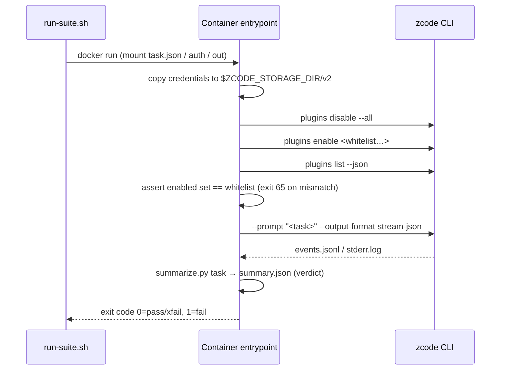

# Fully automated Docker plugin evaluation (from GitLab source)

> Companion to the `zcode plugins` subcommand MR (`docs/cli-plugins-command-parity.md`).
> Orchestration and scoring live in `docker/plugin-eval/`; the CLI core is unaware of evaluation.

## Goal and boundary

- Fully automated plugin evaluation in Docker with the headless CLI (`zcode --prompt ... --output-format stream-json`): built-in plugins plus the full official zcode marketplace, one disposable container per task, real model.
- The image is built from GitLab source; the build installs every official-marketplace plugin into the image; at run time only whitelisted plugins are enabled per task.
- Out of scope: multi-turn conversation, manual scoring, persisting results to a database. Scoring covers only “was the skill invoked, were files produced, does the reply contain the keywords”; finer quality scoring is an outer concern reading `events.jsonl`.

## Overall flow

```mermaid
flowchart LR
  subgraph build[Image build (once)]
    A[GitLab source<br/>ref = staging / MR branch] --> B[pnpm install<br/>--filter @zcode/cli...]
    B --> C[build zcode.cjs]
    C --> D[runtime image<br/>node + zcode.cjs]
    D --> E[plugins marketplace update<br/>+ install all official plugins]
  end
  subgraph host[Host (once)]
    F[~/.zcode/v2 login credentials] --> G[prepare-auth.mjs<br/>re-encrypt + pin model selection]
  end
  subgraph run[One container per task]
    H[task.json] --> I[disable --all<br/>enable whitelist]
    I --> J[assert enabled set == whitelist]
    J --> K[zcode --prompt<br/>stream-json]
    K --> L[summary.json<br/>events.jsonl / workspace]
  end
  E --> run
  G -. read-only mount .-> run
  L --> M[summarize.py suite<br/>report.md]
```

## Prerequisites

| Item | Requirement |
| --- | --- |
| Docker | 20.10+, BuildKit enabled (default); able to pull `node:26.11.1-bookworm-slim` and reach GitLab, the npm registry, and `cdn-zcode.z.ai` |
| Host tools | bash, jq, node ≥ 20 (for `prepare-auth.mjs`), python3 (summary report) |
| GitLab access | Private repos need a read-only PAT (`read_repository`); without `--token-file` the script tries, in order, the `GITLAB_TOKEN` env var → a logged-in `glab` PAT → `git credential fill` |
| ZCode login | Local ZCode logged in with a working provider/model; the eval container reuses those credentials |
| Source under test | The ref must already contain the `zcode plugins install / disable --all` subcommands (staging after the subcommand MR merged, or that MR branch) |

## Step 1: build the image

```bash
# default ref=staging, image tag = zcode-plugin-eval:<ref>
docker/plugin-eval/bin/build-image.sh

# explicit branch, proxy, token file
docker/plugin-eval/bin/build-image.sh --ref feat-cli-plugins-parity \
  --proxy http://127.0.0.1:7890 --token-file ~/.secrets/gitlab-ro-token
```

What the build does:

1. `source` stage: `git clone --depth 1 --branch <ref>`. The PAT arrives via BuildKit secret as a Basic header (`oauth2:<token>`) in `git config http.<host>/.extraheader`, exists only inside that RUN, and never enters an image layer; `.git` and `.gitconfig` are deleted after the clone.
2. `builder` stage: `pnpm install --frozen-lockfile --filter "@zcode/cli..." --filter zcode`, then builds shared-types → contracts → core → adapters → i18n → telemetry → bootstrap → cli in the order of `scripts/build-desktop-agent-cli.mjs`.
3. `runtime` stage carries only `node + zcode.cjs + jq/python3/git/ripgrep`, running as the `zcode` user with uid 10001; `HOME=/data`, `ZCODE_DATA_BASE_DIR=/data`, `ZCODE_STORAGE_DIR=/data/.zcode`, `ZCODE_BASE_URL=https://zcode.z.ai`. Built-in plugins are not inside `zcode.cjs` — the CLI looks for their roots in `packages/<name>-plugin` next to the entry file — so the builder stages the four pure-content built-ins (document-skills, zcode-guide, skill-creator, restore-legacy-sessions) to `/opt/zcode/packages/`, and the built-in provider directory `config/provider/zcode-builtin.json` (required at CLI startup) to `/opt/zcode/provider/`.
4. At build time it runs `zcode plugins marketplace update zcode-plugins-official`, then `plugins install` for every `list --available --json` entry with `installed == false`; the baseline list lands in `/data/plugins-baseline.json`.

At the end the build prints the source ref@sha and the number of plugins baked in (currently 19 from the CDN marketplace + 4 built-in = 23).

## Step 2: prepare the credentials directory

```bash
# list selectable providers on this machine
node docker/plugin-eval/bin/prepare-auth.mjs --list-providers

# generate the credential directory for containers; provider accepts name or id,
# model id and reasoning level must be given explicitly
node docker/plugin-eval/bin/prepare-auth.mjs --out ./.zcode-eval-auth \
  --provider ZAPI --model GLM-5.3-Highspeed --reasoning max
# prints at the end: export ZCODE_EVAL_CREDENTIAL_SECRET=...   (copy and run)
```

Why you cannot just copy `~/.zcode/v2` into the container:

- `credentials.json` values are aes-256-gcm encrypted with a default key derived from `platform:homedir:username`. All three change in a container, so a direct copy always fails to decrypt. The script decrypts on the host with the local key and re-encrypts with `ZCODE_EVAL_CREDENTIAL_SECRET`; the container receives the same value as `ZCODE_CREDENTIAL_SECRET`.
- Headless model selection reads only `config.defaultModelSelection` from `provider_config.json`, and it must be the full `{providerId, modelId, options.reasoningLevel}` form. Without `reasoningLevel` the CLI silently falls back to the first model of the first provider, surfacing as baffling 422s or a wrong model name. The script pins the selection to eliminate this drift.
- API keys of self-created providers in `provider_config.json` are plaintext. The output directory is written 0700/0600 and mounted read-only into a disposable container; never commit it and never `COPY` it into an image.

## Step 3: write task files

One JSON per task in one directory (examples in `docker/plugin-eval/tasks/`):

```json
{
  "id": "finance-budget-variance",
  "plugins": ["run-fpa"],
  "prompt": "使用 run-fpa 插件的 budget-variance skill 做一次预算差异分析：……",
  "timeoutSeconds": 600,
  "expect": {
    "skills": ["run-fpa:budget-variance"],
    "responseContains": ["价格差"]
  }
}
```

| Field | Meaning |
| --- | --- |
| `id` | Task id; also the result subdirectory name and container name suffix |
| `plugins` | Whitelist. Bare name or `name@marketplace`; the container runs `disable --all`, then `enable` each, and asserts the actual enabled set matches exactly |
| `prompt` | Task text passed to `zcode --prompt` |
| `timeoutSeconds` | Hard timeout per run (default 900); timeout counts as failure |
| `expect.skills` | `Skill` invocations expected in `tool.updated` (`payload.input.skill`) |
| `expect.mcpTools` | Substrings of MCP tool names expected to be invoked |
| `expect.files` | Files expected in the working directory (relative paths) |
| `expect.responseContains` | Strings the final reply must contain |
| `xfail` | With a reason, failure is recorded as `xfail` (expected failure) and does not fail the suite |

If a sibling directory `<id>.workspace/` exists, it is mounted read-only at `/task/workspace` and copied into `/work` as the model cwd — for fixtures such as Excel or PDF files.

## Step 4: run the suite

```bash
export ZCODE_EVAL_CREDENTIAL_SECRET=...   # printed in step 2
docker/plugin-eval/bin/run-suite.sh \
  --tasks docker/plugin-eval/tasks \
  --out ./eval-results \
  --auth-dir ./.zcode-eval-auth \
  --image zcode-plugin-eval:staging \
  --jobs 2                       # optional parallelism; --filter 'finance-*' runs a subset
```

Inside each container (`docker/plugin-eval/entrypoint.sh`):



## Step 5: read results

`--out` directory layout:

```text
eval-results/
├── report.md            # suite summary table (task / plugin / result / duration / skill / MCP tools / failed checks)
├── suite.json
└── <task-id>/
    ├── summary.json     # verdict, checks, skillsInvoked, mcpToolsInvoked, finalResponse, source ref@sha
    ├── events.jsonl     # full stream-json event stream
    ├── stderr.log
    ├── plugins.json     # plugins list --json captured at the enable assertion
    ├── container.log
    └── workspace/       # snapshot of the model working directory (node_modules/.git excluded)
```

Verdict: `exitCode == 0` plus a `turn.completed`, then each `expect.*` checked in order. Any failure is `fail`; a failing task with `xfail` is recorded `xfail`. Whether a plugin was actually used is read from `events.skillsInvoked`, shaped like `run-fpa:budget-variance`.

## Known limitations

- **Official MCP unavailable headless (pending a CLI-side fix)**: the finance suite and document-skills' `image_search` declare `zcode_official` authenticated MCP; only agents launched by the desktop host get the trusted-source registry and identity headers, so the standalone CLI fails closed. In the container these plugins have only their skill text, no market/company data tools. The example task `finance-close-recap-mcp` is therefore `xfail`.
- **The model works around restrictions**: headless defaults to yolo permissions. In one smoke run, denied MCP tools, the model decrypted the container's `credentials.json` itself via Bash and curled the data API by hand. Treat the eval container as able to read every injected credential: inject only an eval account, dispose of it after use, never reuse a production account; judge plugin capability by `mcpToolsInvoked`, not by the final answer.
- **`ZCODE_BASE_URL` must be set explicitly**: plugin manifests write MCP URLs as `${ZCODE_BASE_URL}/api/v1/mcp/...`; if the standalone CLI does not get the variable, `plugins list --json` reports `plugin_variable_missing` and that MCP is dropped. The image bakes in the production value; override with `docker run -e ZCODE_BASE_URL=...` for a test environment.
- **Proxy**: the CLI's own networking honors only `ZCODE_HTTP_PROXY`, not `http_proxy`; build uses `--proxy`, runs use `run-suite.sh --proxy`.
- **Desktop-dependent built-ins excluded**: browser-use, computer-use, ios-simulator, and android-emulator need the desktop WebView, a standalone MCP runtime, or emulators — none exist in a headless container, so the image does not stage them and `plugins list` does not show them.
- **`--plugin-dir` (session-level local plugin loading) not implemented yet**: to evaluate unpublished plugins, first `zcode plugins marketplace add <local-dir>` then `install`.

## Troubleshooting

| Symptom | Look at | Common cause |
| --- | --- | --- |
| Build stuck at clone / 401 | `build-image.sh` output | No PAT or PAT lacks `read_repository`; pass `--token-file` explicitly |
| `pnpm install` fails on git deps | builder stage log | git+https deps from the `pnpm-workspace.yaml` catalog also need GitLab credentials |
| Container exits 64 | `container.log` | task.json missing `id`/`prompt`, or a mount path is wrong |
| Container exits 65 | `plugins.json`, `plugins-enable.log` | Whitelist plugin name typo; same name across marketplaces needs `name@marketplace` |
| 422 / wrong model | `stderr.log`, `summary.json.source` | Incomplete `defaultModelSelection`; rerun `prepare-auth.mjs` with explicit `--model --reasoning` |
| Everything 401 / auth_failed | `stderr.log` | `ZCODE_EVAL_CREDENTIAL_SECRET` differs from generation time, or the local login expired |
| `plugin_variable_missing` | `plugins.json` diagnostics | Runtime overrode `ZCODE_BASE_URL` to empty |
| Skill not invoked | `tool.updated` in `events.jsonl` | Prompt does not name the plugin/skill; or the plugin is not whitelisted |

Verification record (2026-09-14, macOS arm64 + OrbStack Docker 29, source `feat-cli-plugins-parity@bf05821832`): image build succeeded (427 MB, 23 plugins, 121 skills, no error diagnostics), three parallel tasks ran — `finance-budget-variance` pass 22s, `builtin-docx-smoke` pass 38s, `finance-close-recap-mcp` xfail 32s; the xfail model reply stated MCP market tools were unavailable and stopped, with no Bash/curl bypass, matching the official-MCP limitation.

## Reusing the eval scripts

The in-image command surface is compatible with `claude plugin`: `zcode plugins install|uninstall|enable|disable --all|update|validate|marketplace ...`, with `zcode plugin` as an alias. Arguments and behavior: `docs/cli-plugins-command-parity.md`. The same task.json set can be reused against another CLI binary; only the stream-json event field names differ.
