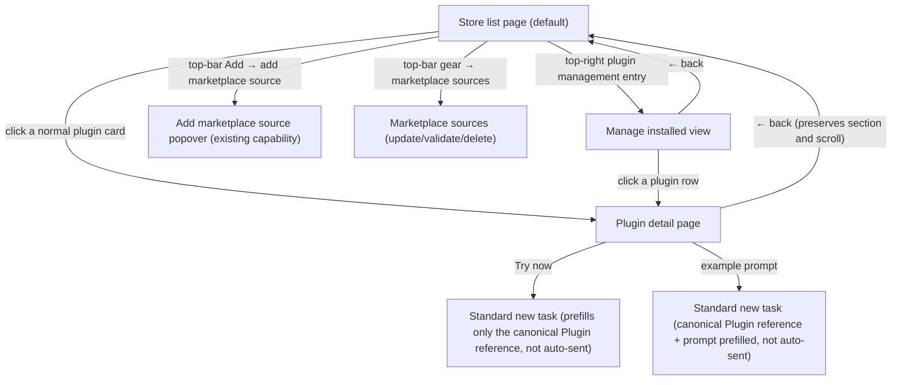
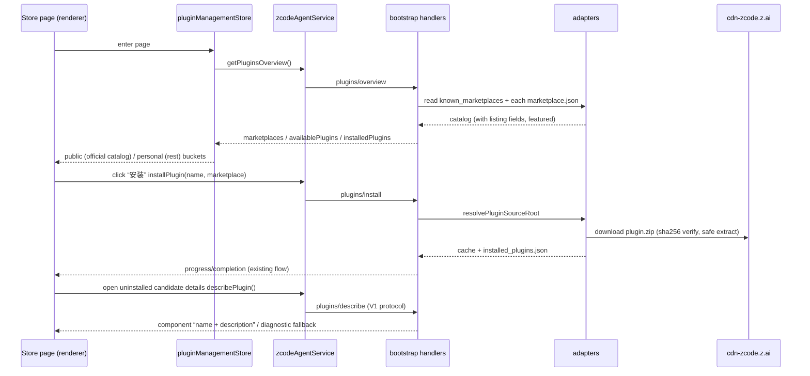

# Plugin Marketplace UI/UX spec V2 — store-style redesign

> Full rewrite 2026-07-14: the plugin settings page became a display-oriented “plugin store page”, replacing the 2026-06 “Installed / Marketplace dual tab + left marketplace switcher” IA (old version in git history). Still valid and inherited: the `plugins/describe` on-demand component detail protocol, CLI-authoritative component enumeration (`ZCodePluginInfo.components`), honest degradation, and the “name — description” two-line rendering.
>
> Updated 2026-10-12: the store adds a community section, a UI capability zone, and a Side Pane entry; management happens inside the store while project config is kept. Current implementation boundary and verification: [interaction scope](./plugins/plugin-market-interactions-scope.md).
>
> Terminology follows the root [CONTEXT.md](../CONTEXT.md); key decisions in [ADR-0001 (listing at catalog layer)](./adr/0001-store-listing-in-marketplace-catalog.md) and [ADR-0002 (deliberate deviation from DESIGN.md restraint)](./adr/0002-plugin-store-style-deviation.md).

## Background and goals

List page and detail page visuals and interactions:

- List page: title and top-bar actions (including the plugin management entry) in one row; public/community/personal sections and the search box in one row; a Featured zone plus category blocks in a two-column card flow; all groups fully expanded by default with manual collapse.
- Detail page: large icon + name + one-line description, top-right “…” and “Try now”, example-prompt pills embedded in the hero image, long description, component sections (“MCP servers”, “Skills”, …), and an Info section (developer/category/version/website/privacy policy/terms of service).

The public and community sections share the official marketplace `zcode-plugins-official` (built-in plugins + CDN zip plugins, catalog source `https://cdn-zcode.z.ai/zcode/official-plugin/marketplace.json`), split by the published entry's `publisherType`; the personal section holds every other personal source (claude-plugins-official, user-added marketplaces, inline).

### Official marketplace single identity and merge contract

`zcode-plugins-official` is the only id of the ZCode official marketplace. Built-in and CDN plugins are two catalog shards of one marketplace, not two marketplaces; never register, display, or generate a `zcode-plugins` marketplace or `<name>@zcode-plugins` plugin ids.

```text
app built-in catalog shard ─┐
                            ├─ merged by name (CDN wins) ─> zcode-plugins-official/marketplace.json
CDN catalog shard ──────────┘                    └─ all plugin ids: <name>@zcode-plugins-official
```

Boundary decisions (user-confirmed 2026-07-15):

| Boundary | Decision | Pruned / non-goal |
| --- | --- | --- |
| Marketplace identity | Built-in and CDN both use `zcode-plugins-official` | No `zcode-plugins` alias; no migration of old test data |
| Refresh semantics | Refreshing the official marketplace replaces only the CDN shard, then re-merges with the current built-in shard | A CDN refresh must not delete or rewrite the built-in plugin cache |
| Name conflicts | CDN entries win; same-name directory entries in the built-in shard are ignored | Only changes merge selection; never deletes or rewrites the built-in cache |
| Update source | The built-in shard updates with the app version; the CDN shard via marketplace refresh | No converting built-in plugin binaries to CDN hot updates |
| UI | Marketplace source management shows one refreshable ZCode official marketplace | No separate built-in or CDN source rows |

State ownership and persistence:

| State | Authority | Local projection | Evidence |
| --- | --- | --- | --- |
| Built-in catalog shard | Current app bundle / SEA assets | Built-in shard snapshot under the official marketplace directory | seed unit tests, cache marker |
| CDN catalog shard | Official CDN manifest | CDN shard snapshot under the official marketplace directory | refresh unit tests, network responses |
| Merged catalog | The two shards merged by name | `marketplaces/zcode-plugins-official/marketplace.json` | overview / install unit tests |
| Marketplace source and refresh time | The single `zcode-plugins-official` record in `known_marketplaces.json` | UI marketplace summary | protocol results, settings page |

Accepted regression cases:

| Case | Setup | Action | Assertions | Evidence |
| --- | --- | --- | --- | --- |
| `official-merge-initial` | Fresh storage, built-in shard only | Open the plugins page | One official marketplace; built-in plugins visible; source points at the CDN | manifest + overview |
| `official-merge-refresh` | Built-in shard present, CDN returns new plugins | Refresh the official marketplace | New plugins use `@zcode-plugins-official`; built-in plugins still present | manifest + protocol |
| `official-merge-conflict` | CDN has an entry named like a built-in | Refresh the official marketplace | The CDN entry wins; the built-in same-name directory entry ignored | manifest + adapter test |
| `official-merge-reseed` | CDN shard cached | Restart / re-seed built-in plugins | CDN entries persist; the merged catalog rebuilds from the new built-in shard | filesystem test |

Desktop, Web, and mobile share `IPluginManagementService` and the same CLI storage contract; no new client mode, workspace identity, or replayable branches. Shared components are covered by representative UI unit tests; refresh interactions are verified with desktop CDP. The conversation E2E state space is untouched, so the conversation case catalog is not modified.

## Non-goals (this round, YAGNI)

| Item | Reason / future anchor |
| --- | --- |
| Per-item enable/disable switches for MCP servers / skills (row Switch, MCP row gear) | The backend has only plugin-level `plugins/setEnabled`. This round's component sections are list-only, no switches; per-item switches need per-component disable config + protocol methods + runtime effects (MCP merge, skill discovery) in a later iteration |
| Top-bar “Plugins / Skills” dual pill tabs | Skills are a separate settings section; not merged this round |
| Top-bar “Local / Remote” dropdown | The existing SSH remote sync entry is folded into the manage-installed view; no view switching |
| “Create plugin” scaffolding | The top-bar Add menu covers create-plugin and add-marketplace (see 2026-09-16 below) |
| Filter/sort icons at the right of the section row | Undefined semantics; category blocks already navigate — omitted for now |
| Ratings, download counts, README rendering | No data source |

### Lifecycle E2E known gaps

The 2026-07-15 plugin management lifecycle cases build green contracts only for entries that exist with confirmed product semantics. These entries disagree with the spec or underlying capability and are registered as bug candidates — not hidden in this round's E2E by bypassing the UI or loosening assertions:

| Bug candidate | Current fact | Test boundary this round |
| --- | --- | --- |
| Install cancel entry missing | The install button only shows loading/disabled; the protocol can cancel but the store UI has no cancel action | Verify the busy installing state; do not claim cancel coverage |
| Source Validate/Diagnose entry missing | Adding a source validates; source management only exposes update and delete | Cover add-time validation, update, delete; not standalone diagnostics |
| Inline plugins expose uninstall | The store's generic menu renders uninstall, but inline plugins have no marketplace install record to uninstall against | Cover inline display and usability only; never execute uninstall |

### Removing a Personal Source keeps installed plugins

Deleting a source removes only catalog discovery and update linkage — never cascades into deleting installed plugins, config, or data. An `Orphaned Installed Plugin` stays on market cards, details, and management, still supporting configure, toggle, run, and uninstall; the update entry must be hidden or disabled with an honest source-missing hint. Re-adding the same source restores catalog details and updates. Full decision: [ADR-0003](./adr/0003-marketplace-source-removal-keeps-installed-plugins.md).

## Information architecture

The plugin settings page's content area is replaced by the plugin store page (same host: still Settings → Plugins, no global navigation or `SettingsPage` container changes). Three views:



Views switch in place inside the same container (the existing list↔detail pattern); no new routes.

## List page spec

Top to bottom:

### 1. Top bar

- Title and action group on one row: title left, actions right; wraps at narrow widths. All buttons use `secondary`; icon-only buttons `icon-lg`, text buttons `lg`. Order:
  - **Refresh**: triggers `plugins/marketplace/update(null)` (all marketplaces), reusing the existing loading state; exempt from auto-refresh throttling.
  - **Catalog auto-refresh**: entering the store refreshes only `zcode-plugins-official`, gated by `now - max(lastUpdated, lastAttemptAt) >= 10 minutes`. `lastUpdated` comes from the Host user-level catalog persistence; `lastAttemptAt` is a renderer-module attempt timestamp — set when a refresh starts, preserved across page remounts, reset on process restart. Failures or in-flight requests within the window are not re-issued on re-entry; a successful manual refresh updates the persisted time. No timer polling; never auto-fetch `claude-plugins-official` or personal sources, so unloaded GitHub marketplaces don't run long-timeout requests on every entry. Auto-refresh raises no “updates found” toast and reuses the existing loading/error feedback. Desktop and Web share this UI and service; user inventory, workspaceIdentity, and request routing unchanged.
  - **Gear**: opens marketplace source management — the existing marketplace source capabilities relocated (list sources: update/validate/delete/diagnostics). “Add” is not here. Source rows sort: `zcode-plugins-official` and `claude-plugins-official` pinned on top; other custom sources by `lastUpdated` descending; sources without `lastUpdated` sink; same timestamps tie-break by localized display name.
  - **Add**: dropdown with create plugin and add marketplace source, absorbing the existing AddMarketplacePopover's github / git / URL / local-path (with drag-drop) capabilities. Zero backend additions.
  - **Plugin management**: `secondary + lg + font-medium` text button, enters the in-store management view.

The “Add plugin marketplace” and “Marketplace sources” dialogs use `text-ui-lg` titles and `text-ui-base` body/help text. Dialog text action buttons use `size="lg"`; source-row icon-only actions use `size="icon-lg"`. Inputs keep the `size="lg"` component standard height without overrides.

Detail title actions follow settings-wide sizing: the more menu uses `outline + icon-lg` and carries enable/disable; the title row shows no separate `Switch`. Try now and install use `size="lg"`. Try now uses the button's default radius, not the hero pill radius; hero prompt actions keep the pill radius. Actions center vertically; list cards keep compact sizing.

### 2. Title area

- The title “插件市场” uses `text-ui-xl` (DESIGN.md heading level 1). No subtitle; keep header density low.

### 3. Search box

- Same row as the source sections: sections left, search right-aligned with `max-w-xs`; wraps below when narrow. Rounded, magnifier prefix, placeholder “搜索插件”.
- Chinese names support toneless pinyin full and initial matching (feishu, fei shu, fs); the English UI also matches the listing's Chinese names. Shares the matcher with the management page; no fuzzy typo matching or sort changes.
- Search is scoped to the current source section and preserves the public/community/personal switch. Non-empty input shows that section's matching cards; clearing restores groups and the UI zone.

### 4. Plugin management entry

- The installed icon strip is removed; the top-bar “Plugin management” action enters the in-store management view.
- Reuses PluginsSection; global install and project config are separate; project overrides can restore inheritance.
- “Browse all plugins” returns from management to the store, preserving source, search, and management scope.
- The more menu has only pause/enable and uninstall. Upgrade stays a separate action on cards/management rows/details; restore-inherit lives in details.

### 5. Public / community / personal sections

- Public by default. External entries in the official catalog show in community; other personal sources go only to personal, even when they self-declare a maintainer.
- Source, usage category, and UI capability are independent. A valid `ui.surfaces` is published as `ui` in `componentTypes` and judged by the actual manifest after install. Pausing does not change the UI classification.
- Each section's “app plugins” zone shares expand/collapse with usage categories: fully shown by default, collapsible to the first 6 when more than 6, expandable in place. “View all” and a separate UI list are removed, so no zone-return entry is needed; manual selection is saved per source section, and searching or clearing the search does not change it. Installed UI cards open the interface; a paused card enables first, then opens; uninstalled cards go to details or install.
- UI details show interface capabilities and zoomable screenshots. Desktop local reuses the existing session; other clients show an unsupported notice; both keep install management.

### 6. Public section content

- **Featured zone**: names come from the CDN catalog's top-level `featured: string[]` (in order). Zone title "Featured" (i18n). Two-column cards.
- **Category blocks**: other plugins group by `category`, fully expanded by default. With more than 6 cards a “collapse” entry stays available; after manual collapse only the first 6 cards show, the rest fold into a bottom row: `[small icons of the first 3] View A, B, and N more`, clickable to re-expand. No automatic collapse by count; new groups also default expanded; manual choice persists in the current page. Plugins without `category` fall into the “Other” block (sorted last by default).
- Categories and in-category plugins support server-side ordering by UI mode — see the [mode order contract](plugins/plugin-store-mode-order.md). Programming mode uses `code`, general mode `work`; unconfigured items append in original order; explicit configuration may move “Other”. Featured and the remaining lists are unaffected.
- Category block title dividers use the `surface` semantic color; combined vertical padding 32px (16px above and below), giving a stable 32px gap between adjacent categories. This spacing applies only to catalog categories — not to search or section controls.
- Uninstalled (restorable) built-in plugins appear normally in the public section with an “安装” card button (via `plugins/restoreBuiltin`).
- Category display names go through the known i18n mapping (e.g. `productivity` → 生产力/Productivity); unknown categories display as-is.
- The guides category merged into utilities; old `guides` catalog caches also merge into `utilities`. `legal` displays as 法律/Legal, keeping the only-show-with-plugins rule; no legal plugins are added for now.

### 7. Personal section content

- Grouped by marketplace (group title = marketplace display name), groups ordered by `lastUpdated` descending — the most recently refreshed/added marketplace on top (visible immediately after the post-add jump); no refresh time sinks to the bottom; equal or both missing tie-break alphabetically by display name. Two-column cards inside groups, fully expanded by default, with the same manual collapse/expand as public categories.
- Inline plugins and local-directory marketplaces group the same way.
- The Recommended zone is retired: no in-repo curated list pinned at the top of the personal section.

### 8. Cards

- Structure: icon (40px rounded) · display name (bold) · one-line truncated description · actions right.
- Right actions: not installed → “安装” pill button (spinner while installing, cancellable, existing flow); installed → “…” menu: enable/pause, uninstall (existing confirmation dialog).
  > Revised 2026-10-11: cards and details toggle via the “…” menu and show the current project's effective state; the management list keeps the plugin-level switch.
- Installed with an update: an “可更新” badge after the title (`Download` `size-3` icon + `settings.plugins.list.updateAvailable`, success semantic pill, `text-ui-sm`, same spec as the plan badge) plus a “更新” pill before the “…” menu (spinner while updating); update is not duplicated inside the “…” menu. Badge and button conditions match the detail page's update entry exactly.
- Clicking a normal or uninstalled-UI card body → details; an installed UI plugin → open (enable first when paused). The separate details entry still shows info and config.

## Detail page spec

Single centered column (max-width per design), top to bottom:

1. **Header**: after the 64px icon, display name and actions share one horizontal row: `display name | “…” menu | Open / Try now / Install`. The name may shrink and truncate; actions never shrink; the one-line description and source-missing notice take the next row alone, never squeezed between name and actions.
   - “…” menu: same as the card menu (enable/pause, uninstall). Restore-inherit is a separate detail action.
   - Primary button: installed normal plugin → “立即试用 / Try now”; installed UI plugin in the session-right marketplace → “打开” (“启用” when paused), in the main-nav marketplace → “立即试用”; not installed → “安装”.
   - Cards and management rows: the whole row enters details, no separate “Details” button; only the session-right marketplace adds an “打开 / 启用” at the row tail. “Try now” reuses the Root standard new-task action, prefilling only the `[@Plugin](plugin://stable-id)` structured mention — no example text attached, not auto-sent.
2. **Hero zone** (rendered only with `heroImage`): a rounded banner with **example prompt pills** stacked on it (from `examplePrompts`; each pill: document-product icon + plugin-name prefix + prompt + → button). Document Skills examples use the UI-bundled `documents@2x.png`, `pdf@2x.png`, `spreadsheets@2x.png`: DOCX/Word → documents, PDF → pdf, XLSX/Excel/CSV → spreadsheets; unrecognized falls back to documents without repeating the plugin avatar. The desktop banner uses a wide ~`3:1` ratio with large rounded corners; mobile keeps a minimum height. The base reuses the onboarding dialog `ThemeHeroVisual`'s theme-aware gradient and glow, with the image overlaid semi-transparently plus a light dark scrim. With no image, a transparent image, or a load failure the colored background remains — never degrading to a plain button list. Prompts arrange at the visual center at natural width. Pills use a dark translucent background and large radius; body text may wrap without single-line truncation; the plugin name uses a muted color, the prompt bright white, and the arrow sits in its own circular muted surface. Clicking a pill reuses the same Root standard new-task action as “Try now”, exits Settings, and prefills `[@Plugin](plugin://stable-id) + space + example prompt` into the composer — **not auto-sent**. The canonical link must reuse the Composer `@` Picker builder; the Agent side still accepts only the destination stable ID — no second plugin-reference state. When the plugin is not installed, clicking a pill guides installation first (equivalent to “安装”), staying on the detail page without creating a session; only after install does a further click enter the draft. With `examplePrompts` but no `heroImage` → a pill-only list; with neither → the whole zone is not rendered.
3. **Long description**: listing `description` (locale from `description_i18n`, falling back to `description`).
4. **Component sections**: in order “MCP 服务器”, “技能”, “命令”, “子智能体”, “Hooks”, rendering only non-empty groups. Each: section title + count badge + divider + entry rows (small icon/letter avatar + name + truncated description), one row style across all five classes. **No per-item switches or row gears this round** (see non-goals). Resource icons must share semantics with the settings lists: MCP servers `Server`, skills `WandSparkles`, commands `Terminal`, subagents `Bot`, hooks `Anchor`; the detail page must not build a near-but-different icon mapping.
   - Data sources unchanged: installed → `ZCodePluginInfo.components` (CLI-authoritative); uninstalled candidates → `plugins/describe` on demand (loading / failure degradation / caching per V1: on failure fall back to componentTypes tags + an honest notice — never fabricate).
5. **Info section**: label-value two columns: developer · category · version · website ↗ · privacy policy ↗ · terms of service ↗. Links use an external-link icon and open in the system browser, https only. Values per “listing priority”; a row with no value is omitted entirely.
6. Hook details, userConfig options, rootPath and other advanced info: a collapsed “更多详情” area reusing the existing `PluginConfigControls` and hook detail rendering, outside the main visual layer. With an update available and the source still present, the update notice and button sit above the collapsed area; orphaned plugins never show this update entry.

Personal-source plugins use the same detail layout and degrade naturally through the matrix (usually no hero/prompt zone, letter avatars, and an info section reduced to manifest-fallback developer/website/version).

## Data model and schema extensions

### Claude official marketplace icon backfill

The upstream `claude-plugins-official` catalog does not guarantee an `icon` per plugin. When refreshing that marketplace, the Agent may fetch an optional icon map from `https://cdn-zcode.z.ai/zcode/official-plugin/assets/icon-sources.json` and backfill catalog entries missing `icon` by plugin `name`:

- Applies only to `claude-plugins-official`; user-added marketplaces, inline plugins, and orphaned installs never apply icons by name, avoiding cross-marketplace mixups.
- A marketplace entry's own `icon` wins; the map never overrides.
- The map consumes only `name`, `icon`, `mimeType`, `sha256`; provenance fields never reach protocol, logs, or UI.
- `icon` must be a safe relative PNG path; the final URL always lands under `https://cdn-zcode.z.ai/zcode/official-plugin/assets/`.
- The marketplace manifest is primary; the icon map is an optional enhancement. Map download/parse failure never fails the marketplace refresh; an old cache keeps being used; a miss or no cache degrades to the unified Blocks icon.
- The map is fetched and cached during the marketplace update phase; `plugins/overview` never issues per-entry icon network requests.
- Legacy migration: the first time an Agent process handles a plugin storage's `plugins/overview`, it starts one background best-effort icon-only enrich of the existing `claude-plugins-official` catalog. The overview returns the current catalog immediately; the migration does not re-fetch the Git marketplace or modify `lastUpdated`, holds no plugin storage lock during network fetch, and only briefly locks (re-reading the manifest) before write-back. Failures do not affect the overview and retry on the next Agent process start; backfilled icons appear from subsequent overviews.

```text
update claude-plugins-official
  ├─ fetch marketplace manifest
  └─ fetch icon-sources.json (may degrade on failure)
            ↓
     validate and cache name → icon
            ↓
     backfill only missing listing.icon
            ↓
     plugins/overview → PluginStoreAvatar

existing catalog after upgrade
  → first plugins/overview returns current catalog immediately
  → background fetch/cache icon-sources.json (no lock during network)
  → acquire plugin storage lock
  → re-read + enrich cached claude-plugins-official/marketplace.json
  → later plugins/overview → PluginStoreAvatar
```

### New CDN / catalog entry fields (all optional)

`marketplace.json` already has top-level `name` / `description(_i18n)` / `owner` / `plugins[]`; added:

| Field | Level | Type | Use |
| --- | --- | --- | --- |
| `featured` | top | `string[]` (plugin names) | Public section Featured list and order |
| `displayName` / `displayName_i18n` | entry | `string` / `Record<locale,string>` | Card/detail display name (falls back to the `name` slug) |
| `icon` | entry | `string` (https URL or in-package relative path) | Card, installed row, detail header icon |
| `homepage` | entry | `string` (https URL) | Info · website |
| `privacyPolicy` | entry | `string` (https URL) | Info · privacy policy |
| `termsOfService` | entry | `string` (https URL) | Info · terms of service |
| `heroImage` | entry | `string` (https URL or in-package relative path) | Detail hero banner |
| `examplePrompts` / `examplePrompts_i18n` | entry | `string[]` / `Record<locale,string[]>` | Hero prompt pills |
| `requiresPaidPlan` | entry | `boolean` (only `true` applies) | Apricot coding-plan badge right of the card/detail title |

Existing fields keep passing through: `category`, `author{name,url?}`, `description_i18n`, `keywords`.

- Paid-plan notice: `requiresPaidPlan` applies only on explicit boolean `true`; ambiguous forms like `"true"` / `1` count as no plan, so a catalog typo never marks a free plugin as paid. The field describes a usage condition (needs a paid plan to be useful), not that the plugin is a paid product — it is display-only and takes no part in install gating or billing. The name deliberately avoids concrete plan product names so renames don't require field changes.
- Cards and detail titles use an apricot pill with a `size-3` crown icon before the label; light theme around `#FFE3C8` background with `#4B280F` text, dark theme a same-hue dark background with light text; colors must come from the dedicated plugin-plan-badge token. Badge text uses `text-ui-sm` — “编程套餐” in Chinese, “Coding Plan” in English; the full conditions stay in a hover/focus tooltip, never reading the 150% campaign config.

- Image fields: CDN entries use absolute https URLs; **built-in plugins** get equivalent listing metadata in the repo's `official-plugin-definitions.ts`. Official built-ins that must override an old cache or lack published CDN assets can use the shared icon resolver to pick a client-bundled icon by full official plugin id — currently Documents, PDF, Presentations, Spreadsheets, Image Search, and Plugin Creator use this path; same-name personal-marketplace plugins must not reuse it. Other icons/heroes ship as bundled app assets (seed writes resolvable local paths into marketplace.json). Only https and controlled local resources are accepted; every other scheme is dropped.
- i18n resolution is uniform: `x_i18n[locale] ?? x`.

### Wire type propagation

Listing fields pass through from the adapter parse layer (`PluginMarketplaceEntry`):

- `AvailablePluginSummary` / `InstalledPluginSummary` (overview) and `ZCodePluginInfo` (plugins/list) gain optional listing fields (displayName/icon/category/author/homepage/privacyPolicy/termsOfService/heroImage/examplePrompts).
- The marketplace records of `PluginsOverviewResult` gain `featured?: string[]`.
- **Manifest fallback**: when the CLI can reach the plugin root (installed/builtin/describe resolved), it also carries plugin.json's `author` / `homepage`; the UI shows **listing first, manifest fallback** (ADR-0001). Uninstalled, undescribed personal candidates have no fallback values and simply omit.

### Data flow



Public/community/personal bucketing: the official marketplace splits public vs community by the published catalog's `publisherType` (default public); everything else (including `claude-plugins-official`, `inline`, user-added) → personal.

## Degradation matrix

| Missing | List page | Detail page |
| --- | --- | --- |
| `icon` | `bg-surface` rounded square + neutral Blocks default icon, no border | Same (64px, detail radius) |
| `displayName` | Falls back to the `name` slug | Same |
| `heroImage` | — | No image; prompts-only pill list if prompts exist, else the zone is not rendered |
| `examplePrompts` | — | Hero is just the banner; with no heroImage either, the zone is not rendered |
| `category` | Falls into the “Other” block | Info · category row omitted |
| `homepage` / `privacyPolicy` / `termsOfService` | — | Corresponding info row omitted (only after the manifest fallback also misses) |
| `author` | — | Developer row: listing → manifest → omitted |
| `requiresPaidPlan` (missing or not `true`) | No plan badge on the card title | No plan badge on the detail title |
| `featured` empty/missing | No Featured zone; straight to category blocks | — |
| Image load failure | Same as missing (avatar fallback), no broken image | Same; a hero failure treats the zone as no-image |
| describe failure/timeout | — | Components fall back to componentTypes tags + honest notice (V1 rule) |

## Manage installed view

The existing Installed-tab management capabilities move in wholesale, nothing lost:

- One row per plugin: icon + display name + version + source badge + update badge + plugin-level switch + “…” menu. The update badge is the “可更新” badge (same component as cards) right after the name; with an update, an inline “更新” button precedes the row-tail “…” menu; the menu has only enable/pause and uninstall.
- Normal plugin rows → details on click; UI plugin rows → open. The separate details entry keeps config and restore-inherit; uninstall confirms global impact; update works inline or from details.
- Global by default, with a concrete project switch preserved. In-store round-trips preserve scope; a project override never modifies the global default or other projects.
- Top: enable-state filter (all/enabled/disabled), check updates (all), and the SSH remote sync entry (the existing RemotePluginSyncDialog relocated here).

## i18n and theming

- All new copy goes into `packages/ui/src/i18n/locales/{en-US,zh-CN}.ts` (continuing the `settings.plugins.*` namespace), zero hardcoding.
- Listing `*_i18n` fields resolve by current locale; category display names use the known mapping table, unknown ones as-is.
- Both Zai Light/Dark must be verified; the hero gradient and pills are image/translucent overlays with no hardcoded colors (ADR-0002: store spacing and visual scale may deviate from DESIGN.md restraint, but semantic tokens and accessibility are not exempt).

## Acceptance checklist

List page:

- [ ] Settings → Plugins shows the store page: title and top-bar actions (including management) in one row, no subtitle; sections and search in one row; the card flow matches the design (spacing/type/radius/two-column grid).
- [ ] The unified “Plugin management” entry enters in-store management; “Browse all plugins” returns preserving search and section.
- [ ] The public section contains only officially maintained official-marketplace plugins and the community section its community-maintained ones; Featured, the UI zone, and usage categories are all scoped to the current section, fully expanded by default with manual collapse.
- [ ] The personal section groups by user-added marketplace (including compatible marketplaces and inline); self-declared sources never enter public or community.
- [ ] Search is scoped to the current section; clearing restores; switching to the full UI list and back preserves conditions.
- [ ] Cards: uninstalled shows “安装” (with in-progress/cancel states); installed shows “…” (enable/pause, uninstall); uninstall confirms global impact.
- [ ] Updatable: the card title “可更新” badge + inline “更新” pill, and the manage-installed row badge + button all appear together; with no update or an orphan, none of the three appear.
- [ ] Top bar: refresh triggers an all-marketplace update; the gear opens marketplace sources (update/validate/delete); the Add menu covers create plugin and add marketplace, with github/git/URL/local path and drag-drop as before.
- [ ] Catalog auto-refresh: entering the store refreshes only the official marketplace and only when stale (≥ 10 min since `max(lastUpdated, lastAttemptAt)`); re-entering within the window, or after a failure or while in flight, never re-issues; a manual refresh bypasses the throttle and updates the persisted time (PLM-LC-018/019).
- [ ] Uninstalled built-in plugins appear in the public section and restore-install.

Detail page:

- [ ] Header icon/name/description with top-right actions (installed = “…” + “打开” (UI plugins, session-right market only) or “立即试用”; uninstalled = “安装” primary).
- [ ] “Try now” prefills only the canonical Plugin mention; example prompt pills prefill mention + prompt; neither auto-sends; uninstalled shows only the install entry.
- [ ] Hero/prompt/info rows render per the degradation matrix — no broken images, no empty blocks, no fabricated fields.
- [ ] Component sections render name + description in the MCP servers/skills/commands/subagents/hooks order, no per-item switches; uninstalled candidates go through `plugins/describe` (loading → content, honest degradation on failure, repeat views cached).
- [ ] Info section: developer/category/version/website/privacy policy/terms of service, listing first with manifest fallback; external links open in the system browser, https only.
- [ ] Personal-source plugins degrade naturally in the same layout, with no empty shells of official-only blocks.

Management view and cross-cutting:

- [ ] The management view keeps global/project scope, plugin-level toggles, config overrides and restore-inherit, update badges, uninstall, state filter, check updates, and the SSH remote sync entry.
- [ ] Complete zh/en; both themes intact; narrow viewports (web/mobile widths) do not overflow: the card flow drops to one column, the detail page stays single-column adaptive.
- [ ] CDP screenshot checks cover: the list page (public/community/personal/search/collapse states), the detail page (full listing and degraded states), and the management view.

## 2026-09-16 Add menu

The top-bar New became “添加 ▾” with exactly “创建插件” and “添加插件市场”, covering desktop/mobile, zh/en, and both themes. This section supersedes the old “New only opens add-marketplace-source” limit; creation enters a new draft via the built-in plugin-creator skill reference. Add marketplace keeps the existing dialog. See [plugin creation entry](plugin-creator.md).

### Missing config records and the store catalog (2026-09-17)

After a plugin is split or delisted, `plugins.enabledPlugins` or `plugins.options` may still carry the old id. The Agent keeps records with `source: missing` / `packageStatus: missing` as User/Workspace config diagnostics; such a record alone never proves the plugin is installable. The store builds items only from availablePlugins, restorableBuiltins, or actually discovered plugin packages: a missing-package record with no catalog/restore source generates no product card, search result, or install entry. A missing-package plugin with a catalog source stays installable; restorable builtins and actually installed orphans keep their behavior. This projection deletes no user config, cache, or install record, and applies to the shared desktop/mobile-web store implementation.

Chain: user config → Agent missing-package diagnostics → protocol keeps the diagnostic data; the store join keeps catalog/restore entries first, then adds only real packages.
Regression scenario: `PLM-MISSING-CONFIG` in the lifecycle case catalog and coverage matrix.

### Default document plugin order (2026-09-17)

The official full ids `pdf`, `presentations`, `spreadsheets`, `documents` (all from `zcode-plugins-official`) order PDF → PPT → Excel → Word in the first four slots of the management page's preset group. Missing plugins are skipped; disabling does not affect order; same-name personal-source plugins are not pinned; the market installed icon strip was removed 2026-10-11. Public categories and the reference selector reusing their order default to this order within the same category; explicit server-side category/plugin order still wins; other rules unchanged. Desktop/mobile, zh/en, and both themes use the same order. The ordering changes display only — never install, toggles, config, or the original array.

### Busy states for concurrent operations

The plugin management store holds an independent in-flight entry per call. Installing different plugins in quick succession shows all unfinished ones “installing” with duplicate clicks disabled; backend queuing also counts as installing. An operation finishing — success or failure — ends only its own busy state. Switching project, source, or config layer clears the old view's in-flight projection; a late old call cannot clear a same-name operation in the new context. Install and refresh reuse the existing service chain — no new queues, timers, or polling.
