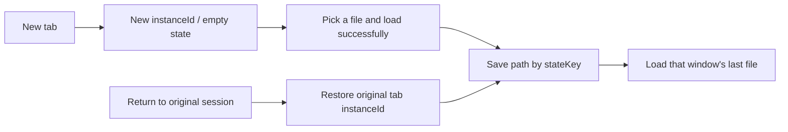

# Built-in document plugin viewer panels spec: documents / pdf / presentations / spreadsheets 0.2.0

> Date: 2026-10-15
> Status: implemented; real desktop verification pending
> Related: the plugin repository's test marketplace has published same-named 0.2.0 plugins (with viewer
> panels); this change folds the panels into the built-in plugins shipped with the app.

## 1. Background and decisions

The four document plugins are built-in plugins shipped with the app (`zcode-plugins-official`), with plugin
ID `<name>@zcode-plugins-official`. If the plugin repository's CDN catalog publishes a same-named entry, the
merged catalog shows the CDN entry, but runtime discovery loads the built-in copy first, a same-ID
marketplace install is treated as a duplicate and ignored, and built-in plugins do not take part in
marketplace updates. So the viewer panels cannot ship from the plugin repository alone; they must upgrade
with the built-in plugins.

Decisions:

- All four plugins move to 0.2.0. Besides the existing production skills they add one viewer skill (`docx-viewer`, `pdf-viewer`, `pptx-viewer`, `xlsx-viewer`), one stdio MCP server and one UI surface with `availability: "session"`.
- The panel implementation lives in the shared package `@zcode/office-runtime` (`apps/zcode-cli/packages/office-runtime`). Each plugin declares the panel title and formats in the `office` field of its package.json; its `build` script calls `../office-runtime/scripts/build.mjs` and bundles only that format's parser and viewer.
- Production skills, the visual-review Agent and the license (Apache-2.0) are unchanged; panel and server code is written to `dist/LICENSE` under office-runtime's MIT license.

## 2. Build and artifacts

```text
apps/zcode-cli/packages/<name>-plugin/package.json  ── office.title / office.kinds
                │ pnpm --filter @zcode/<name>-plugin build
                ▼
office-runtime/scripts/build.mjs (plugin name taken from .zcode-plugin/plugin.json)
                ▼
<name>-plugin/dist/
  server.mjs                 MCP server, fully bundled by esbuild, no node_modules at runtime
  ui/panel.html, assets.json panel entry and chunked-script manifest
  ui/bundle-*.txt ...        panel scripts, pdf.js / xlsx resources
  LICENSE, THIRD_PARTY_NOTICES.txt
```

- The plugin name must come from the manifest: it is the MCP service name, the surface id and the `ui://<name>/` prefix, while built-in package directories carry a `-plugin` suffix.
- `dist/` is not in git (`apps/zcode-cli/.gitignore`). The turbo plugin `build` depends on office-runtime `build` (type check only), so office-runtime source changes invalidate the four plugins' build cache.
- Viewer dependencies (pdfjs-dist, docx-preview, pptx-renderer, react-xlsx, exceljs, ...) are devDependencies of office-runtime: bundled at build time, not distributed as runtime npm dependencies; the licenses of bundled parts are written to `dist/THIRD_PARTY_NOTICES.txt`. exceljs's streaming read/write dependencies (archiver, unzipper, tmp, fast-csv) are replaced by stub modules at build time and do not enter the artifact.

## 3. Required assets and version sources

The sole definition of artifact paths is `OFFICE_RUNTIME_OUTPUTS` in office-runtime `contract.ts`:
`dist/server.mjs`, `dist/ui/assets.json`, `dist/ui/panel.html`. All lists below must stay in sync:

| Location                                                   | Content                                                                                                                              |
| ---------------------------------------------------------- | ------------------------------------------------------------------------------------------------------------------------------------ |
| `bootstrap/src/app/official-plugin-definitions.ts`         | Version 0.2.0 (pdf 0.2.1, declared per plugin); `requiredSeedPaths` adds the viewer skill and `OFFICIAL_OFFICE_VIEWER_RUNTIME_PATHS` |
| `cli/scripts/sea-official-plugin-assets.mjs`               | Version 0.2.0 (pdf 0.2.1); `requiresRuntime: true`, `requiredRuntimePaths` are the panel artifacts                                   |
| `desktop/scripts/prepare-agent-node-bundle.mjs`            | `requiresRuntime: true`, `runtimeBuildScript` points to the office-runtime build script                                              |
| `scripts/build-desktop-agent-cli.mjs`                      | The dev chain builds the four plugins and validates `dist/server.mjs`                                                                |
| `server/src/remote/zcodeAgentOfficialPluginAssets.ts`      | Remote required assets include the viewer skill and panel artifacts                                                                  |
| `docker/plugin-eval/Dockerfile`                            | The eval image builds the four plugins before staging                                                                                |
| Each plugin's `package.json` / `.zcode-plugin/plugin.json` | Version 0.2.0 (pdf 0.2.1)                                                                                                            |

When `requiredSeedPaths` has a gap, seeding rejects only that plugin and falls back to a usable old cache,
leaving other plugins unaffected; an unbuilt dev environment therefore sees these four plugins stuck on an
old cache or missing, not all plugins failing.

The desktop bootstrap build path used to run `tsc` and then the build script for each runtime plugin;
document plugins have no tsconfig of their own, so `tsc` now runs only when the plugin root has a
`tsconfig.json`.

## 4. Acceptance

- office-runtime: `typecheck`, `lint`, unit tests (parsers, anchors, text, i18n, alignment, contract).
- Four plugins: after `build`, `smoke` (real stdio MCP: open, read, search, locate, out-of-range path rejection) and `test:e2e` (loads the panel in Chrome under the MCP Apps sandbox CSP; covers selection citation, Agent locate, find, drawer, screenshot, dark-theme Chinese inline card).
- Version and asset consistency: bootstrap `plugins.test.ts`, `build-sea.test.mjs`, desktop `runtime-asset-scripts.test.ts`, server `remoteDeploy.test.ts`.
- Pending: actually open the four panels in the ZCode desktop app (including remote workspaces); e2e does not cover the Electron sandbox itself.

## 5. Local files and window restore (2026-10-16)

- The empty state is a title, description, an open-file button and format notes. The button calls the system file picker and supports files outside the workspace; cancel leaves the page unchanged.
- Files are imported in 4 MiB chunks to `.zcode/document-imports/<uuid>/<filename>`, keeping the 100 MiB limit. Preview and Agent references use the copy; the original is not modified and arbitrary path reads are not opened. Same-name files are stored independently.
- A manually created document window gets an instanceId persisted with the tab. Ordinary plugins and tool-driven surfaces keep their original routing.
- The SHA-256 of the full workspace/session/plugin/server/resource/surface instance forms an opaque stateKey; panel localStorage stores the last successfully loaded path of that window and never restores from the server-global last document. When storage is unavailable the preview still works but restore is not guaranteed.



The official plugin entry is rebuilt from the built-in original manifest, keeping the real entry and
arguments and repairing wrong caches; HTTP/SSE is not validated as stdio. The service exports main and
starts itself only when run directly. The send-confirmation dialog and the selection-question overlay use
compact spacing, an input area and a uniform border, keeping send, cancel and keyboard behavior.

### Scenario and coverage matrix

| Scenario                                                               | Coverage                                           | Boundary                                                         |
| ---------------------------------------------------------------------- | -------------------------------------------------- | ---------------------------------------------------------------- |
| Cache entry repair, argument retention, HTTP config                    | bootstrap/tests/official-plugin-runtime.test.ts    | unit test                                                        |
| Chunk order, incomplete rejection, same-name isolation, cancel cleanup | office-runtime/src/adapters/files.test.ts          | unit test                                                        |
| New-window isolation, stable serialization scope, session isolation    | packages/ui/src/plugin-ui/contract.test.ts         | unit test                                                        |
| Local import, reload restore, new-window empty state                   | documents branch of office-runtime/scripts/e2e.mjs | Browser AppBridge + real MCP, not an Electron E2E                |
| PDF/PPT native file picker, two PDF windows in one session             | manual on a macOS dev instance                     | verified; cross-session, remote workspace, Windows/Linux pending |
| Compact overlay and confirm dialog                                     | existing interaction regression and manual checks  | dual-theme and mobile-remote visual acceptance pending           |

## 6. PDF CJK text

Conventions of the PDF panel (`office-runtime/ui/viewers/PdfView.tsx`, pdf.js 5.4.296) for Chinese,
Japanese and Korean (CJK) text. Shipped with pdf plugin 0.2.1: the bump moves installed users to a new cache
directory instead of reusing 0.2.0's old panel artifacts (the other three document plugins stay at 0.2.0).
Embedded fonts are loaded by pdf.js directly and do not go through the font chain below; this section covers
only **non-embedded fonts** and **text extraction**.

### 6.1 Font chain for non-embedded fonts

For a non-embedded font pdf.js only looks for a same-named system font and otherwise falls back to the
generic `serif` / `sans-serif`, so SimSun (宋体) is often drawn as a sans-serif; when the font name is a
multi-byte encoding such as GBK (for example `/#CB#CE#CC#E5` = 宋体) pdf.js gives up substitution. The panel
takes over the font chain where the pdf.js canvas sets the font:

```text
PDF font (non-embedded) ── name (with GBK / Big5 / Shift-JIS / EUC-KR decoding) + pdf.js Serif flag
        │ classify in ui/cjkFonts.ts
        ▼
script sc | tc | jp | kr (default sc) x style serif | sans | kai | fang (use the Serif flag when the name is unrecognized)
        ▼
canvas font = <original pdf.js font chain (trailing generic family removed)>, "zcode-cjk-<script>-<style>",
              ["zcode-cjk-<script>-serif" (for kai / fang)], ["zcode-cjk-fallback"], <generic family>
```

- `zcode-cjk-*` are `FontFace`s registered by the panel. Their source is a `local()` list of similar fonts common on the three platforms (macOS 宋体-简 / 苹方 / 楷体-简..., Windows SimSun / Microsoft YaHei / KaiTi..., Linux Noto / Source Han / 文泉驿...). `unicode-range` covers only CJK characters and full-width punctuation, so Latin fallback is unchanged.
- The panel loads all `zcode-cjk-*` before the document opens (`local()` lookup, no download). The original pdf.js font chain goes first: if the system really has the same-named font (for example SimSun on Windows) it is still used.
- Applies only to fonts pdf.js marks as missing font file (`missingFile`); Type 3 and embedded fonts are unchanged.
- Implementation: at build time an esbuild plugin rewrites the single line in pdf.js canvas `setFont` that computes the font chain (the build fails if the original text is not found) and calls `pdfTypeface` in `ui/cjkFonts.ts`.

### 6.2 Built-in fallback font

When the system has no CJK font at all (every `zcode-cjk-*` fails to load, common on minimal Linux), before
opening the first PDF the panel loads the Noto Sans SC 400 shipped with the plugin (Fontsource 5.3.1,
OFL-1.1, split by unicode-range into 97 pieces, about 2.4 MiB, covering GB2312 at 99.5%), registered as
`zcode-cjk-fallback` and placed before the generic family in the chain. Canvas drawing does not wait for
fonts, so the fallback must be ready before first paint rather than loaded and redrawn afterwards. It loads
once per panel lifetime; machines with any system CJK font never load it. Font files are read as
`ui://pdf/assets/fonts/*.woff2` resources with manifest `ui://pdf/assets/cjk-fallback.json`; only the pdf
plugin's build produces them.

### 6.3 Text extraction normalization

PDFs printed by Chrome / Skia often write a radical compatibility character as the ToUnicode of some
Chinese characters (文 -> ⽂ U+2F42, 黄 -> ⻩ U+2EE9): the page looks right but copy, find and citation are
wrong. Server parsing (`read_document`, `search_document`) and the panel text layer and find all go through
`normalizeCjkCompat` in `src/domain/cjk.ts`: Kangxi radicals (U+2F00-2FD5) by NFKC, radical supplements
(U+2E80-2EF3) by Unicode 16.0 `EquivalentUnifiedIdeograph.txt`, taking only the 100 entries whose equivalent
is in the BMP (another 14 are extension-area components and are not replaced). No global NFKC (it would turn
full-width punctuation into half-width). Each replacement is one UTF-16 unit before and after.

### 6.4 pdf.js resources

The panel resource allowlist permits `pdfjs/wasm/*.wasm` (openjpeg for JPEG 2000 images, qcms for ICC
colors); they were previously rejected, so those two kinds of content could not be decoded.

### 6.5 Acceptance

- Unit tests: font classification and chain (`ui/cjkFonts.test.ts`), radical normalization (`src/domain/cjk.test.ts`), extraction and search of `fixtures/cjk.pdf` (`parse.test.ts`), resource allowlist (`src/adapters/assets.test.ts`).
- pdf plugin `test:e2e`: opens `docs/cjk.pdf`, asserts `zcode-cjk-*` fonts are loaded before painting and that locate and find hit by normalized citation; another page makes every `local()` lookup fail, asserts only `zcode-cjk-fallback` is registered and keeps a screenshot; `smoke` reads the wasm and fallback font resources.
- Pending: manual verification on real Windows / Linux and in environments without CJK fonts.

## 7. Review closure: privacy, views and import lifecycle

- The host sends only a full-scope SHA-256 restore key, never a path or sessionId. Window restore and recent files share a window-level cache holding at most 128 recently used windows; beyond that the oldest window returns to the empty state.
- `report_view` carries a viewId and DocumentOwner stores it per window. `get_view` may specify a viewId; with several windows and none specified it returns the window list and an ambiguity hint instead of picking the last reporter. A view is released when the page leaves normally; an abnormally exited stale view can at most cause a conservative ambiguity hint, never a crossed answer. Agent locate still opens the dedicated surface, and the tool copy says so.
- Imports are managed serially by the server. Before a new import is admitted, incomplete imports with no data for over 10 minutes are cleaned. Server startup sweeps only expired `.partial` files, keeping finished copies and recent imports of other processes. Concurrent begins never exceed the 4-slot limit, and failure and exit cleanup produce no unhandled rejections. Resource expiry is used only for reclamation, never to decide page sync order.
- Coverage: restore-key privacy, window cache limit and isolation, multi-view ambiguity, concurrency limit, timeout reclamation, startup sweep and finished-copy retention.
