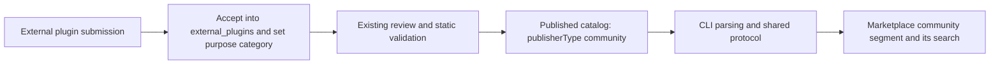
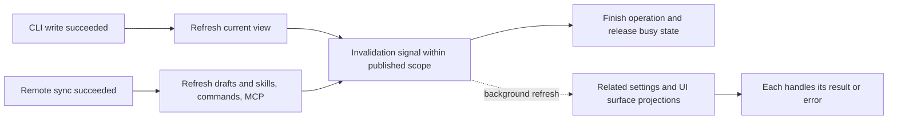
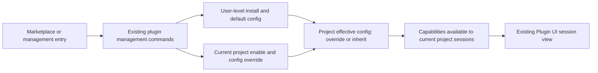
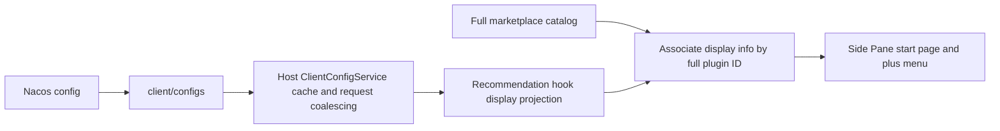
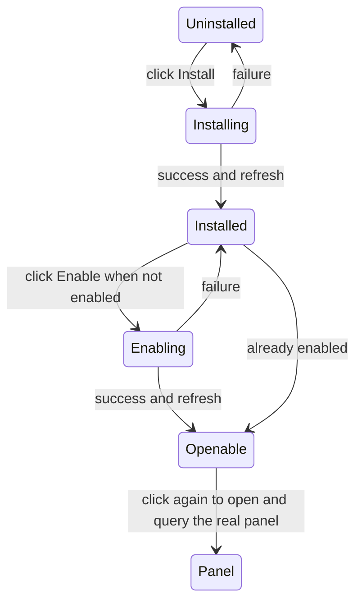

# Plugin marketplace interaction changes: implementation scope

## Baseline and prototype

- Implementation baseline: staging `6295a71ff38a242af5704061fea6b3947ce7241b`.
- Interaction reference: `feat/side-pane-plugins-and-file-manager`, commit `eb137c6fae42e727f139a7568a67df782446b345`.
- Product basis: "Plugin Marketplace & Side Pane interaction changes", revision 2026-10-09, sections 4-7.
- This file records the confirmed scope and implementation constraints; execution evidence is in the verification matrix.

## 2026-10-11 scope revision

The user explicitly required that plugin management still support per-project management. This overrides
the PRD text that removed the project dimension.

- Plugin management keeps the global / specific-project switch. Global install and per-project management both hold.
- Global settings provide the default enabled state and configuration; a project may override enabled state and configuration and restore inheritance from global.
- Pause / enable inside a project changes only the current project, never global or other projects; the UI shows the operation scope and the configuration source.
- Uninstall remains deleting the global install; the confirmation explains the impact on other projects, and a project pause is never presented as uninstall.
- Entering the marketplace from a project, cards show that project's effective state and pause / enable writes that project's override; without project context the global default is changed.
- Plugin management is embedded in the marketplace, reusing the existing plugin list and configuration; the marketplace has no separate MCP / Skill settings tabs. Default is global on first entry; round trips keep the selected project and browse conditions.

## Community plugins: intake, publishing and display

The community segment uses real catalog data; the empty state shows only when there are no community
entries. Classification happens at plugin intake and flows through catalog publishing, CLI queries and
client display.

### Classification semantics

- The official marketplace is a distribution channel, stays `zcode-plugins-official`, and lists both official and community plugins.
- Official / community denotes maintenance ownership. Plugins maintained by external teams, partners and the community are community; an official-maintained plugin using a third-party service stays official. Ownership is never inferred from service brand or an author string.
- `category` stays the purpose category (for example developer tools, productivity); UI capability is a separate dimension and does not occupy the purpose-category or ownership fields.
- The personal segment stays for user-added marketplaces and local sources. A personal source declaring itself official or community does not put it into ZCode's public / community segments.

### Plugin repository changes

1. In `zcode-plugins`, officially maintained plugins stay in `plugins/<name>`; newly accepted external plugins go to `external_plugins/<name>`. Directory placement is the single source of truth for intake classification; no second hand-maintained list.
2. A new plugin submitted externally must use the external directory; fixes to an existing official plugin do not change its ownership. The contribution guide, submission template and existing external-PR intake validation check the directory, registry entry and purpose category at intake.
3. Validator, packager, incremental publishing and related tests cover both plugin roots and keep rejecting path traversal, symlinks and unregistered directories. The existing review and publishing chain is reused.
4. The publisher generates each entry's `publisherType: "official" | "community"` from directory placement, then converts `source` to the CDN ZIP address. The client consumes the published field and does not depend on the rewritten source directory path.
5. Historical entries are checked one by one by maintenance source, and externally maintained ones move into the external directory. Plugin name, marketplace ID, version and artifact path are kept; the plugin version is bumped by the existing rules only when content changes. The directory migration verifies ZIP content and sha256 are unchanged so existing installs, updates and project configs do not break.

### Client changes

- The optional `publisherType` field flows through the existing Store Listing type, runtime schema, catalog parsing and plugin queries, without changing the install semantics of `source`.
- Public = officially maintained plugins in the official marketplace; community = community-maintained plugins in the official marketplace; personal = user-added sources.
- Category queries, featured lists, the UI plugin zone and search first restrict to the current segment, so one entry never shows in several segments.
- The UI plugin zone groups entries by their `ui` component type. Recoverable entries of uninstalled built-in UI plugins (Word, PDF, PPT, spreadsheets) have no runtime information; their component type is delivered by the built-in definition with the official catalog and recoverable list, so they stay in the zone instead of falling into category groups.
- Old-catalog compatibility: when the official marketplace lacks the ownership field, original public display is kept for now; built-in plugins are explicitly official. Newly published catalogs must generate the complete field; historical entries enter the right segment after being checked and refreshed with the catalog.
- No migration of user install directories, plugin IDs or global / project configs; plugin ownership is never treated as an execution permission or trust level.



## Marketplace changes and acceptance

| Change                | Acceptance                                                                                                                                                          |
| --------------------- | ------------------------------------------------------------------------------------------------------------------------------------------------------------------- |
| Source and search     | Default public; public, community and personal always switchable; search is limited to the current source and keeps the existing Chinese pinyin matching.          |
| Community entry       | Shows real community plugins by catalog ownership; with no entries shows "暂无社区插件" (no community plugins yet); a load failure is not disguised as the empty state. |
| Plugin management     | One top-level "Plugin management" entry; keeps the global / project switch, per-project enable/disable and config override; can return to "Browse all plugins".    |
| Management actions    | The more-menu has only pause/enable and uninstall; the existing upgrade stays a separate action; uninstall confirmation and failure feedback are kept.            |
| Install               | Reuses existing user-level install, built-in restore and post-install skill refresh; no separate install state.                                                     |
| UI plugin cards       | The whole row opens details; only the session right-side marketplace has an extra "打开" (Open); a paused plugin shows "启用" (Enable) and enables before opening; uninstalled ones can be installed directly. |
| App plugin group      | Shares in-group expand/collapse with other categories, all expanded by default; above 6 it can collapse to the first 6, never into a separate list. Search and clearing search keep each source's manual selection. |
| UI plugin details     | Reuses the ordinary detail layout, showing an enlargeable preview image, UI capabilities and info.                                                                  |
| Marketplace reuse     | The main area and the Side Pane entry reuse one component, switching browse / details / management inside the marketplace; the entry can suppress the settings-page breadcrumb. |

The file manager and generic tab multi-open/ordering/recently-closed are outside this marketplace work.

## Verified differences

1. The prototype's `useUiPluginInstall.ts` simulates enable, pause and remove with localStorage; `DEMO_PLUGINS` and demo pages are not installable real plugin packages. That state must not be reported as real install success.
2. The current `PluginStorePage.handleInstall` already installs with `user` scope. The management page's workspace/user also carries config-override and restore-inheritance semantics, so removing install-scope grouping is not the same as removing project config capability.
3. The prototype marketplace depends on Side Pane demo-page callbacks. Moving it verbatim would drag in file navigation, demo resources and tab rework.
4. Existing plugin update, orphaned install, built-in restore, marketplace refresh errors and uninstall confirmation must keep working.

## Confirmed UI integration boundary

The repository already has real Plugin UI panels, `plugins/listUiSurfaces` and the sandbox runtime chain.
This work reuses them and adds the catalog UI capability flag and marketplace open entry; with several
surfaces a choice is offered. The independent recommended list contains only verified real plugins; with no
valid entry it shows the empty state; prototype demo state is not imported.

The publisher generates the `ui` capability in the catalog `componentTypes` from valid manifest
`ui.surfaces`; the CLI projects catalog capability onto uninstalled entries and the actual resolved result
onto installed entries, and keeps a surface summary in the plugin details protocol. Disabling does not remove
the capability category; the run entry only allows surfaces enabled in the current project. Ownership,
purpose and UI capability are independent.

Opening a UI is offered only in the session right-side marketplace: the "Open / Enable" button on cards,
details and management rows; in the main-navigation marketplace the whole row opens details and the detail
primary button is "立即试用" (Try now). Desktop local opens the UI in the existing session when available;
mobile, Web and remote can browse, install and manage, and opening a UI shows a not-yet-supported hint.
Launching without a conversation, new session, draft promotion and hot-loading into old sessions are left for
later and not covered here.

Query views are isolated by host, workspace identity and config scope and reuse the existing management
store's read/write logic. After a successful change the affected views and the UI surface list are refreshed
and late responses from an old target are dropped, so the main area, Side Pane and project switching never
cross state.

The global settings projection and the marketplace's independent projection share a non-blocking change
notification; a failing or never-returning secondary view query does not affect the completion state of an
already successful write. The notification records the host, workspace and write scope at operation start:
a user-level change refreshes projects on the same host, a project-level change refreshes only that
project's effective config; remote sync does not require opening global settings first. In-flight queries of
the same service, identity and config scope share a result; a query started before a change cannot satisfy
the post-change refresh. Source user settings and that Source's project projection use one host decision;
each view checks whether its target is still valid and keeps its own operation errors. UI surface
subscriptions reuse the same host and project scope and do not refresh unrelated workspaces; remote sync
finishes the necessary capability refresh before notifying derived views. Install and built-in restore
invalidate the draft and refresh skills only on success, and diagnostic-style failures must be shown as
errors. The main-navigation marketplace offers no open-UI; the management page's "Browse all plugins" still
switches inside the marketplace.



Installed UI cards and management rows open details with the whole row and have no separate "details"
button; viewing details does not trigger enable or open, on desktop, Web and remote alike. The default
recommended list stays independent of the install list, and the empty state keeps a "查看所有插件" (View all
plugins) entry.

## State ownership



Closing a view does not uninstall the plugin. Install state is not managed independently by components or
localStorage. This marketplace layout does not change desktop continuous or mobile replayable message
delivery boundaries.

## Implementation verification

- Update source-isolation, community empty-state, management round-trip and menu-behavior tests first, then the implementation.
- The plugin repository covers external-directory intake, catalog/entry consistency, required purpose category, illegal path rejection, publishing ownership field retention, and artifact and install-identity stability after historical catalog migration.
- The client covers mutually exclusive official / community / personal segments, different ownership under one purpose category, personal-market self-declaration not crossing segments, old-catalog compatibility, and reclassification after catalog refresh.
- Maintain the existing plugin lifecycle E2E: install, manage, pause/enable, update, uninstall and failure scenarios.
- Verify project A's pause and config do not affect project B or global defaults; after restoring inheritance the global config is used; project switching never crosses state; global uninstall clearly states its scope of impact.
- Verify desktop and phone widths, Zai Light/Dark, Chinese and English; keep keyboard focus and accessible names.
- Run architecture check, typecheck, lint, related unit tests and interaction E2E. Unrun items are recorded as such.

## Delivery order and current state

The client's compatible read of the optional ownership field ships first, then the plugin repository's intake
classification, existing-entry migration and published field; each side keeps its own tests and commits. The
plugin repository uses a separate isolated worktree, preserving existing changes in the original checkout.
The client domain vocabulary and the plugin repository's contribution / distribution docs are updated too.

Implemented: intake classification, publishing metadata, the client's three segments and UI capability
recognition, in-marketplace management and the Side Pane entry. Real desktop install, UI sandbox, project
isolation, restore inheritance and uninstall pass in Electron E2E; the browser matrix covers wide and narrow
viewports, Chinese and English, light and dark. The existing external-directory migration keeps install IDs
and the 27 ZIP artifacts unchanged. The catalog is not yet published, so the default UI recommended list is
empty; real mobile remote control and Windows/Linux Electron are unverified. Full execution record:
[verification matrix](../testing/plugin-management-lifecycle-e2e-coverage-matrix.md).

## Impact review

This work is a presentation, option-source, validation, commit-effect and catalog-publishing persistence
change. It does not change conversation recovery, queues or message delivery. The worktree has no code-graph
index, so imports, callers and protocol fields were checked directly; no Codegraph deep scan is claimed.

| Entry                                     | Shared implementation and display state                                              | Authority and commit path                                   | Isolation to preserve                                                          |
| ----------------------------------------- | ------------------------------------------------------------------------------------ | ----------------------------------------------------------- | ------------------------------------------------------------------------------ |
| Workspace main marketplace, Side Pane marketplace | PluginStorePage / ListView / Card; each view has independent query, search and source | IPluginManagementService -> CLI install directory and config files | Workspace identity, host, project / global config; refresh projections after a successful write |
| In-marketplace management, settings management | PluginsSection; global first, project selection and config restore reuse existing capability | setPluginEnabled / configurePlugin / resetPluginConfig | Project override never changes global; uninstall is explicitly a user-level global action |
| UI cards, details, recommended entry      | Valid manifest capability; recommended list independent; open reuses the plugin sandbox | listUiSurfaces -> the existing session's UI runtime         | Open only on desktop local; late responses from an old session / uninstalled view never open a new target |
| External intake, published catalog        | External directory and required purpose category; publishing generates ownership and capability | Plugin repository validate / sync_external_prs / build_dist | Ownership, purpose and UI capability separate; migration never changes install IDs or ZIP content |

Adjacent capabilities that must be checked: post-install skill refresh, ordinary plugin trial, built-in
restore, orphaned-plugin update gate, deep-link jump, tab title / search. Session frozen capability, desktop
continuous, mobile replayable and the existing sandbox permissions are kept as invariants. A personal source
cannot enter the public or community segment by self-declared ownership.

Static graph drift: the existing category-sort node still has old mode names and an installed-bar
description; this work registers the marketplace and UI capability relation, and the old mode naming is out
of scope. Existing UI state is projected from CLI config and the catalog; components store no install state
of their own.

Case handoff: source and interaction unit tests, Side Pane browser regression, PLM-LC-001/002 and the new
PLM-UI-001 (real install, MCP resources and sandbox, project isolation, restore inheritance, uninstall). Full
execution results follow the verification matrix; pending cases are not auto-promoted.

Two large upstream-inherited CLI files already exceeded 800 lines; this work only adds catalog fields and
capability projection, so per the CLI rule their exact paths are registered as line-count warnings and all
other checks stay strict.

<a id="side-pane-服务端推荐配置"></a>

## Side Pane server-side recommendation config

The default UI recommendations are delivered by `data.configs.uiPluginRecommendations` of
`GET /api/v1/client/configs`, replacing the client's static list. Nacos `client_config.yaml` adds this entry
under `configs`:

```yaml
- key: uiPluginRecommendations
  value:
    - pluginId: example@zcode-plugins-official
      surfaceId: panel
```

The list only controls exposure; it never auto-installs or enables a plugin and supplies no resource
address. The Side Pane start page and the plus menu associate with the marketplace catalog by full
`pluginId`; recommendation identity is `pluginId` plus `surfaceId`, shown in config order and deduplicated.
Uninstalled and disabled entries still show; unknown plugins or different sources do not. Button behavior is
in the next subsection. While the config and the full marketplace catalog load, a skeleton placeholder shows
and "none" is not shown early. After both finish, a missing, empty or malformed list shows the empty state; a
failed request ends loading and no hardcoded recommendations are used. Drafts have no entry; Web, mobile and
remote keep the original open-capability hint.



The sole cache owner is the existing `ClientConfigService`, reusing its one-hour TTL; no polling or separate
cache is added. It is read when the entry mounts; results of an old request are dropped after a service
switch or unmount. A config change shows after the next effective read, and a restart clears the process
cache. Reading recommendations does not change ownership of the session, queue or UI runtime.

Acceptance: config parsing isolates bad fields; duplicate and unknown entries are not exposed; late requests
never display across services; after the browser really requests the config, the start page and menu are
consistent, and mouse and keyboard opening keep the original session parameters; a missing config, an empty
list and a failed request hide recommendations. Covers wide and narrow viewports, both themes, Chinese and
English.

### Install and enable in the recommendation area

Recommendation exposure matches the server list against the full marketplace catalog instead of
intersecting with the available panel list. Uninstalled and not-enabled official plugins also show; name and
description come from the marketplace catalog, with the installed panel title taking precedence. The list
shows in config order, deduplicated by full plugin ID and panel ID; entries absent from the catalog are not
shown.

- Uninstalled: shows "安装" (Install), reusing user-level install; recoverable built-in plugins reuse the restore action.
- Installed but not enabled in the current project: shows "启用" (Enable), writing a current-workspace override.
- Installed and enabled: shows "打开" (Open); on click the real panel is queried again, and resource addresses are never built from config.
- Install or enable success only refreshes state and never opens automatically; the user clicks again to open. Failure keeps the original state, shows a hint and allows retry.
- The recommendation area and the marketplace share per-plugin busy state: while A is installing or restoring, B can still submit an install and an already-enabled C can still be opened; only repeated operations on the same plugin are blocked, and multiple surfaces of one plugin share progress.
- Busy state is read from the existing plugin management store; the recommendation hook creates no global operation lock. A queued install keeps the marketplace's "installing" display; installs of different plugins still run serially in submission order, and cancelling an install is not offered in this phase.
- During an install, details of any plugin (including the one installing) can be opened; the component area reads `plugins/describe` and does not wait for the install to finish.
- Creating a right-side tab during an install loads the recommendation area through `plugins/list` and `plugins/overview`, does not wait for the install and does not stay on the skeleton.
- The card "Update" and the detail "Restore user default" are likewise busy per plugin, disabling only the plugin being operated; saving configuration for the same plugin also counts as busy.
- After switching workspace, service or session, an old operation must not trigger actions or error hints of the new target, nor clear the new target's busy state.
- Drafts still show nothing. Mobile/Web/remote can install or enable; opening still follows the original platform capability limits.



Additional acceptance: uninstalled/disabled entries still show; install uses the user scope and enable uses
the workspace scope; success does not auto-open; failure can be retried; rapid repeated clicks write once;
after a target switch an old result neither opens nor shows a hint.
