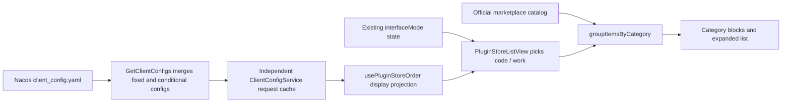

# Plugin store ordering delivered by interface mode

## Function and boundary

Marketplace ordering applies to the category blocks of the public segment; the input-box @ / + reuses the
same config (see the end). Code / Work ordering is selected by the interface mode in the avatar menu:
`interfaceMode=coding` maps to `code`, `interfaceMode=general` maps to `work`, using the existing Zustand
state, local preference and window broadcast. Category ownership still comes from marketplace
`listing.category`.

- Only existing categories and plugins are sorted: no categories are created, no plugin ownership moves, no unconfigured item is hidden.
- Configured items show first in array order; the rest keep the existing order. `other` is last by default and can be repositioned when configured explicitly.
- Unconfigured categories: productivity, developer-tools, utilities, finance, legal, template, then unknown slugs in code-point order, then other. Unconfigured plugins: official PDF -> PPT -> Excel -> Word first, the rest by localized display name.
- In an ordered list the first occurrence of a duplicate wins and whitespace is trimmed; nonexistent categories or plugins are ignored. `pluginOrder` keys use exact category slugs and plugins match by full ID.
- A single invalid or missing mode falls back to the default for that mode and does not inherit from the other mode. An empty array means the default order.
- Marketplace Featured, the personal segment, global search and the installed bar are unaffected; managing installed plugins and install/enable/runtime are unchanged. A restored plugin that no longer shows is covered in the dedicated section below.
- Each category shows 6 items by default; the collapsed preview and the expanded list use the same sorted result.

### Category adjustment (2026-09-15)

- The `guides` category is removed; the built-in `zcode-guide` catalog definition becomes `utilities`. The client merges old cached `guides` into `utilities`, keeping the plugin, install state and behavior.
- Added the known category `legal` (Chinese "法律", English "Legal"); no plugin added yet.
- Test-environment Code / Work ordering drops `guides` and adds `legal` after finance. Empty categories keep the no-display rule; a future plugin declaring `category: legal` shows at the server-configured position.
- Coverage: old guides merged with utilities, no guides heading, bilingual legal label, empty category generates no card, future legal plugin ordered by config. The migration changes only category projection and the built-in catalog, never plugin IDs or features.
- List and detail pages share the category merge, so old-cache details also show as utilities.

## Config contract

`data.configs.pluginStoreOrder` of `GET /api/v1/client/configs`:

```json
{
  "code": {
    "categoryOrder": ["developer-tools", "productivity"],
    "pluginOrder": {
      "productivity": ["lark-cli@zcode-plugins-official"]
    }
  },
  "work": {
    "categoryOrder": ["productivity", "finance", "other"],
    "pluginOrder": {
      "productivity": [
        "tencent-meeting-cli@zcode-plugins-official",
        "lark-cli@zcode-plugins-official"
      ]
    }
  }
}
```

The IDs above are structural examples; copy IDs from the real catalog when publishing. Both fields of each
mode may be omitted. The client validates with a runtime schema at the service boundary; malformed input
never reaches the sorter.

## State ownership and timing



- The independent `IClientConfigService.getSnapshot({ forceRefresh? })` reads public fields and is exposed through the plain RPC channel `client-config`; see the [config service contract](../client-config-service.md).
- The window Local Host's config service is the sole request/TTL owner of this chain; remote workspaces and mobile attachments reuse the same instance. The cache is isolated by endpoint/version/platform and valid for 1 hour; the UI adds no TTL cache.
- Only the plugin reads newly added by this MR are migrated; subscription, security validation, forced update, idle, help and Built-in legacy chains stay as they were.
- On opening the store the config is read asynchronously and the catalog shows immediately by default rules; when the config arrives it reorders for the current mode.
- Switching mode only recomputes: no request, no overwrite of the interface preference, no reset of expanded state.
- Manual refresh fetches the order config in parallel and does not wait for it to refresh the catalog. A read failure keeps the current valid projection; a first-time failure uses the default.
- After unmount, a service switch or an older request finishing, the result must not overwrite a newer projection; a service switch must not show the old service's config.
- A missing field (including a revoked config) is a successful default config and must clear any old ordering. No periodic polling or persistence migration.
- Desktop, Web and mobile share the UI/hook and read through the injected service; this feature does not touch workspace identity, shared-host attachment, or the continuous / replayable session data paths.

## Server landing

zcode-server already supports `ClientConfigItem.Value:any`, and a successful Nacos update parse replaces the
snapshot. `GetClientConfigs` merges database fixed configs and conditional configs; for the same key the
later-matching conditional config overrides as a whole, not by nested merge. Both modes live in one value
published atomically; two same-named keys, one per mode, must not be used. No new Go business interface or
migration is needed; the server provides a Nacos example and an object-order passthrough regression test.

## Feature impact brief

Change layers: option-source, presentation. Mode: planning -> implementation-handoff.

| UI scenario                       | Entry / shared implementation                                | Display owner / default source        | Validation and commit    | Authority / persistence         | Mode and isolation                        |
| --------------------------------- | ------------------------------------------------------------ | ------------------------------------- | ------------------------ | ------------------------------- | ----------------------------------------- |
| Public category browse / expand   | PluginStorePage -> PluginStoreListView -> groupItemsByCategory | hook config projection / old ordering | service schema; read-only | Nacos / Host memory cache       | desktop/web/mobile shared, no plugin-state change |
| Interface-mode menu               | Existing interfaceMode setting                               | Zustand / normalizeInterfaceMode      | existing setInterfaceMode | local preference and window broadcast | coding/general map to code/work      |
| Featured / personal / search / installed | Each selector of the same ListView                    | Existing catalog / install state      | no new action            | Existing sources                | Ordering fully isolated                   |

Shared: the list component, config source and catalog; each entry keeps its original filter, sort and
install semantics.

| Level          | Relation                              | Evidence / checkpoint                                                |
| -------------- | ------------------------------------- | -------------------------------------------------------------------- |
| must-inspect   | service config -> hook -> category order | ClientConfigService.getSnapshot, PluginStorePage, groupItemsByCategory |
| must-inspect   | interfaceMode -> ordering-rule choice | useIsGeneralMode, StoreProvider                                      |
| should-inspect | ordering -> first 6 collapsed and the rest | PluginStoreListView                                             |
| invariant-only | search/featured/personal/installed selectors | pluginStoreListing, PluginStoreListView                       |
| invariant-only | install/runtime/workspace isolation   | no change to the management service or Agent protocol               |
| evidence-only  | schema, service, ordering and browser tests | coverage table below                                          |

Neither workspace has `.codegraph/`, so the index was skipped by convention and `rg` located the real
callers. Static tracing depth 2: Page -> ListView -> groupItemsByCategory; service -> provider ->
client/configs. Graph drift: the existing interface-mode capability lacks the public-store ordering
semantics; this work adds an explicit capability and code seeds. State commits happen only in the existing
interface-mode setting; ordering config writes no local preference, plugin catalog or task.

## Decisions and coverage handoff

Confirmed boundaries: public categories only; unconfigured items are appended and `other` can be ordered
explicitly. No open product question. Main dimensions: code/work x valid/missing/invalid config x
first/switch/refresh x expanded/collapsed. Platform/theme/language use representative combinations only; the
session delivery and plugin lifecycle are unchanged, so their Cartesian product is pruned.

| ID     | Setup -> action -> assertion                                                                           | Evidence                |
| ------ | ------------------------------------------------------------------------------------------------------ | ----------------------- |
| PSO-01 | Same catalog and dual-mode config -> switch existing mode state -> categories and plugins reorder separately, request count unchanged | ordering unit test + browser |
| PSO-02 | No config / empty config / corrupt mode field -> browse -> default order, the other mode still valid   | schema + ordering unit test |
| PSO-03 | Duplicate / unknown IDs, explicit `other` -> sort -> first valid wins, no add/remove or cross-category move | unit test           |
| PSO-04 | Config not returned / network failure -> browse -> catalog visible; refresh failure keeps old projection | hook + service tests  |
| PSO-05 | Two services or an older request arrives late -> switch service/refresh -> does not overwrite the new result | hook test         |
| PSO-06 | More than 6 items -> expand/collapse -> all items in one order and expand state kept                    | browser                 |
| PSO-07 | Featured/personal/search/installed on the same page -> switch mode -> existing ordering unchanged       | browser / existing unit tests |
| PSO-08 | Nacos dual-mode nested arrays -> parse/override/JSON serialize -> both array levels keep order           | Go test                 |
| PSO-09 | Official restored plugin installed and featured -> browse and search in both modes -> hidden from all marketplace entries, same-named personal plugin kept | browser + real dev |

Browser cases live in `packages/ui/test/browser/manual-review/pending/plugin-store-mode-order.*`, using the
real ListView, hook and interface-mode Zustand with finite injected service responses; no model or live
config dependency. Coverage is desktop / 390px, Chinese / English, light / dark. They verify shared-UI
interaction and do not stand in for full Electron / remote-control acceptance. They remain
manual-review/pending, not claimed as formal CI. Real mobile shared-host integration was not run.

## Restore legacy sessions plugin leaves the marketplace display

- `restore-legacy-sessions@zcode-plugins-official` no longer appears in store Featured, categories (including expanded), search or the installed shortcut bar; Code / Work, desktop and mobile Web share one rule.
- The shared `PluginStoreListView` filters the full plugin ID before category, featured and search derivation, so an old catalog cache or a server featured list cannot bring it back; a same-named plugin from a personal source is unaffected.
- Only the marketplace display entry is removed; the plugin package, installed state and plugin management page stay, so a hidden entry never prevents managing existing installs. Ordering config does not handle listing/delisting, the currently delivered config does not reference this plugin, and Nacos needs no change.
- Browser regression covers the official plugin installed and featured, both modes, search and a same-named personal plugin.

## Input-box @ / + reuses the ordering

- Both entries share `usePluginsMentionProvider`: only enabled official plugins inside the authority catalog are sorted by marketplace category and in-category order, flattened to one column; personal sources follow in discovery order, conflicting items visible but not selectable.
- A shared pure sort function is extracted for the marketplace and the Picker, including guides -> utilities, default category order, explicit `other` ordering and localized-name fallback. While the config is pending / failed / revoked the Picker keeps discovery order and neither editing nor the menu is blocked.
- Category is mutable listing display info of the target Host, joined by full plugin ID; it never changes the identity, capabilities or enabled state frozen in the Session and never adds plugins from the marketplace.
- `plugins/referenceCatalogWithCategory` reuses the original query and only adds the category display field. The original method keeps its old response shape. A new service falls back to the old method only when the new method returns -32601; other errors are thrown as is. An old catalog without category keeps its original order.
- Config requests are still cached and coalesced by the window Local Host's ClientConfigService; the Picker requests only when opened, late results after closing are dropped, and Code/Work switching only reorders locally. Remote workspaces keep their own catalog authority and mobile keeps sharing the attachment Host.

```text
workspace/session catalog -- enabled and conflict state --+
target Host listing -- category (display-only) -----------+- shared sort - search relevance (stable on ties) - @ / +
window ClientConfigService -- Code/Work config -----------+
```

| ID     | Scenario and assertion                                                                  | Verification              |
| ------ | --------------------------------------------------------------------------------------- | ------------------------- |
| PSO-10 | Same catalog: marketplace and the Picker's official subset have the same Code/Work order; personal items keep order | pure function / Provider unit test |
| PSO-11 | Config pending / failed / late after close / revoked never blocks; mode switch sends no request | Hook + browser         |
| PSO-12 | Session identity frozen, category updatable; old method returns no new field, new method adds category | protocol test         |
| PSO-13 | New method -32601 falls back to the old method; other errors do not fall back            | service test              |
| PSO-14 | @ and + real entries have the same order; search relevance first, conflicts not selectable, disabled hidden | browser           |

Verification notes: browser cases pass for 1200px/en-US/light and 390px/zh-CN/dark; the real @ / + components
run with non-plugin data sources (files/skills/sessions) replaced while the real plugin provider, reference
hook, config hook, Lexical @ panel and + menu are kept. Personal-item tails can differ because of virtual
scrolling mount range, so DOM counts are not used to infer catalog equality. A real mobile / remote
old-Agent mixed-version run was not done; the compatibility fallback is verified by protocol and service
tests. Re the live config: a first open may show the old order because the Host cached the config before
publishing; a manual refresh applies it, matching the 1-hour cache contract. The server loading Nacos live
does not push to already-open clients.
