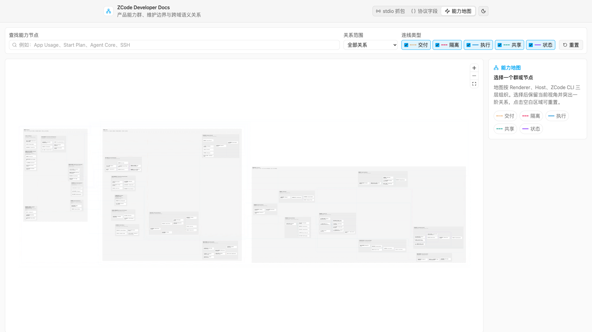

# ZCode product capability map

## Purpose

This document defines the maintenance rules for the ZCode product capability map. The map is not a code-directory or org chart; it answers:

1. Whether a product capability runs mainly in the Renderer, Host, or ZCode CLI, or is engineering infrastructure outside the product runtime;
2. Which capability groups make up each top-level area;
3. Which independently maintainable capability nodes make up each group;
4. What semantics connect different nodes;
5. Which capability owners to invite for review on cross-team changes.

The interactive map lives in `apps/dev-docs`. Run `pnpm dev:docs` and open `http://localhost:5186/?view=capabilities`.



## Graph model

```text
Top-level Area
  └─ Capability Group
       ├─ Capability Node
       ├─ Capability Node
       └─ Capability Node

Capability Node ── semantic relationship ──> Capability Node
```

- **Top-level Area**: the first three areas follow real deployment and state boundaries — Renderer, Host, ZCode CLI; the fourth is engineering infrastructure outside the product runtime.
- **Group**: a set of capabilities within an area suitable for assigning one primary maintaining team or owner, e.g. Agent Core, account entitlements, build & release, test automation.
- **Node**: a maintainable unit with independent product semantics, authoritative state, or commit side effects.
- **Edge**: only dependencies with clear product semantics; not every static code reference becomes a product edge.

## Naming rules

- Groups, nodes, and owners use "Chinese (English)": Chinese is the primary identifying text; existing English names stay in full-width parentheses.
- Product acronyms like MCP, OAuth, CLI, UI, CDP, CUA, ARMS are not force-translated but should gain Chinese semantics.
- Names describe product capabilities; they do not copy directory names, class names, or historical compatibility-layer names.

## Layout algorithm

The map renders with React Flow and a deterministic two-phase "group-first" layout. Node-level cross-group references only affect group adjacency order, never drag a whole group to a different layer:

```text
群内节点 + 群内关系 ──> 每个能力群独立 ELK Layered
                              |
                              +──> 紧凑节点位置 + 群内正交路由

同层跨群节点关系 ──> 聚合为带权群关系图 ──> 关系度优先遍历
                                           |
                                           v
                                 ELK Rectangle Packing
                                           |
                                           v
Renderer -> Host -> ZCode CLI 固定层顺序
                  +
Engineering Infrastructure 位于三层下方
                  +
React Flow 跨群连线
```

- Top-level areas and groups are React Flow parent nodes; a group sits in exactly one top-level area, a node in exactly one primary group.
- Each group independently uses ELK Layered for node positions and intra-group orthogonal bend points; intra-group edges still participate in ordering and avoidance.
- Cross-group node relations within one top-level area aggregate by source/target group into a weighted undirected adjacency; degree- and weight-ordered traversal puts strongly related groups adjacent, but a single long cross-group edge may not widen group layers.
- Groups pack compactly with ELK Rectangle Packing; Renderer, Host, ZCode CLI keep a fixed left-to-right runtime order, and engineering infrastructure centers below the three layers as its own area.
- The layout uses a stable random seed, declaration order as tie-breaker, and deterministic inputs so identical data yields an identical layout — easy to review and diff screenshots.
- A compact spacing profile compresses outer margins of top-level areas, group gaps, intra-group node gaps, and node card widths; text keeps the existing `text-ui-*` hierarchy — density never comes from shrinking fonts.
- Top-level area titles, group titles, and their children's start positions share one set of geometric constants; children must sit below the title separator with at least 12px canvas gap; bilingual titles, owners, and size badges must not invade the children area.
- Cross-group edges are drawn by React Flow at actual node positions; they stay de-emphasized by default and highlight with labels only after selecting a node or group, so full cross-group wiring never overwhelms the group hierarchy.
- React Flow owns viewport, selection, keyboard accessibility, and rendering only visible elements; ELK only lays out and holds no interaction state.

## Implementation boundaries

- The authoritative data for groups, nodes, and edges is `apps/dev-docs/src/data/productCapabilityMap.ts`; it must not be embedded in static HTML.
- The interactive page is `apps/dev-docs/src/capability-map/`, loading React Flow and ELK on demand via dynamic import so the stdio/protocol docs first paint is unaffected.
- `docs/product-capability-map-preview.png` is a documentation preview, not authoritative data or an interactive implementation.

## Visual encoding

- Top-level areas, groups, and nodes use neutral colors; ownership is expressed only by spatial containment and titles.
- Color is used only for edges, never for group or node classification, so one color never carries two semantics.
- Edges combine color, solid/dashed style, and text labels — relations must be identifiable without color alone.
- The z-order is fixed: "group background → semantic edges → group titles and nodes → edge labels"; edge labels are the top semantic layer and must fully cover nodes and lines, never clipped or occluded by nodes.
- In the overview, same-group edges are more prominent than cross-group ones; selecting a group highlights first-degree relations but hides dense labels; selecting a node shows labels only for its first-degree relations.
- Selecting a group or node updates highlights and details only — never the current viewport zoom or position.
- The map records no staffing split and offers no person selection or person-responsibility highlighting; owners in groups only describe suggested maintenance roles.
- Canvas wheel zooms centered on the pointer; panning uses pointer drag, not the wheel.
- Clicking empty canvas equals clicking "reset": clears search and selection, restores all relation filters, and fits the global overview.

## LOC estimation

A group may carry "primary production LOC" and a confidence estimate to help judge maintenance burden — never a substitute for dependency impact analysis:

- Product-runtime groups are estimated from non-empty physical lines of tracked TypeScript/JavaScript files, comments included, excluding docs, dist, node_modules, generated, fixtures, and locale data.
- Infrastructure groups count their primary engineering sources: besides TypeScript/JavaScript they may include CI YAML, Shell, PowerShell, and build configs; shared E2E harness, runner, and reporter belong to infrastructure, while E2E cases for specific product features are not re-attributed to the test platform.
- An incubating group's LOC counts only landed product code; planned nodes may have no implementation, and estimated future code must not inflate group size.
- Each file belongs to exactly one primary group; cross-group shared infrastructure, Workflows, common protocols, dev tools, and code with no stable owner are not forcibly apportioned.
- Group titles show a neutral compact badge like `≈23.6k LOC`; on selection, the details panel shows the full estimate and confidence.
- LOC is metadata only — it never participates in ELK ordering, group area, node area, or edge routing, so big groups do not swallow small ones under linear scaling.
- LOC is a manual audit snapshot, not a build-time live metric. Re-audit and update the authoritative data after capability-boundary, directory-ownership, or large-refactor changes.
- Test code can be counted in dedicated audits; because E2E tests often span groups, this map by default keeps test lines out of group titles.

## Group complexity metrics

Group titles show `LOC · 入 · 出` — three dimensions distinguishing code size, how depended-upon, and how outward-depending a group is:

- `LOC` is the primary production LOC estimate.
- In-degree counts directed capability edges whose target node is in the current group and whose source is in another.
- Out-degree counts directed capability edges whose source node is in the current group and whose target is in another.
- Multiple node-level relations between the same pair of groups each count; intra-group relations count toward neither.
- In/out degrees are always computed from the full authoritative graph, independent of relation-type toggles or "cross-group only" filters, so metrics never drift with browsing state.
- The three metrics stay separate and never merge into one score. LOC means maintenance size; in-degree approximates depended-upon-ness and change impact; out-degree approximates integration burden. Different dimensions weighted together would manufacture unjustified precision.
- On selection, the details panel explains full LOC, in-degree, and out-degree separately; the title badge is only a compact overview.

## Edge types

| Type        | Meaning                                                       | Example                                                             |
| ----------- | ------------------------------------------------------------- | ------------------------------------------------------------------- |
| `state`     | state projection, authoritative facts, or persistence         | ProductProjection projecting to Conversation UI                     |
| `runtime`   | triggers execution, calls, or runtime hosting                 | Automation Scheduler triggering Agent Turn Runtime                  |
| `shared`    | shared candidates, components, config, or extension resources | Provider Registry offering candidates to Model Selector             |
| `delivery`  | cross-process, cross-client delivery or recovery path         | Mobile Replayable entering the same Host via Shared Host Attachment |
| `invariant` | a boundary that must stay isolated, unprivileged, or unshared | Task Index must not become the conversation-body authority          |

## Three runtime layers and engineering infrastructure

```text
Renderer（Desktop / Web / Mobile）
  Composer / Settings / Timeline / Charts / Workbench UI
                         |
                         | intent、query、projection subscription
                         v
Host（Local / SSH / WSL / Docker / Shared Host）
  platform services / process supervision / routing / attachment
                         |
                         | ZCode Protocol / service RPC
                         v
ZCode CLI
  AgentRuntime / CommandInbox / ProductProjection /
  session event journal / usage SQLite
```

| Layer     | Owns                                                                                                                                                               | Explicitly does not own                                          |
| --------- | ------------------------------------------------------------------------------------------------------------------------------------------------------------------ | ---------------------------------------------------------------- |
| Renderer  | input drafts, selection state, filter ranges, chart range, UI projection cache                                                                                     | Agent runtime state, conversation body, CLI queue, usage facts   |
| Host      | window-scoped services, credentials, remote connections, process supervision, attachment routing, platform IO, remote entitlement requests, Telemetry/ARMS sending | conversation body, Agent turns, mobile replayable business state |
| ZCode CLI | Agent/Turn, CommandInbox, ProductProjection, session events, model/tool execution, session recovery, usage SQLite authoritative facts                              | Renderer drafts, window layout, Electron platform state          |

- Desktop Renderer, the future Web App, and Mobile Renderer reuse product semantics but attach to the Host through different attachments.
- SSH, WSL, Docker, and local windows all establish workspace-level connections through the Host; remote workspaces must carry `workspaceIdentity` and `remoteSessionId` end to end.
- Host and relay only route and deliver; they never duplicate the CLI's conversation, queue, snapshot, or usage authoritative state.
- Desktop `desktop-continuous` and mobile `web-remote-replayable` are Host delivery capabilities; both consume the same CLI ProductProjection, but their recovery semantics must not bleed into each other.
- The map shows `desktop-continuous` as “桌面连续通信”; `continuous` here means the full direct realtime delivery profile — not "continuous delivery", and it does not include mobile replayable's gap/snapshot recovery semantics.

Engineering infrastructure is outside the three layers and takes no part in online request chains:

```text
Renderer  ->  Host  ->  ZCode CLI
    \           |          /
     \          |         /
      +---------+--------+
                |
                | 构建、验证、度量、发布
                v
Engineering Infrastructure
  Build & Release Engineering
  Test Automation Platform
  Quality Intelligence & Engineering Governance
```

- Infrastructure may build, verify, observe, and release the three layers, but must never become a Renderer/Host/CLI online runtime dependency.
- The Host's "client update lifecycle" owns only client check, download, install, and update-completion presentation; CI packaging, signing, notarization, artifact upload, CDN warmup, and canary/stable release belong to "Build & Release Engineering".
- The test platform owns the shared harness, runner, capture/replay, fixture contract, cross-platform execution, and promotion tooling; product assertions of specific feature cases stay co-maintained by the corresponding capability groups.
- Quality data records only test results, coverage, failure artifacts, durations, trends, and engineering budgets — never `/report`, ARMS/RUM, Conversation telemetry, or local App Usage.

## Capability groups

| Top-level area | Group                    | Maintenance boundary                                                                                                          |
| -------------- | ------------------------ | ----------------------------------------------------------------------------------------------------------------------------- |
| Renderer       | 对话与任务体验           | Composer, Projection Store, Timeline, session actions, task navigation, attachment experience                                 |
| Renderer       | 模型与账户体验           | Provider Settings, Model Selector, plan status/purchase, plan usage UI                                                        |
| Renderer       | 扩展体验                 | Plugin/Skill/MCP settings, marketplace and import entries                                                                     |
| Renderer       | 浏览器与开发工作台体验   | Browser, File, Terminal, Git/Diff product UI                                                                                  |
| Renderer       | 办公套件与计算机操作孵化 | PDF/Office preview and editing roadmap, Computer Use task experience, manual takeover and security confirmation               |
| Renderer       | 自动化体验               | scheduled automation, off-peak tasks, Bot config/history UI                                                                   |
| Renderer       | UI 平台                  | design system, theming, i18n, responsive, Settings/Onboarding                                                                 |
| Renderer       | 数据洞察与反馈体验       | App Usage charts, Feedback entry, Resource Manager display                                                                    |
| Host           | 账户与权益               | OAuth/Credential, Plan Identity, Start/Coding/Team Plan, payments, remote quota/monitor                                       |
| Host           | 扩展管理与同步           | plugin install/upgrade, resource contribution, cross-local/remote sync                                                        |
| Host           | 浏览器与计算机操作平台   | BrowserView/WebContentsView, CDP backend, Computer Use Helper lifecycle, trust broker, system observation and input execution |
| Host           | 工作区与交付             | workspace identity, Local/Remote Host, mobile remote, continuous/replayable                                                   |
| Host           | 工作台服务               | File/Terminal/Git services                                                                                                    |
| Host           | 自动化与渠道运行时       | scheduler, automation record, off-peak, Bots, third-party channels                                                            |
| Host           | 客户端平台               | Electron lifecycle, client update, Feedback tickets and diagnostic bundles                                                    |
| Host           | 数据与可观测性           | App Usage bridge, product analytics, Conversation telemetry, ARMS, performance reliability, logs and process monitoring       |
| ZCode CLI      | 智能体核心               | runtime assembly, turn state machine, context, memory, compact, stream recovery, goal/target, fault finalization              |
| ZCode CLI      | 对话运行时               | session lifecycle, input admission, CLI queue, event journal, ProductProjection, fork/rewind                                  |
| ZCode CLI      | 模型能力                 | provider runtime, catalog capabilities, token budget, multimodal, reasoning and tool capabilities                             |
| ZCode CLI      | 工具运行时与安全         | built-in tools, scheduling, permissions, mode policy, tool artifacts                                                          |
| ZCode CLI      | 多智能体                 | Subagent profiles, child runtime, coordination and background tasks                                                           |
| ZCode CLI      | 扩展运行时               | MCP, Skills, Hooks, Commands, Memory resources                                                                                |
| ZCode CLI      | 浏览器运行时             | Browser Use Plugin, Node REPL/Playwright, Headless backend                                                                    |
| ZCode CLI      | 用量可观测存储           | model/turn/tool usage facts, SQLite 30-day retention and App Usage SQL aggregation                                            |
| 基础设施       | 构建与发布工程           | GitLab pipeline, cross-platform builds, packaging/signing, notarization, artifacts, CDN, canary/stable release                |
| 基础设施       | 测试自动化平台           | Desktop/CLI E2E harness, capture/replay, cross-platform execution, fault injection, case admission and promotion              |
| 基础设施       | 质量数据与工程治理       | E2E reports, coverage, quality trends, static gates, engineering performance and failure artifacts                            |

## Plans, App Usage, and observability boundaries

```text
Renderer
  套餐状态/购买 UI ─────────────> Host Subscription & Billing
  套餐用量 UI <────────────────── Host Plan Quota & Monitor <── Coding / Team Plan backend
  Start Plan UI <──────────────── Host Start Plan balance       （不走 monitor）

  App Usage Dashboard
          ^
          | snapshot
Host      |
  App Usage Protocol Bridge       Product Telemetry / ARMS / Logs
          ^                                  |
          | usage/stats                      `--> 外部数据与诊断后端
ZCode CLI |
  App Usage SQL Aggregation
          ^
          |
  model_usage / turn_usage / tool_usage SQLite（30 天）
          ^
          |
  Model / Turn / Tool lifecycle facts
```

- Personal Coding Plan, Team Plan, and Start Plan are three distinct entitlement identities and must be separate nodes.
- Start Plan uses the OAuth zcode JWT and balance/daily quota; it does not use the Coding Plan monitor API.
- Team Plan uses organization/project/project-key isolation and must not degrade into a personal Coding Plan display label.
- Plan Quota & Monitor is remote commercial plan data; on failure it must not fall back to App Usage.
- App Usage is local product-usage statistics. Its authority is ZCode CLI's default `~/.zcode/cli/db/db.sqlite` with the independent `model_usage`, `turn_usage`, `tool_usage` tables, served to Host and Renderer via `usage/stats`; it is not a billing ledger.
- `/report` product analytics, ARMS/RUM, Conversation telemetry, log infrastructure, and App Usage are different channels and must not merge into one `telemetry` or `usage-quota` node.

## Agent Core and Conversation Runtime boundary

Agent Core is no longer compressed into Turn/Context/Compact/Session nodes. Inside ZCode CLI at least distinguish:

```text
Agent Core
  Runtime Bootstrap
  Turn Orchestration
  Context Assembly
  Memory Recall & Write
  Context Compaction
  Model Step / Streaming Recovery
  Goal / Target Continuation
  Runtime Fault Recovery

Conversation Runtime
  Session Lifecycle & Resume
  Input Admission / Queue / Steering
  Command ACK / Dedupe / Recovery
  Session Event Journal
  ProductProjection
  Branch / Retry / Rewind
  Session Store
```

- Agent Core owns how one round of work executes; Conversation Runtime owns how multi-turn product state is admitted, persisted, projected, and recovered.
- Model Capabilities provides the model catalog, limits, modalities, and provider options; streaming order, backpressure, and durable event finalization of model steps belong to Agent Core.
- Tool Runtime owns registry/scheduler/executor/permission; Agent Core only consumes tool lifecycle results to continue the turn.
- Extension Runtime owns discovery and loading of MCP/Skills/Hooks/Memory resources; Agent Core owns how they enter context and turns.
- Multi-Agent owns child runtimes and the broker; each child internally reuses Agent Core, but raw child events must never pollute the parent conversation projection directly.

## Model capabilities boundary

Model capabilities are an independent core capability — owned by neither Agent Core nor Account & Entitlements — providing model facts to the runtime and several product entries:

```text
模型供应商注册表
               |
               v
模型目录与能力元数据
        |              |                 |
        |              |                 +--> 推理与工具能力
        |              +--------------------> 多模态能力
        +-----------------------------------> 上下文与输出预算
               |
               v
模型选择器
        |
        +--> 发送消息 / 当前会话（Composer / Conversation）
        +--> 子智能体配置
        +--> 定时自动化
        +--> 闲时任务、机器人

上下文与输出预算 ──> 模型运行时
        |
        +────────────> 上下文压缩与记忆
```

- The model catalog owns capability facts like `contextWindow`, `maxOutputTokens`, input/output modalities, reasoning, tool call, and structured output.
- `contextWindow - maxOutputTokens` together determine the input budget and compact threshold; the model output cap also enters provider adapter requests.
- The catalog schema can describe text, image, video, audio, and PDF modalities; the current Agent request chain already gates image, video, and PDF — audio is still not a delivered input path. The map records both "catalog declaration" and "effective model/provider wire capability" layers and must not miswrite catalog declarations as fully landed audio runtime support.
- The model selector can reuse candidate building and UI components, but each entry's draft and submission state stay isolated: conversation selection writes the current runtime/projection, automation writes the automation record, Subagents write profile/override.
- OAuth, Credentials, Coding Plan, Usage, and Quota affect provider availability and allowance but are maintained by “账户与权益”, connected to model capabilities by edges, sharing no authoritative state with the model catalog or model runtime.

## Office and Computer Use incubation boundary

Office and Computer Use are cross-layer product domains but add no fourth product runtime layer. Renderer owns preview, editing, operation traces, and takeover experience; Host owns file/conversion services and the system-level CUA permission principal; ZCode CLI executes agent intent through Document Skills and the Computer Use MCP.

```text
Renderer
  Office Preview / Editor（PDF、DOCX/DOC、XLSX read-only current；native editing/PPTX preview planned）
  Computer Use Task / Takeover UX（permission entry current；control UX planned）
                    |
                    | intent / projection / workspace-scoped IO
                    v
Host
  File Service + Office Document Service（planned）
  Computer Use Helper Lifecycle + Trust Broker + Surface/Input Backend（macOS beta）
                    ^
                    | ZCode Protocol / per-server MCP broker credentials
                    |
ZCode CLI
  Document Skills（DOCX/PDF/PPTX/XLSX current）
  Computer Use MCP Integration（current beta）
```

- The current Office product base is the read-only Preview Pane for PDF, DOCX/DOC, XLSX plus official DOCX/PDF/PPTX/XLSX Document Skills; that is not an Office native editor, comments/track-changes, or native PPTX preview.
- Future Office native UI parsing, conversion, saving, and version-conflict handling stays inside the Host Workbench Services boundary; the Renderer never references Node, LibreOffice, or local path implementations directly.
- Current Computer Use is a macOS/Windows desktop-local, explicit opt-in/kill-switch internal beta. Signed Helper, peer/token verification, permission, and input-execution failures must fail closed.
- Mobile Web only reuses the desktop's existing Local Host via shared-host attachment; SSH/WSL/Docker or mobile remote Hosts must never start a local Computer Use Helper.
- The map uses node scope to distinguish “当前”、“孵化”、“规划”; group-level LOC and complexity reflect only current code and confirmed semantic edges.

## 2026-08 current-capability additions

Finer-grained recently landed capabilities are in the map; they still follow the Renderer → Host/transport → CLI runtime authority boundaries.

| Capability                           | Current facts                                                                                                                                                                                 | Map boundary                                                                                                                   |
| ------------------------------------ | --------------------------------------------------------------------------------------------------------------------------------------------------------------------------------------------- | ------------------------------------------------------------------------------------------------------------------------------ |
| Office file preview                  | Preview Pane supports PDF, DOCX/DOC, XLSX (read-only, workspace file service bytes); native editing, saving, comments, and revisions remain planned                                           | Preview connects to `file-service`; a future Office Document Service carries only the native editing/conversion path           |
| Video input and sent media           | Composer can attach image/video; model capabilities and provider wire jointly decide sendability; sent media shows as ordered gallery/video preview; audio input still undelivered            | Media preview consumes only safe local/remote previews; attachment drafts or media state never go to the relay                 |
| Per-turn Hook summary                | Only real client-visible Hook executions show an Anchor/Popover summary of safe facts: source, status, duration                                                                               | Projected from ProductProjection to desktop-continuous and web-remote-replayable; no commands/paths or other sensitive details |
| MCP settings and official Server MCP | Settings show localized initialize/tools/list diagnostics attributed by `pluginId`; official Server MCP handles auth/quota/unavailable separately — advertised capability is not entitlement  | Diagnostics are a Renderer settings projection; credentials, quota, and request state stay with Host/Account & Entitlements    |
| Browser tab lifecycle                | Embedded Browser has a 32-tab hard cap and in-process lifecycle; `open` reuses an agent-owned same-site tab by default, creating new only without a candidate; `tabs.new` semantics unchanged | Reuse/cap are Browser runtime + Host hosting facts; no task-end cleanup or cross-process persistence added                     |
| `/plan` shortcut entry               | Empty `/plan` only toggles Plan Mode; with task text it switches and submits compare-and-set; attachment scenarios reject the shortcut                                                        | This is Composer/Commands UI intent — no new protocol fields, persistence events, or a second input queue                      |

## Authoritative state boundary

```text
UI intent
   |
   v
Host service / transport
   |
   v
workspace CLI command inbox
   |
   v
Agent runtime + ProductProjection
   |
   +---- desktop-continuous ------> Desktop UI
   |
   `---- web-remote-replayable ---> Mobile UI
```

- The CLI runtime / ProductProjection is the authority for conversation body and runtime state.
- The Task SQLite index owns only task-list metadata, never session bodies.
- Desktop Main and the external relay only schedule, pair, and pass data through — they own no task/session/queue/snapshot business state.
- `workspaceIdentity?.trim() || workspacePath` is identity isolation; `workspacePath` is for files and command execution.
- Sharing UI, field names, or option sources does not mean sharing draft state or submission side effects.

## Maintenance

When adding or changing capability nodes:

1. First confirm the node's user semantics, authoritative state, and commit landing point.
2. Decide whether the capability belongs to the Renderer / Host / ZCode CLI runtime or only builds, verifies, measures, or releases the product (infrastructure), then place it in exactly one primary group.
3. Add only cross-node relations with clear semantics.
4. Test-only dependencies or static reachability do not enter the product map.
5. Where desktop/mobile or local/remote is involved, make `clientMode`, `deliveryKind`, and workspace identity boundaries explicit.
6. Update groups, nodes, and edges in `apps/dev-docs/src/data/productCapabilityMap.ts` in sync.
