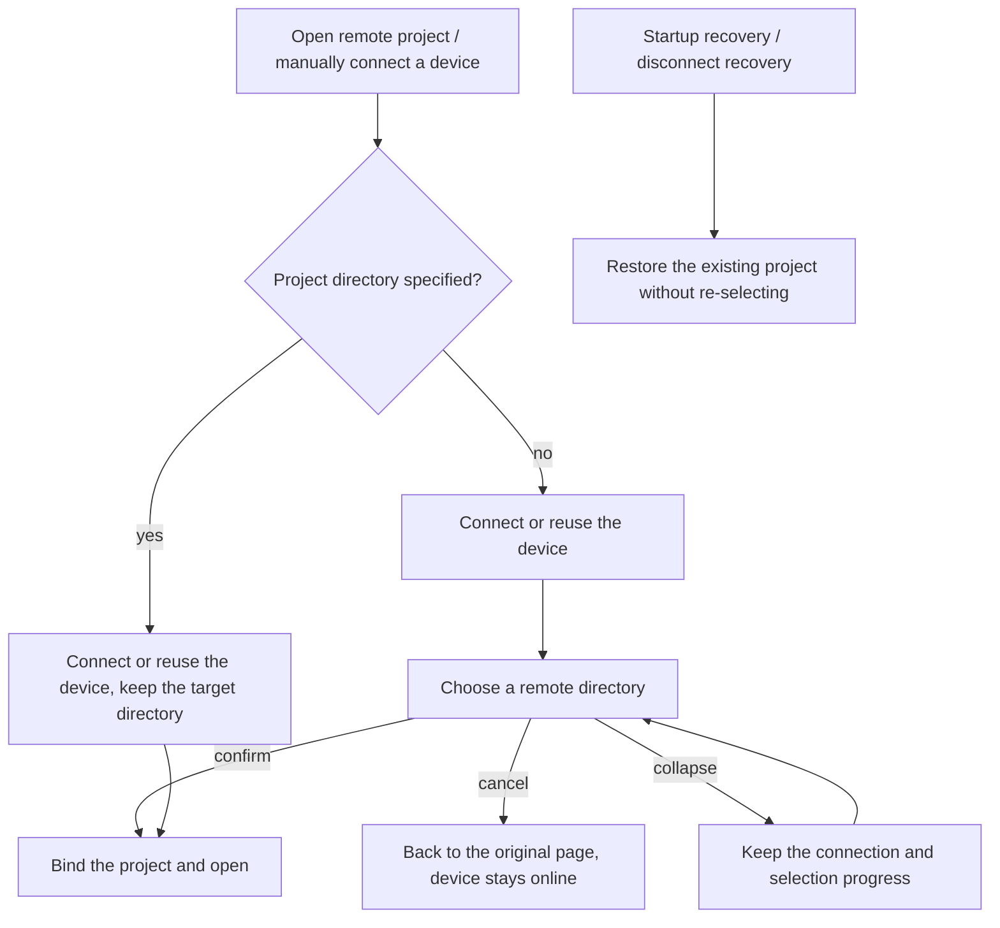

# Flat project navigation and choosing the remote workspace after connecting

The 2026-10-12 confirmed next-round goal is
[separating project creation from remote connection management](../issues/remote-connection-ux/15-project-device-selection-and-connection-management.md)
(ready-for-agent, not yet implemented). When that ticket is implemented, the project plus entry, the unified
ending of directory-less manual connections and the cross-page draft rules follow the target spec; this
document's existing-project reconnect, startup recovery, identity isolation and historical data boundaries
stay valid. The "implemented" marks and run evidence below correspond only to the original batch.

Full history (verification diaries): `git show b8876e8b:docs/remote/project-first-remote-navigation-spec.md`

## Status and scope

- Status: implemented (2026-09-16); prototype A confirmed; local verification passed; the scope of real remote / mobile verification is in §9.
- Source: this round's grill-me / grilling discussion, Q1-Q7 confirmed.
- Scope: the sidebar "项目" (Projects) tab, the remote project opening flow, disabling the remote no-project chat UI.
- Covers SSH / WSL / Docker / Direct Server; the device, route, identity and connection management model keeps the current architecture.
- This spec is the current project navigation contract. It replaces the old spec's device-grouping and connect-and-chat UI paragraphs; the device, route, Host and data-compatibility models stay valid.
- Non-goals: deleting historical chat data, migrating remote chats to local chats, rewriting the connection/authentication/install/upgrade protocols, extending the project list to the device file system or all historical directories.

## 1. Confirmed product decisions

| Decision                          | Contract                                                                                                                                                                                                                                         |
| --------------------------------- | ------------------------------------------------------------------------------------------------------------------------------------------------------------------------------------------------------------------------------------------------ |
| Q1 Project display                | The "项目" tab drops the device layer. Local and remote projects are flat in one "项目" group. Remote projects keep light device identification, using the confirmed compact A device tag and status colors.                                     |
| Q2 Opening a project              | After a manual device connection without a project, choose a remote directory; clicking an existing project opens it directly; startup recovery and disconnect reconnect restore the original project without choosing a directory again.        |
| Q3 Disabling remote no-project UI | All creation and history-access entries are disabled, history data is kept and no longer auto-restored; nothing is migrated, and no remote task, index, chat file or backing workspace is deleted.                                               |
| Q4 Entry points                   | The settings page and the remote connection dialog keep managing devices; the sidebar keeps a global "打开远程项目" (Open remote project) entry as the plus menu of the "项目" group title. Existing projects open/connect from the project row. |
| Q5 Ordering                       | Local and remote projects share one global order, may be dragged across devices and the order is remembered; connection state changes do not change position; offline project rows stay visible.                                                 |
| Q6 Cancel and collapse            | Cancelling directory selection returns to the original page, releases the temporary session not yet bound to a project, keeps the device online, adds no project or chat and does not affect other projects; collapse keeps progress.            |
| Q7 Remove-project actions         | The remote project composer hides the project tag's x and "不在项目中工作" (Work without a project), keeping the ability to switch projects; local behavior is unchanged.                                                                        |

```text
Projects tab
├─ Projects
│  ├─ local project A
│  ├─ project B of remote device 1
│  └─ project C of remote device 2 (kept while offline)
└─ Tasks
   └─ local no-project session
```

When a local project is unbound, the current tab is matched by the full
`workspaceKey = workspaceIdentity?.trim() || workspacePath`; a same-path remote tab placed earlier must not
shadow the local project or the local conversation tab. An existing local conversation tab is reused
directly; remote projects keep forbidding unbinding.

Projects with the same name and path on different devices remain different entries. The device name is for
display only and must not take part in identity equality, sort keys or persistence isolation.

<a id="2-入口与连接顺序"></a>

## 2. Entries and connection order



- A manual entry without an explicit directory always enters directory selection; no remote no-project chat draft is created or activated.
- Existing-project and recent-directory entries must keep the original project intent; when credentials, install or upgrade are needed they complete inside the wizard and then continue with the original project.
- The "recent projects" of a settings device card resolve the original project from locally saved entries by Source identity and directory and fix the entry ID before connecting; online clicks and offline reconnects both reuse the existing project-recovery chain, never enter the project creator and add no project. Passing only a directory must not demote an open intent to a create intent; a missing entry, or several entries for the same directory so the original project cannot be determined, reports "cannot determine the original project", keeps the current page and never guesses. After connecting, the original entry and Host membership are re-validated, and a removed entry is not revived.
- Original-project recovery resolves, after connecting, the entry's valid project from the owning Host's project tree, passes its projectId explicitly into draft initialization and updates the draft scope; a missing local draft cache, or one still pointing to another project of the same directory, cannot substitute the original project identity. Old entries reuse the directory owner's unique-match rule; a missing or deleted project, or a mismatching directory, stops recovery. Reconnects that only restore an existing session keep the session selection.
- A saved project does not require an existing Renderer tab. The desktop menu is dispatched by Root and an unloaded project is resolved from the local membership directory; with complete credentials only the device is restored. When interaction is needed, the exact Profile and original project entry are carried, and after handling the original directory is bound directly without entering new-project editing. The membership is validated to still exist at handoff and before completion; when the Profile connection intent differs, the Source "choose directory after connecting" intent is carried.
- For a saved project with no loaded tab, the operating route follows the Host's default Profile selection rule; failures of other routes only take part in device display and must not replace the default route or block its connection. The handoff uses only the operating route's state and errors.
- The original-project completion intent fixes the entryId and the host membershipId. After async steps such as directory binding return, the original instance is re-validated from the membership directory before committing connection history and navigation; an entry removal or membership generation change cancels the original intent, does not fall back to new-directory selection and does not release an attachment reused by other projects.
- A project is added/activated only after directory binding succeeds. An invalid path, no permission or binding failure must not add a ghost entry; existing error display and directory-correction ability are kept.
- Global new, shortcuts and history-activation paths must not bypass the remote no-project UI disabling via the old active workspace.
- Opening a local project, a new task inside an existing project, in-project task recovery and group management itself keep existing semantics.

<a id="21a-侧栏详情与设备菜单rdux-12"></a>

### 2.1a Sidebar, details and device menu (RDUX-12)

- A project row shows in one line a five-state icon, the project name and a width-limited device name (kept for both online and offline, see RDUX-IDENTITY-01). When not online, status text follows the device name: when the display model is pending (`pending`) its short status shows (需要更新 needs update, 需要安装 needs install, 需要确认新设备 needs new-device confirmation, 需要补充密码 needs password) in the warning color; connecting (including automatic recovery and device online with the project not yet ready) shows its short status "连接中/更新中" (connecting/updating); failure shows "连接失败" (connection failed); other non-online states show "离线" (offline); remote online with the project unresolved shows "请选择项目" (choose a project). No extra error icon, diagnostic icon, duplicate spinner or permanent reconnect button; connection progress and failure reason appear only in the hover details (see "Connection progress details"), row-end actions appear only on hover/keyboard focus, and touch keeps a reachable entry.
- Hovering a project row for 300ms, or keyboard focus, opens read-only identity details anchored to the row's right edge so they do not cover row-end actions. A click keeps the row's original action and does not lock the details; Escape, the mouse leaving the trigger area and the popover, and keyboard moving away close them.
- The detail title uses the same project display name with status right-aligned, using the display model's short status (same as the project row; no generic "需要处理" needs-attention any more). While connecting or on failure, a connection progress block or failure reason block appears under the title first (see "Connection progress details"), then project, full device name, connection type, address and the full remote path; online and pending do not show that block. The details have no connect, disconnect or edit buttons; those actions stay in the project menu and the device settings entry.
- Pending exception (2026-10-14, plan C): when the display model is `pending` on desktop, an entry row "⚙ <display-model action name> ›" is appended below the separator at the bottom of the details (such as "更新远端" update remote, "更新桌面端" update desktop, "安装并连接" install and connect, "作为新设备使用" use as a new device, "补充密码" supply password). The action name reads the same connection-manager state as the settings device card: the project Host projection carries `upgradeTarget` together with `lastConnectionStatus`, so when the desktop version is too old (`upgradeTarget: controller`) it shows "更新桌面端" and cannot fall back to "更新远端". Clicking closes the details and opens "Settings › Remote devices" positioned at that device card, where the settings page does the actual handling; the details themselves perform no update, install or identity confirmation. Web has no remote-device settings page and does not show this entry. Explanatory copy is not yet differentiated by scenario.
- Remote project menu entry (2026-10-16): on desktop the more menu and context menu of remote projects (online, offline and pending) offer "远程设备设置" (Remote device settings), after the sync/connect actions and before edit project. Clicking shares one navigation with the pending details entry: open "Settings › Remote devices" positioned at the project's owning device card; the menu itself performs no connect, disconnect or update. Local projects and Web do not show it.
- "Project + → 打开远程项目" expands all saved devices from the device-management snapshot, regardless of opened projects; online devices reuse the connection and go to directory selection, offline devices connect first and then select a directory. The last item "新建远程连接…" (New remote connection…) enters the existing wizard.
- The session header keeps a status icon and device name; hovering the project name and full path matches the sidebar. The composer's project switch menu shows project name, device name and non-online status compactly in one line (device name kept for online and offline), and search matches project name, directory and device name. All task-row views share the device tag's font size and color.

```text
project row hover/focus → read-only identity popover → opens at 300ms → closes on Escape/leaving the area/keyboard moving away
pending-details entry / project menu "远程设备设置" → setPendingSettingsSectionIntent(remoteDevices, sourceServerId) → settings page positions the device card
project menu connect → existing Root project connection entry → original directory attachment
menu device → existing single wizard → connect or reuse → choose directory
manage device → one-shot settings navigation intent → SettingsPage → focus the matching device card
```

These states belong to UI navigation and popovers only; connection facts still come from the Host management snapshot and project identity still uses workspaceIdentity. Desktop continuous and mobile replayable keep their own recovery chains.

### 2.1b State subscription of a newly created empty project

Before the remote project tree returns, `bindRemoteProjectIdentities` must finish identity preparation for all
project roots and task cwds through the existing resolver, deduplicated by path. Empty projects take part
too; the preparation scope cannot be derived only from existing tasks. A preparation failure is reported to
the caller; publishing an unprepared tree and subscribing early is forbidden. The process opens no tab,
starts no Agent, adds no project entry, and directory and duplicate-project rules are unchanged.

```text
owning Host readTree → roots + task cwd deduplicated → existing identity resolver done
                                         → publish tree → Controller workspace/sessions-index subscription
```

Reason: a dynamic listener created early binds to an unmapped emitter, and a mapping registered later at first open does not rebind the old listener. The fix prepares at the tree-publish boundary, keeps the original subscription recovery of desktop-continuous / mobile replayable and the same remote owner, and adds no mapping or retry mechanism. Regression covers real-time permission display for an empty project's first send, existing task directories, shared-root dedup, and a preparation failure not publishing.

### 2.1 Three-screen selection and collapse (RDUX-10)

"Open remote project" always enters from a searchable unified list; source and platform gates are in the
[UX spec](../architecture/remote-device-connection-ux-spec.md#三屏向导与统一选择2026-09-28rdux-10). A device
row selects a directory after connecting; a recent-directory chip (including for offline devices) opens that
directory after connecting. A new-form inside the first screen adds no progress step.

At the top of the project area a display slot is reserved for the single collapsed wizard: a two-line card shows the device, the stage ratio and the current stage; a failure card keeps the reason and recovers on click, and no popup opens before it is viewed. The card is rendered directly by the wizard session; the sidebar only provides a DOM container and holds no request, log or state copy. Closing clears the draft and cancels the connection while input history is kept. Recovering the card keeps the original intent; a new explicit entry uses an independent intent identifier, an idle or failed flow yields and revokes the old epoch and pending confirmation, and the latest Profile/target and directory are consumed again; a truly in-progress flow, or one with a pending-bind session, is not preempted. This entry state is still held by the single wizard owner.

### 2.2 Disconnect experience and in-place reconnect (RDUX-08)

- The sidebar reconnect button, offline project row, detail card and settings page share one connection intent: with a directory the original project is restored; without a directory, select a directory after connecting. Directory selection offers "稍后选择" (Choose later), which closes the wizard, releases the temporary attachment of the unbound project, keeps the device online and adds no project.
- An existing project first goes through Root's existing reconnect path; with complete credentials no wizard pops up and the project display model shows connecting. Success does not preempt the current page. When credentials, install, upgrade or identity confirmation are needed, the single wizard goes directly to the corresponding waiting point of the connection step, keeping the directory intent.
- For a manual original-project handoff `source-server-upgrade-required` follows main spec §6.3: the wizard reads the latest Host snapshot, confirms the upgrade target is the remote and automatically runs one `force:false` update, then continues with the original directory. The running-task guard still requires explicit confirmation; a too-old local machine only prompts to update the local machine. Cancelling or switching intent invalidates old async results, collapse/restore does not repeat the update; an update failure, or still incompatible after the update, keeps an explicit retry entry and does not loop. Startup and background recovery after disconnect keep waiting for user action.
- If reading the Host snapshot fails before an upgrade, both ordinary connection and original-project handoff show the actual read error with a "重试" (Retry) button, keep no "更新远端" button without an update target and never auto-update from an old snapshot. An explicit retry keeps the original route and directory, reconnects and re-verifies the upgrade; a late read exception after cancel must not override the cancelled state.
- A compatibility failure carries the `profileId` the Host actually used, preserved through Main/platform connection results and the original-project failure handoff to the wizard. The wizard validates the latest snapshot's route and upgrade state by that ID and this failure's normalized target and continues the original intent with the actual connection parameters of the failure; WSL's default distribution and default user are resolved by Main, so unresolved parameters must not be used to rebuild the route identity and an omitted user must not be treated as matching any user. Old calls without an ID keep exact-target matching; a removed specified ID, or one with no executable upgrade state, offers retry, selects no other route and leaves no no-op update button. A too-old local machine still only prompts to update the local machine.
- Upgrade recovery fixes this failure's target identity and must not overwrite it with the latest Profile of the same ID before matching. An async original-project reconnect handoff keeps the non-sensitive `failedTarget`; if the Profile was re-addressed after the wizard opened, the new route's credentials are not read. A WSL upgrade failure also carries `resolvedWslTarget`; without an actual distribution/user, automatic update stops and retry is offered. When the latest route is re-addressed, removed or retired, the old recovery stops, the new target is neither updated nor reconnected, and the original directory intent is kept.
- Wizard automatic update, explicit update and the forced update after running-task confirmation all submit a non-sensitive `expectedTarget`. The Host validates identity at the update entry and resolves and fixes the execution target from the same already-read Profile; a re-address after snapshot validation must be rejected, and a re-address after Host admission must not drift the execution target. Renaming only the display name does not change the target identity. The original requestId/entryEpoch is reused; no persisted revision or recovery owner is added.
- WSL first-install waiting also keeps the Host `profileId` and carries `resolvedWslTarget` containing only the actual distribution and user. The wizard shows the install preview, waits for confirmation and continues with the original directory using that actual target; a failed preview snapshot affects only additional info and does not lose the install wait or target. Changing the system default distribution or user before confirmation must not change the awaited install target. After cancel, close or switching entry, a late snapshot and an old confirmation cannot resume the install.
- The WSL form syncs distribution and user when it accepts a connection target and clears omitted fields; returning to configuration after a saved route's connection failure, after an install wait, or after an upgrade edits the current target and does not borrow the previous route's input. All four combinations of default/explicit distribution and default/explicit user keep their intent; Host-resolved install/upgrade waits use the actual parameters.
- An ordinary reconnect failure keeps the project row and the categorized reason; clicking again enters the wizard connection step with the failure log expanded and does not dial again automatically. Only an explicit retry sends a new request.
- When the session attachment is not ready, the page banner, content placeholder and existing draft are kept, sending is disabled, no offline queue is created and nothing is sent automatically after recovery. Only content still held by the existing session owner may be shown faded read-only; no content cache is added.
- Timeline, grouped, pinned and archived views each keep one connection placeholder row for an offline project and hide stale tasks. Search and send-race errors use readable remote-connection category copy.

```text
project entry → Root reconnect owner → Host connection / attachment admission
             ├─ success → original project ready; current page unchanged
             ├─ pending → single wizard takes over the original directory intent → user handles → attachment admission
             └─ failure → project row reason → user views → wizard connection step and log
service invalid → existing reattach gate closes → banner + placeholder + draft (submit forbidden)
desktop-continuous / web-remote-replayable → each existing recovery boundary → same remote task owner
```

<a id="23-重连与重启后回到原处rdux-09"></a>

### 2.3 Returning to the original place after reconnect and restart (RDUX-09)

- The restore target stays with existing tab persistence: TabStore / `lastWorkspaceSession` / `lastActiveTabIndex` save the project and activation position, and Layout's existing `usePaneSessionPersistence` saves that workspaceKey's last session ID. Both save only navigation choices, not remote content, and add no recovery owner.
- Main-window cold start restores the last activated project (remote included) and session; `restoreTabs` marks the startup-activated tab, and only that tab may consume the cold-start session selection. Explicitly opening a project, a new window and new tasks keep the original navigation intent. Background tab fill or Source recovery does not steal focus; same path on different devices is isolated by identity.
- Host local warm-up still selects only local workspaces. Renderer activating a remote tab does not mean the Host may warm up by a remote path; the two no longer have to select the same project.
- Per the [Renderer reattach gate](./desktop-remote-session-renderer-reattach.md), after Source online, workspace bind, services registration and ready ACK must still complete; before the first reattach only a connection placeholder may show, with no remote session subscribed or rendered. A recovery terminal state of not-connected or failed stays on the original tab with the existing banner and never auto-jumps to local.
- After a successful reattach the original session selection is kept and no new-task action is called. Only for a selection existing at startup recovery and the moment of attachment reattach, and only when the workspace's authoritative `getTaskMeta` confirms the session no longer exists, does it enter the new-task page of this project and clear the old selection; a normal new-task ACK arriving earlier than index persistence does not take part in this missing judgment. An RPC failure is not a session deletion. Old query results are dropped after switching project, session, new draft or services generation.
- Disconnected content that is already loaded and still held by the existing session owner keeps following the read-only retention rule of RDUX-08. No Source auto-connect eligibility, lifecycle, retry or identity rule changes here.
- Only desktop `desktop-continuous` consumes startup navigation recovery; mobile `web-remote-replayable` neither reads nor writes desktop pane selection and still recovers through the original attachment / snapshot / gap flow.

```mermaid
sequenceDiagram
    participant P as Tab and pane persistence (navigation owner)
    participant R as Renderer reattach gate
    participant S as Source / Host
    participant T as Remote task owner
    P->>P: Restore the last activated project and the session T selection
    P->>R: Original tab shows a connection placeholder
    S-->>R: Source online
    R->>S: workspace bind / services registration / ready ACK
    alt reattach failed or not connected
        R-->>P: Keep tab and target, show banner
    else reattach done
        R->>T: Query T by workspaceIdentity
        T-->>P: exists -> original session; missing -> new task of this project
    end
    Note over R,T: No remote content is read or rendered before reattach; late results must not override the new navigation intent
```

Acceptance reuses the tab-persistence, pane-restore and reattach test boundaries; the real-SSH cold-start case
`SSH-P0-LIFE-01` adds assertions for the original activated project/session, reattach placeholder, manual
reconnect keeping the selection and deleted-session fallback. Existing mobile replayable unit tests and
integration cases remain as unchanged-boundary regression.

### 2.4 A remote project directory deleted externally

- On first open, explicit bind and disconnect recovery, Host workspace admission confirms through the current remote File Service that the directory is readable and traversable before preparing the identity mapping. The existing `readdir` RPC reads `workspacePath + "/."`; the trailing `/.` is kept so the remote file system also verifies traverse permission of the target. A successful `stat` of the directory itself cannot prove access permission; no remote Server upgrade is relied on and no control-side local file system is used to check the remote path.
- Only directory access is checked, not write permission; a read-only but readable and traversable directory still opens. The check lists only the root, no recursive scan; identity and persistence keep the original path, and the probe path must not become a new workspace identity.
- A nonexistent directory, a non-directory path or insufficient permission returns `remote-workspace-directory-unavailable` and fails only that project's recovery. The device stays online and other projects of the same device continue to recover; even when an invalid project initiates the SSH reconnect, the directory error must not be treated as a credential failure blocking other projects.
- An already-open project stays in the sidebar and the persisted open set, showing the failure and a directory-unavailable hint; it is not marked connected, task history is not deleted automatically and a directory the user deleted is not recreated. After the user restores the directory it can be retried. A newly picked invalid directory must not add a project.
- Directory validation uses the existing Host scope and cancel signal; a late result after cancel must not keep binding identity or record open history. Desktop continuous and mobile replayable share this Host boundary and add no connection or task owner.
- This is open/recovery-time validation and adds no online directory watcher; file operations after a directory is deleted post-bind follow their original I/O errors.

```text
Source Manager: device online
  -> Host workspace admission: remote readdir(directory/.)
       -> readable and traversable: identity mapping -> existing attachment/Controller -> project connected
       -> invalid directory: project fails -> keep the history entry; other projects continue admission
```

## 3. Disabled surfaces and historical data

A remote no-project session is determined by remote workspace identity and `workspacePurpose=conversation`,
not by filtering "remote tasks" or path names; normal tasks in remote projects stay visible and usable.

The disabled surfaces include at least:

1. The sidebar remote "任务 +" (Tasks +), the device card's "在此设备聊天" (Chat on this device), and the settings device "新建任务" (New task).
2. The branch where a successful manual connection opens a conversation by default.
3. The composer remote project tag x / "不在项目中工作".
4. Remote no-project sessions in "分组" (Group), pin, search, timeline, archive and other history entries.
5. Old conversation open entries in startup recovery, Renderer reattach and device-online recovery.
6. Bypasses in global new, shortcuts and persisted active workspace recovery.
7. The corresponding history entries in mobile remote control; desktop local no-project chat and remote project tasks are kept.

Historical task data, original session content and remote backing directories are kept. Filtering UI open
membership and deleting remote data are different operations, and remote data cleanup must not be carried out
under this change. Whether the underlying conversation capability is relied on by other callers must be
checked at implementation; this spec authorizes no unrelated service deletion or storage migration.

## 4. State ownership and multi-platform boundary

| State                            | Authoritative owner / boundary                                                                                                        |
| -------------------------------- | ------------------------------------------------------------------------------------------------------------------------------------- |
| Device, route and online/offline | Existing Source Directory / Host connection manager; removing the display layer is not deleting the device model.                     |
| Project identity                 | `workspaceIdentity?.trim() \|\| workspacePath`; the same path on different devices cannot merge; paths are for display and execution. |
| Project list and order           | Existing workspace/open-set and ordering persistence path; no second accepted order per device is introduced.                         |
| Directory-selection draft        | The single remote connection dialog; cancel, collapse and confirm use the existing lifecycle paths.                                   |
| Tasks and messages               | Original CLI/runtime owner; no state moves into sidebar, main or relay.                                                               |

```text
desktop-continuous   → existing direct realtime chain ──────────┐
                                                               ├→ existing Host / CLI state owner
web-remote-replayable → shared-host attachment → recovery boundary ┘
```

- Mobile `/remote` keeps attaching to the desktop's existing Host and creates no independent Agent, SSH/WSL/Docker session or local host.
- Remote paths keep `workspaceIdentity` and `remoteSessionId` end to end; owner/lease routing and stale-run protection are unchanged.
- Mobile device management / new-connection capability is not expanded by the layout prototype; the UI follows the existing platform capability.
- Device online, offline and attachment recovery do not reorder projects; only a manual user sort updates the sort fact.
- Light/dark, desktop/narrow, Chinese/English must all be verified; hover is not the only way to identify a device.

## 5. Display rules

Project rows, details and the device menu follow §2.1a; colors, icons and status priority refer only to the
[UX five-state table](../architecture/remote-device-connection-ux-spec.md#统一展示合同2026-09-27rdux-03).
The old A/B/C prototype discussion and the green/blue/orange/red four-state scheme have been retired and are
not the current visual acceptance basis.

## 6. Acceptance cases

The following is the acceptance list of the confirmed contract. Tests come before implementation; executed
unit tests and local Electron E2E, and the real environments not yet verified, are in §9.

| ID     | Scenario / action                                                                 | Assertion                                                                                                                                   |
| ------ | --------------------------------------------------------------------------------- | ------------------------------------------------------------------------------------------------------------------------------------------- |
| RPN-01 | Local and two remote devices all have open projects                               | One "项目" group, no device layer, remote project identity independent.                                                                     |
| RPN-02 | Two devices have projects with the same name and path                             | The owning device is identifiable; clicking enters each workspace.                                                                          |
| RPN-03 | Drag across devices and restart                                                   | Order kept; device online/offline does not reorder.                                                                                         |
| RPN-04 | Click the original project after going offline                                    | Row stays, the original directory opens after connecting, no remote no-project draft is created.                                            |
| RPN-05 | Manual connect of each remote type without a directory                            | Choose a directory after success; no project or remote chat is added before confirming.                                                     |
| RPN-06 | Original-project connection needs credentials/install/upgrade                     | Connection completion continues the original project, errors retryable, no silent dead end.                                                 |
| RPN-07 | Cancel after a successful connection at directory selection                       | Original page kept, device online, other projects unaffected, project/chat counts unchanged.                                                |
| RPN-08 | Restore after collapsing the directory step                                       | Progress and selection kept, the connection is not cancelled.                                                                               |
| RPN-09 | Startup and disconnect recovery                                                   | Original project restored with no directory prompt; old remote conversations not restored.                                                  |
| RPN-10 | Historical remote no-project sessions in group/pin/archive indexes                | All UI entries hidden, data kept; remote project tasks work normally.                                                                       |
| RPN-11 | Remote composer, global new and shortcuts                                         | x / "不在项目中工作" invisible; cannot enter remote no-project chat.                                                                        |
| RPN-12 | Local projects and no-project sessions                                            | Existing new, unbind and history access do not regress.                                                                                     |
| RPN-13 | Desktop and mobile access the same remote project                                 | shared-host and identity isolation kept; continuous / replayable not mixed.                                                                 |
| RPN-14 | Dark/light themes, zh/en, narrow screen, keyboard                                 | Devices distinguishable, status not by color alone, menus not clipped, focus visible.                                                       |
| RPN-15 | Invalid directory or bind failure                                                 | Error stays in the selection flow, no project added, execution device not switched.                                                         |
| RPN-16 | One of three remote projects has its directory deleted externally, then reconnect | Device online, remaining projects recover; the deleted one is kept but shows failure, directory not recreated; retry works after restoring. |
| RPN-17 | Desktop remote project more menu / context menu                                   | Has "远程设备设置", opens settings and positions the owning device card; local projects and Web have none.                                  |

## 7. Manual connection and automatic recovery

### Mutual exclusion between manual connection and automatic recovery

Root's current connection intent keeps the existing target tabId (an in-window identifier, not a new
workspace identity). While the wizard is active or collapsed, device-online recovery handles only other
projects; that tab's directory binding is completed by the wizard. The tabId stays the same across the
legacy -> stable identity re-projection, so the mutual exclusion is not lost on a key change. When the wizard
completes/cancels the gate is released and recovery still follows existing open membership; collapse does not
clear the intent, and a failed connection is not retried automatically when the popup is restored.

```text
Source online
  ├─ tabId held by the current wizard → wizard completes the original directory binding
  └─ other open projects              → existing automatic attachment recovery
wizard complete/cancel → release the temporary gate; collapse → keep intent and error
```

This boundary adds no accepted queue, Host owner or connection cache; it only makes the existing two UI
entries obey the same explicit user intent. RPN-04 and RPN-08 unit tests first showed the duplicate admission
and the unexpected retry after collapse, then verified the fix.

## 9. Verification and limitations

(§8 does not exist in the source document; numbering is kept.)

### Settings recent-project restore (2026-10-16)

Root cause: the settings entry passed only the Profile and directory, so Root had no saved entry ID and
skipped the original-project recovery branch. The fix reuses the sidebar directory owner and fixes the unique
entry ID by Source and directory at click time; connection completion continues with the existing membership
re-validation and navigation, with no new state cache or retry. A review follow-up: after entry validation the
projectId was still not passed, so a draft would reuse the local cache, become unclassified when missing or
point to another project when stale; recovery now resolves the valid project from the owning Host, hands the
project ID to Root's draft owner and updates both the in-memory and persisted scope. An explicit project draft
and restoring the old session selection are mutually exclusive.

Verified on macOS Desktop + a fresh Linux SSH container: with a missing draft cache and with a leftover cache
of another project, the original project is restored and the persisted scope corrected, the entry set is
unchanged and no creation dialog appears. Not run: Windows/Linux Desktop, WSL, Docker transport, mobile; the
settings device-management entry is open only on desktop; the candidate E2E stays pending.

### Connection-intent isolation regression (2026-09-16)

When an existing project enters the wizard, the external preference initializes the current connection intent
only once; later credential supply, install, upgrade and retry read the wizard's `pendingCompletionIntentRef`.
When the device page explicitly selects "新建连接" (New connection) or another route, the old project
directory and the Root-held `preferredWorkspaceTabId` restore mutual exclusion are cancelled, and a connection
without a directory must enter directory selection after success.

Form credentials belong only to the current target. Auto-filling another device (including returning to
configuration after a missing Profile credential) must clear the previous password, private-key passphrase
and Server token; a missing credential must not become reuse of another device's credentials. Filling an
existing SSH target keeps that target's `assetInstallMode`; only a new route uses the default download mode.
Collapse/restore of the same intent keeps the draft and does not re-consume the external preference.

```text
existing-project preference → wizard current intent → supply credentials / install / retry → original project directory
                      └→ explicit new / switch route → clear old credentials and project intent → choose a new directory
Root holds only the current project's restore exclusion; released as soon as the project intent is cancelled.
```

The regression corresponds to RPN-05/06/08: real form component tests cover both target entries, password/
passphrase/Server token isolation, new connection and route switching, install retry and download mode; a
local Electron case covers the project entry, form backfill and new-connection switching. The fix lies only
in the UI intent boundary and changes no Host, protocol, task data or desktop continuous / mobile replayable
chain.

### Batch verification (2026-09-16)

Targeted unit tests cover project purpose filtering, same-path isolation, expand and ordering, recovery
keeping data, manual/background recovery exclusion, directory selection after connecting, original directory
preserved across upgrade, credential gate, no retry after collapse, mobile history projection and
connection-address redaction. The local Electron E2E `conversation-session-rpn-project-navigation.test.ts`
(under `manual-review/pending`) covers the flat layout, single project/task grouping, device detail isolation,
details with no connection side effect, Escape not reopening the tooltip, old conversations not restored,
canonical data kept and a project-name click entering the unique connection wizard; it sends no prompt and
connects to no real remote. The old device-group-header/connect-and-chat pending cases belong to the
superseded UI contract and are not acceptance for the new feature.

Not fully run: real SSH / WSL / Docker / Direct Server connection, install, upgrade and disconnect recovery,
and real-phone shared-host integration. Component and state unit tests must not be described as real remote or
mobile E2E passes. The change can be rolled back as a whole by reverting its commit; no remote session, task
file or canonical conversation mapping was deleted, and no protocol, owner/lease, continuous/replayable or
physical connection management changed.

<a id="连接进度详情2026-10-15"></a>

## Connection progress details (2026-10-15)

Regression background: the 10-10 merge lost the Host's `onLog` injection for project connections and Main
never registered `project-connection:*` requestIds, so the sidebar (i) diagnostic tooltip was always empty;
also the "connecting" project-row status text fell into the "离线" branch. After the fix the sidebar no longer
uses requestId text logs but reads the structured operation log of the connection management service; the old
channel and diagnostic icon are deleted.

Aimed at users, not developers: no raw log lines, timestamps or levels. The confirmed prototype D (light
semantic-background block + segmented progress bar):

```text
┌ project name ─────────────────────── 连接中 ┐
│ ┌──────────────────────────────────┐ │
│ │ ⟳ Install ZCode Server 43%         │ │  current stage + percent only for upload/download
│ │ ▬▬▬▬ ▬▬▬▬ ▬▬── ────               │ │  4 segments: done filled, current by progress, not started empty
│ │ Step 3/4 · 32 s elapsed · auto-recovery 2/3 │ │
│ └──────────────────────────────────┘ │
│ project / device / connection / address / directory │
└──────────────────────────────────────┘
```

- Stages share the same stage projection with the connection wizard (RDUX-11): connect device / identify device / install ZCode Server / start and check compatibility; the raw phase merge rule exists once. A skipped stage (such as the install stage when already installed) shows as done together with later stages. With no log yet, step 1 is shown.
- The percentage comes only from the current upload/download log's `progress`; in other stages the current segment breathes as a whole.
- Elapsed time counts from the first log time of this operation; a new operation (including each attempt of automatic recovery) replaces the old log and the timer resets. The timer refreshes every second only while the details are open, is for display only and takes no part in timeout decisions.
- The Host's recent log keeps "the most recent operation", not necessarily "the operation in progress". When the last entry is a successful terminal state (`ready`) or a failure (`error` level), that operation has ended: after an unexpected disconnect, before the first retry and between retries. Then it is shown as "no log yet" (step 1, no elapsed time), keeping only "auto-recovery n/m"; once the next attempt starts, the Host replaces the log and progress appears.
- Auto-recovery `n/m` comes from the device's `recoveryAttempt/Limit` in the status registry; the project row still shows only "连接中".
- Failure (display model `failed`, or offline with an error) shows a light-red block: a readable reason by error category, "连接失败" when it cannot be classified, plus a "复制错误详情" (Copy error details) button copying the same raw connection error text as the old diagnostic entry (the Host projection's `lastConnectionError` or the old workspace error); the raw text is not shown directly; "已复制" (Copied) corresponds only to the copied raw text and returns to "复制错误详情" when the error changes.
- Data is read-only: `host.id` -> `sourceServerId` (same resolution as the Host-side `resolveProjectHostService`) -> status registry inputs (`profileId`, recovery count, error code) -> `getRecentOperationLogs(profileId)`. The log is not subscribed while the details are closed; a URL Server direct connection (and a Host without `sourceServerId` yet) has no Source management domain, shows no progress area while connecting and keeps only "连接中" at the title's right; the failure block is unaffected.
- Mobile Web remote control has no hover and only gets the project-row status text fix.

```text
Host connection pipeline → SourceServerOperationLogs (sole log owner)
      │ onDidAppendOperationLog (invalidation notice only)
      ▼
details open → useSourceServerOperationLogs([profileId]) → stage projection (shared with the wizard) → progress area
status registry (sourceServerId) → recovery count / error code ──────────────┘
```

Verified (2026-10-15) with a macOS Desktop + Linux SSH container `retry-budget` E2E: after a network cut the
project row shows "连接中" without a diagnostic icon; with the details open "auto-recovery 1/3, 2/3, 3/3"
increments live and after exhaustion the same popover switches to the failure area (readable reason + copy
error details); after the network returns, silent recovery and manual takeover each still get a new session.
The earlier known failure `displayedAttempts=[]` (remote-e2e-stability #20) is now visible in the details.

## Remote identity hover details (2026-10-13)

The composer project menu and the sidebar remote project row share a read-only details popover. Sidebar
session rows (inside projects, the pinned area and recently updated) show no remote identity details on hover
or focus and keep their original session actions. The popover shows the project, full device name,
connection type, address, directory and the existing five states; projects with the same name are
distinguished by Host + project ID, names come from the existing Source name projection, and address and
status come from the corresponding Host, never substituted by the currently active device. Offline projects
can still be viewed; selection and navigation permissions are unchanged.

The confirmed "compact one-line" prototype is used. The popover has no close x and no click lock; it closes
automatically when the mouse leaves the trigger area and the popover, and on keyboard focus moving away or
Escape. The detail text can be selected and copied, but a selection does not lock the popover; leaving
directly after selecting text, returning to the trigger area and leaving again, or keyboard moving away all
must close it. Moving between the trigger area and the details keeps the original close buffer. Moving into
the popover lets one read the full text, and it does not interrupt the original project expand, select, drag
and task actions. Touch keeps a visible device name, and the details do not change the original selection
semantics. Chinese/English, long names/paths, light/dark themes, desktop and the mobile shared view all apply.

The details in the composer project menu use the menu's own popover layer and must not be clipped or covered
by the menu. The details anchor horizontally to the menu's outer edge with a uniform 4px outer gap, kept
consistent with or without scrollbar, after search filtering and when avoiding left/right; when space is
short the existing left/right avoidance is reused and the width shrinks to the actual available width. The
details do not overlap the menu and the menu options remain operable. When the mouse leaves a project item
the menu returns focus to its container, which does not mean leaving the details and must not close details
the pointer has moved into; truly leaving the trigger and detail areas, keyboard switching or Escape still
close per existing rules. Online and offline projects both apply; acceptance must check the real hit element
at the edge of the details, not just DOM existence or text content.

```text
existing Host directory + Source name projection → project identity → sidebar project row / composer project menu share a read-only popover
sidebar session row hover/focus → original session actions, no remote identity popover mounted
mouse enter/keyboard focus → show → leave area/focus moves away/Escape → close
```

Verification: remote sidebar and real-task E2E, mobile shared-host and project menu passed on 2026-10-13;
Chinese/English, light/dark, online/offline and wide/narrow layouts were checked (run records are in the
2026-10-13 fix section of the case catalog). 2026-10-14 session-hover scope change: the session-row identity
popover was removed (a component regression first reproduced popovers in all three session views, then
verified hover/focus no longer shows them); a macOS Desktop + Linux SSH E2E confirmed project details still
open and session hover shows none. Windows/Linux Desktop and mobile shared-host were not rerun; the candidate
stays pending.
