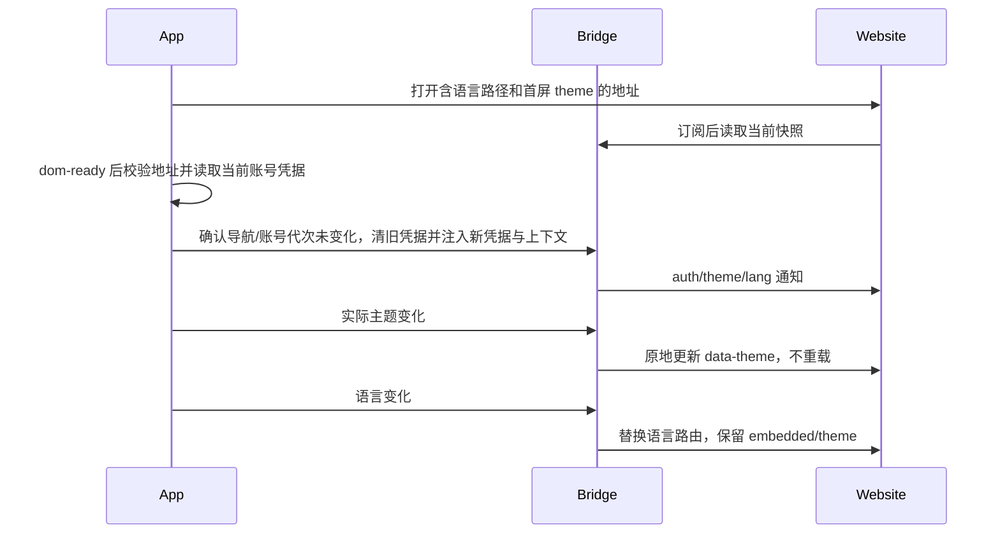

# Rewards embedded integration

## Scope and ownership

On Windows/Linux, the rewards page and its login entry must keep the top window buttons; closing the web page and closing the window are independent actions. `marketing-touch-rewards.test.ts` asserts window controls are visible and unobstructed after opening rewards and login; macOS keeps its native traffic lights.

The Rewards menu entry uses the Lucide `Gift` icon, `size-4`, inheriting text color; the account avatar's `User` icon is unchanged.

The Rewards entry renders only when the existing user login state is non-empty; logged-out or signed-out hides the whole row. Desktop and Web share one condition with no duplicate login state.

Marketing navigate with page=rewards shares the RewardsProvider. The website accepts only /{cn|en}/rewards; both old page=referrals and old /{cn|en}/referrals are rejected. The Provider uniquely holds the post-login continuation attempt ID — dropped on cancel/failure/replacement, opened at most once after success and user-readiness, independent of account-switch rebuilds of marketing instances. See marketing-touch-actions.md.

The menu entry keeps "邀请好友 [奖励] / Refer a friend [Rewards]"; the embedded page title is "奖励中心 / Rewards". Entry copy and title use dedicated rewards i18n keys. The menu width fits Chinese and English content, with light/dark themes and mobile support. The in-page invite-friend, invite-link, and invite-history features keep referral/invite semantics.

The bottom-left avatar menu shows "邀请好友 [奖励]" below Upgrade. The window-level Rewards Provider uniquely owns the open state, independent of plan inventory; it changes no task, model, or settings navigation. App and website share the URL/bridge contract; invitation data and rewards are server-owned — the current static website sample is not business completion. Coding Plan purchase completion, channels, and the theme protocol stay compatible.

2026-09-15 switch verification: 88 related app unit tests, full typecheck, lint, and architecture checks passed with the invite entry and rewards badge kept; macOS Electron 3 E2E cases passed (marketing navigation/single report, menu/theme/language/close, login cancel) — the final run's exit cleanup once reported a process timeout whose PID had already exited, so functional assertions do not imply a clean exit phase; website 5 unit tests, production build, typecheck, affected-file lint, browser checks of cn/en new paths (200) and the old home (404), real invite subroutes, and 390/900/1440px light/dark layouts passed (full website lint keeps pre-existing unrelated errors). Production deployment, real server-side reward issuance, and native Windows/Linux runs were not verified; the task realtime chain and Coding Plan protocol are unchanged.

## Address and modes

The entry shows the rewards badge, keeping the original plugin-badge size, 6px copy spacing, and gift icon style.

The shared EmbeddedWebsiteHeader (invite-friend and upgrade pages) has zero bottom padding, keeping top py-4 and side px-6 / max-sm:px-4.

Layout constraints: the App WebView fills the window's available width with the page scrollbar at the window's right; the website owns content width-limiting and centering. The top navigation stays fixed outside the scroll viewport with no extra App-level scroll container. This fix changes no Coding Plan or web/mobile external-open path.

- Local explicit dev integration: http://localhost:3000; test: https://zcode.z.ai; production: https://zcode.z.ai.
- `pnpm dev:desktop:test` defaults to the test domain; `pnpm dev:desktop` defaults to the production domain; dev mode never auto-switches to localhost.
- Explicit local website integration: `VITE_REWARDS_WEBVIEW_ORIGIN=http://localhost:3000 pnpm dev:desktop:test`. This overrides only the rewards page address — app APIs still use the test environment; language, theme, and auth protocols are unchanged.
- URL: /{cn|en}/rewards?embedded=app&theme={zai-light|zai-dark}; zh-CN maps to cn, en-US to en.
- Local addresses are allowed only for dev/E2E; production and test deployments validate HTTPS origin, exact path, and the embedded marker. User info, forged subdomains, and similar paths are rejected.
- Desktop uses an isolated WebView; web/mobile use the HTTPS external website and website login — the app token never enters a URL or external browser. desktop-continuous / web-remote-replayable, host attachment, and task authoritative state are unchanged.

## State and ordering

### Rewards page request headers (2026-09-16)

Final decision: visiting the rewards page injects no app common headers and no Authorization. The earlier header scheme is withdrawn; full common headers and the Bearer JWT apply only to the app's own `/event/report` — see the [report delivery contract](monitoring/event-report-delivery-reliability.md).

```text
打开 WebView（普通网页请求） → dom-ready → 原 bridge 注入/状态同步（保留）
```

The rewards-specific request-context IPC, hook, Main network interceptor, and their schema are deleted; page loading no longer waits for header preparation.

The bridge keeps login state, theme, language, the storage injection the page needs, and navigation/account-generation validation. Web/mobile external opens still never hand over the app token; task continuous/replayable is unchanged.

Acceptance REW-17: the first request/refresh carries no extra app common parameters and no Authorization; the original bridge/menu/theme/language and mobile external links are unchanged. Earlier header-verification records are historical evidence of the withdrawn scheme, not the current protocol.

Final regression: local Electron `desktop-e2e-20260916-043702-139` 3/3 passed, also confirming the login/anonymous headers of the app's `/event/report`; no Docker. With the dedicated IPC/hook removed, the "request-header context preparation" step no longer exists.



## Bridge v1

### 2026-09-15 direct-switch decision

- Change layers: presentation / validation / commit-effect / persistence; existing state ownership unchanged.
- Page-level directory, components, functions, types, i18n, logs, test ids, and build entries are uniformly Rewards/rewards; the local env config becomes VITE_REWARDS_WEBVIEW_ORIGIN and old variables are not read.
- New partition persist:zcode-rewards and context event zcode-rewards-context; window.zcodeBridge and OAuth/JWT keys are unchanged.
- No migration, reading, or auto-cleanup of the old persist:zcode-referrals partition; no old-event subscription, old alias export, or old-path compatibility; no redirect or fallback-to-old-page on switch failure. Existing invalid-config validation, security rejection, and plain-web no-bridge behavior are not migration fallbacks and stay.
- The website's /invite, /invite/accept, /invite/unavailable, and /referrals/unavailable are real invitation business and keep their semantics; only the old /{cn|en}/referrals root page returns 404.
- Upgrade, redemption, marketing reporting, task/session, mobile replayable, and desktop continuous are unchanged. User data/rewards stay server-owned; page display state belongs to the website; login continuation belongs to the window Provider.

| Acceptance | Setup/action                                                      | Assertions/evidence                                                                                                                  |
| ---------- | ----------------------------------------------------------------- | ------------------------------------------------------------------------------------------------------------------------------------ |
| REW-13     | Build and validate URLs for three environments, cn/en, light/dark | Exact rewards path only; old paths, similar paths, and old config rejected/not read (unit tests)                                     |
| REW-14     | Dispatch old and new events after bridge install                  | Old events do not update state, new ones do; partitions use only new names (unit/desktop E2E)                                        |
| REW-15     | Open from login menu and marketing button                         | Gift + 邀请好友 [奖励] / Refer a friend [Rewards]; rewards routing, auth, language/theme, and single report work (real Electron E2E) |
| REW-16     | Website plain/embedded new and old homepages and invite pages     | New pages 200, old home 404; invite routes unchanged; cn/en light/dark at 390/900/1440px with no horizontal overflow (browser tests) |

These cases are accepted per the user's decision; migration/old-version compatibility combinations are pruned with no migration tests added. The original REF-01…12 login/bridge-isolation case ids are reused; initially new E2E stayed pending — the 2026-09-16 promotion decision is below, without Docker. The graph keeps stable capability ids, adding the Rewards alias and marketing entry relations; codegraph was unavailable, so a two-level static call check was used instead of a claimed full index scan.

window.zcodeBridge provides getTheme/onThemeChange, getLang/onLangChange, getAuthState/onAuthChange. Subscriptions return an unsubscribe function; reads return null before ready. theme is zai-light/zai-dark, locale is zh-CN/en-US. AuthState is {status: ready|anonymous, provider: zai|bigmodel|null, revision: number}; ready only means injection completed, not successful server-side verification. Events never carry tokens. Purchase-completion capability must not appear on the invite page.

Credential keys match the purchase page: the current channel's oauth:zai:access_token or oauth:bigmodel:access_token, plus zcodejwttoken. Old values are cleared on account switch and close; before each injection and after each async read, re-check the current URL, component lifecycle, and account generation — a late old result must never land in a new page. No proactive invite submission or automatic business retry on auth failure.

## Impact surface (static check)

| Layer          | Entry/shared implementation                             | Ownership/constraint                                                              |
| -------------- | ------------------------------------------------------- | --------------------------------------------------------------------------------- |
| must-inspect   | WorkspaceSidebar avatar menu, Root                      | Rewards opening is independent of Coding Plan inventory                           |
| must-inspect   | Web shell, Rewards Provider                             | Reuse display controls; auth and callback stay separate                           |
| must-inspect   | desktop will-attach-webview, preload, partition cleanup | Bridge permissions limited to trusted pages, not spread to normal browsers        |
| should-inspect | CodingPlanEmbeddedWebviewDialog                         | Purchase navigation, close, refresh, and callback keep original behavior          |
| invariant-only | Mobile remote, task flow                                | No runtime, queue, or workspace-identity changes                                  |
| evidence-only  | UI unit tests, Electron WebView E2E, website unit tests | Assert setup/action/result; static samples do not stand in for server integration |

codegraph was unavailable — the above is a static source check, not a full call-graph scan; the semantic graph gained the Rewards node plus purchase-shell reuse and remote-boundary relations.

## Acceptance and handover

| Case   | Setup and action                                                               | Assertions                                                                                                                                       |
| ------ | ------------------------------------------------------------------------------ | ------------------------------------------------------------------------------------------------------------------------------------------------ |
| REF-01 | Build URL for cn/en, three environments, light/dark                            | Domain, exact path, embedded/theme correct                                                                                                       |
| REF-02 | Menu click, repeated open, close                                               | Entry below Upgrade; independent container; original tasks unchanged                                                                             |
| REF-03 | Bridge ready before/after, switch theme                                        | Snapshot readable, one notification, no page reload, unsubscribe works                                                                           |
| REF-04 | Switch language                                                                | Route replaced keeping theme/embedded; no token carried                                                                                          |
| REF-05 | Injection/account switch/close/late async                                      | Old values cleared, only current channel kept, stale injection ineffective                                                                       |
| REF-06 | Foreign domain, similar path, malicious URL                                    | No bridge/no credential injection                                                                                                                |
| REF-07 | Load failure, refresh, reopen                                                  | Recoverable; old events do not leak into the new page                                                                                            |
| REF-08 | Plain website/mobile                                                           | No-bridge does not crash; app token never handed over                                                                                            |
| REF-09 | Coding Plan regression                                                         | Original purchase bridge and completion refresh unchanged                                                                                        |
| REF-10 | Scroll invite page in light/dark                                               | WebView edges match the window; page scrollable; top navigation position unchanged                                                               |
| REF-11 | Banner / standalone dialog dispatches navigate rewards                         | Opens the existing invite page; one report per confirm; no redemption triggered                                                                  |
| REF-12 | Navigate while logged out, then success/cancel/failure/replaced login attempts | Continue only for the same id with user ready; no other login triggers a jump after cancel/failure/replacement; the web external link opens once |

2026-09-16 user-confirmed promotion: the 3 Rewards E2E cases moved to `packages/desktop/test/e2e/ui-shell/marketing-touch-rewards.test.ts`, included in the default spec scan, without Docker. The standard promotion dry run does not support ui-shell, so the marketing-domain manual migration applies. The official run has the runner start an isolated website fixture with a random loopback origin before the build instead of a manually started localhost:3000; the fixture implements only the website-side bridge consumption protocol and a long scrollable page and does not replace real website business or visual acceptance. Earlier real-website integration evidence is retained; real server-side verification, deployment, and reward issuance are out of scope for these cases.

Promotion verification: local macOS Electron `desktop-e2e-20260916-033102-475`, official path, no MANUAL_REVIEW switch, no manual page-address override, 3/3 passed, runner exit 0. Fixture HTTP unit tests 16/16, root typecheck, desktop typecheck:e2e, lint (47 warnings / 0 errors), and architecture check passed. No Docker admission or remote CI run; the account races, security boundaries, and environment selection covered by unit tests are not claimed as new E2E.

## 2026-09-15 verification record

- Marketing rewards navigation increment: 8 unit test files, 113 cases passed; 3 macOS Electron E2E cases passed, covering one confirm each for banner/standalone dialog, anonymous guided login/cancel with reports carrying no Authorization, and the original embedded flow. Login-success continuation, user-ready ordering, cancel/failure/replacement, and single web open are covered by Provider unit tests; no real OAuth authorization was executed. One E2E exit-cleanup timeout warning was observed; the process had already exited when checked.
- Real macOS Electron embedding of localhost:3000: entry below Upgrade, OAuth/JWT injected with the other channel cleared, light/dark switching without reload, cn/en round trips, refresh, and close/reopen passed; screenshots in local E2E artifacts.
- Two Coding Plan E2E cases (existing BigModel and Z.ai purchase-completion notification, close, and Provider refresh) passed; no real payment.
- 85 unit tests for URL/bridge/window navigation/startup auth and Coding Plan, 18 for desktop commands and partition cleanup, 3 website protocol unit tests, and the production build passed.
- App typecheck, lint, and architecture check passed; lint has pre-existing repo warnings. The graph's 4 dangling edges are pre-existing; new source seeds validated; the codegraph runtime index was unavailable.
- Not verified: Windows/Linux real machines, mobile browsers, real invite APIs, real token-expiry responses, production/test website deployment. The website currently only subscribes to the auth-ready state and does not claim server-verified login or issued rewards.

## 2026-09-16 header verification record (withdrawn scheme)

Historical evidence for the withdrawn request-header approach; the current protocol is the "no header injection" decision above.

- 22 cases in 6 unit test files passed: request scope, window identity isolation, redirect revocation, window-less requests, anonymous requests, late account-switch result discarding, refresh re-reading the JWT, and existing bridge/navigation behavior.
- 3 macOS Electron E2E cases passed (`desktop-e2e-20260916-024814-751`). Actual first-load and refresh requests showed the common parameters and a Bearer-free Authorization; theme, language, close/reopen, marketing navigation, and anonymous cancel were regressed. Tests recorded only header presence, never credentials.
- Root `pnpm typecheck`, desktop `typecheck:e2e`, `pnpm lint` (47 warnings, 0 errors), and `pnpm architecture:check --changed` passed. The desktop module is not yet in the managed architecture contract, so this is not full boundary proof.
- An extra HEAD diff of standalone main/preload/renderer TypeScript configs showed only pre-existing config/type diagnostics with no new file/error-code/message combinations; this extra check is not claimed as passing.
- Not verified this round: real server-side verification, production/test website deployment, Windows/Linux and mobile real machines. Website business APIs were inside that scheme's exact-route header injection scope at the time; the bridge behavior was unchanged.

Full history: git show 3da132e86ee5ba3b6a079f99fa3987f038457c29:docs/rewards-embedded.md
