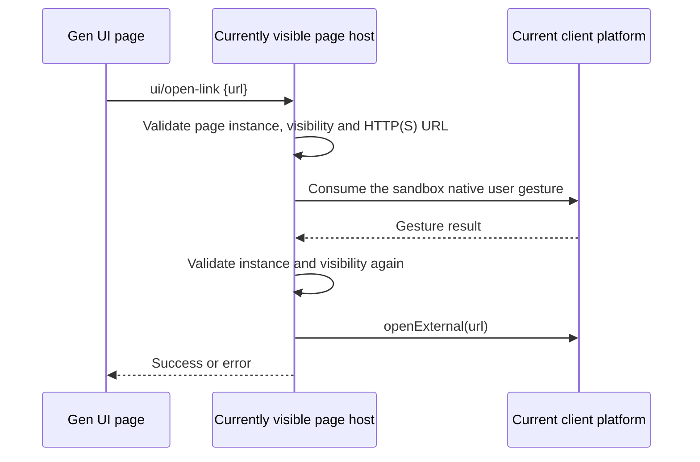

# Gen UI external links

## Goal and scope

An ordinary `<a href="https://example.com/subscribe">` in Gen UI can navigate directly; for script control,
`window.zcode.openExternal({ href })` is provided and returns `Promise<void>`. Both entries reuse the same
host chain and add no other page API.

## Behavior contract

- Absolute `http:` / `https:` URLs are supported; relative addresses, `file:`, `javascript:`, `data:` and other protocols cannot be opened through the host.
- Ordinary links are handled by delegation in the page runtime, including dynamically added links, icons inside links, keyboard Enter activation, left-click with modifier keys and middle-click. `target` does not change host routing; the card itself neither navigates nor creates a guest window. Right-click keeps its original behavior.
- A click already handled with `preventDefault()` by the page is not handled again. An empty href and a `#fragment` keep in-page behavior. A `download` link is not converted into an external open; this change provides no download capability.
- An external link must be triggered by a real user action; a synthetic click does not open, and a page load or timer call without a user gesture is rejected. The host reuses the existing recent-native-gesture consumption mechanism and re-checks page validity after the async validation returns.
- The explicit API parameter is `{ href: string }`; on failure the Promise rejects; an ordinary link failure is reported through the existing `zcode:error` event. The Promise confirms that the host called the platform entry, not that the browser loaded successfully.
- The page host declares the `openLinks` capability and handles the standard `ui/open-link` request. The external-open function is obtained by dependency injection, no Desktop preload is exposed to the page, and the original navigation, new-window and download interception are not loosened.
- The open action happens on the client viewing the page, and `IPlatformService.openExternal` decides the actual browser behavior; a remote workspace executes no remote open command, sends no Agent message and adds no persisted state.
- Web / mobile that provide no Gen UI sandbox keep the existing HTML fallback behavior; this change adds no Web sandbox and does not change the continuous / replayable message chain. No theme, copy or layout change.

## Verification

In the existing Electron Gen UI integration fixture, using the production guest bridge, native gesture
registration and CDP trusted mouse/keyboard events: ordinary links, nested content, dynamic links, `target`,
modifier keys, middle click, keyboard and the explicit API each open exactly once; fragments, prevented
default, download, invalid URLs, synthetic clicks, no gesture and hidden pages do not open. After holding the
gesture response and hiding the page, a late request must not open. A remote-workspace card must call the
client opener, and the existing state, follow-up, layout and page-reuse checks keep passing.

The fixture registers the gesture through Electron native keyboard input, then uses CDP trusted click/Enter
to hit the nested iframe (CDP itself does not trigger Electron's `input-event`). The final platform opener is
replaced by a recorder to verify request routing and failure propagation without launching the system browser.
Automated coverage is not equivalent to actual browser launch or manual input acceptance on each operating
system.

Run `pnpm typecheck`, `pnpm lint`, the architecture gate and `node packages/desktop/scripts/gen-ui-e2e.mjs`.
Actual platform coverage and checks that could not run are recorded in the commit message.
