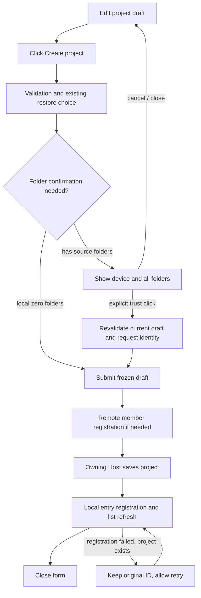

# Confirm Trusting Folders Before Creating a Project

Status: implemented (2026-10-13). Q1–Q3 were confirmed individually. The shared creation entry, restore confirmation and interaction details are part of this change; verification scope is in §10.

## 1. Feature Summary

| Item            | Content                                                                                                                                                          |
| --------------- | ---------------------------------------------------------------------------------------------------------------------------------------------------------------- |
| Confirmed need  | With source folders, "Create project" creates only after an explicit trust confirmation; local empty projects are created directly                               |
| Layer           | Project-creation folder confirmation; presentation, validation, commit-effect; no new persistence                                                                |
| Baseline source | `842da373332763dd39fec2bebb4f80c817b410af`                                                                                                                       |
| Main entry      | `ProjectCreation` → `ProjectEditor.save` → `IProjectService.saveProject`                                                                                         |
| Scope           | Folder-access confirmation in the creation flow, local and remote, and the desktop, Web and mobile entries that reuse it                                         |
| Not extended    | Hook auto-authorization, a persistent folder-trust registry, migrating existing projects, adding folders when editing a project, deep link, task permission mode |

Related: [virtual project spec](../superpowers/specs/2026-09-09-virtual-project-design.md), [project rules integration](../superpowers/specs/2026-10-10-session-manage-upstream-integration.md), [local directory picker](../ui/project-local-directory-picker.md). Security boundaries: [workspace hook trust](workspace-hook-trust-persistent-only.md) and [project config trust boundary](../security/deep-link-project-trust-boundary.md).

## 2. Boundary Decisions

| ID  | Decision                                          | Conclusion                                                                                 | Impact                                                        |
| --- | ------------------------------------------------- | ------------------------------------------------------------------------------------------ | ------------------------------------------------------------- |
| Q1  | Does "trust" also authorize auto-executed config? | It confirms only this creation's folder access; Hooks keep their own trust rules           | No change to Agent admission or Hook Trust                    |
| Q2  | Confirm again when the same folder is used again? | Every creation confirms; no permanent trust record                                         | No trust storage, migration or revoke entry                   |
| Q3  | Dialog for a local zero-folder project?           | Create directly; first use follows the existing default-directory rule                     | The default directory is not generated at creation            |
| Q4  | Remote, Web and mobile entries reusing the flow   | Confirm the real folders on the selected Host; remote keeps a single root                  | Mobile shows the Host's folders, never as phone-local folders |
| Q5  | Restore, edit, add an existing remote project     | Restore via "Create project" also confirms; editing and add-only entries get no new dialog | The latter two keep current behavior                          |

Confirmation applies to this creation only and creates no permanent authorization. Existing service callers, CLI and deep link gain no new global folder admission.

## 3. Interaction and State Order

1. The user fills in name, device and source folders; folder selection only changes the form draft.
2. Clicking "Create project" runs the existing form validation and restore-project selection first; the "restore or continue creating" semantics are unchanged.
3. A local zero-folder project saves directly. With source folders, the target `hostId + roots + primaryRoot + name + restoreProjectId` is frozen and the trust dialog is shown. The underlying form is inert while it is open.
4. Confirming submits that snapshot. Cancel, the close button, Escape or overlay close return to the form with name, device, folders and primary folder kept; nothing is saved.
5. A save failure shows the existing error and keeps the draft. If the remote save succeeded but local entry registration failed, the `created` result is reused to retry registration, without creating again or asking for confirmation again.

Copy (zh-CN, as asserted by tests; English gloss in parentheses):

- Title: single folder "信任此文件夹吗？" (Trust this folder?); multiple "信任这些文件夹吗？" (Trust these folders?).
- Content: device name and the full folder list; paths in monospace, selectable, wrapping and scrollable, never only the last segment.
- Note: "ZCode 可在当前权限设置允许的范围内读取、编辑这些文件夹中的文件，并运行命令。请仅在你信任列出的所有文件夹时继续。" (ZCode may read and edit files in these folders and run commands within what the current permission settings allow. Continue only if you trust all listed folders.)
- Primary action: "信任文件夹并创建" (Trust folders and create); when restoring "信任文件夹并恢复" (Trust folders and restore). Secondary: "取消" (Cancel).

The dialog uses the existing Dialog/Button theme and size rules per [DESIGN.md](../../DESIGN.md), not the large pill buttons of the reference image. On narrow screens the path area scrolls and the action area stays visible; Chinese/English and light/dark are covered.

Initial focus is on Cancel; Tab reaches Trust. Only Enter/Space or click on the Trust button confirms; there is no global Enter accept. After cancel, focus returns to the Create button. When a tab switch hides the parent form, the child dialog hides and the old confirmation is invalidated; a hidden form cannot keep submitting.

## 4. UI Surface Matrix

- Sidebar project plus. Shared implementation and draft: `ProjectCreation` → `ProjectEditor` owns name/host/roots/primary; Default / validation: Device defaults, local 0..n and remote 1 root rules; confirmation added; Submit and authority: `onBeforeSave` → `saveProject`; Host project store; Mode and isolation: Shared by Desktop/Web/mobile; unaffected by other tabs' cwd.
- Chat project menu "create project on this device". Shared implementation and draft: `ProjectComposerMenu` → same `ProjectCreation`; Default / validation: Preselects the returned remote device; otherwise same; Submit and authority: Same save chain and remote entry registration; Mode and isolation: Creates no chat, leaves composer text and attachments alone.
- Create inside the remote project picker. Shared implementation and draft: `RemoteProjectPicker` → `ProjectEditor(project=null)`; Default / validation: Explicit host and initialRoots; Submit and authority: Host saves, then the original add callback registers the entry; Mode and isolation: Must use the same confirmation, not a dialog outside `ProjectCreation`.
- Edit project. Shared implementation and draft: `ProjectEditor(project!=null)`; Default / validation: Existing folder and edit validation; Submit and authority: Original `saveProject(id)`; Mode and isolation: No confirmation this round; shared component must distinguish explicitly.
- Add existing remote project. Shared implementation and draft: `RemoteProjectList`, not a save branch; Default / validation: Original member and entry identity checks; Submit and authority: `addEntry`, creates no remote project; Mode and isolation: Unchanged this round.

## 5. Shared and Divergent Behavior

| Concern                | Shared / divergent                                                                                    | Meaning here                                                                      |
| ---------------------- | ----------------------------------------------------------------------------------------------------- | --------------------------------------------------------------------------------- |
| UI / candidate source  | Shared editor; Desktop local uses the system picker, remote/Web/mobile use the Host directory service | Picker source unchanged; the confirmation list comes from the same draft snapshot |
| Defaults               | Local allows empty roots; remote requires exactly one root                                            | Local zero-folder creates directly; remote still needs one folder                 |
| Validation             | Saving already checks folder existence on the Host; trust is an extra user action                     | Confirmation neither replaces service validation nor grants OS permission         |
| Commit effect          | Remote saves the authoritative project first, then registers the local entry                          | Keeps the created ID and the registration-retry branch                            |
| Persistence / recovery | Project authority stays on the owning Host; UI has only transient confirmation state                  | No new database, localStorage or recovery protocol                                |

## 6. Feature Relationships / State Owners

| Level          | Relationship and evidence                                                        | Reason                                                                                                    |
| -------------- | -------------------------------------------------------------------------------- | --------------------------------------------------------------------------------------------------------- |
| must-inspect   | `ProjectEditor.save` validation → `ProjectCreation.onBeforeSave` → `saveProject` | Confirmation must precede remote member registration and project write                                    |
| must-inspect   | `ProjectCreation.saved` → `remoteService.addEntry`; `ProjectEditor.created`      | Keep the two-phase completion; registration retry never recreates                                         |
| must-inspect   | Editor `epoch` / `alive` / `suspended` → async confirmation result               | A stale confirmation cannot submit a draft after a device change or after leaving the UI                  |
| should-inspect | Soft-deleted project with the same roots → restore confirmation                  | Confirm after the restore target is decided; the two confirmations are not merged into one default accept |
| invariant-only | Q2 → no permanent folder trust record                                            | A folder used by another project is not exempt                                                            |
| invariant-only | Workspace Hook Trust, tool permissions, deep-link confirmation                   | Folder confirmation never writes their authorization state                                                |
| invariant-only | Mobile shared-host / continuous-replayable                                       | No extra Host/Agent; message delivery boundaries unchanged                                                |
| evidence-only  | Project creation, folder picker and mobile project E2E                           | Coverage recorded only from the setup/action/assertion actually run                                       |

| State                                | Draft / display owner                            | Authority owner / commit target                                                |
| ------------------------------------ | ------------------------------------------------ | ------------------------------------------------------------------------------ |
| Name, device, roots, primary         | `ProjectEditor`                                  | `saveProject` → owning Host's ProjectRepository                                |
| Pending target of this creation      | `ProjectEditor` local snapshot and request epoch | Not persisted; can trigger exactly one submit bound to the snapshot            |
| Created result, pending registration | Existing `created`                               | Remote project saved; local remote entry still managed by RemoteProjectService |
| Hook Trust                           | Existing Hook UI projection                      | Agent's exact-declaration Trust authority, unchanged                           |

## 7. Invariants

- For creation with source folders, before the user confirms there is no call to this creation's `onBeforeSave`, `saveProject` or `addEntry`, no workspace is opened and no Agent started. Connections the user already triggered to pick remote folders keep the existing flow.
- Displayed folders, submitted folders and the device agree. Devices are not matched by display name; local paths are not used to judge remote folders.
- While one operation is in flight, creating again is blocked. Use the existing request epoch and explicit state, revalidate after async returns, and never infer sync with delays.
- If a folder is deleted or loses permission during confirmation, the original Host validation fails and the draft is kept; no substitute folder is created.
- Cancel leaves no project. Remote entry registration failure is distinct from project save failure. No automatic network retry is added and the existing unknown-RPC-result problem is not claimed fixed.
- Local multi-folder, remote single-folder, unchanged session cwd, project organization-state owner, exact Hook authorization and mobile permission boundaries keep their contracts.

## 8. Code Evidence

The checkout had no codegraph index; the relationships were verified with `rg` and source reading (entry, shared editor, Host save, remote registration). No depth-2 graph impact query was run.

| Seed                | Verified direct callers / key path                                                        |
| ------------------- | ----------------------------------------------------------------------------------------- |
| `ProjectEditor`     | `ProjectCreation`, sidebar edit entry, `RemoteProjectPicker`                              |
| `ProjectCreation`   | Sidebar create, `ProjectComposerMenu`                                                     |
| `saveProject`       | Service schema/folder validation → repository; remote routes by `hostId`                  |
| `ConfirmDialogHost` | Generic confirm includes a window Enter capture; not usable as the explicit trust control |

Graph delta: folder confirmation applies to this creation only; prior usage records do not waive it; local zero-folder creates directly; Hook Trust is independent. The new feature-graph nodes' code seeds point at the shared creation entry and the confirmation component. The three creation entries and the restore branch are in scope; edit and add-existing keep behavior.

## 9. Case Planning

Domains: project UI, workspace/remote identity, organization-state persistence; Hook permission is an invariant. Dimensions: create/restore/edit, 0/1/many folders, local/remote, trust/cancel/close, pending/save/registration retry, Desktop/Web/mobile. High-risk combinations: confirmation vs device/draft epoch change, hidden parent form, double click, save success with registration failure, same path on different devices.

- **PCFT01**: Setup → Action: Local two folders → click create → click trust; Guard / Assertions: All folders shown; nothing saved before confirm, target project saved after; State / evidence: Electron E2E passed; real Host before/after comparison.
- **PCFT02**: Setup → Action: Dialog open → cancel, X, Escape, overlay close; Guard / Assertions: Nothing created; name, device, roots, primary restored; focus restored; State / evidence: Electron E2E passed; four close modes with draft/focus.
- **PCFT03**: Setup → Action: Dialog open → keyboard navigation; repeated clicks on create/trust; Guard / Assertions: Enter does not confirm globally; one submit in flight; no duplicate create; State / evidence: Targeted unit tests passed; desktop keyboard see §10.
- **PCFT04**: Setup → Action: Remote single folder, same path also local → confirm; Guard / Assertions: Remote device shown; corresponding Host called, no local project written; State / evidence: Component and creation-owner unit tests passed; real SSH/WSL/Docker not run.
- **PCFT05**: Setup → Action: Confirmation pending → switch tab/unmount/epoch change; Guard / Assertions: Confirmation invalid; old result cannot save or close a new form; State / evidence: Targeted unit tests passed; hide/unmount during confirmation and remote pre-query.
- **PCFT06**: Setup → Action: Folder unavailable or remote offline after confirm → save; Guard / Assertions: Error visible, draft kept, no substitute folder, no auto resubmit; State / evidence: Targeted unit tests cover save rejection; real disconnect/permission change not run.
- **PCFT07**: Setup → Action: Remote project returned success, local registration fails → retry; Guard / Assertions: Reuse original project ID, retry registration only, no recreate; State / evidence: Targeted unit tests passed; saved once, only registration retried.
- **PCFT08**: Setup → Action: Local zero folders; same folder used by another project → create; Guard / Assertions: Zero folders: no dialog; folder used by another project still reconfirmed; State / evidence: Targeted unit tests passed.
- **PCFT09**: Setup → Action: Create hits soft-deleted project → choose restore → trust; Guard / Assertions: Reuse original project ID; cancelling trust neither restores nor creates new; State / evidence: Targeted unit tests passed; restore target ID unchanged.
- **PCFT10**: Setup → Action: Folder contains an untrusted Hook → finish creation; Guard / Assertions: Folder confirmation never writes Hook Trust or triggers the Hook; State / evidence: Source boundary check; no end-to-end malicious-Hook scenario run.
- **PCFT11**: Setup → Action: Desktop and mobile create entries → cancel/confirm; Guard / Assertions: Same Host saves; no extra Host/Agent; theme and long paths usable; State / evidence: Mobile shared-host E2E passed; touch cancel/confirm, Host/tab counts.

Pruning: no full theme/language × error-state product; local multi-folder and remote long paths are representative. SSH/WSL/Docker share the UI gate, so cases are reusable but real-connection evidence is reported separately. Edit and add-existing are unchanged behavior; per Q1/Q2, permanent folder trust, revoke and config auto-authorization are excluded.

## 10. Implementation and Verification

- `ProjectFolderTrustDialog` reuses Dialog/Button and is independent of the global Enter confirm. It sits inside the parent DialogContent React subtree so a delayed outside-click from a touch cancel cannot close the underlying draft. Initial focus is on Cancel; paths keep their original value with wrapping and scrolling; the device name shows the target Host. Chinese/English copy and light/dark follow the existing system.
- The `ProjectEditor` save closure fixes this draft; a synchronous in-flight flag blocks duplicate submits and the request epoch is revalidated after confirmation. Hide or unmount cancels the confirmation and invalidates unresolved remote restore queries. Confirmation state is not persisted.
- Before confirmation `onBeforeSave`, `saveProject` and entry registration are not called; afterwards the original Host save and `created` registration retry apply. ProjectService, protocol, database and Hook Trust are unchanged.
- The creation E2E helper clicks the trust button explicitly rather than auto-accepting through a generic click tool. Native-folder cases launch without an account to avoid unrelated fake OAuth-expiry overlays; narrow-width changes go through the Electron BrowserWindow and the sidebar is restored before verifying the list.

Executed verification:

- Root typecheck, desktop `typecheck:e2e`, lint, architecture changed. Result and boundary: Passed; lint 0 errors / 208 warnings, architecture 0 violations.
- Affected unit tests. Result and boundary: Selected from the base commit: 670 files / 6521 tests passed first; only 2 SSH creation-helper tests had not adapted to the new button and passed after the fix. Final targeted creation, folder, owner, touch, lifecycle and fixture run: 8 files / 101 tests passed.
- Desktop native-folder E2E. Result and boundary: No project written on the real Host before confirm; cancel/X/Escape/overlay keep draft and focus; after confirm the save, refresh/reopen keep folders and primary folder; 1200px English and 390px Chinese, light/dark, button hit checks.
- Mobile shared-host E2E. Result and boundary: Chrome 390×844 touch-device emulation paired with the real desktop Host via local relay/account fixture; draft kept after cancel, created only after confirm; theme/button hit, Host/tab count, follow-up task and reopen assertions passed. Not a physical phone or a real external relay.
- Fixture / docs. Result and boundary: Mobile fixture check passed with the existing metadata/matcher warnings; the spec's 6 relative links are valid; new feature-graph nodes and seeds valid, no new dangling edges; competitor-term check 0 hits.

Run IDs for desktop and mobile are recorded in the coverage matrix. The cases stay in `manual-review/pending` and are not auto-promoted or added to container CI. Cross-platform GUI, real SSH/WSL/Docker and Hook-bearing E2E are not part of the executed evidence.
