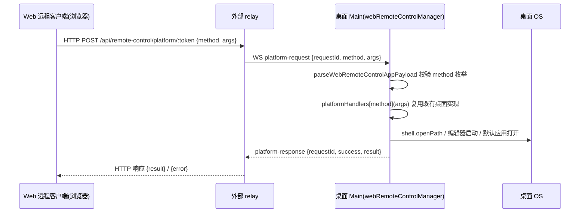

# Web 远程控制「在桌面打开」

## 目标与范围

Web 远程客户端（手机浏览器经外部 relay 接入桌面）复用共享 UI，但 `IPlatformService.openInEditor` / `openInFileManager` / `openExternalFile` 在 Web 平台目前固定返回 `Not supported in web mode`，`getInstalledEditors` 固定返回空数组。本特性把这四个方法接入既有的 Web 远程控制平台代理（`WebRemoteControlPlatformMethod` 类型化代理），由桌面执行，桌面本地行为不变。纯增量改动，不新增消息类型、不新增协议通道。

## 行为契约

- 方法契约沿用 `WebRemoteControlPlatformMethodArgsMap` / `ResultMap`：
  - `getInstalledEditors`：无参数，返回桌面已安装编辑器 `EditorInfo[]`；
  - `openInEditor`：参数 `{ editorId, path, options? }`，与 `IPlatformService.openInEditor(editorId, path, options?)` 一一对应，返回 `{ success, error? }`；
  - `openInFileManager`：参数为路径字符串，返回 `{ success, error? }`；
  - `openExternalFile`：参数为路径字符串，返回 `{ success, error? }`。
- 路径是桌面文件系统路径；桌面 Main 复用 `getInstalledEditors`（`editors.ts`）、`openInEditor`（`openInEditor.ts`）、`openPathInFileManager` / `openPathInDefaultApp`（`desktopMainIpcHelpers.ts`），即渲染进程 IPC 同一份实现，不复制逻辑。
- 运行时校验：四个方法名加入 `webRemoteControlPlatformMethodSchema` 枚举（`validation.ts`），桌面与 Web 两侧 transport 对 `platform-request` / `platform-response` 的既有校验继续生效；`args` 保持与相邻方法一致的 `z.unknown()`，由桌面 handler 消费。
- Web 平台实现沿用现有三段式分支：`externalWebRemoteControlProxy` 优先，其次 `webRemoteControlProxy` 走 relay HTTP，两者都没有时保持既有降级（`Not supported in web mode` / 空编辑器列表）。普通 Web（非远程控制）行为不变。
- 信任边界沿用平台代理既有模型：请求来自已完成配对的 window control session，与 `saveMcpToUserDirectory` 等既有写操作同级；不放宽配对、鉴权或转发校验。
- 共享 UI 无需改动：文件树、消息文件链接、预览面板等入口通过 `IPlatformService` 调用，代理生效后自然可用；不修改 `isWebRemoteControl` 相关的门控。

## 状态与事件顺序（owner）

- 请求-响应按 `requestId` 关联，owner 为桌面 `webRemoteControlManager.respondToPlatformRequest`；每次调用独立，无跨请求状态，天然幂等。
- relay 与 Main 只做转发与调度，不缓存方法结果；`EditorInfo` 每次调用现查桌面，不在 Web 侧缓存。
- 失败语义：桌面 handler 抛错或返回 `{ success: false }` 时原样回传；relay HTTP 非 200 时 Web 侧抛错并由既有 UI toast/日志路径处理。

## 验收场景

1. Web 远程控制打开本地工作区，消息中的文件链接「在编辑器中打开」能看到桌面编辑器列表，选择后桌面启动对应编辑器打开该文件。
2. 文件树/预览「在文件管理器中显示」：桌面文件管理器 reveal 对应文件或目录；目录被删除时返回 `{ success: false }` 并 toast 失败。
3. 普通浏览器访问 Web Server（无代理）：行为与现状一致（`Not supported in web mode`），不发起 relay 请求。
4. 未知方法名经 zod 枚举校验被拒绝，桌面丢弃并记录 warn，不进入 handler。
5. 桌面本地（Electron 渲染进程）上述入口行为与改动前完全一致。

## 验证

- 单元测试：
  - shared：方法枚举接受四个新方法名，`platform-request`/`platform-response` payload 校验通过；
  - desktop：`platformHandlers` 新方法分发到既有桌面实现（mock）；
  - web：`createWebPlatform` 分支——有 `webRemoteControlProxy` 时走 relay 请求，无代理时保持降级返回。
- `pnpm typecheck`、`pnpm lint`、`npx oxfmt --check <changed>`、`pnpm architecture:check --changed`。
- 真实 relay 端到端（手机配对后实际打开）无法在 worktree 内验证，列入 PR「Not verified」并附手动步骤。
