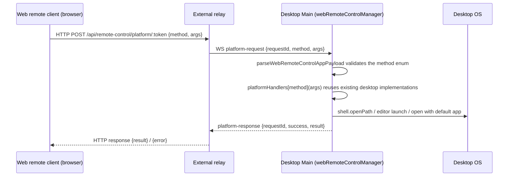

# Web Remote Control "Open on Desktop"

## Goal and Scope

The web remote client (phone browser attached to the desktop through the external relay) reuses the shared UI, but on the Web platform `IPlatformService.openInEditor` / `openInFileManager` / `openExternalFile` returned a fixed `Not supported in web mode` and `getInstalledEditors` returned an empty array. These four methods are routed through the existing web remote-control platform proxy (the typed `WebRemoteControlPlatformMethod` proxy) so the desktop executes them. Desktop-local behavior is unchanged. Purely additive: no new message types or protocol channels.

## Behavior Contract

- Method contract follows `WebRemoteControlPlatformMethodArgsMap` / `ResultMap`:
  - `getInstalledEditors`: no arguments, returns the desktop's installed editors as `EditorInfo[]`;
  - `openInEditor`: `{ editorId, path, options? }`, mirroring `IPlatformService.openInEditor(editorId, path, options?)`, returns `{ success, error? }`;
  - `openInFileManager`: a path string, returns `{ success, error? }`;
  - `openExternalFile`: a path string, returns `{ success, error? }`.
- Paths are desktop filesystem paths. Desktop Main reuses `getInstalledEditors` (`editors.ts`), `openInEditor` (`openInEditor.ts`) and `openPathInFileManager` / `openPathInDefaultApp` (`desktopMainIpcHelpers.ts`), the same implementations as the renderer IPC handlers; no duplicated logic.
- Runtime validation: the four method names are in the `webRemoteControlPlatformMethodSchema` enum (`validation.ts`); the existing `platform-request` / `platform-response` transport validation on both sides applies; `args` stay `z.unknown()` like neighboring methods and are consumed by the desktop handler.
- The Web platform keeps the three-way branch: `externalWebRemoteControlProxy` first, then `webRemoteControlProxy` over relay HTTP, then the existing fallback (`Not supported in web mode` / empty editor list). Regular Web (non-remote-control) behavior is unchanged.
- Trust boundary follows the platform proxy's model: requests come from an already-paired window control session, with the same trust as existing write operations such as `saveMcpToUserDirectory`. Pairing, authentication and forwarding validation are not relaxed.
- No shared-UI changes: file tree, message file links and preview panels call through `IPlatformService`, so they work once the proxy is active; `isWebRemoteControl` gating is untouched.

## State and Event Order (owner)

- Request-response correlation is by `requestId`; the owner is the desktop's `webRemoteControlManager.respondToPlatformRequest`. Each call is independent with no cross-request state (naturally idempotent).
- The relay and Main only forward and schedule; results are not cached. `EditorInfo` is re-queried from the desktop on every call and not cached on the Web side.
- Failure semantics: a desktop handler throw or `{ success: false }` is passed back as-is; a non-200 relay HTTP response throws on the Web side and is handled by the existing UI toast/log paths.

## Acceptance Scenarios

1. With web remote control attached to a local workspace, "open in editor" on a message file link shows the desktop's editor list; picking one launches that editor on the desktop with the file.
2. File tree / preview "reveal in file manager" reveals the file or directory on the desktop; if the directory no longer exists, `{ success: false }` is returned and the failure is toasted.
3. A regular browser visiting the Web Server (no proxy) behaves as before (`Not supported in web mode`); no relay request is made.
4. An unknown method name is rejected by the zod enum validation; the desktop drops it and logs a warn without entering any handler.
5. Desktop-local (Electron renderer) entries behave exactly as before.

## Verification

- Unit tests: shared (method enum accepts the four new names; `platform-request`/`platform-response` payloads validate); desktop (new `platformHandlers` dispatch to the existing implementations, mocked); web (`createWebPlatform` branches: relay request with `webRemoteControlProxy`, fallback returns without a proxy).
- `pnpm typecheck`, `pnpm lint`, `npx oxfmt --check <changed>`, `pnpm architecture:check --changed`.
- A real relay end-to-end pass (opening from a paired phone) cannot be verified inside a worktree; it is listed in the PR "Not verified" section with manual steps.
