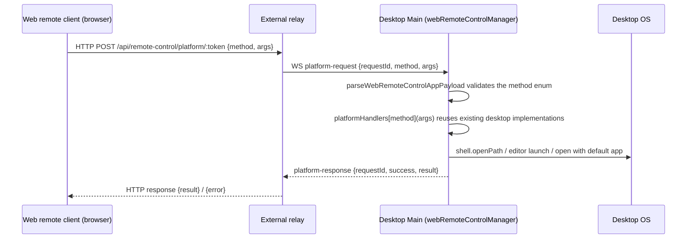

# Web Remote Control "Open on Desktop"

## Goal and Scope

The web remote client (phone browser attached to the desktop through the external relay) reuses the shared UI, but `IPlatformService.openInEditor` / `openInFileManager` / `openExternalFile` currently return a fixed `Not supported in web mode` on the Web platform, and `getInstalledEditors` returns an empty array. This feature routes these four methods through the existing web remote-control platform proxy (the typed `WebRemoteControlPlatformMethod` proxy) so the desktop executes them; desktop-local behavior is unchanged. Purely additive: no new message types and no new protocol channels.

## Behavior Contract

- The method contract follows `WebRemoteControlPlatformMethodArgsMap` / `ResultMap`:
  - `getInstalledEditors`: no arguments, returns the desktop's installed editors as `EditorInfo[]`;
  - `openInEditor`: arguments `{ editorId, path, options? }`, mirroring `IPlatformService.openInEditor(editorId, path, options?)`, returns `{ success, error? }`;
  - `openInFileManager`: argument is a path string, returns `{ success, error? }`;
  - `openExternalFile`: argument is a path string, returns `{ success, error? }`.
- Paths are desktop filesystem paths; desktop Main reuses `getInstalledEditors` (`editors.ts`), `openInEditor` (`openInEditor.ts`), and `openPathInFileManager` / `openPathInDefaultApp` (`desktopMainIpcHelpers.ts`) — the same implementations the renderer IPC handlers use; no duplicated logic.
- Runtime validation: the four method names are added to the `webRemoteControlPlatformMethodSchema` enum (`validation.ts`); the existing transport validation of `platform-request` / `platform-response` on both the desktop and Web sides keeps applying; `args` stay `z.unknown()` consistent with the neighboring methods and are consumed by the desktop handler.
- The Web platform implementation keeps the existing three-way branch: `externalWebRemoteControlProxy` first, then `webRemoteControlProxy` over relay HTTP, and the existing fallback (`Not supported in web mode` / empty editor list) when neither is present. Regular Web (non-remote-control) behavior is unchanged.
- The trust boundary follows the platform proxy's existing model: requests come from an already-paired window control session, at the same level of trust as existing write operations such as `saveMcpToUserDirectory`; pairing, authentication, and forwarding validation are not relaxed.
- No shared-UI changes are needed: file tree, message file links, and preview panels call through `IPlatformService`, so they become usable once the proxy is active; `isWebRemoteControl`-related gating is untouched.

## State and Event Order (owner)

- Request-response correlation is by `requestId`; the owner is the desktop's `webRemoteControlManager.respondToPlatformRequest`. Each call is independent with no cross-request state — naturally idempotent.
- The relay and Main only forward and schedule; method results are not cached. `EditorInfo` is re-queried from the desktop on every call and is not cached on the Web side.
- Failure semantics: a desktop handler throw or `{ success: false }` result is passed back as-is; a non-200 relay HTTP response throws on the Web side and is handled by the existing UI toast/log paths.

## Acceptance Scenarios

1. With web remote control attached to a local workspace, the "open in editor" action on a file link in a message shows the desktop's editor list; picking one launches that editor on the desktop with the file.
2. File tree / preview "reveal in file manager": the desktop file manager reveals the file or directory; when the directory no longer exists, `{ success: false }` is returned and the failure is toasted.
3. A regular browser visiting the Web Server (no proxy): behavior identical to today (`Not supported in web mode`); no relay request is made.
4. An unknown method name is rejected by the zod enum validation; the desktop drops it and logs a warn without entering any handler.
5. Desktop-local (Electron renderer) entries above behave exactly as before the change.

## Verification

- Unit tests:
  - shared: the method enum accepts the four new names; `platform-request`/`platform-response` payloads validate;
  - desktop: the new `platformHandlers` dispatch to the existing desktop implementations (mocked);
  - web: `createWebPlatform` branches — with `webRemoteControlProxy` present the relay request is used, without a proxy the fallback returns stay.
- `pnpm typecheck`, `pnpm lint`, `npx oxfmt --check <changed>`, `pnpm architecture:check --changed`.
- A real relay end-to-end pass (actually opening from a paired phone) cannot be verified inside a worktree; it is listed in the PR "Not verified" section with manual steps.
