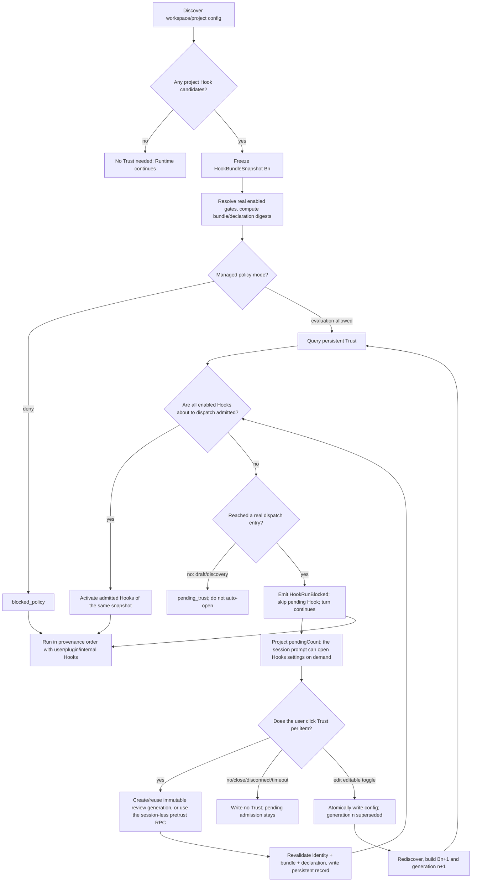
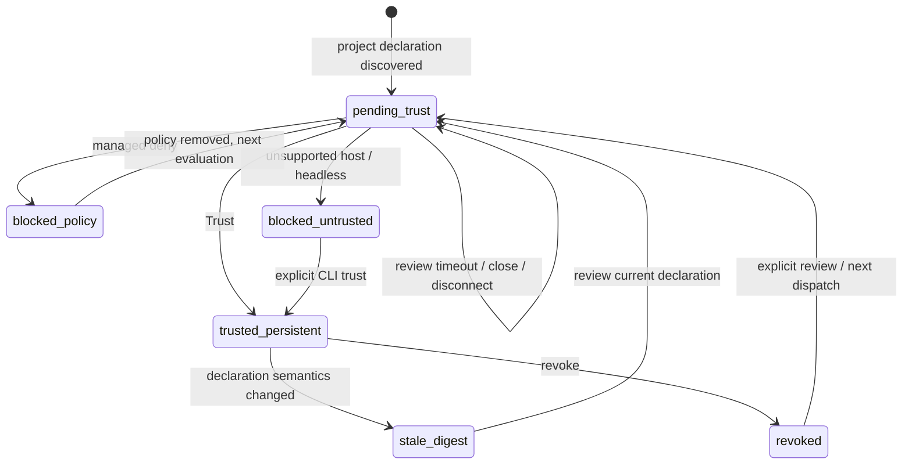

# Workspace Hook Manual Trust Spec (Settings-centered)

> **2026-08-13 persistent-trust simplification:** the latest product semantics are in [`workspace-hook-trust-persistent-only.md`](./workspace-hook-trust-persistent-only.md). Workspace Hooks keep only per-declaration persistent Trust. The normative sections below are converged to the current schema; the retired authorization state machine is not an executable NL→Code input.

> **Interaction model (2026-08 current):** when a prompt is sent and untrusted Hooks exist, the turn does not wait for review. Pending Hooks produce `HookRunBlocked` and are skipped this turn, and a prompt bar appears at the bottom of the chat. After the user enters Hooks settings on their own, they can only create per-declaration persistent Trust; a skipped SessionStart is not re-run. Details: [`workspace-hook-trust-soft-gate.md`](./workspace-hook-trust-soft-gate.md).

> Full pre-compaction history (implementation phase records, review diaries): `git show b8876e8b:docs/specs/workspace-hook-trust.md`.

- Status: Implemented; current interaction is persistent-only + soft-gate; static and automated checks done; final real-Desktop manual acceptance is run by the product owner.
- Date: 2026-08-07.
- Applies to: ZCode CLI Runtime, ZCode Protocol v4, Desktop/Web UI, Remote Workspace, Headless CLI.
- Main objects: Workspace/project-level `zcode.json` and `.zcode/config.json` Hooks.
- Security base: Default deny, explicit authorization, per-declaration invalidation on change, policy deny first.
- Related docs: `docs/security/deep-link-project-trust-boundary.md`; `docs/web-remote-control/web-remote-control-architecture.md`; `docs/web-remote-control/task-realtime-sync.md`; `docs/web-remote-control-task-command-queue.md`.
- Interaction: Review happens in `Settings → Hooks → Workspace` (`设置 → 钩子 → 工作区`); no standalone Trust Dialog on the task page.
- Interaction demo: `docs/specs/workspace-hook-trust-demo.html` (historical prototype, superseded by the persistent-only spec).
- Manual acceptance: `docs/testing/workspace-hook-trust-manual-acceptance.md`; fixture generated by `scripts/create-workspace-hook-trust-uat-fixture.mjs`.

## 1. Summary

Interaction and state follow [`workspace-hook-trust-persistent-only.md`](./workspace-hook-trust-persistent-only.md) and [`workspace-hook-trust-soft-gate.md`](./workspace-hook-trust-soft-gate.md); this file describes only the current persistent Trust and soft-gate contract. The security baseline, isolated discovery, Trust domain, Runtime admission, Desktop/Mobile review, Remote route, CLI/Headless, rollout and telemetry are complete and converged to:

- Workspace/project Hook declarations are normalized by Runtime discovery into an immutable snapshot and cannot enter an executable path before admission.
- Desktop shows Hook config in `Settings → Hooks → Workspace`. An untrusted row offers only a per-declaration persistent "信任" (Trust) button and shows the effective-run toggle as off and inoperable; trusted rows show no extra Trust badge.
- No capable Host, old client, stale generation, snapshot mismatch, Trust store failure and config rebuild failure all fail closed.
- Desktop continuous and Web/Mobile replayable share one Runtime review projection; responses bind task/run/remoteSession/runtime epoch, and sensitive commands only do ACK queries and are never auto-replayed.
- Headless provides exact status/review/grant/revoke and pretrust diagnostics; the trusted rollout gate, redacted telemetry, security/remote/user docs and old-diagnostic migration are done.

The spec introduces a **Workspace Hook Trust Admission** independent of ordinary Hook enablement, with a **Settings-centered** interaction:

1. Discover Hooks from project config but do not turn them into executable callbacks yet.
2. Form an immutable `HookBundleSnapshot` of the current project Hook declarations.
3. Compute a `bundleDigest` for the bundle and a `hookDeclarationDigest` for each declaration.
4. Persistent Trust is keyed by `workspace identity + hook declaration digest`, supporting per-declaration review.
5. The user may trust proactively in `Settings → Hooks → Workspace`. When any real project Hook dispatch entry finds an unreviewed declaration, Runtime **no longer stops the turn or forces navigation to settings**: the pending hook is skipped this turn (`HookRunBlocked`), the turn runs immediately, and a persistent bottom prompt bar (N Hooks pending review + review/dismiss) appears; the user opens Hooks settings by clicking (see the soft-gate spec).
6. The settings UI offers only persistent `Trust` per untrusted declaration; trust stays orthogonal to the configured toggle.
7. Closing the settings UI or a temporary client attachment disconnect makes no security decision; dismissing the prompt bar only hides it locally and persists nothing; pending admission is restored through the continuous event or the replayable snapshot. Persisted trust affects only later natural Hook events; an already skipped SessionStart is **not re-run** and takes effect at the earliest at the next real SessionStart.
8. A Hook declaration change invalidates only the affected declaration digest; the snapshot/bundle digest still guarantees review/execution consistency.
9. Non-interactive environments fail closed by default; exact Trust must be pre-established with an explicit CLI command.
10. Enterprise/managed policy deny takes precedence over any user authorization.
11. The effective-run toggle of an untrusted declaration stays off and inoperable; showing it or trusting must not rewrite the raw workspace config; after trust succeeds the toggle follows the real `configuredEnabled`.
12. Desktop uses `desktop-continuous`, mobile Web uses `web-remote-replayable`; both connect to the same Host/Runtime and review commands are submitted through the trusted attachment with owner/stale-run routing.

This design authorizes **the current Hook declaration shown in settings**, not the full transitive code of scripts the Hook command references.

---

## 2. Background and Current State

### 2.1 Current security fix

`apps/zcode-cli/packages/adapters/src/config/project-config.adapter.ts` handles project Hooks on two isolated paths:

1. `loadProjectConfigFile()` emits a diagnostic when `result.config.hooks` is present and keeps the declarations in a separate candidate/snapshot side-channel:

```text
config_project_hooks_pending_trust
Project hooks are pending workspace trust and remain blocked
```

2. `normalizeProjectConfig()` still strips the whole `hooks` field from the returned executable `RuntimeConfigPatch`; the candidate is never consumed by the config merger or configured runner.

This fixes the attack chain:

```text
external deep link / untrusted directory
  -> open attacker-controlled workspace
  -> auto-discover project config
  -> SessionStart Hook runs shell/process on startup or resume path
```

So the Trust mechanism cannot be only a renderer settings toggle or a check at one `turn.ts` call site; the boundary must sit **before project Hooks go from config declarations into the executable Runtime, and cover every Hook dispatch entry**.

### 2.2 Settings vs Runtime semantic mismatch

The Settings Service and Runtime Adapter reuse one discovery/canonical resolver and can show the project Hook snapshot, real configured gates, source provenance and `editable`. Runtime's executable patch still always strips project Hooks, so the UI shows "configured but not admitted", not "runnable". The model must separate:

```text
configuredEnabled  whether the Hook config is enabled
trustState         whether the current declaration passes Trust admission
effectiveRunnable  whether it is actually allowed to run in this context
```

One `enabled` must not mean both "configured on" and "security-allowed to run".

### 2.3 Config discovery is not a single-file model

In a Git worktree, project config is discovered from the cwd up to the worktree root:

```text
<dir>/zcode.json
<dir>/.zcode/config.json
```

merged in root-to-cwd order; an explicit `projectConfigPath` (currently mostly passed by tests and a few construction chains) is appended after the discovery files as a forward-compatible capability, not the V1 UI main path.

**Non-Git directories behave differently:** `getProjectConfigDirectories()` returns only `cwd` and adds no parent directories. The snapshot builder must reuse this behavior and not implement a different "scan parents in non-Git too" rule.

A discovery snapshot therefore cannot represent a single `.zcode/config.json` or hash only the final UI text. The full bundle must cover the real discovery scope, sources, relative order and merge result; the per-declaration digest must include the Hook's source, event, matcher, position and all known execution semantics.

### 2.4 Draft prewarm differs from real execution

The V4 composer creates a draft session ahead of time, but draft prewarm does not run Hooks. `SessionStart` has at least two real execution paths: `turn.ts` calls `runSessionStartHooks("startup", ...)` and `resume.ts` calls `runSessionStartHooks("resume", ...)`. The matcher source type of `runSessionStartHooks()` also reserves `clear` and `compact`; there is no separate call site yet, but any future one must inherit admission automatically and never become a bypass.

The spec does not auto-open review during draft prewarm. The user may review early in settings; when any real entry that could dispatch a workspace Hook arrives, Runtime must complete admission before letting matching project Hooks run for that source/event.

---

## 3. Terminology

- **3.1 Workspace Hook / Project Hook:** a Hook from `zcode.json`, `.zcode/config.json` or an explicit `projectConfigPath` within a workspace's project config discovery scope. Called **Workspace Hook** here; the code source enum uses `project`, consistent with `ConfigScope.Project`.
- **3.2 Hook Bundle:** the normalized set of all declarations relevant to project Hook execution found by one config discovery of a workspace.
- **3.3 HookBundleSnapshot:** an immutable in-memory snapshot created before admission. The summary the user sees, the canonical digest and the actual execution all come from the same snapshot.
- **3.3.1 Hook Declaration Digest:** the digest of the versioned canonical serialization of one `CanonicalWorkspaceHookEntry`'s execution semantics. Persistent Trust and per-item revoke use it as the content boundary. `bundleDigest` still exists but identifies the whole snapshot, detects review/execute inconsistency and aggregates diagnostics; it is no longer the sole V1 persistent Trust granularity.
- **3.4 Workspace Identity:** the workspace dimension of Trust. Local: the canonical `workspacePath` / `workspaceKey` of the protocol/service layer. Remote: the existing `workspaceIdentity`. A bare path on a remote machine is never an identity. The Trust service treats identity as an opaque string and does not guess or re-assemble it.
- **3.5 Trust lifecycle:** Workspace Hook authorization comes only from exact persistent records in the user-owned Trust store. `sessionId`, `taskId`, `runId`, `reviewFlowId` and `interactionId` only bind one review command to the current trusted Runtime snapshot and never widen Trust scope. Whether authorization holds depends only on the exact `workspace identity + hook declaration digest` record and the current policy/snapshot gate. compact, resume, fork, new task and subagent neither generate nor inherit extra authorization; they can only reuse persistent records under the same workspace identity that still match the current declaration digest. After a Runtime rebuild it must bootstrap from the Trust store and fail closed until the read completes.
- **3.6 Trust Record:** a persistent record in user-domain secure storage that a `workspace identity + hook declaration digest` was chosen as trusted by the user. The product creates one exact record from a Hook row each time.
- **3.7 Admission:** the security decision before a project Hook enters the Runtime executable set. Admission is a different dimension from ordinary tool permission and from the Hook's enabled state.

---

## 4. Goals

1. Let the user explicitly authorize the workspace's current Hook declarations instead of permanently blocking all project Hooks.
2. Default to fail closed; unauthorized project Hooks never enter an executable path.
3. Deep link, ordinary folder open, recent workspace and remote workspace share one admission boundary.
4. Do not disturb the user when merely browsing a workspace or during composer draft prewarm.
5. Without Trust the user can still use the task; only workspace Hooks are skipped.
6. A changed project Hook declaration automatically requires re-authorization.
7. The UI offers per-declaration Trust in the existing `Settings → Hooks → Workspace`, expressing untrusted state as a locked-off effective toggle.
8. Headless/automation behavior is deterministic, auditable and has no implicit privilege escalation.
9. Trust data is not written to the project repository, so a project cannot declare itself trusted.
10. Keep the existing behavior and execution-order semantics of user, plugin and internal Hooks.
11. Support explicit revoke, after which later project Hook executions stop receiving admission promptly.
12. Provide an extensible policy interface for future managed deny/allow policy.

---

## 5. Non-goals

1. No verification of the supply chain of scripts, binaries, interpreters, dependency packages or network resources a Hook references.
2. No new OS sandbox for project Hooks; Hooks keep the existing Hook executor capability.
3. Hook Trust is not merged into the ordinary tool permission prompt.
4. No change to the existing trust policy of workspace MCP.
5. No change to the `permissionMode` security boundary of project subagent profiles.
6. V1 offers no "permanently trust all future Hook changes in this workspace".
7. V1 offers no coarse "permanently allow a whole Hook event"; the Trust target is the actual Hook declaration.
8. V1 never silently creates persistent Trust through environment variables.
9. V1 writes no trust token, signature or allowlist into workspace config files.
10. Revoke does not terminate already started external Hook processes; process cancellation is a later independent capability.

---

## 6. Threat Model and Security Principles

### 6.1 Scenarios to defend

- An attacker uses a deep link to lure the user into opening a directory with a malicious Hook.
- After cloning a repo, the first message triggers a `SessionStart` Hook.
- A project changes its Hook config and keeps reusing old Trust.
- A remote workspace wrongly reuses another host's Trust only because the path is the same.
- The renderer/UI is bypassed and the CLI or protocol creates a Runtime directly.
- Draft prewarm triggers authorization or execution without explicit user intent.
- Review shows one config, but execution re-reads another after approval.
- Enterprise policy forbids project Hooks but local user Trust overrides it.

### 6.2 Principles

1. **Default deny:** no explicit admission result, no project Hook execution.
2. **Runtime-enforced:** the decision happens before the Runtime executable set forms, not on UI self-discipline.
3. **Content-bound:** persistent Trust binds the single Hook declaration digest; the bundle digest serves snapshot consistency.
4. **Identity-bound:** Trust binds the workspace identity.
5. **Policy-first:** managed deny outranks user Trust.
6. **Snapshot consistency:** review, digest and execution use the same immutable snapshot.
7. **No repository self-trust:** project content cannot write or declare its own Trust.
8. **Explicit automation:** non-interactive environments accept only explicit, auditable pre-authorization commands.
9. **Graceful refusal:** refusing a Hook is not refusing the workspace.
10. **Honest wording:** the UI must say that the Hook declaration is authorized, not that called script content stays unchanged.

---

## 7. End-User Decision Tree



### 7.1 Dismiss, disconnect and termination

Not Trust decisions: closing or leaving settings; desktop renderer reload; mobile Web page refresh or temporary replayable attachment disconnect; transport gap/reannounce while the same Runtime lives. None of them writes Trust or calls generic `cancel`; pending admission stays valid and is restored from the Runtime projection/snapshot.

Only these end the current review generation:

- the user submits persistent Trust for exactly selected declarations;
- after a configured toggle mutation succeeds, the old generation is `superseded` and replaced by a new one;
- `WORKSPACE_HOOK_REVIEW_TIMEOUT_MS` expires (only expires the immutable request; writes no user decision);
- the session is explicitly cancelled/deleted;
- the Runtime/Host process terminates (no user decision is faked; a later resume must rediscover/evaluate and create a new interactionId).

### 7.2 Atomic replacement on a toggle during review

A toggle during review does not modify the old immutable snapshot. For the editable current workspace `.zcode/config.json`:

```text
acquire workspace review mutation lock
  -> validate proposed config in memory
  -> atomic write temp + fsync/close + rename
  -> rebuild discovery snapshot Bn+1
  -> mark generation n superseded
  -> atomically install generation n+1
  -> re-evaluate persistent Trust
  -> preserve renderer presentation state
```

- A late response with the old interactionId returns `workspace_hooks_review_superseded` and never writes Trust.
- A declaration disabled in the new snapshot must not run from the old enabled snapshot.
- If it is enabled and not yet trusted, it enters a new pending generation.
- If writing or rebuilding fails, the current task fails closed, the old generation can no longer execute, and the UI shows the config write/parse error.
- `bundleDigest` keeps including configured gates; the snapshot identity is not weakened to suit the UI toggle.

### 7.3 No project Hooks

No empty review flow or meaningless Trust Record is created. Settings may show an ordinary empty state.

## 8. Adopted Product and Architecture Decisions

### D1. Trust granularity

**Adopted:** `workspace identity + hook declaration digest`, per-declaration persistent Trust only. `bundleDigest` freezes the full snapshot, correlates pending requests, validates responses and execution consistency, but is not a permanent authorization for future whole-bundle changes. Reasons: per-Hook review lets the user see exactly which command they trust; a single Hook change only re-reviews the affected declaration; workspace identity stops the same command from sharing Trust across local/remote workspaces; the declaration digest must include event, matcher, source, order and all execution-relevant fields so same-looking declarations with different semantics cannot reuse Trust; every mutation binds explicitly selected exact declarations (the UI submits one row at a time).

### D2. When to ask and where

**Adopted:** trusting happens uniformly in `Settings → Hooks → Workspace`. When any real workspace Hook dispatch entry finds a pending declaration, this turn only emits `HookRunBlocked` and continues; the Host neither blocks the turn nor forces settings open. The session prompt bar lets the user open the same Hooks settings. Must cover: startup (`turn.ts -> runSessionStartHooks("startup")`), resume (`resume.ts -> runSessionStartHooks("resume")`), every dispatch of other Hook events, and future `clear` / `compact` SessionStart sources. SessionStart admission should sink into the shared `runSessionStartHooks(source, ...)` pre-path, not be patched into `turn.ts`, so resume and future sources structurally cannot bypass it. No standalone Trust Dialog on the task chat page. Reasons: Trust is long-lived workspace Hook security state sharing settings context with Hook source, config, toggle and revoke; opening a workspace or draft prewarm does not navigate to Hooks settings; the Runtime boundary is defined by all execution entry points, not one product path; settings is only the decision entry while Runtime/Trust Service enforces.

### D3. User action set

**Adopted:** `Trust` persistently trusts only the exact Hook declaration of the current row; `Enable / Disable` changes only the configured state and never implicitly creates or deletes Trust (an untrusted row's effective toggle is shown off and inoperable); `Revoke` keeps exact revocation at the lower level while the Hook list shows no revoke button; closing settings, ignoring the prompt, timeout or disconnect are not user decisions and write no negative state. V1 has no `Always trust this workspace` and no wildcard for future Hooks. Reasons: only explainable, auditable per-declaration persistent authorization; configured toggle and Trust are separate so "toggle on" never runs unknown code; every action maps to a clear, testable, revocable state.

### D4. Task behavior after refusal

**Adopted:** the task continues and only project Hooks are skipped. Hooks are usually enhancements and must not hijack basic workspace usability; the user can read and edit the project without running unknown code; compatible with the existing "project Hooks ignored but task usable" security baseline.

### D5. Config change semantics

**Adopted:** rebuild the snapshot; a changed declaration digest misses old Trust and unchanged declarations may keep hitting. Detail:

- Changes to `command`, process `args`, command `async`/`shell`, normalized timeout/max-output, event, matcher, source identity or semantic order re-review the corresponding declaration.
- Only `configuredEnabled` changing does not delete persistent Trust; re-enabling can hit the same declaration digest, with effectiveRunnable still decided by enabled and policy.
- A new Hook is pending without affecting unchanged Hooks' persistent Trust; a deleted Hook's record may remain for audit but is no longer shown as active.
- A draft session that has not started a real turn is invalidated and its snapshot rebuilt; an already started active session keeps the immutable snapshot admitted at start and is not hot-replaced by new on-disk declarations; an explicit reload/restart later uses the new snapshot and re-decides per item.

### D6. Revoke semantics

**Adopted:** per-item revoke and workspace-scoped bulk revoke. Per-item revoke deletes the target `workspace identity + hook declaration digest` record, and later not-yet-started executions of that Hook are blocked immediately. Bulk revoke deletes specified or all declaration records of the workspace identity and does not kill started Hook processes (that needs a reliable process-ownership, cancel and cleanup contract beyond this spec).

### D7. Headless / Bot / Automation

**Adopted:** fail closed by default, with explicit CLI Trust management commands. Headless has no trusted interactive UI and cannot auto-select Allow; pre-authorization by command is more auditable than environment variables; CI can view the digest explicitly and then decide to trust.

### D8. Remote identity

**Adopted:** remote uses `workspaceIdentity`, never a bare remote path. `/repo` on different remote hosts/containers is not the same trust subject; the protocol already provides the remote workspace identity and it is reused instead of inventing a host key; local and remote Trust records are naturally isolated.

### D9. Trust persistence location

**Adopted:** independent user-domain secure storage, not written to the workspace and not synced with ordinary settings. Logical location `~/.zcode/security/workspace-hook-trust.json`; the real path must come from the existing user data directory / CLI storage root resolver, never a hardcoded `$HOME`. Implemented path: `security/workspace-hook-trust-v1.json` under the trusted user CLI storage root. Reasons: workspace content cannot self-establish Trust; syncing ordinary settings to another machine would widen authorization; an independent schema, file permission, atomic write and migration is easier to audit.

### D10. Enterprise policy priority

**Adopted:** `managed deny > user trust > default deny`. Management policy must set an organizational security boundary local users cannot override; user Trust applies only when policy lets the user decide; even with an existing Trust Record, policy deny shows as blocked, not trusted.

### D11. Persistent Trust lifecycle

**Adopted:** the only authorization fact of a Workspace Hook is the exact persistent Trust in the user-owned store; session/task lifecycle neither creates nor inherits authorization. Current session, compact, resume, fork, new task and subagent create no new kinds of authorization; Runtime bootstrap loads records from the Trust store and the security revision invalidates/refreshes in-memory evaluation; after a declaration digest change the old record no longer authorizes the new declaration; page close, in-process session relations or attachment lifecycle cannot widen Trust; a Trust store that is not ready or fails to load always fails closed.

### D12. Configured Toggle during review

**Adopted:** keep the editable toggle; after a toggle commit succeeds, the old review generation is superseded and the snapshot and pending request are rebuilt from the atomically written config, using `reviewFlowId + generation + interactionId`: `reviewFlowId` is the continuous review flow the user sees; each immutable bundle uses an incrementing `generation` and a new `interactionId`; the UI may keep window, scroll and expand state but a security response is valid only for the current generation; persistent Trust is still reused by declaration digest, and configured gates still enter the bundle digest. Not adopted: removing `configuredEnabled` from the bundle digest (the bundle could no longer represent the executable set) and freezing toggles throughout V1 (settings is where users understand and fix Hook config).

### D13. Desktop / Mobile multi-client boundary

**Adopted:** Desktop and mobile Web connect to the same Host/Runtime and both implement the responsive `Settings → Hooks → Workspace` review UI; delivery and recovery semantics differ per trusted attachment.

- Desktop: `clientMode=desktop-continuous`, updates the prompt bar and Settings store through the direct continuous projection.
- Mobile Web: `clientMode=web-remote-replayable`, restores pending review from the conversation snapshot/resume.
- A pending review is visible to capable online clients of the same task but does not block the turn.
- Any authenticated attachment declaring UI capability can submit a decision.
- The response is routed via owner/lease/stale-run to the unique Runtime and must carry workspace identity, remote session, task/session, run and interaction generation.
- Relay and desktop main only forward/route and hold no Trust, snapshot or pending review business state.
- Concurrent multi-client decisions accept only the first valid submission of the current generation.

Old or unsupported clients show only a compatibility prompt and never auto-answer; with no capable client the request waits until the safe deadline and is then blocked.

### D14. Execution gate and security revision

**Adopted:** a host-level, workspace-scoped security revision with an in-memory fast path only. Each host process creates a random `coordinatorEpoch`; each workspace identity keeps a monotonic `counter`; persistent Trust grant/revoke and policy revision changes increment it; the Runtime admitted cache stores the last validated revision; same revision and the declaration in the admitted set allows in O(1); a different revision re-evaluates with the in-memory Trust/policy index and never reads disk, network or rediscovers in the dispatch hot path; a failing check emits a blocked lifecycle before `HookRunStarted` and before background dispatch.

### D15. Soft-gate activation contract

> The turn never waits for review; a pending hook is skipped this turn (`HookRunBlocked`) and the turn runs immediately; a review flow is opened on demand by the user clicking "去审核" (Review) on the prompt bar through the `requestWorkspaceHookReview` command.
>
> **Current `activate()` contract:** it waits only for Trust store bootstrap and in-memory evaluation; on finding a pending declaration it creates or waits for no human review, and this turn emits `HookRunBlocked` at the execution boundary and skips. The user may then start a review flow from the prompt bar; that does not resume or re-run skipped Hook events.

### D16. Single review-monotonicity ruling function

One set of review monotonicity rules (monotonic by generation within a flow; equal generation is idempotent replay/corrupt and rejected; across flows is a Runtime epoch change needing epoch-boundary ruling) is implemented by a shared pure function. Current mirrored consumers are the bootstrap product projection (event replay) and the renderer review store (binding display); the prompt-turn observer was deleted with the soft gate.

**Adopted:** ruling and application are layered. The single ruling function lives in shared (`workspace-hook-review-monotonicity`) and the mirror consumers share it:

```text
Ruling (pure function, single source): input current {reviewFlowId, generation, interactionId}
                          and an isomorphic candidate triple; output:
  no_current            -> no current authority, candidate takes over
  same_flow_advance     -> same flow higher generation, accept
  same_flow_replay      -> same flow same generation and same interactionId, idempotent replay
  same_flow_conflict    -> same flow same generation different interactionId, violates controller monotonicity
  same_flow_stale       -> same flow lower generation, late event
  cross_flow            -> different flow, Runtime epoch change; the caller rules on its own epoch evidence

Application (kept per consumer): projection cross_flow -> drop (wait for onSessionResumed to clear)
                     store        cross_flow -> accept (new Runtime authority overrides old binding)
                     replay/conflict/stale  -> both ignore consistently
```

The core flow registry is the mutation-contract owner (supersede/validate semantics) and is not forced to use this function; any new mirror consumer must use it. Event order (sequenceNumber) stays with the product projection; the store's connection lifecycle stays with the store.

**Exposure-path constraints:** direct subpath whitelist: `@zcode/shared/workspace-hook-review-monotonicity` (ruling function) and `@zcode/shared/workspace-hook-mutation` (`WorkspaceHookMutationError`/atomic-write API, used directly by the review controller). All consumers must import the declared subpath directly; the `workspace-hook-discovery` barrel **must not re-export these modules**. Root cause: the first D16 version exposed them through the discovery barrel's `export *`, the packages/ui Desktop build chain failed to resolve that re-export edge so the App could not open after restart, and a barrel creates a double-exposure path where drift cannot be spotted at import. The cli SEA/esbuild bundling side (`packages/cli/scripts/build.mjs`) must declare an exact alias for **each** subpath: esbuild rewrites by prefix, and a missing one is rewritten by the generic `@zcode/shared` alias to `src/index.ts/<subpath>` (a file as a directory) and breaks packing; alias order is locked by `build.test.mjs`. **Adding a subpath requires three synchronized places: package.json exports / consumer import / build.mjs exact alias.**

**Toggle error attribution (TR27):** the catch in controller.toggle must pass through by `WorkspaceHookMutationError.code` (`snapshot_mismatch` ≠ `config_write_failed`): a mismatch happens before the disk write, and reporting it as a write failure invites useless retries and hides the real cause. The telemetry toggle_failure must carry the original errorMessage.

### D17. Single source of Hook config schema

The `hooksSchema` copy in `adapters/config/schema.ts` is field-for-field equivalent to `shared/workspace-hook-config.ts`. Three convergence attempts were blocked by dependency reality: re-exporting the shared schema (two pnpm workspaces resolve **physically different zod instances**, adapters 4.4.3 / shared 4.3.6; embedding the shared schema into the local `ZCodeConfigFileSchema` makes the dts reference foreign zod internals, TS2742); explicit `typeof` annotations (the composed schema's inferred type still carries foreign references and loops into TS2502/2456); unifying the zod version (^4.4.3; needs rolling the root pnpm-lock and shared's protocol schemas depend on zod strict/passthrough semantics, so minor-upgrade drift risk and merge cost: **rejected unless a product-level decision**).

**Adopted:** keep the copy but demote it to "config-file load diagnostics only"; authoritative runtime validation always uses the shared schema (discovery / trust assembly / settings service all import shared); `workspaceHooksConfigSchema.parse(hooks)` in `project-config.adapter` stays as a **type bridge** (`HooksRuntimeConfigPatch` and `WorkspaceHooksConfig` are two domain types; do not change it to an `as` assertion); the two-builder digest parity sentinel (services side) locks assembly consistency. **Revisit condition:** once zod instances are unified, delete the copy and re-export.

### D18. Runtime admission authority

**Adopted:** Runtime admission depends only on the current immutable snapshot, the persistent Trust index, managed policy and the workspace security revision. Task/session lifecycle creates no authorization record and widens no Trust scope. The mutable API of `InMemoryWorkspaceHookPolicyProvider` (set/clear policy + subscribe revision chain) remains a managed-policy extension point and is not user Trust state.

### D19. Unified persistent Trust display semantics

The Settings static snapshot and Runtime review items use the persistent-only schema. The only user-authorizable path is `pending_trust -> trusted_persistent`; other blocked/revoked/stale states are security evaluation results, not another kind of user authorization. **Adopted:** an untrusted row shows only a per-item "信任" button and a locked-off effective-run toggle; after persistent trust succeeds the button disappears. The UI shows no Trust-state badge or run-expectation badge; Settings rows present facts only from the static snapshot and the persistent Trust store.

### D20. Runtime / Settings digest parity test duties

The services-side `workspaceHookDigestParity.test.ts` is really a "Settings builder self-consistency" check (both sides mirror the hooksService assembly formula) and does not cover Runtime; Runtime-entry parity is covered by the adapters-side `tests/workspace-hook-digest-parity.test.ts`, which compares real `createConfig` output (Runtime layers Default/user/project/env/cli) with the Settings assembly formula. The two builders currently converge (Default/env/cli layers are no-op idempotent for hooks); any layer or merge-semantics change on either side turns the adapters test red.

### D21. Dismiss does not change Trust

Prompt-bar dismiss is renderer-local hiding keyed by `sessionId + bundleDigest`; closing settings, timeout or disconnect also write no Trust. Revoke only deletes the exact persistent record and returns to pending admission. If the product later needs a workspace-level "don't prompt again" it must be designed separately as a visible, revocable user preference, never by widening the Trust state machine or using a fuzzy source/event permission key. Organization-level blocklists stay expressed by `blocked_policy`.

### D22. Settings shows only provable persistent facts

`hooksService.readPersistentWorkspaceHookTrustDigests` reads only the user-owned Trust store; this is a design boundary, not a missing runtime query. Settings decides from the static snapshot only whether the current declaration is persistently trusted; it must not add a task/session authorization query and must not show derived "will run / won't run" badges that cross policy, configured gate and future events.

---

## 9. Rejected Alternatives

- Trust granularity. Rejected alternative: Permanently trust the whole workspace; Reason: Later added or replaced Hooks get execution rights automatically; authorization grows with the project; Revisit condition: Signing policy, controlled repo identity or publisher policy.
- Trust granularity. Rejected alternative: Digest only, trusted across workspaces; Reason: The same declaration is reusable across workspaces/remotes with no project identity boundary; Revisit condition: Global publisher signatures and a trusted publisher identity.
- Trust granularity. Rejected alternative: All-or-nothing by full bundle; Reason: Any unrelated Hook change invalidates all Trust; no per-item review and revoke; Revisit condition: Product re-requires a minimal bundle-only model.
- Trust granularity. Rejected alternative: Allow by whole Hook event; Reason: One event may hold several different commands; authorization object too wide; Revisit condition: Controlled event policy forbidding arbitrary commands.
- Interaction place. Rejected alternative: Standalone Trust Dialog on the task chat page; Reason: Separate from Hook config/source/toggle/revoke; a second management entry that clashes with settings design; Revisit condition: The task page must serve special Hosts that cannot reach settings.
- Interaction place. Rejected alternative: Separate Runtime Inspector / decision flow page; Reason: Information density and visual change too large, inconsistent with settings style; Revisit condition: Internal debug tool only.
- Ask timing. Rejected alternative: Auto-open review as soon as a workspace is opened; Reason: Merely browsing a directory disturbs the user; no task or Hook may run; Revisit condition: Product requires code trust before entering a workspace.
- Ask timing. Rejected alternative: Auto-open review on draft prewarm; Reason: Prewarm is a performance optimization and must not cause user-visible security side effects; Revisit condition: Prewarm redefined as an explicit user action.
- Ask timing. Rejected alternative: Ask before every Hook execution; Reason: High-frequency disturbance, changes Hook timing, hard for non-interactive events; Revisit condition: Risk-tiered Hooks with real per-run confirmation needs.
- User option. Rejected alternative: `Always trust this workspace`; Reason: Ignores future declaration changes; dishonest risk expression; Revisit condition: Explicit warning, repo signing or managed policy.
- Refusal behavior. Rejected alternative: Block the whole session creation/first turn; Reason: Hooks are not basic workspace functionality; forces running unknown code to use the project; Revisit condition: Hooks defined as a hard startup dependency with a safe alternative.
- Refusal behavior. Rejected alternative: Silently treat as no Hook; Reason: The user cannot tell why project automation did not run; Revisit condition: Explicit compat mode with visible diagnostics retained.
- Config change. Rejected alternative: Hot-load new Hooks in an active session; Reason: Unapproved new commands; review/execute inconsistency; Revisit condition: Explicit hot-load only after a new snapshot is re-admitted.
- Revoke. Rejected alternative: Delete the record without affecting later events of an active Runtime; Reason: The Hook still gets admission after the user clicks revoke; Revisit condition: None.
- Revoke. Rejected alternative: Kill all started Hook processes; Reason: No unified safe process-ownership and cleanup guarantee; Revisit condition: Hook executor gains reliable process-group cancellation.
- Headless. Rejected alternative: Temporarily allow when untrusted; Reason: Automation becomes a bypass of the interactive security boundary; Revisit condition: Closed environment controlled by managed policy.
- Headless. Rejected alternative: Environment variable for permanent trust; Reason: A parent process or CI template can silently widen privilege; weak audit; Revisit condition: Protected short-lived signed token.
- Remote. Rejected alternative: Remote path only; Reason: The same path on different hosts/containers collides; Revisit condition: Never; at least host/workspace identity is needed.
- Persistence. Rejected alternative: Write to `.zcode/config.json`; Reason: The repository could commit self-trust; Revisit condition: Never.
- Persistence. Rejected alternative: Reuse the ordinary settings store with cloud sync; Reason: Authorization may spread to unreviewed machines; security records mixed with preferences; Revisit condition: Device binding, encryption and cross-device authorization design.
- Digest. Rejected alternative: Hash only the command string; Reason: Ignores event, matcher, timeout, source, order and other execution semantics; Revisit condition: None.
- Digest. Rejected alternative: Hash raw bytes of the whole config file; Reason: Unrelated formatting or non-Hook setting changes re-prompt; multi-file merge semantics unclear; Revisit condition: Product wants any project byte change to re-review.
- Digest. Rejected alternative: Hash referenced script content and dependency closure; Reason: The dependency closure cannot be fully enumerated; false sense of security; Revisit condition: Restricted execution model or verifiable dependency graph.
- Infrastructure. Rejected alternative: Reuse ordinary tool permission types; Reason: Different Trust lifecycle, persistence and digest structure; confuses security concepts; Revisit condition: May reuse broker/queue but not domain event types.
- Toggle in review. Rejected alternative: Remove configured gates from the bundle digest; Reason: The bundle cannot represent the real executable set; weakens review/execute identity; Revisit condition: Only when the bundle no longer carries snapshot identity.
- Toggle in review. Rejected alternative: Freeze all toggles during the whole pending period; Reason: Simple but blocks fixing config at the review entry; Revisit condition: If supersede/rebuild cannot land safely in V1.
- Multi-client. Rejected alternative: Mobile is always read-only and decides back on desktop; Reason: Inconsistent with existing blocking permission/elicitation owner routes; fails mobile UI constraints; Revisit condition: Product forbids persistent security decisions on mobile.
- Multi-client. Rejected alternative: Create a separate Agent Runtime/Host for mobile; Reason: Breaks the shared-host and workspace identity boundary; Revisit condition: Updated remote architecture and an independent security review.
- Digest version. Rejected alternative: Execution-semantics minor change keeps hitting old Trust; Reason: An old record has only a digest and usually cannot prove new field defaults equal the old authorization; Revisit condition: Verifiable migration proof and old canonical data.
- Policy priority. Rejected alternative: User Trust overrides managed deny; Reason: Breaks organizational policy authority; Revisit condition: Never.
- Prompt transport. Rejected alternative: Only let the review decision command bypass the serial queue; Reason: A hidden priority bypass that still cannot guarantee readState/subscribe/createSession routing; Revisit condition: Protocol formally provides an ordered control lane.
- Prompt transport. Rejected alternative: Make all ordinary protocol requests concurrent; Reason: Breaks command FIFO, session gate, idempotency and projection ordering assumptions; Revisit condition: Full protocol concurrency semantics refactor and verification.
- Runtime admission. Rejected alternative: Make `activate()/review` fire-and-forget; Reason: Background Hook dispatch could cross an unfinished admission, breaking the fail-closed execution gate; Revisit condition: Never.
- Crash recovery. Rejected alternative: Silently replay pending input after a Runtime restart; Reason: May repeat user input or wrongly inherit an old decision in a new epoch; the ledger has no recoverable hold state; Revisit condition: Durable held state, flow rebuild and ACK reconciliation.
- Client lifecycle. Rejected alternative: Rely only on `client.onClose` to clean the service cache; Reason: A request-timeout recycle can dispose the protocol client while the service still caches the old reference, so the next command fails with `client is disposed`; Revisit condition: Transport close and manager lifecycle proven strictly in order.

---

## 10. Trust State Model

### 10.1 Independent dimensions

Contracts, services and renderer expose the following seven states uniformly for each workspace Hook; user authorization exists only on the path `pending_trust -> trusted_persistent`:

```ts
interface WorkspaceHookEffectiveState {
  reviewItemId: string;
  sourceRootEnabled: boolean;
  declarationEnabled: boolean;
  runtimeHooksEnabled: boolean;
  configuredEnabled: boolean;
  editable: boolean;
  trustState:
    | "not_applicable"
    | "pending_trust"
    | "trusted_persistent"
    | "blocked_untrusted"
    | "blocked_policy"
    | "revoked"
    | "stale_digest";
  admissionClass: "not_applicable" | "admitted" | "pending" | "blocked";
  effectiveRunnable: boolean;
  workspaceIdentity?: string;
  bundleDigest?: string;
  hookDeclarationDigest?: string;
  sourcePaths: string[];
  reasonCode?: string;
}
```

`configuredEnabled` must be computed by the same authoritative resolver as the Runtime discovery/config merger/configured runner:

```text
sourceRootEnabled     = source hooks.enabled !== false
declarationEnabled    = hook.enabled !== false
runtimeHooksEnabled   = merged hooks.enabled === true
configuredEnabled     = whether the declaration enters callback construction under the above real semantics
```

Settings' former `hooksConfig?.enabled ?? false` differs from Runtime's `enabled !== false`; V1 must remove this dual track: Trust/UI display reads the Runtime discovery evaluation, and `hooksService` carries only controlled mutations and compatibility rows and defines no security state itself.

### 10.2 State, Admission and Reason mapping

| trustState           | admissionClass   | effectiveRunnable              | reasonCode                           |
| -------------------- | ---------------- | ------------------------------ | ------------------------------------ |
| `not_applicable`     | `not_applicable` | false                          | `workspace_hooks_not_applicable`     |
| `pending_trust`      | `pending`        | false                          | `workspace_hooks_pending_trust`      |
| `trusted_persistent` | `admitted`       | per configured/policy/snapshot | `workspace_hooks_trusted_persistent` |
| `blocked_untrusted`  | `blocked`        | false                          | `workspace_hooks_blocked_untrusted`  |
| `blocked_policy`     | `blocked`        | false                          | `workspace_hooks_blocked_by_policy`  |
| `revoked`            | `pending`        | false                          | `workspace_hooks_revoked`            |
| `stale_digest`       | `pending`        | false                          | `workspace_hook_declaration_changed` |

`revoked` and `stale_digest` are user-readable diagnostic states, not a third executable authorization; the Coordinator normalizes them to not admitted, and a later explicit review can return to `pending_trust`. Transient renderer/mobile disconnect, closing settings, prompt dismiss and review timeout produce no new Trust state. `blocked_untrusted` is a fail-closed evaluation result such as an unavailable Runtime/Host capability, not a user choice; a review timeout only expires the immutable request and pending admission stays.

### 10.3 `effectiveRunnable`

```text
effectiveRunnable =
  configuredEnabled
  AND admissionClass == admitted
  AND current policy permits this grant class
  AND declaration belongs to current immutable snapshot and evaluated admitted set
  AND workspace security revision has been validated
```

For project Hooks in ancestor directories, `zcode.json`, an explicit projectConfigPath or any source the settings service cannot safely write back, `editable=false`. Compatibility rows such as `.agents/settings.json` and `.claude/settings.json` stay disabled/read-only and do not enter the Runtime Trust snapshot.

### 10.4 State transitions



## 11. Data Model

### 11.1 HookBundleSnapshot

A pure data structure with no mutable closures:

```ts
interface WorkspaceHookBundleSnapshot {
  schemaVersion: 1;
  workspaceIdentity: string;
  discoveredAt: string;
  sourceFiles: Array<{
    canonicalPath: string;
    baseDir: string;
    discoveryOrder: number;
    configFileKind: "zcode.json" | ".zcode/config.json" | "explicit";
    explicitProjectConfig: boolean;
    editable: boolean;
    hooksRoot: {
      enabled?: boolean;
      timeoutMs?: number;
      maxOutputBytes?: number;
    };
  }>;
  hooks: CanonicalWorkspaceHookEntry[];
  digestAlgorithm: "sha256";
  bundleDigest: string;
}
```

`discoveredAt` is diagnostic only and enters no digest. Settings compatibility rows (`.agents/settings.json`, `.claude/settings.json`) do not enter this snapshot.

### 11.2 CanonicalWorkspaceHookEntry

Fields derive from the real Hook schema and runner parsing; no invented `cwd`, `env` or separate `process` executable field:

```ts
interface CanonicalWorkspaceHookEntry {
  reviewItemId: string; // opaque ID used only within the current snapshot/request
  event: HookEventName;
  matcherIndex: number;
  hookIndex: number;
  sourceFileIndex: number;
  sourceRelativePath: string;
  matcher: string | null;

  type: "command" | "process";
  command: string; // both types use command
  args?: string[]; // process only
  async?: boolean; // command only
  shell?: true | string; // command only

  // Same normalized result as configured-runner, not both timeout/timeoutMs as permission semantics.
  resolvedTimeoutMs: number;
  resolvedMaxOutputBytes: number;

  // Presentation-only, not in the declaration digest.
  statusMessage?: string;

  sourceRootEnabled: boolean;
  declarationEnabled: boolean;
  runtimeHooksEnabled: boolean;
  configuredEnabled: boolean;
  editable: boolean;

  declarationDigestAlgorithm: "sha256";
  hookDeclarationDigest: string;
}
```

- The executable of a `process` Hook is `command` and its arguments `args`; there is no `process?: string`. The Hook schema has no `cwd` or `env`; the execution cwd comes from the runner's workspace/input and is not a declaration field.
- Command `timeout` (seconds) and `timeoutMs` (milliseconds) are normalized into `resolvedTimeoutMs` with `resolveHookTimeoutMs()` semantics; the source root `timeoutMs` is the default input for a single Hook's timeout; the effective source/merged-root `maxOutputBytes` goes into `resolvedMaxOutputBytes`.
- Command `async` and `shell` are execution semantics and enter the canonical form; `statusMessage` only affects presentation and is excluded from the declaration digest.
- Unknown `.passthrough()` extension fields exist for round-trip compatibility and are explicitly excluded from the V1 digest; Runtime must not consume any unknown extension field unless it is first added to the supported schema, the digest schema version is raised and tests are added.
- `reviewItemId` is never interpreted by the renderer as a permission key; Runtime maps it back to the declaration digest through the waiting immutable request.

### 11.3 Persistent Trust Record

```ts
interface WorkspaceHookTrustStoreFile {
  schemaVersion: 1;
  records: WorkspaceHookTrustRecord[];
}

interface WorkspaceHookTrustRecord {
  workspaceIdentity: string;
  hookDeclarationDigest: string;
  digestAlgorithm: "sha256";
  decision: "trusted";
  grantedAt: string;
  lastUsedAt?: string;
  bundleDigestAtGrant?: string; // diagnostic only, not part of permission matching
  eventAtGrant: string;
  displayCommandAtGrant: string;
  sourcePathAtGrant: string;
  sourceDiscoveryOrderAtGrant?: number;
  matcherAtGrant?: string | null;
  matcherIndexAtGrant?: number;
  hookIndexAtGrant?: number;
  appVersionAtGrant?: string;
}
```

- All user Trust of Workspace Hooks is written to this file; there is no extra task/session temporary grant.
- The UI submits exactly selected declarations; the store's bulk lower-level API must also stay atomic.
- Create the file with user-private permissions; update via temp file + fsync/close + atomic rename, or reuse an existing atomic JSON store; fail closed on parse failure.
- event/command/source/order/matcher slot are for diagnostics and exact `stale_digest` recognition only, never the permission key; when old slot metadata is missing, prefer showing `pending_trust` over fuzzy source/event matching that fakes a stale attribution.
- A bounded GC/compaction policy must exist, able to delete old records unused for a long time and no longer present in current discovery; GC must never delete current or just-created records.

Implemented store details: store schema rejects duplicate `workspaceIdentity + hookDeclarationDigest` keys; the path is `security/workspace-hook-trust-v1.json` under the trusted user CLI storage root (only the user config's `storage.dir` is read; project config, workspace files, environment variables or `resolveWorkspaceStorageDir()` must not override the security record location; a relative `storage.dir` binds to the user home); mutations use an in-process queue and a cross-instance `wx` lock, re-read the current store while holding the lock, then commit via temp `write -> fsync -> close -> rename`, so grant, revoke, touch and compact create no partial records or lost updates; the security directory is `0700` and store/temp/lock files `0600` (permission-setting failure must not degrade to loose writes); a failure before rename keeps the original store and cleans temp/lock; on JSON/schema corruption the original file is atomically moved to `.corrupt-<timestamp>`, loading returns empty records with a corrupt status and all admission fails closed, and only a later explicit Trust mutation creates a clean store; GC keeps current digests and recent records and applies max-age / max-record caps without deleting current records; a Trust record is built only from the immutable snapshot and opaque `reviewItemId`, never from renderer-submitted digest, command or provenance.

### 11.4 Security revision and host-level carrier

```ts
interface WorkspaceHookSecurityRevision {
  coordinatorEpoch: string;
  counter: number;
}

interface WorkspaceHookWorkspaceSecurityState {
  workspaceIdentity: string;
  revision: WorkspaceHookSecurityRevision;
}
```

This state lives inside the trusted Runtime/Coordinator boundary. Trust store grant/revoke, policy revision and snapshot invalidation increment the revision; the dispatch gate uses it to invalidate the in-memory evaluation cache. The revision is not an authorization record, cannot be supplied by the workspace and cannot replace an exact Trust store query. The host-level `WorkspaceHookTrustCoordinator` holds the in-memory persistent index, revoke markers, policy snapshot and per-workspace revision; `validateSecurityRevision()` is a pure in-memory O(1) fast path.

### 11.5 Review Flow / Generation

```ts
interface WorkspaceHookReviewFlowState {
  reviewFlowId: string;
  generation: number;
  interactionId: string;
  sessionId: string;
  workspaceIdentity: string;
  bundleDigest: string;
  state: "pending" | "resolved" | "superseded" | "cancelled" | "timed_out";
  supersededByInteractionId?: string;
  createdAt: number;
  deadlineAt: number;
}
```

One settings presentation may stay open across generations, but every Trust decision must bind the current `interactionId + generation`; an old generation never writes back to the Trust store. Review authority belongs to the Runtime security handle (a pure-domain `WorkspaceHookReviewFlowRegistry` in Core managing flow/generation/interactionId, deadline, current immutable snapshot and first-valid-decision), never to the renderer or Settings Service; UI, Host and `IHooksService` never obtain the coordinator/store and can only submit an opaque `reviewItemId` and the current generation target.

## 12. Canonical Digest Rules

### 12.1 Two digest layers

1. `hookDeclarationDigest`: the content boundary of persistent Trust and per-item revoke.
2. `bundleDigest`: identity of the whole immutable snapshot, used for pending requests, response validation, TOCTOU and diagnostics.

### 12.2 Hook Declaration Digest input

Every declaration digest includes: (1) digest schema version; (2) canonical identity of the source file in the workspace namespace; (3) source discovery order; (4) Hook event; (5) matcher and matcherIndex; (6) hookIndex; (7) Hook type; (8) `command`; (9) ordered process `args`; (10) command `async`; (11) command `shell` (`undefined`, `true` and a concrete shell string must be distinguished); (12) `resolvedTimeoutMs` from `resolveHookTimeoutMs()`; (13) the `resolvedMaxOutputBytes` the real runner uses; (14) any future execution field Runtime consumes.

Fields that do not exist in the current Hook declaration schema and must not enter the canonical model: `cwd`, `env`, a `process` executable field (process type also uses `command`).

`configuredEnabled` and its raw gates **do not enter the declaration digest**: enablement is configuration state, not content Trust, so disabling and re-enabling an identical declaration needs no re-Trust. Semantic normalization: `{ timeout: 30 }` and `{ timeoutMs: 30000 }` must produce the same declaration digest when other fields and the resolver output match.

### 12.3 Bundle Digest input

`bundleDigest` includes: the digest schema version; the source file set, file kind and discovery/merge order; each source's raw hooks-root `enabled`, `timeoutMs`, `maxOutputBytes`; the ordered list of `{hookDeclarationDigest, sourceRootEnabled, declarationEnabled, runtimeHooksEnabled, configuredEnabled}`; the distinction between explicit `projectConfigPath` and auto-discovered sources. So enable/disable, additions, deletions, source defaults or order changes produce a new bundle snapshot identity but never automatically delete persistent Trust of unchanged declarations.

### 12.4 Explicit exclusions

The declaration digest excludes `statusMessage`, unknown `.passthrough()` extension fields, and the content of scripts, binaries or dependency packages a Hook references. Before Runtime first consumes any unknown extension field it must: enter the formal Hook schema/contracts; define a canonical rule; raise the digest schema version; add an exhaustive "field change triggers re-review" test. Neither digest includes `discoveredAt`, UI locale/theme, JSON whitespace / key order / formatting, user/plugin/internal Hooks, Trust state, or Hook execution results and logs.

### 12.5 Canonical serialization

```text
parse and validate project config files with current schema
  -> preserve source hooks root settings and provenance
  -> resolve real discovery/merge order
  -> normalize command fields, defaults, timeout and output limits with shared runner helpers
  -> preserve matcher/hook order
  -> canonicalize supported execution fields for one Hook
  -> SHA-256 => hookDeclarationDigest
  -> build ordered snapshot descriptor including configured gates
  -> SHA-256 => bundleDigest
```

Do not rely on plain `JSON.stringify()` of un-normalized objects with incidental key order, and do not duplicate a timeout/default logic in the digest builder that differs from the runner.

### 12.6 Source path rules

Source file identity enters the declaration digest; local paths use the workspace identity resolver's canonical form; remote paths are interpreted inside the matching `workspaceIdentity` namespace; a symlink alias does not inherit another path's Trust unless the existing resolver normalizes them to one identity; Windows case/separator normalization reuses existing platform rules; a non-Git directory includes only cwd discovery and never accidentally pulls in parent-directory declarations.

### 12.7 Digest versioning

Any implementation change that alters canonical semantics must raise the schema version. After a version change old Trust does not hit by default and settings shows that re-review is required.

### 12.8 Important limitation

For `{ "type": "command", "command": "./scripts/session-start.sh" }`, a change to the script content does not necessarily change the declaration digest. UI wording must therefore be "Trust / 信任当前 Hook 声明" (trust the current Hook declaration), never "trust all current Hook code" or "script verified unchanged".

---

## 13. Preventing TOCTOU and Review Generation Races

```text
discover config
  -> parse/normalize
  -> create immutable HookBundleSnapshot Bn
  -> compute bundleDigest and declaration digests
  -> create review generation n
  -> settings shows the Bn summary
  -> response maps back to Bn via interactionId/generation
  -> build admitted callbacks only from Bn
```

Forbidden: read A -> show A -> user approves -> read B from disk again -> execute B.

1. The snapshot is deep-frozen or converted to an immutable DTO once created.
2. Executable Hooks are derived from the snapshot.
3. A pending request stores `workspaceIdentity + bundleDigest + reviewItemId -> hookDeclarationDigest`.
4. The Host response references only the opaque `reviewItemId` and cannot submit or override a digest.
5. A response validates workspace identity, reviewFlowId, generation, interactionId and bundleDigest.
6. Unknown, expired, superseded, cancelled or stale responses are always rejected.
7. The current immutable Runtime snapshot is not hot-replaced by an ordinary watcher.
8. A controlled toggle during review is the only V1 in-place rebuild entry and must use the workspace mutation lock and an atomic generation swap.
9. After a toggle mutation succeeds Bn is permanently superseded and the current task can only wait for/run Bn+1.
10. Concurrent multi-window/multi-client decisions and toggles serialize under the same flow lock; the first valid commit on the current generation wins.

Error recovery: validation failure before the atomic write keeps generation n and unchanged config; atomic write succeeds but discovery/build fails marks generation n superseded, project Hooks fail closed and a configuration-error projection is created; a renderer disconnect mid-swap leaves Runtime to finish or roll back the mutation and the client reconnects to the authoritative generation from the snapshot; a Runtime process restart invalidates all old interactions/generations and resume starts from a new discovery.

## 14. Runtime Admission Architecture

### 14.1 Layers

```text
Project Config Discovery
  -> Workspace Hook Candidate Bundle
  -> Snapshot + Declaration/Bundle Digests
  -> WorkspaceHookTrustService.evaluate()
  -> Admission Result
  -> admitted project hooks / blocked project hooks
  -> merge with user/plugin/internal hooks
  -> Hook Runtime
```

### 14.2 Security boundary

`normalizeProjectConfig()` no longer unconditionally deletes project Hooks, but must not put them straight back into the ordinary merged runtime config. Project Hooks are kept in a separate channel before admission (`ProjectConfigDiscovery.projectHookCandidates?: WorkspaceHookCandidateBundle`); ordinary `configResult.config.hooks` carries only user/internal Hooks that can follow existing rules. This is preferred over carrying source/admission state through the merge because the type boundary between "candidate declarations" and "executable config" is stronger.

### 14.3 Trust Service port

```ts
interface WorkspaceHookTrustPort {
  evaluate(input: {
    workspaceIdentity: string;
    bundleDigest: string;
    declarations: Array<{
      reviewItemId: string;
      hookDeclarationDigest: string;
      configuredEnabled: boolean;
    }>;
    policy: WorkspaceHookPolicy;
  }): Promise<WorkspaceHookTrustEvaluation>;

  grantPersistent(input: GrantWorkspaceHookDeclarationsPersistentInput): Promise<void>;
  revoke(input: RevokeWorkspaceHookTrustInput): Promise<void>;
  list(input?: ListWorkspaceHookTrustInput): Promise<WorkspaceHookTrustRecord[]>;
}
```

`evaluate()` is a UI-free domain decision returning per-item trust/effective state; `stale_digest` and `revoked` normalize to `admissionClass=pending`. Whether a pending review request is created or UI navigated is decided by the admission coordinator and Host. Evaluation order is `deny > allow_trusted_only > user_decides(persistent > pending)`, synchronous and in memory; a policy provider read/validation failure becomes a fail-closed deny.

### 14.4 Admission Coordinator

The Coordinator: (1) receives the immutable snapshot; (2) reads managed policy; (3) queries persistent records per item; (4) reports pendingCount via the `WorkspaceHookAdmissionUpdated` event and creates a dedicated immutable review request only on user request; (5) skips pending hooks this turn (`HookRunBlocked`) while the turn runs immediately, opening Hooks settings through the `requestWorkspaceHookReview` command only when the user clicks "去审核"; (6) accepts only `trust_selected` persistent Trust; (7) validates the response against the request snapshot; (8) atomically records the persistent grant (close, timeout or disconnect record no user security decision); (9) returns the admitted declarations and blocked diagnostics of the same snapshot. Closing the settings page, a renderer reload or a transient attachment disconnect does not call the decision API; the Coordinator keeps the request pending until an explicit decision, safe timeout, generation supersede, session cancel or Runtime termination.

Commit order: persistent Trust — the store grants atomically first, then its returned records are applied to the coordinator and the revision raised (a store failure leaves in-memory admission unchanged); revoke — the store revokes atomically first, then the coordinator's revoked state updates; after every mutation the current snapshot is re-evaluated and activated only from the exact digest set of the same snapshot.

### 14.5 Preconditions on all SessionStart entries

Admission must not hang only on `turn.ts`. The shared entry `runSessionStartHooks(source, ...)` accepts `type SessionStartSource = "startup" | "resume" | "clear" | "compact"`. Current real call sites: `turn.ts -> ensureContextInitialized -> runSessionStartHooks("startup")` and `resume.ts -> restore/append resumed state -> runSessionStartHooks("resume")`. The project Hook admission guard sinks into `runSessionStartHooks()` before any matcher/runner dispatch:

```text
runSessionStartHooks(source)
  -> ensureWorkspaceHookAdmission(snapshot, source)
  -> resolve admitted/blocked declarations
  -> mark SessionStart decision as consumed for this runtime
  -> dispatch only admitted matching callbacks from the same snapshot
```

so future `clear` / `compact` call sites inherit the gate. Patching only `turn.ts` is forbidden (a `matcher: "resume"` Hook could bypass admission from `resume.ts`). If Runtime already built the Hook executor at materialization, the executor receives only non-executable candidate wrappers; no SessionStart callback may reach the runner before the shared admission guard completes.

### 14.6 Other Hook events, security revision and async dispatch

After admission, for the same active snapshot, **each project Hook dispatch** still checks: the declaration belongs to the admitted immutable snapshot; the configured snapshot gate allows it; the workspace security revision matches the Runtime cache; managed policy allows the current grant class. Fast path: same `coordinatorEpoch` + same `counter` + digest in `admittedSet` → O(1) allow; revision mismatch → re-evaluate with in-memory trust/policy indexes and update the cache or block. The hot path must not: read the filesystem or parse the Trust store; make network requests; rediscover project config; recompute the whole bundle digest; create an external process or background Promise for a blocked Hook. The execution gate sits before `HookRunStarted` and before the foreground/background branch; a command Hook with `async:true` that fails the gate yields only `HookRunBlocked` with a stable reason code. Revoke/policy changes intercept only future dispatch; already started async/foreground external processes are not force-killed in V1 and keep closing under their existing invocation/run ID.

### 14.7 Mixed-source ordering

After merging user/project/plugin/internal Hooks, the existing event, matcher and Hook order semantics must be kept. After admission, project candidates are inserted back at their logical position by the original config scope, source discovery and matcher/hook provenance: for each event, after the last user registration and before the first internal/plugin registration; later Runtime-registered internal Hooks such as mailbox stay after the configured registrations. A blocked project Hook is filtered only from project source entries; the relative order of user/plugin/internal entries is unchanged; project removal does not wrongly change matcher matching; execution status/logs record `skipped_untrusted` or `skipped_policy`, never disguised as disabled. A blocked project registration contributes only its own `HookRunBlocked` and never reorders or swallows adjacent sources.

### 14.8 Soft-gate turn boundary

The turn never waits for review. `activate()` creates no review flow and does not wait when it finds pending declarations; pending hooks each emit `HookRunBlocked` and the turn runs as usual. A review flow is opened on demand only when the user clicks "去审核" via `requestWorkspaceHookReview`.

```text
sendText / createSession(firstInput)
  -> durable input admission
  -> background sendInput starts
  -> activate(): pending → skip (HookRunBlocked)
  -> WorkspaceHookAdmissionUpdated { pendingCount }
  -> snapshot.workspaceHookAdmission projection
  -> TurnStarted committed
  -> command accepted

User clicks the prompt bar [Review]
  -> requestWorkspaceHookReview command
  -> controller openReviewFlowForNewPendingItems + supervise
  -> Settings/Hooks per-row trust
  -> trust persisted, revision bump
  -> affects only later natural Hook events; skipped SessionStart is not re-run
```

The `SessionResumed` epoch boundary still clears old canonical Workspace Hook review; old generation/interaction events and late events of a different flow can neither renew nor end the current monitor — review monotonicity rules keep applying under the soft gate.

---

## 15. Protocol and Multi-client Delivery Design

### 15.1 New protocol capabilities

The interaction registry's pending/queue/resolve/reject infrastructure may be reused, but an independent domain and multi-client routing are required:

1. `hostCapabilities.workspaceHookReview: boolean`: whether the Host understands the review domain, projection and secure response route.
2. `clientHello.capabilities.workspaceHookReviewUi: boolean`: whether the attachment can show and answer the responsive Hooks Settings review.
3. The `workspaceHookReview` pending interaction kind.
4. The `workspaceHookReviewState` conversation projection/snapshot row.
5. Desktop continuous banner/store and mobile replayable snapshot/resume.
6. The owner/stale-run response command.
7. reviewFlow/generation/supersede semantics.
8. The additive `conversationSnapshotSchema` field `workspaceHookAdmission` (`pendingCount`, `bundleDigest`, `workspaceIdentity`, `default: null`).
9. The `WorkspaceHookAdmissionUpdated` event (same family as `WorkspaceHookReviewRequested/Settled/Superseded`).
10. The `requestWorkspaceHookReview` command (sent when the user clicks "去审核" on the prompt bar; the handler opens the review flow under supervisor).

`clientMode` and `deliveryProfile` come from the trusted connection context and cannot be forged by the UI decision body.

### 15.2 Host / Client capability

Zod contracts are extended; for already deployed old Host/Client, the V4 wire fields are additive optional and all consumers interpret missing as `false` through a capability helper:

```ts
const hostCapabilitiesSchema = z.object({
  nativeDialogs: z.boolean(),
  localTerminal: z.boolean(),
  binaryFrames: z.boolean(),
  compression: z.enum(["none", "permessage-deflate"]),
  workspaceHookReview: z.boolean().optional(),
});

const clientHelloSchema = z.object({
  // existing fields
  capabilities: z
    .object({
      workspaceHookReviewUi: z.boolean().optional(),
    })
    .optional(),
});
```

Wire optional is for compatibility only; `workspaceHookReview !== true` and `workspaceHookReviewUi !== true` both mean capability false. A missing Host domain capability makes Runtime fail closed at once and send no probing unknown method. A supporting Host with no capable attachment keeps the request pending to the deadline; when a capable desktop/mobile attachment joins it gets the same request from the continuous projection or replayable snapshot. Old clients never show a fake trusted state and cannot submit a generic permission answer.

### 15.3 Review request / projection schema

```ts
interface WorkspaceHookReviewRequest {
  kind: "workspaceHookReview";
  reviewFlowId: string;
  generation: number;
  interactionId: string;
  sessionId: string;
  taskId: string;
  runId: string;
  workspaceIdentity: string;
  workspaceLabel: string;
  remoteSessionId?: string;
  bundleDigest: string;
  createdAt: number;
  deadlineAt: number;
  sourceFiles: Array<{
    path: string;
    displayPath: string;
    editable: boolean;
  }>;
  summary: {
    eventCount: number;
    hookCount: number;
    pendingCount: number;
  };
  items: Array<{
    reviewItemId: string;
    event: string;
    matcher?: string;
    type: "command" | "process";
    displayName: string;
    displayCommand: string;
    sourcePath: string;
    resolvedTimeoutMs: number;
    resolvedMaxOutputBytes: number;
    executionMode: "foreground" | "background";
    configuredEnabled: boolean;
    editable: boolean;
    trustState: WorkspaceHookEffectiveState["trustState"];
  }>;
  warningCode: "workspace_hooks_execute_code";
}

type WorkspaceHookReviewDecision = { action: "trust_selected"; reviewItemIds: string[] };
```

All types enter the Zod runtime schemas of `packages/shared` and extend the pending interaction snapshot, the conversation projection/delta and a separate owner-command answer union. `workspaceHookReview` must not reuse or extend the generic `resolveInteraction` answer; only the `respond_workspace_hook_review` secure owner route can submit a Trust decision (a dedicated v4 command `respondWorkspaceHookReview`, handled only by the restricted `ZCodeApp.respondWorkspaceHookReview()` API).

### 15.4 Navigation and decision are separate

On Desktop, clicking the prompt bar makes the renderer set a Hooks navigation intent and open settings; this navigation submits no Trust decision. Closing the settings page does not call registry `resolve()` or send generic `cancel`. Mobile replayable restores pending state from snapshot/delta and, on prompt click, navigates to the responsive `Settings → Hooks → Workspace`; relay/main store no navigation or Trust business state.

### 15.5 Auto-resolution isolation and timeout

The turn never waits for review; a review flow timeout only expires the immutable request and creates no Trust or negative user decision. Hard constraints: the registry kind must be `workspaceHookReview` (not the generic `askUserQuestion`/`other` security semantics); `autoResolutionEligible=false`; it never enters AskUserQuestion's 60s/300s auto-accept; `WORKSPACE_HOOK_REVIEW_TIMEOUT_MS` is passed explicitly (V1 suggests 10 minutes); the deadline settles as `timed_out` and neither the Trust store nor pending admission change; transient attachment disconnect, renderer reload and mobile replayable gaps neither reset the deadline nor trigger blocked; a Runtime/Host process termination invalidates the old request and resume creates a new one without faking a decision.

On the prompt command path only one timeout concept remains after the soft gate:

- Prompt request authority watchdog. Standard value: 25 seconds; Role: Waits for committed `TurnStarted`; if missing, fail closed (ordinary turn semantics).
- Workspace Hook review deadline. Standard value: 10 minutes; Role: Validity of the immutable operation snapshot; expires that generation without writing authorization or refusal.
- Host protocol request watchdog. Standard value: normal default; Role: Review does not occupy an RPC; used to detect a truly authority-less/stale Runtime.

A Host timeout is never interpreted as a Trust decision; once it fires it can only recycle the Runtime, invalidate old interactions and fail closed. Never relax the Host timeout to mask a serialized-request deadlock.

### 15.6 Response / owner route

A response from a capable attachment enters the Runtime owner through a trusted route envelope:

```ts
interface RespondWorkspaceHookReviewCommand {
  type: "respond_workspace_hook_review";
  commandRequestId: string;
  workspacePath: string;
  workspaceIdentity: string;
  workspaceKey: string;
  remoteSessionId?: string;
  taskId: string;
  runId: string;
  sessionId: string;
  reviewFlowId: string;
  generation: number;
  interactionId: string;
  decision: WorkspaceHookReviewDecision;
}
```

- The command reuses the task realtime owner envelope: `commandRequestId` is for command idempotency/tracking and `workspaceKey` for owner location (never replaced by `workspaceIdentity`).
- `clientMode`/delivery profile are injected from the attachment context, never self-reported in the body.
- Owner/lease rejects stale runs by workspaceKey + taskId + runId.
- `reviewItemIds` must be non-empty, duplicate-free and all belong to the current immutable request; the Host does not echo declaration digests (Runtime maps them from the request).
- Superseded/expired/cancelled/unknown generations return a stable error and write no record; repeated multi-client responses accept only the first; on an unclear ACK the command status can be queried, and sensitive decisions are never auto-replayed across runtime epochs.
- Routing decision: the V4 architecture unified Desktop/Web/Mobile write paths into connection-scoped `sendConversationCommandV4 -> CLI CommandInbox`; the old task-realtime bus remains only as a compatibility schema. The implementation therefore builds no second Trust owner state in main/relay: the trusted connection selects the unique CLI Runtime and the immutable request's task/run/remote/generation target performs final owner/stale-run admission. The only security authority is the CLI Runtime registry.
- `protocol session`'s `runId` is a fresh epoch token per Runtime creation, so after restart/resume old interactions are not wrongly accepted for the same sessionId. The active command target is `sessionId + taskId + runId + remoteSessionId? + workspaceIdentity + bundleDigest + reviewFlowId + generation + interactionId`, and wrong task, stale run, wrong remote session and pre-restart old commands all fail closed before any store mutation.

### 15.7 Toggle mutation protocol

A toggle is an independent settings mutation command, not a Trust decision. It carries the current review generation, and the Host/Service must: (1) validate `editable`, workspace identity and source file; (2) atomically write config under the workspace review mutation lock; (3) trigger snapshot Bn+1; (4) supersede the old interaction; (5) publish the new pending projection; (6) broadcast the generation replacement to all attachments. The toggle only changes the configured gate of an editable declaration in the current snapshot; it does not change the declaration digest, so callbacks can be reused safely; hand-editing command/args changes the digest and the old callback immediately mismatches and is blocked; the V1 review controller adds, deletes or rewrites no declaration content through the toggle API.

### 15.8 Old Host / old Client

New Runtime + Host domain capability false: project Hooks blocked; new Host + old desktop/mobile client: another capable attachment may handle the request, else it waits for the safe timeout; old Runtime + new Host/UI: keeps the old hard block and shows no fake Trust; capability is never probed via a `-32601` from an unknown reverse method.

## 16. Desktop / Web UI

### 16.1 Single review entry

Runtime never auto-navigates to settings; the bottom prompt bar opens Hooks settings only after the user clicks "去审核". User-level interaction lives in `Settings → Hooks → Workspace` only: no standalone Trust Dialog on the task chat page and no persistent Runtime Inspector, decision flow chart or event log UI. The settings page keeps its visual structure: the left nav selects "钩子" (Hooks); the main area keeps the "用户 / 工作区" (User / Workspace) tabs, search and existing Hook config style; the persistent bottom prompt bar (`WorkspaceHookPendingBanner`) shows "N 个工作区 Hook 待审核，本会话暂未启用" (N workspace Hooks pending review, disabled for this session) + [去审核] + [忽略]; the Hooks list keeps only per-row config and Trust actions, no second review area.

### 16.2 Inline Hook trust

- An untrusted row shows an outline `信任` (Trust) button left of the rightmost effective-run toggle; its visibility comes from the Settings static persistent Trust snapshot, not from whether a live review flow exists.
- With a session command binding, first request/reuse the immutable generation containing that item, then submit that row. If a session command binding exists but Runtime explicitly rejects the current Settings bundle with `workspace_hooks_require_trust_capable_host`, `workspace_hooks_snapshot_mismatch` or `workspace_hooks_bundle_changed`, and the trusted Host offers workspace grant authority, fall back to the workspace-level Agent RPC to rediscover and exactly validate the canonical snapshot; never hot-replace the active session snapshot and never fall back generically on policy, store, timeout or other rejections.
- Without a task/session, use the workspace-level Agent RPC to rediscover and exactly validate the canonical snapshot.
- The button is disabled during a mutation; on success the list refreshes and it disappears; on failure it stays with a localized error.
- The effective-run toggle of an untrusted row is shown off and inoperable but never rewrites the raw `configuredEnabled`.
- Trusted rows show no Trust badge or revoke entry. Desktop and mobile Web share the responsive information architecture and the trusted Host/Runtime boundary.

### 16.3 Visual and information hierarchy

Reuse the existing dark settings surface, borders, font sizes, spacing and icon style; risk text uses existing warning tokens; do not use extra color or a check mark for trusted. Whenever the current Settings scope has an unpersisted-trust Workspace Hook judged identically to the inline Trust button, show a static non-interactive risk notice above the list: "Hooks can run outside of the sandbox so we ask you to review any recently installed or modified hooks" (zh: "钩子可在沙盒外运行，因此，请审查最近安装或修改的所有钩子"). It derives only from the target workspace's HooksService snapshot (`workspaceHook.trustState !== trusted_persistent` → show, else hide), adds no button, click event, navigation or review state, disappears with the same snapshot refresh after persistent trust, and search filtering must not hide this scope-level notice. No purple gradients, large flow panels or multi-scenario switchers; the configured toggle and Trust button sit side by side with independent semantics, the toggle's operability decided by `editable`; `.agents/.claude` compatibility rows keep their disabled/read-only semantics and do not enter workspace Trust review.

### 16.4 Interaction semantics

- After a single Trust the row updates at once; the prompt bar disappears once pendingCount reaches 0; once all enabled rows are admitted the bar disappears; an already skipped SessionStart is not re-run.
- Closing the window, switching pages or a transient reconnect does not resolve the request.
- Prompt "忽略" (Dismiss) is renderer-local (key `sessionId + bundleDigest`), not persisted; the bar reappears after the bundle changes.
- An editable toggle triggers `superseded -> rebuild -> generation+1` through a controlled mutation; the UI stays open and shows "配置已更新" (config updated).
- A disabled declaration must not run in the new generation; an enabled untrusted declaration enters pending.
- A response of an old generation shows "审核内容已更新" (review content updated) and never silently does nothing.
- Under managed deny the corresponding actions are disabled per policy mode; revoke raises the security revision at once, affecting later gates without killing started processes.

### 16.5 Settings and the real Runtime

The settings page must not derive Runtime admission by reading disk config alone. Runtime discovery/evaluation is the authority for configured, trust and effective results; the static Settings snapshot owns only "does an exact persistent Trust exist" and the button/toggle display, and forms no second security semantics. Display dimensions: Config (Runtime enabled / Source enabled / Hook enabled / Read-only source), Trust (Pending persistent Trust / Trusted persistent / Policy denied / Changed), Effective (only for the locked toggle, no "will run / won't run" badge), Source (`zcode.json`, `.zcode/config.json`, user, plugin, internal).

With no task/session, the Hooks service may fetch the static snapshot through the read-only Agent control plane using the same discovery resolver; on Trust click the Agent must revalidate identity, bundle and declaration digest and first pass the trusted managed policy provider shared by the Protocol Host and the session Runtime: only `user_decides` may mutate; `deny` / `allow_trusted_only` must return `workspace_hooks_blocked_by_policy` / `workspace_hooks_policy_requires_pretrust` before any Trust store mutation. UI or services never write the Trust store directly. The UI must use the `editable` and composite `configuredEnabled` returned by the service layer. All `.zcode/config.json` mutations use temp + fsync/close + atomic rename, after which Runtime discovery rebuilds the authoritative snapshot. Compatibility rows may appear in the ordinary settings list but do not count toward the pending number.

### 16.6 Execution status

Reuse Hook provenance/display metadata and add a project source and skip reason: `source: project`, `status: skipped_untrusted | skipped_policy | skipped_revoked | executed | failed | disabled`. `skipped_untrusted` is never shown as an ordinary failure nor disguised as configured disabled.

### 16.7 i18n / Accessibility

command/path use a monospace font and copyable text; fragments in command/args that look like token, URL query, header or credential are masked by default; trusted/blocked cannot be distinguished by color alone; initial focus goes on the review title or risk note and Enter does not trigger persistent Trust by default; Escape/close only close the display and produce no Trust decision; keyboard, screen reader and narrow screens must show the full list, details and actions.

---

## 17. CLI / Headless

### 17.1 Commands

```text
zcode hooks trust status [--workspace <path-or-identity>] [--json]
zcode hooks trust review [--workspace <path-or-identity>] [--json]
zcode hooks trust grant --workspace <path-or-identity> --hook-digest <sha256> [--hook-digest <sha256> ...]
zcode hooks trust grant --workspace <path-or-identity> --all-current --bundle-digest <sha256>
zcode hooks trust revoke --workspace <path-or-identity> [--hook-digest <sha256>|--all]
```

The final command shape follows existing CLI conventions but must satisfy: `review/status` are read-only and output the bundle digest and per-declaration digest/state; an exact `grant` must name the workspace and one or more `--hook-digest`; `--all-current` is a headless pre-trust command bound to the current `bundleDigest` that creates exact persistent records only for currently configured declarations (it is not a review decision action and the UI does not expose it); a TTY may show a temporary index stable for the current output for interactive selection, but submission still binds the current bundleDigest and validates the declaration digest; non-TTY must not use a vague `--yes` to trust unknown or changed declarations; `revoke` supports an exact declaration digest and all workspace records; `--json` outputs stable reason codes for CI.

### 17.2 Headless admission

With a non-interactive Host and declarations that miss Trust: non-admitted project Hooks do not run; project Hooks with exact persistent Trust may run; the session/turn continues; stderr/structured diagnostics print the workspace identity, bundle digest, pending declaration digests and a hint for the command that establishes Trust; ordinary tasks do not fail merely because a Hook was skipped (a future `--require-workspace-hooks` mode could fail).

### 17.3 Forbidden bypasses

V1 does not support `ZCODE_TRUST_WORKSPACE_HOOKS=1` or `ZCODE_ALWAYS_ALLOW_PROJECT_HOOKS=1`. If an automation token is introduced later it must be short-lived, bound to the workspace identity and an exact declaration digest set, revocable and auditable, never a global boolean.

---

## 18. Remote Workspace and Multi-client Delivery

### 18.1 Identity and host boundary

1. The Trust namespace uses `workspaceIdentity`.
2. The remote response route carries and validates `remoteSessionId`.
3. Declaration source paths are interpreted only inside that identity namespace.
4. The Trust store lives on the trusted user host that executes admission and cannot be controlled by a remote repository.
5. The same remote path with a different identity shares no Trust.
6. A missing identity fails closed and never falls back to a bare path.
7. Relay/main hold no Trust, review flow or snapshot business state.

### 18.2 Desktop continuous

```text
CLI Runtime
  -> continuous conversation projection
  -> desktop attachment (desktop-continuous)
  -> pending banner (user opens Hooks Settings)
  -> requestWorkspaceHookReview
  -> respond_workspace_hook_review
  -> owner/stale-run validation
  -> same CLI Runtime
```

Desktop does not splice mobile replayable's gap/snapshot recovery messages; a renderer reload does not destroy the Runtime pending request.

### 18.3 Mobile Web replayable

```text
CLI Runtime owns pending review
  -> conversation snapshot/delta
  -> host owned subscription
  -> mobile attachment (web-remote-replayable)
  -> responsive Hooks Settings review
  -> owner-routed response command
  -> same CLI Runtime
```

Mobile `/remote` only attaches an existing shared Host and never creates an independent Agent Runtime or local/remote Host; pending review, deadline, generation and state recover from the full replayable snapshot (Mobile/Web restore the same request from `pendingInteractions[kind=workspaceHookReview]`; gap/resync, refresh and attachment rebuild rebuild only the renderer subscription and never settle the Runtime request); gap/resync affects only the mobile subscription and never pauses the desktop sibling; attachment rebuild does not clear user-owned persistent Trust; a Runtime restart changes the epoch, old interactions/commands are not auto-replayed and resume rediscovers/evaluates; a pending review is visible to online capable clients of the same task and must not be swallowed by ordinary owner-only content filtering; the pending-command registry for sensitive decisions stores only digests/command status, never a raw authorization payload that could be auto-resent (the renderer pending-command registry treats review/toggle/revoke as sensitive digests: an unclear network ACK can reconcile via `commands/query`, localStorage stores no raw Trust decision and nothing resends across runtime epochs).

### 18.4 Concurrency and no usable UI

When desktop and mobile open the same reviewFlow they share the current generation; the first decision passing owner/stale-run/generation validation wins; other clients receive a resolved/superseded projection and close the old operation state; a Host that supports the review domain but has no capable UI attachment keeps the request pending to the safe deadline; Headless/missing Host domain capability does not wait for UI, fails closed and prints CLI guidance.

## 19. Managed Policy

```ts
type WorkspaceHookPolicy =
  | { mode: "deny"; reason: string; policyRevision: string }
  | { mode: "user_decides"; policyRevision: string }
  | { mode: "allow_trusted_only"; reason?: string; policyRevision: string };
```

### 19.1 Mode semantics

| mode                 | Use existing persistent Trust | Create/update persistent Trust | On miss                                                                    |
| -------------------- | ----------------------------- | ------------------------------ | -------------------------------------------------------------------------- |
| `deny`               | no                            | no                             | `blocked_policy`                                                           |
| `user_decides`       | yes                           | yes                            | interactive pending or headless blocked                                    |
| `allow_trusted_only` | yes                           | no                             | `blocked_policy`, hint that an admin/pre-review CLI must create the record |

`allow_trusted_only` is not automatic Trust and does not degrade to `user_decides`. Per-item decision: policy deny → blocked regardless of records; `allow_trusted_only` → matching persistent record only, no new grant; `user_decides` → matching persistent else pending/default deny.

### 19.2 Policy source and hot update

V1: the repository has no generic managed-settings provider meeting Runtime/Remote ownership requirements, so a dedicated read-only `WorkspaceHookPolicyProvider` is used (default built-in policy `user_decides`; the workspace file can never be a policy source). Requirements: the provider cannot be overridden by the repo; read failure or unverifiable revision fails closed (becomes a deny snapshot); a policy revision change raises the workspace security revision; started Hooks are not killed and later dispatch re-evaluates; lifting a deny does not auto-Trust; policy UI state syncs via continuous/replayable projection. A trusted embedder of the standalone App path may inject a static managed policy via `ZCodeAppOptions.workspaceHookPolicy`; the Protocol Host must hold a `WorkspaceHookPolicyProvider` and inject the same instance into the session Runtime and session-less Settings pretrust; neither parses workspace/project files, and `deny`/`allow_trusted_only` still outrank user persistent Trust.

## 20. Config and Session Lifecycle

### 20.1 Draft session

Discovery, snapshot and digest may complete during prewarm; every untrusted declaration stays `pending_trust`; no automatic navigation to the user-visible Hooks settings (the user can still review proactively); no project Hook callback is activated; a config file change invalidates and rebuilds the draft.

### 20.2 All real dispatch entries

Admission is not a one-time UI precondition of the first turn but two Runtime security layers: (1) **Activation admission** — completed before a project candidate first enters the admitted immutable snapshot; (2) **Execution gate** — checks declaration, policy and workspace security revision before every project Hook dispatch. Any entry that can trigger a project Hook must pass both layers; currently SessionStart `startup` and `resume`, and any future `clear`, `compact` or other event dispatch must reuse the shared guard rather than copy a check that is easy to miss.

### 20.3 Startup

With the soft gate `activate()` does not wait for review. In `turn.ts -> runSessionStartHooks("startup")`: get/confirm the current immutable snapshot; evaluate admission per item; if pending declarations exist, **no review request is created or waited for** — pending hooks each emit `HookRunBlocked` and the turn runs as usual; report pendingCount via `WorkspaceHookAdmissionUpdated`, the snapshot projects `workspaceHookAdmission` and the bottom prompt bar appears; activate only admitted project Hooks from the same snapshot; run `startup`-matching `SessionStart` Hooks after the execution gate; the skipped SessionStart event is over immediately and trust persisted later affects only later real events without catch-up.

### 20.4 Resume

`resume.ts -> runSessionStartHooks("resume")` must use the same shared admission guard: resume must not execute untrusted Hooks by bypassing `turn.ts`; `matcher: "resume"` and any project Hook that can match the resume source are under the gate; persistent Trust hits only by identity + declaration digest; after an app/host restart bootstrap again from the user-owned Trust store, failing closed until the read completes.

### 20.5 Active session

Uses the admitted immutable snapshot of activation; when a watcher sees an on-disk change settings marks `Hook declaration changed`; new declarations are not hot-loaded; persistent Trust of unchanged declarations is unaffected; revoke, grant-set changes or managed policy updates raise the security revision and the gate re-decides not-yet-started matching project Hooks; already started foreground or async/background Hooks are not promised to be killed.

### 20.6 Clear / Compact

Facts: compact is an in-place operation within the current session (no new session id); there is currently no standalone clear protocol/runtime call site; `SessionStartSource` reserves `clear` and `compact`. V1 builds no special bypass for non-existent chains; when the call sites are added they reuse the shared admission guard automatically, new or changed digests miss, and persistent Trust hits per item.

### 20.7 Fork / New Task

Persistent Trust can hit per item; remaining unmatched declarations re-enter review.

### 20.8 Subagent

A child `AgentRuntime` is an independent instance but still decides per item with its own workspace identity and current declaration digests; a child with a different workspace identity or declarations must not reuse another Runtime's evaluation cache; a child never creates persistent Trust itself (persistent writes come only from a user Host decision or an explicit CLI management command).

### 20.9 Client reconnect / Runtime restart

- Desktop renderer reload or mobile attachment disconnect/reconnect with the Runtime still alive: pending review is kept; a replayable client recovers the current generation from the snapshot and creates no duplicate interaction.
- A Runtime/Host process restart invalidates old interactions, generations and coordinator epoch.
- When the Process Manager publishes the current Runtime `unavailable`, the Service synchronously clears the corresponding active protocol client, Provider Registry readiness state, interaction preference sync and session model cache; the next command must get/start a new Runtime and must not reuse a disposed client (this Registry state belongs to the current Environment and does not mean Desktop syncs a Registry to the remote). Cleanup compares client identity: a late close/unavailable event of an old Runtime must not delete the new client already registered for the same workspace.
- Resume uses the new process's discovery snapshot and re-evaluates persistent Trust; if pending declarations remain a new reviewFlow/interaction is created; a sensitive decision from before the restart is never auto-replayed into the new epoch.

---

## 21. Change Scope

Ownership by area (the repository holds the code; this lists where each contract lives).

1. **Config discovery / adapters** (`apps/zcode-cli/packages/adapters/src/config/*`): candidate declarations, source path, baseDir, discovery order and diagnostics kept instead of stripping project hooks; immutable snapshot, declaration digest and bundle digest builders mapping the real schema; `configuredEnabled` separate from the declaration digest; candidates cannot mix into executable runtime hooks before admission; `config_project_hooks_ignored` migrated to pending/blocked diagnostics on the `loadProjectConfigFile()` path while `normalizeProjectConfig()` only isolates the executable patch.
2. **Contracts / provenance** (`contracts/src/hooks/index.ts`, `core/src/hooks/display-metadata.ts`): `HookSourceKind` and `HookConfigSource.kind` gain `project` (client-visible); `reviewItemId`, digests, workspace identity, trust/admission state and skip reason; review request/result schema; stable untrusted/policy/revoked mapping onto `HookRunBlocked`.
3. **Trust domain / persistence:** per-declaration evaluate / persistent grant / revoke / list; user-domain atomic JSON store with schema version, corruption recovery, record migration and bounded GC; workspace security revision and in-memory indexes; host-level `WorkspaceHookTrustCoordinator`; managed policy provider. Layering: pure evaluation, Policy and revision in `@zcode/core` (dispatch fast path reads memory only); paths, locks, atomic JSON and corruption recovery in `@zcode/adapters`; contracts carry only versioned data schemas.
4. **Runtime** (`core/src/runtime/methods/{hooks,turn,resume}.ts`, `core/src/hooks/*`): activation admission in the shared `runSessionStartHooks(source, ...)` pre-path; admitted callbacks materialize per item only from the immutable snapshot (never merged back into `RuntimeConfigPatch`, never re-read from disk after approval); per-execution O(1) revision fast path; the gate sits before `HookRunStarted`, stdin temp file, ExecutionPort call and async Promise creation; blocked project Hooks emit `HookRunBlocked` (`descriptor.sourceKind=project`, stable `WorkspaceHookReasonCode`, `outcome=blocked`, no `preventContinuation`) so only project Hooks are skipped. The Trust store bootstrap is async without changing the synchronous `createZCodeApp()` contract: a `workspaceHookTrustReady` Promise is created once, only the first activation admission waits for it, and a load failure becomes a `corrupt/fail-closed` in-memory state without blocking user/plugin/internal Hooks or the main task. The turn `AbortSignal` takes no part in human review.
5. **Protocol / bootstrap** (`packages/shared/src/zcode-protocol-v4/*`, bootstrap interaction broker/registry/server-operations): §15 capabilities, dedicated pending interaction kind with auto-resolution permanently off, explicit review timeout, projections, owner-routed response command, `workspaceHookAdmission` snapshot field and `WorkspaceHookAdmissionUpdated`; `prompt-turn.ts` observes no review events.
6. **Services / Desktop Host** (`packages/services/src/zcode-agent/zcodeAgentService.ts`, `hooks/hooksService.ts`): per-item effective trust state; `trust_selected`, revoke, toggle and session-less workspace pretrust APIs; `editable=false` for sources that cannot be written back; atomic Settings mutation with generation supersede/rebuild; `hooks.enabled` default aligned with Runtime; identity-guarded invalidation of the service active client and runtime-scoped sync/cache on current-runtime `unavailable`.
7. **UI** (`packages/ui/src/store/hooksStore.ts`, `settings/{HooksSection,HooksList,useWorkspaceHookInlineTrust}`): `WorkspaceHookPendingBanner` in `SessionPane`'s `conversationBottomDock` (`role="status"`, shown when `snapshot.workspaceHookAdmission?.pendingCount > 0` and not dismissed; [去审核] = `setPendingSettingsSectionIntent("hooks")` + `openSettingsTab()` + `requestWorkspaceHookReview` via `findWorkspaceHookCommandBinding`; [忽略] = renderer-local dismiss keyed by `sessionId + bundleDigest`); no forced navigation in `V4InteractionDialogs.tsx` (store connect/upsert/clear kept); `chatLoadingVisibility.ts` does not treat `workspaceHookReview` as a loading blocker and `SessionPane`'s `blockingInteractionId` excludes it; no standalone review panel, bulk selection or state badges; untrusted rows show per-item `信任`; ancestor `zcode.json`, upstream `.zcode/config.json` and explicit projectConfigPath show a read-only toggle with `Open source config`.
8. **CLI** (`apps/zcode-cli/packages/cli/src/*`): status/review/grant/revoke, guarded `--all-current` (not a review decision), TTY vs non-TTY behavior, structured diagnostics/JSON, fail-closed skip without Trust.
9. **Docs / security:** `docs/security/deep-link-project-trust-boundary.md`, `docs/web-remote-control/web-remote-control-architecture.md`, `docs/web-remote-control/task-realtime-sync.md`, task command queue doc, `docs/hooks-runtime-contract.md`, `docs/workspace-hook-trust-user-guide.md` (configured vs Trust vs effective; the only UI entry is `Settings → Hooks → Workspace`; CLI automation examples; limits).

---

## 22. Compatibility and Migration

- **22.1 Default behavior:** after upgrade a workspace project Hook without a Trust Record still does not run, so execution rights are not silently widened relative to the current version.
- **22.2 Project Hook diagnostic migration:** `loadProjectConfigFile()` emits `config_project_hooks_pending_trust` on detecting valid project hooks and keeps the candidate side-channel; `normalizeProjectConfig()` only strips hooks from the executable patch. Security attribution is refined in Trust evaluation, not in normalize: discovery succeeded and undecided → `config_project_hooks_pending_trust`; user/no-Host block → `config_project_hooks_blocked_untrusted`; policy block → `config_project_hooks_blocked_policy`. The old `config_project_hooks_ignored` code/i18n mapping was deleted; discovery uses `config_project_hooks_pending_trust` uniformly and Runtime lifecycle gives the concrete blocked reason.
- **22.3 First creation and retention of the Trust store:** no file equals an empty store; Trust is not inferred from existing Hooks enabled settings or from recent workspace history; no project is auto-migrated to trusted; stale/orphaned records may be kept briefly for audit but need bounded GC/compaction with thresholds fixed before implementation.
- **22.4 Old Host / old CLI:** a new Runtime + Host with capability false/missing: project Hooks blocked with `workspace_hooks_require_trust_capable_host`; the new Runtime sends no unknown reverse method to probe via `-32601`; old Runtime + new Host keeps the old hard block with no fake trusted; CLI/Headless without interactive capability can only use pre-established exact persistent Trust, otherwise fail-closed skip; old mobile/desktop attachments do not answer review and the same Runtime may wait for another capable attachment or the safe timeout.

---

## 23. Observability and Diagnostics

### 23.1 Reason codes (authoritative, must stay in sync with the contracts schema)

```text
workspace_hooks_no_enabled_hooks
workspace_hooks_not_applicable
workspace_hooks_pending_trust
workspace_hooks_trusted_persistent
workspace_hooks_blocked_untrusted
workspace_hooks_blocked_by_policy
workspace_hooks_policy_requires_pretrust
workspace_hook_declaration_changed
workspace_hooks_bundle_changed
workspace_hooks_require_trust_capable_host
workspace_hooks_interaction_timeout
workspace_hooks_trust_store_corrupt
workspace_hooks_snapshot_mismatch
workspace_hooks_review_superseded
workspace_hooks_config_write_failed
workspace_hooks_config_unreadable
workspace_hooks_config_rebuild_failed
workspace_hooks_revoked
workspace_hooks_unknown_execution_field
workspace_hooks_feature_disabled
```

### 23.2 Hook lifecycle / product projection

Execution status reuses `HookRunStarted`, `HookRunCompleted`, `HookRunFailed`, `HookRunBlocked`. The project source must be explicitly visible in the `clientVisible` decision of `display-metadata.ts` / projection; `skipped_untrusted`, `skipped_policy`, `skipped_revoked` map to `HookRunBlocked` + a stable reason code, never `HookRunFailed`; state/admission/reason use the single mapping table of §10.2; a Hook failing the async gate produces only a blocked lifecycle, no started/background-dispatch; `hookInvocationId` / `hookRunId` keep the existing correlation model; existing projection behavior of user/plugin/internal Hooks is unchanged.

### 23.3 Log safety

May log event, source path, digest prefix, decision and reason code. By default do not report full command/args or token-like/URL query/header/credential fragments to telemetry. Persistent Trust writes, revokes and policy denies get audit-friendly local logs. Telemetry does not upload the full workspace path unless allowed by existing privacy rules. Implemented `workspace_hook.*` structured telemetry through the existing `Logger` port: review created, selected persistent Trust, timeout, stale/superseded, snapshot mismatch, policy blocked, Trust store failure, toggle/write/rebuild failure and feature disabled; it records only reason/action/generation, a SHA-256 short digest of the workspace identity and bundle/declaration digest short digests (no command, script content, source path, Trust payload or response body); Runtime admission de-duplicates repeatable policy/store/mismatch events with a bound to avoid high-frequency production logs.

### 23.4 Metrics

Optional, anonymous/aggregated only (never full Hook commands): declaration pending → persistent Trust conversion; stale declaration digest counts; headless blocked and Host unsupported counts; settings leave, interaction timeout and Trust conversion; project Hook executed/skipped/failed; startup/resume blocked distribution; async Hooks intercepted before dispatch; review generation superseded / config rebuild failures; desktop continuous vs mobile replayable pending restore/decision distribution; stale-run/old-generation response rejections.

---

## 24. Test Matrix

Each row is `ID: scenario → expected`.

### 24.1 Config / Digest / Settings alignment

- CFG01: command Hook → project candidate, declaration digest and bundle digest generated, not in executable hooks.
- CFG02: process Hook → `command` is the executable, `args` enter the digest in order; no separate `process` field.
- CFG03: command `async` changes → declaration digest changes.
- CFG04: command `shell` among undefined/true/string → declaration digest changes.
- CFG05: `{timeout:30}` vs `{timeoutMs:30000}` → same declaration digest when the resolver result is the same.
- CFG06: effective timeout changes → declaration digest changes.
- CFG07: root `timeoutMs` / `maxOutputBytes` change → effective declaration and bundle digest change per normalized result.
- CFG08: command/matcher/event/source identity/order change → corresponding declaration digest changes.
- CFG09: only `statusMessage` changes → declaration digest unchanged.
- CFG10: `.passthrough()` unknown field changes → digest unchanged; Runtime does not consume the field.
- CFG11: new Runtime-consumed field but canonical schema not updated → exhaustive test fails, release forbidden.
- CFG12: source-root / declaration / merged-runtime enabled combinations → `configuredEnabled` matches real Runtime semantics.
- CFG13: only configured gates change → declaration digest unchanged, bundle digest changes.
- CFG14: Settings `hooks.enabled` default → consistent with the authoritative Runtime `enabled !== false` resolver.
- CFG15: multiple config files at root and cwd → source order, provenance and digest stable.
- CFG16: ancestor `zcode.json` / upstream `.zcode/config.json` → in snapshot; Settings row `editable=false`.
- CFG17: `.claude/.agents` compatibility Hook → disabled/read-only, not in Trust snapshot/pending count.
- CFG18: non-Git workspace → scans cwd only, no parent directories.
- CFG19: JSON whitespace/key order change → digest unchanged.
- CFG20: invalid schema → no executable snapshot, diagnostic, fail closed.
- CFG21: symlink/worktree → follows identity/source rules, never widens Trust.
- CFG22: explicit `projectConfigPath` → marked as explicit source and in the digest.
- CFG23: Settings atomic write success → after temp + flush/close + rename the watcher sees only complete JSON.
- CFG24: Settings atomic write failure → original file stays parseable; no new review generation installed.
- CFG25: project candidate merged after admission → inserted back by original scope/discovery/matcher provenance, not appended.

### 24.2 Review generation / Trust evaluation

- TR01: no record, capable Host → reviewFlow generation 1 created and Settings review projected.
- TR02: single Trust → only the target declaration gets a record; other rows pending.
- TR03: several pending, trust one → only explicit `reviewItemIds` submitted; no implicit authorization of other rows.
- TR04: resume after app restart → persistent record hits; old interaction invalid.
- TR05: child Runtime → re-evaluates by its own workspace identity/declaration digest.
- TR06: session-less Settings pretrust → Agent revalidates the canonical snapshot then persists per item; no hidden task.
- TR07: close settings or dismiss → no user decision; non-admitted Hooks stay pending and are skipped at dispatch.
- TR08: dismiss / desktop reload → request stays pending, no record.
- TR09: mobile attachment disconnect/reconnect → deadline not reset; same generation restored from replayable snapshot.
- TR10: safe timeout → immutable request expires; Trust and pending admission unchanged.
- TR11: toggle disables a pending item → atomic write; old generation superseded; new snapshot does not run it.
- TR12: toggle enables an untrusted item → new generation shows the pending item.
- TR13: old Trust response arrives after a toggle → `workspace_hooks_review_superseded`, no record.
- TR14: toggle write succeeds, rebuild fails → project Hooks fail closed; config rebuild error published.
- TR15: Trust and toggle concurrent → flow lock serializes; only the first valid commit on the current generation takes effect.
- TR16: one declaration changes → only that row `stale_digest/admission=pending`; other records hit.
- TR17: revoke → state `revoked/admission=pending`, no negative user decision written.
- TR18: workspace identity changes, digest same → no hit.
- TR19: managed deny + records → blocked_policy, all authorization actions disabled.
- TR20: `allow_trusted_only` + existing record → persistent record may run.
- TR21: `allow_trusted_only` + no record → blocked_policy; creating Trust disabled.
- TR22: corrupt Trust store → fail closed with diagnostics, basic workspace use not blocked.
- TR23: response session/workspace/generation mismatch → rejected, no record.
- TR24: stale/orphan record GC → current/active records not deleted; store bounded.
- TR25: response bundle digest differs from the current admission snapshot → `workspace_hooks_snapshot_mismatch`, no record (authorization must not land on a new bundle via replaceSnapshot; D5 watcher is the front defense).
- TR26: policy tightens to deny/allow_trusted_only during pending review → grant explicitly rejected with `workspace_hooks_blocked_by_policy`, never misreported as trust_store_corrupt.
- TR27: precondition validation of a toggle mutation fails (bundle changed / discovery read failed) → pass through `workspace_hooks_snapshot_mismatch`, not `config_write_failed`; telemetry carries errorMessage.
- TR28: the immutable snapshot of an active session cannot review the current Settings bundle → fall back to workspace pretrust only for require-capable-host/snapshot-mismatch/bundle-changed; Agent revalidates the exact digest; the current session does not hot-load new declarations.

### 24.3 Runtime / security revision / TOCTOU

- RT01: startup SessionStart project Hook → never runs before admission completes.
- RT02: resume SessionStart including matcher resume → shared guard; untrusted does not run.
- RT03: future clear/compact wired to the shared method → inherit the guard automatically.
- RT04: ordinary disk change after review → runs only the admitted immutable snapshot, never re-reads B.
- RT05: controlled toggle during review → can only wait for/run the new generation snapshot.
- RT06: partial Trust → only admitted project Hooks activate; the rest each emit HookRunBlocked.
- RT07: project blocked + user/plugin/internal → relative order of non-project Hooks kept.
- RT08: project source descriptor → `HookConfigSource.kind=project`, clientVisible=true.
- RT09: next event after revoke → security revision changes, target `skipped_revoked`.
- RT10: policy revision change → security revision changes, next gate re-evaluates.
- RT11: revision fast path → no file/network, no discovery, no bundle recompute; O(1) membership check.
- RT12: revision mismatch → queries only the host in-memory Trust/policy index.
- RT13: async fails the gate → no background Promise/process, only HookRunBlocked.
- RT14: revoke after async passed the gate → started process not killed; later dispatch blocked.
- RT15: draft prewarm → no auto-open review, no project Hook run.
- RT16: snapshot/request mapping inconsistent → fail closed, never approve A and run B.
- RT17: child with a different workspace identity → does not reuse the parent Runtime's evaluation cache, re-decides.
- RT18: Coordinator process epoch changes → all old runtime evaluation caches invalid.
- RT19: no committed `TurnStarted` within 25 seconds → single latch enters timeout/uncertain, abort requested, RPC fails closed at once (ordinary turn semantics).
- RT20: dispatch meets a pending declaration → emits `HookRunBlocked`, turn continues, no review flow created.
- RT21: review deadline expires → immutable request expires; pending admission and Trust store unchanged.
- RT22: current-row Trust succeeds → record affects only later natural Hook events.
- RT23: turn receives abort → ends the current turn, generates no Trust decision.
- RT24: new generation + late old settled → old interaction neither ends, shortens nor extends the new generation.
- RT25: Runtime restarts while pending → prompt bar/review cleared; a new flow can take over from generation 1; old input finishes normally or is discarded.
- RT26: queued input while pending → turn runs immediately; queue item removed normally after `TurnStarted` commits.
- RT27: cold-resume prompt → turn runs immediately, pending hook skipped, prompt bar appears.
- RT28: timeout races a late TurnStarted projection commit → single irreversible latch, first terminal state wins; the late commit/timeout is a no-op.
- RT29: queue authority timeout / uncertain commit → reservation stays promoting; no release, auto-replay or second promotion.
- RT30: same flow, same generation, different interaction → projection and renderer store both ignore the conflicting event and keep the current authority.
- RT31: review notification and projection commit out of order → converge by canonical `sequenceNumber`; Settled/Resumed not reversed by a late Requested.

### 24.4 Protocol / Desktop continuous

- PD01: Host domain capability true → domain request and projection can be created.
- PD02: Host domain capability false/missing → no unknown method sent; project Hooks blocked.
- PD03: desktop capable attachment → continuous projection updates the prompt bar; Hooks Settings opens only on user click.
- PD04: desktop renderer reload → Runtime request kept; same generation restored on reconnect.
- PD05: `workspaceHookReview` kind → not disguised as permission/userInput/askUserQuestion.
- PD06: beyond AskUserQuestion's 300 seconds → no auto-accept until the independent deadline.
- PD07: leave Hooks Settings → Trust not resolved; pending admission kept.
- PD08: prompt-bar dismiss → only renderer-local hide state, no decision API call.
- PD09: client body forges clientMode → ignored/rejected; connection context used.
- PD10: Zod schema → request/projection/decision/command runtime validation fully covered.
- PD11: prompt triggers a pending Hook → turn runs immediately; review flow still needs an explicit user request.
- PD12: current Runtime unavailable → service active client invalidated at once; next command never hits a disposed client.
- PD13: any ordinary RPC hangs → default protocol watchdog; not relaxed globally for Workspace Hook review.
- PD14: old review after Runtime restart + new flow generation 1 → SessionResumed clears the old projection; the new flow takes over the renderer store.
- PD15: cold-resume first prompt meets a pending Hook → prompt runs immediately, pending hook skipped, prompt bar appears.
- PD16: request watchdog ends before projection commit → command stays failed/uncertain; a late commit cannot flip the terminal state back to accepted.
- PD17: Requested of a different flow without SessionResumed → treated as a stale/error event; cannot override the current canonical review authority.
- PD18: renderer command client replaced → old disconnect/effect cannot clear or override the new binding; Settings must not reuse a disposed client.

### 24.5 Mobile Web replayable / owner route

- PR01: mobile capable attachment → pending review restored from the conversation snapshot.
- PR02: gap/resync → authoritative generation restored after a full snapshot apply; no stale row merge.
- PR03: mobile refresh → no independent Runtime/Host created; not resolved as blocked.
- PR04: desktop and mobile decide at the same time → owner route accepts only the first valid response on the current generation.
- PR05: stale runId / wrong task/workspace → rejected by owner/lease.
- PR06: remote workspace route → carries workspaceIdentity + remoteSessionId throughout.
- PR07: mobile decision ACK unclear → query command status; never auto-resend the sensitive payload.
- PR08: Runtime logEpoch/process change → old decision not replayed; resume creates a new review.
- PR09: old mobile client → does not answer review; another capable client or the deadline handles it.
- PR10: mobile gap → does not pause the desktop continuous sibling.
- PR11: blocking projection → not swallowed by ordinary owner-only content filtering.
- PR12: relay/main inspection → hold no Trust/review snapshot business state.

### 24.6 CLI / Headless

- CLI01: non-TTY first run → pending Hook skipped, prints bundle/declaration digest guidance.
- CLI02: status --json → outputs identity, bundle, items, state, reason code.
- CLI03: grant an exact digest → only that declaration hits afterwards.
- CLI04: TTY index selection + digest validation → index is only a selector, digest finally validated.
- CLI05: all-current + correct bundle → writes exact persistent records per currently configured item.
- CLI06: all-current + stale bundle → rejected, no record.
- CLI07: revoke exact/all → deletes target records and raises the security revision.
- CLI08: remote identity missing / environment-variable bypass → fail closed.
- CLI09: resume without persistent Trust → Hook skipped; no other authorization state created.

### 24.7 Deep link regression

- SEC01: deep link opens a malicious directory → open confirmation kept; Hooks still need Trust.
- SEC02: open confirmed but no dispatch → no execution, no auto-open review.
- SEC03: first dispatch without Trust → Hook does not run, task continues.
- SEC04: UNC/network deep link → rejected before the filesystem probe.
- SEC05: Host domain capability false → fail closed.
- SEC06: resume after a deep link → still passes the shared admission guard.
- SEC07: deep link + mobile remote attach → does not bypass identity/replayable/owner route.

## 25. Phased Implementation (done)

All phases landed 2026-08-06; exit conditions held. Phase decisions already folded into the sections above (store path/permissions/corruption/GC/lock in §11.3, policy provider §19.2, revision §11.4/§14.6, mixed-source ordering §14.7, atomic toggle order §7.2/§15.7, owner routing §15.6). One-line scopes:

- **Phase 0, contracts and security tests first:** source kind, snapshot, two-layer digests, state/admission/reason mapping, reviewFlow/generation/supersede, Host/Client capability, projections and owner response schemas; exhaustive Hook-schema lock; red-first tests for startup/resume/async/auto-resolution/replayable/toggle races; golden tests of the old hard block. Exit: those tests exist and project candidates are still not executable. Capability fields start as "wire optional, missing = false" and the Host/UI advertise `true` only when the production admission/UI is wired.
- **Phase 1, discovery snapshot, digest and Settings alignment:** keep project Hook candidates; versioned digests and immutable provenance; reuse the timeout/max-output resolver; Runtime discovery resolver as the authority of Settings configured state; `.agents/.claude` compatibility rows isolated from the Trust snapshot; `.zcode/config.json` atomic mutation primitive. A Node-only `@zcode/shared/workspace-hook-discovery` subpath is shared by the CLI Adapter and Settings Service (the main `@zcode/shared` browser-safe entry does not export Node-only code). Exit: Settings and Runtime agree on `hooks.enabled` default, source, editable and configured gates; unknown passthrough is not consumed; project Hooks still do not run.
- **Phase 2, Trust domain, policy and security revision:** per-entry persistent grants and exact revoke; revision and in-memory indexes; policy provider with all three modes; atomic store, corruption recovery, GC, concurrent-write tests. Exit: persistent Trust, policy hot update and revoke cache invalidation work without UI, and the dispatch gate needs no I/O.
- **Phase 3, Runtime admission and Hook lifecycle:** shared `runSessionStartHooks(source)` activation admission; per-dispatch revision gate; provenance-preserving mixed-source insertion; gate before async/background dispatch; project source client-visible lifecycle/projection. Exit: startup/resume/async cannot bypass; the fast path does no file/network/discovery; blocked project sources are visible without affecting other Hooks' order.
- **Phase 4, review flow, atomic toggle and Desktop UI:** dedicated pending interaction and independent timeout; reviewFlow/generation registry; Desktop continuous admission/review projection and inline Trust; workspace mutation lock, atomic toggle, supersede/rebuild; old Host/client fail closed. A dedicated v4 command (not `resolveInteraction`) carries decisions; the Desktop Host advertises `workspaceHookReview=true` and the renderer `workspaceHookReviewUi=true` only when the dedicated command handler, continuous projection and Settings UI are all available; a Settings that is opened proactively still shows the three configured gates from the discovery snapshot plus the exact persistent record, overridden by the Runtime projection when a pending generation exists. Exit: after a toggle an old response never writes Trust, a disabled Hook never runs from an old snapshot, closing a window/reload keeps pending.
- **Phase 5, Mobile replayable / Remote / CLI:** review projection in conversation snapshot/delta; responsive mobile Hooks Settings; client capability and owner/lease/stale-run response route; replayable gap/resync, ACK query and runtime epoch change; CLI status/review/grant/revoke; remote workspaceIdentity + remoteSessionId. `web-remote-replayable` Host advertises the review capability like Desktop; static exact revoke on remote workspaces carries and validates `remoteSessionId`; Workspace Hook CLI/discovery paths use async read/access/stat. Exit: desktop-continuous and mobile-replayable share one Runtime authority; a phone refresh does not change admission; concurrent multi-client decisions accept exactly one; CI can pre-review exact declarations.
- **Phase 6, docs, telemetry and rollout:** security, remote architecture and user docs; metrics/reason codes/generation diagnostics; feature flag, gray rollout and rollback drill; delete/migrate the old `config_project_hooks_ignored` wording. Exit: default behavior, rollback path, Desktop/Mobile regression and user diagnostics are verifiable. Final acceptance: focused regressions, typecheck/build/lint and a real CLI smoke (`status → pending_trust`, exact `grant → trusted_persistent`, exact `revoke → pending_trust`, using the digest returned by status, no wildcard); the CLI esbuild generic `@zcode/shared` alias once swallowed the new Node-only subpath, fixed with an exact alias (see D16); the final real-Desktop per-item Trust, toggle and digest-change checks are manual product-owner acceptance (UAT fixture generator and step list), not UI automation; unrelated pre-existing core baseline failures are not counted against this phase.

## 26. Rollout and Rollback

### 26.1 Feature flag

A trusted runtime feature flag controls "whether to enter the user Trust flow". The generic App factory defaults to false (`ZCodeAppOptions.workspaceHookTrustEnabled`); the ZCode Protocol workspace Host currently turns it on explicitly at the trusted bootstrap boundary (Desktop/Web/Mobile). Workspace/project config and environment variables cannot set it.

```text
workspaceHookTrustEnabled = false
  -> keep the current hard block
workspaceHookTrustEnabled = true
  -> use this spec's admission
```

The flag never means "auto trust". With the flag off, Runtime still keeps the project Hook snapshot/blocked lifecycle but creates no Trust store adapter, reads no existing records, creates no review request, and every dispatch returns `workspace_hooks_feature_disabled`; the Trust file is left as is. Headless diagnostics keep the real Runtime block reason (rollout-off outputs `workspace_hooks_feature_disabled`, not overwritten as pending by the CLI static status).

### 26.2 Rollback

On a security problem: turn off the feature flag; Runtime returns to hard-blocking project Hooks; keep but do not read the Trust store; delete no user record (so choices are not lost after a fix); a managed emergency deny can override all records at once, effective at the next execution gate. Turning the flag off is a reversible hard block; turning it on still requires managed policy, exact digest, snapshot/generation and owner-route validation.

### 26.3 Data migration

On Trust store schema upgrade failure: back up the original file; fail closed; prompt the user to re-review; never loosely parse unknown fields and continue executing; when the digest canonical semantics version changes old records may be kept for audit but do not hit by default and are not auto-reused for a "minor version" reason without verifiable migration proof.

---

## 27. Risks and Mitigations

- Script content assumed verified → state that only the current declaration is Trusted; script dependencies are not in the digest.
- Approve A, run B / old snapshot after a toggle / late old-generation response → immutable snapshot, generation mapping, atomic mutation, stable superseded error.
- Digest misses a field → canonical exhaustive tests.
- Resume or a future source bypasses; async starts before the gate; gate reads disk → shared SessionStart guard, gate before dispatch, security revision O(1) fast path with in-memory indexes.
- Generic interaction auto-accept → independent kind, auto-resolution off, timeout only expires the request.
- Temporary disconnect misjudged as refusal; replayable semantics leaking into desktop; mobile bypasses owner/stale-run; separate mobile Runtime; relay/main hold review state → transient disconnect stays pending, clientMode/deliveryProfile boundary, owner/lease validation, mandatory shared-host attachment, business state kept in the CLI Runtime.
- Settings/Runtime enabled defaults differ; non-atomic config write; project source classified internal → single discovery resolver, temp + flush/close + atomic rename, extended HookSourceKind/HookConfigSource.
- Multi-client conflict; Trust store growth; unstable remote identity; started process continues after revoke; old Host/Client; command exposes a secret → flow lock first-valid-wins, bounded GC, workspaceIdentity + remoteSessionId, explicit non-kill plus revision blocking, two-layer capability, sanitizer.
- Zombie review or silent input replay after a Runtime restart → SessionResumed clears the old review, generation compared within one flow only, old input never auto-replayed.

## 28. Open Questions

These do not change decided security semantics but engineering parameters need fixing before implementation:

1. Final CLI naming: `zcode hooks trust ...` or shorter; a TTY may use index selection but the digest must finally be validated.
2. Long-term normalization of the local workspace identity: currently `workspaceIdentity?.trim() || workspacePath` without `realpath`; whether to introduce a versioned identity resolver and verifiable migration is undecided.
3. Final unification of the Trust store across Desktop/CLI storage roots: implemented under the user CLI storage root at `security/workspace-hook-trust-v1.json` (project cannot override); when Desktop Host wires in, confirm whether to reuse the path or map through a trusted storage provider to the same device domain.
4. Final review timeout: currently suggested 10 minutes; adjustable, but expiry only expires the immutable request, writes no user decision, and reconnect does not reset it.
5. Trust Record GC parameters: last-used threshold, audit retention, max records and a manual cleanup command.
6. command/args sanitizer rules: golden cases for token, URL query, header, credential.
7. Wiring the external managed policy source: the dedicated read-only provider interface and fail-closed semantics are frozen and implemented; the organization policy source still has to be wired into it.
8. Later security-revision optimization: per-workspace global counter is in use; evaluate per-declaration revision after Runtime benchmarks without weakening the V1 gate.
9. Prompt when no capable client exists: concrete product copy (desktop system notification, mobile banner, or only a task pending row).
10. Recovery entry when config write succeeds but snapshot rebuild fails: "open source file / retry parse" or automatic watcher retry; fail closed either way.
11. Whether to provide `--require-workspace-hooks`: whether automation fails when any required Hook is skipped.
12. Design-draft archiving: attach the user-provided design screenshots or internal design links in a reviewable form.
13. Session-less pretrust lifecycle: the idle recycle time of the read-only Agent control plane and failure feedback can be optimized, but must never create a hidden task or bypass the Agent canonical snapshot revalidation.

## 29. Acceptance Criteria

The feature is complete only if all hold:

1. Untrusted project Hooks cannot run on Desktop, CLI, Remote, deep link, startup or resume.
2. The activation guard sits in the shared `runSessionStartHooks(source)`, and every dispatch also has the security revision gate.
3. Digests match the real schema, timeout aliases normalize, and unknown passthrough is not consumed by Runtime.
4. `workspaceHookReview` never enters AskUserQuestion auto-accept; its independent timeout writes no Trust or negative decision.
5. Review, digest and execution use the same immutable generation; never approve A and run B.
6. An editable toggle uses an atomic write; the old generation is superseded and the new one rebuilt; a disabled Hook never runs from an old snapshot.
7. Superseded/expired/stale responses write no Trust and return a visible reason.
8. Settings and Runtime use the same configured resolver with the same top-level enabled default.
9. Ancestor/explicit sources are read-only; compatibility Hooks do not enter the Trust snapshot.
10. `HookSourceKind`, `HookConfigSource` and display metadata support client-visible project sources.
11. Desktop `desktop-continuous` does not use replayable recovery semantics; a renderer reload keeps the Runtime pending request.
12. Mobile `web-remote-replayable` restores pending review from snapshot/resume and creates no independent Runtime/Host.
13. Mobile/remote responses pass owner/lease/stale-run and validate workspaceIdentity, remoteSessionId and task/run/generation.
14. Transient attachment disconnect does not resolve the request or reset the deadline; a Runtime restart invalidates old interactions.
15. Desktop and mobile Web can both complete per-item persistent Trust in the responsive `Settings → Hooks → Workspace`; old clients cannot auto-answer.
16. Concurrent multi-client decisions accept only the first valid one on the current generation.
17. Persistent Trust hits only workspace identity + declaration digest; each UI action trusts only the current row.
18. `WorkspaceHookReviewDecision` accepts only a non-empty, duplicate-free `trust_selected.reviewItemIds`.
19. The three policy modes `deny/user_decides/allow_trusted_only` behave per §19.1.
20. The security revision fast path has no file, network, discovery or bundle recompute.
21. An async Hook that fails the gate creates no background dispatch; revoke does not kill started processes but blocks later dispatch.
22. `stale_digest` and `revoked` both normalize to pending admission; close, timeout and dismiss produce no user decision.
23. Project Hook lifecycle is visible to clients, blocked reason mapping is stable, and the pretrust protocol does not pass through underlying error text.
24. A non-interactive Host fails closed with exact CLI diagnostics; session-less Settings Trust is revalidated by the Agent and creates no hidden task.
25. Deep link UNC/network path and workspace confirmation defenses do not regress.
26. Regression covers multiple configs, worktree, symlink, draft/live, partial admission, resume, async, toggle race, desktop reconnect, mobile gap/resync, owner route, subagent and revoke.
27. The turn does not wait for review; a pending Hook is `HookRunBlocked` this turn and the chat prompt only guides out-of-band review.
28. Trust affects only future natural Hook events; a skipped SessionStart is not re-run.
29. After Runtime unavailable the Service no longer caches/reuses a disposed protocol client and the next command can get a new Runtime.
30. A Runtime restart clears the old canonical review; a new flow at generation 1 can take over; old authorization commands are not auto-replayed.
31. After a renderer reconnect the cleanup/effect of an old command client must not delete or override the new command/review binding, and Settings decisions must go to the current client.

## 30. Conclusion

The spec chooses a model of **per-declaration binding, workspace binding, default deny, Settings-centered persistent trust, immutable review generation, two-layer Runtime admission, and Desktop continuous / Mobile replayable sharing one Runtime authority**. Under the soft gate the turn does not wait for review: a pending Hook is skipped this turn, the prompt bar is persistent, the user trusts per item on their own initiative, and authorization affects only future natural events.

It keeps the existing deep-link security fix and lets Desktop and mobile Web users review workspace Hooks in the responsive `Settings → Hooks → Workspace`. Runtime freezes the snapshot, validates generation/digests, and holds the pending request and security revision; Host/relay only handle capability, projection, presentation and owner route. A toggle during review uses an atomic write plus supersede/rebuild so a user Disable never keeps running the old snapshot.

V1 deliberately offers no workspace wildcard trusting future changes, no verification of the script dependency closure, no silent headless allow, and no standalone security page inconsistent with existing settings style.
