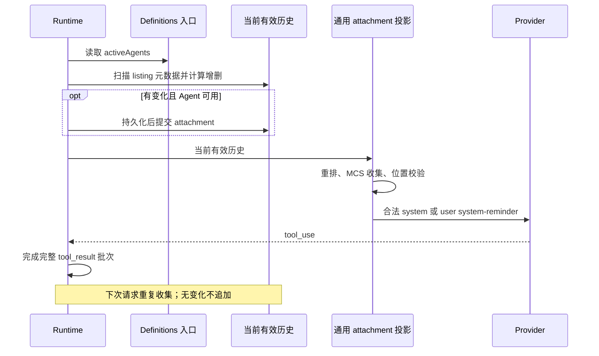

# Agent listing attachment

## Behavior and boundaries

The Agent tool description points only at the in-session `<system-reminder>`. The full directory reaches the model via the `agent_listing_delta` attachment; profile execution permissions do not change. Config refresh follows the [parent context refresh contract](./subagent-runtime-refresh.md); listing only consumes the directory valid for this turn and builds no separate config-loading or notification state.

`AgentDefinitionsSnapshot.activeAgents` is the normalized effective directory. The runtime reads it through the dependency-injected synchronous, no-I/O `getAgentDefinitions()`; the default entry uses the normalized snapshot of startup profiles. The local integration entry loads and freezes a snapshot at the start of a new parent turn; listing, runner, and plugin-reference share that definition. Later requests in the same turn and auto compact do not reload; a same-name config change appends no directory reminder. A config-load failure ends the turn during parent-turn preparation; listing needs no availability fallback switch, and existing directory history stays unchanged. The collector neither fills in built-in types, caches rosters, nor reads files; per-entry formatting keeps the existing name, description, and tool semantics.

The Agent description copy is fixed to the lean version of the first-party MCS branch. The continuation note uses `Use SendMessage with the agent's ID to continue a previously spawned agent with its context intact; a new Agent call starts fresh.` — only agent-ID addressing is supported; no `or name` addressing. The definition source uses ``Each agent type's model, reasoning effort, and tools come from its definition (`.zcode/agents/*.md` frontmatter).`` — reusing the source sentence with ZCode's Markdown directory; the unsupported SDK `agents` entry is not added, and actual load paths, override precedence, and execution behavior are unchanged. The concurrency note appears only on the first listing; the description drops the duplicate sentence; background default behavior and isolation stay as-is.

The provider-visible contract above is limited to the first-party MCS branch. Tests with MCS disabled verify the existing ZCode-compatible path: no extra serialization merges the reminder into the last tool_result, and the non-MCS full request is not claimed byte-identical. The exclusion policy for historical continuity sources stays as-is; listing, like any ordinary attachment, accepts the existing legal-position checks without bypassing them.

## Single source of truth and ordering

The dedup source of truth is the structured attachment history still valid on the current branch after compact. After applying `addedTypes` and `removedTypes` in order, compare with the exact name set of current definitions. Additions sort by name localeCompare, removals by string order; a rename is delete-old + add-new. Compute removals by iterating the notified set directly; sort only after confirming changes; do not copy the whole set into a temp array. Same-name description/tools/model changes produce no delta; with no change, or when the current valid tools have no Agent, nothing is appended. When the notified set is empty, `isInitial=true` — including re-adding after removing everything; an empty directory sends no initial notice.

Collection runs before every ordinary model request, after compact and tool filtering. Output-token continuation keeps the existing private request branch and does not change unfinished tool_use/tool_result pairing. Read/persist failures propagate upward — never interpreted as an empty directory, never written into the notified set. Without a SessionStore, runtime history can still be committed.

## Persistence, projection, and compact

Metadata carries the runtime-validated `addedTypes`, `addedLines`, `removedTypes`, `isInitial`, and `showConcurrencyNote`; persistence keeps the original text, and recovery never reverse-derives names from the body. The initial directory carries the concurrency note. Missing/invalid structured data does not enter the notified set; the next request of an old session re-sends the initial directory.

Validation and defensive copies stay at the persistence-recovery and MessageHistory write/replace boundaries; deltas newly generated within a request come from the same collector. The collector reads only `addedTypes` / `removedTypes` of the valid history and does not re-parse metadata, copy arrays, or build validation Sets per request. The set is still rebuilt from valid history with no cursor cache; invalid-metadata filtering, history-copy isolation, and provider-visible content are unchanged.

Listing is an ordinary source-owned attachment reusing existing reorder, MCS collection, position validation, and provider serialization. With MCS enabled and a legal position it may merge with other reminders into system body; with MCS off or an illegal position it uses a user `<system-reminder>`. It joins no non-MCS/no-reorder exclusion table and expands no generic anchor range for listing. Internal history and metadata are never rewritten by provider reordering. The shared projection classifies it as provider context — no user bubble, turn starter, background wake, or new UI hint. Desktop continuous and mobile replayable keep the existing host/stream boundaries with no new runtime, queue, or message-delivery path.

Compact uses the same collector with the actually retained messages as dedup history, placing necessary listings into postCompactReminderEntries, persisted together with the summary before commit. A full compact backfills the full directory; a partial compact backfills only missing items; the next ordinary request does not repeat. Backfilled tokens count into truePostCompactTokenCount. microcompact needs no backfill when it clears only tool results. Cold resume, fork, and rewind restore metadata from the valid branch. No new DB tables or migrations; old messages are not backfilled or rewritten.

Auto compact obtains this turn's listing tool set through the lazy read entry, reading only after passing the compact threshold and rapid-refill checks; when compact is skipped, no tool contract is built. Ordinary requests still read current tools after MCP init, keeping this turn's disable rules and never reusing an old set across MCP init; a tool-read failure still propagates upward and does not count as a compact failure.

## Acceptance

Tests split by responsibility, pruning the profile × MCS × compact cross-products; each new piece of logic keeps direct assertions:

| Coverage                                            | Owned assertions                                                                                                                                                                                                                                                                                                                         |
| --------------------------------------------------- | ---------------------------------------------------------------------------------------------------------------------------------------------------------------------------------------------------------------------------------------------------------------------------------------------------------------------------------------- |
| `agent-listing.test.ts`                             | Default definitions snapshot; first listing, empty directory, repeats, add/remove, exact names/renames, same-name metadata, remove-all-then-add; valid-history rebuild/partial retention/fork/rewind; metadata validation and copy isolation; adjacent reminders, MCS position downgrade, and anchor regression without listing          |
| `agent-listing-runtime.test.ts`                     | Replacing definitions after a same-turn tool batch, dedup on later user turns, Agent unavailable; pure synthetic/mixed-text recovery; live/cold equivalence for ordinary and post-compact, backfill-before-commit/no repeat next turn; definitions/persistence failures; reactive compact hiding Agent. Reuses one Runtime/store fixture |
| `agent-listing-wire.test.ts`                        | Release-config first-party `claude-fable-5-1` through the real Anthropic adapter: body, role, wrapper, ordering, and tool pairing after the initial listing and full tool batches, covering the MCS switch; Core does not repeat these serialization assertions                                                                          |
| Existing tool/source tests, shared projection tests | Lean description copy, source registration/validation, provider-context classification and no turn trigger; tool filtering follows automation/off-peak restrictions                                                                                                                                                                      |
| Official Desktop I21/SA                             | Non-MCS traces for the four profile kinds plus one general-purpose MCS scenario; all check first-listing-after-parent-request/dedup-after-tools, child having no Agent/listing, execution completion, and no fake user message in UI; MCS duplication pruned for the other three profile kinds                                           |

- Run the relevant unit tests, official Electron E2E, architecture, typecheck, lint, E2E typecheck, and coverage audits; record actual results and artifacts.

## Verification outcomes

2026-09-14 generic-attachment integration: the listing's non-MCS/no-reorder special case and generic anchor expansion were withdrawn; the two generic provider projection files match the original HEAD exactly; the source adds only lifecycle registration and a descriptor. Final 385 focused tests + 1 shared UI projection test pass; `agent-listing-wire.test.ts` 4 cases pass with local fetch fixtures (no live model service); official Electron I21/SA 2/2 first pass without retry (artifact `packages/desktop/.e2e-artifacts/desktop-e2e-20260914120729653-p63978-8d35aec89b130289/`; `network-capture/upstream-provider.json` is the real capture, `agent-listing-verification.json` the per-request check). Root typecheck/lint, Core/Adapters typecheck/lint, Desktop E2E typecheck, and fixture checks pass (42 pre-existing root-lint warnings, 10 Core). Expanded Core+Adapters full run: 4084 passed / 84 failed — 3 stale cache assertions restored, 6 timing flakes isolated green, the rest reproduce on pristine HEAD; Adapters' own lint script hides files via ignore and shows pre-existing max-lines errors with `--no-ignore`; conversation coverage audit keeps pre-existing D19/I74/I75 drift — these gates are not reported as fully passing. Windows, Linux, and mobile GUI were not verified on real machines.

Earlier "listing always user" contract records (same day) prove only the pre-correction implementation and are superseded by the current contract: focused/wire tests and official Electron must be re-run for the current provider-visible contract. Those runs (20 collector/runtime/persistence + 1 projection test, Core full 2397/18 failed matching pristine HEAD `ae7b0928a8`, I21/SA 1/1 with case-local replay fixtures, artifact `desktop-e2e-20260914094914319-p65512-58d2158db972bffc/`) and the lean-copy addendum re-run (66 Core tests, artifact `desktop-e2e-20260914105041342-p8117-87dcf4e0620cd911`) remain in git history.

Full history: git show 3da132e86ee5ba3b6a079f99fa3987f038457c29:docs/subagent-listing-attachment.md

## Implementation notes

The listing delta generates only an intermediate meta user message at formatting time; the final provider role is decided by later reorder, MCS collection, and position validation — never treat the formatter intermediate as the final provider role. The old "description carries the directory by default" conclusion is only a historical baseline; this spec supersedes its implementation description.
