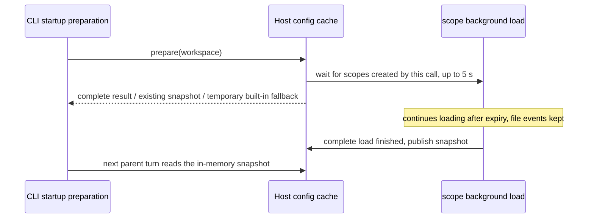

# Subagent config refresh per parent context

## Contract and single data source

The Local Host subagents service owns the file-parse cache and the in-memory snapshot per workspace.
User documents/state are shared inside the Host; projects are isolated by
`workspaceIdentity?.trim() || workspacePath`. Local sources follow Host/Settings; other `storage.dir`
uses and the standalone CLI / remote workspace sources are unchanged.

`subagents/readRuntimeConfig` is read once at session initialization and once at the start of each
ordinary parent turn. Listing, Agent, SendMessage and plugin-reference for that turn share the
fixed definitions; later model requests, retries, compact, Guide and running children do not
refresh. Terminal resume keeps the identity history and looks up the original agentType of the
turn; a missing profile/history fails explicitly, without creating an empty session or substituting
the default profile.

IDE in-memory edits do not trigger updates; Settings, autosave and external disk writes go through
the same native watcher. "Publish" only means replacing the in-memory snapshot: while a background
read runs the old complete snapshot keeps being returned, and the next parent turn after completion
consumes the new snapshot. Hosts observe the disk independently; there is no broadcast, CLI push or
all-Host acknowledgement barrier.

```mermaid
sequenceDiagram
    participant D as Settings / external file write
    participant H as Host watcher (each)
    participant S as Host snapshot
    participant P as CLI parent turn
    D->>H: native file event
    H->>H: write stable, paths merged, read only changed files
    H->>S: replace config on success; replace with fallback state on read failure
    P->>S: RPC at init / new parent turn
    S-->>P: complete in-memory copy
    P->>P: merge inline / built-in / loaded plugins, fixed for the turn
```

## Watching, parsing and I/O

### Startup preparation and background refresh

Startup preparation waits only for the first load of scopes created by this call. While the shared
user/state scope refreshes in the background, a new workspace may compose its first snapshot from
the last complete load of each scope without waiting for the shared scope to be idle. An existing
workspace keeps using its published snapshot during a background refresh and never publishes partial
batch results. "Complete snapshot" means `ready`. A built-in fallback produced by a first-load
timeout does not block recovery: once the project load completes and the shared scope has a usable
complete result, the snapshot publishes even if the shared refresh is still running; if any scope
still fails, the fallback stays.

The first load (including explicit reload) waits at most 5000 ms and continues as soon as it
completes. On expiry the existing workspace snapshot is kept; if there is still no complete result,
only that workspace temporarily uses `built-in-fallback`, keeping inline agents. Reading ahead for a
prepared workspace without a first snapshot uses the same bounded wait. The limit constrains cache
load waiting only; it is not a total bound for disk path resolution, migration or whole-process startup.

Expiry does not mark the scope read as failed, cancel the background load or clear pending paths.
The scope keeps managing the load, finishes once stable and publishes independently, with no extra
file event needed; a first load that finishes after the startup wait must still publish. Only a new
parent turn consumes the new result; started parent turns and running children are unchanged. Real
read failures follow the fallback rules below; destroyed/replaced scopes keep cancellation and
late-result isolation. No retry timer or new cache is added.



### File watching and parsing

1. Watcher: chokidar 4.0.3 native events (`usePolling:false`). The effective scope is the files
   directly under the agents root (`depth:0` relative to the root), accepting case-insensitive
   `.md`/`.markdown`. When the directory exists, the original configured path from preparation is
   watched directly and the filesystem handles directory case; there is no alias mapping and no
   lower-casing. When it is missing, the nearest existing parent's direct directory changes are
   watched temporarily; events re-check the original configured path and switch to the target. All
   watches are `depth:0`; there is no recursive enumeration from ancestors with string-prefix
   filtering. State likewise receives only target-file events and supports atomic replace.
   `followSymlinks:true` and drive-letter/POSIX roots are kept; no resident polling or backend fallback.
2. One active Chokidar watcher per scope, switched serially; late events from an old instance are
   invalid. After the watcher is `ready`, the directory is re-confirmed to cover changes between the
   check and the binding. Directory deletion/replacement forces a rebind even if the original path
   was rebuilt. Unrelated directory changes only do the necessary path checks; when the watch
   location is unchanged there is no rebind and no config read. Switching and destroying cancel the
   old load and forbid late publication. Unrelated parent-directory checks do not reset the merge
   timer of an existing batch, so other file activity cannot keep postponing config updates.
3. The native library may emit child `unlink` first and `unlinkDir` late. Before a delete batch
   publishes, the directory location is checked once so a deleted directory switches back to the
   parent watch; otherwise rebuilding right after publishing an empty snapshot could lose the
   deletion notice and leave the old watch. Moving an empty directory away may produce only a raw
   event on macOS, and on Windows even a root watch gets no raw event. Each scope therefore carries
   a cancellable native parent-directory structure subscription, switched/closed together with
   Chokidar. It does not enumerate the parent and is not merged into the Chokidar file index (so a
   real `AGENTS` is not reported as a logical agents deletion).
4. The check queries only the state of the watch root and compares the directory identity at bind
   time to detect a fast same-path replacement. It does not query file identity, keep a path map or
   trigger unrelated config reads. When the config path is occupied by a regular file, read-failure
   semantics are kept and that path is watched so deletion/restore rebinds.
5. Timing: write-stable threshold 1000 ms, check interval 500 ms, event merge 300 ms; only changing
   files are checked. `ready` does not guarantee the first enumerated files are stable: when a
   directory first appears or is rebuilt, a catch-up scan enumerates candidates and does a bounded
   async state check; a file is read only after size, mtime and replace identity stay unchanged for
   1000 ms. Disappearance is treated as deletion; other errors follow scope-failure fallback. Files
   added during the scan are taken over by the watcher without a full rescan. Wait end, cancel and
   failure release the temporary checks; no sync I/O is added. Cold start/explicit reload of an
   existing directory keeps the original load semantics; ordinary updates use Chokidar. Stability
   only means a quiet period was observed, with no multi-file transaction guarantee.
6. Load after the first watcher is established and handle events during loading; creating a missing
   directory and deleting/rebuilding a directory both recover. Watcher errors log a warning and
   explicit reload rebuilds the watcher; destroy closes the watcher and rejects late publication.
7. Custom user/project profiles (initial load, explicit reload, directory-rebuild catch-up scan, and
   the Settings list) only process `.md`/`.markdown` files directly under the agents root, matching the
   `depth:0` watch; the standalone CLI uses the same scope. Deeper files take no part in the custom
   agent list or runtime definitions; an existing deep profile must be moved to the root to be used,
   and files are not moved or deleted automatically. Plugin agents keep the original recursive
   discovery. Regression covers user/project init, hot update, rescan, directory rebuild, runtime
   scans not reading deep files, and plugin recursive discovery; Desktop reuses SHR22 and asserts
   that both Hosts' init and later parent-turn provider requests contain no deep definitions.

The pure Markdown parser and profile types/schema live in shared; the Host and the standalone CLI
reuse the same implementation. The Host does not import Core; parsed fields, diagnostics and project
permission limits are unchanged, and Settings `AgentSummary` does not stand in for the full profile.
Diagnostics are recorded at file load time, not per parent turn. The CLI only composes in memory and
no longer parses Markdown. State updates use the fixed path resolved at preparation and do not
re-read CLI config; changing `storage.dir` still needs an explicit reload.

| Change                                                           | Config I/O                                                                        |
| ---------------------------------------------------------------- | --------------------------------------------------------------------------------- |
| add/update A                                                     | read and parse only A                                                             |
| delete A                                                         | remove the cache entry, read no other Markdown                                    |
| rename A→B                                                       | remove the old path, read the new path; state is read only if it actually changed |
| state                                                            | read only state; compute enable/override in memory                                |
| init, explicit reload, directory rebuild, scope failure recovery | scan the affected scope                                                           |
| parent-turn RPC / spawn / resume / unrelated workspace           | no config file reads, no repeated parsing                                         |

The cache is keyed by file path and keeps same-name files and the original sort/override; a state
change does not re-read documents. Each scope merges pending paths so events during a read are not
lost; an internal generation counter stops stale results from overwriting. A complete batch replaces
the snapshot and never mutates a returned snapshot. No hash, delta RPC or general incremental
framework; native events still require the necessary file-state queries.

## Failure, protocol and save

The RPC response strictly distinguishes `{ kind: "ready", profiles, builtInModelSelectionOverrides,
pluginAgentModelSelectionOverrides }` from `{ kind: "built-in-fallback" }`; raw Markdown is not sent.
File-parse diagnostics keep the existing filtering. A scope read failure makes the workspaces that
depend on that scope fall back to built-in agents, keeping explicit inline agents and not mixing in
old custom/plugin/disk overrides; the next file event or explicit reload recovers, with no retry at
RPC read time. A user/state failure affects all dependent workspaces; a project failure affects only
that project. RPC disconnect/cancel/not-ready/destroyed still throws: input is kept and the parent
turn sends no model request; it must not become a built-in fallback.

Settings save only does the existing serial persistence; `changedPaths`, the dedicated event and the
broadcast binding are removed, and save does not wait for the watcher. Multi-file save is not a
transaction; a partial disk failure still takes effect per the disk facts, and a failed save is not
promised to never take effect. Plugin templates do not hot-update; existing overrides and
canonical-name/alias rules are kept; plugins/MCP are not rebuilt. Mobile shares the original Host and
does not change the desktop `continuous` / mobile `replayable` boundary.

<a id="覆盖映射与验证"></a>

## Coverage mapping and verification

- Desktop E2E keeps the official CLI resolver and storage startup preparation. The config-fault proxy
  is preloaded by the test via `NODE_OPTIONS --import`, wraps only app-server stdio, and strips its own
  preload from the child CLI to avoid recursion. Custom commands must not bypass
  `storagePreparationEntry` / `supportsStorageStartup`, and the production startup contract is not changed.
- Role onboarding of the isolated profile is skipped through the existing UI helper, then workspace
  and model are prepared; production onboarding state is not changed.
- Dual-Host plugin model overrides use a case-local plugin fixture, not a built-in plugin that may be
  renamed, split or change its default model. The Agent description keeps the upstream dynamic-workflow
  gray-release hint; the directory and concurrency hints still come from the listing attachment.
- Test controls (timing, model responses, faults) live only in test files, provider fixtures, a
  temporary filesystem and existing transport ports. No test environment checks, marker branches, wait
  hooks, test RPC or test-only public interface in production `src`.
- Startup-wait regression covers: a shared refresh not blocking a new workspace; the 5 s boundary for
  first load / explicit reload; concurrent first reads; publication without events after expiry; and
  destroy/replace isolation. A real watcher verifies that under continuous writes serial preparation
  and state save can finish, and that after writes stop existing and new workspaces recover
  automatically and previously returned snapshots are kept.
- E2E log observation matches paths in the Host's JSON-serialized form, covering POSIX, Windows drive
  letters and UNC; log waiting and the preload observer share this escape convention so backslashes do
  not make a completed update look like a timeout. The Markdown migration regression checks that the
  OS-reported file mode is unchanged by migration; POSIX still checks exact permissions, Windows does
  not apply POSIX modes it cannot express.
- Run: affected unit tests, the six Desktop groups, fixture validation, architecture, typecheck, lint,
  fmt. The native watcher needs Windows verification and must not be claimed passing if not run.
  Keep PID, provider capture, parent/child model-io/trajectory/logs; replay-prefix checks do not
  represent online cache hit rates.

### Case-insensitive path boundary (SHR22)

On a case-insensitive filesystem, the configured path `agents` and the real directory `AGENTS` point
to the same directory; both Hosts must consume saved updates, deletions and renames, verified
separately for user scope and project scope. Desktop reuses the cross-host pending case: both new
Hosts load the old profile, a Settings save follows, and the next parent turn on each side is
accepted by the real provider request carrying the new prompt, keeping PID, disk content and
parent/child trajectories. After a publish-wait timeout the request is still captured for
attribution, and the final assertion still requires the new config (old config or timeout never
counts as pass).

First creation, delete-rebuild and symlinks keep the existing contract, plus case-change
combinations and filename case-only renames. On a case-sensitive filesystem, coexisting
`agents`/`AGENTS` must be isolated. Tests choose scenarios by actual filesystem capability, not by
guessing from the OS; skipped capability branches must be stated in the verification record. The
Chokidar direct-directory probe is for design analysis only; it does not replace production service
regression and does not freeze a parent/mapping implementation.

### Six manual-review/pending E2E groups

Kept as business assertions, not CI admission:

| Scenario           | Kept or migrated evidence                                                                                                                                                                                                  |
| ------------------ | -------------------------------------------------------------------------------------------------------------------------------------------------------------------------------------------------------------------------- |
| SHR01-SHR03        | runtime-refresh: new parent turn, failed-child recovery, same-turn old config and compact                                                                                                                                  |
| SHR04-SHR08        | catalog-refresh: add/delete/rename/enable-disable, same-name update, user/MCS, parent trajectory and cache prefix                                                                                                          |
| SHR09              | profile-fields: single-field reasoning/prompt/tools spawn/resume                                                                                                                                                           |
| SHR10-SHR13, SHR15 | context-boundaries: running child, same-turn resume, RPC fault, retry/cancel, child trajectory                                                                                                                             |
| SHR14, SHR17       | multi-workspace: real multiple CLIs, project isolation, faults not blocking save                                                                                                                                           |
| SHR16, SHR18-SHR21 | cross-host: bidirectional save and external edit, each side's next turn, state override, I/O-failure fallback/event recovery, late background results, Host close                                                          |
| SHR22              | cross-host: differently-cased user directory update, project directory first creation and rebuild; two existing sessions consume the new config next turn; the real-watcher unit test adds add/delete/rename and lifecycle |

Broadcast send failure / illegal payload / loopback are no longer product branches; their tests and
fixtures are removed. Delayed/duplicate/unrelated events are verified as file events and I/O
boundaries. Cache unit tests add first creation, atomic replace, rebuild, concurrent reads,
update-during-read, destroy, per-file read/parse counts and zero file I/O on a new parent turn.
Shared-parser field and diagnostic regression is kept.

### Dynamic catalog and prefix acceptance (SHR04-SHR08)

Accepted using real Settings operations, the same running parent session and real provider
requests. Continuity scenarios use a large enough context window and forbid compact; the original
SHR01-SHR03 compact scenarios are kept separately.

| Scenario                    | Action and required assertions                                                                                                                                                                                                                                                                                                                                            |
| --------------------------- | ------------------------------------------------------------------------------------------------------------------------------------------------------------------------------------------------------------------------------------------------------------------------------------------------------------------------------------------------------------------------- |
| SHR04 dynamic add           | after the parent session completed a turn, create A; the next turn's listing appends A, and the provider request for Agent A uses the selected profile                                                                                                                                                                                                                    |
| SHR05 rename                | rename A to B; the next turn's listing removes A and adds B; spawn by the old name and SendMessage to the old instance fail explicitly with no new child; B runs                                                                                                                                                                                                          |
| SHR06 delete/toggle         | after disabling B, spawn/resume fail; after re-enabling they work; after deleting B the listing removal and spawn/resume failures are verified again; failure paths must not create a child/session                                                                                                                                                                       |
| SHR07 same-name update      | update B's model, reasoning, prompt, description and tool constraints; the next turn's provider uses the new values and tool set; the original history listing keeps the old body and no same-name notice is appended                                                                                                                                                     |
| SHR08 trajectory continuity | the MCS and user-reminder projections each run through all the above; raw model-io is kept before cleanup and exported via prompt-trajectory; each parent session yields exactly one segment covering all main requests; per request check system/tools unchanged, history append-only, tool_use/result paired, and cache breakpoints and the prefix they cover untouched |

```text
same parent session: first turn → add A → run A → rename A to B → old name/instance fail
                   → run B → same-name config update → run new config → disable/fail → enable/run → delete/fail
provider history: original prefix always preserved ───────────────→ only the tail appends
```

The trajectory tool's ignoring of `cache_control` in its continuity check cannot replace a cache
check; wire requests separately assert cache markers and protected content. Synthetic replay `usage`
is for protocol replay only and does not prove real provider cache hits. A child's model/system
prompt change is an explicit config change: identity/history persist, and the new config's prefix
need not equal the old one. The tests introduce no business state and do not change the
desktop-continuous / web-remote-replayable boundary.

SHR08 found and now regression-covers a bug: Core correctly marks the last tool message, but when the
AI SDK merges consecutive tool messages it keeps only the first message's `providerOptions`, losing the
cache marker at the end of the batch. The adapter maps that marker to the matching tool-result part's
`providerOptions`, keeping the original breakpoint position; Core history, tool-result text and the
provider protocol are unchanged. Wire unit tests cover single/multiple results, error results,
mid-batch/end-of-batch cache positions and TTL; Desktop keeps forcing per-request assertions for both projections.

### Single-field update and SendMessage state boundary

SHR09: model/provider stay unchanged and only reasoning, prompt or tools change in turn. After each
save, the next parent turn's spawn and SendMessage resume of a completed child both use the new
field, with other fields unchanged. Resume keeps agentId, childSessionId and full history; only a
reasoning change reuses the model-change record, and a prompt/tools-only change adds no model divider.
Desktop saves from the real Settings form and is accepted through provider requests and read-only
persistence assertions; the Core cases build each of the three fields independently so changes do
not mask one another.

SHR10: SendMessage config depends on the target's state, not only on the call name.

```text
parent T1 snapshot v1 → child A running (v1)
save v2 → parent T2 snapshot v2
  ├─ SendMessage → A still running: only delivers the message; later child requests stay v1
  ├─ spawn B: uses v2
  └─ A finished → SendMessage resume A: keeps identity/history, uses parent T2's v2
save v3 again inside parent T2 → that turn's terminal resume still uses v2; only parent T3 can use v3
```

## Verification record

2026-09-17/18 verification passed on macOS, SSH Windows and a case-sensitive temporary volume
(including SHR22 failing before the directory-watch fix and passing after); the remaining gaps are
the Windows Desktop UI/multi-Host E2E, real remote workspace/mobile E2E, and the full-repo format
check blocked by unrelated Electron sample HTML syntax errors. Two Windows migration tests assert
exact POSIX modes (`0o640/0o400` becoming `0o666/0o444` on Windows) and two chmod fault scenarios
are skipped on that platform; test-side assertions were corrected without production changes. The
full command/PID/provider-request logs were written under `packages/desktop/.e2e-artifacts/`
(links to them were dropped). Full history: `git show 37b98ff8:docs/subagent-runtime-refresh.md`.
