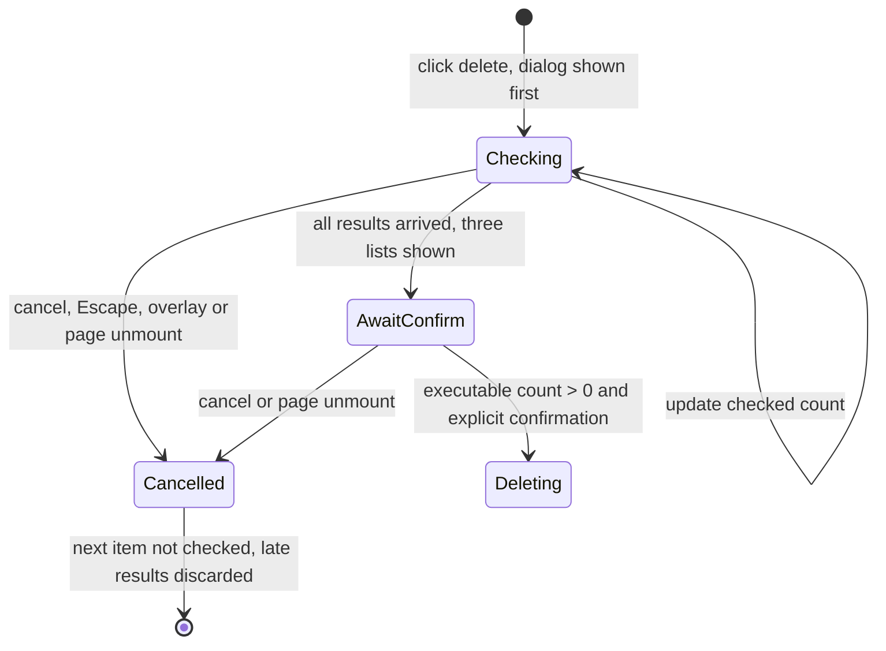
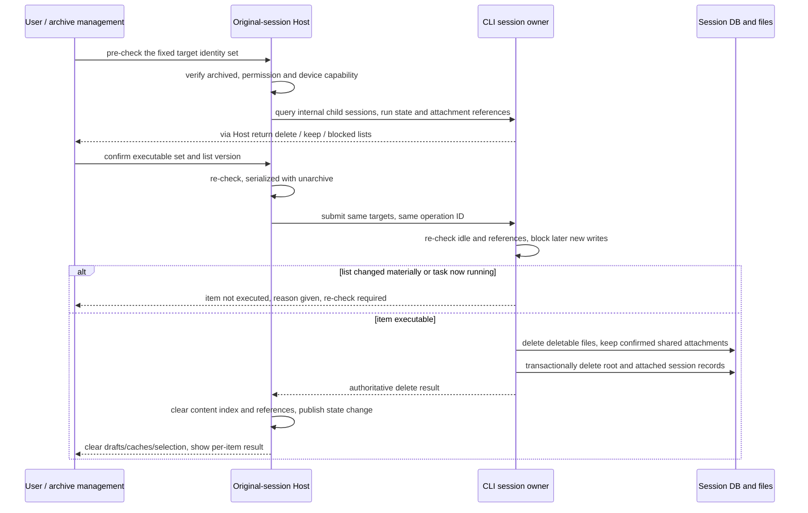

# Settings: Archive Management

Settings -> Data and statistics -> Archive management ("归档管理"). Layout follows the "archived chats" reference
screenshot: title / delete-all, search, sort and project filters, project group header with count and more menu,
and cards with task title / time / delete / unarchive. Project candidates and groups use virtual projects, never
cwd.

Full history: `git show 37b98ff8:docs/superpowers/specs/2026-09-11-archive-management.md` (per-round verification
logs and the Select-expansion performance measurements).

## Behavior and boundaries

- Both the page name and the page title are "归档管理"; it sits before the auto-archive settings; the list title is
  "已归档的会话". Only `archived` rows of the Host `readTree` are shown. The CLI delete mirror excludes deleted
  tasks, and rows cannot be added back from sessions-index.
- The auto-archive settings live at the top of archive management, before the archived list: "自动归档旧会话"
  (auto-archive old sessions) and "归档保留时长" (retention) stay in one settings card and are removed from the
  general page. Existing setting keys and the 3/7/14/30 day options are kept. Since 2026-10-19 the default is off
  with 30 days (existing day values are not overwritten). While off the duration can still be chosen and saved: it
  is stored only and no archiving runs; when turned on, archiving uses the stored duration. Changing the duration
  while on reuses the settings-change re-scan; already archived sessions are not restored by a duration change.
  Since 2026-10-14 an old enabled value is reset once to off (days kept) and runs only after the user re-enables it;
  the migration contract is in `2026-09-09-virtual-project-design.md`, "Auto-archive re-enable after the fix
  (2026-10-14)". Chinese/English, light/dark and narrow layouts reuse the shared settings row.
- Fixed page copy uses "会话" (English: session) everywhere: auto-archive label/description, list title, search,
  counts, loading/empty/failure messages and delete confirmation. User-defined session titles and project names are
  shown as they are. The title reuses the shared SettingsPage header and `archives.nav`, the list still uses
  `archives.title`; display only, no change to state owner, commands, persistence or failure semantics, no
  migration.
- Default sort is updated time / all projects, searching titles case-insensitively. The middle dropdown is "sort by"
  and offers only updated time and created time, both descending. Search and project filter intersect.
- The filter row reuses the shared Select: the trigger shows only the current option and a dropdown arrow; the
  "sort by" label sits outside, left of the sort box, and neither sort nor project box has a decorative icon. The
  external label is associated with the Select, keeping keyboard operation and accessible name; narrow screens
  wrap; Chinese/English and light/dark stay usable. Filter state is still held by ArchiveManagementContent; no new
  component or sync path.
- Groups and selection are keyed by Host + projectId; same-directory projects and same-name projects on different
  Hosts are not merged. The project name is shown, remote with the Host name. No projectId shows "未归类"
  (unclassified); a deleted container keeps its name plus the "已移除" (removed) mark without restoring the project
  or changing session cwd. Candidates come from the same tree and include deleted containers that still have
  archived sessions, and unclassified.
- The time shown is the CLI updatedAt/createdAt selected by the current sort, descending and stable; the title is a
  single line with ellipsis and the full title readable; 50 items per group on first screen, show more adds 50.
  Counts and batch operations use all matches, not the rendered page.
- All archive groups (including unclassified and removed projects) are collapsed by default, with a collapse arrow
  right of the name; the name and arrow share one keyboard-operable expand button while count and more menu stay
  separate. It reuses the shared Collapsible; chat cards, row buttons and "show more" are built/mounted only when
  expanded and unmount at once on collapse. Each Host+projectId ArchiveGroupCard owns its `open` for this page;
  groups still in the result keep state across sort/filter, new or re-entered groups are collapsed, and search never
  expands automatically. Loaded counts use the page's per-group limit; counts, search results and batch operations
  never depend on collapse or DOM mounting; no persisted preference.
- Each row has unarchive/delete; the group more menu offers unarchive/delete for the group; the top-right delete-all
  acts on the current search/filter result. Deletes need confirmation stating the count and that the UI cannot
  undo. (Since 2026-11-04 delete means permanent delete with a pre-check, see "2026-11-04: permanent deletion of archived sessions" below; this bullet's soft-delete wording is superseded.) The candidate identities are fixed during confirmation and
  later new matches are not added.
- Only one operation batch runs at a time on a page (buttons disabled). Existing commands are sent per item, UI
  state is cleaned only on success, then a final refresh; partial failure reports success/failure counts, failed
  items stay in the authoritative tree, errors are never swallowed, successes are not rolled back and full success
  is never faked. Cancelling confirmation sends no command. Targets that expired, were unarchived or deleted are no
  longer executed.
- Local and online remote share the page; offline fakes no session cache and starts no Agent for reads; an offline
  project is recognizable but has no actionable offline index. Loading / empty / no-search-result / read-failure are
  shown separately with retry on failure. Async refresh reuses the original request sequence number with no new
  sync timer.
- DESIGN.md semantic colors, text-ui sizes and component reuse apply; light/dark, keyboard, Chinese/English and
  narrow screens are usable. Mobile reuses the existing Host attachment and must not create a runtime for the
  archive page.

## Archive and scheduled-task linkage

When a session newly enters the archived state, all enabled scheduled tasks bound directly to that session under the same source and full workspace identity are paused. Manual, batch, background auto-archive and the existing tool and remote-control entries behave the same; the existing archive admission and candidate range are kept, and sessions already archived are not back-filled.

Unarchiving does not resume scheduled tasks. While the session is still archived the user may enable a scheduled task by hand; a repeated archive request, a background scan or an app restart does not pause it again. Already claimed, queued and executing runs still execute; pausing only blocks later claims.

Association scope, commit boundary, state transitions and acceptance checklist are in [pause bound tasks when a session is archived](../../automation-edit-status.md#会话归档时暂停绑定任务). This section changes none of the session-deletion rules below and adds no notification or management UI.

## Architecture decisions

The archive UI belongs to the managed project-sidebar/ui module and exposes ArchiveManagement through its index;
settings navigation only registers the entry. ProjectDirectoryProvider is lifted to RootWorkspaceContent so sidebar,
composer and settings share one source; a nested Provider reuses the existing owner, a standalone shell can still
use it, and `useProjectTree` must not run several times. The Host owns projects/roots/archived; the CLI owns
existence/title/time. The UI owns only search, filter, collapse, pagination, the confirmation snapshot and the
in-flight batch.

```text
Host readTree -> single ProjectDirectoryProvider -> sidebar / composer / archive settings
user filter -> pure derived groups (Host+projectId; task address still workspaceKey+taskId)
confirm fixes candidates -> existing Controller.mutateTask / TaskService
             -> Host archive=false or CLI delete -> index event -> same tree refresh
desktop: continuous chain unchanged; mobile: shared-host + replayable chain unchanged
```

Task operation address/routing reuses one module-internal mutation adapter shared by sidebar and archive page;
remoteSessionId resolves from the existing registry and sourceServerId from the unified identity parser, never by
guessing remote from paths. No new protocol, schema, migration, persisted cache or accepted queue.

The auto-archive card is composed by SettingsPage in the archives section; setting values and callbacks stay owned by
SettingsPage and SettingsService stays the persistence authority; project-sidebar query/list components do not take
over settings state. The page updates only after a successful save; failure uses the original settings feedback. Host
scan scheduling, remote config scope and the desktop/mobile boundaries are unchanged; mobile gets no new settings
entry.

```text
archive settings card -> SettingsPage original callback -> SettingService.update
                                      ├-> original Host scan scheduling: off exits, on scans with the stored days
                                      └-> save succeeded -> SettingsPage updates displayed value
```

## Impact analysis and test decisions

| Item               | Conclusion                                                                                                                                                                                         |
| ------------------ | -------------------------------------------------------------------------------------------------------------------------------------------------------------------------------------------------- |
| Layer/pattern      | presentation, option-source, validation, commit-effect                                                                                                                                             |
| Entries to check   | SettingsPage/navigation/config; RootWorkspaceContent/WorkspaceShellLayout; ProjectDirectoryProvider; task archive/delete commands                                                                  |
| Shared / different | three places share the directory source; the archive page takes only archived and includes deleted containers; the sidebar shows no archive; the composer shows no deleted containers              |
| UI surface matrix  | settings filter: page draft -> pure tree projection; row/group/all actions: confirmation and in-flight -> existing command -> Host/CLI; sidebar: refreshed by the same event, navigation unchanged |
| Owner / landing    | query and preferences by Provider; archive by Host tasks-index; delete by CLI mutateSessionFacts -> mirror; no new landing                                                                         |
| Invariants         | workspaceIdentity isolation, Host+projectId grouping, old cwd unchanged, no change to time/title, no write to the other database, continuous/replayable separated                                  |
| Codegraph          | unavailable (`no such table: unresolved_refs`); impact traced from source with rg, no graph analysis claimed                                                                                       |
| Graph drift        | old surface.project-task-list still points at deleted grouped/workspace nodes (historical drift); only the new archive entry and existing authoritative ports were registered                      |
| Not expanded       | provider/tools/message stream/queues do not affect archive management; no full cartesian product, no new runtime request                                                                           |
| Clarification      | user confirmed the middle dropdown is sort-by with only updated/created time; delete-all uses the current filtered result and the dialog shows the count                                           |

| Case  | Setup -> Action -> Assertion                                                                                                                                                                                            | Status/evidence                                                   |
| ----- | ----------------------------------------------------------------------------------------------------------------------------------------------------------------------------------------------------------------------- | ----------------------------------------------------------------- |
| ARM01 | settings data-and-statistics entry; several virtual projects sharing a cwd, long titles, unclassified, deleted project -> search / time sort / project filter -> groups / counts / candidates use virtual projects only | accepted; unit + pending E2E                                      |
| ARM02 | archived row -> unarchive -> index archived=false, page row gone, sidebar shows it again; cancelling delete changes nothing, confirmed delete sets CLI time_deleted and mirror delete, refresh does not revive          | accepted; unit + pending E2E                                      |
| ARM03 | after search/project filter -> group/all batch action -> only items matching at confirmation are processed; repeated clicks run once, failed items kept and reported, other groups untouched                            | accepted; unit + pending E2E                                      |
| ARM04 | same projectId / task ID / real path on different Hosts -> routing -> full identity/source/attachment kept; local and remote isolated                                                                                   | accepted; unit; real remote/mobile GUI pending                    |
| ARM05 | long titles, 50+ list, Chinese/English, 390px, light/dark -> search / more / buttons / scroll usable                                                                                                                    | accepted; unit + E2E on the shared renderer, not a mobile pairing |
| ARM06 | default all collapsed -> mouse/keyboard expand and collapse -> only expanded groups mounted; collapsed groups' counts and batch actions stay complete                                                                   | accepted; unit + pending E2E                                      |
| ARM07 | general page has no auto-archive item -> archive management default off / 30 days -> while off change and save the duration, restored on refresh -> on uses the stored duration; still editable after turning off       | accepted; pending E2E; layout covered by ARM05                    |
| ARM08 | page header "归档管理" above the auto-archive settings, fixed session copy and delete confirmation                                                                                                                      | accepted; layout reuses ARM05                                     |

E2E cases live under manual-review/pending with fixtures in an isolated HOME/workspace; history data needs no model
(provider policy=none). Function and batch semantics follow the user request and existing command constraints; the
stream protocol is unchanged, so formal-proof message-state combinations are pruned. Not promoted to formal/Docker;
awaiting manual review.

### 2026-10-19: default 30 days, duration presettable while off

Default settings, SettingsPage initial/fallback values and the Host scan fallback are all 30 days; existing days are
not migrated. The disabled binding between the duration dropdown and the switch is removed; saving still goes through
SettingService; scanning exits while off and reads the stored value when on; no new state or sync path.

Verified with a fresh Electron run (ARM07, ARM08, ARM01/05/06: default off/30 days, change to 7 days while off and
refresh, keep 7 on enabling, change to 14 while on, off again then 30, archived sessions not restored; Chinese/English
x light/dark x 1200/390px layouts). Cases stay pending; narrow screens are not a real-phone check. The extra
ARM02/ARM03 unarchive cases of the old build failed and were not touched by this change, so they are not counted as
passed. A first affected-unit run had 2 failures in subagentsService tests (afterEach cleanup timeout, then temp file
ENOENT); the file passed 29/29 on rerun, with no test or timeout change and no claim that the first batch was green.

## Verification summary

Related unit tests, Electron E2E (real created/updated reverse sort, virtual-project filter, unarchive write-back,
delete confirm cancel, CLI time_deleted and Host cli_deleted, persistence after reopen, search-scoped batch delete,
group unarchive, 1200/390px light/dark screenshots and overflow checks), root/E2E typecheck, fixture check, lint and
the architecture gate passed. Real mobile pairing / remote Host / Windows / Linux were not run and narrow-screen
screenshots do not substitute. The semantic graph gained the archive surface, shared directory owner and task
mutation adapter relations; codegraph scanning stayed unavailable and was not written up as graph analysis.

### 2026-09-15: simplified filter controls

The two dropdowns already reused the shared Select; only the project-sidebar/ui composition changed to move the icon
and sort label out of the trigger. Filter state, commands and the continuous/replayable chain are unchanged. The
decorative icons before the sort label and before the project selector were then removed per user request, leaving
the sort text and the shared Select arrow; the filter bar keeps only the search icon and two arrows.

### 2026-09-15: archive-page expand lag located; groups collapsed by default

Cause (profiled in a real dev window with 42 archive groups): `ArchiveGroupCard`'s 50-item limit applies per
project while `ArchiveManagementContent` rendered all groups at once (about 1,142 rows, 17k DOM nodes). Radix Select
injects a scroll lock and changes body `pointer-events` when opening, forcing large-scope style recalculation in
`UpdateLayoutTree`; menu open took about 400-490ms with all projects versus 60-110ms with a single project. Per user
ruling the fix is default-collapsed groups mounted only when expanded: archive rows mounted dropped from 1,142 to 0,
sort Select 406-416ms -> 66-74ms, project Select 461-487ms -> 90-124ms (dev-build numbers, not production
benchmarks). Open follow-up: whole-page virtual scrolling to limit off-screen mounted entries was proposed but not
done.

```text
click Select -> scroll lock / outside-click lock -> style recalculation over many archive DOM nodes -> measure menu position -> first frame
enter archive page -> all groups open=false -> only group title/count/more mounted
click name or arrow -> that group open=true -> mounts its paged chat cards; click again unmounts
batch command -> original matched data -> existing Host/CLI command (independent of mount state)
```

A default-not-mounted unit test failed against the old implementation (50 rows) before the change. E2E also covers
independent expansion, no row DOM after keyboard collapse, more menu not expanding, new groups collapsed / group state
kept after filtering, batch delete and unarchive of collapsed groups, and 16 screenshots (Chinese/English x light/dark
x 1200/390px x collapsed/expanded).

### 2026-09-15: auto-archive settings moved into archive management

The whole settings group moved out of GeneralSectionContent; SettingsPage's archives section now composes
TaskAutoArchiveSettings above the original ArchiveManagement. The card has no internal state; reading and saving use
SettingsPage's existing callbacks; the shared settings row's narrow stacking layout and existing Chinese/English copy
are reused and control accessible names added. Only the ui module's display changed; the project-sidebar contract,
Host scheduling, persistence keys and protocol are untouched. ARM07 failed on the old implementation because
"general" still showed the auto-archive copy, and passed after the change together with the existing archive list
operations; the scan case verifies old-task archive, pinned protection and recent-task retention.

### 2026-09-15: archive page title and session wording

The shared settings page header is restored with "归档管理" and the list keeps its own "已归档的会话" title. The old
implementation hid the archives header and mapped the page title to the list title, which left no page title after
the auto-archive card moved in; both special cases were removed. Archive-specific Chinese/English copy is unified to
session; user content is not replaced. ARM08 covers the title above the auto-archive settings, fixed copy and the
delete confirmation. Four ui display files changed with zero net lines; owners, event order and the
continuous/replayable boundaries are unchanged.

Across the 2026-09-15 rounds the default-branch architecture check still reported a pre-existing unmanaged-file
error for `packages/ui/src/root/resolveConversationWorkspaceTarget.ts`, unrelated to this work. Real mobile
shared-host, remote Host and Windows/Linux GUI were not run in any round; narrow-screen evidence comes only from the
shared renderer. Cases stay pending.

## 2026-11-04: permanent deletion of archived sessions

This section replaces the soft-delete semantics of the single-item, group and current-filter delete above. It is implemented as pre-check, second confirmation and physical cleanup. Unarchive, ordinary session delete, project management and share management keep their existing semantics. Verification scope is at the end.

### Requirements and decisions

| Decision | Confirmed behavior                                                                                                                                                                              | Source                                                     |
| -------- | ----------------------------------------------------------------------------------------------------------------------------------------------------------------------------------------------- | ---------------------------------------------------------- |
| PD-D1    | The existing archive-management "delete" becomes "permanent delete" and really clears session data; no separate soft-delete entry is kept                                                       | user confirmed                                             |
| PD-D2    | User-created independent forks are kept; the confirmation states they still hold their own conversation content                                                                                 | user confirmed                                             |
| PD-D3    | If a root or attached session still has work executing, that item's deletion is blocked and the user must stop the task first; no automatic stop or process kill                                | user confirmed                                             |
| PD-D4    | Attachments still referenced by other conversations may be kept, listed per item in advance; this must not keep the whole original conversation, and the user is not asked to remove references | user correction                                            |
| PD-D5    | Published shares are managed independently; this operation calls no share query, disable or delete API                                                                                          | final user ruling, overriding the earlier linkage proposal |
| PD-D6    | The confirmation lists what will be deleted, kept and cannot be deleted; exceptions list reasons per item so the user confirms the actual scope                                                 | user confirmed                                             |

### Data scope and promises

"Permanent delete" means physically removing the records in the current ZCode session store and the dedicated files deletable this time; there is no undo or recycle bin. It is not just writing `time_deleted`. Forensic-grade disk wiping is not promised; the feature is not extended into whole-device privacy wiping, backup management or share management.

| Object                                                                          | Handling                                                | Boundary                                                                                                                                                                                                                    |
| ------------------------------------------------------------------------------- | ------------------------------------------------------- | --------------------------------------------------------------------------------------------------------------------------------------------------------------------------------------------------------------------------- |
| Target root session                                                             | delete                                                  | title, message bodies, tool records, in-session edit/revert branches, input history, queue, todo, usage, session/workflow storage etc. are cleaned by actual ownership                                                      |
| Attached sessions                                                               | deleted with the root                                   | reuses the owned tree: side Q&A, subagent, workflow child sessions and session_task_link; not an indiscriminate recursion over every parent_id                                                                              |
| User-created independent forks                                                  | keep                                                    | not cascaded just because parent_id points at the target; the content copied into the fork still exists                                                                                                                     |
| Session attachments and tool artifacts with no external reference               | delete                                                  | only the CLI-managed session store scope; no deletion by arbitrary file paths in messages                                                                                                                                   |
| Attachments/artifacts still referenced by a kept session                        | keep the needed files and the index needed to read them | the list shows file name, reason and reference count, and referencing sessions when accessible; the original conversation body is still deleted and no whole session is kept as the attachment owner                        |
| CLI session-dedicated execution files and model-io                              | delete                                                  | reuses the controlled cleanup scope of cli/{exec,agents,sessions}/<sid> and that session's model-io files under debug/rollout                                                                                               |
| Host task index and client caches                                               | clear the target content and references                 | including title, searchable_text, meta_json, group membership, selection state, drafts, history and preview caches; not just hiding the list                                                                                |
| Projects, workspace files, Git/worktree, directory-level checkpoints and memory | keep                                                    | session deletion does not infer directory ownership; the archive-specific protocol accepts no directories                                                                                                                   |
| Published shares                                                                | keep                                                    | fixed note "Published shares are not deleted; share links stay valid"; no share count query and no cloud-delete dependency                                                                                                  |
| Export copies, backups and mixed application logs                               | no linkage                                              | fixed scope note; user files are not scanned and historical migration backups are not changed. A manual whole-database backup restore may bring content back, so it must not be claimed that every channel is unrecoverable |
| Deletion credential needed to prevent re-execution                              | minimal metadata may be kept                            | only identity, operation ID, stage/version etc.; no title, body, attachment content or raw snapshot. Stored by CLI session_purge and Host task_purge                                                                        |

Keeping attachments is an exception the user explicitly confirmed. The success result must say "Session permanently deleted; N still-referenced attachments kept" and not "all related data cleared". Deleting rows does not shrink the database file at once; no per-session VACUUM is added, and the database's logical size is not counted as freed disk space.

Sessions soft-deleted in the past and not visible on the current archive page are not included automatically and are not cleaned in bulk on upgrade.

### Second-confirmation dialog

Reuses the shared confirmation dialog and the destructive button, semantic colors, font sizes, keyboard and responsive rules of DESIGN.md. No full-page data-management UI is added; the plain single-item path stays short and an itemized list appears only when there are exceptions.

1. Clicking the single-item, group or all entry freezes the full identity set currently matched. Group collapse and pagination do not limit the set; after a search the button reads "Permanently delete filtered results...", otherwise "Permanently delete all archived sessions...". The dialog shows the concrete scope and count.
2. The dialog opens first, then the real owner's delete pre-check runs inside it. During the check it shows done/total, the permanent-delete button is disabled and Cancel stays available; unread, failed or offline must not be treated as empty records or zero references.
3. The dialog has three parts. All exceptions are visible by default and a long list scrolls on its own; a normal large item list may collapse, but totals and exceptions must not hide inside a collapse.

| Area                        | Content                                                                                                                                                         | Meaning to the user                                                                      |
| --------------------------- | --------------------------------------------------------------------------------------------------------------------------------------------------------------- | ---------------------------------------------------------------------------------------- |
| Will be permanently deleted | executable root sessions with their project/device, attached-session count; categories of messages/internal history, deletable attachments and dedicated files  | confirmation authorizes only this fixed set                                              |
| Will be kept                | independent forks; each referenced attachment with its name and reason; fixed scope notes for workspace files/directory-level data, shares, exports and backups | can proceed, but these are explicitly not deleted                                        |
| Cannot be deleted this time | session title, project/device, reason: running, offline, no permission, old version unsupported, unarchived, manifest check failed etc.                         | the item is not in the execution set; no "ignore protection and force delete" is offered |

The button reads "Permanently delete N sessions"; N counts only executable root sessions, not internal child sessions or blocked items. With N=0 confirming is disabled. When only some are executable it says "M more sessions are not handled this time". Default focus is Cancel and Enter must not submit just because the dialog opened. The existing second confirmation is used; no typed passphrase or chained confirmations.

Results (success, kept, skipped, not finished) are reported per item. Even with no failures the actual number of kept shared attachments is shown. Failure details stay inside archive management for retry, not only a transient toast. Closing the page does not undo a deletion the authority has already accepted.

#### 2026-11-06: the pre-check runs inside the dialog

Field logs proved that per-item pre-check lasted minutes, with CPU samples in the CLI's synchronous SQLite reference scan; the old implementation opened the confirmation only after the whole batch of pre-checks finished, so the page just disabled the entry and the user saw no progress and could not cancel. Single, group and filtered-all must share this order:



The confirmation-dialog store owns this check's cancel signal and display lifecycle; the archive hook owns the fixed targets and pre-check results. The check starts only after the dialog is committed to the DOM, with no fixed delay. Cancel releases the page operation state at once without waiting for an already issued read-only RPC to return; result updates apply only to the same still-open request and must not overwrite a later dialog or trigger deletion. Unmounting the component cancels an unconfirmed request; a deletion already confirmed and accepted still completes under the existing contract.

Current cancel boundary: later session pre-checks stop and in-flight results are discarded; the existing single CLI synchronous SQLite scan has no cancel protocol, so one already issued still completes, and closing the dialog is not claimed to stop that scan at once. A failed check is listed per item as cannot-delete; partial results must not be confirmed before the check completes. Performance and confirmation safety are accepted separately; dialog responsiveness does not mean the full-database scan is optimized.

Regression uses a controllable pre-check stop point to verify the DOM is already shown, confirm is disabled, cancel is immediate, the next item is not issued, a late result does not pollute a reopened dialog, covering desktop and phone paths; no fixed sleep replaces the stop point.

### Authority, order and concurrency

| State                                                                   | Sole owner                                                        | Other layers                                                                                         |
| ----------------------------------------------------------------------- | ----------------------------------------------------------------- | ---------------------------------------------------------------------------------------------------- |
| Archive flag, project/Host ownership                                    | Host task/project store                                           | UI displays; at execution the Host re-checks and serializes with unarchive                           |
| Session existence, internal session tree, bodies, file deletion results | CLI session store and the existing session-data execution surface | Host issues commands and mirrors results; it must not write the CLI database directly                |
| Session execution / write admission                                     | CLI runtime, request counts and SQLite runtime presence           | execution after the pre-check must verify again; "not loaded in this process" is not "globally idle" |
| Filter, confirmation lists, current-operation display                   | archive UI                                                        | temporary draft; no second authoritative delete queue                                                |
| Shares and directory-level data                                         | their original owners                                             | this operation calls none of their delete APIs                                                       |



Execution rules:

- Identity is Host/source + workspaceKey + sessionId, carrying the current trusted attachment/remoteSessionId; workspacePath is only the execution path. No same-path cross-Host fallback; pre-check and execution cannot switch devices.
- The pre-check is explanatory material, not a substitute for execution authorization. The Host re-confirms the item is still archived at commit; the CLI re-checks, at the session write-admission boundary, that the whole owned tree has no execution, pending interaction or startable work. Admission is closed first and idle residency released afterwards, so no new command enters during file IO awaits.
- A held paused queue or active goal is judged by the concrete state after stop per the existing Stop contract, not by top-level phase alone. If it may still auto-start, deletion is blocked with an explicit reason; no delay-waiting and no guessing idle from the UI.
- What is frozen is the user's target and exception scope. Sessions archived after confirmation are not added; sessions unarchived are skipped. When a new reference, child session or owner change makes the list inconsistent with the confirmation, that item takes no destructive action and is marked "needs re-check"; other independent items may continue.
- Multiple targets execute item by item: for each item, sessions still existing outside its tree (including other roots in the same batch) count as referrers, so attachments are conservatively kept. When an earlier deletion changes a later item's reference list, the later item requires re-confirmation; it must not be assumed that every item in the batch is deleted.
- The existing project-delete default contract, "keep the whole tree if referenced", is unchanged. Archive permanent delete adds an explicit keep-referenced-attachments policy, reusing the file port, owned tree, SQL cascade and projection cleanup, with no second set of file path rules.
- Only files needed by references and the read metadata they need are protected; they are identified by attachment URI/file association, not just fork.parent_id. Coverage includes history branches, input/queue and workflow references in kept sessions. If scanning fails the item is not deleted; zero references is never guessed.
- After the original session is deleted, kept attachment URIs must stay readable, with permission still checked by the trusted context of the reading session; neither the original session body is kept for readability nor reading by arbitrary path allowed. Unrelated files are still cleared.
- This phase adds no background attachment GC, copy-migration, share linkage or backup rewrite. Files kept because they are shared may keep occupying space; automatic reclaim after the last reference disappears is an independent follow-up requirement, and the dialog and result must say so truthfully.
- It runs in bounded batches per original source, item by item, without loading thousands of message/attachment bodies into memory and without starting a model to preview each entry. Each item publishes its authoritative change and refreshes its source; the UI refreshes once at the end of the batch; no session runtime or model is started.

### Failure, retry and recovery

```text
Not started --re-check rejects--> Not deleted (data as before)
   | accepted, writes sealed
   v
Deleting --file/database/Host cleanup fault--> Cleanup incomplete (must not be restored to an executable session)
   |                                            | the same operation continues cleanup
   +-----------------retry converges------------+
   v
Deleted (may carry "kept shared attachments")
```

- The file system and SQLite cannot form one atomic transaction. Existing file cleanup may delete some files and then fail, so not every failed result may be described as "data kept as is". Not-started and partially-done must be told apart.
- One item's failure does not roll back other successful items; partial deletion offers no restore button. The minimal retry record keeps only the identity needed to finish cleanup and does not back up a body for "undoable deletion". CLI session_purge and Host task_purge persist minimal credentials; fault injection verified the resume-deletion path.
- A timeout or lost reply means the result is unknown: query by operation ID or retry idempotently first. An RPC exception must not be treated as "the remote did not execute", nor targets blindly reselected, nor the list hidden first and success reported.
- After a hard delete, late snapshots, index events, create/upsert and old command replays must not rebuild the same session. Where a minimal deletion credential is needed the CLI holds the fact and the Host holds only a mirror; a soft-deleted row carrying body text must not be kept to prevent resurrection.
- Success is shown only when the session DB, deletable files and the Host content index are all cleaned; once the client reads the authoritative deleted result it clears that scope's cache and the currently open session exits to the empty state. Controller cleanup-listener registration/resync and source refresh re-issue an idempotent cleanup signal from the Host minimal credential, clearing drafts left during an offline period; real-time notification alone is not relied on.
- Device offline before commit: not executed, no offline pending-delete queue. Disconnect after the authority has accepted: recover the existing operation result, which is not equivalent to creating a new offline delete intent. A remote that does not support the capability explicitly shows "not supported" and never degrades to soft delete.

### Impact Brief

| Item           | Conclusion                                                                                                                            |
| -------------- | ------------------------------------------------------------------------------------------------------------------------------------- |
| Feature / mode | permanent deletion of archived sessions / implementation; scope and exceptions follow the confirmed product decisions                 |
| Change layers  | presentation, validation, commit-effect, persistence, recovery                                                                        |
| Main domains   | session existence, attachment storage, list/cache, run state and identity isolation                                                   |
| Out of scope   | share deletion, project/directory-level cleanup, full-disk scan, migration of historical soft deletes, background GC, forensic wiping |

#### UI Surface Matrix

| Entry                                   | Shared implementation / display owner               | Default and candidates                                                         | Validation and commit                             | Authority and isolation                                                      |
| --------------------------------------- | --------------------------------------------------- | ------------------------------------------------------------------------------ | ------------------------------------------------- | ---------------------------------------------------------------------------- |
| Archive single item                     | ArchiveManagement / useArchiveManagement            | the current archived root                                                      | pre-check, confirm, permanent-delete task service | original Host + CLI, full task address                                       |
| Archive group                           | same                                                | all matched items of the group in the current filter, including unmounted rows | same orchestration, fixed ID set                  | Host+projectId grouping does not change session cwd                          |
| Archive all / filtered results          | same                                                | the full matched set of the current filter                                     | same orchestration, per-item results              | multiple sources routed separately; partial failure never fakes full success |
| Existing phone archive entry / observer | reuses the service contract and original attachment | keeps the existing entry scope, no new settings entry                          | same guard, capability shortfall shows the reason | web-remote-replayable; no separate runtime                                   |
| Sidebar, search, current conversation   | existing projection and removeTaskState             | only consumes authoritative results                                            | clear cache / close the deleted session           | desktop-continuous and mobile replayable kept separate                       |

What is shared is target resolution, pre-check, deletion and result, not the project-delete scope or the soft-delete semantics of ordinary deleteSession. The new operation has an explicit permanent-delete contract that internally reuses the existing session-data cleanup; deleteSession must not be replaced globally.

#### Relations, evidence and graph

| Level          | Relation                                                      | Current evidence / gap                                                                                                                     |
| -------------- | ------------------------------------------------------------- | ------------------------------------------------------------------------------------------------------------------------------------------ |
| must-inspect   | archive action -> task-mutation -> task service -> task facts | independent preview/execute protocol; Host transaction re-checks archive, CLI seals writes after admission                                 |
| must-inspect   | CLI session-data -> sessions repository -> session-data-files | archive keeps referenced files and deletes the original tree; legacy project cleanup may still keep the whole tree                         |
| must-inspect   | runtime owner -> delete admission -> SQL/file writers         | this process's request/initialization/run-state check + SQLite process-residency registration; multi-connection and late-write regressions |
| must-inspect   | CLI delete -> Host index -> client drafts/caches              | task rows carry searchable_text/meta_json, so content must be cleared, not just deleted set                                                |
| should-inspect | fork, workflow, input queue -> artifact URI                   | scan messages, parts, input/history, revert and workflow journal row by row; keep only referenced controlled files                         |
| conditional    | online remote -> the same capability on the original source   | executed by the existing client of the original source; offline or unsupported shows blocked, no fallback to local                         |
| invariant-only | shares, projects, worktree, directory memory                  | no deletion side effects                                                                                                                   |
| evidence-only  | ARM02/03, TSL39, PJM07, CLI session-data tests                | existing soft-delete/project-delete evidence is not counted as coverage of the new feature                                                 |

Source seeds: `useArchiveManagement`, `mutateProjectTask`, `createZCodeTaskServiceAdapter`, `purgeSessionDataWith`, `listOwnedSessionTrees`, `listArtifactReferrers`, `purgeSessions`, `createNodeSessionDataFiles`, `ProjectRepository.purgeTasks`, `removeTaskState`. codegraph was tried; this isolated workspace had no index and none was created. The main chain was checked to two layers by targeted source reading and the storage owner one layer further; a codegraph impact analysis is not claimed.

Graph drift: the historical delete-all docs/graph still describe the earlier "delete only list members"; before implementation, archive already used CLI soft delete, and the later TSL39 replay description was updated. The difference is registered here and the current behavior is not changed from the old graph. Graph delta: register the confirmed permanent-delete capability, the archive entries and the dedicated CLI execution surface; existing ordinary delete edges stay.

### Case planning and implementation order

Dimensions: single / group / filtered-all; idle / running / paused-but-with-work; independent fork / attached session; exclusive / shared attachments; local / online remote / offline; desktop continuous / mobile replayable; change before execution / partial failure / lost reply / cold start. No model/provider permutations: cleanup sends no model request. Light/dark, Chinese/English and wide/narrow screens get representative layout verification.

Accepted cases are APD01-APD12, defined in the [case catalog](../../conversation-session-case-catalog.md#归档永久删除apd). Coverage status is in the [coverage matrix](../../testing/conversation-session-e2e-coverage-matrix.md#归档永久删除apd). Each case is marked covered by actual run evidence; remote, platform and fault combinations not run do not count as passed.

Pruning: forced deletion while running, offline queued deletion, automatic fork deletion, share linkage, project file cleanup, clearing history on upgrade and automatic attachment GC are all not implemented. Normal content-cleanup coverage is not repeated per provider; fault and cross-owner combinations are covered separately.

Order of implementation:

1. First maintain the permanent-delete assertions of ARM02/03 and TSL39 and build an isolated E2E fixture for APD; keep the ordinary soft-delete tests.
2. CLI first writes regression tests for reference retention, refusing running items, concurrent admission and mid-way failure, then extends the existing cleanup execution surface. If a schema is needed, follow additive migration, touchedTables/hash and downgrade rules; first verify whether an old writer can bypass the delete protection.
3. Wire the pre-check and execution through the existing task service/Controller, restricted to the archive scope; then implement the three-list confirmation and per-item results.
4. Verify that database/file/index data really disappears, fork attachments stay readable, failures can continue cleanup, and cross-end and restart do not resurrect; then commit locally.

E2E handoff: uses an isolated HOME, real SQLite, shared/exclusive attachments and non-target control files. Ordinary scenarios request no model; running scenarios use a controllable provider/tool barrier and races use explicit stop points, no fixed sleep. Cover macOS/Windows/Linux file-handle differences and real remote/phone; narrow-screen screenshots cannot replace the phone. Enter manual review first per e2e-case-lifecycle, with no automatic promotion or widening of the Docker suite. No App business unit tests are added.

Open engineering items: the multi-process exclusive-write boundary, all reference sources of kept attachments, the minimal remote capability contract, and the minimal persistent retry credential. These must converge through source and fault verification before implementation and are not new product features; if the process architecture or data-format compatibility promises must change, bring a concrete proposal for discussion.

### Planning-round verification

- Baseline `20f5ac3c74cad9f8488e5b36d08690e71aec2704`, isolated-workspace freshness passed.
- Targeted reading of the existing archive soft delete, project physical delete, SQL cascade, file paths, attachment references, Host index and draft cleanup implementations.
- In a temp directory the current `createNodeSessionDataFiles` ran: 6 dedicated files totaling 42 bytes went to 0 after deletion; a repeated delete returned 0; an external control file pointed to by a symlink was kept; an illegal session ID was rejected. The temp directory was cleaned.
- This proves only the file-adapter behavior above, not the new feature, database cleanup, fault recovery or cross-platform E2E.
- The records above belong to the planning phase; implementation and verification conclusions are in the next section.

### Implementation details and verification boundary

- CLI migration 0025 adds the minimal deletion credential and process-residency registration; Host migration 0007 adds the task deletion credential. Old sessions are not migrated or deleted in bulk.
- CLI admission checks the owned tree, active input/goal, runtime and external references; database triggers block re-creation, derivation and late content writes. A file-deletion failure is not rolled back into a runnable session.
- Reference scanning is bounded and row by row; independent forks and shared files are kept, and URI file resolution does not depend on the original session body. File operations do not follow symlinks.
- Client cleanup covers V4/legacy input drafts, task selection and navigation, projection and side panels. The Controller re-issues the deletion credential under the original source identity, without replaying notifications or recreating a runtime.
- For the current version, cross-process runtimes that registered are conservatively blocked from deletion; external processes not yet upgraded lack the new registration, and coverage of all mixed historical versions is not claimed.
- Run evidence and unverified combinations are maintained in the [coverage matrix](../../testing/conversation-session-e2e-coverage-matrix.md#归档永久删除apd); local implementation does not mean Windows/Linux, real remote or phone hardware is accepted.

Implementation acceptance: ARM 7/7 (including phone pairing and reload clearing drafts), TSL39 batch delete 1/1; 87 related CLI regressions, 20 affected engineering tests and 61 architecture engineering tests passed. Types, lint, schema, architecture, fixture, coverage audit and changed-file format checks passed. Detailed artifacts, covered assertions and untested combinations are in the coverage matrix.
