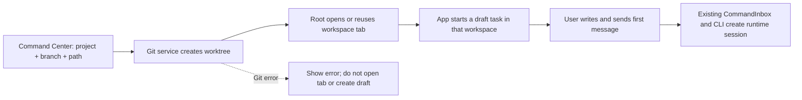

# Command Center: Worktrees and Themes

> Status: research draft. Describes target behavior for discussion; implementation and product boundaries were not
> yet confirmed in this document. Later sections record the decisions and shipped behavior (PR #70 review rounds).

Full history: `git show 37b98ff8:docs/superpowers/specs/2026-10-11-command-center-worktrees-themes-design.md` (Russian
original).

## Goal

Add quick Git worktree and theme selection to the existing Command Center. Keyboard, search, localization and visual
behavior build on the Command Center that already works. Before implementation the scope of worktree management and
the rules for local and remote workspaces had to be chosen.

## What exists

- Command Center opens with `Cmd/Ctrl+K` or `Cmd/Ctrl+Shift+P`; `Cmd/Ctrl+P` and `Cmd/Ctrl+G` lead to the same
  surface.
- The palette groups commands, conversations and files; a command has a stable id, group, localized name, search
  keys, icon and handler.
- It has a light/dark toggle command: a switch for the current mode, not a pick from a list.
- Settings already separate the mode `light/dark/system` from a palette chosen from a fixed list; a change applies
  app settings and syncs across windows the existing way.
- Open workspaces are tabs, and reopening the same workspace can activate the existing tab.
- The Git layer recognizes `main-tree` and `linked-worktree`. The contract found had no operation to list or create
  worktrees.
- Session creation accepts a workspace reference, so a future flow can prepare a path first and pass it to the
  existing session owner. The session-creation protocol itself does not create Git worktrees.
- The workflow contract accepts `isolation: "worktree"`, but the runtime currently ends such a request with a "not
  implemented" error; that is a separate unfinished capability and not a working mechanism.

These facts come from the current implementation and existing ZCode specs. For Copilot, the extracted frontend bundles
were studied: the palette uses pages with forward/back navigation and new-session creation offers choosing a project
and branch. The bundles are minified; this is a behavior reference, not source to copy.

## Copilot.app reverse engineering: confirmed mechanics (2026-10-11)

Static analysis of the frontend bundle of `/Applications/GitHub Copilot.app` 1.1.28 (Tauri v2). A behavior reference;
no code is copied.

### Palette (quick-open)

- An item may carry `page: {id, placeholder, dynamic}`: selecting it pushes a sub-page onto the page stack of the same
  palette (`pushPage`/`popPage`/`resetPages`); Escape closes the whole palette, back returns keeping context.
- A command may declare a `valueList` (`arg`, `prompt`, `title`, `options`, `current`): the palette renders a
  value-selection page with the current one marked. That is how `model` ("Pick a model"), `effort` and
  `app.theme.set` ("Pick a theme mode": Match system / Light / Dark; `run` applies the value immediately) work.
- "New session" is an item with `page: new-session-project` ("Pick a project..."): a project list (first 5 + the rest
  sorted) plus a "No project" item; picking a project opens the new-session composer.
- Color themes are NOT changed in the palette: quick-open has only the mode; color palettes are the Themes page in
  Settings.

### New-session composer

- The session destination is a dropdown: `New worktree` ("Separate directory for each session") / `Current checkout`
  ("Work in the existing checkout") / `cloud`. Worktree is the main ordinary path, not an exotic command.
- The base branch is a combobox "Base branch" / "Checkout branch" with search ("Search branches...") and a per-project
  default branch (`branchesByProject -> defaultBranch`).
- The branch name is generated from a prefix template; validation ("Not a valid branch name", "Generated branch name
  is invalid") and copy to clipboard.
- The worktree is created lazily: the session's file-list empty state is "Start prompting in this session to create
  the worktree". This matches the ZCode invariant that the runtime session is created by the first message.

### Settings

- Global (zustand persist, user level): store `branch-prefix-settings`, field `branchPrefixTemplate`, default
  `%username%-` ("Use %username% for your GitHub login"). Worktree location is a path template `worktreePathTemplate`
  with presets (sibling next to repository / inside / under global storage / custom).
- Per project: `project-default-branch`, `project-branch-prefix` ("Branch prefix override"),
  `project-branch-update-strategy`, `project-reusable-worktrees`, `project-sparse-checkout`. The model is a global
  default plus an explicit project override; reusable/sparse are deferred in ZCode too.

### Decisions from the reverse engineering

The "like Copilot" direction was confirmed by the user on 2026-10-11:

1. **Nested pages**: a page stack inside Command Center; an item carries `page`, selecting pushes a sub-page, back
   returns. No separate WorktreeDialog.
2. **Theme**: a command with a valueList page in the same palette (mode: System/Light/Dark with the current marked,
   applied without closing). The color palette is a second valueList page (an extension over Copilot, where colors
   live only in Settings; it matches ZCode's two independent settings).
3. **Settings storage**: global defaults in `AppSettings` via `ISettingService` plus a per-project override map in the
   same object; nothing is written to the project repository. The prefix is stored as a template string (future
   `%username%` will not break the format); the MVP expands only a literal prefix.
4. **Project source**: open workspaces (tabStore) + `AppSettings.recentProjects`; no separate directory picker.
5. **Creation form**: instead of a wizard "Review" page, an analog of Copilot's session form: after picking a project
   a palette setup page opens with controls for destination (worktree / current checkout), base branch and the
   generated branch name with validation. Difference from Copilot: the worktree is created on Start (eager), not on
   the first message, because ZCode workspace identity is path-based and the composer is bound to an existing
   workspace, so the controls live on the setup page before the directory is created. The runtime session is still
   created only by the first message. Until the settings stage the default location is the sibling directory
   `<parent>/<repo>-worktrees/<branch>`.
6. **Review recommendations 2026-10-11 (after live review)**: (a) in settings, under the Worktree location choice an
   example of the resulting path is always shown, recomputed when option/prefix/custom path changes; (b) branch
   prefix field: Enter commits, Escape reverts to the saved value, width does not cut typical prefixes; (c) in the
   new-draft empty state a "in a new worktree" checkbox with a mini-form (branch name, default base); with the
   checkbox on, sending the first message is intercepted: it creates the worktree and moves the draft to the new
   directory keeping the typed text (composer draft workspace transfer), after which the user presses send again and
   the session is created the normal way in the worktree workspace. Auto-send after transfer was deliberately not
   done: there is no programmatic composer submit API and waiting for the new workspace to be ready would need
   timeouts (forbidden by repo rules). The worktree is eager relative to sending; it is the same `createWorktree`
   contract plus open/draft as in the palette flow. (Superseded by "Clarification 2026-10-13 (second)" below.)

### Review clarifications 2026-10-12

- **Start attempt ownership**: each new Start attempt gets an increasing id. Closing the palette and a new Start make
  old replies stale; a stale attempt must not change the busy indicator or the current attempt's result. Only the
  owner of the current id may clear `worktreeStartBusy` in `finally`.
- **Project override drafts**: when saved settings update, refresh a draft only for fields the user did not change
  relative to the previous saved value. Unfinished input is kept; each field syncs independently.
- **System theme**: in system mode the color scheme used by the palette swatches in Command Center subscribes to
  `prefers-color-scheme` changes and updates without changing the saved `system` choice.

## Proposed interface

### Worktrees

Add the action `New task in worktree` to Command Center. It is the main Copilot-like scenario: create a Git worktree
for a new task and prepare a draft in the resulting workspace.

Flow (from the reverse engineering, eager creation):

1. **Project**: palette sub-page `page: new-task-project`: open workspaces + `recentProjects` with search; an
   "already open" mark.
2. **Setup page**: a second sub-page (analog of Copilot's session form): destination (`New worktree` / `Current
checkout`), base branch (combobox searching `listLocalBranches`), new branch name with validation (taken, invalid,
   or branch already attached to a worktree: error code `branch-in-other-worktree`); preview of the target directory.
3. **Start**: for a worktree, service `createWorktree`, then open the workspace by the existing contract
   (`activateTabByPath`/`addTab` + `startDraft`) in the new directory; on error `target-path-exists` with an existing
   worktree of this branch, open it without a second directory (WT-04). For current checkout, `startDraft` in the
   project itself. The runtime session is created later by the normal first-message send.

A separate action **Open existing worktree** may list the project's existing Git worktrees with branch, path and an
"already open" mark. Selecting it uses the existing workspace open/dedupe and creates no session by itself.

Pages keep the entered project/branch when going back and focus returns to search. `Escape` closes Command Center per
the current contract.

Flow states: loading projects and branches, empty result, project is not a Git repository, Git unavailable, branch
exists/occupied, preparing the directory, worktree creation error. On a Git error no tab is opened and no draft is
created. If the worktree was created but could not be opened as a workspace, show the path and an "Open worktree"
action; a retry must not create a second directory. Branch-name validation errors show in the composer next to the
field and do not close it.

**First boundary proposed**: start a new task in a separate worktree from a local Git project. Opening existing
worktrees is a useful neighboring action that can be a separate stage. Git operations belong to the service/Host;
Command Center only collects parameters and shows the result.

### Worktree settings

Copilot splits settings into general new-session settings and project settings. ZCode had no separate Worktree
section, so settings are added together with the feature.

**General settings**: section `Worktrees` in Settings:

| Control               | Behavior                                                                                                                                                          |
| --------------------- | ----------------------------------------------------------------------------------------------------------------------------------------------------------------- |
| Worktree location     | Choice: Global storage, Inside repository, Next to repository or Custom. For Custom show a path field and a `Choose folder` button.                               |
| Default branch prefix | Text field, an example of the resulting branch name and a `Reset to default` button. If a template syntax is supported, the preview expands variables explicitly. |

**Project settings**: available from the project/workspace and override the general values:

| Control                | Behavior                                                                                                   |
| ---------------------- | ---------------------------------------------------------------------------------------------------------- |
| Default base branch    | Choice of the branch a new worktree branch is created from; the creation form can replace it for one task. |
| Branch prefix override | Optional project prefix; `Reset to global` returns to inheriting the general prefix.                       |

Parameters affect only later worktree creations. Changing the location moves and creates nothing by itself. The
creation form shows the computed target path before confirmation. For Custom, check availability and that the path is
not taken; the error stays next to the field and does not close the form.

Copilot also has `Branch update strategy`, `Reusable worktree` and `Worktree sparse-checkout`: extra settings (a
reusable pool manages disk and cleanup; sparse-checkout changes checkout content and needs Git 2.27+). They are not in
the first version and need separate research after the basic create/open flow.

> **The Stage D deviation was lifted by stage F (2026-10-11).** The `Global storage` mode is implemented:
> `IPlatformService.getAppWorktreesDir?()` (desktop-only) gives the renderer the directory `~/.zcode/worktrees`; the
> worktree path is `~/.zcode/worktrees/<repoName>/<branch>` (structure after Copilot's `...-worktrees/<repo>/<branch>`),
> shown with `~` in the UI. On platforms without the method (web/mobile) the Global option in Settings is hidden, and a
> saved global mode is treated as an unusable location: Start / first send are blocked with the internal error
> `commandCenter.worktree.error.global-location-unavailable`. The renderer requests the directory lazily, only when the
> effective mode is global. Location examples in Settings for the preset modes are fixed short strings
> (`example-repo-worktrees/my-branch` / `example-repo/.worktrees/my-branch` /
> `~/.zcode/worktrees/example-repo/my-branch`); custom shows the real computed path. The sibling convention was
> renamed to `<parent>/<repoName>-worktrees/<branch>` (was `<repoName>.worktrees`); inside stays
> `<repoRoot>/.worktrees/<branch>`; custom unchanged. Implementation matches otherwise: `worktreeLocationMode` /
> `worktreeCustomLocationPath` / `worktreeBranchPrefix` (literal template) in `AppSettings` +
> `worktreeProjectOverrides` (keyed by workspacePath); the project prefix beats the global one and `Reset to global`
> deletes the override entry.

**Theme settings** stay in the existing Appearance section. The new Theme page in Command Center is a quick pick of
the same values, and the `Open appearance settings` command leads to detailed settings if needed. A pick in the
palette immediately updates the selected value in Appearance.

### Themes

Add a `Theme` action or group with two separate blocks:

- **Mode**: System, Light, Dark.
- **Palette**: Neutral, Z.ai, Ocean, Forest, Ember, Violet, Slate, Rose, Sand, Mint.

Each row is a normal item with an icon/color swatch and a mark on the current choice. Picking applies the value at
once and leaves the user in Command Center. Picking a mode does not change the palette and vice versa. The existing
`Switch theme` can stay as a quick toggle but its duplicate is hidden from the Theme group or replaced by a link to
the mode choice.

The palette uses the existing setters and palette list. No new storage, separate sync or own theme values are added.

### Other useful ideas from Copilot's Command Center

1. **Switch workspace**: quickly switch among already open workspaces without file search or Git; complements the
   worktree flow because a workspace may not be a Git repository.
2. **Pages with context**: nested choices (project -> branch -> confirmation) use the same palette, keep context on
   return and focus search.
3. **Later: quick link input**: paste a URL or `owner/repo#123` and jump to the object; only after checking ZCode's
   current GitHub/PR routes.

The current command registry is not rewritten; new actions are added through its contract and Git operations stay
behind the service/API layer.

## Rules and boundaries

- A workspace is defined by its existing identity: `workspaceIdentity?.trim() || workspacePath`; the path stays the
  target of file and Git operations.
- The open result must use the current tab deduplication; do not create a separate session or Agent just because a
  worktree was picked.
- Mobile web remote control stays attach-only. No local directory/Git operations are added there.
- Until remote Git is decided, do not assume a browser client's path points to the host's repository.
- Deleting a worktree, deleting a branch, discarding changes and automatically switching the base branch are out of
  this scope (worktree removal and prune were later added; see the 2026-10-13 stage-two section).
- Theme acts through the existing app state; no per-workspace setting is introduced.

## Acceptance scenarios

| ID       | Scenario                                                 | Expected result                                                                                                                                       |
| -------- | -------------------------------------------------------- | ----------------------------------------------------------------------------------------------------------------------------------------------------- |
| `WT-01`  | Create a task in a new worktree for a local Git project  | The worktree is created from the chosen base; the workspace and a draft task open. The runtime session is created only after the normal message send. |
| `WT-02`  | Branch name taken or branch active in another worktree   | Creation does not start; a clear explanation and an action to choose another branch.                                                                  |
| `WT-03`  | Project is not a Git repository or Git unavailable       | A separate state is shown; no worktree and no session are created.                                                                                    |
| `WT-04`  | Worktree created, but opening the workspace/draft failed | The existing path is shown and a retry is available without creating a second worktree.                                                               |
| `WT-05`  | Open an existing worktree already open in a tab          | The existing tab is activated; no duplicate workspace is created.                                                                                     |
| `TH-01`  | Pick Light, Dark or System                               | Only the mode changes; the current palette is kept.                                                                                                   |
| `TH-02`  | Pick a palette                                           | Only the palette changes; the current mode is kept.                                                                                                   |
| `TH-03`  | Change the theme in one window                           | Command Center shows the new selected value; other windows get the update by the current mechanism.                                                   |
| `CC-01`  | Open a nested choice, go back                            | Search gets focus, the entered context is kept.                                                                                                       |
| `WTS-01` | Pick Custom worktree location                            | The path field appears, the target path in the creation form updates; the folder is not created before confirmation.                                  |
| `WTS-02` | A branch prefix override is set for the project          | The preview uses the project prefix; `Reset to global` returns the general prefix.                                                                    |
| `WTS-03` | Change a general Worktree setting                        | It is saved in the general scope and applies to later worktrees; already created paths/branches do not change.                                        |

## Decisions that change scope

| Question                                                     | Options                                                                             | Proposed direction                                                                             |
| ------------------------------------------------------------ | ----------------------------------------------------------------------------------- | ---------------------------------------------------------------------------------------------- |
| What does Worktree mean in this feature?                     | New session in a separate worktree / open an existing one / both                    | Main flow is a new task in a separate worktree; opening existing ones stays a separate action. |
| Where to pick the project from?                              | Only the active workspace / any already open workspace / list of all local projects | Start with already open local workspaces; no new directory picker in this flow.                |
| What if the chosen branch is already attached to a worktree? | Reuse it / create another branch / show a choice                                    | Show the existing worktree explicitly and ask for a choice; do not switch workspaces silently. |
| Which environments to support?                               | Desktop local / also Web and remote workspace                                       | Start with Desktop local; remote needs a host-side Git contract.                               |
| How to store the created folder?                             | Next to the project / in a chosen directory / via a general setting                 | Decide before implementation; Copilot has a configurable path, ZCode had no such contract.     |
| Where to store settings?                                     | Local to the user / in project config / general default plus project override       | General default plus explicit project overrides; format and sync not chosen yet.               |
| Which branch prefix syntax?                                  | Literal prefix only / templates like `%username%`                                   | Start with a literal prefix; templates need a username source and fallback behavior.           |
| Reusable worktrees and sparse checkout now?                  | MVP / separate stage                                                                | Defer: they add cleanup lifecycle and checkout content rules.                                  |
| What is the "Theme section"?                                 | Mode only / mode and palette                                                        | Mode and palette as independent blocks per current ZCode settings.                             |
| Which extra ideas to include?                                | Switch workspace / PR URL input / nothing yet                                       | Switch workspace is the simplest next item; URL input needs separate research of routes.       |

## Implementation map

- Command Center: `CommandCenterDialog` and `createQuickPickCommands`: existing surface, groups and actions.
- Workspace/task: `tabStore`, root workspace actions and `startDraft`: workspace dedupe, tab opening and starting a
  draft task. Confirmed open-by-path contract: `activateTabByPath` -> fallback `addTab` ->
  `store.startDraft(path, provider, identity, {createSource})` (`packages/ui/src/App.tsx`). Actual runtime session
  creation stays in the current send/CommandInbox flow.
- Theme: `useTheme`, the Zustand store and the `THEME_PALETTES` registry: current values and application.
- Settings: `SettingsPage` has Appearance but no Worktrees section; persistence owner chosen: `AppSettings` via
  `ISettingService` (file + broadcast already work), per-project override is a map in the same object.
- Git: `GitCliRepo` and shared Git contracts: repository-kind detection, `listLocalBranches` (for-each-ref with
  upstream and date) and the `branch-in-other-worktree` error classification (stderr "is already used by worktree
  at"); list/create worktree operations did not exist and had to be added to the contract and service. The Git
  list/create operations go into the corresponding spec and contract first; the UI must not call the Git CLI or Repo
  directly. The Git underlying contract is in `docs/git/worktree-operations.md`.



## Impact boundaries

| Surface            | Draft / displayed state                                              | Action and authoritative owner                                                    | Boundary                                           |
| ------------------ | -------------------------------------------------------------------- | --------------------------------------------------------------------------------- | -------------------------------------------------- |
| Worktree setup     | Project, branch and directory live temporarily in the nested UI flow | The Git operation must be run by the service on the Host that owns the repository | First version proposed for local Desktop only      |
| Opening the result | Workspace tab and draft task                                         | `Root` opens/reuses the tab; `App.startDraft` creates the draft                   | Do not create a session before a message is sent   |
| Theme              | Selected mode and palette are shown separately                       | Existing store setters apply and save the choice                                  | Mode does not overwrite the palette and vice versa |

Invariants to keep before implementation:

- Workspace identity stays `workspaceIdentity?.trim() || workspacePath`; Git and file operations run by `workspacePath`.
- Worktree selection does not bypass the normal draft/send/CommandInbox path and does not create a runtime session
  directly from the UI.
- A remote workspace uses its own Host's Git service; a browser path is not treated as a local path. Mobile remote
  control stays attach-only.
- Mode and palette stay separate settings with the current cross-window sync.

The impact graph has no separate capability for Command Center/quick-open. Proposed graph delta: surfaces `new task
in worktree` and `theme selection`, to be added after the first worktree version and platform boundary are chosen.
The codegraph tool was unavailable in this environment; call paths were checked against current source and docs.

## Next step

Decisions are recorded in "Copilot.app reverse engineering" (direction "like Copilot", confirmed by the user
2026-10-11). Then: fix the acceptance scenarios for the composer pattern and split work into vertical stages: Theme
(valueList page) -> page stack in Command Center -> Git list/create worktree in contract and service -> composer
destination/branch controls -> Settings Worktrees section.

## Clarification 2026-10-13: empty-state form, name auto-generation, existing branch

Reference (external app, user screenshot): the model "either work in a branch (Current checkout), or new worktrees go
from the chosen branch": a `New worktree` toggle plus a `Branch: <name> >` line. The ZCode palette already implements
this model (page "Where to work": destination + Base branch). The clarification closes three empty-state/palette
deltas; the Git contract (`docs/git/worktree-operations.md`) does not change since `createWorktree` already allows
checking out an existing branch.

### 1. Base branch in the empty state becomes a choice

- The "Base: <branch>" line (display-only in `ChatEmptyWorktreeTaskToggle`) becomes an interactive control "Base
  branch: <name> >" opening the list of local branches (`listLocalBranches`).
- Default and override semantics match the palette: project override `defaultBaseBranch` -> the repository's current
  branch -> first in the list (`resolveDefaultBaseBranch`); the choice updates the target-path preview and
  `baseBranch` in `createWorktree`.
- Loading/error states are inherited from the current mini-form: until the list loads, sending is blocked (already
  implemented) and the control shows "Loading branches...".

### 2. Branch-name auto-generation (Copilot pattern)

- On opening the form (empty-state checkbox and palette setup page) the name field is prefilled with a generated name
  `<adjective>-<noun>`: lowercase ASCII, git-safe (`sanitizeWorktreePathSegment`-compatible).
- No separate "pencil": the field stays an ordinary editable input with a "regenerate" button next to it. Manual edits
  are kept until the user clears them.
- The generator is a pure function in `worktreeTaskFlow` (shared by both entries), takes the loaded branch list into
  account and does not offer a taken name (bounded attempts; if all are taken it returns as is and existing validation
  shows the conflict).
- Prefix composition is unchanged: `composeBranchName(prefix, generated)`; the prefix from settings/override is still
  applied to the generated name.
- Dictionary is built in, no new dependencies (confirmed 2026-10-13): about 43 adjectives x 85 nouns, lowercase ASCII
  git-safe words. Groups: character/mood, animals, fantasy creatures, absurd objects/food, sci-fi. Pattern weights:
  `adjective+animal` 35, `adjective+fantasy` 20, `adjective+object` 20, `scifi+animal` 10, `scifi+object` 10,
  `scifi+fantasy` 5 (merged into groups 35/20/20/25 in the implementation). The generator is the pure function
  `generateWorktreeBranchName({ isTaken, random? })`: does not offer taken names (composite name with prefix), up to 10
  attempts, RNG injected for tests.
- **Fixed name format (review 2026-10-13)**: a separate "Branch name template" setting was rejected; a free template
  is an error surface (typos in placeholders, git-invalid characters, static colliding names). The generator always
  yields `<adjective>-<noun>` from the built-in lists; manual input and the prefix (`worktreeBranchPrefix`) work as
  before.
- **Default prefix `zcode/` (review 2026-10-13)**: with no override and no global setting the effective prefix is
  `DEFAULT_WORKTREE_BRANCH_PREFIX = "zcode/"`; an explicit empty string in settings also resolves to the default (there
  is no "no prefix" configuration). Settings show the effective value; "Reset" (icon with tooltip) deletes the saved
  field and returns the default. The Prefix field is a full-width row (input flex-1 + reset icon) with a preview
  `Preview: <effective prefix><generated name>` below it using a fixed RNG.
- **Empty state is only a checkbox (review 2026-10-13, second round)**: the mini-form under the "New worktree"
  checkbox is hidden. The checkbox means "create a worktree for the first message": the name is fully automatic
  (dictionaries + prefix, collisions avoided), base is the repository's current checkout (a per-project override is
  honored silently), and branch/name choice remains only in the palette. Under the checkbox only a transient status
  appears: "Creating worktree...", an inline error or the WT-04 recovery button.
- **Worktree location: the Custom item is temporarily disabled** (review 2026-10-13); a previously saved custom mode
  keeps working.
- Known issue (reproduced by the user, inside mode): after a worktree is created by the first send, the new project
  appears in the list but the view does not switch and the draft is not transferred. The component contract (create ->
  open -> draft transfer) is covered by tests; the failure is at the live shell level (pane switch / draft transfer on
  workspace change). Needs reproduction with the console (the info log "[ChatEmptyWorktree] worktree created,
  redirecting the draft" shows whether it reached opening). (Superseded in intent by the next clarification.)

### 3. Existing branch: open instead of an error

- Previously entering an existing name gave the client error `branch-already-exists`. New behavior:
  - the branch is already attached to a worktree -> inline offer "open existing worktree <path>" per the WT-04
    contract (`findWorktreeForBranch`); no second directory is created;
  - the branch exists and is free -> the form allows creating a worktree that checks out that branch (the client block
    is lifted; the server stays authoritative and still returns `branch-in-other-worktree` on a race).
- The choice is always the user's: silently substituting the action without an explicit offer is forbidden.

### Acceptance scenarios

| #     | Scenario                                        | Expectation                                                                                                                                                                                                                     |
| ----- | ----------------------------------------------- | ------------------------------------------------------------------------------------------------------------------------------------------------------------------------------------------------------------------------------- |
| WT-G1 | Open the empty state, enable the checkbox       | The checkbox sets automatic worktree creation for the first message; the name is generated, base comes from the current checkout honoring the silent project override; the form shows no name editor, base choice or regenerate |
| WT-G2 | Open the Base branch choice                     | A list of local branches; the choice updates the path preview and goes to `createWorktree`                                                                                                                                      |
| WT-G3 | Enter a branch name that already has a worktree | Inline offer "open existing"; accepted -> the directory opens, the draft is transferred, no second directory is created                                                                                                         |
| WT-G4 | Enter the name of an existing free branch       | A worktree is created checking out that branch; `baseBranch` is ignored by the server                                                                                                                                           |
| WT-G5 | Prefix `dev/` + generation                      | Result `dev/<adjective>-<noun>`; validation and preview as before                                                                                                                                                               |
| WT-G6 | Open the palette setup page and edit the name   | The name field is editable by hand; regenerate changes only the generated name                                                                                                                                                  |

Tests: unit tests for the generator (determinism with a fixed seed/list, does not offer taken names) and the derive
logic; e2e for WT-G3 (first-send interception + opening the existing one). i18n: new keys en-US / uk-UA / zh-CN.

### Second stage also in scope (confirmed 2026-10-13): removal and prune

Worktree removal and `git worktree prune` are in the scope of the current work. The contract is extended in
`docs/git/worktree-operations.md` (`removeWorktree` / `pruneWorktrees`); UI placement:

- The list of the project's existing worktrees is a section on the "New task in worktree" palette setup page (data
  exists: `listWorktrees`): branch + path + an "already open" mark for open tabs; a delete action for non-main entries
  that are not open and not the current workspace.
- Removal: first without `--force`; with uncommitted changes the service returns a structured issue, the UI shows a
  "delete with changes" confirmation and retries with `force`. The main worktree, the current workspace, open tabs and
  worktrees with an active session cannot be removed from the UI. For tabs and sessions the path is compared with the
  Git list through a canonical identity resolved at the Git/service boundary with realpath and the current platform's
  case rules; an exact branch-name match serves as an additional fallback only for an active session with a known
  `branchName`. If identity resolution fails, removal is blocked.
- Prune: an action next to the list; cleans stale entries (directory deleted manually). It does not touch runtime
  sessions: removing a worktree directory with an active session is blocked by the open-tab check, and the session
  owner is the Host, which survives a directory becoming unavailable like any other missing files.

The stage-two Git contract is in `docs/git/worktree-operations.md` (removeWorktree / pruneWorktrees).

## Clarification 2026-10-13 (second): a worktree session lives in the current project

User review (screenshot): after the "New worktree" checkbox the created worktree appears as a separate project in the
sidebar, the chat does not open and the session does not start. That model is wrong. Target behavior:

1. **The session starts within the current project**: it appears in the task list of the current workspace, not as a
   new project.
2. **The chat opens and starts at once**: the first message goes as a normal send; while the worktree is being
   created the status "Creating worktree..." is shown.
3. The agent physically works in the created worktree directory (separate branch, the main checkout is untouched).

### Model: the session's execution worktree

The owner of the decision is the session (CLI runtime), not the workspace. The concept **execution worktree** is
introduced: the directory in which the agent runs while the session stays bound to the parent workspace (listing,
identity, Host unchanged).

- **Worktree creation stays with the UI** (`IGitService.createWorktree`, already implemented and tested: error
  classification, WT-04, name generation, prefix). The CLI does not duplicate git logic; branch/location settings work
  does not move.
- **Binding to the session is through the protocol.** The optional field `executionWorktree: { path, branchName }` in:
  - the v4 command `createSession` (`packages/shared/src/zcode-protocol-v4/command.ts`);
  - `zcodeSessionCreateParamsSchema` (`packages/shared/src/zcode-protocol/index.ts`): the schema is strict; without the
    field the bridge parse would drop it.

  Compatibility: the v4 command schema is not strict, so an old CLI silently drops the key (fail-closed: the session is
  created in the parent directory without an error).

- **Persistence.** The session row gets new nullable columns `execution_directory` / `execution_branch` (migration
  `0023_session_execution_worktree`). The `directory`/`path` columns **keep the parent workspace path**: session
  listing filters by `directory = ?` and `workspaceID || path || directory` (`server-operations.listSessions`), so
  writing the worktree into `directory` would hide the session from the project list.
- **Resume.** Cold resume passes the stored `execution_directory` / `execution_branch` into app/runtime record
  creation so both `workingDirectory` and directory-bound dependencies (including MCP and custom commands) are created
  relative to the execution worktree. `resume.ts` keeps reading `execution_directory ?? directory`.
- **Execution.** `createZCodeApp` normalizes `workingDirectory = executionWorktree.path ?? runtimeConfig.workingDirectory
?? process.cwd()`; `projectID` for persisted mode settings is computed from `workspacePath` (the parent) so a
  project's mode settings do not diverge across the project's sessions.

### Send flow (empty state, checkbox)

- The contract `ComposerDraftWorktreeIntentSlot.interceptFirstSend` changes from `boolean` to a result
  `{ action: "cancel" } | { action: "proceed", executionWorktree }`:
  - worktree creation failed (any issue) -> `cancel`, inline error / WT-04 offer as now, the draft stays;
  - creation succeeded -> `proceed`, the composer continues the normal send in the current workspace, passing
    `executionWorktree` in the options of the first send.
- Workspace switching and draft transfer (`onOpenWorktreeDraft` + draft transfer) leave this flow; they remain only in
  the WT-04 recovery ("open existing worktree" is an explicit user choice) and in the palette.
- **The prewarm session is bypassed**: draft prewarm creates an empty session in the parent's cwd, unusable for a
  worktree send. When `executionWorktree` is present in the send, promote-prewarm is skipped and the session is created
  by the fallback `createSession` path with the field; the unpromoted prewarm session is deleted by the existing
  mechanism (hook disable -> dispose -> delete).
- Progress: during `interceptFirstSend` the status "Creating worktree..." in the empty state (exists), then the
  composer's existing pending spinner until the `createSession`/`sendText` ack.

### Owners and event-order diagram

```
UI (composer submit)
  └─ interceptFirstSend (ChatEmptyWorktreeTaskToggle)
       └─ IGitService.createWorktree (RPC -> GitService -> GitCliRepo)   [owner: UI/Git service]
  -- proceed: onSendText(options.executionWorktree) -->
SessionPane
  ├─ skip prewarm promote (executionWorktree present)
  ├─ command createSession { workspaceId: current, executionWorktree }  [wire owner: shared v4 schema]
  └─ command sendText (normal)
CLI Host (v4 gateway -> bridge -> createRecord)
  ├─ runtimeConfig.executionWorktree -> createZCodeApp workingDirectory = worktree  [owner: CLI runtime]
  └─ first turn -> persistSession: directory/path = parent, execution_directory = worktree  [owner: core]
Cold resume: resume.ts reads execution_directory ?? directory  [owner: core]
```

### Visibility of the worktree session (round 2026-10-13, user review)

The `executionWorktree` fact reaches the UI through sessions-index: `sessionSummarySchema.executionWorktree` (additive);
the CLI fills it from the runtime (`AgentRuntime.getExecutionWorktree()` via the host hook `getSessionIndexMeta`) for
live sessions and from the columns `execution_directory/execution_branch` for cold seeds
(`loadStoredSessionSummaries`); the projection compares the field in `summariesEqual` (a worktree appearing produces a
delta). In the UI the field goes `mapSessionSummaryToTaskMeta` -> merge with the task-index row ->
`ZCodeTaskMeta.executionWorktree`.

- **Sidebar**: a task row with a worktree session shows a GitBranch icon (title "Worktree session · <branch>", i18n
  x3) in the right cluster next to the cron/off-peak icons.
- **"Open in IDE" (task header)**: the editor button opens `executionWorktree.path`, not the root checkout (the field
  comes from `resolvedActiveTaskMeta` in `WorkspaceHeaderActionSection` -> `WorkspaceEditorButtonGroup`).
- **File-tree panel**: "Open in file manager" and "Copy path" lead to the worktree (the target is built from
  `resolveTaskFileTreeTarget` and carries `executionWorktreePath`).
- Known boundary: the file-tree content still shows the parent checkout (re-rooting the tree into the worktree is a
  separate step; paths in the transcript point to the worktree).

### PR #70 review (2026-10-14)

- The execution cwd of a worktree session does not change the project root and the project-memory scope; cold resume
  keeps the same boundaries as session creation.
- After a worktree is created on first send, the path is kept in the draft until a send is accepted. An attachment
  preparation error, a block or a confirmation requirement keeps the retry bound to the created worktree. Inline
  attachments are copied into the new session's attachment store after it is created; only refs belonging to it go in
  the send, and the prewarm session stays until copying finishes.
- Worktree removal is unavailable if an open tab or an active session references it. Paths are compared through the
  service-resolved canonical identity; if identity cannot be resolved, removal is blocked. For an active session the
  exact branch name is an additional fallback if branch metadata is saved.
- The execution-worktree indicator is shown in the ordinary interactive row of a grouped task and in its drag overlay.
- A failure of the optional worktree-list load does not block the project/branches and the Start action. An occupied
  branch requires the explicit Open worktree action; Start itself does not open a tab.
- Returning to the same project entry keeps the entered branch and the touched-guard state. An empty branch prefix is
  shown as the effective default `zcode/`.
- Removal via `--force` accounts for Git locked worktrees and uses a double `-f` when needed. Normalization of trailing
  path separators is linear for long paths.

### Remote prewarm race fix (review logs 2026-10-13)

Live-QA logs recorded `fault.subscribe.sessionNotFound` about 2s after a successful worktree send. Chain: the draft
panel is subscribed to the prewarm session; on a send with the checkbox the promote is skipped and the prewarm is
deleted CLI-side (`dispose` -> `deleteSession`), but its projection store stays in keep-warm (30s) and reacts to the new
session's "runtime available"; the reconnect to the deleted session fails. The race existed before (switching
workspace with an unpromoted prewarm), but the worktree flow makes it reproducible on every happy path.

Fix: `fault.subscribe.sessionNotFound` in `ConversationProjectionStore.connect` is a terminal outcome: the flag
`sessionGone` stops all reconnect paths (retry, runtime-restart/available/unavailable), and `SessionDataLayer`, on the
`onSessionGone` callback, drops the keep-warm entry (if the store has no active panel references). The existing discard
flow of the draft panel is unchanged.

### Known limits (not in the first slice)

- The legacy `session/create` path from `packages/services` (bots, saved workflows) does not pass the field: only the
  desktop v4 flow.
- `isolation: "worktree"` in the script-workflow runtime (dynamic workflow subagents) is a separate unfinished
  capability, not included here.
- A first message that starts with `/goal` (empty goal), with the checkbox on, creates the worktree but the command
  itself stays in the draft scope: a rare edge; a normal send and `/goal <text>` take the main path.

### Acceptance scenarios

| #     | Scenario                                                         | Expectation                                                                                                                                                                   |
| ----- | ---------------------------------------------------------------- | ----------------------------------------------------------------------------------------------------------------------------------------------------------------------------- |
| WT-H1 | Checkbox + first message                                         | The session is created in the current project; the worktree directory and branch are created; the first turn runs in the worktree; no separate project appears in the sidebar |
| WT-H2 | Worktree creation error (git unavailable)                        | The send is cancelled, an inline error, the draft stays, no session is created                                                                                                |
| WT-H3 | Restart the app, open the worktree session from the project list | Resume in the same worktree (`execution_directory`)                                                                                                                           |
| WT-H4 | A prewarm session was already created before sending             | Promote is skipped, the session is created with `executionWorktree`; the prewarm session does not linger                                                                      |
