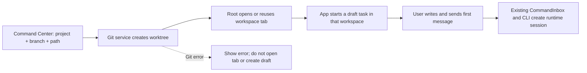

# Command Center: Worktrees и Themes

> Статус: исследовательский черновик. Описывает целевое поведение для обсуждения; реализация и границы продукта ещё не подтверждены.

## Цель

Добавить в существующий Command Center быстрый выбор Git worktree и темы. Клавиатура, поиск, локализация и визуальное поведение должны опираться на уже работающий Command Center. До реализации нужно выбрать объём управления worktree и правила для локальных и удалённых workspace.

## Что уже есть

- Command Center открывается через `Cmd/Ctrl+K` или `Cmd/Ctrl+Shift+P`; `Cmd/Ctrl+P` и `Cmd/Ctrl+G` ведут в ту же поверхность.
- Палитра группирует команды, conversations и файлы; у команд есть стабильный id, группа, локализованное название, поисковые ключи, иконка и обработчик.
- В палитре есть команда переключения light/dark. Это переключатель текущего режима, а не выбор из списка.
- Настройки уже разделяют режим `light/dark/system` и палитру из фиксированного списка; изменение применяет настройки приложения и синхронизируется между окнами существующим способом.
- Открытые workspace уже представлены вкладками и повторное открытие того же workspace может активировать существующую вкладку.
- Git-слой распознаёт `main-tree` и `linked-worktree`. В найденном контракте нет операции перечисления или создания worktree.
- Создание сессии принимает workspace-ссылку, поэтому будущий flow сможет сначала подготовить путь, затем передать его существующему session owner. Сам протокол создания сессии не создаёт Git worktree.
- Workflow-контракт уже принимает `isolation: "worktree"`, но runtime сейчас явно завершает такой запрос ошибкой «not implemented». Это отдельная незавершённая возможность, её нельзя считать работающим механизмом.

Эти факты взяты из текущей реализации и существующих спецификаций ZCode. В Copilot исследованы извлечённые frontend-бандлы: палитра использует страницы с переходом вперёд/назад, а создание новой сессии предлагает выбрать проект и ветку. Бандлы минифицированы; это ориентир поведения, не исходная реализация для копирования.

## Реверс Copilot.app: подтверждённая механика (2026-10-11)

Статический анализ фронтенд-бандла `/Applications/GitHub Copilot.app` 1.1.28 (Tauri v2; дамп чанков в `/tmp/copilot-frontend`, см. память `copilot-app-palette-analysis`). Ориентир поведения, код не копируется.

### Палитра (quick-open)

- У пункта может быть свойство `page: {id, placeholder, dynamic}` — выбор пушит под-страницу в стек страниц той же палитры (`pushPage`/`popPage`/`resetPages`); Escape закрывает палитру целиком, back возвращается с сохранением контекста.
- Команда может объявлять `valueList` (`arg`, `prompt`, `title`, `options`, `current`) — палитра рендерит страницу выбора значения с отметкой текущего. Так работают `model` («Pick a model»), `effort` и `app.theme.set` («Pick a theme mode»: Match system / Light / Dark; `run` применяет значение немедленно).
- «New session» — пункт с `page: new-session-project` («Pick a project…»): список проектов (первые 5 + остальные отсортированные) плюс пункт «No project». Выбор проекта открывает composer новой сессии.
- Цветовые темы в палитре НЕ меняются: в quick-open только режим; палитры цветов — страница Themes в Settings.

### Composer новой сессии

- Назначение сессии — дропдаун: `New worktree` («Separate directory for each session») / `Current checkout` («Work in the existing checkout») / `cloud`. Worktree — основной обычный путь, не отдельная экзотическая команда.
- Базовая ветка — combobox «Base branch» / «Checkout branch» с поиском («Search branches…») и per-project default branch (`branchesByProject → defaultBranch`).
- Имя ветки генерируется из prefix-шаблона; валидация («Not a valid branch name», «Generated branch name is invalid») и копирование в clipboard.
- Worktree создаётся лениво: empty-state списка файлов сессии — «Start prompting in this session to create the worktree». Полностью совпадает с инвариантом ZCode: runtime-сессия создаётся первым сообщением.

### Настройки

- Глобально (zustand persist, user-level): стор `branch-prefix-settings`, поле `branchPrefixTemplate`, дефолт `%username%-` («Use %username% for your GitHub login»). Worktree location — path-шаблон `worktreePathTemplate` с пресетами (sibling next to repository / inside / under global storage / custom).
- Per-project: `project-default-branch`, `project-branch-prefix` («Branch prefix override»), `project-branch-update-strategy`, `project-reusable-worktrees`, `project-sparse-checkout`. Модель — глобальный дефолт плюс явный project override; reusable/sparse отложены и в ZCode.

### Решения по результатам реверса

Направление «как в Copilot» подтверждено пользователем 2026-10-11:

1. **Вложенные страницы** — page-stack внутри Command Center: пункт несёт `page`, выбор пушит под-страницу, back возвращается. Отдельный WorktreeDialog не делаем.
2. **Theme** — команда с valueList-страницей в той же палитре (режим: System/Light/Dark с отметкой текущего, применение без закрытия). Палитра цветов — вторая valueList-страница (расширение относительно Copilot, где цвета только в Settings; соответствует текущим настройкам ZCode с двумя независимыми значениями).
3. **Хранение настроек** — глобальный дефолт в `AppSettings` через `ISettingService` + per-project override-словарь в том же объекте; в репозиторий проекта ничего не пишем. Поле префикса хранится как строка-шаблон (будущие `%username%` не сломают формат); MVP раскрывает только literal-префикс.
4. **Источник проектов** — открытые workspace (tabStore) + `AppSettings.recentProjects`; отдельный directory picker не добавляем.
5. **Форма создания** — вместо wizard-страницы «Проверка» используется аналог session-формы Copilot: после выбора проекта открывается setup-страница палитры с контролями назначения (worktree / текущий checkout), базовой ветки и сгенерированного имени ветки с валидацией. Отличие от Copilot: worktree создаётся при нажатии Start (eager), а не при первом сообщении — идентичность workspace в ZCode построена на пути, а composer привязан к уже существующему workspace, поэтому контроли живут на setup-странице до создания каталога. Runtime-сессия по-прежнему создаётся только первым сообщением. Дефолтное расположение до этапа настроек — sibling-каталог `<parent>/<repo>-worktrees/<branch>`.
6. **Ревью-рекомендации 2026-10-11 (после живого просмотра):** (a) в настройках Worktree location под выбором опции всегда показывается пример результирующего пути, пересчитываемый при смене опции/префикса/своего пути; (b) поле branch prefix: Enter фиксирует, Escape откатывает к сохранённому значению, ширина не режет типовые префиксы; (c) в empty state нового draft — галочка «в новом worktree» с мини-формой (имя ветки, база по умолчанию); при активной галочке отправка первого сообщения перехватывается: создаёт worktree и переводит draft в новый каталог с сохранением набранного текста (механика composer draft workspace transfer), после чего пользователь нажимает отправку ещё раз — сессия создаётся обычным путём уже в worktree-workspace. Авто-отправка после переноса сознательно не сделана: нет программного API сабмита composer, а ожидание готовности нового workspace потребовало бы таймаутов (запрещено правилами репо). Worktree eager относительно отправки; это тот же контракт `createWorktree` + открытие/draft, что и в palette-flow.

### Уточнения по ревью 2026-10-12

- **Start attempt ownership:** каждая новая попытка Start получает возрастающий id. Закрытие палитры и новый Start делают старые ответы неактуальными; устаревшая попытка не меняет состояние занятого индикатора или результат текущей попытки. Только владелец актуального id может очистить `worktreeStartBusy` в `finally`.
- **Project override drafts:** при обновлении сохранённых настроек обновлять черновик только для полей, которые не менялись пользователем относительно предыдущего сохранённого значения. Незавершённый ввод сохраняется; каждое поле синхронизируется независимо.
- **System theme:** при системном режиме схема, используемая образцами палитры в Command Center, подписана на изменения `prefers-color-scheme` и обновляется без изменения сохранённого выбора `system`.

## Предлагаемый интерфейс

### Worktrees

Добавить действие `New task in worktree` в Command Center. Это основной Copilot-подобный сценарий: создать Git worktree для новой задачи и подготовить draft в полученном workspace.

Предлагаемый flow (по результатам реверса, eager-создание):

1. **Проект** — под-страница палитры `page: new-task-project`: открытые workspace + `recentProjects` с поиском; отметка «уже открыт».
2. **Setup-страница** — вторая под-страница палитры (аналог session-формы Copilot): назначение (`New worktree` / `Current checkout`), базовая ветка (combobox с поиском по `listLocalBranches`), имя новой ветки с валидацией — занято, недопустимо или ветка уже подключена к worktree (код ошибки `branch-in-other-worktree`); превью целевого каталога.
3. **Start** — если worktree: сервис `createWorktree`, затем открытие workspace существующим контрактом (`activateTabByPath`/`addTab` + `startDraft`) в новом каталоге; при ошибке `target-path-exists` с уже существующим worktree этой ветки — открыть его без второго каталога (WT-04). Если текущий checkout: `startDraft` в самом проекте. Runtime-сессия создаётся позже обычной отправкой первого сообщения.

Отдельное действие **Open existing worktree** может показывать уже созданные Git worktree текущего проекта с веткой, путём и отметкой «уже открыт». Выбор использует существующее открытие/дедупликацию workspace и сам по себе не создаёт новую сессию.

На страницах сохраняются введённые проект/ветка при переходе назад; фокус возвращается в поиск. `Escape` закрывает Command Center по текущему контракту.

Состояния flow: загрузка проектов и веток, пустой результат, проект не является Git-репозиторием, недоступный Git, ветка уже существует/занята, подготовка каталога, ошибка создания worktree. При ошибке Git не открывать вкладку и не создавать draft. Если worktree создан, но его не удалось открыть как workspace, показать путь и действие «Open worktree»; повторная попытка не должна создавать второй каталог. Ошибки валидации имени ветки показываются в composer возле поля и не закрывают его.

**Предлагаемая первая граница:** начать новую задачу в отдельном worktree из локального Git-проекта. Открытие уже существующих worktree — полезное соседнее действие, но его можно оставить отдельным этапом. Git-операции принадлежат сервису/Host; Command Center только собирает параметры и показывает результат.

### Настройки Worktree

В Copilot настройки разделены на общие настройки новых сессий и настройки проекта. В ZCode сейчас не найден отдельный раздел Worktree, поэтому предлагается добавить настройки вместе с feature, но хранение значений нужно решить до реализации.

**Общие настройки** — раздел `Worktrees` в Settings:

| Контрол               | Поведение                                                                                                                                                      |
| --------------------- | -------------------------------------------------------------------------------------------------------------------------------------------------------------- |
| Worktree location     | Выбор: Global storage, Inside repository, Next to repository или Custom. Для Custom показывать поле пути и кнопку `Choose folder`.                             |
| Default branch prefix | Текстовое поле, пример результирующего имени ветки и кнопка `Reset to default`. В preview явно раскрывать переменные, если синтаксис шаблонов будет поддержан. |

**Настройки проекта** — доступны из проекта/workspace и переопределяют общие значения:

| Контрол                | Поведение                                                                                                    |
| ---------------------- | ------------------------------------------------------------------------------------------------------------ |
| Default base branch    | Выбор ветки, от которой создаётся новая worktree-ветка; в форме создания её можно заменить для одной задачи. |
| Branch prefix override | Необязательный префикс для проекта; действие `Reset to global` возвращает наследование общего префикса.      |

Параметры влияют только на следующие создания worktree. Изменение location само по себе ничего не перемещает и не создаёт. В форме создания показывать вычисленный target path до подтверждения. Для Custom проверять доступность и отсутствие уже занятого пути; ошибка остаётся возле поля и не закрывает форму.

У Copilot также есть `Branch update strategy`, `Reusable worktree` и `Worktree sparse-checkout`. Это дополнительные настройки: reusable pool управляет диском и очисткой, sparse-checkout меняет содержимое checkout и требует Git 2.27+. Предлагается не включать их в первую версию; исследовать отдельно после базового create/open flow.

> **Отклонение Stage D снято этапом F (2026-10-11).** Режим `Global storage` реализован: `IPlatformService.getAppWorktreesDir?()` (desktop-only) отдаёт рендереру каталог `~/.zcode/worktrees`, путь worktree — `~/.zcode/worktrees/<repoName>/<branch>` (структура по референсу Copilot `…-worktrees/<repo>/<branch>`); в UI отображается с `~`. На платформах без метода (web/mobile) опция Global в Settings скрыта, а сохранённый режим global обрабатывается как недопустимое расположение: Start/первая отправка блокируются с внутренней ошибкой `commandCenter.worktree.error.global-location-unavailable`. Каталог рендерер запрашивает лениво — только когда эффективный режим global. Примеры расположений в Settings для предустановленных режимов — фиксированные короткие строки (`example-repo-worktrees/my-branch` / `example-repo/.worktrees/my-branch` / `~/.zcode/worktrees/example-repo/my-branch`); custom показывает реальный вычисленный путь. Конвенция sibling переименована: `<parent>/<repoName>-worktrees/<branch>` (было `<repoName>.worktrees`); inside остаётся `<repoRoot>/.worktrees/<branch>`; custom без изменений. Прочее соответствует реализации: `worktreeLocationMode` / `worktreeCustomLocationPath` / `worktreeBranchPrefix` (literal-шаблон) в `AppSettings` + `worktreeProjectOverrides` (keyed by workspacePath), префикс проекта побеждает глобальный, `Reset to global` удаляет запись override.

**Настройки Theme** остаются в существующем разделе Appearance. Новая Theme-страница в Command Center — быстрый выбор тех же значений, а команда `Open appearance settings` ведёт к подробным настройкам, если они понадобятся. Выбор в палитре немедленно обновляет выбранное значение в Appearance.

### Themes

Добавить действие или группу `Theme` с двумя отдельными блоками:

- **Режим:** System, Light, Dark.
- **Палитра:** Neutral, Z.ai, Ocean, Forest, Ember, Violet, Slate, Rose, Sand, Mint.

Каждая строка — обычный пункт с иконкой/образцом цвета и отметкой текущего выбора. Выбор сразу применяет значение и оставляет пользователя в Command Center. Выбор режима не меняет палитру; выбор палитры не меняет режим. Существующий `Switch theme` можно сохранить как быстрый toggle, но скрыть дубликат из Theme-группы либо заменить его ссылкой на выбор режима.

Палитра использует существующие setters и список палитр. Новое хранение, отдельная синхронизация или собственные значения тем не добавляются.

### Что ещё полезно взять из Command Center Copilot

1. **Switch workspace** — быстро переключаться между уже открытыми workspace без поиска файлов или обращения к Git. Это дополняет worktree flow: workspace может быть не Git-репозиторием.
2. **Страницы с контекстом** — вложенные выборы (проект → ветка → подтверждение) используют ту же палитру, сохраняют контекст при возврате и фокусируют поиск.
3. **Позже изучить быстрый ввод ссылок** — вставка URL или `owner/repo#123` с переходом к соответствующему объекту. Включать стоит после проверки текущих GitHub/PR маршрутов ZCode.

Не предлагается переписывать текущий реестр команд: он уже существует. Новые действия добавляются через его текущий контракт, а операции Git остаются за сервисным/API слоем.

## Правила и границы

- Workspace определяется его существующей identity: `workspaceIdentity?.trim() || workspacePath`; путь остаётся целью файловых и Git-операций.
- Результат открытия должен использовать текущую дедупликацию вкладок; не создавать отдельную сессию или Agent только из-за выбора worktree.
- Мобильный web remote control остаётся attach-only. Не добавлять туда локальные directory/Git операции.
- До решения о remote Git не считать, что путь клиента браузера указывает на репозиторий host-а.
- Удаление worktree, удаление ветки, очистка изменений и автоматическое переключение базовой ветки в этот объём не входят.
- Theme действует через существующее состояние приложения; отдельная настройка внутри workspace не вводится.

## Acceptance-сценарии для уточнения

| ID       | Сценарий                                                               | Ожидаемый результат                                                                                                                           |
| -------- | ---------------------------------------------------------------------- | --------------------------------------------------------------------------------------------------------------------------------------------- |
| `WT-01`  | Создать задачу в новом worktree для локального Git-проекта             | Worktree создаётся из выбранной базы; открывается workspace и draft-задача. Runtime-сессия создаётся только после обычной отправки сообщения. |
| `WT-02`  | Имя ветки уже занято или ветка активна в другом worktree               | Создание не начинается; показано понятное объяснение и доступное действие для выбора другой ветки.                                            |
| `WT-03`  | Проект не Git-репозиторий или Git недоступен                           | Показано отдельное состояние; worktree и сессия не создаются.                                                                                 |
| `WT-04`  | Создание worktree прошло, открытие workspace/draft завершилось ошибкой | Показан существующий путь и доступен повторный запуск без создания второго worktree.                                                          |
| `WT-05`  | Открыть существующий worktree, уже открытый во вкладке                 | Активируется существующая вкладка; дубликат workspace не создаётся.                                                                           |
| `TH-01`  | Выбрать Light, Dark или System                                         | Меняется только режим; текущая палитра сохраняется.                                                                                           |
| `TH-02`  | Выбрать палитру                                                        | Меняется только палитра; текущий режим сохраняется.                                                                                           |
| `TH-03`  | Изменить тему в одном окне                                             | Command Center показывает новое выбранное значение; другие окна получают обновление по текущему механизму.                                    |
| `CC-01`  | Открыть вложенный выбор, вернуться назад                               | Поиск получает фокус, введённый контекст сохранён.                                                                                            |
| `WTS-01` | Выбрать Custom worktree location                                       | Поле пути появляется, target path в форме создания обновляется; до подтверждения папка не создаётся.                                          |
| `WTS-02` | Для проекта задан branch prefix override                               | Preview использует project prefix; `Reset to global` возвращает общий prefix.                                                                 |
| `WTS-03` | Изменить общую Worktree настройку                                      | Настройка сохраняется в общем scope и действует на последующие worktree; уже созданные пути/ветки не меняются.                                |

## Решения, которые меняют объём

| Вопрос                                                         | Варианты                                                                                  | Предлагаемое направление                                                                                             |
| -------------------------------------------------------------- | ----------------------------------------------------------------------------------------- | -------------------------------------------------------------------------------------------------------------------- |
| Что означает Worktree в этой функции?                          | Новая сессия в отдельном worktree / открыть существующий / оба                            | Рекомендация: основной flow — новая задача в отдельном worktree; открытие существующих оставить отдельным действием. |
| Откуда выбирать проект?                                        | Только активный workspace / любой уже открытый workspace / список всех локальных проектов | Начать с уже открытых локальных workspace; не добавлять новый каталоговый picker в этот flow.                        |
| Как поступать, если выбранная ветка уже подключена к worktree? | Переиспользовать его / создать другую ветку / показать выбор                              | Явно показать существующий worktree и запросить выбор; не переключать workspace молча.                               |
| Какие окружения поддержать?                                    | Desktop local / также Web и remote workspace                                              | Начать с Desktop local; remote требует host-side Git-контракта.                                                      |
| Как хранить созданную папку?                                   | Рядом с проектом / в выбранном каталоге / через общую настройку                           | Решить до реализации; у Copilot это настраиваемый путь, у ZCode аналогичного контракта не найдено.                   |
| Где хранить настройки?                                         | Локально у пользователя / в конфиге проекта / общий default плюс проектный override       | Рекомендация: общий default плюс явные project overrides; формат и синхронизацию пока не выбирать.                   |
| Какой синтаксис branch prefix поддержать?                      | Только literal prefix / шаблоны вроде `%username%`                                        | Начать с literal prefix; шаблоны требуют определения источника username и fallback поведения.                        |
| Нужны ли reusable worktrees и sparse checkout сразу?           | MVP / отдельный этап                                                                      | Отложить: они добавляют lifecycle очистки и правила содержания checkout.                                             |
| Что значит «раздел Theme»?                                     | Только режим / режим и палитра                                                            | Режим и палитра как независимые блоки, согласно текущим настройкам ZCode.                                            |
| Что из дополнительных идей включить?                           | Switch workspace / ввод PR-URL / пока ничего                                              | Switch workspace — наиболее простой следующий элемент; URL требует отдельного исследования маршрутов.                |

## Карта реализации для следующего этапа

- Command Center: `CommandCenterDialog` и `createQuickPickCommands` — существующая поверхность, группы и действия.
- Workspace/task: `tabStore`, корневые workspace actions и `startDraft` — дедупликация workspace, открытие вкладки и начало draft-задачи. Подтверждённый контракт открытия по пути: `activateTabByPath` → fallback `addTab` → `store.startDraft(path, provider, identity, {createSource})` (`packages/ui/src/App.tsx`). Фактическое создание runtime-сессии остаётся в текущем send/CommandInbox flow.
- Theme: `useTheme`, Zustand store и реестр `THEME_PALETTES` — текущие значения и применение.
- Settings: `SettingsPage` уже содержит Appearance, но отдельной секции Worktrees нет; persistence owner выбран: `AppSettings` через `ISettingService` (файл + broadcast уже работают), per-project override — словарь в том же объекте.
- Git: `GitCliRepo` и shared Git-контракты — есть определение вида репозитория, `listLocalBranches` (for-each-ref с upstream и датой) и классификация ошибки `branch-in-other-worktree` (stderr «is already used by worktree at»); операций list/create worktree нет — их нужно добавить в контракт и сервис.
- Перед реализацией потребуется оформить Git list/create операции в соответствующих спецификации и контракте; UI не должен напрямую вызывать Git CLI или Repo.



## Границы влияния

| Поверхность         | Draft / отображаемое состояние                              | Действие и авторитетный владелец                                         | Граница                                                  |
| ------------------- | ----------------------------------------------------------- | ------------------------------------------------------------------------ | -------------------------------------------------------- |
| Worktree setup      | Проект, ветка и каталог временно живут во вложенном UI-flow | Git-операция должна выполняться сервисом на Host, владеющем репозиторием | Первая версия предлагается только для локального Desktop |
| Открытие результата | Workspace tab и draft-задача                                | `Root` открывает/переиспользует вкладку; `App.startDraft` создаёт draft  | Не создавать сессию до отправки сообщения                |
| Theme               | Выбранный режим и палитра показываются отдельно             | Существующие store setters применяют и сохраняют выбор                   | Режим не перезаписывает палитру и наоборот               |

Перед реализацией сохранить следующие инварианты:

- Workspace identity остаётся `workspaceIdentity?.trim() || workspacePath`; Git и файловые операции выполняются по `workspacePath`.
- Выбор worktree не обходит обычный draft/send/CommandInbox путь и не создаёт runtime сессию напрямую из UI.
- Remote workspace использует Git-сервис своего Host; browser path не трактуется как локальный путь. Мобильное remote управление остаётся attach-only.
- Режим и палитра остаются отдельными настройками с текущей межоконной синхронизацией.

В графе влияния пока нет отдельной capability для Command Center/quick-open. Предлагаемый graph delta — поверхности `new task in worktree` и `theme selection`; добавлять их в граф следует после выбора первой версии worktree и платформенной границы. Codegraph-инструмент в этой среде недоступен; call paths выше проверены по текущим исходникам и документации.

## Следующий шаг

Решения зафиксированы в разделе «Реверс Copilot.app» (направление «как в Copilot», подтверждено пользователем 2026-10-11). Дальше: зафиксировать acceptance-сценарии под composer-паттерн и разбить работу на вертикальные этапы: Theme (valueList-страница) → page-stack в Command Center → Git list/create worktree в контракте и сервисе → composer-контроли назначения/ветки → Settings-секция Worktrees.

## Уточнение 2026-10-13: empty-state форма, автогенерация имени, существующая ветка

Референс (внешнее приложение, скриншот пользователя): модель «либо работаем в ветке (Current checkout), либо новые worktree идут от выбранной ветки» — тумблер `New worktree` + строка `Branch: <name> ›`. В палитре ZCode эта модель уже реализована (страница «Where to work»: назначение + Base branch). Уточнение закрывает три дельты empty-state/палитры; Git-контракт (`docs/git/worktree-operations.md`) не меняется — `createWorktree` уже допускает checkout существующей ветки.

### 1. Base branch в empty-state становится выбором

- Строка «Base: <branch>» (сейчас display-only в `ChatEmptyWorktreeTaskToggle`) превращается в интерактивный контрол вида «Base branch: <name> ›», открывающий список локальных веток (`listLocalBranches`).
- Семантики дефолта и подмены — те же, что в палитре: override проекта `defaultBaseBranch` → текущая ветка репозитория → первая в списке (`resolveDefaultBaseBranch`); выбор обновляет превью целевого пути и `baseBranch` в `createWorktree`.
- Состояния загрузки/ошибки наследуются от текущей мини-формы: пока список не загружен, отправка блокируется (уже реализовано), контрол отображает «Loading branches…».

### 2. Автогенерация имени ветки (паттерн Copilot)

- При открытии формы (галочка empty-state и setup-страница палитры) поле имени предзаполняется сгенерированным именем `<adjective>-<noun>`: нижний регистр ASCII, git-safe (`sanitizeWorktreePathSegment`-совместимо).
- Отдельный «карандаш» не вводится: поле остаётся обычным редактируемым input; рядом кнопка «перегенерировать», генерирующая новое имя. Ручная правка сохраняется, пока пользователь её не сотрёт.
- Генератор — чистая функция в `worktreeTaskFlow` (общая для обоих входов), учитывает загруженный список веток и не предлагает занятое имя (ограниченное число попыток; если все заняты — отдаёт как есть, конфликт покажет существующая валидация).
- Композиция с префиксом не меняется: `composeBranchName(prefix, generated)`; префикс из настроек/override по-прежнему применяется к сгенерированному имени.
- Словарь — встроенный, без новых зависимостей (решение подтверждено 2026-10-13): ~43 прилагательных × ~85 существительных, слова lowercase ASCII git-safe. Группы: характер/настроение, животные, фантастические существа, абсурдные предметы/еда, sci-fi. Веса паттернов: `adjective+animal` 35, `adjective+fantasy` 20, `adjective+object` 20, `scifi+animal` 10, `scifi+object` 10, `scifi+fantasy` 5 (в реализации сведены в группы 35/20/20/25). Генератор — чистая функция `generateWorktreeBranchName({ isTaken, random? })`: не предлагает занятые (составное имя с префиксом), до 10 попыток, RNG инъецируется для тестов.
- **Формат имени фиксированный (ревью 2026-10-13):** отдельная настройка «Branch name template» отклонена — свободный шаблон это поверхность ошибок (опечатки в плейсхолдерах, невалидные для git символы, статические имена-коллизии). Генератор всегда выдаёт `<adjective>-<noun>` из встроенных списков; ручной ввод и префикс (`worktreeBranchPrefix`) работают как раньше.
- **Дефолт префикса `zcode/` (ревью 2026-10-13):** при незаданных override и глобальной настройке эффективный префикс — `DEFAULT_WORKTREE_BRANCH_PREFIX = "zcode/"`; явная пустая строка в настройках тоже резолвится в дефолт (отдельной конфигурации «без префикса» нет). Настройки показывают эффективное значение; «Reset» (иконка с тултипом) удаляет сохранённое поле и возвращает дефолт. Поле Prefix — full-width строка (ввод flex-1 + иконка reset), под ней превью `Preview: <эффективный префикс><сгенерированное имя>` с фиксированным RNG (ревью 2026-10-13).
- **Empty-state — только галочка (ревью 2026-10-13, второй раунд):** мини-форма под чекбоксом «New worktree» скрыта. Галочка означает «создать worktree для первого сообщения»: имя генерируется полностью автоматически (словари + префикс, коллизии избегаются), base — текущий checkout репозитория (пер-проектный override соблюдается тихо), выбор ветки/имени остался только в палитре. Под чекбоксом появляется только временный статус: «Creating worktree…», инлайн-ошибка или кнопка WT-04-восстановления.
- **Worktree location: пункт Custom временно disabled** (ревью 2026-10-13); ранее сохранённый custom-режим продолжает работать.
- Известная проблема (воспроизведена пользователем, режим inside): после создания worktree первой отправкой новый проект появляется в списке, но view не переключается и черновик не переносится. Компонентный контракт (create → open → draft transfer) покрыт тестами; сбой — на уровне живого шелла (переключение pane / перенос draft при смене workspace). Требует воспроизведения с консолью (info-лог «[ChatEmptyWorktree] worktree created, redirecting the draft» показывает, дошло ли до открытия).

### 3. Существующая ветка — открытие вместо ошибки

- Сегодня ввод существующего имени даёт клиентскую ошибку `branch-already-exists`. Новое поведение:
  - ветка уже подключена к worktree → инлайн-оффер «открыть существующий worktree <path>» по контракту WT-04 (`findWorktreeForBranch`); создания второго каталога нет;
  - ветка существует и свободна → форма разрешает создать worktree с checkout этой ветки (клиентская блокировка снимается; сервер остаётся авторитетным и по-прежнему вернёт `branch-in-other-worktree` при гонке).
- Выбор всегда за пользователем: автоматическая подмена действия без явного оффера запрещена.

### Acceptance-сценарии

| #     | Сценарий                                    | Ожидание                                                                                                        |
| ----- | ------------------------------------------- | --------------------------------------------------------------------------------------------------------------- |
| WT-G1 | Открыл empty-state, включил галочку         | Имя предзаполнено `adjective-noun`, Base = текущая ветка; кубик генерирует новое имя; ручная правка сохраняется |
| WT-G2 | Открыл выбор Base branch                    | Список локальных веток; выбор обновляет превью пути и уходит в `createWorktree`                                 |
| WT-G3 | Ввёл имя ветки, у которой уже есть worktree | Инлайн-оффер «открыть существующий»; принял → каталог открыт, draft перенесён, второй каталог не создан         |
| WT-G4 | Ввёл имя существующей свободной ветки       | Worktree создаётся с checkout этой ветки; `baseBranch` игнорируется сервером                                    |
| WT-G5 | Префикс `dev/` + генерация                  | Итог `dev/<adjective>-<noun>`; валидация и превью как раньше                                                    |

Тесты: unit на генератор (детерминизм при фиксированном seed/списке, не предлагает занятые) и на derive-логику; e2e на WT-G3 (перехват первой отправки + открытие существующего). i18n: новые ключи en-US / uk-UA / zh-CN.

### В объём работ входит и второй этап (подтверждено 2026-10-13): удаление и prune

Удаление worktree и `git worktree prune` входят в скоуп текущей работы. Контракт расширяется в `docs/git/worktree-operations.md` (`removeWorktree` / `pruneWorktrees`); размещение в UI:

- Список существующих worktree проекта — секция на setup-странице палитры «New task in worktree» (данные уже есть: `listWorktrees`): ветка + путь + отметка «уже открыт» для открытых вкладок; для non-main, не открытых и не текущего workspace записей — действие удаления.
- Удаление: сначала без `--force`; при незакоммиченных изменениях сервис возвращает структурированный issue, UI показывает подтверждение «удалить с изменениями» и повторяет с `force`. Main worktree, текущий workspace и открытые вкладки удалению из UI не подлежат.
- Prune: действие рядом со списком; чистит stale-записи (каталог удалён вручную). Runtime-сессии это не затрагивает: удаление каталога worktree с активной сессией блокируется проверкой открытых вкладок, а владелец сессии — Host, который переживает недоступность каталога так же, как любую другую пропажу файлов.

Git-контракт второго этапа — см. `docs/git/worktree-operations.md` (removeWorktree / pruneWorktrees).

## Уточнение 2026-10-13 (второе): worktree-сессия живёт в текущем проекте

Ревью пользователя (скриншот): после галочки «New worktree» созданный worktree появляется отдельным проектом в сайдбаре, чат не открывается, сессия не стартует. Это неправильная модель. Целевое поведение:

1. **Сессия запускается в пределах текущего проекта** — появляется в списке задач текущего workspace, а не новым проектом.
2. **Чат открывается и стартует сразу** — первое сообщение уходит как обычная отправка; на время создания worktree показывается статус «Creating worktree…».
3. Агент при этом физически работает в каталоге созданного worktree (отдельная ветка, основной checkout не затрагивается).

### Модель: execution worktree у сессии

Владелец решения — сессия (CLI runtime), а не workspace. Вводится понятие **execution worktree**: каталог, в котором агент исполняется, при том что сессия остаётся привязана к родительскому workspace (листинг, identity, Host — без изменений).

- **Создание worktree остаётся за UI** (`IGitService.createWorktree`, уже реализовано и протестировано: классификация ошибок, WT-04, генерация имени, префикс). CLI не дублирует git-логику; работа с ветками/настройками локации не переезжает.
- **Привязка к сессии — через протокол.** Поле `executionWorktree: { path, branchName }` (опциональное) в:
  - v4-команде `createSession` (`packages/shared/src/zcode-protocol-v4/command.ts`);
  - `zcodeSessionCreateParamsSchema` (`packages/shared/src/zcode-protocol/index.ts`) — схема strict, без поля bridge-парс его отбросил бы.
    Совместимость: v4-схема команды не strict — старый CLI молча отбрасывает ключ (fail-closed, сессия создаётся в родительском каталоге без ошибки).
- **Персистентность.** Строка сессии получает новые nullable-колонки `execution_directory` / `execution_branch` (миграция `0023_session_execution_worktree`). Колонки `directory`/`path` **продолжают хранить путь родительского workspace**: листинг сессий фильтрует по `directory = ?` и `workspaceID || path || directory` (`server-operations.listSessions`), поэтому запись worktree в `directory` скрыла бы сессию из списка проекта.
- **Резюме.** Cold-resume уже перезаписывает `workingDirectory` из строки сессии (`resume.ts`); он читает `execution_directory ?? directory` — worktree-сессия после перезапуска приложения продолжает работать в своём worktree без участия UI.
- **Выполнение.** `createZCodeApp` нормализует `workingDirectory = executionWorktree.path ?? runtimeConfig.workingDirectory ?? process.cwd()`; `projectID` для персистентных настроек режима считается от `workspacePath` (родитель), чтобы настройки режима проекта не разъезжались между сессиями проекта.

### Поток отправки (empty-state, галочка)

- Контракт `ComposerDraftWorktreeIntentSlot.interceptFirstSend` меняется с `boolean` на результат `{ action: "cancel" } | { action: "proceed", executionWorktree }`:
  - создание worktree не удалось (любой issue) → `cancel`, инлайн-ошибка/WT-04-оффер как сейчас, черновик остаётся;
  - создание удалось → `proceed`, композер продолжает обычную отправку в текущем workspace, передавая `executionWorktree` в options первого send.
- Переключение workspace и перенос черновика (`onOpenWorktreeDraft` + draft transfer) из этого флоу уходят; остаются только в WT-04-восстановлении («открыть существующий worktree» — явный выбор пользователя) и в палитре.
- **Prewarm-сессия обходится**: draft-prewarm создаёт пустую сессию в cwd родителя, для worktree-отправки она непригодна. При наличии `executionWorktree` в отправке promote-prewarm пропускается, сессия создаётся fallback-путём `createSession` с полем; непродвинутая prewarm-сессия удаляется существующим механизмом (hook disable → dispose → delete).
- Прогресс: на время `interceptFirstSend` — статус «Creating worktree…» в empty-state (уже есть), далее — существующий pending-spinner композера до ack `createSession`/`sendText`.

### Диаграмма владельцев и порядка событий

```
UI (composer submit)
  └─ interceptFirstSend (ChatEmptyWorktreeTaskToggle)
       └─ IGitService.createWorktree (RPC → GitService → GitCliRepo)   [владелец: UI/Git-сервис]
  ── proceed: onSendText(options.executionWorktree) ──>
SessionPane
  ├─ skip prewarm promote (executionWorktree present)
  ├─ command createSession { workspaceId: текущий, executionWorktree }  [владелец провода: shared v4 schema]
  └─ command sendText (обычный)
CLI Host (v4 gateway → bridge → createRecord)
  ├─ runtimeConfig.executionWorktree → createZCodeApp workingDirectory = worktree  [владелец: CLI runtime]
  └─ первый turn → persistSession: directory/path = parent, execution_directory = worktree  [владелец: core]
Cold resume: resume.ts читает execution_directory ?? directory  [владелец: core]
```

### Видимость worktree-сессии (раунд 2026-10-13, ревью пользователя)

Факт `executionWorktree` доезжает до UI через sessions-index: `sessionSummarySchema.executionWorktree` (additive), CLI кладёт его из рантайма (`AgentRuntime.getExecutionWorktree()` через host-хук `getSessionIndexMeta`) для живых сессий и из колонок `execution_directory/execution_branch` для cold-сидов (`loadStoredSessionSummaries`); проекция сравнивает поле в `summariesEqual` (появление worktree даёт delta). В UI поле проходит `mapSessionSummaryToTaskMeta` → merge с task-index строкой → `ZCodeTaskMeta.executionWorktree`.

- **Сайдбар:** строка задачи с worktree-сессией показывает иконку GitBranch (титул «Worktree session · <branch>», i18n ×3), в правом кластере рядом с cron/off-peak иконками.
- **«Открыть в IDE» (заголовок задачи):** кнопка редактора открывает `executionWorktree.path`, а не корневой checkout (поле идёт из `resolvedActiveTaskMeta` в `WorkspaceHeaderActionSection` → `WorkspaceEditorButtonGroup`).
- **Панель дерева файлов:** «Open in file manager» и «Copy path» ведут в worktree (target строится из `resolveTaskFileTreeTarget` и несёт `executionWorktreePath`).
- Известная граница: содержимое дерева файлов продолжает показывать родительский checkout (ре-рут дерева в worktree — отдельный шаг; пути в транскрипте указывают на worktree).

### Ревью PR #70 (2026-10-14)

- Execution cwd worktree-сессии не меняет корень проекта и область project memory; холодное восстановление сохраняет те же границы, что и создание сессии.
- После создания worktree при первой отправке путь сохраняется в черновике до принятой отправки. Ошибка подготовки вложений, блокировка или требование подтверждения оставляют retry привязанным к созданному worktree.
- Удаление worktree недоступно, если на него ссылается открытая вкладка или активная сессия.
- Сбой необязательной загрузки списка worktree не блокирует проект/ветки и действие Start. Занятая ветка требует явного действия Open worktree; Start сам вкладку не открывает.
- Возврат к той же записи проекта сохраняет введённую ветку и состояние touched guard. Пустой branch prefix показывается как действующий default `zcode/`.
- Удаление через `--force` учитывает Git locked worktree и при необходимости использует двойной `-f`. Нормализация завершающих разделителей пути линейна для длинных путей.

### Исправление гонки удалённого prewarm (ревью-логи 2026-10-13)

Логи live-QA зафиксировали `fault.subscribe.sessionNotFound` через ~2с после успешной worktree-отправки. Цепочка: draft-панель подписана на prewarm-сессию; при отправке с галочкой промоут пропускается и prewarm удаляется CLI-side (`dispose` → `deleteSession`), но его projection-store остаётся в keep-warm (30с) и реагирует на «runtime available» новой сессии — реконнект к удалённой сессии падает. Гонка существовала и раньше (переключение workspace с непрорамоученным prewarm), но worktree-флоу делает её воспроизводимой в каждом happiest-path.

Исправление: `fault.subscribe.sessionNotFound` в `ConversationProjectionStore.connect` — терминальный исход: флаг `sessionGone` останавливает все пути реконнекта (retry, runtime-restart/available/unavailable), а `SessionDataLayer` по колбэку `onSessionGone` сбрасывает keep-warm-запись (если на стор нет активных ссылок панели). Существующий discard-флоу draft-панели не менялся.

### Известные границы (не в первом срезе)

- Legacy-путь `session/create` из `packages/services` (боты, saved workflows) поле не передаёт — только v4-флоу десктопа.
- `isolation: "worktree"` в script-workflow-runtime (динамические workflow-субагенты) — отдельная незавершённая возможность, сюда не входит.
- Первое сообщение, начинающееся с `/goal` (empty-goal), при включённой галочке создаёт worktree, но сам команда остаётся в draft-scope — редкий эдж; обычная отправка и `/goal <текст>` идут по основному пути.

### Acceptance-сценарии

| #     | Сценарий                                                          | Ожидание                                                                                                                                            |
| ----- | ----------------------------------------------------------------- | --------------------------------------------------------------------------------------------------------------------------------------------------- |
| WT-H1 | Галочка + первое сообщение                                        | Сессия создаётся в текущем проекте; worktree-каталог и ветка созданы; первый turn исполняется в worktree; отдельный проект в сайдбаре не появляется |
| WT-H2 | Ошибка создания worktree (git unavailable)                        | Отправка отменена, инлайн-ошибка, черновик на месте, сессия не создана                                                                              |
| WT-H3 | Перезапуск приложения, открытие worktree-сессии из списка проекта | Резюме в том же worktree (`execution_directory`)                                                                                                    |
| WT-H4 | Prewarm-сессия уже создана до отправки                            | Promote пропущен, сессия создана с `executionWorktree`; prewarm-сессия не остаётся висеть                                                           |
