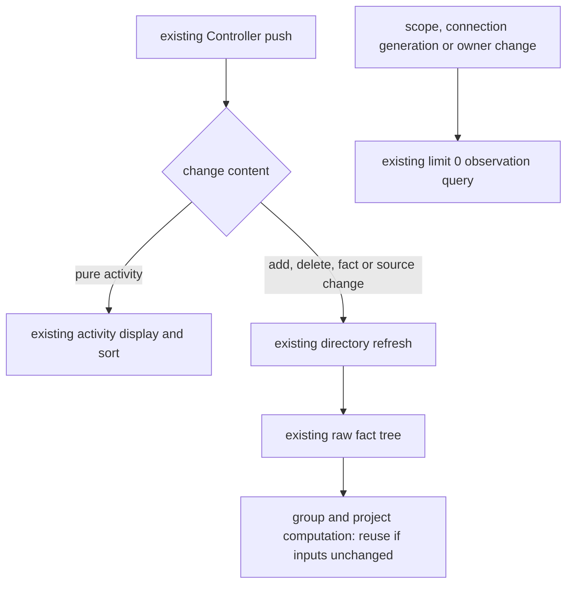

# Task list refresh semantics (`workspace_task_list_changed` reason taxonomy)

> Finalized 2026-07. After M5 moved the left-list data source to sessions-index, composer actions
> (switching model), task close-out and opening a history task all made the left task list refresh
> wholesale and the task jump to the top. Root cause: two consumption semantics were never defined as
> contracts: (1) the `workspace_task_list_changed` reason taxonomy, (2) the definition of "activity" for
> sessions-index `lastActivityAt`. This document is the source of truth for both. The project sidebar
> consumes list changes in `packages/ui/src/project-sidebar/useProjectTree.ts`; automatic unread is
> handled by `useProjectUnreadSignals.ts` in the same directory; regression is in
> `packages/ui/test/projectTreeBackgroundUnread.test.ts`.

## 1. reason → UI refresh level matrix

Emit surface: `taskIndexSyncer.emitWorkspaceTaskListChanged(target, meta, reason)`. **`reason` is
required** (design fix: the former default `task_meta_changed` silently put every non-committal emit
point into the heaviest refresh semantics, the root of the whole defect chain).

| reason                                           | Meaning                                                                         | Full-list refresh¹ | Membership refetch² | Meta incremental write-back³ | Typical emit point                                                                |
| ------------------------------------------------ | ------------------------------------------------------------------------------- | ------------------ | ------------------- | ---------------------------- | --------------------------------------------------------------------------------- |
| `task_pinned` / `task_unpinned`                  | pin membership flip                                                             | yes                | yes                 | n/a                          | setTaskPinned                                                                     |
| `task_archived` / `task_unarchived`              | archive membership flip                                                         | yes                | yes                 | n/a                          | archiveTask/unarchiveTask                                                         |
| `task_meta_changed`                              | membership-related meta (unread) or a fallback with no finer class              | no (with meta)     | yes                 | preserve-membership          | setTaskUnread, group operations, bulk archive, first broadcast                    |
| `task_status_changed`                            | status/snapshot convergence (close-out, resync, open/resume task, compact/goal) | no                 | no                  | preserve-membership          | applyTerminalTransition, resync, resumeSession                                    |
| `task_model_changed`                             | model switch (pure config)                                                      | no                 | no                  | preserve-membership          | zcodeSessionService.setModel                                                      |
| `task_title_changed`                             | title (first message / auto title / manual rename)                              | no                 | no                  | preserve-membership          | applyTitleChange, renameTask                                                      |
| `task_created`                                   | new task (tasks-index positive row set grows)                                   | yes (without meta) | yes                 | insert-active                | adapter/create, first grouped-order commit                                        |
| `user_message_saved` / `assistant_message_saved` | message persisted                                                               | no (with meta)     | no                  | preserve-membership          | legacy protocol path                                                              |
| `task_deleted`                                   | delete tombstone                                                                | yes                | yes                 | n/a                          | deleteTask; removes the cache at once and bumps the deleted-membership generation |
| `stream_mirror_*`                                | stream recovery fallback                                                        | yes                | no                  | n/a                          | remote-control recovery path                                                      |

¹ `shouldRefreshTaskListForWorkspaceEvent`; ² `shouldRefetchTaskListMembershipForWorkspaceEvent` →
`bumpTaskListMembershipVersion` (a global version; one bump makes all list instances refetch the
pin/archive/unread join surface, deduped by event content to avoid duplicate delivery from two
subscription chains); ³ `getTaskMetaWorkspaceEventSyncMode`.

`task_status_changed` may carry an optional `unreadSignal="background_terminal"`. The v4 sessions-index
host syncer does not know which task each window is viewing, so the Host only decides "is this
terminal state worth a reminder", and the renderer then performs the full-task-address viewing check.
Ordinary background terminal states, Goal `verified` and real errors carry the signal; Goal
`active/paused/verifying/notSatisfied/failed` do not. Ordinary status broadcasts for opening/resuming
a history task or compact/goal snapshot convergence do not either; a new completion must never be
guessed from a terminal status alone. When the renderer receives the signal and the task is not being
viewed by the desktop or an effective Web foreground, it calls `setTaskUnread(true)`; that ownership
change emits `task_meta_changed`, which triggers the unread membership join refetch.

With the project sidebar on the Controller, an explicit background-terminal signal must still reach the
window's single unread handler. The Host forwards a narrow live signal from the original workspace
event and never infers a new completion from a sessions-index snapshot, reconnect replay or history
read; the signal carries the full task address. Automatic unread signals go only to the
desktop-continuous local/base attachment; a remote scope attachment and mobile share the same
persisted `unreadAt` and produce no second automatic writer. The ordinary Web path without a Controller
is consumed from the original event by the same project-tree owner.

The window identifies a task by full workspaceKey + taskId and decides whether to set unread using
desktop navigation and the effective Web viewing facts below. The same terminal state is deduped;
concurrent writes get different markers atomically allocated by the persistence owner, and each reply
represents only its own write. After a successful persisted write the existing project tree is
refreshed; no separate committed-unread state is kept. If the user has viewed the task during the
write, a read-CAS uses only that write's reply's exact `unreadAt`; the Controller must not substitute
another marker version read by a later refresh. After a service generation change or owner unmount, a
stale reply starts no write. Regression covers local/remote identity isolation, active task, ordinary
status, duplicate terminal state, write failure and late replies.

### Actual viewing state of a connected Web (2026-10-13)

Automatic unread accepts the original full desktop navigation facts, or a connected Web foreground that
actually displays the same full task address. The mobile home, settings/other main views, chat covered
by an inert layer, background pages, drafts and disconnection do not count as viewing. Wide and narrow
layouts share the viewing report entry; draft-to-task promotion, task switch, visibility change and
unmount update at once; it cannot be inferred from a mounted component or a cached activeTaskId alone.
Browser foreground follows the Page Visibility visible state.

The last navigation position `mobileViewState` keeps its restore purpose; the new `mobileTaskView` is a
transient viewing fact inside Main's existing remote-control runtime and is not persisted. Main accepts
only declarations whose current pairing generation, increasing sequence number, bridge and workspace
identity all match; disconnection or bridge invalidation clears it at once and a reconnect must
re-declare, without the dialog's mobileConnected grace. When publishing the viewing fact to the desktop
Main injects a trusted remoteSessionId from the current bridge; Web must not declare that route. Exact
reads and CAS for an old remote identity follow that session route; an explicit session mismatch
between the viewing and completion signals cannot suppress unread. Every effective change is pushed
directly; the desktop subscribes before reading the initial state, and a late initial reply cannot
overwrite an update event. Polling, clock comparison and new timeouts must not patch ordering.

On hidden/pagehide/freeze the Web lifecycle must first revoke viewing through the still-sendable
current connection and then pause the transport. It must not depend on React Reporter listener order:
sending is forbidden once paused while the relay may still consider the original socket paired.
suspended and its original-socket probe window while entering reconnecting keep the Main-issued epoch
and increasing seq; a real connect or auth still revokes the old qualification, and a new pairing
request or bootstrap restores the current epoch. After the page is visible again it re-declares through
the original recovery flow and the current Reporter; background online/resume cannot re-report a cached
task as being viewed, and freeze/resume must re-read the real page visibility.

The bootstrap viewing epoch is written synchronously only after the existing version guard confirms the
current request generation and version are acceptable; the request function only reads the response. A
stale reply cannot occupy an empty epoch even if it arrives when already re-paired again. If a new
pairing's re-claim is lost, the current generation's bootstrap must still re-send; a valid re-claim
that arrives first is not overwritten by bootstrap. This also holds for re-pairing on the same socket;
no separate socket generation is created as the source of viewing qualification.

```text
old: hidden → transport paused → Reporter(null) cannot send → Main still thinks T is viewed
new: hidden → send null → transport paused → Main revokes viewing → write unread on completion
     visible/resume → read what is actually shown → original connection resumes/re-pairs → declare T → exact CAS
```

Only the desktop directory owner consumes Web viewing events and converges unread automatically; Web
only reports and must not become a second automatic writer through a shared hook. A completion signal
and a new effective viewing event are processed serially in the same writer per full workspaceKey +
taskId, while other tasks can run concurrently. If viewing happens in the middle of an unread write,
only the marker returned by that write is cleared; if the write has completed, the new viewing event
reads the owning Source's current marker through the Controller's exact `getTaskMeta(address)` and then
CAS. The read and CAS occupy one place in that task's serial chain; a slow read must not overtake a
later completion and wrongly clear a new marker. The chain manages only in-flight operations and is not
a new business accepted queue or persisted state.

The Controller exact read routes through the existing source/attachment validation to the owning
TaskService and verifies the owner has not changed generation before and after async IO; it does not
read the marker through the list cache or an error-swallowing projection. Unmount, identity change,
read or write failure do not fabricate a local false read; errors stay on the existing log and refresh
paths. Repeating the same effective viewing state does not run a read command, so render, polling or
resend cannot erase a manual unread. After an effective viewing becomes empty, re-declaring the same
task is a new viewing and clears the unread produced during disconnection/leave.

A wide/narrow breakpoint change only switches layout and does not mean leaving the task. Viewing
reports and mobile Home/chat navigation are held by the same owner outside the layout branch; while
the same task keeps displaying, a child-component unmount must not produce `T → null → T`, and the
manual unread must be kept. Really switching to Home, covering the chat, going to background or
unmounting still revokes viewing at once; no delayed event merging.

```text
Web foreground actually shows T → Main validates current connection/bridge/seq → single desktop writer
U1 completes → mark-unread(11) → view T → owner read + CAS(11) → leave
                                                     → U2 completes → mark-unread(12)
```

Regression MRO03 covers wide/narrow screens, foreground/Home/background, draft promotion, disconnect
reconnect, same path with different Sources; timing regression covers in-flight write, viewing after a
completed write, leaving and completing again during a slow read, an old marker not clearing a new
marker, old owner replies and repeated viewing not clearing a manual unread. The original
desktop-continuous and mobile replayable, Host explicit completion signal, single-DB CAS and sort-time
semantics are kept.

The desktop viewing branch must match the active tab, the workspace's `activeTaskId` and the current
navigation entry's full `workspaceKey + taskId` at the same time. The "viewed" record for an in-flight
write consumes only the navigation owner's full-address commit event: `setActiveTaskId` publishes
after completing its atomic update; returning from settings to an existing task publishes from the
return action. The event keeps no second copy of navigation state. When clicking B/T2 across
workspaces, activating B first briefly exposes B's cached T1, and a draft may also keep B/T1 history,
so no raw tab/session store notification alone can prove T1 was viewed. Empty navigation, automation or
the plugin market also cannot be evidence of viewing a task. Records of really opened-then-switched-away
and the exact marker CAS are kept; no delayed merging of store notifications.

```text
A → click B/T2 → activate B (caches T1, history may still be B/T1) → publish no viewing event
             → atomically commit B/T2 → full-address event → confirms only T2
T1 unread reply → no T1 viewing fact → keep that marker
```

The Host forwards an explicit completion signal at once, without waiting for list IO, so the window's
viewing record covers the list-read period. The unread mutation waits for in-flight reads to settle; if
the exact task address still has no projected row, it refreshes once more, verifies the source did not
change generation, and then performs the original write. An old read failure for a known task must not
swallow the completion signal; with a missing row and a failed refresh the write is rejected. Neither
leaving after a foreground completion nor viewing then leaving during the read after a background
completion may re-create unread.

On first opening a remote project, the mark-read request first validates the current attachment's full
sessionId, workspaceIdentity and cwd, then locates the sidebar's long-existing task row by stable
Source identity; a projection with a sourceServerId does not require back-filling a logical sessionId
created later. Old paths without a stable Source ID still match exactly by sessionId. The attachment
is checked again when the async read after identity validation ends, rejecting an old request that has
changed generation.

```text
background terminal → Host explicit live signal → window base owner's active-task guard
                                  → existing mark-unread waits for the task row to be ready → persisted unreadAt → project tree
                                  → viewed meanwhile: mark-read CAS on this marker
```

The whole-list refresh of `task_deleted` remains the fallback for hidden-item `total/hasMore`; a task
that hits the visible cache may first be removed incrementally. Whether or not it hits the visible
cache, it must bump the membership version, because sessions-index may still return the same CLI session
in a later live frame or cold-start seed, and only the tasks-index deleted-id negative set prevents it
from re-entering the ordinary list.

`task_created` must also bump the membership version. tasks-index is now the left table of the
Project/Timeline/Pinned/Archived/Grouped persisted rows; even if the event carries `taskMeta` and
sessions-index has already published activity, the old "incremental meta write-back only" strategy no
longer applies. The event occurs after the task row and initial grouped order are committed, and only a
generation-changing read can finish the `optimistic -> persisted row` convergence and let tasks created
by other windows/phones enter the current list.

**Rule for judging a new emit point**: does the change affect pin/archive/unread membership? If no,
never use `task_meta_changed`; choose an exact reason or add one and update this matrix and the guard
tests. A high-frequency path (taken on every message/close-out/open) put in the wrong class costs
all list instances × membership RPC × whole-list re-render.

## 2. lastActivityAt: "what counts as task activity"

sessions-index `lastActivityAt` = CLI `record.updatedAt` (v4-bridge `getSessionIndexMeta`), and the UI
sidebar sorts by it descending. **Only user-perceivable session activity may bump it**:

- Counts as activity: message send/receive, turn lifecycle, tool execution, background tasks, and newly
  produced permission/userInput blocking requests and other user-perceivable SessionEvents.
- Does not count (`isNonActivitySessionEvent`, server-operations.ts):
  - `ModelSelected` / `SessionModeChanged`: pure config changes (switch model / mode);
  - `FollowupModeChanged`: queue/guide config sync for follow-up messages; the automatic sync after
    opening a history session, repeated syncs and manual toggles do not refresh activity time;
  - `SessionResumed`: opening/resuming a session is a read, not activity (the cold-resume path just
    back-filled the real time in the store and must not be wiped).
- refresh/snapshot/resume/replay of the same pending interaction produces no new activity; only a new
  blocking request event may bump once.
- Config-class mutations (`CONFIG_ONLY_MUTATION_REASONS`: model/thought_level/mode changed) and
  `updateRuntimeModelConfig` do not bump `record.updatedAt`.
- tasks-index membership/meta mutations (unread, pin/archive, group, rename) must not merge their
  SQLite `updatedAt` back into sessions-index `lastActivityAt`. Updated sort recognizes only the
  latter; the grouped view recognizes only the explicit `sort_order`.

Consequence of violation: a config operation / opening a task pushes the task to the top of the list
and triggers a whole-column reorder.

## 3. sessions-index cold-recovery downgrade defense (seed↔live switch window)

On cold start the list seed comes from the store (`getStoredSessionSummaries`); after a task is opened
the live projection overrides the seed. Before hydration completes the live projection is a
half-finished product, and the following fields must not overwrite a non-empty baseline with a
downgraded value (`SessionsIndexProjection.upsertFromConversation`):

- empty `title` → keep baseline; newer `createdAt` → keep the earlier value; empty
  `lastAssistantPreview` → keep baseline;
- `phase === "draft"` while the baseline is not draft → keep baseline phase/sessionEnded/goalStatus
  (once a session has content it cannot go back to draft).

With the defense complete, "opening an unchanged history task" produces zero delta (guard test:
sessions-index-projection.test.ts "cold-recovery draft-window snapshot equal to baseline produces no delta").

## 4. Renderer delta pipeline (prevents one frame change from amplifying into a whole-list refresh)

The current form is "full in-memory recompute + reference-equality short circuit + IO cached by
version" (recompute is ~ms at thousand-session scale; a truly materialized delta store is a later
refactor direction, see §6):

- `useWorkspaceSessionsIndexItems`: the aggregation layer compares field by field and reuses the old
  object when equal; whole-table equality reuses the old array, so downstream effects that depend on
  array identity (grouped refresh, workspace cache invalidation, republish) short-circuit naturally.
- `useWorkspaceTaskLists`: a sessions-index change only marks dirty the workspace scopes whose diff
  changed and no longer invalidates everything.
- **Refresh display semantics**: a workspace with an existing query cache uses stale-while-revalidate:
  only the hit scope is marked `stale` and the current task rows are kept, replaced in place when the
  background recompute completes; only a first hydration with no query cache at all enters blocking
  loading. "Clear the existing list → loading → refill" must not express an ordinary sessions-index /
  membership refresh, otherwise one task selection or recovery is still perceived as the whole sidebar reloading.
- `useGroupedTaskView`: `stabilizeGroupedView` reuses at node level; when the whole tree is equal,
  setState gets the same reference and bails.
- `taskQueryCacheStore.setQueryResult(s)`: skip setState when the result equals the current cache;
  `mergeIncomingTaskListItem` keeps the old reference for content-equal items.
- **IO delta**: membership (pin/archive/unread) and the grouped structure do not change with
  sessions-index content frames and are cached by `membershipVersion + signature`
  (`fetchTaskListMembershipSetsForEndpointsCached`, grouped `remoteDataCacheRef`); content frames
  (title/status/lastActivity) only do an in-memory join with zero RPC; the group-mutation path
  invalidates the cache explicitly.

### 4.1 Workspace scope subscription isolation

`useWorkspaceSessionsIndexItems` consumes a set of workspaces, but subscription ownership must land on
a single `endpoint + workspaceKey`. A scope-set change may only reconcile incrementally by key; an array
signature change must not be read as "release all old subscriptions and subscribe to all new scopes".
Otherwise deleting one workspace would clear the snapshot, watermark and task rows the other
workspaces hold, amplifying a local navigation action into a cross-workspace state rebuild.

```text
before = [A, B, C]             after = [B, C]
             │                         │
             └── reconcile by key ─────┤
                                       ├─ release A
                                       ├─ retain B store/subscription/watermark
                                       └─ retain C store/subscription/watermark
```

| Scope change                            | Allowed side effect                 | Forbidden side effect                         | Class                          |
| --------------------------------------- | ----------------------------------- | --------------------------------------------- | ------------------------------ |
| remove A                                | unsubscribe/release A               | rebuild or clear B/C                          | accepted                       |
| add D                                   | acquire D; D hydrates independently | clear existing A/B/C rows while waiting for D | accepted                       |
| only reorder scopes                     | none                                | any subscribe/unsubscribe                     | pruned: set identity unchanged |
| B's endpoint/service generation changes | replace only B                      | rebuild other workspaces on the same endpoint | accepted                       |
| hook really unmounts                    | release all current entries         | keep leaked references                        | accepted                       |

Key invariant: after going from `[A, B, C]` to `[B, C]`, the `SessionsIndexStore` instance,
subscription, watermark and session set of B/C must keep their values, and the renderer must not publish
an empty intermediate state for B/C. Desktop still uses `desktop-continuous`, and a mobile remote-control
scope still uses its endpoint's `web-remote-replayable`; this change only isolates the subscription
lifecycle and does not change either delivery semantic. The identity key stays
`workspaceIdentity?.trim() || workspacePath`; `workspacePath` is for transport parameters and
display/execution only.

### 4.2 No blank frame in the grouped view (2026-08)

`Grouped` is the only sidebar view that keeps the "authoritative list" in component-instance
`useState` and has a first-paint gate; timeline/pinned/archived all render from the module-level
`taskQueryCacheStore`. So on the same content frame only grouped expresses "refreshing" as a whole blank
block, which users perceive as "the left grouped list flashes". Four invariants:

- **The gate blocks only first paint**: `isGroupedTaskViewInitialized` must be a one-shot latch. It must
  not read the current Controller list's `loading` directly: every streaming node of a running task
  (sending a prompt, first tool, output done) makes it re-query once, and the gate would close again
  and unmount the whole grouped subtree.
- **Once painted, never go back to blank**: `shouldHideGroupedTaskContent` must accept `hasPaintedOnce`.
  After a non-empty list has rendered, any loading / uninitialized / transient empty frame keeps
  rendering the previous list.
- **The authoritative view survives remounts**: the last authoritative view is cached at module level by
  scope signature (`groupedViewCacheBySignature` in `useGroupedTaskView`), so after an ancestor remount /
  HMR drawing continues at once and RPC only converges; the init latch is also seeded from the cache,
  otherwise the first frame after a remount still closes the gate.
- **The scope memo must use a value signature**: `scopes` / `sessionsIndexScopes` must not be memoized on
  the tabs array identity. A parent rebuilding a same-value array changes `refresh`'s identity, and the
  "refresh changed → refresh" effect then setStates and triggers the next render, a self-exciting
  refresh loop that sends RPC every frame and creates a flash window for the gate/empty state. It matches
  `useGlobalTaskList`'s `workspaceSignature`.

```txt
Controller activity frame (phase/lastActivityAt change)
   │
   ├─ timeline/pinned/archived ─> module-level query cache ─> stale-while-revalidate, no blank
   └─ grouped ─> instance state + first-paint gate ─> latch/hasPaintedOnce/module cache: missing any one gives a blank block
```

Verification hint: such fixes depend on "seed initial state at mount + in-component latch"; vite HMR
keeps the old state of mounted components, so **fully restart the app** to retest; observations under
hot replacement are not conclusions.

## 5. Historical root-cause chain (2026-07 fix reconciliation)

The same symptom (left list flashing / whole refresh / task jumping to the top) came from four
independent defects stacked together, fixed respectively in:

1. reason default value being borrowed → required reason + exact classification of high-frequency paths (§1);
2. config/resume counted as activity → §2 non-activity event set;
3. cold-recovery draft downgrade → §3 phase defense;
4. unstable references in the aggregation layer / query cache → §4 stabilization.

### 5.1 Whole-block grouped flash (2026-08 fix reconciliation)

The same origin as above but only in the `Group` view: switch to Group and run a multi-tool task, and
it flashes once each at **sending the prompt, first tool shown, final output done**; Project/Timeline do
not flash. Three independent defects reproduced and confirmed by tests
(`packages/ui/test/groupedTaskViewStreamingStability.test.ts`):

1. **The gate followed transient loading**: `initialized` was derived directly from the Controller list's
   `loading`, and each streaming node's re-query closed the gate, so the whole grouped subtree unmounted
   and remounted.
2. **Self-exciting refresh loop**: the `scopes` memo was on array identity, so a parent rebuilding the
   array triggered render→refresh→setState→render (the guard case ran 200+ renders before the fix).
3. **Remount fell back to empty**: the authoritative view lived only in component-instance state, so a
   remount returned to "empty view + gate closed" and needed two RPCs to recover; this is also the
   structural reason why only grouped flashes.

Two suspected paths were ruled out at the time: top-level/in-group virtualization (measured
`nodeCount 67 < 80` threshold, not enabled) and the sidebar width being squeezed by right-side content
(the sidebar panel is `flex-none` + CSS-variable width).

Counter-example (do not reintroduce): "the live Controller still reports this task" was once used as
evidence that "the row should not disappear" to offset transient row loss. That criterion's scope is
`kind:"active"` = `!archived`, which **includes pinned tasks**, while grouped's scope is "not pinned and
not archived", so a pinned task would be resurrected by the guard and linger in a group. The constraint
is in "Visibility source of truth and deletion convergence" in `docs/ui/task-grouped-view.md`.

## 6. Sidebar performance: local optimizations

> 2026-10-15: fixes the refresh dependencies and duplicated computation of existing consumers; keeps the
> Controller, service interface, persistence and list data structures. A full read model, subscription
> leases and per-row subscriptions are out of scope this round. Only the host changes; the policy that
> plugin code and effective UI guests are not frozen or reclaimed automatically is unchanged.

### 6.1 Evidence and goal

In one dev-mode capture a plugin took 57.482 s from open notification to editor ready; the same window
had 431 `window-controller.listTaskList` calls with about 473 ms total Host handling. RPC service time
cannot explain all the waiting. The original long frames and later call stacks point at Renderer
synchronous rendering pressure, including group sorting and serialization; full tracing itself has
notable overhead, so its time share cannot be back-filled into the original run, and optimized startup
seconds cannot be promised in advance.

The current sidebar establishes Source activity observation with a `limit: 0` query, which supplies no
project-tree rows. Before the fix, one Controller revision triggered the observation query, directory
re-read and activity synthesis at once; the Provider handed the synthesized tree to the grouping logic,
so task activity also recomputed the group signature repeatedly. Now pure activity only triggers the
display path.

### 6.2 Three changes

| Change                                            | Implementation boundary                                                                                                                                                                                                                                                                                                  | Expected gain                                                                                         |
| ------------------------------------------------- | ------------------------------------------------------------------------------------------------------------------------------------------------------------------------------------------------------------------------------------------------------------------------------------------------------------------------ | ----------------------------------------------------------------------------------------------------- |
| Narrow refresh conditions                         | the existing registry distinguishes pure activity from fact changes; the directory re-reads only on facts, recovery and existing explicit refresh entries. The observation query is established or restored by the effective scope set, connection generation and owner lifecycle and is not resent on ordinary activity | fewer useless listTaskList, readTree and following whole-tree computations                            |
| Grouping and project computation use stable facts | reuse the raw fact tree already in useProjectTree without a new store; the group signature is computed only when fact inputs change, the sort key is serialized once; project sorting depends on the project set and the original sort preference                                                                        | removes full group sorting, duplicate JSON allocation and unrelated project sorting on every activity |
| RPC control messages check the marker first       | in the existing protocol check, test the control marker first and enumerate fields only for candidate control messages, keeping strict validation                                                                                                                                                                        | large binary messages are no longer enumerated byte by byte for type checks                           |

Mainly touches `windowControllerTaskListRegistry`, `useProjectTree`, `ProjectDirectoryProvider`,
`useTaskGroups` and the RPC message check, plus tests. The Controller protocol is not extended, the
directory owner is not migrated, the search/paging cache and the Host full projection are not redone;
those paths keep running under the existing contract.



### 6.3 Preventing missed updates when narrowing

- Do not just delete the effect's revision dependency. With a Controller the current hook no longer
  listens to workspace fact events directly; an explicit fact-refresh notification must be kept first,
  and then pure activity goes to the display path.
- Use the before/after rows the registry already stores for the local decision. The Host merges the
  activity's updatedAt, status and pendingInteraction into meta, so the directory must not be re-read
  merely because the meta reference or those fields changed. A frame that also carries fact changes
  such as title, unread or membership still refreshes; add, delete, snapshot, Source generation change
  and any change that cannot be proven pure activity keep refreshing. The existing activity-time sort
  keeps updating.
- Scope is compared by stable identity and canonical order; observation registration cannot depend on
  task activity to stay alive. First registration failure, reconnect, owner rebuild and explicit
  refresh can still re-establish observation; generation protection is kept, and a late reply cannot
  overwrite a new source. No polling, delayed merging or new automatic retry timer is added.
- Grouping changes only its input source and computation timing and is still registered by the existing
  taskGroupService; the system-task marker, explicit delete, first-send promotion, unread CAS and
  remote identity rules are kept. Merely wrapping the activity-synthesized tree in `useMemo` is not enough.
- A bounded query window may still re-query when activity changes the sort. This round's zero-requery
  goal targets sidebar observation and directory reads, and does not claim all search, menu and paging
  paths consume incrementally.

### 6.4 Verification and scope

- The activity-hook counter-example showed 1,000 activities triggering 1,000 directory reads before the
  change; after it, directory reads, observation queries and group-signature computations increase by 0
  and the final activity is correct. Covered: title, unread, pin/archive, system marker, add/delete,
  registration-failure retry, offline reconnect, recovery snapshot and owner remount.
- RPC regression uses a real 3 MiB Uint8Array to confirm ordinary binary does not enumerate fields and
  valid/invalid control messages are still handled correctly.
- TSL40 full desktop controlled stream: from ACTIVITY_02 to ACTIVITY_29 the listTaskList count stays at
  2 and readTree at 6; after Stop the running marker disappears, and right-click rename syncs. The case
  is manual-review/pending; an automatic pass is not a manual promotion.
- The mobile shared-host VP13 E2E passes, covering the shared project directory, group operations and
  draft handoff. A full dev window with unmodified PhotoCraft 0.2.2 and a standalone Electron host
  regression covered background editing, tab hide/return to the same guest, keeping unsaved state and
  release on delete.
- These results show the specified useless work is eliminated. There is no same-data, same-load
  before/after cold/hot startup comparison for the original 57.482 s scenario, so no total startup
  reduction in seconds is claimed, and a drop in overall app memory is not proven.

This round still keeps whole-tree activity synthesis and the existing Context notification, and does
not promise that only one task row re-renders. If measured startup and interaction meet the requirement,
stop; if long tasks remain, design the next step for the remaining hotspots separately. Do not add a
materialized store, lease protocol or bridge migration in advance just because the local optimization
did not remove all O(N) work. The plugin retention boundary stays per
[MCP page retention and background execution](./plugin-ui-background-execution.md).

## 7. Passive observation and runtime lifecycle

Listening to `workspace_task_list_changed` and acquiring a sessions-index scope are observation
behaviors, not workspace usage intent. They must satisfy:

- `onDynamicWorkspaceEvent` only returns the workspace emitter and establishes no upstream subscription;
- task-list sessions-index and the Host task-index syncer subscribe/resync only in `existing-only` mode;
- when the runtime is missing they go dormant: no production-level error, no backoff timer, no Agent trigger;
- once the runtime is available only the observer matching the workspaceKey establishes one generation of
  subscription; when a Host task-index dormant state first activates it must idempotently install the
  workspace frame listener first and then send subscribe, so an initial frame arriving in the same stdio
  read after the ACK promise resolves but before the await continuation / subscription ownership takes
  effect is not lost; a runtime generation change only resubscribes and does not install the listener again;
- after unavailable, clean up ownership, pending frames and retry, and hide running activity that lost live proof;
- a renderer reload may reuse the runtime already in the Host but must not start other restored workspaces.

App cold-start warmup is an explicit startup intent issued by Main and is not the passive observation
above. When one window restores several local workspaces, Main picks only the last-activated workspace
as the single target (limit 1) and hands it to the Host in the first `InitLocal` to run the existing full
`initializeWorkspace` warmup path; other workspaces in `recentProjects` are no longer warmed up and stay
dormant until the user explicitly opens/sends/uses a background-task entry. Single-workspace entries such
as no restorable session or an explicit open-workspace/deep-link cold start also warm only their own
target; a warmup failure does not scan other workspaces to fill in. The list is computed only when the
Host is first created, and a renderer reload reuses the original Host without widening it.

> 2026-09-30 reduced from at most 3 to 1: the session CLI has no idle reclaim, so starting 3 Agent
> processes at launch keeps 3 CLI memory copies resident per window, and the cold-start gain from
> switching to a recent project does not offset that resident cost.

```text
startup restore ─> explicit warmup target (active only, max 1) ─> Agent runtime available
                                                        │
sidebar mount/reconcile ─> passive observers ─> tasks-index rows
                                      │                 │
runtime available(workspaceKey) ──────┴─────────────────┴─> install listener -> attach sessions-index
runtime unavailable(workspaceKey) ─────────────────────────> dormant; no retry spawn
```

Production logs keep only runtime available/unavailable and real subscription lifecycle; observer
reconcile, dormant hits and per-frame detail use `debug`, so workspace count × list consumers does not
create a new log storm.
