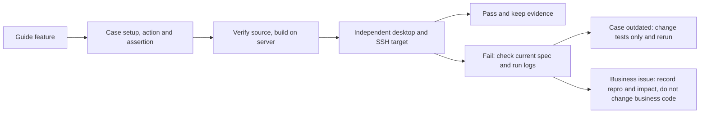

# Desktop SSH Test Guide Regression

Status: done

This round is based on the "ZCode Remote Connection New Test Guide" version 41 (2026-10-09); the business baseline is `a13999a28927f629d0c64080a5096cf8b4f23bae`. Only desktop SSH is verified; mobile, WSL and Docker product connection modes are out of scope. A standalone Linux Docker container is used only to simulate a real SSH server.

The server queue is reused; every case has its own HOME, display session and SSH target. The full source manifest is verified first, then Desktop, Server and Agent are built on the server. Model replay covers function and fault timing; real models run separately as live-zapi / live-team. A PASS needs a user action, the matching assertion and run evidence; an old-version result or merely passing through a page does not count as coverage.

## Acceptance result

The check "every desktop SSH feature point has a case that passes or is recorded" is complete; the round is **not all green**. All 100 scheduled scenarios ran: 95 PASS; 3 business failures, 1 spec/entry behavior difference, 1 account-model precondition block. The raw runner recorded FAIL for those five; no result was edited, no failure skipped, no business assertion loosened.

Follow-up fixes (statistics and ledger below keep the original baseline result; evidence is in each issue record):

- 2026-10-10: directory permission issue [05](../issues/remote-e2e-stability/05-directory-permission-reattach.md) fixed; the full `directory-denied` E2E passes alone, including retry after permission restore and the original history continuation.
- Edited-route project reconnect issue [06](../issues/remote-e2e-stability/06-edited-route-ignored-by-project-reconnect.md) fixed; the `connection-management` edit variant passes alone: the new port really receives the connection, an empty password authenticates, both original projects recover, and no stale-route Profile is added.
- Existing-project-must-update issue [07](../issues/remote-e2e-stability/07-existing-project-upgrade-intent.md) fixed; the four version-policy variants pass alone: manual connect auto-updates and restores A/B; background wait, optional update with "later", and local-too-old behavior are unchanged. Full evidence and the note on the local first-round fixture-preparation timeout are in the issue record.
- Issue [08](../issues/remote-e2e-stability/08-reinstall-history-visible-in-new-device.md): semantics confirmed by the user on 2026-10-10. A formal uninstall that keeps data must keep the original device, connections and projects on reinstall, with the old history visible and continuable; only an independent data-environment replacement confirms a new identity. The old case expectation "new device shows no old history" does not apply to data-preserving reinstall. Both variants pass alone: the original device history is actually continued; confirm/cancel/archive and isolation for the independent environment hold.
- 2026-10-11: the task-identity precheck of multi-route migration compared only canonical snapshots and missed conflicts between sources; reopening created a new failed ledger and backed up both databases. New case `history-conflict-sources`: before the fix, batch `r3-server-20261011024625012-2857c7` failed (2 failed ledgers and 2 migration backups already at open); after the fix, batch `r3-server-20261011025925916-fb3363` passes this case plus `history-conflict` and `history-merge`, with only the same single ledger before and after retry and no migration backup on the remote.

The queue keys below map to specs/environment variants declared in one place by `harness/remote/run-all-remote.sh`. Directory faults, resource kinds, version policies, update confirmation and management paths of the same spec run as separate variants.

| Guide feature | Case / actual evidence | Result |
| --- | --- | --- |
| Device search, SSH config discovery, new connection, recent directories | projectentry, kinddoubleclick, three-screen | PASS |
| Wrong password supplemented in place, missing password, reuse of an online connection | p0-conn, wizardcredentials | PASS |
| First install version/account/path/size, real stages/logs, in-place retry | install-progress, log-contract, installfaults, downloadproxy, three-screen | PASS |
| Collapse, restore, cancel, close clears the form | cancelretry, three-screen | PASS |
| Rename device, pick directory, choose later stays online with no project | devicecards, disconnectux, three-screen | PASS |
| First directory page has a dismissible note, not repeated later or after restart | boundary | PASS |
| Continue running after exit/network loss, reconnect without duplication | app-exit-running, transportloss, coldreconnect, renderer, ackloss | PASS; physical system sleep listed as an environment record |
| Several projects share a device, waiting confirmation is not auto-approved | p0-main, sharedwait, transportloss, taskcontrol | PASS |
| 1/3, 2/3, 3/3, exhausted failure, silent recovery and manual takeover | retry-budget, transportloss | PASS |
| Manual disconnect, startup switch, 7-day guard, remote restart | recov, coldreconnect, daemondet, serverfault | PASS |
| Draft send disabled/kept, read-only content, original and deleted sessions | disconnectux, coldreconnect, rdux13, rdux14, mixed | PASS |
| Device/connection name, address/credential effective next time, empty value kept | settings-safeguards, connection-management | Name and empty-credential contracts tested; sidebar address reconnect failed, see [06](../issues/remote-e2e-stability/06-edited-route-ignored-by-project-reconnect.md) |
| Several connections per device, current/default, set default, remove route | sourcelines, connection-lifecycle | PASS |
| Online/offline location, remove-device confirm/default cancel, remote data kept | settings-safeguards, connection-lifecycle | PASS |
| Unfinished records collapse/delete/clean without affecting a connected device | devicecards, offlineicons | PASS |
| Required/optional update, background wait, local too old and later | version-manual-required, version-automatic-required, version-optional, version-controller-required | Background / local-too-old / optional prompt and later PASS; existing-project auto-update difference recorded in [07](../issues/remote-e2e-stability/07-existing-project-upgrade-intent.md) |
| Running task list, cancel/retry, force confirm, version/project recovery | serverupdate, serverupdate-force, install-progress, installfaults | PASS |
| Reinstall confirm, cancel, archive old connection, old history not mixed into the new device | uninstall (real old task + visible new-device task list) | Confirm/cancel/archive/data retention PASS; history mix-in failed, see [08](../issues/remote-e2e-stability/08-reinstall-history-visible-in-new-device.md) |
| Same address with different accounts, same-path history isolation | account-isolation | PASS |
| Flat list, five states, same name and path, details and device marks everywhere | projectnavigation, presentation, sidebar-menus, entryattr, pluginidentity, uipairwise | PASS |
| Drag order persists and going online/offline does not reorder | project-order | PASS |
| Remote share account, no displacement, unauthenticated rejection, artifact opens | share-authority (synthetic account, real SSH) + share (real cloud) | PASS; mobile entry is out of desktop scope |
| Directory deleted/turned into file/no permission, other projects recover, retry after repair | directory-missing, directory-file, directory-denied | Deleted/file PASS; permission revoke failed, see [05](../issues/remote-e2e-stability/05-directory-permission-reattach.md) |
| Single-route old-version upgrade, history continuation, actual fallback keeps working | history-single | PASS |
| Multi-route merge, backup, conflict, retry/give up and old-version fallback limits | history-merge, history-conflict (real old program, SQLite, GUI) | PASS; after both old routes are actually read the original task data remains, not promising every old view is complete |
| File browse/edit, terminal, Git, first send/continue, search/timeline | p0-dev, p0-main, terminal, filelocal, taskactions | PASS |
| Pin/archive, offline operation rejected, local data not used | taskactions, projectnavigation, botremote, modelcand | PASS |
| Send then immediate disconnect executes once, body cleared, later draft kept | ackloss (a new draft is actually edited while the ACK is withheld) | PASS |
| Queue, stop/resume, permission, subagent, compaction | queuesel, taskcontrol, subagent, compactgoal, taskfaults | PASS |
| Attachment drag/paste/send, preview/download, recovery after cancel/disconnect | attachments, mediapreview, attachment-cancel, attachment-disconnect | PASS |
| Model/default auto sync, offline catch-up, no-model guidance | provisioning, modelcand, modelswitch, provready, connectivity, live-zapi, live-team | Replay and real API Key PASS; real Team request blocked by precondition, see [09](../issues/remote-e2e-stability/09-live-team-model-precondition.md) |
| Skills/MCP/plugin/Hook/command/subagent management, real save, scope | resource-skill/mcp/command/hook, settingsscopes, settings-safeguards, pluginidentity, pluginsync, remotehooks | PASS; each kind has a real-target save or execute/delete assertion |
| Local settings vs project-machine settings boundary | desktopauthority, settingslocalboundary, settingsscopes | PASS |
| Bot identity routing, offline rejection, no misuse of local / other projects | botidentity, botremote, botruntime | PASS (synthetic channel and real Host/MessagePort chain); real channel and SSH end to end listed as an environment record |
| zh/en, dark/light theme, narrow window and keyboard safety | uipairwise, accessibility, devicecards, settings-safeguards | PASS |

## Build and execution evidence

Business code is `a13999a28927f629d0c64080a5096cf8b4f23bae`, equal to the latest branch at task resume. After recomputing and verifying the full source manifest, `pnpm prepare:remote-assets` (Server / Agent) and Desktop `build:no-runtime-assets` ran on the server to build test / production; final build fingerprint prefixes are `60c92e7db6b5` / `8002e5ec70bb`. Each case uses its own HOME, display session and SSH target.

| Batch | Scope / purpose |
| --- | --- |
| `r3-server-20261009170002590-cabde7` | Main batch, 80 items, 55 PASS; located old-case and new gaps |
| `r3-server-20261009183107835-42af65` | 38-item corrected rerun, 21 PASS |
| `r3-server-20261009221305938-a3e800` | 22 items after resuming interrupted tasks; run-identity evidence for complete exit and permission faults |
| `r3-server-20261009223735233-3b63ee` | Two latest builds, 19 items: post-send draft, real forced update, share account routing, etc. |
| `r3-server-20261009234650716-227ddc` | 13 items: keyboard/visual, update retry, old-version fallback, attachment disconnect, version-policy recheck |
| `r3-server-20261010000352793-dc135c` / `r3-server-20261010001224807-40c41f` | Device default/remove final pass; real old tasks revealed the post-reinstall history mix-in |
| `r3-server-20261010001822450-9f7e7e` | After multi-route merge, actual fallback to the old program reading both routes, confirming original task data is kept |

Early first-install/boundary representative passes also exist. A build fingerprint was invalidated by a catalog/matrix update: `r3-server-20261009223615174-965622` marked 19 items BLOCKED_ENV before launching Electron; they were rebuilt and rerun, and that batch is not counted as pass evidence.

The final per-item ledger, per-batch summaries, build proofs and redacted diagnostics are in `packages/desktop/.e2e-artifacts/desktop-ssh-guide-regression-20261010/`; full run logs and videos are kept in the original server artifacts under the batchId / case key above. The ledger records for each item the last actually executed batch, source fingerprint, spec, environment and raw status; early failure counts are not accumulated to manufacture a final pass rate.

## Case corrections and additions

Eleven SSH candidate spec families with case-local fixtures were added: account isolation, complete exit, mid-attachment fault, connection management, directory faults, ordering, resource settings, retry budget, share account, old-version upgrade/fallback, version policy. They follow the guide and existing accepted specs; all stay in `manual-review/pending` with no manual promotion or CI admission.

Main corrections to old cases: the three-screen wizard and dismissible note replace the old dialog; the current upstream replay entry is used; anonymous replay does not seed a fake login that would trigger real control-plane requests; menus/devices are located by stable identity; explicit waits for form animation, history body and old attachment release; the failure page's retry is actually clicked; after cancelling an update, continue via "retry -> protected auto-update"; CLI control commands drop the stale subcommand and parse the last JSON result line; real Team is accepted by the OAuth token-exchange contract. Continuous visual sampling uses the Electron native window API and asserts actual sizes.

History assertions use real tasks produced naturally by the old program, and the post-reinstall new device checks the actually visible task list; "file sentinel exists" or "internal key contains install UUID" does not replace user-history isolation. Synthetic conflicts, version metadata and share-account APIs are classified explicitly in the artifacts and are not passed off as real old business versions, accounts or cloud releases.

## Verification and environment boundaries

- `pnpm --filter @zcode/desktop typecheck:e2e`, root `pnpm typecheck` and `pnpm lint` pass. The 81 existing lint warnings remain, no new errors.
- `pnpm architecture:check --changed` passes with 0 new violations; affected root unit tests (20 files / 110 cases) and 14 Node audit tests pass; no unauthorized full unit run.
- Fixture checks pass for 28 replay/no-model modified specs; real Team is listed separately as a real-request precondition and does not carry a fake `none` or replay contract. The queue audit has 104 items with no contract gaps; the desktop SSH scope is 100 of them.
- Open-source terminology scan and diff whitespace check pass. Changes are in E2E, orchestration and docs only; no business implementation changed.
- Physical client system sleep is not verified: a same-machine Linux Desktop/SSH container cannot represent a separate computer sleeping; passes of `app-exit-running` and `transportloss` do not replace this dimension.
- Full delivery/continuation from a real bot channel to SSH is not verified: the existing bot cases are synthetic bindings plus real service/RPC routing evidence and are not extended to real-channel acceptance.
- The current Desktop's minimum compatible version equals its own version, so no "older and compatible" Server release exists for the remote optional archive update. `version-optional` uses a compatible newer Server to verify the bidirectional optional prompt and "later"; it does not claim the remote optional archive update branch ran.

Business/spec records keep the failed cases; real-account request blocks and environment gaps are listed separately. With explicit user authorization the test, orchestration and record changes of this round were committed; nothing was pushed and no MR created.
