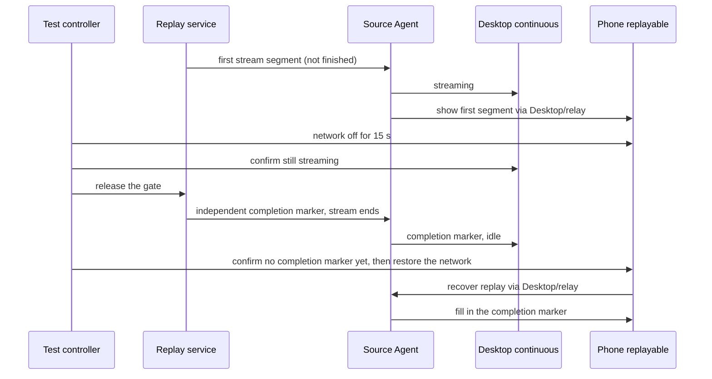

# R3 Remote e2e Server Harness (same-machine simulation)

Orchestration code lives in `harness/remote/`; this document states its facts. Goal: **every remote-connection e2e case can run on one Linux server**, with the remote simulated by same-machine Docker containers; cross-machine verification is not pursued.

Current commands, build environment, source verification, scheduling and cleanup rules are in the [harness README](../../harness/remote/README.md). This document keeps the topology, the real/simulated boundary, the case tiers and the attribution lessons; results of different dates must not be stitched into a current full PASS. The October SSH-scope results are in the [guide regression](desktop-ssh-guide-regression.md). The 50-cycle / 2-hour full acceptance target is in the [test plan](r3-remote-automation-plan.md); the 10-round / 10-minute soak of this harness proves only the corresponding shorter tiers.

Full history: `git show b8876e8b:docs/testing/r3-remote-server-harness.md`

## 2026-10-11 Full Recheck Result

Status: done

The goal was completed: **90 remote specs and 109 tasks all executed** on the same business baseline; by the latest valid evidence per task, **80 PASS, 29 FAIL**, with no unexecuted, untriaged or environment-blocked item. The 29 failures were all recorded as business behavior at the time, with no business code changed. A later root-cause review withdrew the misjudged old recovery contract among them (next section). Test fixes were re-verified; subsequent assertions blocked by business failures are listed in each issue record. A wrong local-ownership PASS and a PASS produced by the walkthrough collector swallowing exceptions were withdrawn. This is not a single all-green batch, nor a manual promotion or CI admission.

Natural single-line and multi-line old history, actual old-program rollback, real Team/ZAPI/Docker, two phone scenarios, 10-round reconnect and 10-minute dual-end stability all have passing evidence. The phone is a Chromium touch viewport; native Windows/Mac topics are not replaced by this Linux server run. The unique remaining failure of the walkthrough was the collapsed progress card (45 evidence groups with full video kept; a real container stop/start changed the backend port, recovered through a stable proxy).

### 2026-10-12 Root-cause Review

Issue 11 was fixed by credential ownership; the "new-version cold start must restore all tabs of the old list" of issue 15 conflicts with virtual-project F5, so that business characterization was withdrawn: the new version restores only `lastActiveWorkspace`, keeps other project entries and opens them on demand. The original `project-order` failure actually happened while waiting for an inactive tab after a manual connect, not in a cold-start B recovery failure. The five cold-start acceptances of the review batch all passed. Issue 25 was fixed after the startup owner supplied the app-owned cwd; the original settings-change scenario and the remote cold start PASS and the Worker restart exits 0 with a normal storage-complete frame. Issue 07 fixed the wizard hand-off of project-menu / unloaded tabs, the missing credential error code and a new recovery cycle misreading an old terminal error; its seven cases and two adjacent recovery/cold-start cases all PASS on the same source and build. The old two-tab assertion of background update follows F5: the active project recovers automatically and other projects open on demand; manual upgrade still verifies A/B recovery. These nine targeted results do not mean the full 109 were rerun, nor case promotion or CI admission. Details: [issue 11](../issues/remote-e2e-stability/11-ssh-credential-missing-after-restart.md), [issue 15](../issues/remote-e2e-stability/15-cold-start-open-workspace-siblings.md), [issue 25](../issues/remote-e2e-stability/25-data-directory-restart-startup-failure.md), [issue 07](../issues/remote-e2e-stability/07-existing-project-upgrade-intent.md). The table below keeps the original batch task mapping and no longer means there are 29 confirmed business defects.

### Original failure mapping

| Task                                                                                                                                                                 | Local issue record                                                                                                                |
| -------------------------------------------------------------------------------------------------------------------------------------------------------------------- | --------------------------------------------------------------------------------------------------------------------------------- |
| `serverupdate`, `serverupdate-force`, `uninstall`, `version-manual-required`, `version-snapshot-failure-required`, `version-automatic-required`, `projectnavigation` | [Missing authentication, upgrade and reinstall hand-off in the original project connection](../issues/remote-e2e-stability/07-existing-project-upgrade-intent.md) |
| `boundary`, `recov`, `project-order`                                                                                                                                 | [SSH saved connection lacks credentials after a cold restart](../issues/remote-e2e-stability/11-ssh-credential-missing-after-restart.md) |
| `sourcelines`                                                                                                                                                        | [Remote project does not converge to the realpath identity after creating a task from a symlink](../issues/remote-e2e-stability/12-project-symlink-workspace-identity.md) |
| `renderer`                                                                                                                                                           | [A ready remote task cannot be switched after a Renderer reload](../issues/remote-e2e-stability/14-renderer-reload-task-navigation.md) |
| `mixed`, `coldreconnect`, `rdux14`                                                                                                                                   | [Cold start does not restore the other opened remote workspace](../issues/remote-e2e-stability/15-cold-start-open-workspace-siblings.md) |
| `settings-safeguards`                                                                                                                                                | [Settings "show in sidebar" does not locate the project focus](../issues/remote-e2e-stability/16-settings-show-project-focus.md)  |
| `directory-missing`, `directory-file`, `directory-denied`                                                                                                            | [Original task history cannot open after the remote home directory becomes invalid](../issues/remote-e2e-stability/17-unavailable-root-history-navigation.md) |
| `history-conflict`, `history-conflict-sources`                                                                                                                       | [A single workspace history conflict blocks the whole remote project picker](../issues/remote-e2e-stability/19-history-conflict-blocks-project-picker.md) |
| `retry-budget`                                                                                                                                                       | [Auto reconnect runs three times but the project page does not show retry progress](../issues/remote-e2e-stability/20-retry-progress-not-visible.md) |
| `version-optional`                                                                                                                                                   | [After a compatible-version connection succeeds the device card lacks a deferrable update notice](../issues/remote-e2e-stability/21-optional-update-notice-missing.md) |
| `uipairwise`                                                                                                                                                         | [Focus stays on the page body after opening the editor from the project menu](../issues/remote-e2e-stability/22-project-editor-focus-missing.md) |
| `version-controller-required`                                                                                                                                        | [The version gate detail does not say the desktop should be upgraded](../issues/remote-e2e-stability/23-desktop-upgrade-guidance-missing.md) |
| `p0-main`                                                                                                                                                            | [A remote session is generating but the sidebar task row has no running indicator](../issues/remote-e2e-stability/24-remote-task-running-indicator-missing.md) |
| `desktopauthority`                                                                                                                                                   | [Cold start fails after desktop settings and data directory change](../issues/remote-e2e-stability/25-data-directory-restart-startup-failure.md) |
| `uiwalkthrough`, `three-screen`                                                                                                                                      | [No progress card on the main UI after the connection wizard is collapsed](../issues/remote-e2e-stability/26-minimized-connection-progress-missing.md) |

Not deciding a task's terminal state on its own: [startup reconnect description still says 7 days](../issues/remote-e2e-stability/13-startup-reconnect-description.md). The [suspected old-history open failure](../issues/remote-e2e-stability/18-upgraded-project-history-open.md) was excluded by real clicks and complete rollback evidence and classified as a test fix. Each issue record states the steps reached, run evidence and blocked subsequent assertions; failures were not deleted or turned into skips.

### Duration and test reliability

- Formal uninstall dropped the fixed 3 + 30 second waits and types the two real confirmation prompts; the uninstall command was measured at 1527ms, keeping the data and identity assertions.
- A history conflict fails immediately once the project page shows an explicit error: the two variants dropped from 880.0 / 865.2 s to 328.2 / 304.8 s; the original business conflict is still FAIL.
- Running state uses an explicit replay gate, dragging uses an activation-event barrier, refresh and restart do not wait for an unrelated default draft; the 10-minute stability observation window was not shortened.

Original batches, recordings, logs, fixtures and source manifests stay in the server's batch/case artifacts; the local `packages/desktop/.e2e-artifacts/r3-full-20261011/` holds the batch terminal states and `latest-results.json`. Business issues need a product change before re-verification; this round committed only tests, fixtures and docs. Results are attributed by actual source manifest, build environment, batchId and per-task result; passes of different business versions are never merged. Dedicated-fixture items stay in the denominator and run once the independent environment is available, never replaced by static audits or environment probes.

### Test fixes and evidence boundaries (from the full recheck)

- A global new task belongs to local uncategorized; remote sending uses a project draft and waits by Source identity + path. Source B with the same path cannot pass early by borrowing Source A's activated state.
- The connection wizard topic enters from the settings page and retries on the same settings page after closing. The new-version project entry and the independent three-screen wizard are verified separately; the old-version upgrade history uses the old UI operations; after rolling back to the old program the original directory is reconnected from the old draft entry, not through the new project-row selector. The recent-directory shortcut also opens the project editor with a preselected root; the directory must be checked and saved before continuing. An explicit error on the project picker page must end the wait immediately with the original reason, and a wrongly disabled "new project" button must not be taken as still loading. The desktop version gate reads the visible upgrade reason through "needs handling -> details" and verifies the remote archive is not downgraded. After collapsing the wizard from the settings page, return to the main UI and check the progress card in the project area as the contract requires; the settings page itself is not where the card is shown.
- Deliberate disconnect waits for the actual offline projection of the target project, not the retired settings history failed field. Renderer reload uses the valid Main ready ACK of each original attachment as recovery evidence; the navigation cache does not replace the attachment owner. Accessibility and desktop-settings scenarios wait only for an operable main UI after refresh/cold restart and do not require an unrelated default project draft. retry-budget keeps the requirement of three visible progress steps at the end of the scenario so a missing display does not block later silent recovery and manual takeover forensics.
- Under the [current project spec](../superpowers/specs/2026-10-10-session-manage-upstream-integration.md) device detail/edit is in the settings page, and the sidebar verifies project menu, device name, keyboard, theme and viewport. After removing the local entry the original remote project is re-added, never treating a same-directory new project as recovery of the original and never requiring that membership removal close the whole Source attachment.
- Directory-invalid verification follows the [primary root availability contract](../project-primary-root-availability.md): Source/B/C stay online, A's create/file entries are disabled and history readable; after the directory recovers a focus refresh allows continuing the conversation.
- provisioning-failure originally stalled about 10 minutes at the install confirmation; it now confirms the first install and observes the injected fault, and the fault cleanup restores the injected key only inside the credential file lock, keeping SSH credentials saved during the connection.
- SSH P0 first/continued sends use the existing controlled replay: stop at the gate after the first output and release the end frame after the sidebar active/running assertions. A fixed 1200ms response once finished before the sidebar observation and must not be handled by lengthening a fixed wait or removing the running assertion; failure diagnostics record the final boolean state. A confirmed missing running icon defers to a summary failure at the end and continues to check the four-turn history and telemetry; row ownership, active or error mismatches still fail immediately.
- The Bot synthetic identity fixture distinguishes the old context (no hostId) from the new project authorization key. A real Bot service probe rejected authorization before the fix; after the fix both deliveries enter the same Source, one connection, zero local deliveries.
- The phone home page shows shared projects/tasks and the old pairing copy is gone. The readiness chain is "pairing URL -> specified project/task visible -> Desktop phone connection state -> business operation"; an empty sidebar is not success and the stability observation window is not shortened. Later scenarios in the same file that reuse a logged-in remote page first return explicitly to the default local project, and close the old instance before overwriting a browser handle.
- Explicit plugin sync checks "synced" and the remote materialization first, then closes the result dialog and creates a verification session from the original project; it does not click the sidebar through a modal overlay.
- Image preview limits sent thumbnails to the main pane and opens them with a real pointer; the retiring DOM after reconnect is not an interaction target, and a separate diagnostic snapshot is kept on failure.
- Project dragging first crosses the activation threshold and observes aria-pressed, then sends the actual displacement; a merged mouse event may only activate the sensor and does not count as a drag. Accessibility and walkthrough share the same gesture.
- Provider settings refresh returns to the original workspace and does not wait for a never-switched local default directory; an empty-parameter tab probe reads the actual active project, and not matching any path is not "no remote session".
- Docker dynamic SSH mappings change after a container restart (33087 -> 33088; 33089 -> 33091), the old port becomes unreachable; the walkthrough keeps the app-side line stable through a TCP proxy held for the whole run and updates the backend to Docker's actual mapping after restart, keeping the real container stop, disconnect and re-handshake.
- soakdual completed 65 rounds in the full 10-minute observation window (603370ms, 21 phone network-recovery cycles) with input loss, desktop missing, phone echo missing and network-recovery failure all 0 and max Host / Agent counts 1; RSS first/last samples 1220 / 1211 MB, which is one sample and not a proof of no long-term leak.
- Static checks of the local follow-up test fixes: root and E2E type checks and architecture clean; affected unit tests 35 files / 142 tests and 14 Node script tests; lint 0 errors / 207 existing warnings. Of 51 changed conversation specs 48 replay-fixture contracts passed; `live-team`, `live-zapi`, `dockertrn` use real account requests and the base had no replay fixture/manifest for them, so the generic fixture checker reports them missing; this limit is kept and the actual live queue is the execution evidence, with no faked replay responses and no promotion.

Completion criteria and handling:

- Test-code problems: save failure logs, UI and state evidence first, check the accepted spec; change only the case, fixture or orchestration, keep original assertions and coverage scope, rerun the affected items and record the fix result.
- Business-code problems: save reproduction, expected vs actual, run version and impact, and write them into the local issue ledger; business implementation is not changed in this round.
- Duration optimization: record preparation, interaction, replay and cleanup durations first, then remove waits or repeated preparation with no business meaning and compare on the same business baseline; never shorten the stability observation window, swallow failures or raise the pass rate with automatic retries.
- Done = every item of the complete list has an actual result; test problems fixed and re-verified, business problems have evidence and records, duration problems evaluated and optimized in a semantics-preserving way, applicable code checks passed. An environment block can never be recorded as PASS.

```text
fixed business baseline -> verify test / production -> full queue and per-item duration
                                        ├─ test problem -> fix -> re-verify on the same baseline
                                        ├─ business problem -> local Issue and original evidence
                                        └─ slow case -> measure -> coverage-preserving optimization -> compare
```

## Topology

### Isolated parallelism and trusted results (2026-09-16)

Optimization is constrained by the current business assertions: do not shorten the 10 minutes / 10 rounds of soak, do not turn a fault stream into a normal response, do not replace production handshake, install, Provisioning or remote execution with test doubles. Pure preparation actions may seed local fixtures; install tests still use a brand-new target. An old case conflicting with the project-flattening contract must be migrated or explicitly reported as a contract block; it must not be attributed to a product failure by timeout nor filtered and called a full pass.

```text
fixed source/build -> scheduler (sole owner of resources and results)
                 ├─ slot 1: independent HOME/display/runId/container -> cases serial
                 ├─ slot 2: independent HOME/display/runId/container
                 └─ slot 3: independent HOME/display/runId/container
                         ↓
                  per-case result -> full summary (wait for all to finish)
```

Resource admission, exclusive phone, live mutual exclusion, batch locks, evidence and failure-exit rules are in the README. Independent HOME/display/target, real install and handshake, the whole planned denominator and the distinction between FAIL/BLOCKED/ERROR/TIMEOUT must be kept; automatic retry must not mask failures.

Acceptance: scheduler unit tests prove the concurrency limit, live mutual exclusion, overlap of pure-desktop soak with ordinary cases, exclusive phone items for their whole duration, and continuing after a failure with complete results; process-level verification proves timeout reclaim and display-server cleanup; small batches of ordinary SSH, dual-target/fault and soak representatives validate it. Sampling verifies only the orchestration mechanism; case stability still depends on actual independent execution evidence of the complete list and final assertions. Business failures and environment blocks are not passes.

The three-slot default rests on a 2026-09-24 same-source comparison of six items (all passed, wall clock 493.35 s -> 422.54 s, about 14.4% improvement for those six) and a complete 70-item run after fixing the exclusive phone: that batch took 4029.12 s with average CPU 71.21% and minimum available memory 3617.2 MiB; it gave 64 PASS, 4 recorded business FAIL, 2 VPN BLOCKED_ENV; the three phone pages had no resource-load errors and execution intervals did not overlap. The full source differs from the earlier two-slot round, so the wall-clock difference cannot be attributed entirely to concurrency. A later candidate record keeps the 70-item denominator: 63 items with at least three valid passes, 5 with business failure or unreached later assertions, 2 VPN blocked. The Provisioning PRV-12 write-failure recovery scenario was verified independently three times; the PRV-13 real un-returned RPC scenario exposed [the device management page blocked by remote statistics](../issues/remote-e2e-stability/04-management-blocked-by-remote-counts.md) three times, so it is still FAIL as a whole. The native-editor positive branch is not yet verified on macOS/Windows.

```
┌──────────────── e2e server (Ubuntu 24.04 / x86_64) ────────────────┐
│ xvfb-wm-run: Xvfb dynamic display + openbox + dbus-session         │
│   └─ wdio → Electron Desktop (independent HOME/profile per case)   │
│         │ product SSH dialog: 127.0.0.1:<mapped port>, dev / random password per round │
│         ▼                                                          │
│   docker: zcode-r3-server-a  [dev + tunnel users]                  │
│                          c / d / e / f / dt (other tiers)          │
│                                                                    │
│   replay provider ──SSH forwardIn(tunnel user)──► 127.0.0.1 in the container │
│   docker exec ─────────────────────────────────► fault injection / probes │
│   mock-cdn/releases/<version> ─── local download or upload installs zcode-server │
└────────────────────────────────────────────────────────────────────┘
```

Key point: the SSH protocol, remote sshd, remote server/Agent processes and remote file system are all real; only "another machine" is simulated. Container ports bind only to `127.0.0.1`, so the Desktop must be on the same machine as the containers.

## Real / Simulated Boundary

| Stage             | Implementation                                                                                                                                                          |
| ----------------- | ----------------------------------------------------------------------------------------------------------------------------------------------------------------------- |
| Connection        | The product SSH dialog is really filled with host/port/user/password, password authentication only                                                                      |
| Remote host       | Same-machine Docker container (`zcode-remote-ssh:test`), rebuilt for each case                                                                                           |
| Remote server/Agent | Really installed and run; the test reconciles the remote PID/startTicks/logs                                                                                          |
| server artifact   | Locally built `mock-cdn/releases/<version>`, installed through "local download/upload", no real CDN                                                                      |
| Model requests    | Default replay: `createSSHReplayTunnel` exposes the local replay server as `127.0.0.1:<port>` in the container through SSH reverse port forwarding; the `tunnel` user carries it separately so a "kill the dev sshd" fault does not take it down |
| Real model        | Only the three cases `live-zapi`, `live-bigmodel-team`, `docker-transport`                                                                                              |
| Fault injection   | `docker exec` kills the sshd in the container / read-only probes; a local loopback TCP proxy holds the first connection; a local HTTP proxy verifies the download path; forged release sources |
| Phone             | Local chromium (`R3_MOBILE_CHROME`) 390x844 viewport; by default hosts the same-batch-source v4 Web build and uses the standard test external relay (`wss://zcode.z.ai/ws`); an explicit page URL override is still valid |

## Case and Tier Mapping

The queue `harness/remote/run-all-remote.sh` declares the full list and `run-queue.mjs` schedules it. Query the exact list with `node harness/remote/run-queue.mjs --list`; the three restricted-install variants count as separate execution items. `projectpolicy` seeds its offline entry itself with the runner's independent HOME and runs in the no-target tier; an online SSH project does not replace the offline assertion. Other cases are grouped by capability below.

`SSH-P0-CONN-08` (`conversation-session-ssh-provisioning-failure.test.ts`) is included in the remote list as a named exception with queue key `provisioning-failure` on an ordinary single SSH target. It verifies safe diagnostics and retry recovery for corrupted credentials, sends no model request and needs no live account; it stays pending and being queued does not mean manual promotion or a passing run.

`R3A-DEV-06-hooks-local-scope` and the banner-reconnect spec use queue keys `hooks-local-scope` and `banner-reconnect` on an ordinary single SSH target in the `replay` group. The former verifies on-disk isolation of local and remote Hooks scope; the latter creates a TCP proxy inside the case and injects disconnects, and the whole spec runs in order without filtering the pre-handshake disconnect scenario. Both stay pending; the list check must also verify the actually generated execution plan, to prevent registering a spec but missing the queue.

| Group                        | Tier                                       | Description                                                                                                                                                  |
| ---------------------------- | ------------------------------------------ | ------------------------------------------------------------------------------------------------------------------------------------------------------------ |
| 1 Structure and recovery     | `a` (entry-attribution uses `a`+`c`)       | boundary / ack-loss / mixed / recovery / renderer / shared-waiters / source-lines / stale-gen / transport-loss                                               |
| 2 UI / device / settings     | `a`; offline-icons and remote-dialog use zero connections | device-row / task-actions / ui-pairwise / settings-scopes / desktop-settings-authority / offline-icons / remote-dialog / settings-ui-polish(MP-UI-05-remote) |
| 3 Provider / model           | `a`                                        | project-entry / provisioning-gui / model-candidates / connectivity / model-switch / queue-selection / provisioning-ready                                     |
| 4 Task / conversation        | `a`                                        | compact-goal / subagent / task-control / task-faults / task-lifecycle / settings-overlay                                                                     |
| 5 Remote development         | `a`                                        | attachments / media-preview / file-local-actions / remote-hooks / terminal                                                                                   |
| 6 Install / upgrade / connection lifecycle | `a` (install-faults uses `a`+`c`) | daemon-detached / install-faults / server-update / uninstall / cancel-retry / cold-reconnect / server-fault / download-proxy                                 |
| 7 Existing P0                | `a`; development-p0 needs a container with git | ssh-remote-p0 / connection-p0 / development-p0                                                                                                           |
| 8 RDUX and scope             | `a`                                        | rdux-13 / rdux-14 / project-conversation-scope / share-ssh-artifact                                                                                          |
| 9 Remote workspace plugin    | identity uses `a`+`c`, sync uses `a`       | WPL-010 / WPL-011                                                                                                                                            |
| 10 Bot remote workspace      | no container                               | BOT-E2E-RW-01 (synthetic fixture contract)                                                                                                                   |
| 11 Mobile                    | `a` + chromium + relay                     | mobile / mobile-permission                                                                                                                                   |
| 12 soak                      | `a`                                        | soak-reconnect (10 rounds) / soak-dual (10 minutes)                                                                                                          |
| 13 Restricted-environment install | `d` / `e` / `f` / `g`                 | noexec-tmp / no-tar / no-forwarding / old-glibc (injected getconf returns `glibc 2.17`)                                                                      |
| 14 live                      | `a`; docker transport uses `dt`            | live-zapi / live-bigmodel-team / docker-transport                                                                                                            |

Coverage gate: `packages/desktop/scripts/r3-remote-spec-inventory.mjs` is the single point of the remote spec inventory and `packages/desktop/test/r3RemoteSpecInventory.test.ts` checks that the queue covers the inventory. A case whose fixture cannot be built in an existing tier must report a block explicitly and must not vanish from the planned denominator. RDUX-16 really installs first inside the case and then builds a same-version different-SHA update from this run's staged archive; no manual pre-install is required. Update and install faults unlink this run's hard links before writing, so the public build package stays read-only.

### Project navigation migration and case value

The project-flattening contract of September 16 replaced the device group header / connect-and-chat. File names are kept for traceability and assertions follow current behavior:

| Case                                     | Current acceptance behavior                                                           |
| ---------------------------------------- | ------------------------------------------------------------------------------------- |
| RDUX-13, device-row                      | Project reconnect keeps the directory and a repeated click gives one wizard; after connecting from the settings page the directory is chosen explicitly; A/B of the same Source recover |
| Original CWP13/CWP15 project/conversation | RPN-03/07: sessions of projects A/B are independent, and one cannot exit to a remote no-project chat |
| entry-attribution                        | Attribution of new tasks of two Sources' same-path projects; the second project does not repeat the first Provisioning |
| settings-scopes                          | User lands locally; remote projects A/B land on disk separately by identity           |
| mixed-entries, provisioning-gui          | Local and remote A/B recover; config changes during disconnect sync after reconnect; project sessions are independent |
| recovery-guards, cold-reconnect, RDUX-14 | Offline projects kept; startup / explicit-disconnect guards, history and generation-swap assertions kept; use the settings page / project rows |
| offline-icons, ui-pairwise               | The settings-page connect button is keyboard reachable; project detail and reconnect usable in a narrow English dark window and a Chinese light desktop |

`--audit` only prevents known retired entries from flowing back and does not mean a passing run; the real product path is still proven by E2E. Steps within a case stay ordered, and desktop continuous and mobile replayable recovery assertions are not merged.

The slow fixtures of `model-switch` and `queue-selection` are released explicitly after the key operation instead of waiting 45 s. The queue case checks, per the admission contract, that the `model` of the unique request is A, rather than waiting for two mutually exclusive A/B requests until one exhausts 90 s. Recorded/fault streams must not use the release mechanism, and replay evidence records the actual release time. Provider preparation seeds only the local Personal Config and updates the Registry through the real refresh button; the remote still goes through the product Provisioning. Cases verifying Provider save/delete keep using the real settings UI.

## Feilian VPN Environment Admission

### Automatic preparation before tests and waiting for manual authentication

`vpn.mjs` owns the VPN precheck of deployment and queue. If already ready it continues; if not it calls a fixed-permission helper once, idempotently starts the service and restores Docker route protection. A running client is not restarted by uptime: on 2026-10-11 a real machine already reached the one-time-password window automatically, and the old five-minute restart rule would have interrupted an unfinished authentication.

Preparation waits up to 600 s by default, configurable with `R3_VPN_WAIT_SECONDS` (1-3600 s). The limit controls only this preparation and is not the validity period of authentication; timeout and cancel both keep the Feilian scene. Each actual check must pass before letting go: neither the end of waiting nor a live process replaces tunnel, route and HTTPS verification. Cancel ends the wait at once without closing the shared VPN.

Progress is printed when preparation starts and on recovery success; if still not ready after 30 s the current blocking layer is prompted once: service, VPN connection, Docker route or intranet endpoint. Only the connection layer prompts to check the Feilian window and complete the login/MFA it asks for; without evidence of the client's authentication state, not every disconnect is characterized as MFA. After manual authentication the same preparation continues automatically; on timeout dependent items are still recorded as `BLOCKED_ENV` per existing rules, and failed tests are not rerun automatically.

```text
precheck → ready → run tests
    └─ not ready → idempotent start once → keep checking real readiness
                              ├─ ready → continue automatically
                              ├─ not ready after 30 s → one diagnostic prompt, keep the authentication window
                              └─ wait limit / cancel → blocked / NOT_RUN, keep the shared connection
```

The client's "auto-connect VPN at startup" remains a one-time prerequisite. When the authentication state cannot be confirmed, the connect switch is not blindly clicked and a one-time password is not submitted automatically; if the client itself hangs or the user turned auto-connect off, the client must be diagnosed first and not masked by restart loops.

Real-machine verification (2026-10-11): deploying the new helper on an existing one-time-password window, calling it twice in a row and then running a 35-second prepare check kept the client PID unchanged; the wait prompted the connection-layer diagnosis once, and the timeout returned non-zero and kept the authentication scene. No password was submitted and real intranet recovery after authentication was not verified; continuing after ready, the status recheck of the last wait and cancel are covered by focused regression tests. An old test deployment must sync the new `vpn.mjs` to use the new wait budget and diagnostic prompts.

The VPN is shared host infrastructure managed by systemd (`corplink.service`, `feilian-client.service`, `feilian-local-routing.service`). The first login and enterprise MFA are done by an authorized user, with "auto-connect VPN at startup" enabled in the Feilian settings. Tests store no authentication material, do not switch accounts, do not toggle the VPN per case, and do not turn it off at the end.

```text
host boot → systemd starts Feilian → official auto-connect (manual MFA if needed)
test batch → VPN precheck → one service start/recovery if needed → utun + Docker route + HTTPS probe
                                            ├─ ready → build → read-only recheck per dependent item → case
                                            └─ not ready → dependent items BLOCKED_ENV; other replay can continue
```

`live-zapi` and `dockertrn` declare `R3_REQUIRE_VPN=1` explicitly; `--list`, `--audit` and pure-replay targeted runs do not start the VPN. Deployment preparation also performs VPN admission. The check requires the service active, a global IPv4 on the Feilian `utun`, the Docker subnet still on the local bridge, and a valid non-5xx GitLab HTTPS response; 401/403 only proves network reachability and does not pose as successful repository authentication. Extra intranet services can be configured with `R3_VPN_PROBE_URLS` (credential-free, query-free HTTPS addresses). A batch saves a redacted `vpn-preflight.json`; if the recheck fails before a case starts, an environment block is reported and Electron is not started.

Recovery runs through a one-time installed root-owned fixed helper, callable only by the e2e user and without arguments; no arbitrary systemctl/shell permission is granted. The helper uses a host lock, idempotently starts a missing instance and always keeps the authentication scene of a running client, never restarting by start time. Exceeding the readiness budget fails explicitly and waits for the user to authenticate. Acceptance covers: a healthy state changes no service, an unconnected state triggers recovery, MFA/network/route failure cannot fake a pass, unrelated replay does not depend on the VPN, and GitLab reachability after a real connection. The full E2E is not run for now.

Real-machine record (2026-09-17): with Feilian 3.2.16 and "auto-connect VPN at startup" enabled, restarting `feilian-client.service` triggered the official connection flow. While MFA was incomplete the check returned `servicesActive=true`, `dockerRouteSafe=true`, `tunnelReady=false`, `ready=false`, correctly blocking; after the authorized user completed one-time authentication, `utun` was established, the GitLab route switched to the tunnel, and Docker still went through `docker0 / table 10144`. Running preparation and check as the e2e user returned `ready=true`, GitLab login page and ZAPI home both HTTP 200; preparation took about 0.23 s, a repeated fixed-helper call about 0.05 s, the client PID unchanged, and a healthy connection was not restarted. A sudo call with extra arguments was rejected. GitLab `git ls-remote` moved from a connect timeout to a missing username/credentials, which shows the network recovered but not that repository read permission was obtained; CI checkout still needs the corresponding access credentials. The Feilian UI showed that this connection disconnects automatically after 16 hours; auto-connect at startup cannot bypass expiry/MFA policy, and unattended runs need the enterprise administrator to confirm an allowed auto-access policy, otherwise the precheck keeps the environment-block result. Test scripts store no authentication material and never close the shared VPN automatically.

## Environment Injection Contract

The runner injects from `resources-<suffix>.json`:

```
ZCODE_E2E_SSH_HOST / PORT / USERNAME / PASSWORD     random password per round, written by docker exec chpasswd
ZCODE_E2E_SSH_WORKSPACE_PATHS                        two directories, for A/B workspace isolation
ZCODE_E2E_SSH_WORKSPACE_PATH                         single-workspace form (WPL-011)
ZCODE_E2E_SSH_CONTAINER                              container control plane (docker exec fault injection)
ZCODE_E2E_SSH_{A,B}_{HOST,PORT,USERNAME,PASSWORD}    dual Source (when R3_RESOURCES_B exists)
ZCODE_E2E_SSH_SHARED_WORKSPACE_PATH                  the same POSIX path shared by the two Sources
DEEPSEEK_E2E_HTTP_MODE=replay + fixture matched by spec name
LANG/LC_ALL/LANGUAGE=zh_CN                           pins the Chinese UI (see below)
ZCODE_DEV_REMOTE_ASSET_USE_CDN / _CDN_BASE_URL / _CACHE_DIR
                                                     only for local-download-proxy; the Electron env is created
                                                     by chromedriver before the worker, so an export inside the
                                                     case is too late and only orchestration can inject it
ZCODE_E2E_MOCHA_GREP                                 run only one case inside a spec (in settings-ui-polish
                                                     only MP-UI-05-remote is a remote case)
```

## live-team Real Account Verification Boundary

`conversation-session-r3-live-bigmodel-team.test.ts` imports production BigModel login material, must run alone, and WDIO selects the production ZCode control plane uniformly before launcher / worker / Electron start, also setting `ZCODE_ENV=production` and `BIGMODEL_API_BASE_URL=https://bigmodel.cn` explicitly, because the domain of Team organization/project validation is independent of the ZCode control plane. The SSH environment allowlist passes `ZCODE_ENV` through but not the BigModel address override; overriding only the local address still makes the remote request `bigmodel.cn`. Real-account cases must also build with `R3_BUILD_ENV=production`: Desktop's `buildHostProcessEnv` re-injects the compile-time environment and the built-in Provider config also varies with the build tier, so changing only runtime variables is not a substitute for a production build. Run in an independent deployment directory: `R3_BUILD_ENV=production R3_LIVE_HOME=<imported HOME> node harness/remote/run-queue.mjs live-team share`, keeping the test build of the ordinary replay deployment. The two environments enter the build fingerprint and the summary report separately, and a build receipt must not be reused across environments. A full run can set `R3_PRODUCTION_SERVER_BASE` from the test home directory to point at a same-source production deployment so one queue runs all 70 items; the two kinds of builds are prepared before scheduling, share the concurrency cap and hold separate directory locks. A differing commit or full source manifest of the copy blocks its tasks, and results of different versions cannot be merged into complete coverage. The explicit E2E store bridge switch is kept.

The SSH share case of a real account uses the same override; ordinary replay and signed capture add no BigModel domain override. The `beforeSession` mock cleanup must preserve this selection: a production JWT must not be sent to the default test domain, nor rely on a URL trailing slash to dodge environment cleanup. Ordinary E2E keeps the existing environment; existing signed capture presets keep their behavior. When live-team is mixed with other specs the configuration stage rejects it explicitly, to prevent the production environment from spreading.

```text
original path: production JWT + default test domain -> HTTP 401 -> clean BigModel OAuth / expiry dialog -> case fails
after the fix: standalone live-team -> WDIO selects and restores the production control plane -> SSH Provisioning -> real Team request
```

The remote credential probe does not require a global `node`, and when enumerating JSON key names it must keep colons inside key names; model selection and remote request assertions use the current canonical ID `GLM-5.3-Flash`. The test still must prove that BigModel OAuth and the Team key are synced, the real response contains `TEAM1`, the replay request count is unchanged, and the remote request's provider/model/endpoint are correct. Business 401 exit, login dialog, SSH protocol and desktop/phone stream semantics are unchanged. On a request timeout the remote model network stage is saved before the target container is cleaned up, collecting only allowlisted fields such as model identity, address and status, never credentials, request headers or prompts into case facts. Verification scope: a focused endpoint-selection regression check and a single live-team E2E on the server; the full queue was not rerun.

## Attribution Lessons (2026-09-15, per-case rerun forensics)

One-line conclusion: **no product defect in that round's FAILs**. All fall into three classes, in order of frequency.

### 1. Test code out of step with a product refactor

| Symptom                                                                  | True cause                                                                                                                                          | Product-side fact                                                                                                    |
| ------------------------------------------------------------------------ | --------------------------------------------------------------------------------------------------------------------------------------------------- | -------------------------------------------------------------------------------------------------------------------- |
| "remote file-tree entry not found / more-menu entry not shown" (p0-dev, tasklifecycle) | The in-row workspace action changed to mount only on hover/focus (`da065a17cb`), so a plain DOM query cannot see it                    | The other four cases using the same entry (two non-remote) added a hover at that time                                |
| WPL-011 "remote task header has no more menu"                            | `d7b1d8a2a5` moved the header context into `ControlHintTooltip`; `TID_WORKSPACE_PATH` kept only `aria-label` (display name + host, **no absolute path**) and the DOM `title` is gone | A `data-workspace-abs-path` anchor was added and locked with a ui unit test                                |
| WPL-011 "no 'sync Plugin' entry"                                         | The menu item copy is `remote.syncPlugins` = "同步插件"                                                                                             | The menu really was open (`moreState:"open"`)                                                                        |
| cancelretry "no usable back button"                                      | The button copy is `remote.backToConnection` = "返回配置"                                                                                           | Button row at the scene: collapse / close / retry / back to config / feedback / connection log                       |
| SSH-P0-LIFE-02 daemon probe returns an empty list                        | The daemon is already `server-cli.js serve --supervisor` + `server-core.js`; the old regex looked for `zcode-server.cjs`                            | Fault injection must stop the core too, otherwise the core keeps serving and the UI does not disconnect              |
| serverfault "did not enter the disconnected keep state"                  | The product **self-heals**: starts a new server and swaps in a new `remoteSessionId`                                                                | Scene `sessionsBeforeFault.A=9effdcc2...` -> read `9dcde31a...`, remote `status.json` has a new pid and `state:"ready"` |
| devicerow "settings-page back button did not appear"                     | "Connect" in the settings page dispatches `connect-device` + `effect:"open-conversation"` and the product leaves the settings page itself on success | The earlier online decision falls back to `document.body` when the settings page is missing (the sidebar group header also carries `data-remote-connection-status`), so it passed anyway |

### 2. Bugs in the tests themselves

| Symptom                                           | True cause                                                                                                                                                                                                  |
| ------------------------------------------------- | ----------------------------------------------------------------------------------------------------------------------------------------------------------------------------------------------------------- |
| p0-dev / share "parent directory does not show the target directory" | `pathInput.setValue()` cannot clear a controlled React input, and `addValue` appends after the remote home that the product prefills asynchronously -> `/home/dev/home/dev/...`; the prefill is async so it was intermittent and looked like environment jitter. Use the native value setter to overwrite |
| Scene facts in diagnostics all empty (`()`, `visible=[]`) | `timeoutMsg` is a template string evaluated when `waitUntil` is **called**, giving the initial pre-probe values. **20+ places in the repo use the same pattern**; scene facts must be assembled after the timeout |
| devicerow stuck at a different place in four rounds | "click each once and wait" can miss on a slow machine at any step; merged into a self-healing loop that re-clicks on demand, it passes                                                                      |
| mediapreview cannot open the gallery 45 s after reconnect | A remote tab does not automatically become the primary pane after reconnect and the main area stays on the welcome page; the offline-read step already used a manual `activateTab` and the same is needed after reconnect |
| share button not clickable for 5 s                | `$().waitForClickable()` defaults to 5 s; Chromium in the container places elements at huge coordinates and misjudges, so use `clickTestIdByDom`                                                              |

### 3. Orchestration gaps

| Symptom                                                                      | True cause                                                                                                                                                                                                                                                                     |
| ---------------------------------------------------------------------------- | ------------------------------------------------------------------------------------------------------------------------------------------------------------------------------------------------------------------------------------------------------------------------------- |
| 8 cases cannot find `aria-label="更多"`; offline-icons expects "重连" and gets "Reconnect" | The e2e user has `LANG=en_US.UTF-8` and Electron starts an English UI. The runner pins zh-CN                                                                                                                                                                  |
| downloadproxy first assertion `received undefined`                           | The three CDN/cache env vars were **never injected by any entry in the repo**, so this case could not run on any machine                                                                                                                                                        |
| share never reaches `share-ssh-ready`                                        | Missing replay reverse tunnel: `127.0.0.1` in the container is the container itself. This case keeps the default replay provider and uses `mirrorLocalPort` so the remote listens on the same port number (fixed, replies arrive)                                                |
| share entry `conversation-share-trigger` always missing                      | The entry condition includes `user &&`, and `user` is an OAuth product (credentials `oauth:<provider>:user_info`) that API Key login does not produce. `remoteTarget.kind` (measured `"ssh"`), a missing header and draft state are excluded. **Still not working**: adding OAuth credentials requires the app to reach an operable state first, and the case's old conversation helper (`prepareConversationE2E` -> `ensureDeepSeekProviderForE2E`) internally uses WebDriver clickable, the very path that misjudges in containers (`chat-model-select-trigger still not clickable`). To run it, migrate it to the `prepareV4ConversationE2E` system first |
| settings-ui-polish FAIL                                                      | Its remote case MP-UI-05-remote passes by itself and was dragged down by the local case MP-UI-06 of the same spec; use `ZCODE_E2E_MOCHA_GREP` to run only the remote case                                                                                                         |
| A whole round of 8 cases FAIL(1) within 1 second each                        | The runId prefix passed by the rerun script failed the runner's validation, and the queue sent runner output to `/dev/null`, so orchestration failures were indistinguishable from business failures. Now written to `run-logs/<runId>.launcher.log`                              |
| live-zapi / dockertrn                                                        | `zapi.z.ai` is unreachable from the host and the container; waiting for Feilian (configured by the user manually)                                                                                                                                                              |
| live-team                                                                    | Same; after injecting live credentials the app stays at `root-startup-loading` (`bodyText:""`, `localStorageKeys:[]`), the startup account request cannot get through                                                                                                         |

Result (full run at commit `7573244112`): **PASS 60 / FAIL 3** (previous round on the same queue PASS 49 / FAIL 15). The 3 left: `share` (needs migration to the v4 helper system), `live-zapi`, `live-team` (both waiting for egress); `dockertrn` turned PASS that round.

### Methodology (repeatedly hit in that round)

1. A "timeout" by itself cannot characterize anything; you must know whether it would appear if you kept waiting. Turning a one-shot snapshot into a wait made many "defects" disappear.
2. The timeout message of a multi-condition decision **must print scene facts**, or misjudgment is certain; mind that `timeoutMsg` is evaluated early, so assemble the facts in the catch.
3. A case stuck at a **different place** each round means timing sensitivity, not a fixed defect; only a stable stall at the same place makes the product suspect.
4. Fixes must self-heal: clicking a menu once or hovering once fails stably on a slow machine.

## Rerun Discipline

1. From the dev machine, push code with `sync-server-tree.mjs <commit> --base <old commit>`; the server cannot reach `git.example.invalid` (443 connect times out after 135 s) so it cannot clone, and after syncing the check output `mismatched: 0` must be seen (git blob sha recomputed per file, symlinks computed by target path).
2. The server's `deploy-server.sh` checks dependencies and the deployment receipt (rejects when ffmpeg or `.deployed-commit` is missing).
3. `run-queue.mjs` verifies the full deployment manifest file by file, then builds or reuses by build fingerprint uniformly, and only after that runs in parallel. The build fingerprint excludes desktop tests, the remote harness, test docs and the remote inventory script; all other sources/configs plus commit, Node/platform and build flags take part, so test-only changes do not recompile the four platforms' release artifacts. A matching receipt is reused by default; `R3_REUSE_BUILD=0` forces a rebuild and `=1` requires a valid receipt; file existence or version number alone is never grounds for reuse.
4. Full run `run-all-remote.sh`; targeted run `node harness/remote/run-queue.mjs <caseKey...>`. `recheck-run.sh <label> <caseKey...>` goes through the same scheduler too; a new batch keeps first-round results and does not retry automatically.
5. A conclusion must carry the commit: PASS/FAIL of different commits cannot be merged into statistics. The scheduler saves an independent summary per batch; **do not snapshot with `cp -al`**: hard links share an inode and are changed together by an overwrite (this once made the results of two rounds incomparable); use `cp -a`.
6. Orchestration-layer failures must leave a trace: the queue and rerun scripts both write the runner's stdout/stderr to `batches/<batchId>/<case>.launcher.log`, and a missing terminal state or abnormal runner exit is recorded as ERROR.

### Optimization verification (2026-09-16 to 17)

Independent directory `/home/e2e/z-code-perf-validation-20260916`, the original `/home/e2e/z-code` untouched; baseline commit `f2707534a169e9fd004aace4ed1ac140945b1293` with worktree patches verified file by file and each batch saving the full `sourceRevision`. The samples are representatives, not full-suite or A/B performance conclusions. Valid representative results: password connection, model switch, Bot offline boundary, device-row, queuesel (two slots actually overlapped; the queue evidence confirms that switching to B while running leaves the queued request on A and the next new request on B), soak-dual (full 10-minute loop, 100 rounds, input loss / two-end message missing / network-recovery failure all 0, Host/Agent max 1; available memory about 6.6 GiB, so soak was exclusive per reserved budget and then ordinary items ran on two slots, reusing the matching business build), install-progress, offline-icons, project-navigation. Findings kept as lessons: the device-button helper matched the settings page's ancestor section repeatedly and timed out; a Host probe opening the resource manager stayed in the foreground so the original failure frame recorded the probe window; an SSH loss of contact was not characterized as a memory problem without OOM evidence; the install-progress case called the empty-draft menu after the first install and now reconnects through the settings-page device; cold-restart flows must rebuild the CDP bridge by reusing the existing safe restart (old-process exit barrier, kept Profile, new bridge probe) and window switching verifies the real handle/target intersection and waits for main UI readiness, never a bare targetId or fixed sleep; the Host probe now reads only `app.getAppMetrics()` of Main and no longer grabs business-window focus; settings cards take the nearest section from the exact title; ordinary preparation turns check the real request, reply and final idle without requiring the probe to catch a transient streaming (business running windows are still verified by controlled-stream); an operation failure of the available model-switch entry in the queue is no longer swallowed (only an explicit disabled state allows switching after drain). Local checks passed (typecheck, typecheck:e2e, lint 0 errors / 61 existing warnings, architecture 0 violations; 23 focused unit-test files with 118 tests passed and 1 platform skip; 12 affected fixture contracts). No full run was executed; representative samples must not be used to claim stability of all cases or promotion.

## Evidence Constraints of Mobile Recovery and Permission Cases (2026-09-24)

The completion marker of `mobile` is controlled by an explicit fixture gate and keeps the 15-second phone-offline observation window. The desktop must finish the turn while the phone is still offline, and the phone may see the final marker only after replay recovers:



The cross-client FIFO also uses a gate: while the phone turn is running, desktop input must enter the same queue; only after the phone turn is released does the desktop input enter the model request. The two ends check count and order by user-message rows, not by word frequency in the whole-page text. The two turns each have an independent reply and each requires one model request; sidebar titles, assistant quotes and old replies cannot constitute success evidence.

`mobileperm` and the desktop `transportloss` read `tool.call.started` / `tool.call.completed` of the corresponding Write from the remote formal Agent log, scoped by task and Write: zero before allow, one start and one completion after allow. If a replay produces another call ID it must also be counted; filtering only the expected ID and missing a duplicate execution is not allowed. File content is still checked, but overwriting the same line cannot prove the tool executed once. Message forensics, execution event parsing and the actual HTTP fixture are verified by focused regression checks.

The phone case passed on the current baseline: both scenarios of `mobile` (batch of patch 08) succeeded, covering real relay, independent replay, desktop continuous, FIFO, in-place reconnect and a no-model draft. The [earlier phone home onboarding problem](../issues/remote-e2e-stability/01-mobile-home-onboarding.md) keeps the old-baseline record and is no longer a blocker of this round. The phone evidence here is a Chromium touch viewport and must not be extended to a physical phone.

## Native Editor and Remote Media Export

The Linux result of `filelocal` covers only remote file read, copy and the disabled local actions. Main does not enumerate editors on Linux, so even if that branch PASSes there is no positive Remote-SSH URI evidence. The macOS case requires a really installed VS Code, creates an executable `code` recording fixture in this run's artifact directory and changes only the PATH of the test Electron Main, restoring it afterwards. The fixture keeps the argument count and the SHA-256 of each argument and matches the expected `--file-uri` with authority/path completely, avoiding plain-text recording of credentials that wrong arguments might carry. A missing VS Code or an uncalled CLI fails explicitly and is never silently skipped. Windows needs the native test environment to provide `R3_CODE_STUB_DIR/code.exe`, which appends `{argumentCount, argumentHashes}` to `code-calls.jsonl` in the same directory on every call, arguments hashed as UTF-8 SHA-256, without overwriting or de-duplicating calls.

The download and cancel of DEV-10 are supplemented by `mediapreview`: the remote image goes through real upload/read with the source bytes checked, then after reconnect is downloaded through the gallery and saved by native Save As to a controlled local path; on cancel an existing file stays unchanged. The OS-selected path may use a fixture, but Source read, Main write and image content verification must use the real implementation.
