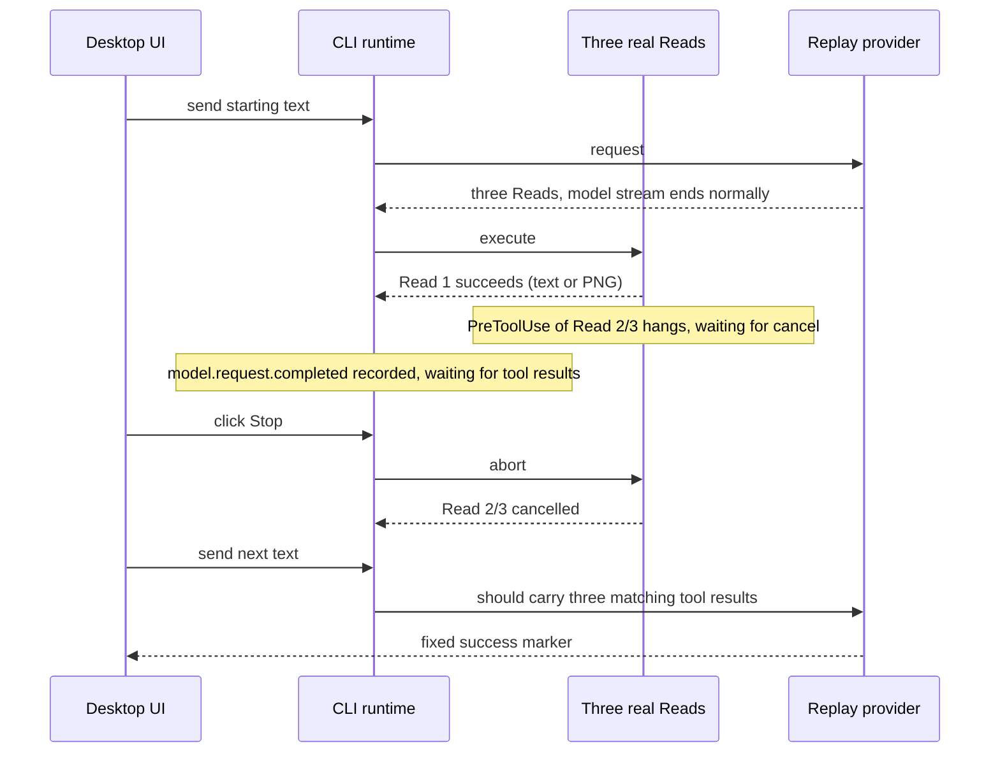
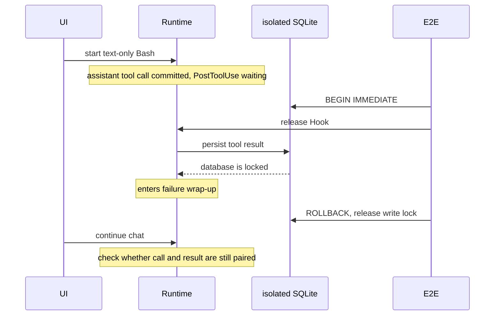
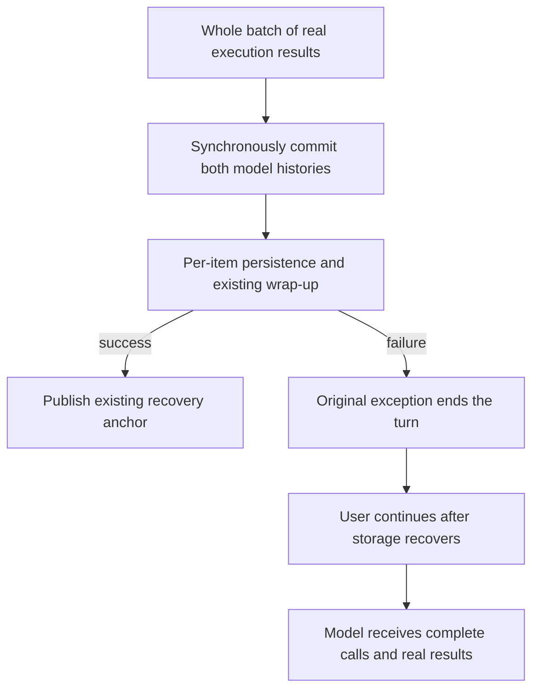

# Missing tool results Desktop E2E: Stop and storage failure

Status: fix implemented; the Desktop E2E stays in manual-review/pending awaiting human review.

Goal: once a whole batch of real tool results has been obtained, a Stop or a storage failure must not corrupt the model history of the next turn in the current process. The source of database locks and cross-process backfill are out of scope.

Feedback `ZCT-2102451151499956224` confirmed one successful Read, two cancelled, and then three missing results, but the logs did not keep the read content. The experiment runs a causal control on the image-persistence hypothesis and does not treat image input as a known fact of that feedback.



- The two groups use the same three Read declaration order, Hook, Stop barrier and follow-up request; only the first file type differs.
- The synthetic provider decides only legal tool calls and the success reply. Results come from real file tools and cancellation from the UI Stop.
- The Hook lives in the isolated E2E HOME user config and only hangs this case's `blocked-*.txt` PreToolUse. The test reads runtime logs to confirm the first tool succeeded, the model finished and two items are still unsettled, then operates Stop; no fixed delay decides the trigger point.
- The correct-behavior assertion keeps green semantics: the next real network request contains the unique paired results, cancelled results are marked failed, and the reply completes. If SDK local validation fails, the test keeps log/request/UI evidence and errors; missing results are never treated as the expected success.
- Real-device scope is local Desktop continuous. Mobile replayable, remote workspace and real Windows are not covered. The Hook uses Node process argument arrays and isolated workspace paths to avoid POSIX-only blocking tricks.

Run:

```sh
ZCODE_E2E_MANUAL_REVIEW=1 ZCODE_E2E_DEEPSEEK_CONTEXT_WINDOW=128000 \
pnpm --filter @zcode/desktop test:e2e -- --spec \
'./test/e2e/conversation-session/manual-review/pending/conversation-session-stop-tool-results.test.ts'
```

## Non-media path: SQLite write failure

3.14.3 feedback `ZCT-2102596858952212480` describes `database locked` first and then the model becoming unusable with MissingToolResults. It has no log attachment, so it is only an independent candidate cause and cannot be attributed to the three-Read feedback.

A third group reads no image and clicks no Stop; it runs a real Bash that returns short text. A PostToolUse Hook in the isolated user config builds a barrier after tool execution. The test confirms the model finished, then holds a `BEGIN IMMEDIATE` write lock on the isolated CLI database and releases the Hook. When the runtime enters failure wrap-up the lock is released immediately, then the UI continues the chat.



The lock only creates a real storage fault; it never edits session rows, model history, tool results or the SDK. Lock and Hook are cleaned in `finally`. Acceptance still requires that after storage recovers the next turn sends normally with complete results; MissingToolResults is red, with logs and provider capture kept. This experiment verifies a candidate mechanism and does not replace the original feedback's field evidence.

## Pre-fix reproduction

2026-09-24 Desktop run `desktop-e2e-20260924064058170-p71167-286d64339dbaed74`: text Stop control passed; the image Stop group failed on the next turn with `AI_MissingToolResultsError`, missing all three Read results. That only reproduces the known image problem and does not prove `ZCT-2102451151499956224` read an image.

Full supplementary run `desktop-e2e-20260924070659985-p94983-c3e14a5ec032c9c8` (macOS local Electron): of 4 groups, 2 passed and 2 reproduced the failure. It reused the same production code of the earlier formal build with `ZCODE_E2E_SKIP_BUILD=1 ZCODE_E2E_SKIP_AGENT_BUILD=1`; the Electron test itself was not skipped.

| Input / fault                                 | Result                                                  | Next actual network request      |
| --------------------------------------------- | ------------------------------------------------------- | -------------------------------- |
| three text Reads + Stop                       | pass                                                    | 3 calls and 3 unique results     |
| first Read PNG + Stop                         | fail: MissingToolResults, 3 results missing             | none; SDK rejects before HTTP    |
| text-only Bash, no lock, no Stop              | pass                                                    | Bash result paired, normal reply |
| same Bash, lock held at result write, no Stop | fail: first database is locked, then MissingToolResults | none; SDK rejects before HTTP    |

Database group timeline (UTC):

- `07:07:26.362` test took the isolated database write lock.
- `07:07:31.488` `tool.call.completed`: Bash finished and produced short text.
- `07:07:41.626` `turn.failed`, cause=`database is locked` / `ERR_SQLITE_ERROR`.
- `07:07:41.669` test released the write lock.
- `07:07:42.202` continued chat `turn.failed`, cause=`AI_MissingToolResultsError`, missing `toolu_stop_results_db_bash`.

Session: `sess_40468255-d05f-41ca-9550-deea4b93688f`. The failing request tail saved in `database-locked-model-io.jsonl` is `user -> assistant(tool-call Bash) -> user` with indeed no matching tool-result. The capture holds only the legal first-turn tool declaration and injected no missing-result error; all three requests of the unlocked control hit the tool / first-turn-complete / continuation fixtures.

Evidence directory: `packages/desktop/.e2e-artifacts/desktop-e2e-20260924070659985-p94983-c3e14a5ec032c9c8/`. `summary.md` is the formal run report; `conversation-session-stop-tool-results/` holds per-group logs, requests, screenshots and model-io.

## Root-cause boundary

Non-media mechanism confirmed before the fix: `turn-model-step.ts` first commits the assistant call via `commitAssistantToTurnRequest`; the old `turn-tools.ts` handled results by `persistPart` first and `commitTurnRequestEntries` (adding results) afterwards. When `sessionStore.savePart` in `message-persistence.ts` threw a SQLite write error, the turn ended but the committed call stayed in in-memory history. Restoring storage does not backfill that result, so the next turn failed in SDK request conversion. This code order in the affected version `ab4d5e6b`'s `turn-tools.ts` matches the pre-fix baseline.

This shares a gap with image cancellation: the call is committed first, an async persistence step that can throw remains before the result commit, and failure wrap-up does not guarantee call/result closure. Image write failing on abort and plain-text tool result failing on SQLite are two reproduced triggers; not all MissingToolResults can be attributed to images.

- `ZCT-2102596858952212480` (3.14.3/Linux): user description "database locked first, then the model unusable", no log attachment. The experiment verifies a mechanism consistent with the description but cannot prove the field cause is this SQLite contention.
- `ZCT-2102451151499956224` (3.14.3/Windows): confirms only an explicit Stop, one of three Reads succeeded and two cancelled, and four consecutive missing-result errors; no Read parameters, returned content or model-io. Whether it was an image is unknown, and this database fault cannot be attributed to it.
- `ZCT-2102757550488236032` (3.14.3/Windows): logs show Read succeeded, Bash cancelled, then a missing Read result; without the Read content it still cannot separate media persistence from other wrap-up failures.

## Fix and boundary

`tool-result-settlement.ts` receives the real results already collected by the execution layer in declaration order and writes them into the canonical history and the turn request history together in one synchronous `commitTurnRequestEntries`; only then does it run nested usage, media, ToolPart, checkpoint, recovery anchor and follow-up input handling. Per-item history commits are removed; no result cache, backfill queue or state source is added. `turn-tools.ts` keeps scheduling and execution.



- Media saving for completed results no longer takes the turn AbortSignal; unfinished tools still respond to Stop, and the model is not auto-resumed.
- Real write errors keep throwing and are not converted to tool-execution failures. Failed and unsaved items publish no committed/anchor; results already saved are not rolled back. Checkpoint cancellation is still thrown late so siblings can finish wrap-up.
- After process exit, unsaved raw results may still be lost; cold recovery keeps pending/running -> interrupted result.
- No change to database locking, wait times, retry policy, storage schema or protocol; the event delivery boundary of Desktop continuous and mobile replayable is unchanged.

## Post-fix acceptance (2026-09-24)

Based on the working-tree diff on `0e40230d34`. Formal macOS Electron run `desktop-e2e-20260924081102510-p55865-08e6cb00c4a7ad50`: **4/4 pass**. The production build comes from the same-workspace run `desktop-e2e-20260924080555672-p50144-04be77cd4f3ebe33`; the final run reuses it with `ZCODE_E2E_SKIP_BUILD=1 ZCODE_E2E_SKIP_AGENT_BUILD=1`, and only test config and assertions changed in between, not production code. Root typecheck and Electron build/run ran in sequence.

The first post-fix run passed 3/4: the image continuation succeeded but the new image wire assertion failed, because the replay model is text-only by default and, per the existing model-capability rule, downgrades images to a hint. The final version only declares image input capability for this spec's replay model to accept real provider image content directly; production model capability is untouched and the image assertion is not loosened.

| Scenario               | Final provider input and execution facts                                                                                                               |
| ---------------------- | ------------------------------------------------------------------------------------------------------------------------------------------------------ |
| text Read + Stop       | 3 calls and 3 unique results, first real text, the other two cancelled; no automatic model resume after Stop                                           |
| image Read + Stop      | 3 unique call/result pairs; first `is_error=false` with a 67-byte `image/png`, the other two `is_error=true`                                           |
| Bash without lock      | Initial turn and continuation succeed, original `E2E_STOP_RESULTS_DB_OUTPUT`, executed once                                                            |
| real SQLite write lock | First turn keeps `database is locked`; after releasing the lock the continuation succeeds, original Bash output and success marker kept, executed once |

Image session: `sess_7c4a78f6-0613-49c1-858c-afca02ac3e4b`; network image SHA-256: `f19fe636a57e6c5076413efab51d1c36e87686c79f461b7ad8913fe7de4c964e`. Database group session: `sess_02fe91d4-b4a8-4834-9e8b-60ed497f4d2f`; UTC `08:11:24.543` lock acquired, `08:11:39.741` the original database exception caused `turn.failed`, `08:11:39.750` lock released; the group has only two main requests (tool declaration and user continuation) and one Bash `tool.call.started`. None of the four groups shows MissingToolResults.

Four new Core regressions failed on the old implementation and pass after the fix; the affected **12 files, 278 tests pass**:

- Second item's ToolPart save fails in a three-result batch: continuing in the current process still gets all real results once each; only the first item keeps committed/anchor.
- Media save and nested-usage event failure: the original exception is kept and the current turn does not resume the model; after recovery results are complete, tools are not rerun and no persistence anchor is re-emitted.
- Image Stop cold recovery: successful media content and two cancelled results recover completely; save-failure cold recovery: the saved first item keeps its original output, the two unsaved items stay interrupted.
- Existing streaming part identity, multimodal, provider request, output-token continuation, checkpoint cancellation and goal reminder order regressions pass.

A later upstream/downstream review reran 6 Core suites, 99 tests all passing (runtime persistence, command queue, guide model selection / refresh, browser screenshot, stream recovery). Together with the 12 suites above: 18 suites, 377 tests; logs in `verification/boundary-audit.log` and `verification/stream-audit.log`. The architecture check currently covers only managed modules and CLI is not in scope; the CLI-internal boundary was confirmed by call-chain review and regression tests.

Other checks: root typecheck, CLI typecheck, root lint (61 warnings / 0 errors), independent lint of changed Core sources and new tests, architecture check, Desktop E2E typecheck and this case's fixture check all pass. CLI full lint fails with 85 `max-lines` errors; each reported file was confirmed identical to HEAD, and the two modules split in this wrap-up are 289 / 283 lines. The repo-wide conversation coverage audit is still blocked by two existing `conversation-session-highspeed-card` manifest / fixture `syntheticReason` mismatches; those files are unmodified.

Evidence directory: `packages/desktop/.e2e-artifacts/desktop-e2e-20260924081102510-p55865-08e6cb00c4a7ad50/`. `summary.md` is the formal run report; `conversation-session-stop-tool-results/` holds per-group runtime logs, real requests, screenshots and model-io; `verification/` holds Core red/green regressions, typecheck/lint/architecture/fixture check records and the lint baseline comparison.

Not verified: mobile replayable on device, remote workspace, Windows / Linux on device, and the original feedback's full field conditions. A pass only shows the two reproduced paths are fixed and does not turn the unknown trigger of the original 3.14.3 feedback into a confirmed attribution. The E2E is not auto-promoted; commit and push follow user authorization separately. No storage migration; the Core change can be reverted.
