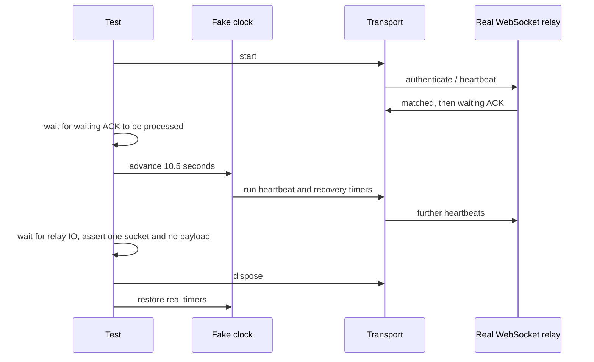

# Unit-test runtime optimization

## Scope and invariants

Reduce test setup and wall-clock waits without changing product behavior or
excluding regression scenarios from the normal test entry points.

- Consolidate the five App / WorkspaceShellLayout source-contract files into
  two suites. Preserve every test title, assertion, and existing skip; read each
  immutable source fixture once per suite using asynchronous IO.
- Keep the real WebSocket relay in the desktop waiting-window regression. Drive
  its timers virtually, retain the 10.5-second observation window, and verify
  continued heartbeats, one connection, and blocked business payloads. Restore
  timers and dispose the transport even when assertions fail.
- Wait for SQLite handle release only on Windows in the six task-index/grouped
  view cleanup hooks. Keep per-test database creation, close, and cleanup.
- Register the real mocked IPC resolve listener in the permission picker's
  update-devices test. Verify cancellation settles the picker as `null`; preserve
  request identity, device updates, and the post-settlement no-op assertions.
- In the rejected-renderer guest test, explicitly target the rejected tab in
  `getState`. Assert the `not-webview` attach rejection and unavailable tab without
  implicitly creating a legacy tab and waiting for its attach acknowledgement.
- Read the M2 boundary suite's production/test source fixtures once per suite.
  Preserve every root, extension filter, pattern, expected owner set, test title,
  and sorted POSIX path comparison; no assertion is removed.
- Do not disable test isolation, weaken assertions, or move tests out of the
  default collection to produce a shorter runtime.

The test clock owns timer progression; the existing transport still owns
connection and recovery state. WebSocket delivery stays on real IO:

## Verification

Compare the affected suites before and after with the same runner configuration.
Retain their passing test names and skip state; report measured duration rather
than treating fewer test files as evidence of faster execution. Run the complete
root unit suite, root Node tests, typecheck, lint, and architecture checks, and
report environmental or pre-existing failures separately.

The transport regression must also reject the historical premature-recovery
timer (1.5 seconds). Use a temporary local mutation to verify that assertion,
then restore product source before final verification.

## Measured results (2026-10-10)

Same root Vitest configuration, Node 24.16.0, pnpm 10.33.2, macOS. These timings
refer to the affected suites, not the complete repository or CLI/E2E runs.

| Metric                    | Before   | After         |
| ------------------------- | -------- | ------------- |
| Affected-suite wall time  | 21.00 s  | 6.46 s        |
| Test files                | 12       | 9             |
| Passing tests             | 129      | 129           |
| Existing skipped tests    | 1        | 1             |
| Waiting-window regression | 10.758 s | about 0.160 s |

The affected suites are about 69% faster. Comparing JSON reports confirms every
test's full name and pass/skip status is identical. Returning the recovery timer
to its historical 1.5-second value makes the waiting-window regression fail
because the second heartbeat never arrives; product source was then restored
byte-for-byte.

The three additional suites (`embeddedBrowserPermissionUiBridge`,
`browserGuestManager`, and `m2-completion-boundary`) went from 20.76 s to 4.62 s
in a separate combined run, with the same 190 passing test names and statuses.
M2's suite time went from 9.830 s to 0.370 s. The picker and guest fixtures keep
all existing assertions and add direct assertions for listener registration and
the rejected attachment result.

The complete root unit run after the first optimization stage took 328.12 s;
after the three additional fixture/snapshot changes it took 296.60 s (about 9.6%
faster). Both runs passed 18,130 tests with 10 existing skips across 1,926 files.
The complete reports have identical test names and pass/skip statuses. These are
single-machine observations, not a guarantee of the same gain on other runners.

Root Node tests: 123 passed. Root typecheck and architecture checks passed; lint
reported 0 errors and 62 warnings. During PR preparation, the three modified files
with existing formatting defects (`zcodeGroupedTaskViewOrder`,
`browserGuestManager`, and `embeddedBrowserPermissionUiBridge`) were formatted
with the repository formatter.

The first complete baseline run had missing Electron and local package build
artifacts. It cannot serve as a coverage-equivalent whole-suite timing comparison.
Windows/Linux execution and CLI/E2E runtime were not measured. Windows keeps the
original cleanup delay; no default test exclusions or runner isolation changed.
