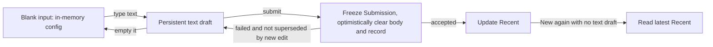
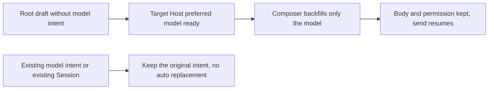

# Composer persists text drafts only

> Current implementation (2026-10-16): new drafts and Recent belong to a project/uncategorized task, and an unsent task reuses its execution directory; see [unified lifecycle](project-task-draft-lifecycle.md). The 2026-10-14 workspace Root/Recent and mobile-deferral clauses below record the original implementation; current behavior follows the new spec and its verification records. The formal Session restore and non-empty-text rules still apply.

Full history (verification diaries and implementation order): `git show b8876e8b:docs/ui/composer-text-draft-persistence.md`.

## Rules and scope

2026-10-14: the user confirmed "no typed text means no draft, no persistence". This replaces the Todo71 rule that kept configuration for an empty body. The body is judged by `text.trim().length > 0`; typing, pasting and template prefill are equivalent; spaces, newlines, an empty editor JSON, and changing only model/permission do not form a persistable draft. The only exception is the explicit model selection of an existing Session, see "Explicit model selection of an existing Session" below. The display text of reference chips follows the editor's existing text serialization; no attachment serialization is added.

With text, the body, editor state, permission, Plan and the full ModelSelection are saved; emptying the text deletes the record. Sending keeps the existing optimistic clear: freeze the Submission first, then clear the body and the record; on failure, restore unless superseded by later edits; on accept, update Recent. Reading an old empty draft only filters it, and an explicit write cleans it, so old config does not keep blocking defaults.

The current composer's config is held solely by the in-memory state of `useDraftConfigControl`; it does not fall back on an ordinary render, directory refresh or Snapshot arrival just because nothing is written to disk. Re-entering the blank new-task page uses the current workspace's Recent; an existing Session always restores permission and Plan from the current Snapshot, and with a text draft only the body and model are restored from it. An explicit New Task opens a new blank editing lifecycle even if it reuses the current pane; a text draft is still restored.

## Model backfill once the first Provider is ready

2026-10-16: a new Root draft may have initialized permission and typed a body under an empty Provider config. If it has no original `modelSelection` intent, the existing Composer owner automatically backfills the full model once the target Host's first legal `preferredSelection` arrives. The backfill writes only the model, keeps the body, editor state, permission and Plan, does not update Recent, sends no model request and starts no second Agent. No synchronization timer and no second copy of state is added.

An existing selection (including an invalid model or invalid reasoning) is not backfilled; an existing Session and share import do not apply this Root rule. Later catalog changes must not overwrite a backfilled or user-explicit model. It is still isolated by workspace identity; desktop and mobile use the same Hook and the continuous/replayable transport boundary is unchanged.

Verification: the I23/I24 desktop E2E cover an empty config, history read, saving the first Provider, original text kept, send resumed and a single Agent; Hook unit tests cover local/remote identity, permission/Plan retention, selected/invalid selection and exclusion of an existing Session.

## Explicit model selection of an existing Session (ISSUE-035, 2026-10-22)

2026-10-22 (user ruling, option b): only for an **existing Session**, reverse "changing only the model is not a persistable draft" above. A new Root draft still follows the rule above: an empty body with only a model change is not written to disk.

- After the user explicitly picks a model in an existing Session's input (menu or shortcut), a record is saved even with an empty body, containing the full `modelSelection` plus `modelSelectionPicked: true`. This flag is the only reason an empty-body record is kept.
- A model inherited from the Snapshot, changing only permission/Plan, and a model initialized from Recent or defaults carry no flag and are not written when the body is empty.
- Switching away from the task or refreshing and returning to that Session restores the chosen model; permission and Plan still follow the current Snapshot.
- Once the Host accepts a flagged model intent the flag is cleared; if the body is also empty the record is deleted, and the model then follows the Session's latest Snapshot. On send failure or non-acceptance, the flag and the record are kept.
- Writes go only through `persistV4ComposerDraft`, and the in-memory config is still held solely by `useDraftConfigControl`. The retention rule is the same on read and write sides: an old empty record without the flag is still filtered.
- **Priority versus ISSUE-026**: when the chosen model currently cannot be resolved (the Registry cannot resolve the selection), the expiry rules below do not apply. The user's intent is kept: the flag and model stay unchanged, no other model is substituted, and send stays blocked for the model reason. Only a resolvable stale selection has its flag removed (decision 1 of `specs/composer-unresolved-model-selection.md`).
- Storage keeps isolation by `workspaceIdentity?.trim() || workspacePath` plus the Session id; different workspaces or remote identities do not share records.
- Recent is not updated by picking a model and is still updated only on accepted. "Picking adopts it as Recent" is not implemented in this round.
- **Baseline model (C-1)**: the record also stores the model of the Session snapshot at pick time (`modelSelectionPickedFrom`). If the Session's provider and model later leave this baseline (another window, a Host fallback or a CLI change), the selection is stale: the flag is deleted and the draft model is changed to the Session's current model. The body is kept (whether or not there is one).
- **The baseline comparison looks only at provider and model (MF1)**: the reasoning level is not compared. A snapshot omitting the level, or another window changing only the level, does not make the selection stale.
- **With no baseline (MF3)**: if the pick happened before the first snapshot arrived (or an old record has no baseline field), the first arriving snapshot becomes the baseline and expires by the previous rule afterwards. If that snapshot's model equals the pick, it is a no-op selection and the flag is cleared too.
- **Known limitation for old records**: an old flag without `modelSelectionPickedFrom` takes the first arriving snapshot as baseline after reopening. A Session model change while the app was closed is therefore not detected: the selection is kept as an intent for the Session's current model and does not expire. New records written after the snapshot has arrived carry a baseline and are not subject to this limit.
- **Not expiring when unresolvable (MF2)**: see "Priority versus ISSUE-026" above.
- **Selection equal to the Session's (C-4, MF1)**: a selection with the same provider and model as the Session's current model writes no flag; if there was one, it is cleared. A selection of the same model with a different level also falls here.
- **Changing only the thinking level (C-4)**: a thinking-level change is not a model selection, writes no flag, and with no body is not persisted, consistent with the above.
- **Delete or archive (C-2)**: the Session's draft record is not cleaned. The UI has no unified session delete/archive draft hook (permanent delete covers only the archive management page). A session is recoverable after archiving, so the record is kept; a record after permanent deletion is an orphan, at most one small record per Session.

| ID   | Setup and action                                                                             | Must observe                                                                                               |
| ---- | -------------------------------------------------------------------------------------------- | ---------------------------------------------------------------------------------------------------------- |
| MP01 | Existing Session with empty body, pick model B; switch to another task and return            | Model is still B; body empty; record exists with the flag                                                  |
| MP02 | Same as MP01, refresh the window and reopen the Session                                      | Model restored to B                                                                                        |
| MP03 | Existing Session with empty body, change only permission or Plan                             | Nothing written; no record                                                                                 |
| MP04 | Existing Session inheriting the Snapshot model, empty body, switch away and back             | Nothing written; model follows the Snapshot                                                                |
| MP05 | Pick B, send and be accepted, body empty                                                     | Flag cleared, record deleted; the model follows the Snapshot afterwards                                    |
| MP06 | Pick B, send fails                                                                           | Flag and record kept; model still B                                                                        |
| MP07 | New Root blank page, pick only a model                                                       | Nothing written (rule above unchanged)                                                                     |
| MP08 | The chosen model becomes invalid in the Registry                                             | Intent kept, no auto replacement (ISSUE-026 unchanged)                                                     |
| MP09 | Same path, different workspaceIdentity, same Session id                                      | Records are invisible to each other                                                                        |
| MP10 | After picking B (baseline A), the Session model is changed externally to C                   | Flag deleted; draft model is C; body kept; record deleted (if body empty)                                  |
| MP11 | Pick B and then pick A (the Session's current model) again                                   | Flag and record cleared; draft model is A                                                                  |
| MP12 | Pick B and then change only the thinking level (no body)                                     | Nothing written; no record                                                                                 |
| MP13 | After picking B, the Session snapshot omits or changes the level while the model stays A     | Flag kept; draft still B                                                                                   |
| MP14 | Pick B (unresolvable in the Registry), then the Session moves to a resolvable C              | Flag and model B kept; send stays blocked for the model reason                                             |
| MP15 | The pick happens before the first snapshot, then moves away after the first snapshot arrives | The first snapshot becomes the baseline; after moving away it expires and the draft model is the new model |

## Ownership of editor content on scope switch (ISSUE-060, 2026-10-23)

When one pane switches from an existing Session to a new draft (or switches project or session), the same Composer and Lexical editor instance are reused.

- **Invariant**: until the new scope's draft restore actually lands in the editor, the editor content still belongs to the old scope. No write path (Lexical onChange, the 350 ms debounce, `blur`/`pagehide` flush, unmount flush, the new-draft reader) may write it into the new scope.
- **Defect (confirmed)**: the scope effect first switches `draftScopeRef` and the owner callbacks to the new scope, then schedules the editor's clear/restore for the next frame (`requestAnimationFrame`). In that gap the editor still shows the old Session's body, and a window `blur` or further user input then writes the old body (or "old body + new input") into the new draft.
- **Field trigger (hypothesis, to be re-verified)**: the main window keeps Electron's default `backgroundThrottling` (`desktopWindowChrome.ts`), so when the window is occluded or in the background the next frame can be delayed by seconds, which is why QA could still read the old body after 2.5 s.
- **Rule**: on a scope switch with an existing editor, restore the new scope's draft synchronously in the same effect without waiting for the next frame. Only when the editor is not ready (first mount or the editor is remounting) is it deferred to the next frame; until the deferred restore lands, the write paths above are all skipped and write no empty value (writing empty would delete the draft the new scope already saved).
- The write barrier is raised in the commit phase (layout effect), earlier than the scope effect; a send during the barrier is ignored and the old body in the editor is not sent. If the workspace switches again during the barrier and the draft is transferred, what transfers is the pending-restore scope's own draft, not the editor content.
- No timer is used to mask this; the old scope's draft is covered by the immediate write on body change, and the scope switch itself writes nothing extra to the old scope.

| ID    | Setup and action                                                                                       | Must observe                                                                            |
| ----- | ------------------------------------------------------------------------------------------------------ | --------------------------------------------------------------------------------------- |
| DL01  | Session A draft "qa draft A"; the same pane switches to a new draft, window blur before the next frame | New draft has no record; editor empty; A is still "qa draft A"                          |
| DL02  | Same as DL01, type "qa draft new" before the next frame                                                | New draft is "qa draft new" without "qa draft A"; A unchanged                           |
| DL03  | Editor not ready at scope switch, window blur before it is ready, then the editor becomes ready        | No write to the new draft; after ready it shows the new scope's draft, not "qa draft A" |
| DL03b | Same as DL03, but the editor becomes ready without the Composer re-rendering                           | The new scope's draft is restored on the next frame; later input writes normally        |
| DL04  | Trigger send while the editor is not ready                                                             | Not sent; A unchanged                                                                   |
| DL05  | The new draft is transferred to another workspace while a restore is pending                           | The target workspace gets "qa draft new", not "qa draft A"                              |

## State ownership and impact

| Scenario / entry                       | Sole owner / commit path                                 | Persistence and initialization                                                                                                    | Impact level   |
| -------------------------------------- | -------------------------------------------------------- | --------------------------------------------------------------------------------------------------------------------------------- | -------------- |
| New / current Session input            | useDraftConfigControl -> Submission -> CLI admission     | composerDraftStore saves text only; Recent updates only on accepted                                                               | must-inspect   |
| New Task / project and group menu      | workspace UI store `draftProjectId` / `draftTaskGroupId` | The current creation intent stays in memory; with text it is saved with the draft, and mobile cold restore reads only text drafts | must-inspect   |
| First share import                     | navigation params -> Composer owner                      | One-time initial config in memory only; no fake disk draft and no Recent change                                                   | must-inspect   |
| Offline page and refresh               | read-only result of composerDraftStore                   | Restores only text drafts, adds no offline queue                                                                                  | should-inspect |
| Automation, sub-agents, accepted queue | original record / CLI owner                              | Does not consume the Composer draft or change the frozen Submission                                                               | invariant-only |

The shared behavior is draft read/write and effective model resolution; a new draft reads Recent, an existing Session reads its own Snapshot, and the two are not unified into a global config. Permission/Plan restore follows the current Session Snapshot; historical grants are used only to recognize new changes during this open period and are not stored in the draft. Workspace isolation always uses `workspaceIdentity?.trim() || workspacePath`; desktop continuous and mobile replayable transport, shared-host, owner/lease and queue protocol are unchanged. No new Host/Agent state or synchronization timer is added.

Recent's scope is unchanged: a new draft in the same project/workspace inherits the most recent accepted config; a currently global uncategorized new draft is allocated a new working directory and does not copy another workspace's Recent. Desktop regressions create from the same project entry explicitly so a workspace switch is not mistaken for an empty-draft restore.

## Cases and pruning

| ID   | Setup and action                                                                                                   | Assertion                                                                                                                                               | Layer / status                                  |
| ---- | ------------------------------------------------------------------------------------------------------------------ | ------------------------------------------------------------------------------------------------------------------------------------------------------- | ----------------------------------------------- |
| TD01 | Fresh input, pick only yolo + A, then switch away/refresh                                                          | The in-memory current selection works; localStorage has no draft, and reopening initializes from the default source                                     | storage + Hook / accepted                       |
| TD02 | First send yolo + A; open a blank page once; return to the original Session, change build + B and submit; then New | Recent is build + B; the new page has the same value and no blank persistent record; real buttons and model switch                                      | Desktop E2E / accepted pending                  |
| TD03 | Type text and change permission and model, switch Session and return/refresh                                       | Text and model restored; an existing Session's permission/Plan use the current snapshot; Recent unchanged                                               | Hook + Desktop E2E / accepted pending           |
| TD04 | Empty the text or leave only spaces and New again                                                                  | The old persistent record is deleted, the new page uses the latest Recent; a repeated New Task in the same pane keeps no empty config                   | storage + Hook + Desktop E2E / accepted pending |
| TD05 | Send succeeds, fails, or a late ACK arrives after the user typed the next one                                      | Success clears only the original submit; failure keeps body and config; the old ACK does not overwrite the new scope/new text                           | existing submission tests + Hook / accepted     |
| TD06 | Existing empty records and text records of a different remote with the same path                                   | Only empty records are cleared; remote identity is isolated; a text record with a broken model is kept for correction                                   | storage / accepted                              |
| TD07 | Pick a project/group before typing, then type and send first                                                       | An empty page writes nothing, the first send still goes to the chosen project/group; a text draft can cold-restore                                      | store + navigation tests / accepted             |
| TD08 | First share import, delayed View, existing Session reused                                                          | Navigation initialization writes no empty draft, import still follows new-draft initialization; user re-selection takes priority, reused does not reset | Hook / accepted                                 |

Pure style, theme and i18n are unchanged and reuse shared controls, so no full appearance cross product is enumerated. Two legal models of the same provider are the model representative; yolo/build are the permission representative. Queue admission and execution config stay frozen; only the send-draft boundary is verified and queue features are not extended. Attachments currently have no cross-restart draft persistence and none is added.

## Scan evidence and open verification

The codegraph tool was unavailable; exact caller search traced storage -> Hook -> SessionPane/Root and one hop of the project menu and share entry, and no codegraph scan is claimed. The existing conversation-model-control in the feature graph lacked the text-only persistence and new-draft lifecycle relations, so semantic nodes were added. There is no product boundary awaiting a user ruling; not persisting blanks was confirmed.

Verification summary (2026-10-14 baseline `7d60f53393`, re-verified on `f67f7570ba`): the TD01/02/04/06 storage and Hook regressions failed first and passed after the change; `pnpm test:unit:affected` passed in full; `pnpm typecheck`, `pnpm lint` (0 errors, 210 existing warnings) and `pnpm architecture:check --changed` pass. Linux Electron runs `desktop-e2e-20261014-093656-755` and `desktop-e2e-20261014-120739-442` pass TD01/03/04 (blank not saved, text restored on refresh, default taken after emptying and New Task).

**Open**: the full I74/I75 + TD02 send-chain E2E did not pass: the first input reports "the draft session has switched, please send again" before reaching the A -> B switch assertion. Restoring all modified product sources to the baseline and rebuilding reproduces the same first-send error (run `desktop-e2e-20261014-093347-523`), and the Agent log also records `loadPersistedEvents / Session not found` for the pre-warmed session. It is not changed here (pre-warm/Host/CLI lifecycle), the Hook regression of TD02 cannot replace this E2E, and the full send flow needs a rerun after the baseline pre-warm issue is fixed. Mobile has only shared-logic and navigation unit tests; no real-device mobile, macOS or Windows GUI verification. The E2E stays in manual-review/pending and is not auto-promoted to formal/CI.

MR integration: after syncing the latest staging remote directory confirmation flow, the ordinary project entry and the remote directory confirmation uniformly read `draftTaskGroupId` from the workspace UI store through `createProjectTask`. Choosing a group in the blank input must also travel with the remote directory confirmation; an existing task still does not inherit the new-draft group.

## Simplified rules after review (2026-10-14)

The user confirmed: when the text draft of an existing Session is reopened, the body and model selection are restored, while permission and Plan use that Session's latest Snapshot. Menu selections during the current open period still belong to the Composer; an ordinary snapshot cannot overwrite them, and a real new authorization/Plan tool change updates the matching field from the latest Snapshot. The first matching snapshot only establishes the current state and the observation baseline and does not replay historical grants. A Snapshot being temporarily absent does not reset the observation baseline; only a scope switch/unmount ends it.

The persistent draft's `lastPermissionGrantId`, `lastPlanTransitionId` and `initializeFromNewTask` are removed; old fields are ignored on read. A new Root's text draft still restores its full selection (no real Session yet). The first import is delivered explicitly by the navigation owner as new-draft initialization config; an existing Session/reused does not go through import initialization. Binding the first send to a real Session is a migration within the same Composer editing cycle and keeps new input made during sending; the Session restore rule applies only when reopening after leaving.

The first send no longer uses a global seed Map: the current pane allows only an accepted result with the same workspaceKey and the same draft generation to migrate; New Task, page switch and unmount invalidate old callbacks. Share-import initialization attaches to the existing workspace navigation action, is cleared on receipt and discarded on task switch/New; it is not saved as an empty draft. The submit config is still frozen at send time and does not change with later edits.

Reading drafts only parses/filters and does not write localStorage; old empty records are cleaned on explicit writes. No text means nothing is saved; New uses the workspace Recent, and Recent updates only on accepted.

This round explicitly does not modify mobile project/navigation restore; the shared Composer logic still serves both desktop continuous and mobile replayable and does not change Host, CLI, queue or transport recovery semantics. Plan: [state simplification plan](../plans/composer-state-simplification.md).

New regressions CS01-08, CS10: historical grants/Plan are not replayed; a text draft restores the latest permission and Plan; a live new change updates only the matching field; a repeated/late projection does not overwrite edits; the first-send migration keeps new input and old callbacks do not clear the new page; import initialization is consumed/invalidated with navigation; render reads write nothing. CS09 mobile project restore is explicitly excluded by the user.

Verification: the new regressions failed on the old implementation first; final affected unit tests 305 files / 3,956 cases pass; Hook/storage targeted 50 cases pass. The browser `share-import-selection.test.mjs` passes 14 groups (10 import, 4 Session restore; 390/1200px, Chinese light/English dark) using the real Hook and toolbar with a controlled Snapshot, covering switch back/refresh, history not replayed, live grants/Plan and repeated projections. That browser fixture does not represent the real CLI or mobile remote chain.
