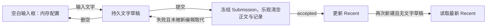
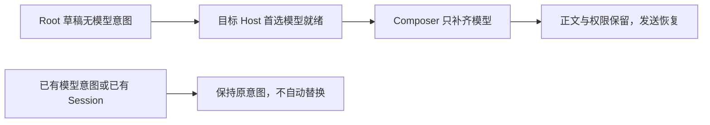

# Composer 仅持久化文字草稿

> 2026-10-16 当前实现：新建草稿与 Recent 按项目/未归类任务归属，未发送任务复用执行目录；详见 [统一生命周期](project-task-draft-lifecycle.md)。下文 2026-10-14 的 workspace Root/Recent 与手机暂缓条款记录原实现，当前行为以新规格及其验证记录为准；正式 Session 恢复与非空文字规则继续适用。

## 规则与范围

2026-10-14：用户确认“没有输入文字就不算草稿，不做持久化”。本文替代 Todo71 中空正文保留配置的规则。
正文以 `text.trim().length > 0` 判定；键入、粘贴和模板预填等价，空格、换行、空 editor JSON、仅改模型/权限不构成可持久化草稿。唯一例外是已有 Session 的显式模型选择，见下文“已有 Session 的显式模型选择”。引用 chip 的显示正文沿用编辑器现有文本序列化，不新增附件序列化。

有文字时保存正文、编辑器状态、权限、Plan、完整 ModelSelection；删空时删除记录。发送沿用既有乐观清空：先冻结 Submission，再清空正文和记录；失败且未被后续编辑取代时恢复，接纳后更新 Recent。读取旧版本空草稿时只过滤，显式写入时清理，不让旧配置继续阻挡默认值。
当前输入框的配置仍由 `useDraftConfigControl` 的内存态唯一持有；不因不写盘而在普通 render、目录刷新或 Snapshot 到达时回退。重新进入空白新建页使用当前 workspace Recent，已有 Session 始终从当前 Snapshot 恢复权限与 Plan，有文字草稿时只恢复其中的正文与模型。显式 New Task 即使复用当前 pane，也开启新的空白编辑生命周期；有文字的草稿继续恢复。

## 首个 Provider 就绪后的模型补选

2026-10-16：新建 Root 草稿在空 Provider 配置下可能已初始化权限并输入正文。若它没有任何
`modelSelection` 原意图，目标 Host 的首个合法 `preferredSelection` 到达后，现有 Composer
owner 自动补选该完整模型。补选只写模型，保留正文、编辑器状态、权限和 Plan；不更新 Recent，
不发送模型请求，也不启动第二个 Agent。不新增同步定时器或第二份状态。

已有选择（包括失效模型或失效 reasoning）不补选；已有 Session 和分享导入不应用此 Root
规则。后续目录变化不得覆盖已补选或用户显式选择的模型。仍按 workspace identity 隔离，
桌面与手机使用同一 Hook，不改变 continuous/replayable 的传输边界。

验证：I23/I24 桌面 E2E 覆盖空配置、历史读取、保存首个 Provider、原文保留、发送恢复和唯一
Agent；Hook 单测覆盖本地/远端 identity、权限/Plan 保留、已选/失效选择与既有 Session 排除。

## 已有 Session 的显式模型选择（ISSUE-035，2026-10-22）

2026-10-22（用户裁决选项 b）：只对**已有 Session** 反转上文“仅改模型不构成可持久化草稿”。新建 Root 草稿仍按上文规则，空正文且只改模型时不写盘。

- 用户在已有 Session 输入框里显式选模型（菜单或快捷键）后，即使正文为空也保存一条记录，内容为完整 `modelSelection` 加 `modelSelectionPicked: true`。该标记是唯一让空正文记录保留的依据。
- Snapshot 继承的模型、只改权限/Plan、以及从 Recent 或默认值初始化的模型都不带标记，空正文时不写盘。
- 切走任务或刷新后返回该 Session，恢复所选模型；权限与 Plan 仍以当前 Snapshot 为准。
- 带标记的模型意图被 Host 接纳后，标记清除；若此时正文也为空，记录删除，之后模型跟随 Session 最新 Snapshot。发送失败或未接纳时，标记与记录保留。
- 写入只经 `persistV4ComposerDraft`，内存配置仍由 `useDraftConfigControl` 唯一持有。保留规则在读取与写入两侧一致：没有标记的旧空记录仍被过滤。
- **与 ISSUE-026 的优先级**：所选模型当前无法解析（Registry 无法解析该选择）时，下方的过期规则不生效。这时保留用户意图：标记与模型都不变，不自动换成其他模型，发送继续被模型原因阻止。只有可解析的过期选择才会被删除标记（decision 1 of `specs/composer-unresolved-model-selection.md`）。
- 存储沿用 `workspaceIdentity?.trim() || workspacePath` 加 Session id 隔离，不同工作区或远端身份不共享记录。
- Recent 不因选模型而更新，仍只在 accepted 时更新。“选择即采纳为 Recent”本次未实现。
- **基准模型（C-1）**：记录同时保存选择时 Session 快照的模型（`modelSelectionPickedFrom`）。若之后 Session 的 provider 与 model 离开该基准（另一窗口、Host 回退或 CLI 改动），该选择已过期：删除标记，并把草稿模型改为 Session 当前模型。正文保留（无论是否有正文）。
- **基准的比较只看 provider 与 model（MF1）**：reasoning 档位不参与比较。快照省略档位、另一窗口只改档位，都不会让选择过期。
- **没有基准时（MF3）**：选择发生在第一个快照到达之前（或旧记录没有基准字段）时，第一个到达的快照成为基准，之后按上一条规则过期。若该快照的模型与选择相同，则这是无操作选择，标记一并清除。
- **旧记录的已知限制**：没有 `modelSelectionPickedFrom` 的旧标记，在重新打开后会采用第一个到达的快照作为基准。因此应用关闭期间发生的 Session 模型变化检测不到：该选择会被当作当前 Session 模型的意图保留，不会过期。在快照已到达后写入的新记录带有基准，不受此限制。
- **无法解析时不过期（MF2）**：见上文“与 ISSUE-026 的优先级”。
- **与 Session 相同的选择（C-4、MF1）**：选择与 Session 当前模型的 provider 与 model 相同即不写标记；若之前有标记，则一并清除。同一模型、不同档位的选择也属于这种情况。
- **仅改思考档位（C-4）**：思考档位变化不是模型选择，不写标记；无正文时不落盘，与上文一致。
- **删除或归档（C-2）**：不清理该 Session 的草稿记录。UI 中没有统一的会话删除/归档草稿钩子（永久删除只覆盖归档管理页）。归档后可恢复，因此记录保留；永久删除后的记录是孤儿，每个 Session 至多一条小记录。

| ID   | 前置与操作                                            | 必须观察                                                 |
| ---- | ----------------------------------------------------- | -------------------------------------------------------- |
| MP01 | 已有 Session 正文为空，选模型 B；切到其他任务再返回   | 模型仍为 B；正文为空；记录存在且带标记                   |
| MP02 | 同 MP01，刷新窗口后重新打开该 Session                 | 模型恢复为 B                                             |
| MP03 | 已有 Session 正文为空，只切权限或 Plan                | 不写盘；无记录                                           |
| MP04 | 已有 Session 继承 Snapshot 模型，正文为空，切走再返回 | 不写盘；模型跟随 Snapshot                                |
| MP05 | 选 B，发送并被接纳，正文为空                          | 标记清除，记录删除；之后模型跟随 Snapshot                |
| MP06 | 选 B，发送失败                                        | 标记与记录保留；模型仍为 B                               |
| MP07 | 新建 Root 空白页只选模型                              | 不写盘（上文规则不变）                                   |
| MP08 | 所选模型在 Registry 中失效                            | 保留意图，不自动替换（ISSUE-026 不变）                   |
| MP09 | 同一路径、不同 workspaceIdentity，同一 Session id     | 记录互不可见                                             |
| MP10 | 选 B（基准 A）后，Session 模型被外部改为 C            | 标记删除；草稿模型为 C；正文保留；记录删除（若正文为空） |
| MP11 | 选 B 后再选回 A（Session 当前模型）                   | 标记与记录清除；草稿模型为 A                             |
| MP12 | 选 B 后只改思考档位（无正文）                         | 不写盘；无记录                                           |
| MP13 | 选 B 后，Session 快照省略或改变档位但模型仍为 A       | 标记保留；草稿仍为 B                                     |
| MP14 | 选 B（Registry 无法解析）后，Session 移到可解析的 C   | 标记与模型 B 保留；发送继续被模型原因阻止                |
| MP15 | 选择发生在第一个快照之前，第一个快照到达后再移走      | 第一个快照成为基准；移走后过期，草稿模型为新模型         |

## Scope 切换时编辑器内容的归属（ISSUE-060，2026-10-23）

同一个 pane 从已有 Session 切到新建草稿（或切项目、切会话）时，复用同一个 Composer 与 Lexical 编辑器实例。

- **不变式**：编辑器里的内容在新 scope 的草稿恢复真正落到编辑器之前，仍属于旧 scope。任何写入路径（Lexical onChange、350 ms 防抖、`blur`/`pagehide` 落盘、卸载落盘、新建草稿 reader）都不得把它写进新 scope。
- **缺陷（已确认）**：scope effect 先把 `draftScopeRef` 与 owner 回调切到新 scope，再把编辑器的清空/恢复排到下一帧（`requestAnimationFrame`）。这段间隔里编辑器继续显示旧 Session 的正文，此时窗口 `blur` 或用户继续输入，会把旧正文（或“旧正文 + 新输入”）写进新建草稿。
- **现场触发（假设，待复验）**：主窗口保留 Electron 默认的 `backgroundThrottling`（`desktopWindowChrome.ts`），窗口被遮挡或在后台时下一帧可能延迟数秒，因此 QA 才能在 2.5 s 后仍读到旧正文。
- **规则**：scope 切换且编辑器已存在时，在同一个 effect 内同步恢复新 scope 草稿，不再等下一帧。仅当编辑器尚未就绪（首次挂载或编辑器正在重挂）时才延后到下一帧；在延后恢复落地之前，上述写入路径一律跳过，不写空值（写空会删除新 scope 已保存的草稿）。
- 不用定时器掩盖；旧 scope 的草稿由正文变更时的即时写入负责，scope 切换本身不额外写旧 scope。

| ID    | 前置与操作                                                               | 必须观察                                                     |
| ----- | ------------------------------------------------------------------------ | ------------------------------------------------------------ |
| DL01  | Session A 草稿 "qa draft A"；同一 pane 切到新建草稿，下一帧之前窗口 blur | 新建草稿无记录；编辑器为空；A 仍为 "qa draft A"              |
| DL02  | 同 DL01，下一帧之前输入 "qa draft new"                                   | 新建草稿为 "qa draft new"，不含 "qa draft A"；A 不变         |
| DL03  | 切 scope 时编辑器尚未就绪，就绪前窗口 blur，随后编辑器就绪               | 新建草稿无写入；就绪后显示新 scope 草稿，不显示 "qa draft A" |
| DL03b | 同 DL03，但编辑器在 Composer 不重渲染的情况下就绪                        | 下一帧恢复新 scope 草稿；此后输入正常写入                    |

## 状态归属与影响面

| 场景 / 入口                  | 唯一 owner / 提交路径                                   | 持久化与初始化                                                     | 影响级别       |
| ---------------------------- | ------------------------------------------------------- | ------------------------------------------------------------------ | -------------- |
| 新建 / 当前 Session 输入框   | useDraftConfigControl → Submission → CLI admission      | composerDraftStore 只保存文字；Recent 仅 accepted 更新             | must-inspect   |
| New Task / 项目与分组菜单    | workspace UI store 的 draftProjectId / draftTaskGroupId | 当前创建意图留内存；有文字时随草稿保存，手机冷恢复只读取有文字草稿 | must-inspect   |
| 分享首次导入                 | 导航参数 → Composer owner                               | 一次初始化配置仅内存；不伪造磁盘草稿、不修改 Recent                | must-inspect   |
| 离线页与刷新                 | composerDraftStore 的只读结果                           | 只恢复有文字草稿，不新增离线队列                                   | should-inspect |
| 自动化、子智能体、已接受队列 | 原有 record / CLI owner                                 | 不消费 Composer 草稿、不更改冻结的 Submission                      | invariant-only |

共享行为是草稿读写与有效模型解析；新建读 Recent，已有 Session 读自身 Snapshot，两者不统一为全局配置。权限/Plan 恢复以当前 Session Snapshot 为准；历史授权只用于本次打开周期内识别新变化，不存入草稿。
工作区隔离始终使用 `workspaceIdentity?.trim() || workspacePath`；桌面 continuous 与手机 replayable 的传输、shared-host、owner/lease 和队列协议不变。没有新增 Host/Agent 状态或同步定时器。

Recent 的作用域不变：同一项目/工作区内新建继承最近已接纳配置；当前全局未分类新建会分配新的工作目录，不自动复制另一个工作区的 Recent。桌面回归显式从同一项目入口创建，避免把工作区切换误判为空草稿恢复。

## 实施顺序

1. 更新 spec、catalog、coverage；先写存储与 Hook 回归并观察旧实现失败。
2. 将项目/分组当前创建意图收口到现有 workspace UI store，迁移原来从空草稿读它们的调用方；首次分享导入改为临时交接。
3. 存储入口统一过滤空正文并清理旧记录；Hook 在 New Task 生命周期边界重新初始化空输入框，保持当前编辑与迟到 ACK 的 scope 防护。
4. 更新已有空草稿测试，并扩展桌面 pending E2E；运行必要门禁后提交。

## 用例与剪枝

| ID   | 前置与操作                                                              | 断言                                                                    | 层次 / 状态                                     |
| ---- | ----------------------------------------------------------------------- | ----------------------------------------------------------------------- | ----------------------------------------------- |
| TD01 | 全新输入框只选 yolo + A，然后切走/刷新                                  | 内存当前选择可用；localStorage 无草稿，重开按默认来源初始化             | storage + Hook / accepted                       |
| TD02 | 首发 yolo + A；打开一次空白页；回原 Session 改 build + B 并提交；再新建 | Recent 为 build + B；新页同值、无空白持久记录；真实按钮和模型切换       | Desktop E2E / accepted pending                  |
| TD03 | 输入文字并改权限模型，切 Session 后返回/刷新                            | 恢复文字及模型，已有 Session 权限/Plan 采用当前快照；不改 Recent        | Hook + Desktop E2E / accepted pending           |
| TD04 | 文字删空或只剩空格后重新新建                                            | 旧持久记录删除，新页按最新 Recent；同 pane 的重复 New Task 不保留空配置 | storage + Hook + Desktop E2E / accepted pending |
| TD05 | 发送成功、失败、ACK 迟到且用户已输入下一条                              | 成功只清原提交；失败保留正文配置；旧 ACK 不覆盖新 scope/新文字          | existing submission tests + Hook / accepted     |
| TD06 | 存量空记录与同路径不同远端的有文字记录                                  | 仅清空记录；远端身份隔离、有文字坏模型保留待修正                        | storage / accepted                              |
| TD07 | 未输入时选择项目/分组，随后输入并首发                                   | 空页面不写盘，首发仍进入所选项目/分组；有文字可冷恢复                   | store + navigation tests / accepted             |
| TD08 | 首次分享导入、View 延迟、已有 Session reused                            | 导航初始化不写空草稿，导入仍遵循新建初始化；用户改选优先，reused 不重置 | Hook / accepted                                 |

纯样式、主题和国际化没有变化，沿用共享控件，不枚举全套外观叉乘。模型使用同 provider 两个合法模型作为代表；权限使用 yolo/build。队列 admission 与执行配置保持冻结，只验证发送草稿边界，不扩展队列功能。附件目前没有跨重启草稿持久化，不增加此能力。

## 扫描证据与后续验证

codegraph 工具不可用；使用精确调用方检索追踪 storage → Hook → SessionPane/Root 及一跳项目菜单和分享入口，未声称完成 codegraph 扫描。功能图原有 conversation-model-control 缺少 text-only persistence 与新建生命周期关系，本次补充语义节点。没有待用户裁决的产品边界；空白不持久化已获确认。

验证记录（2026-10-14，基线 `7d60f53393`）：

- 先运行 TD01/02/04/06 存储和 Hook 回归观察失败，修改后通过；最终 `pnpm test:unit:affected` 为 301 文件、3,885 用例全部通过。含失败恢复、迟到 ACK、新任务配置继承、分享导入和手机项目初始化。
- `pnpm typecheck`、`pnpm lint`、`pnpm architecture:check --changed`、case-local fixture 检查通过；Lint 为 0 errors（仓库既有 210 warnings）。功能图新增节点/边和源码种子检查无新增问题，图中既有 4 条悬空边未扩展处理；codegraph 未执行。
- Linux Electron + Xvfb，回放 `common.json` 与本用例 fixture。`desktop-e2e-20261014-093656-755`：TD01/03/04 独立用例通过（空白不保存、正文/权限刷新恢复、空格删空、同项目重复新建）；截图与 JSON 为该 run 下 `conversation-session-composer-recent-mode/00-text-only-draft.*`。
- 完整 I74/I75 + TD02 发送链路未通过：首条输入即报“草稿会话已切换，请重新发送”，尚未到 A→B 切换断言。将全部修改的产品源码临时还原到基线并重新构建，对照 run `desktop-e2e-20261014-093347-523` 同样在首发报错；Agent 日志同时记录预热 session 的 `loadPersistedEvents / Session not found`。产品源码随后完整恢复。本次不修改预热/Host/CLI 生命周期，TD02 的 Hook 回归通过不能替代这项 E2E。
- 手机只完成共享逻辑与导航单测，未做手机实机、macOS、Windows GUI 验证。E2E 保持 pending，不自动晋级 formal/CI；完整发送流程需在基线预热问题修复后补跑。

MR 集成补充：同步最新 staging 的远程目录确认流程后，普通项目入口与远程目录确认统一通过 `createProjectTask` 读取 workspace UI store 的 `draftTaskGroupId`。空白输入框选择分组也必须能随远程目录确认传递；已有任务仍不继承新建草稿分组。

同步基线 `f67f7570ba` 后复验：项目菜单 38 用例通过；受影响单测 304 文件 / 3,948 用例通过；typecheck、lint（0 errors、210 既有 warnings）、architecture 通过。重新构建的 Linux Electron run `desktop-e2e-20261014-111418-638` 仅选择 TD01/03/04，1/1 通过。完整发送用例本轮未重跑，仍保留上述未通过记录。

## Review 后的简化规则（2026-10-14）

用户确认：已有 Session 的文字草稿重新打开时，恢复正文和模型选择，权限与 Plan 使用该 Session 最新 Snapshot。当前打开期间的菜单选择仍归 Composer；普通快照不能覆盖，真实新授权/Plan 工具变化按最新 Snapshot 更新对应字段。首次匹配快照只建立当前状态和观察基线，不重放其中的历史授权。Snapshot 暂时缺席不重置观察基线；切换 scope/卸载才结束。

删除持久草稿的 lastPermissionGrantId、lastPlanTransitionId 和 initializeFromNewTask；旧字段读取时忽略。新建 Root 的文字草稿仍恢复其完整选择（尚无真实 Session）。首次导入由导航 owner 显式交付新建初始化配置；既有 Session/reused 不走导入初始化。首发绑定真实 Session 是同一 Composer 编辑周期的迁移，保留发送期间的新输入；离开后再打开才应用 Session 恢复规则。

首发不再使用全局 seed Map：当前 pane 只允许同 workspaceKey、同 draft generation 的已接受结果迁移；New Task、切页、卸载使旧回调失效。分享导入初始化附着于已有 workspace 导航动作，接收后清除，切任务/新建时废弃；不保存成空草稿。提交配置仍在发送时冻结，不因后续编辑变化。

读取草稿只解析/过滤，不写 localStorage；旧空记录在显式写入时清理。无文字不保存，新建使用 workspace Recent，Recent 只在 accepted 时更新。

本轮明确不修改手机项目/导航恢复；共享 Composer 逻辑仍同时用于 desktop continuous 和 mobile replayable，不改变 Host、CLI、queue 或传输恢复语义。实现计划见 [状态简化规划](../plans/composer-state-simplification.md)。

新增回归 CS01–08、CS10：历史授权/Plan 不重放；有文字恢复最新权限与 Plan；live 新变化只更新对应字段；重复/迟到投影不覆盖编辑；首发迁移保留新输入且旧回调不清新页；导入初始化随导航消费/失效；render 读取零写入。CS09 手机项目恢复由用户明确排除。

验证（2026-10-14）：新增回归先在旧实现失败；最终受影响单测 305 文件 / 3,956 用例通过。Hook/storage 定向 50 用例通过。浏览器 `share-import-selection.test.mjs` 14 组通过（导入 10 组，Session 恢复 4 组；390/1200px、中文浅色/英文深色），使用真实 Hook 与工具栏、受控 Snapshot，覆盖切回/刷新、历史记录不重放、live 授权/Plan 与重复投影。该浏览器夹具不代表真实 CLI 或手机 remote 链路。

Linux Electron 重建后 run `desktop-e2e-20261014-120739-442`，TD01/03/04 1/1 通过：空白不保存、文字刷新恢复、删空后 New Task 取默认。`pnpm typecheck`、`pnpm lint`（0 errors，210 既有 warnings）、`pnpm architecture:check --changed` 通过。完整 A→B 发送 E2E 仍保留此前基线预热阻塞，本轮未重跑；手机项目代码未进一步修改，手机实机、macOS/Windows GUI 未验证。用例仍在 manual-review/pending。
