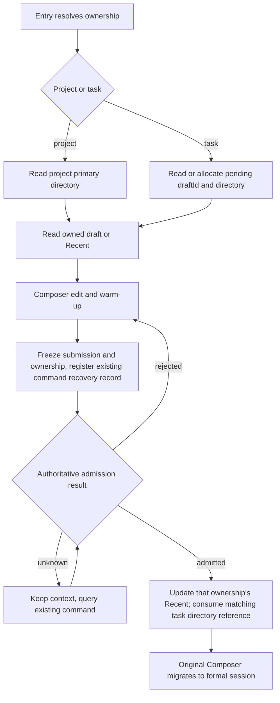

# Draft, Default Config and Directory Lifecycle for Projects and Unclassified Tasks

Status: user-confirmed 2026-10-16; implementation and necessary regressions done; no installer released.

## Terms and Boundaries

- A Project is the logical container organizing sessions, identified by target host identity and project ID.
- A root is a real folder; the primary root is the directory a project uses when creating a new session.
- A workspace carries run and data isolation; workspaceKey = workspaceIdentity?.trim() || workspacePath.
- workspacePath is the actual path; the session execution directory (cwd) is fixed once the session is
  created. Moving project ownership does not change it.
- The "Tasks" entry creates unclassified tasks. It owns an independent new-task draft and default config and
  is not a fake Project.
- Client-local storage isolates desktop from mobile; the target host of a remote-control connection must
  also be isolated. A reconnect must not mint a new ownership from a temporary bridge ID.

## Unified State and Single Writer

| State                                         | Owner / single writer                                         | Persistence and purpose                                                                                         |
| --------------------------------------------- | ------------------------------------------------------------- | --------------------------------------------------------------------------------------------------------------- |
| New draft                                     | Composer owner, scoped by project or unclassified task        | Only with non-blank text are text, editorState, mention, the complete ModelSelection, mode and Plan saved       |
| Current input box                             | useDraftConfigControl                                         | User edits win; an ordinary render, View or Snapshot response cannot reset the current edit                     |
| New default config (Recent)                   | The unified path that admits a real user Submission           | Model Provider/model/options and permission saved together; one per project, one for unclassified tasks         |
| Unclassified task pending directory reference | New-navigation lifecycle owner                                | Saves draftId and the preparation result; empty text may still keep the directory reference, no fake text draft |
| Later draft of a formal session               | The original session Composer                                 | Workspace identity + session ID, not switched to per-project storage                                            |
| Session facts and execution directory         | CLI; the Host keeps only organization state and a fact mirror | Not manufactured by draft storage, directory scanning or UI snapshots                                           |

Projects P and Q save separate new drafts and Recent even with the same primary directory. A project rename
does not affect ownership; changing a project's primary directory keeps its text draft and Recent. Groups
express organization intent only and create no separate default-config scope.

## User Behavior

### Ordinary Project

New reads that project's draft; with text the full selection is restored, without text that project's
Recent is read and Plan defaults off. The project's primary directory prepares the warm-up session. Once the
first input is admitted it becomes a formal session; later news keep using the project's primary directory
at that time. A project without a root keeps the existing prepareSession flow that initializes the primary
directory. An old session's execution directory does not change with project primary-directory edits or
session moves.

### Unclassified Task

The first New generates a draftId, prepares a real directory and saves the reference. Switching away and New
again reuses the same directory and draft. After the first input is admitted the reference is consumed and
the next New generates a new draftId and a new directory. Repeated clicks and concurrent preparation reuse
one preparation result; merely blocking navigation while still creating several directories is not enough.
The semantics of the no-argument prepareSession must not change globally: Bots, automations and other
callers keep their own directory-preparation semantics.

### Default Config

Recent updates only when a real user send is admitted; a finished model reply is not a boundary. Changing a
menu, warm-up, permission confirmation, reading history, opening settings and a failed send do not update
Recent. A real send in an existing session also updates the project or unclassified-task scope it belonged
to at send time, reading ownership from authoritative organization state, never guessing a project from cwd.
Side chat is not in the main task index: a follow-up queries the Recent project ownership via the owning
main session recorded in the sidebar while the command is still sent to the side child; ordinary sessions
and forks query their own task. Ownership and the complete config are frozen before sending; a late receipt
updates only that ownership and does not rewrite other projects due to current navigation changes. Across
Panes, the most recently admitted submission by initiation order is kept; an old receipt cannot overwrite a
newer admitted config. Updating Recent from other sends does not overwrite a draft being edited.
ModelSelection saves providerId/modelId/options per the current schema (currently options is
reasoningLevel); app settings such as followup are not merged into Recent. Plan stays a draft/run state, not
a switch inherited by a brand-new task. With no valid model the existing ModelSelection View validation
rule applies; the first menu item is not saved as a default.

### Existing Text Draft Rules

Only non-blank body forms a persisted text draft. Changing only options saves nothing; emptying the text
deletes the text record, and the directory reference does not vanish. Returning to a new draft with text
restores its complete selection; re-entering a blank new page takes the scope's Recent. Reopening a formal
session restores body and draft model, with permission/Plan taken from that session's latest Snapshot;
explicit selections during mounting keep the existing observation rule. New input during the first send
belongs to the same editing cycle and is kept after migration to the formal session, not overwritten by new
draft cleanup. Attachments keep the existing prepare and upload flow; no cross-restart attachment
persistence is added.

## Lifecycle and Timing

- Consuming the directory reference is decided by the first input's accepted or verifiable duplicate state,
  not by the prewarm create ACK, the Host reserved row, a list projection or navigation success.
- The existing pendingCommandRegistry persistent command context stores ownership and draft identity; no
  second accepted queue is added.
- Local first-send side effects must be re-entrant: duplicate receipts and recovery queries cannot consume
  twice nor overwrite a newer Recent.
- Consumption matches by draftId; an old ACK cannot clear the next draft's reference. Finish the recoverable
  local hand-off first, then delete command recovery evidence.
- Unknown result is not failure; disconnect, timeout, expired record or a temporarily absent list cannot
  prove the directory is reusable for a new task. Reuse the existing query mechanism, not timed guessing.
- Navigation switching may invalidate UI binding but cannot undo an admitted send nor skip the persistent
  hand-off.
- When switching back to a draft, the previous generation's warm-up creation still exiting does not
  invalidate this send. Wait for the existing creation to settle, then validate the target generation at
  click time; no parallel session is created and no timeout guessing.
- If the first send is admitted while unmounted, new body typed during the wait is handed to the formal
  session; recovery reconciliation uses the original body before submit, so protocol text with attached
  context does not resurrect an already-sent body.
- Draft isolation must run through storage key, Hook scope, in-memory organization intent, warm-up owner,
  attachments and callbacks, not only localStorage.
- Desktop continuous and mobile replayable keep the existing transport and command recovery boundaries;
  when mobile switches workspace, ownership must be delivered explicitly through bridge/navigation.

## Directory Change, Import and Compatibility

After a project changes its primary directory, text and Recent stay with the project; warm-up must be
re-prepared in the target directory, file references and attachments are re-checked by existing validation,
and an old running instance does not change cwd. When a directory is missing/unavailable the draft is kept
and the existing directory error is reported, with no silent directory revival or choosing another root.
Moving a formal session changes organization ownership only and does not move the project's new draft or
Recent; later sends record default config by the ownership at submit time. First-time share import, template
prefill and explicit project switching keep the existing explicit hand-off actions; ordinary navigation does
not move one project's body to another project nor overwrite the target's existing draft.

Old text records are kept. A draft can be claimed only when its saved projectId matches the target; an old
unclassified draft needs an explicit current context and must not be matched by scanning the latest
directory. Old Recent has no project ownership; it is not bulk-copied to all same-directory projects nor
merged with history. A new scope with no record uses normal default resolution. Migration reads do not write
to disk; an explicit save/clear records the old data as claimed, preventing a directory-changed project or
an emptied body from reading the old draft back. Data readable by old versions is kept and historical
directories are not bulk-deleted. Navigation also remembers each workspace's last opened new-task scope only
for the refresh-restore entry; body and Recent stay with the project/task scope as the only data source.

## Feature Impact Brief

Change layers: draft-default, persistence, commit-effect, recovery. Mode: implementation-handoff.

| UI scenario                          | Shared path and owner                                   | Default source / validation                           | Commit and landing                                                | Boundary and level                         |
| ------------------------------------ | ------------------------------------------------------- | ----------------------------------------------------- | ----------------------------------------------------------------- | ------------------------------------------ |
| Tasks section plus button            | useRootWorkspaceActions -> Composer                     | tasks scope Recent / View                             | prepareSession -> user Submission -> CLI; client draft and Recent | desktop/mobile must-inspect                |
| Project row / shortcut new           | same navigation and Composer; explicit projectId/hostId | project scope Recent / primary directory availability | project prepareSession; same send chain                           | same-directory projects must-inspect       |
| Existing session                     | SessionPane/useDraftConfigControl                       | current Snapshot + session text draft                 | CLI admission; owning scope Recent                                | ownership move, late ACK must-inspect      |
| Mobile new/restore                   | Web openProjectDraft, shared Root                       | target host + project/task scope                      | project-workspace-navigation, original replayable recovery        | conditional                                |
| Share/template/group                 | explicit navigation hand-off, original creation intent  | same initialization rule, user edits win              | original first-send and organization ownership path               | should-inspect                             |
| Automations/Bots/Subagent            | own record/CLI owner                                    | original config source                                | original command/storage                                          | invariant-only, consumes no Composer draft |
| Provider settings / model candidates | original ModelSelection View                            | original availability validation                      | original provider service                                         | invariant-only                             |

Shared: draft read/write, Recent, model validation, submit freeze, admission callback. Different: ownership
identifier and directory-preparation strategy. Authoritative boundaries stay: the Host owns organization,
the CLI owns sessions, the client owns drafts; execution paths never use project ID or workspaceIdentity as
a substitute. Source seeds: composerDraftStore/useDraftConfigControl/newTaskDraft/composerRecent,
useRootWorkspaceActions, SessionPane/pendingCommandRegistry, project.prepareSession,
project-workspace-navigation, Web openProjectDraft. Graph drift: the existing text-draft node expresses only
workspace Recent, and the historical new-task-model-resolution-chain still holds the old last-selected rule;
update the index and current rule entry with the implementation, and do not restore old code from old docs.

## Rulings, Dimensions and Pruning

User-confirmed: an unsent directory is reused; each end is independent; memory happens only on send
success; model and permission are unified; project drafts and Recent are isolated per project. Main
dimensions: project/task, non-empty/empty draft, same/different directory, first/later send,
accepted/rejected/unknown/late, desktop/mobile, host identity, directory change/ownership move. Pruned: no
multi-desktop-window product rule, no cross-device draft sync, no cross-restart attachment storage, no
automation default inheritance; the formal session cwd, run queue and permission rules are unchanged.
Multi-host same-path, two projects with one directory, late ACK and refresh restore must keep representative
cases; theme and language are checked on representative screens, not full combinations.

## Acceptance Cases and E2E Handoff

| ID   | Precondition -> action                                                                | Must assert                                                                                                                | Evidence                                |
| ---- | ------------------------------------------------------------------------------------- | -------------------------------------------------------------------------------------------------------------------------- | --------------------------------------- |
| PD01 | Task input text and model/permission -> switch session -> tap Tasks plus              | Directory, body, selection restored; no extra mkdir                                                                        | UT + Desktop/mobile E2E, files and logs |
| PD02 | Task send admitted -> New again                                                       | New directory, empty body, complete Recent inherited                                                                       | E2E + CLI ACK/directory                 |
| PD03 | Two same-directory projects with different bodies/selections -> switch back and forth | Draft and in-memory/warm-up ownership isolated, projectId not overwritten                                                  | UT + E2E                                |
| PD04 | P/Q/task each send successfully with different configs -> New                         | Three Recents isolated; later sends of one project update it                                                               | UT + E2E                                |
| PD05 | Change only options / empty the body -> switch away and back                          | No text draft produced; initialized from Recent; task directory reference remains                                          | UT + E2E                                |
| PD06 | First send rejected, unknown, reconnect duplicate                                     | No input lost, directory not wrongly released; final hand-off exactly once                                                 | UT + fault E2E                          |
| PD07 | Rapid New clicks, late preparation, fast project switch after send                    | No duplicate preparation; old callback does not write new scope; admission still completes the original ownership hand-off | UT + E2E                                |
| PD08 | Type the next message during first send -> ACK/projection late                        | Next message stays in the formal session, does not resurrect the new Root                                                  | UT + E2E                                |
| PD09 | Project rename / change primary directory / move session                              | Project draft and Recent kept; old session cwd unchanged                                                                   | UT + E2E                                |
| PD10 | Refresh, restart, same path on different hosts, edit on desktop and mobile separately | Identity stable and each end independent; unknown sends recoverable by query                                               | UT + Desktop/mobile E2E                 |
| PD11 | Valid old projectId draft, ambiguous old record, storage failure                      | Claim only when ownership is provable; keep old data; a write failure does not clear the source                            | UT                                      |
| PD12 | File/screenshot attachment, share import, template, group, unavailable model          | Original flows usable; Recent not wrongly updated, ownership not crossed                                                   | affected UT + representative E2E        |

All PD cases are accepted at product-semantics level. Automation is verified by the layered evidence below;
one passing representative interaction is not widened to all combinations. E2E uses manual-review/pending
with the real sidebar button, controlled Provider fast-text and fault/delay fixtures, no sleep-based success
inference; main assertions check UI, workspace identity, directory, CLI admission and client persistence at
once, covering desktop and mobile shared-host/replayable. Prefer reusing the helpers and case-local fixtures
of composer-recent-mode and virtual-project-mobile; no auto-promotion or CI addition. The run located and
fixed a warm-up generation wait issue, verified by a real send after switching back to the task rather than
only a Hook unit test.

## Implementation Order and Done Criteria

1. Land design, catalog, coverage and feature graph; record baseline and runtime reproduction.
2. Write regressions for scope/storage/Recent/directory idempotence/recovery and the desktop/mobile
   interaction cases first, confirming the old implementation fails.
3. Unify ownership resolution in existing owners, replace the workspace new-task key and default-config
   source, avoiding a new state copy.
4. Finish task directory reuse, first-send hand-off and command recovery; wire project, shortcut, share,
   mobile navigation and attachments.
5. Run affected unit tests, typecheck, lint, architecture, E2E typecheck and targeted interaction
   verification; inspect the diff.
6. After required verification passes, commit locally; record unverified items; no auto push/MR and no claim
   that incomplete verification passed.

## Verification Record (2026-10-16)

Baseline `dd10b6e7bf36f7073f6edfc1b9305ddb25d34c4f`. An independent Linux container ran Electron
desktop-continuous and mobile-browser replayable against a real Host/Agent, with synthetic case-local replay
model output.

| Verification                            | Result and actual coverage                                                                                                                                                            |
| --------------------------------------- | ------------------------------------------------------------------------------------------------------------------------------------------------------------------------------------- |
| Composer lifecycle suite                | `desktop-e2e-20261016-095920-188`, 5/5; PD01-05, PD07, PD09 project rename/primary-directory change, PD10 refresh; includes switching away during the first send and receipt hand-off |
| First-send single-flight and next input | `desktop-e2e-20261016-093955-345`, 1/1; PD08 new input kept while waiting for the first send; no duplicate session                                                                    |
| Text and attachment draft switching     | `desktop-e2e-20261016-100030-743`, 1/1; completed/running/new-draft switching keeps body and in-memory attachment references                                                          |
| Mobile full project flow                | `desktop-e2e-20261016-100100-797`, 1/1; PD01/02/10 switch back, refresh, directory reuse and post-admission directory change; plus existing project, group and file navigation        |
| Affected unit tests                     | Official affected selection 1,444 files, identical to the batch list actually run; 16,503 passed, 28 skipped; the full suite was not run                                              |
| Type, lint, architecture                | Root typecheck and desktop E2E typecheck passed; lint 0 errors (210 existing warnings); architecture 0 violations                                                                     |
| Replay contract and format              | Replay contract 5/5; changed-file format, diff whitespace and new spec link checks passed                                                                                             |

PD06 rejected/unknown/duplicate, ledger rebuild on refresh, TTL and old ACK; PD07 directory-preparation
concurrency; PD09 session ownership resolution; PD10 same path on different hosts and client isolation; and
PD11 claim and storage failure are covered by unit tests; the in-flight delay E2E is not stated as real-device
verification of all offline combinations. PD12 used affected regressions and representative UI switching; no
cross-restart attachment persistence was added and not every file picker, screenshot and import combination
was re-verified. Test helpers now wait for this run's draftFocusVersion to advance, so an existing same-project
draft DOM cannot satisfy the new-wait condition early. Old permission cases were adapted to the currently
available modes and the existing "formal session reopen takes the Snapshot" rule; the replay was completed with
Write tool results and the compaction response after a model switch. Initial failures are kept; fixture gaps and
wrong old-case premises are not attributed to product faults.

Environment limits: an early large batch plus browsers hit an 8 GB container OOM, so tests ran in official
selection batches with two fork workers; two packaging tests passed after installing a missing zip, and one Root
mock passed after adding the client namespace. Electron file URLs failed with module loading in this
environment, so a supported localhost renderer URL was used. No MacBook Air installer, Windows GUI, physical
phone or cross-device text sync was verified. The feature graph's six source seeds exist and nodes have no
duplicates, but the whole graph still has four baseline dangling references and one missing old source seed; the
whole-graph integrity pass is not claimed. Cases stay manual-review/pending, not auto-promoted nor added to CI.
Open-source word check: eight hits all come from the original virtual project history design and match the
baseline; the new spec has none.

## MR Integration Verification

When preparing the MR the work moved onto staging `f05db3e645`, excluding unmerged Provider commits from the
start point. The mainline warm-up subscription identity validation and main-input positioning are kept. The
new-project draft hand-off and group-draft close use the same client/project scope; a new project in the same
directory also receives the attachment hand-off explicitly, consumed once by the target draftFocusVersion.
Editor registration and hand-off consumption recognize project-identity Root scopes. Three unit tests first
reproduced the old directory-key read/write and same-directory attachment skip issues before the fix; the group
close case gained body and refresh assertions. Direct callers checked: ProjectCreation, TaskGroupedView, Root
actions, ConversationComposer; the feature graph gained hand-off and group-cleanup seeds.

| Integration verification             | Result                                                                                                                                                                                                                                                                                                                                            |
| ------------------------------------ | ------------------------------------------------------------------------------------------------------------------------------------------------------------------------------------------------------------------------------------------------------------------------------------------------------------------------------------------------- |
| Desktop Composer                     | `desktop-e2e-20261016-103617-676`, 5/5, full project/task draft and Recent cases                                                                                                                                                                                                                                                                  |
| Group close and refresh              | `desktop-e2e-20261016-104001-042`, GRP02/03/11 1/1; zh/en and dark/light representative combinations                                                                                                                                                                                                                                              |
| Mobile and project-creation hand-off | `desktop-e2e-20261016-104236-866`, VP13 1/1; also PCD01/02 two desktop entries x dark/light, PCD03 mobile body and ready attachment kept                                                                                                                                                                                                          |
| Unit tests                           | Affected selection 1,417 files; first run 15,832 passed, 3 failed, 28 skipped (including the pre-fix same-directory attachment failure; after the fix draft storage/hand-off 26/26; two network-backoff failures under system Node 24.19 passed 22/22 under the repo-pinned Node 24.14.0). Final push-gate results are in the MR validation field |
| Types and gates                      | Root and E2E typecheck, lint (0 errors), architecture (0 violations), database schema and architecture script tests passed                                                                                                                                                                                                                        |

The first mobile run timed out waiting on the mainline's new group long-press menu; runtime touch-event sampling
confirmed the menu opens normally. A Playwright interactability check was added before CDP coordinate input,
keeping the real touch long-press, and the full flow passed. The initial integration build lacked the font
package because dependencies were not refreshed after the rebase, and was completed after reinstalling per the
current lockfile. Failure records are kept so as not to hide environment and case-preparation issues.
Screenshots were checked for desktop permission inheritance, project hand-off and mobile body/attachment; the
platform limits are the same as the previous section.
