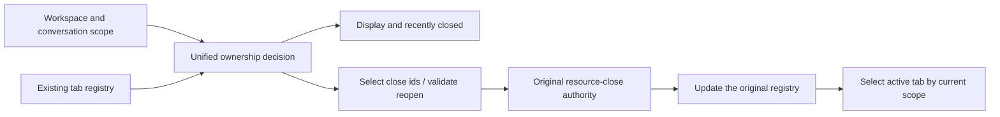

# Side Pane Tabs

## Goal

The right side pane is upgraded from single-slot switching to a multi-tab model, so Browser, Diff and Code
Viewer can stay open at once and be switched inside the pane.

## Key Design

- Side pane state becomes `tabs + activeTabId`, not a single `type`.
- Diff is a singleton tab; repeated clicks only activate or close the current tab.
- Browser supports multi-instance tabs; the Browser fallback of the main entry first switches to an existing
  Browser, while a Browser from the new tab page creates an independent tab.
- Code Viewer reuses tabs by a stable `sourceKey`, so the same file does not stack up.
- Each workspace's tab registry is cached separately in memory and restored on switch; tabs are not moved
  across workspaces.

## Ownership and Operation Contract

Display, close current/others/all, recently closed and reopen share the `workspaceKey + ownerTaskId` scope:

- Match the workspace first (`workspaceIdentity?.trim() || workspacePath`); an old unmarked workspace tab
  keeps the registry it is in.
- When a new tab commits, missing workspace and owner are filled independently; an existing owner must not be
  overwritten, but an existing owner must not cause a missing workspace to be skipped.
- Git, Developer Tools and Treemapping are workspace-common tabs; other tabs belong to the conversation/draft
  that opened them. browser-use uses `sessionId`; Subagent/Bash use `rootSessionId`; side chat, Plan,
  Workflow and plugin panels use `parentSessionId`; the rest use the frozen `ownerTaskId`. An unmarked owner
  and null keep draft semantics.
- The close menu selects only currently visible tabs. After closing, only the remaining tabs of the current
  scope are activated; when expanding with no visible tab, a new tab of the current scope is created and the
  pane stays expanded; an active collapse is unchanged. Hidden tabs are kept.
- Recently closed shows only tabs recoverable in the current scope; reopen also validates the same scope and
  keeps the original ownership. Workspace-common tabs can be restored in different conversations of that
  workspace.
- Browser is still confirmed closed by main first, then the UI shell is deleted. An async close handles only
  the tab ids selected at click time; tabs opened while waiting are outside the close range. On completion it
  updates the original workspace, and the current conversation's active/collapsed state resolves by the scope
  at completion time and cannot be overwritten by the old operation.
- No new tab state source, permission queue, timeout, persistence format or cross-process protocol; desktop
  and mobile share the UI ownership logic, and the Browser main authority and continuous/replayable message
  boundaries are unchanged.
- The `Open tab` launcher page (opened by `+` or the empty state) also offers a Model trajectory entry for the
  active task (`model-trajectory` in `OpenTabLauncherItemId`). The entry is hidden (not disabled) while no
  active task exists, matching the selection-side-conversation gating. Opening always targets the active task
  and reuses the existing per-task tab identity `model-trajectory:<taskId>`: an already-open tab for that
  task is re-activated instead of duplicated, and the title falls back to `modelTrajectory.title` when no task
  title is available.

## UI Behavior

- The tab strip's "+" directly creates and activates a "新标签页" (New tab), no longer popping the app menu.
  Each click generates an independent id, so several new tabs may coexist.
- A new tab is the `new-tab` type in the unified registry, owned by the workspace and conversation at
  creation; focus, drag sorting, close and close others/all reuse the existing tab operations (a new tab does
  not enter recently closed), with no second local tab state.
- A new tab reuses the standard tab trigger with a blank-file icon and a close button, and keeps the width of
  other tabs (min 60px, max 156px); the title is not stretched to fill the remaining area.
- Content reuses the empty-state new-tab entry and the recommended app plugins; selecting a tool or app keeps
  the existing open action and replaces the current new tab in place; an already open singleton only
  activates the existing tab and removes the current new tab. "View all plugins" keeps the source new tab for
  returning. Plugin host support boundary and de-duplication rules are unchanged.
- The new-tab page's app list also offers a Model trajectory entry for the active task (`model-trajectory` in
  `OpenTabLauncherItemId`), with the same gating and tab identity as the launcher entry above.
- While a recommended plugin installs, restores or enables, only that plugin's entry shows a spinning icon
  beside the loading text and is marked `aria-busy`; other plugins keep their own install, enable or open
  text. Several surfaces of the same plugin share progress. The recommended list stays disabled until the
  current operation ends and, on success or failure, clears the icon and busy state and becomes operable
  again; after success the user still has to click to open. Empty state and new tab, desktop and mobile layout
  follow the same rule; with system reduced-motion the static loading icon and text are kept.
- The top of the right panel renders the tab strip with the project's existing `Tabs` component.
- Switching tabs keeps opened pane instances, so the Browser webview is not destroyed.
- A Browser tab follows the webview's `page-title-updated` / `page-favicon-updated` events to show the page
  title and favicon; when an event has not returned it falls back to the default Browser title and Globe icon.
- The separate Browser / Diff buttons on the Header are removed and unified into the rightmost side pane
  button.
- The side pane button is always clickable; when expanding with no visible tab in the current scope, it
  creates and activates a new-tab; it does not auto-create tool tabs such as Browser / Review / Terminal.
- Panel toggle and animated show/hide updates affect only the right side and the conversation layout; when
  the left project data and navigation props are unchanged the project tree skips re-render. Desktop passes
  stable remote callbacks and mobile navigation still completes jumps by the original same-workspace /
  cross-workspace rules. Project directory, unread, task status, theme and language changes still update
  normally; the sidebar is not frozen by a props-ignoring comparator.
- A new draft and its later config and panel collapse updates follow the same render boundary: the new action
  does not lose reference stability because Root re-assembles the remote navigation callback and uses the most
  recently committed implementation at call time; remote navigation depends on a stable service object, not
  an RPC method that is newly created on every read; repeated directory reads yielding an equivalent project,
  empty task list, connection state and entry reuse the original references. The sidebar subscribes only to
  the current task state affecting display, and group inheritance reads the current task at click time.
  Project data, identity or navigation target really changing still updates normally, with no delay,
  navigation queue or business state copy added. SPT03 covers new and follow-up operations of desktop and
  mobile layouts and verifies the boundary with render counts, navigation results and data updates.
- Cmd/Ctrl+N enters the draft along the real chain menu -> platform -> Root -> App -> WorkspaceShell. An
  equal-valued `addTab` of the same workspace keeps the tab and list references; the task-select callback
  reads the current session at operation time and does not re-render all projects when entering a draft. Real
  connection metadata, identity and classification changes still publish updates. Host `prepareSession`'s
  project read and the delete re-check after the directory check load only projects/roots, reading no
  unrelated tasks, and keep the original directory, concurrent-delete and remote single-directory checks.
  SPT04 verifies this chain on an existing multi-project Dev App with real key presses and menu events,
  recording project-row render counts, the draft first frame and trace; a noop must not replace the
  App/WorkspaceShell/tab store. Millisecond data serves same-condition comparison; the regression threshold
  uses behavior and render counts.
- Activity-time changes of a running task update only the related project and task rows. Project-row
  assembly is isolated per project: unrelated projects skip content rendering when their task element
  references, menu data and callback semantics are unchanged; the task array is compared by element identity
  and order, with all other properties participating. Real changes of running/done, unread, title, ownership,
  pin, remote connection, language and operation callbacks keep propagating. It keeps the existing directory
  projection and task owner, without filtering activity fields or adding delay or business cache. SPT06 drives
  activity updates in a multi-project fixture on desktop/mobile and dark/light, and checks running end and
  project actions still work.
- Loading in sidebar tasks and the message area keeps the original icon, size, color and state semantics; the
  rotation acts on the existing HTML container so Chromium composites the animation. During idle waiting, SVG
  rotation must not recompute styles frame by frame. SPT06 also verifies the icon keeps rotating, is removed on
  completion, and style recalculation counts during idle animation.
- When the full toolbar layout already fits, the size notification only reads existing geometry and does not
  clone measurement nodes. On overflow or an existing compressed state, an invisible copy continues to be used
  for measurement, keeping the original fold order, restore order, focus and open pickers. The measurement
  result is only a DOM layout projection, adding no business state or delayed sync.
- The New Task draft and an existing Task reuse the same `WorkspaceHeader` skeleton, hiding task-specific
  context and menus with `variant="draft"` while keeping Help / Terminal / Side Pane and the platform caption
  area. Entering a new draft keeps the side pane collapsed by default; after the user clicks the button, the
  draft owner's existing tabs are restored; with no visible tab a real `New tab` is created and the unified tab
  strip shows. Mobile Web remote keeps reusing the existing side pane overlay, adding no separate runtime or
  recovery chain. Full constraints: `docs/ui/workspace-header-variants.md`.
- When the user actively expands the side pane and the current task has no visible tab, a `New tab` is
  created; the decision uses the visible tab set filtered by the active task, not all tabs of the workspace
  registry. Even if the registry still keeps session-scoped hidden tabs of other tasks, a new tab of the
  current scope must be created and the tab strip and `+` shown. A standalone empty state is no longer
  rendered. The empty-state page is top-aligned and scrollable, with a left-aligned title "新标签页" and no
  subtitle. Built-in apps are on top and UI plugins below, separated by a short centered divider. Entries of
  both areas are horizontal rows: a 48px `surface` icon block + name and single-line description + a trailing
  `secondary` pill "打开" (Open); the whole row is clickable, `hover:bg-hover`, no border. At container width
  36rem it becomes two columns, a narrow panel one column. The UI plugin area title has a "查看所有插件"
  (View all plugins) entry at the right that opens the full plugin market. With no session yet
  (activeTaskId empty), the whole app-plugin area, divider and View all plugins entry are hidden. For an
  existing session entering the market via this entry from the new tab, the market browse page shows a back
  arrow left of the title; back closes the market tab and activates the source new tab, or creates a new one
  if the source tab was closed. Other entries show no such back arrow; the back entry is visible only for the
  source task and not when switching to another task. This entry context is kept only within the current panel
  lifecycle and not restored across reload. Built-in app descriptions follow the prototype copy: side chat
  "在侧边面板中继续对话。", Review "查看代码变更与差异。", Terminal "运行命令和查看输出。", Browser
  "浏览网页和预览应用。", Developer tools "检查和调试应用。".
- Closing the last visible tab (including a new tab) or running close-all collapses the panel without creating
  a tab; a new tab is created only when the user expands the empty panel again. A new tab does not enter the
  recently closed list; after Cmd/Ctrl+W closes the last tab, the next key press follows the window-close
  fallback. A background close on an already collapsed panel must not expand it.
- When Browser / Diff / Code Viewer is re-activated, the collapsed state is cleared automatically, so existing
  content on the right is not kept hidden.
- Conversation-level tabs are hidden by ownership scope rather than destroyed; switching to a conversation
  with no tabs collapses, but ordinary Browser and browser-use `<webview>` both stay mounted in the background
  to stay alive. Switching back to a conversation with tabs re-selects that conversation's preferred/current/
  latest tab and actively expands, and cannot inherit the collapsed state of an intermediate conversation.
- Code Viewer keeps syntax-highlighted preview for code files; `.md/.markdown` files and markdown text sources
  render as body text, supporting inspecting headings, lists, workspace file links and external-link jumps
  directly in the side pane.
- The Code Viewer top shows a compact path breadcrumb: by the current workspace first `workspace -> directory
-> file`, with a file-type icon on the final file node; an overly long path scrolls horizontally.
- The Code Viewer top right has `More + Open` buttons; closing still goes through the tab's own close entry,
  and the `More` menu carries only file-type view switching: markdown preview/source, SVG preview/code, and the
  word-wrap switch of ordinary code files.
- The tab strip supports horizontal drag sorting; sorting changes only the `tabs` array order, not the current
  `activeTabId`. A small distance threshold is used, ordinary clicks still only switch tabs, and the close icon
  area does not trigger drag.
- The default width of each tab is 156px (`w-39`); when the tab strip's available width cannot keep the
  default, all tabs shrink equally to a minimum of 60px (`min-w-15`). Only when all tabs at 60px still do not
  fit may the tab strip scroll horizontally. The title uses the space left beyond the in-tab icon and badge;
  the close button is absolutely positioned and takes no space; icon and text form the item-content, and
  overlong content fades by mask instead of ellipsis; when the close button shows, the fade area shifts left
  and content neither shifts nor reflows.
- The tab overview does not take part in equal tab width division. The add button follows the last tab when
  not overflowing; once all tabs shrank to 60px and the strip scrolls horizontally, the add button moves out of
  the scroll area and is fixed on the right.
- Each tab's close button is absolutely positioned, takes no title space, and shows only when selected, hovered
  or focus-within; when hidden it does not respond to mouse clicks, while keyboard focus can show it. On touch,
  select first then close; closing keeps preventing tab activation or drag.
- A tab can be closed with the middle mouse button: pressing the middle button on any non-interactive area of
  the tab closes it directly without activating it first, and the browser default middle-click auto-scroll must
  be prevented. This applies to all Side Pane tab types (side chat, Browser, Terminal, etc.); mobile Web touch
  has no middle button and does not depend on it.
- Each tab reuses the project's Tooltip showing the untruncated full title. After the pointer enters, it waits
  1500ms to show; leaving or moving to another tab cancels the current tooltip immediately, and the new tab
  must wait the full 1500ms again, not reusing the Tooltip group's quick-switch window. Dragging a tab forces
  the tooltip closed, and touch does not depend on the hover.
- The tab strip supports a context menu offering close current tab and close other tabs; close others keeps
  and activates the tab operated by the right-click.
- Beside the plus there is a tab overview entry: multi-word search of open tabs by title, path/URL and type,
  viewing open times, switching to a target tab, and close others or close all. The overview bottom shows
  recently closed tabs; clicking one reopens and activates the matching tab. The overview search filters both
  open and recently closed tabs; results sort title hits first, then path/URL and type hits.
- The side pane's tabs, collapsed state, Git source selection and Browser current URL are cached in memory by
  `workspaceIdentity?.trim() || workspacePath` and restored after switching workspace; not retained after a
  refresh or restart. The URLs of multiple Browser tabs are recorded as `browser tab id -> URL`, so several
  webviews do not share one restore address.
- Desktop `Cmd/Ctrl+W` uses "close current context" semantics: when the right side pane is expanded and has an
  active tab, that tab closes first; otherwise it falls back to closing the current window. The shortcut is
  forwarded by the main process to the renderer to decide, preventing Electron's native `close` role from
  bypassing side pane state and closing the window.
- On desktop the panel top right offers "进入完整视图" (Enter full view, `⇧⌘F` / `Ctrl+Shift+F`): the panel
  fills the window, the conversation becomes the first tab and offers a floating input window; full contract in
  `docs/ui/side-pane-full-view.md`.

### New Tab Page Display

The launcher page title is "新标签页" (New tab). Minimum left/right margin is 28px, the two-column gap 32px;
section titles align with the left edge of the entry logo squares. App plugins reuse the market's real icon
source and size rules through PluginStoreAvatar, showing a puzzle placeholder when the image is missing or
fails to load; built-in tools keep their own icons. Recommended order, install and open behavior are
unchanged. The recommended app list shows 8 skeleton entries on first load: a 48px rounded icon, two-line
title and description placeholders, and a 24px-high pill action placeholder; row gap and padding match real
entries, keeping the 36rem single/double-column breakpoint and 32px column gap and honoring system
reduced-motion.
