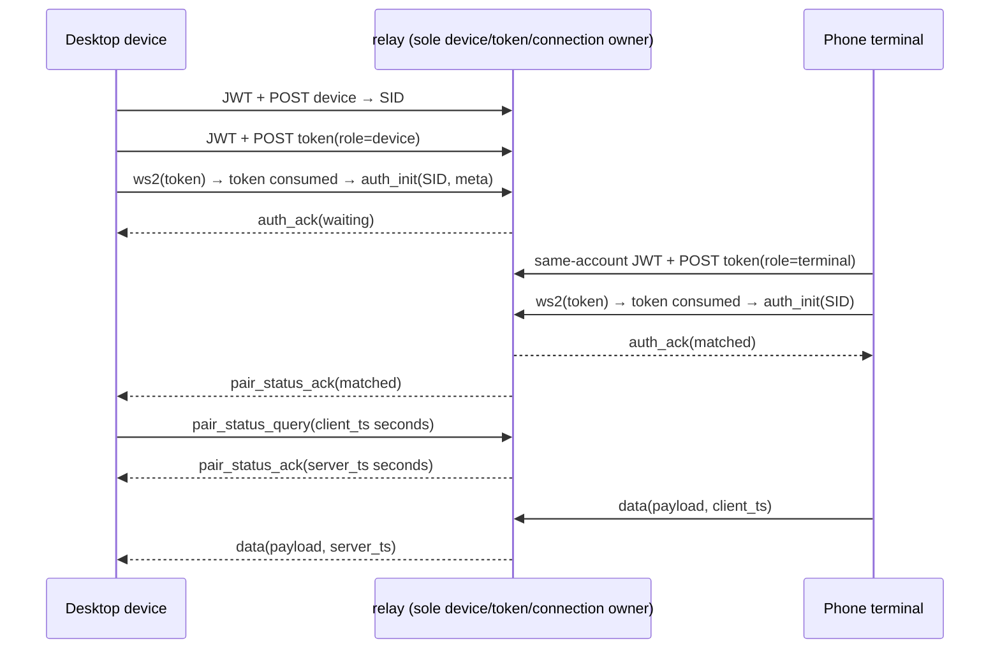
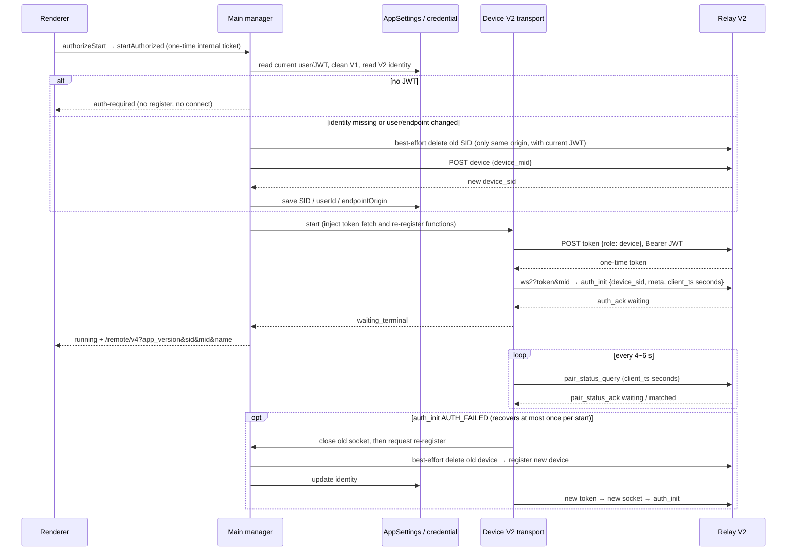
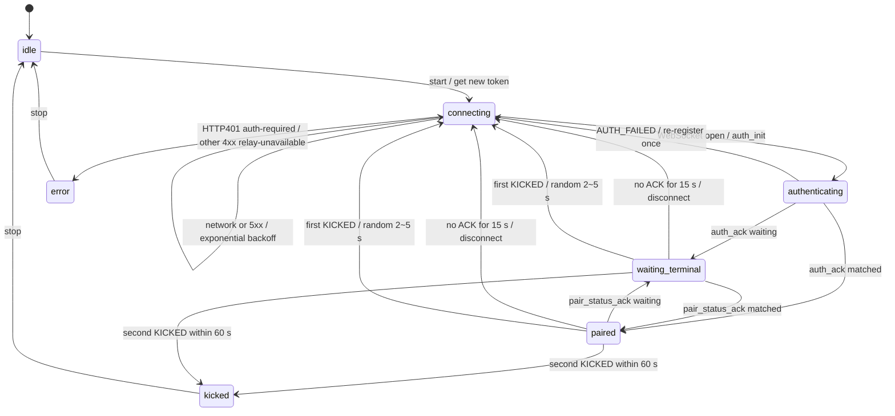
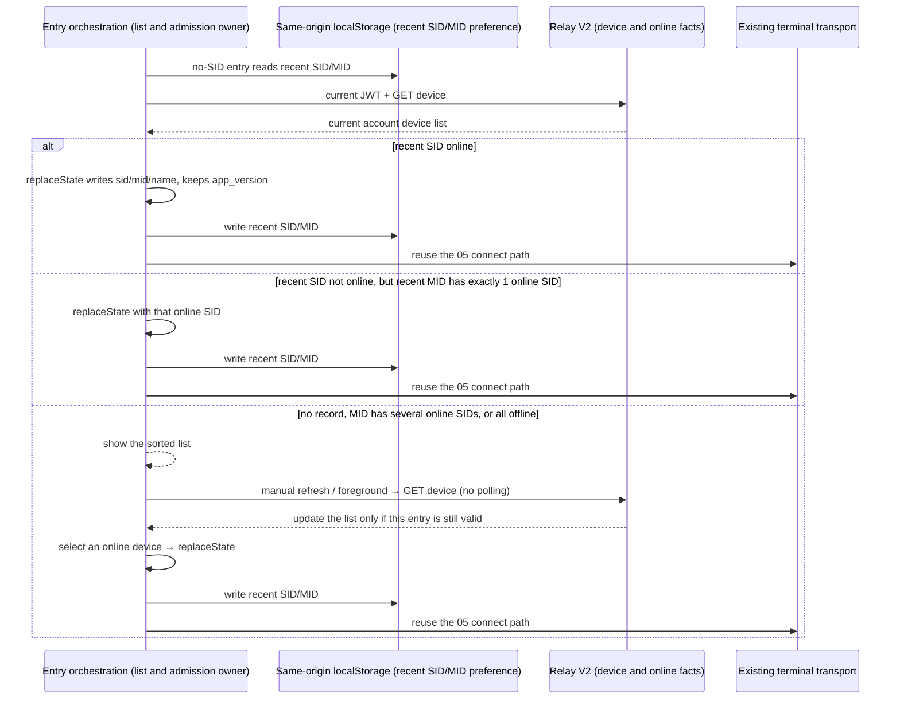

# Relay V2 Shared Contract and Pairing

This page defines the final shared contract, connection behavior and acceptance boundaries of
[Relay V2](../issues/web-remote-control-relay-v2/01-relay-v2-login-pairing.md). Desktop device, phone terminal
and shared code use V2 only.

Full history: `git show b8876e8b:docs/web-remote-control/relay-v2-pairing.md`

Contract basis: zcode-server `origin/staging` commit `5a947caea3a022b12b5d051ef25c807952feefa7`, files
`docs/remote-relay.md`, `internal/domain/relay_v2/proto.go`, `service.go` and
`internal/interfaces/web/{dto,controller}/remote_v2.go`. HTTP requests and WebSocket messages use strict field
validation (never send V1 fields to V2 by accident); HTTP responses use the compatibility validation below.
The server's Go JSON decoding itself may ignore extra fields.

## HTTP contract

All endpoints use `Authorization: Bearer <jwt>`; the user comes from the login context. The success envelope
is `{code: 0, msg: string, data: T}`; the failure envelope is `{code: non-zero integer, msg: string, data?: null}`,
and a non-2xx HTTP response may have no JSON body.

HTTP responses may gain fields on the server: unknown fields in success/failure envelopes of register, list,
delete and token, in device records, in device `meta` and in token data objects are ignored at parse time and
removed from the returned value. Client-unused metadata such as `logid` is not listed in the schema and its
type is not restricted, so no client release is needed for new server fields. Required-ness, type and value
constraints of declared fields are still validated, and `code !== 0` is still a failure. Field-addition
compatibility does not mean a missing device SID, an invalid token or a wrong business state is accepted.

Acceptance: when a response adds top-level trace fields, device attributes, `meta` attributes or token
attributes, desktop register/token and phone list/token still succeed and return only declared fields; when an
existing business field is missing or has the wrong type they still fail. HTTP request and WebSocket field
validation is unaffected.

- POST `/api/v1/remote/device`: request `{device_mid: string}` (non-blank, at most 128 chars); success data is a device record.
- GET `/api/v1/remote/device`: no body or query; success data is the current user's device record array.
- POST `/api/v1/remote/device/delete`: request `{device_sid: string}` (non-blank, at most 128 chars); data is `null` or omitted.
- POST `/api/v1/remote/token`: request `{role: "device" | "terminal"}`; data `{token: string, expires_in: positive integer seconds}`.

A device record is `{device_sid, device_mid, online: boolean, created_at: Unix seconds, meta}`. `meta` is
`{name?: string, platform?: string, version?: string}`; offline is `{}`. Registration takes no `meta`, and each
registration of the same MID yields a new SID. Only your own offline device can be deleted; a deleted SID can
no longer authenticate. Deleting a non-existent SID succeeds idempotently; deleting another account's device
returns HTTP 200, `code: 1006`, `msg: "no permission"`; deleting an online device returns HTTP 400,
`code: 3005`, `msg: "wrong status"`. Callers must check both the HTTP status and the business `code`. Invalid
request parameters return HTTP 400, `code: 3001`, `msg: "parameter error"`.

A token is a 22-character Base64URL (no padding) encoding of 16 random bytes, bound to user and role but not
to a SID; it is issued with `Cache-Control: no-store`, valid for 60 seconds, and consumed atomically before WS
Upgrade; a failure is not restored, so a reconnect must request a new one. Expiry does not affect established
connections. JWT/token never enter the QR code or business messages.

## WebSocket contract

Entry `/api/v1/remote/ws2?token=...`, optionally with the gateway routing hint `mid`. A missing, invalid,
expired or reused token returns 401 before upgrade. Only JSON text is accepted; at most 1 MiB per message.

Client to relay:

- `auth_init`: `device_sid` (non-blank, at most 128 UTF-8 bytes), optional `meta`, optional `client_ts`; no `role`.
- `pair_status_query`: optional `client_ts`; no `device_sid`.
- `data`: must have `payload` (any JSON), optional `client_ts`.

Relay to client:

- `auth_ack`: `device_sid`, `terminal_sid`, `pair_status`, optional `server_ts`.
- `pair_status_ack`: `terminal_sid`, `pair_status`, optional `server_ts`.
- `data`: `payload`, optional `server_ts`; no `client_ts`.
- `error`: `code`, optional `message`, optional `server_ts`.

`terminal_sid` may be an empty string or absent: a device's auth ACK has it empty, a terminal's auth ACK has
the allocated SID; a query ACK carries the peer terminal SID, a push ACK is empty. `pair_status` is only
`waiting | matched`. Error codes are only `AUTH_FAILED | WRONG_PARAM | KICKED | INTERNAL | DEVICE_OFFLINE`.

Timestamps are non-negative integer Unix seconds (up to the end of year 9999; millisecond values are
rejected) and take no part in authorization. V2 heartbeat baseline is 5,000 ms, jitter +/-1,000 ms, ACK
deadline 15,000 ms; the heartbeat delay helper defaults to the V2 constants, with no V1 default kept.



State ownership: the fake relay alone owns devices, unconsumed tokens, connections and the current owner of
`(SID, role)`. Ownership is validated first, then the old same-role owner is replaced, `KICKED` sent and the
old connection closed; an old connection's async close must not remove the new owner. An unauthenticated
connection cannot send data/query; a repeated auth or illegal field closes the connection. When the device
disconnects, the terminal gets `waiting`, `DEVICE_OFFLINE`, and is closed; when a terminal disconnects, only
the device gets `waiting`. Data goes only to the other role of the same SID; user/device info inside the
payload is never read.

The relay holds no task, workspace, stream or submitted input; the owner and snapshot/gap recovery boundaries
of desktop `desktop-continuous` and phone `web-remote-replayable` are unchanged.

## Self-hosted relay identity modes and the QR `pk` (fork)

A self-hosted relay selects `zai-jwt` (z.ai login JWT, default) or `device-key` (each install generates its
own Ed25519 key, no z.ai login needed) through `ZCODE_REMOTE_RELAY_IDENTITY_MODE`. JWT, routing, `ws2` and the
pairing flow are unchanged; see section 15 of `specs/relay-v2-migration.md` and `packages/remote-relay/README.md`.

In `device-key` mode the phone has neither a key nor a z.ai login, so the QR code carries an optional
parameter `pk`: a one-time pairing code the desktop requests from `POST /api/v1/remote/pairing` (relay JWT),
128 bits random, valid 5 minutes, stored only as a hash by the relay. The phone exchanges it with
`POST /api/v1/remote/session {"pairing_code": "..."}` for a relay JWT of the same `dk:` user; afterwards
`device`, `token` and `ws2` are identical to the desktop. `pk` is a credential: the entry removes it from the
address bar with `replaceHref` right after reading, and never logs or stores it; the desktop refreshes the
pairing code in the QR every 4 minutes. `zai-jwt` mode carries no `pk`, the QR is byte-identical to upstream,
and a QR without `pk` parses as usual. After the pairing JWT expires (default 1 hour) a consumed code cannot
renew it; the phone must rescan and shows "Session expired".

## Final QR contract

`buildWebRemoteControlExternalQrUrl` accepts only the V2 routing hints `sid`, `mid`, `name`, `app_version`, all
optional; the output clears residual `hash`/`t` of the base URL. `parseWebRemoteControlExternalQrParams(params)`
returns V2 parameters only, treats blank parameters as absent, and allows entering the device list with no
parameters. An old link with `hash` or `t` returns null; there is no V1 overload or parse fallback. Shared V1
message types, proof vectors and heartbeat constants are deleted; the heartbeat helper defaults to V2's 5 s +/-1 s.

## Shared fake relay

Location `packages/shared/test/fixtures/fake-relay-v2.ts`, standalone test subpath
`@zcode/shared/testing/fake-relay-v2`. Imported only in Node test processes, not exported from the production
shared root, so no Node HTTP or `ws` enters browser bundles. Real loopback HTTP/WS serve Node `ws` and
browser-WebSocket-API-compatible clients.

`createFakeRelayV2({users: {testJWT: userId}, now?, onHttp?, onMessage?})` returns `httpUrl`, `wsUrl`,
`httpCalls`, `messages`, `sendError(target, code)`, `disconnect(target)` and async `close()`. `now` returns
milliseconds; a target can be filtered by `connectionId`, `deviceSid`, `role`. `onHttp(call)` returns
`{status, body?}` or `{networkError: true}`; `onMessage(record)` returns `{pairStatus}`, `{error}`,
`{disconnect: true}` or `{drop: true}` (ignore the request without changing connection state or sending an
ACK), and an empty return takes the normal behavior. Tests must `await relay.close()` in cleanup.

The control plane supports per-request HTTP 401/5xx/network-break injection, orchestration of auth/pair ACK
state per connection role and SID (including dropped ACKs for watchdog tests), arbitrary protocol error
injection and active close. Every HTTP call and WS message (including invalid ones) is kept in memory for
assertions; test credentials are not logged.

Capability boundary: register/list/offline delete, user isolation, one-time token/expiry, auth/pair/replace,
data passthrough, error injection and cleanup. It uses a test JWT-to-user mapping, does not verify real
JWT/OAuth, and does not simulate Redis, multi-instance owner TTL, IP bans, TLS, gateway mid routing, automatic
Ping/auth timeout or client reconnect policy; those still need transport tests and online joint debugging. ACK
state overrides change only the reply and never fake a peer connection or business state.

## Acceptance seams

- shared public parse functions: valid wire/HTTP samples, invalid fields/types/time units, V2 QR and old
  credential parameter rejection, V2 heartbeat parameters.
- Fake relay real HTTP/WS: register/list/delete, cross-user rejection, one-time token and validity, old close
  after same-role replacement, bidirectional transparent routing, heartbeat ACK, all error codes/disconnects/
  HTTP faults and call records.
- Node `ws` and the global standard WebSocket each run one paired transport; this does not replace the
  desktop/phone production transport or real-device E2E.

## Desktop device lifecycle (03)

The main manager is the sole owner of device identity and window runtime; `webRemoteControlRelayV2Device` in
AppSettings stores only `{deviceSid, userId, endpointOrigin}`. First start clears the V1
`webRemoteControlExternalRelayDevice` and the `web-remote-control:external-relay:pass_hash` credential; V2
writes no credential. The JWT is loaded read-only for the current account through main's existing credential
read entry, not through the services process's network layer, and triggers no logout.



The register endpoint accepts only `device_mid`; the host name is reported through `auth_init.meta.name`
(per the server contract verified in 02). Across endpoints the new domain's JWT is never sent to the old
domain, so deleting the old record is skipped; a no-permission delete failure on the same domain does not
block registration.

If registration succeeds but saving the local identity fails, the manager best-effort deletes the freshly
registered SID, logs the real save error, and ends this start with a non-retryable `relay-unavailable`,
keeping the `error` state. A failed compensating delete only logs a warning and still ends the start without
entering the network-backoff re-register; the local old identity and the enabled intent are not overwritten
by the failed write. Network/5xx still back off, and the "`AUTH_FAILED` recovers at most once per start" rule
is unchanged.

```text
before: relay registers new SID → local save fails → transport network backoff → registers another new SID
after:  relay registers new SID → local save fails → best-effort delete new SID → non-retryable error
```

This boundary sits before main's device registration and connection and holds only the device identity; it
does not change shared-host attachment or the stream/snapshot/queue semantics of desktop `desktop-continuous`
or phone `web-remote-replayable`.



The transport exclusively owns the socket, retry count and timers; the shared helper owns heartbeat
scheduling, waiting/matched mapping and bounded retry. The first SID acquisition and the forced re-register
after AUTH_FAILED both go through the manager's identity-resolution callback, while serialized registration
and identity persistence stay with the manager; first registration also falls under the transport's backoff,
cancellation and the 30 s first-wait deadline. Each heartbeat round re-samples 5 s +/-1 s, the 15 s ACK
watchdog is timed independently, and the handshake also has a 15 s deadline. Disconnects and HTTP network/5xx
back off exponentially from 1 s, jitter +/-20%, max 30 s, reset by `auth_ack`. The first KICKED reconnects
after a random 2~5 s; a second within 60 s sets kicked, and the manager exposes `error/session-conflict`;
beyond the window the next bounded recovery is allowed. Any reconnect closes the old connection before
requesting a new token; generation and AbortSignal drop stale async results after stop/restart.

HTTP401 sets `auth-required` and stops auto-reconnect; other 4xx, invalid responses or a repeated AUTH_FAILED
set `error/relay-unavailable`. The last enabled intent is kept, with no global logout and no clearing of the
enabled record; login notifications recover as in the next section. The QR is available after auth_ack and
the SID updates after re-register; JWT/token never enter state or logs. When the 30 s first-call wait times
out it reports failure and keeps the recoverable runtime while background backoff continues; only a user stop
revokes the enabled intent.

The renderer-reachable dependency surface is only `authorizeStart/startAuthorized/stop/getStatus`; the
refresh-QR button, confirm dialog, platform method and IPC are deleted, with no new UI copy. Business owners,
workspaceIdentity isolation, snapshot/gap and acknowledged replay of desktop continuous / phone replayable are unchanged.

## Desktop login gate and recovery (04)

`auth-required` means remote control is waiting for app login: no QR or copy link is shown, no device is
registered, no token requested, no relay connected, and no host, remote session or Agent runtime is created.
The dialog's login button closes the remote control dialog and reuses the existing `requestLoginEntry`. It is
not a global OAuth logout command; HTTP 401 only stops remote control.

Dialog copy (implemented and visually accepted):

- Title: "需要先登录" / "Sign in required".
- Description: "登录后即可使用手机远程控制。手机和电脑需登录同一账号。" / "Sign in to control this computer from your phone. Use the same account on both devices."
- Login button: "登录" / "Sign in".

The main manager is the sole owner of the remote control runtime and recovery admission; the OAuth credential
stays the login fact source. After OAuthService finishes writing login credentials or clearing on logout in
the session serial queue, it publishes `signed-in | signed-out` through `onDidChangeSession`, before derived
provider cleanup, settings refresh and the UI user projection update. A cancelled or rolled-back login and a
logout whose cleanup did not succeed publish no completion event; re-authenticating the same account also
publishes. The renderer subscribes and sends the strict `{state: "signed-in" | "signed-out"}` over the
existing one-way IPC, carrying no JWT, user or workspace; when local session restore completes it still syncs
the initial state once. Main validates the payload and the sending window; a login notification only triggers
a credential re-read and cannot authorize device registration.

```text
before: credential cleared → provider/settings update fails → UI user not cleared → logout event missed → old remote control still connected
after:  OAuthService credential cleared → session event → renderer IPC → Main revokes connection/attachment
                            └→ provider/settings post-processing (failure still reported, session event not revoked)
same-account login: credential written → session event → Main re-reads credential and recovers; no wait on UI success count change
```

Regression covers: after pairing, a logout still moves Main to `auth-required`, closes the old WS and releases
the attachment even if derived provider cleanup or the UI settings update fails, keeping the last enabled
record; after same-account re-authentication, recovery works even if the settings refresh fails. The event
subscription is released when Root unmounts; ordinary Web/phone platforms do not subscribe to desktop session
notifications; the continuous/replayable recovery boundaries are unchanged. Multi-window recovery anomalies
are out of scope here.

```mermaid
sequenceDiagram
    participant O as OAuthService / credential (via renderer IPC)
    participant M as Main manager
    participant W as Existing window workspace
    participant R as Relay V2
    W->>M: sync workspaceIdentity/path + current remoteSessionId
    M->>O: read JWT
    alt no JWT
        M-->>W: auth-required, keep the last enabled target
    end
    O->>M: signed-in (credential written)
    M->>O: re-read JWT
    alt JWT present and enabled target exists, workspace synced
        M->>R: register/reuse device → token → WS
        M-->>W: running / active
    else workspace not synced yet
        M-->>W: idle, wait for later sync; do not create a workspace
        W->>M: retry recovery after workspace sync
    end
    O->>M: signed-out
    M->>M: invalidate old recovery results, abort pending starts, release all window transports/attachments
    M-->>W: auth-required, keep the enabled record
```

Each window's start/connection lifecycle is bound to `{userId, endpointOrigin}`. After a login notification
re-reads credentials, if the identity changed, main first revokes all mismatching pending starts and
connections/attachments, then recovers per the enabled targets. A new notification arriving during the
identity read invalidates the old read; a late result of the old account must not overwrite the new
connection. A repeated same-account notification does not reconnect.

```text
before: A connected → login B → only checks that a JWT exists → A's connection still accessible
after:  A connected/pending → login B → main revokes the old generation → B registers/connects
first registration: runtime/first-wait deadline → identity resolution → network failure → transport backoff → retry
```

The process claims the last enabled target only once; repeated login notifications cannot reconnect twice.
Old async recovery results after logout, manual stop or window destruction must not restart. A manual stop
clears the enabled record and a later login does not revive it. Candidates already synced by a window must
always be kept, even before a runtime exists; `SyncWebRemoteControlWorkspaces` always publishes the complete
local and remote snapshot (including deleting with an empty list), and remote control recovery no longer
consumes the local-path-only `SyncWindowTabs`; remote targets match by workspaceIdentity and use the
remoteSessionId synced by this process. Without a JWT it keeps waiting and does not mark the failure recovered.

The owner, snapshot/gap and host attachment boundaries of desktop `desktop-continuous` and phone
`web-remote-replayable` are unchanged. Acceptance uses the manager's public interface + a mutable fake login
source + a real loopback relay, IPC schema and dialog rendering; the desktop E2E covers opening the dialog
without login, zero remote control HTTP/WS, and Zai Light/Dark x zh-CN/en-US screenshots.

<a id="手机首次进入与恢复05"></a>

## Phone first entry and recovery (05)

The pre-orchestration owns only the entry flow; the credential owner is `BrowserOAuthCredentialRepo` /
`WebAuthService`; the transport exclusively owns socket, generation, AbortController, heartbeat and retry.
Without a SID, the current account's devices are queried per 06 to choose a landing; before a target is
chosen no token is requested and no business runtime is created.

```mermaid
sequenceDiagram
    participant P as /remote/v4 pre-orchestration
    participant A as WebAuthService / same-origin storage
    participant O as OAuth provider
    participant T as Terminal V2 transport
    participant R as Relay V2
    alt code + state (or error + state)
        P->>A: reuse WebCallbackPage / handleCallback
        A->>A: validate nonce; exchange token per build environment and save login state
        A-->>P: replace safe app_return_to (with sid/mid/name/app_version)
    else normal entry
        P->>A: read local JWT (check cache and expiry)
        alt no JWT
            P-->>O: login page → authorize, app_return_to is the current full URL
            O-->>P: endpoint origin /remote/v4 + original app_version/sid/mid/name + authorization params
        else no SID
            P-->>P: per 06 query devices → recent online device / device list
        else has SID
            P->>T: create the single transport
            T->>R: Bearer JWT + POST token {role: terminal}
            T->>R: ws2?token&mid → auth_init {device_sid, meta, client_ts seconds}
            R-->>T: auth_ack matched
            T-->>P: paired → existing bootstrap → workspace bridge → rpc-frame/ack
        end
    end
```

Callback mode precedes the normal entry. The production callback address derives from the endpoint origin;
local debugging still forwards through the allowed private-network `return_to=/remote/v4`, accepted only by
builds that explicitly enable dev forwarding. `app_return_to` only allows the same-origin `/remote/v4`, the
retained `/remote/__test__` (both may have a trailing slash) and existing share paths; remote control query
passes only `app_version`, `sid`, `mid`, `name`, and other parameters and fragments do not enter the OAuth
safe return. The test entry reuses the `/remote/v4` callback and returns to the original test link, adding no
OAuth or private callback path; acceptance is in
[test-entry login return](./web-remote-login.md#test-entry-login-return).

When authorization starts, the callback address and the private return_to keep the same allowlisted
parameters, so the gateway can pick resources by app_version before loading JS. The credential repository
stores this login record (including the full callback address) in same-origin localStorage keyed by nonce,
and the callback takes the matching record and exchanges the token at that address. Boundaries and regression:
[callback keeps QR parameters](./web-remote-login.md#callback-keeps-qr-parameters) and
[callback lands in another tab](./web-remote-login.md#callback-lands-in-another-tab-of-the-same-browser).

With a SID, authenticate directly without first querying the device list. A V1 hash/t link shows a re-pairing
notice (the `repair-needed` view, copy in `domain/webRemoteControlRepairNotice.ts`), computes no HMAC and does
not try to connect. Every reconnect re-reads the JWT and requests and consumes a one-time terminal token; the
transport uses the shared V2 heartbeat (5 s +/-1 s / 15 s watchdog), pair_status mapping and the KICKED
window. Phone network/5xx keeps 500 ms x 2^n backoff capped at 10 s; the desktop keeps its 1 s start / 30 s
max / jitter. The first KICKED recovers after a random 2~5 s, a second within 60 s ends as session-conflict,
and returning to the foreground cannot bypass that terminal state.

HTTP401 or a missing JWT before reconnect: close the connection, clear the local session, return to the login
page with the current full URL as the return address. AUTH_FAILED after auth_init: device-not-owned; switching
account also clears the session and keeps the return address. WRONG_PARAM: invalid-mobile-connection.
DEVICE_OFFLINE keeps a 15 s grace period; INTERNAL keeps the existing recoverable wait/reconnect. waiting is
a legal paired state and heartbeats continue; business data is received only when authenticated and paired.
dispose/suspend/rebuild invalidates late tokens and old socket messages.

Foreground/background recovery first probes the same socket and requests a new token if needed; after
re-pairing, in the original order: validate the desktop version, restore bootstrap/mobile-view-state, bridge,
unacked frames and snapshot/gap. The business owner, workspaceIdentity and recovery order of desktop
`desktop-continuous` and phone `web-remote-replayable` are unchanged.

### Browser HTTP cancellation compatibility

The terminal token and device list HTTP adapters do not depend on `AbortSignal.any()`,
`AbortSignal.timeout()` or `throwIfAborted()`. When these are absent, a real request and pairing must still
complete, not throw while building request parameters and reconnect forever.

Both adapters share a request-scoped `AbortController`, connecting the caller's cancellation and the existing
15 s deadline to one request signal. The deadline covers fetch and the full body read; receiving headers must
not release it early. A caller that has already cancelled sends no request; after success, an HTTP/business
error, network failure, cancellation or timeout the timer and the caller listener are always cleaned. When an
HTTP status is rejected early the unread body is also terminated so no unbounded request lingers after the
deadline. HTTP 401, business errors and retryable network errors keep their classification; errors are not
swallowed and no partial body is returned.

```text
before: token / list → static API missing → fetch not executed → reconnect / list failure
after:  entry / transport cancel signal → in-request AbortController → fetch + full body
                                               ├─ 15 s deadline
                                               └─ finally cleans timer / listener
```

The helper owns only the cancellation resources of one HTTP request; navigation belongs to Entry, and
socket/generation/retry to the transport. Pairing protocol, account isolation and the state ownership of
desktop continuous and phone replayable are unchanged.

Regression: with each static API missing and with both missing, token/list succeed; cancellation covers the
header and body phases, an already-cancelled input sends zero requests, body deadline and success/exception
cleanup have adapter tests; a real loopback relay verifies pairing and bootstrap passthrough. The ML08
pending browser case covers QR direct connect and no-code device pick to pairing and bootstrap, over three
missing-API variants x two entries x phone/wide x light/dark, interleaving zh/en. This evidence does not
replace a real-device browser, production relay or on-site incident verification.

### Phone copy and screenshot acceptance

The copy below keeps the 05 stage; 06 replaced the no-SID QR placeholder with the device list and enabled
"Choose another device". The current device list and ownership-failure actions follow 06; the secondary action
of a failure page uses a Button ghost under the primary button. zh-CN strings are asserted by tests and stay
verbatim.

- Login title: "登录后继续使用 Web 远程控制" / "Sign In To Continue".
- Login description: "请选择与电脑端相同的登录平台，并使用同一账号。" / "Choose the same sign-in provider and account as on your computer."
- Z.AI button: "连接 Z.ai 继续使用（全球）" / "Connect to Z.ai (Global)". BigModel button: "连接 BigModel 继续使用（中国）" / "Connect to BigModel (CN)".
- No-sid title: "请扫描桌面二维码" / "Scan the desktop QR code". Description: "在电脑端打开 Web 远程控制，再用手机扫描二维码连接。" / "Open Web remote control on your computer, then scan its QR code to connect."
- Ownership failure title: "该设备不属于当前账号" / "This device does not belong to this account". Description: "请使用与电脑端相同的账号登录。" / "Sign in with the same account as the computer." Primary: "重新连接" / "Try Again". Secondary: "切换账号" / "Switch account".
- Reserved device action (hidden): "选择其他设备" / "Choose another device".
- Parameter failure title: "手机连接已失效" / "Mobile Connection Invalid". Description: "当前页面的二维码参数无效，请扫描桌面端的最新二维码。" / "The QR parameters are invalid. Scan the latest desktop QR code." Button: "重新连接" / "Try Again".

Screenshot matrix: login gate / no SID / device-not-owned x 390px / 1024px x Zai Light / Zai Dark x zh-CN /
en-US, 24 shots; pending case `packages/web/test/e2e/manual-review/pending/remote-login-v2.mjs`, not
auto-promoted. The test seam is the pre-orchestration with injected auth/fetch/location/storage/transport plus
a real loopback fake relay.

Cases:

- ML01: no JWT shows the two-provider login gate, zero token/WS; 8 of the 24 matrix shots (pending browser).
- ML02: logged-in no-SID queries devices and shows the list, zero token/WS before selection; 06 updated it to mixed/empty lists, 16 shots (pending browser).
- ML03: AUTH_FAILED shows the ownership failure; switch account clears the session and keeps the URL; 8 shots (pending browser).
- ML04: two providers x phone/wide keep the callback's QR parameters, save nonce/provider/callback address, exchange the token at the original address, return, pair and send bootstrap (pending browser, controlled OAuth/relay).
- ML05: logged-in direct terminal token/auth_init/pair and send bootstrap (pending browser).
- ML06: token 401 clears credentials and returns to login keeping the URL, no WS (pending browser).
- ML08: with the AbortSignal static APIs missing, QR direct connect and device list selection both complete token/WS/auth/pairing and send bootstrap (pending browser, `remote-abort-api-compat.mjs`).

### Environment acceptance record

The root version stays `3.13.0`. Before the OSS test pipeline overwrites `3.13.0/`, notify colleagues who
still use that version's V1 desktop; real-device "first scan login → return → connect" and "logged-in direct
connect" must be recorded separately. Local automation evidence is not real OAuth, OSS gateway, real-device
or cross-instance relay acceptance. As of 2026-09-19 local automation passed ML01-ML06 and RV01-RV03, with
Web and transport targeted tests and typecheck/lint/architecture green; there is no OSS overwrite or real
phone OAuth evidence, so test-environment acceptance is not marked complete. Known gap: home-only
dynamic-session/workspace event subscription missing warnings existed (see the 2026-10-11 update in 06). A
full unit run was blocked by an existing feedback E2E `/private/tmp` path assertion.

<a id="手机设备列表与最近设备06"></a>

## Phone device list and last device (06)

This section corresponds to the [06 issue](../issues/web-remote-control-relay-v2/06-mobile-device-list-and-last-device.md);
the user confirmed the wireframe, copy and behavior on 2026-09-19. It replaces 05's no-SID QR placeholder and
the hidden "Choose another device" action; 05's SID direct connect, OAuth return and business recovery
contracts still apply.

<a id="落点状态归属与刷新"></a>

### Landing, state ownership and refresh

`WebRemoteControlEntry` is the sole owner of the entry view, the device list request and the auto-connect
admission; pages only render its projection and send select, refresh and switch-account commands.
Credentials stay with `WebAuthService`; device online facts come from the current account's
`GET /api/v1/remote/device`; the localStorage recent SID/MID are preferences only and prove neither ownership
nor online state; the remembered device name and platform in same-origin localStorage are display preferences
only and take no part in identity, ownership or online judgment.

1. Callback mode and the login gate keep priority; with a SID, 05's direct connect is kept and the device list is not queried.
2. Logged in with no SID: read `zcode-web-remote-last-device-sid` and `zcode-web-remote-last-device-mid` from
   same-origin localStorage, fetch the current account's device list and choose the landing in this order:
   - The list contains the recent SID with `online=true`: auto-connect that SID.
   - The recent SID is not online (offline, or deleted by a desktop re-register) but the recent MID has
     exactly 1 online SID in the current list: auto-connect that SID. The same computer gets a new SID after
     re-registering, the MID identifies the machine, and the list is already account-scoped, so it can connect
     directly. When the recent MID is missing (a legacy preference with only a SID), take the MID of the
     recent SID's record in the list.
   - Several online SIDs for the same MID, no record, or none of the above: show the list, never pick another computer or connection.
3. Recent-device auto-connect is tried once, only on the first successful list fetch of this no-code entry.
   After entering the list, manual and foreground refreshes only update the list and never suddenly jump into
   a connection. "Choose another device" on a failure page always skips recent-device auto-connect, so it does
   not return to the device that just failed.
4. The list is requested once on entry, once per refresh click, and once when `visibilitychange` becomes
   `visible`; no request while hidden and no polling. The refresh button is disabled during a request,
   overlapping triggers merge into the current request; leaving the list, switching account or starting a
   connection cancels the request and invalidates the old result.
5. First load shows loading copy; during a refresh the current list stays but selection is temporarily
   disabled. On request failure show an in-list error with a refresh entry, never disguised as an empty list;
   old data, if present, stays but is not connectable until a refresh succeeds. HTTP 401 clears the session and
   returns to login keeping the current return URL; network, 5xx, a non-success business code or an invalid
   response all show a load failure and start no polling.
6. A localStorage read failure is treated as no recent record; a write failure does not block connecting.
   After switching account the current account's list must be re-fetched to validate the recent SID/MID; the
   old list or an old request's result is never reused.



Entering a connection revokes the list-refresh listeners. After pairing, the existing bootstrap/bridge takes
over; the owner, workspaceIdentity, ACK and snapshot/gap order of desktop `desktop-continuous` and phone
`web-remote-replayable` are unchanged.

<a id="列表排布与文本线框"></a>

### List layout and text wireframe

2026-09-23 redesign (prototype confirmed, archived in branch `prototype/mobile-remote-redesign`): a standalone
full-screen page in native-App grouped-list style, no centered card. 16px horizontal margin, top safe area;
wide screens (>= 768px) also use one centered column of max width `max-w-md` with no outer card. The group
container is `rounded-xl`, the platform icon block inside is `rounded-lg`, and a row is at least 64px high to
tap. The entry provides a viewport-height scroll container so the last device row is reachable when content
overflows. Default theme is `zai-dark`, following an existing saved theme; no new theme or language switcher.

```text
┌──────────────────────────────────────┐
│ [Z] ZCode                            │
│ Choose a computer               (⟳) │
│ (J) jyrong · Z.ai  Switch            │
│                                      │
│ Online 2                             │
│ ┌──────────────────────────────────┐ │
│ │ [] Alice’s MacBook Pro         › │ │
│ │ ●  macOS · ZCode 3.15.0          │ │
│ ├──────────────────────────────────┤ │
│ │ [⊞] Workstation   2 connections › │ │
│ │ ●   Windows                      │ │
│ └──────────────────────────────────┘ │
│ Offline 2                            │
│ ┌──────────────────────────────────┐ │
│ │ [L] Home PC                       │ │
│ │      Linux · Offline              │ │
│ ├──────────────────────────────────┤ │
│ │ [▭] Unnamed device                │ │
│ │      Offline                      │ │
│ └──────────────────────────────────┘ │
│ Don't see your computer? Sign in to  │
│ ZCode on it with the same account... │
└──────────────────────────────────────┘
```

"Home PC" is a device this phone once saw online and is now offline; its name and platform come from the
locally remembered record. "Unnamed device" is an offline record that never came online on this phone and
shows the generic computer icon.

Empty list: keep the header, title, account row and refresh icon; the list area is replaced by a centered
computer icon, "暂无设备" (No devices yet), the description "在电脑端登录同一账号并开启 Web 远程控制，然后刷新列表。",
and a labeled "刷新" (Refresh) button.

- The header brand on the left is the desktop title bar's app logo icon (`logo-zai.svg`, 20px, own
  background, shared by light and dark themes) plus the text "ZCode"; a purely static identity, not
  clickable; the icon is decorative and the readable name comes from the text.
- To the right of the title "选择电脑" is a refresh icon button (40px hit area, readable name "刷新",
  spinning and disabled during a request); no pull-to-refresh, to avoid conflict with the pull gesture of
  mobile and in-app browsers.
- The next line is the current account: avatar (`avatarUrl`, falling back to the first character of the
  display name), display name, "·", sign-in platform (`Z.ai` / `BigModel`), and on the right a text button
  "切换" that opens the [manual switch-account confirmation](./web-remote-login.md#manual-switch-account-confirmation).
  Account info is read only from the locally saved login profile, without validating or cleaning credentials;
  when it cannot be read the row shows only the text button "切换账号".
- The current account's registration records are aggregated into device items by full `device_mid`; one MID
  always shows one item. SID stays the isolation key for connection and local business state; different
  SIDs' business state is not merged and server records are not deleted or rewritten.
- Device items split into "在线 {n}" and "离线 {n}" groups, with a small muted title plus count; a group with
  no members is hidden entirely. The offline group is muted as a whole, not collapsed, with no delete.
- Each record's display name is the trimmed `meta.name`, falling back to the locally remembered device name
  (next section), else empty. Within a group order: online first, non-empty display name first, then display
  name in the current language; same/empty names are ordered stably by full MID, SID. The entry aggregates in
  this order: the device name is the first record's display name; any online SID puts the item in the online
  group; an all-offline item appears once. Each successful refresh rebuilds online facts and the connection
  projection from the current response, with no cached history; only the device name and platform may fall
  back to locally remembered records.
- The left of a device row is a 36px platform icon block: `meta.platform` of `darwin` / `win32` / `linux`
  shows the macOS / Windows / Linux brand icon (Simple Icons, CC0), unknown or missing shows the generic
  computer icon; an online device overlays a success-colored dot at the bottom right. First line: device name
  (single-line truncation, empty shows "未命名设备"); second line: online single connection "{platform} ·
  ZCode {version}", online multi-connection "{platform}", offline "{platform} · 离线", with the platform
  segment omitted when unknown.
- The device ID is hidden by default; only when the same group has same-named items is the first 8 characters
  of `device_mid` appended to the second line of those items ("· ID a12b34c5"); the first 8 characters take no
  part in identity. A MID fragment is never used as a name.
- With exactly one online SID the online row is a focusable button supporting touch and Enter/Space; a click
  connects that SID and an enter arrow shows on the right. An all-offline row is natively disabled, muted,
  with no arrow. State is not conveyed by color alone: offline rows carry the "离线" text and online rows the arrow.
- With several online SIDs there is still one device item; the row shows "{n} 个连接" and the arrow, and a
  click opens a bottom sheet (next section); the user must pick explicitly before connecting, with no
  guessing or dropping of connection targets by registration time.
- The end of the list has the muted hint "没看到你的电脑？在电脑端 ZCode 登录同一账号并开启远程控制，然后刷新。".
- The title uses `text-ui-xl font-semibold`, device names `text-ui-base font-medium`, second lines, group
  titles and hints `text-ui-sm`; colors use existing semantic tokens.

### Multi-connection selection

The bottom sheet title is the device name, with the description "这台电脑上有 {n} 个 ZCode 在线，选择要连接的一个".
Each online connection is a row: platform icon on the left; first line "ZCode {version}" ("ZCode" when the
version is missing); second line "{relative time}启动 · ID {last 6 of SID}", where the start time is that
SID's `created_at`; an enter arrow on the right. A full-width "取消" button sits at the bottom. The sheet shell
follows DESIGN's `bg-popover`, `border-popover-border` and `rounded-t-2xl`; it follows dialog focus and Esc
semantics; after selection it closes and takes the same admission as a single connection; while refreshing or
after a refresh failure the connection rows are disabled too. The full SID is not shown in the UI but is still
written to the URL and the recent record.

### Locally remembered device name and platform

The server carries the host name and platform through `auth_init.meta` only while the device is online;
offline records have an empty `meta`. To keep offline devices recognizable, the phone remembers seen online
device names and platforms locally, scoped to this phone's same-origin localStorage, not synced to the server
or other phones.

- Storage key `zcode-web-remote-device-names`, a JSON array `[[device_mid, name, platform?], ...]` ordered by
  recent update, at most 50 entries; beyond that the longest-unupdated entry is evicted. The key is the full
  `device_mid`, so the new SIDs a computer gets on each registration share one record. Reads accept legacy
  two-item `[device_mid, name]` entries (platform unknown).
- Write time: after each successful list refresh that passes the account check, device items with an online
  connection and a non-empty display name or platform are written by MID and moved to the most recent
  position; a computer rename overwrites the old name on its next online. Selecting a device, pairing success
  and QR direct connect add no write.
- Read time: in the same refresh, read the cache first and use it to fill the display name and platform of
  offline records. Display-name priority is the current response `meta.name`, the locally remembered name,
  then empty ("未命名设备"); the platform likewise. The connecting page's platform icon also reads this record
  by the current connection's MID, falling back to the generic computer icon.
- A read failure, invalid JSON or a wrong entry shape is treated as nothing remembered; a write failure is
  silently ignored. Neither blocks list display or connecting.
- Switching account does not clear this cache: records belong to machines, not accounts, and another
  account's list never contains MIDs not belonging to it, so cache entries are not shown.
- The cache takes no part in recent-device auto-connect, ownership checks or SID isolation; a QR entry with a
  SID does not read it to decide the connection target.

```text
GET device records succeeds → account check passes → read local device name/platform cache
                → fill offline records' display name and platform → aggregate by MID, sort
                → write device items with an online connection and a name or platform back (LRU, <=50)
                → page display projection
```

Device aggregation owner and event order:

```text
current account GET device records → WebRemoteControlEntry validates account/request validity
                     → derive device items by full MID (keep all online SIDs)
                     → page shows one device item → user picks an online SID in it
                     → Entry re-validates current list/account → original SID connect path
```

Recent-device auto-connect follows the order of "Landing": the recent SID online wins; otherwise only when the
recent MID has exactly 1 online SID is it replaced by that SID, and with several online SIDs the user picks.
A QR entry with a SID is unaffected by aggregation. During refresh, after a refresh failure or an account
change, all connect buttons follow the original admission, and a late result cannot supply a new connection
basis. Desktop continuous, phone replayable, workspaceIdentity and the per-SID business state are unchanged.

### Connecting page

The connecting page between selecting a device (or auto-connect) and the task home becomes full screen: the
ZCode brand stays at the top left; the middle shows a 64px platform icon block, "正在连接 {设备名}" ("正在连接电脑"
when there is no name), the current stage text with a spinner, and a 4-segment progress bar (connect relay
service → device auth → wait for desktop pairing → sync workspace). Only presentation changes; the stage
source is still the terminal transport state, with no change to stage logic or recovery semantics;
non-linear states such as reconnecting or background waiting do not highlight a progress segment, and add the
original explanation under the stage text.

### Bilingual copy

zh-CN strings are asserted by tests and stay verbatim; en-US is the paired copy.

- Brand "ZCode"; title "选择电脑" / "Choose a computer"; refresh button name "刷新" / "Refresh".
- Account row action "切换" / "Switch"; fallback action "切换账号" / "Switch account".
- Groups "在线" / "Online", "离线" / "Offline"; first load "正在加载设备…" / "Loading devices…"; offline caption "离线" / "Offline".
- Unnamed "未命名设备" / "Unnamed device"; multi-connection "{n} 个连接" / "{n} connections".
- Multi-connection description "这台电脑上有 {n} 个 ZCode 在线，选择要连接的一个" / "{n} ZCode instances are online on this computer. Choose one."; start time "{相对时间}启动" / "started {relative time}"; cancel "取消" / "Cancel".
- Not-found hint "没看到你的电脑？在电脑端 ZCode 登录同一账号并开启远程控制，然后刷新。" / "Don't see your computer? Sign in to ZCode on it with the same account, turn on remote control, then refresh."
- Empty title "暂无设备" / "No devices yet"; empty description "在电脑端登录同一账号并开启 Web 远程控制，然后刷新列表。" / "Sign in with the same account on your computer, enable Web remote control, then refresh this list."
- Load failure "无法加载设备，请检查网络后刷新。" / "Could not load devices. Check your connection and refresh."
- Connecting title "正在连接 {设备名} / 正在连接电脑" / "Connecting to {device} / Connecting to your computer"; failure-page pick-device "选择其他设备" / "Choose another device".

### URL, recent device and failure-page actions

Manual selection and recent-device auto-connect share one admission: from the current device item's online
connections take the selected SID's `device_sid`, `device_mid`, `meta.name`, overwrite `sid`, `mid`, `name`
with `history.replaceState` and keep the original `app_version`; without a name remove the old `name` and
never write "未命名设备" into the URL. Then write the recent SID and MID and call the existing connect path.
A storage failure does not block connecting; one click is never admitted twice. A page refresh recovers via
05's with-SID path.

A QR/history link with a SID also updates the recent SID after relay pairing succeeds (and the recent MID too
when the URL carries `mid`), so "most recently used" includes QR entry; a direct connect that fails ownership
does not overwrite the recent record. The existing per-SID client ID, workspace selection and mobile-view-state
keep their keys and isolation.

The failure page "Choose another device" clears `sid`, `mid`, `name` of the URL (and `hash`, `t` left by an
invalid old link), keeps `app_version`, releases the current connection and business resources, then enters
the list flow that explicitly skips auto-connect. It does not clear the per-SID business state.
`device-not-owned` shows two actions: "切换账号" as the primary button, sharing the
[manual switch-account confirmation](./web-remote-login.md#manual-switch-account-confirmation) with the list
page and, after confirming logout, returning to login keeping the target URL; "选择其他设备" as the ghost
button below, staying in the current account to pick a device. Other connection failures keep the existing
retry primary button and add a pick-device secondary action.

### Device entry on connected pages

The wide-screen remote control sidebar and the phone task home share the project sidebar and both show
"当前设备：{name}" plus the text button "切换设备" below the sidebar navigation (English `Current device: {name}`
/ `Switch device`). The name uses this connection's `deviceName` parameter, trimmed; when missing show
"未命名设备" / `Unnamed device`. The phone chat page keeps the existing back-to-task-home entry.

`WebRemoteControlWorkspaceSwitcherApi` gains an optional `deviceNavigation`, injected by the Web bootstrap
with the display name, platform and the choose-device command; it is a UI navigation capability and is not
passed through workspace bridge/RPC. Plain desktop, plain Web or callers that do not inject it show no device
entry. Both the normal bridge and home-only connections inject the same capability.

A click reuses `WebRemoteControlEntry.chooseOtherDevice()`: no full page refresh, no re-login, no new device
list or connection state owner. Its abort first releases the current bootstrap's transport, requester, bridge
registration, version check and lifecycle listeners and then shows the list; an old async result must not
remount the original device. Existing URL cleanup and SID isolation rules stay, recent-device auto-connect is
explicitly skipped, and a new connection starts only after the user picks an online device.

```text
before: connected home → only workspace/task navigation, cannot actively enter the device list
after:  header button → Entry.chooseOtherDevice → abort current bootstrap
                 → clean connection/bridge → device list without auto-connect → pick device → new bootstrap
business boundary: desktop continuous / mobile replayable → original task owner (both unchanged)
```

Acceptance: pending browser case `packages/web/test/e2e/manual-review/pending/remote-device-switch.mjs` covers
the entry after QR connect, keeping the list when the recent device is still online, picking another device
and rewriting URL/name, old connection release and late responses, refresh recovering on the new SID;
phone/wide, light/dark and zh/en check entry layout and long device names. Component regression covers
capability absence and no device name; the entry orchestration reuses the existing cancel/recent-device tests.
Controlled relay/desktop responses are not real-phone OAuth and online deployment verification.

Known limits: wide-screen home-only was blocked by the existing `onDynamicWorkspaceEvent` /
`onDynamicLocalTtftFacts` subscription gap and was not in the passing matrix. 2026-10-11 update: home-only
empty services now return an empty Event by the RPC event naming contract, and the home-only `Root` marks
ready after mount (pairing-state jitter no longer remounts the home); `remote-device-switch.mjs` dropped the
known-exception waiver and passes 16 configurations (phone/wide x bridge/home-only x light/dark x zh/en)
without page exceptions. The same day the home-only home was changed so the project sidebar shows the
`listWorkspaces` workspace list and a reconnect entry (see
[virtual project §6.0.3](../superpowers/specs/2026-09-09-virtual-project-design.md#603-手机项目新目录的-shared-host-admission));
the pending case `remote-home-only-workspaces.mjs` passes 8 configurations (phone/wide x light/dark x zh/en),
covering the reconnect failure hint, a row becoming openable after a successful reconnect, and bridge creation on click.

### Acceptance plan and record

Unit tests cover: device-name/platform cache old and new formats; recent SID/MID landing (online original SID
first, unique online SID of the same MID continues, several online or all offline show the list); read-only
account profile; groups / same-name ID / multi-connection rows and connecting-stage mapping; the aggregation
regression MD08-MD10 (1 online + 11 offline of one MID, all offline, several online SIDs, same first 8
characters but different full MID, recent SID still matched by original identity, selecting an old SID after
refresh forbidden, account isolation and response order change); recent online/offline/non-existent,
cross-account list, sorting and same name, three refresh triggers, no polling, refresh never auto-jumps,
late response discard, 401/network failure, URL and recent SID writes, unavailable storage, empty list and
the two failure-page actions. The device HTTP adapter reuses the shared V2 parser and verifies current-account
isolation and envelope errors against the fake relay. Tests use the pre-orchestration public interface
(injected auth, fake device API, location/history/storage and connect callback) and the list page rendering,
not private state.

Pending browser cases (not auto-promoted): `remote-login-v2.mjs` 75 checks (mixed online/offline and empty
list x 390px/1024px x Zai Light/Dark x zh-CN/en-US, 16 shots; ML02 updated to the device list entry; manual
refresh, foreground refresh, URL after picking a device, refresh direct connect, switch device from the
failure page), `remote-device-groups.mjs` 24 configurations (single-device display, in-item multi-connection
keyboard selection with exact URL rewrite, refresh disabled/failed/recovered, bottom sheet 16px top radius per
DESIGN) and `remote-device-switch.mjs` 12 configurations; the connecting page is checked manually at
390/1024 x light/dark x zh/en. Controlled interfaces are not real-phone, OAuth or online deployment acceptance.

Real-device acceptance is pending on the test environment (see the 07 matrix). Local implementation
acceptance (2026-09-19 to 2026-09-23) is done; the full unit run still had 3 files / 3 failures plus a Vitest
teardown anomaly caused by existing issues unrelated to this work (an existing feedback E2E using a bare
system temp path in `packages/desktop/test/e2eRuntimePaths.test.ts`, a child-process timeout in
`zcode-builtin-process.test.ts` and a KICKED recovery timing assertion in
`webRemoteControlTransport.test.ts`, the last two passing when rerun individually); individual passes do not
replace a full success, so work stays uncommitted and the issue stays `in-progress` until real-device and
remaining verification finish.

## Module boundaries and architecture acceptance (2026-10-11)

The branch's remote control implementation moved into dedicated managed modules (plan A). New files that sat
flat in the legacy root directory were not module-constrained, so CI based on the target branch reported
`unmanaged-new-file`; comparing only upstream would miss already-pushed new files. The fix adds no exception,
updates no baseline and does not widen what upstream accepts.

- web-remote-relay: `packages/shared/src/web-remote-relay`. V2 wire schema, error classification, backoff and heartbeat; schema/pure computation layered apart from the timer adapter.
- desktop-web-remote-relay: `packages/desktop/src/main/web-remote-relay`. Node HTTP, non-sensitive device storage and device transport; Main assembles through the public entry.
- web-remote-control: `packages/web/src/web-remote-control`. Phone admission, device display, terminal transport; pages depend on read-only contracts, HTTP/storage injected via ports.
- web-remote-control-ui: `packages/ui/src/web-remote-control`. Desktop dialog, device navigation and the OAuth completion event subscription; holds no second copy of credential facts.
- mobile-ui: `packages/ui/src/components/mobile-ui`. Shared brand, device icons and bottom sheet; keeps existing package subpaths and theme/accessibility semantics.

Each module provides a manifest, contract, call examples, contract tests and a short contract note. Cross-module
use goes through public entries; types and implementation are separate so device grouping and storage do not
depend on each other. The transport's socket/generation and the entry's AbortController each keep a single
owner; only data parsing, types and independent request-correlation duties are extracted, and state machines
are not split.

```text
OAuth owner finishes credential write → UI notification → Main re-reads credential → device transport
phone entry (this AbortSignal) → terminal transport → relay → Main attachment → existing Host/CLI
desktop continuous ────────────────────────────────────────────────────────────┤
phone replayable (snapshot + gap)────────────────────────────────────────────┘
```

Main manager, Web bootstrap and the existing app payload contract keep their assembly duties; the migration
changes no SID/MID, workspaceIdentity, remoteSessionId, owner/lease, CommandInbox or continuous/replayable
semantics. Stop, account switch and later navigation keep invalidating old requests; JWT and one-time tokens
do not enter settings or logs.

Acceptance covers the whole branch's endpoint diff: the module gate uses a fixed staging SHA
(`6295a71ff38a242af5704061fea6b3947ce7241b`); it checks source imports, package exports, build/deploy
scripts, specs, affected unit tests and E2E source paths. Regression reuses the two AUTH-08 Electron cases and
the phone login, device group/switch, home-only, version recovery and share OAuth cases; pending cases are
not auto-promoted.

Plan A regression evidence (local, controlled): five modules completed directory, contract, public entry and
dependency registration, with package subpaths, share image COPY, historical tag routing capability
detection, source-path-reading tests and the feature map updated, no gate exception added and no baseline
refreshed. The JSONC parse regression first reproduced that neither alias created an edge, then was fixed
with the TypeScript parser, and after real alias recovery `mobile-ui`, `web-remote-control-ui` and the
existing `workspace-config-catalog` gained dependencies on the UI adapter entry. The architecture check on
the fixed staging base has 0 violations; 37 architecture tests, 12 new-module contract tests, repo typecheck,
lint, Web/share page build and the CUA version check pass. Across the whole branch the affected selection
picked 2203 test files; after fixing test boundaries the seven related files (61 tests) pass, and no database
migration or session behavior was changed. Desktop AUTH-08's four scenarios pass (login gate and remote
control 401 re-authentication use a fully rebuilt artifact; then registration-save failure and logout
write-lock failure; the fixture isolates account business requests to loopback, holds only the settings write
lock, and requires observing a real `setting.update FAIL` before releasing it). Phone entry 75 checks and
device groups 24 configurations pass; the bottom sheet first reproduced a 12px radius mismatch and was fixed
to DESIGN's popup surface and 16px top radius. Phone device switch 16, home-only 8, version recovery 6 and
share OAuth 16 configurations pass. The device-switch store probe depends on the same Vite module instance;
when hot reload produced a different module URL, a fresh server re-verified it without changing product state logic.

All of the above is local controlled verification. E2E stays pending; real phones, online OAuth/relay,
Windows/Linux real machines and the full Docker image build are outside this round. The share image
verification checked that local COPY sources exist and completed a real frontend production build.

## Known limitations (07)

- A link saved before the upgrade carries an old `app_version`, so the gateway still loads the old V1 page.
  That page connecting to a new V2 desktop stalls on the waiting page and cannot self-correct; the user must
  rescan the current QR code. The new V2 page itself rejects `hash`/`t` parameters.
- The server provides no online `meta` for offline devices; the list shows an offline device by a
  `device_mid` fragment and must not treat it as a still-connectable named device.
- `KICKED` means both "same role replaced" and "relay owner lost", and the client cannot tell them apart. The
  first one retries after a random 2-5 s with a new token; a second within 60 s stops and shows
  `session-conflict`; so two phones taking over may produce one reverse grab-back. A stable immediate-stop
  policy requires the server to distinguish the error codes.

## External dependencies and release order (07)

Carried over from the parent spec; production acceptance evidence was not re-obtained in this task, so this
does not declare production releasable.

- Production zcode-server deploys V2 HTTP/WS (server maintainers): the token endpoint returns 401 without a JWT, and a valid account completes device registration and one-time token pairing.
- `/api/v1/remote/ws2` exact routing with both ends of the same MID on one instance (gateway maintainers): no-token returns 401, same-MID pairing is stable, and recovers after a rolling restart.
- `/remote/v4` fetches the OSS index by `app_version` with directory-routed resources (gateway maintainers): two versions load their own resources and release-manifest returns JSON, never SPA HTML.
- ZAI/BigModel OAuth callback allowlist (OAuth providers): `https://zcode.z.ai/remote/v4` registered, and a real login on the test environment returns to the original URL.

Release order: production server V2 → gateway WS and OSS rules → OAuth allowlist → new phone page version
directory → same-version desktop App. Do not run the manual latest job before the gateway supports version
directories. The current root version is `3.13.0`; before overwriting the same-version directory in the test
OSS, notify colleagues still using that version's V1 desktop.

<a id="测试环境真机验收矩阵07"></a>

## Real-device acceptance matrix on the test environment (07)

Recorded 2026-09-19. Target entry: test environment `/remote/v4`. Execution needs a deployed page of the
version, a logged-in desktop, two real phones, two accounts and a relay rolling-restart operator. This
session had no access to those devices and accounts, so every row below is **not executed**; the local fake
relay and browser tests do not replace real-device evidence.

1. First-scan login: the phone clears test login state and scans the current desktop QR → OAuth → original sid/mid/name/app_version restored → pair and enter tasks.
2. Logged-in direct connect: the same-account phone scans again → no login page → pair and enter the existing workspace bridge.
3. No-code device pick: open the no-sid entry; show the list when the recent device is unavailable → pick an online device → URL rewritten → refresh recovers.
4. Account mismatch and account switch: another account opens a sid URL → ownership failure → switch to the desktop account → original URL restored and connected.
5. Another phone takes over: two phones of the same account connect the same SID, record KICKED and the first bounded retry; after the original phone is replaced again it stops reconnecting and says so.
6. Desktop logout and re-login: with a connection, desktop logs out → phone disconnects; desktop logs in with the same account → enabled record kept, re-register/pair recovers.
7. Relay rolling KICKED recovery: the maintainer rolls instances and triggers owner loss → first KICKED delay, new token → pairing and replayable snapshot/gap recover.

On execution, record per row: App/page version, device OS/browser, anonymous account code, time,
screenshot/redacted log, and result. Never record JWT, one-time tokens or credentials. Unexecuted rows stay
open and 07 is not marked complete.

## Local verification record (07)

2026-09-19, on the then-current workspace: `pnpm typecheck` passed; `pnpm lint` passed (60 warning / 0
error); `pnpm architecture:check --changed` passed with 0 violations (a legacy module does not mean runtime
behavior is verified); targeted remote control regression passed (15 files, 250 tests; shared
contract/QR/heartbeat, fake relay, both transports, manager, entry and rpc-frame gap recovery); OSS /
build-tool / serializer regression passed (7 files, 131 tests, plus 2 files, 25 tests after adding test image
inputs); `pnpm build:web-remote-control:test` passed (existing bundle-size and dynamic-import warnings).
Standalone nginx container verification passed (entry, redirects, static resources, invalid-prefix 404, CMap
binary response; using the host Vite artifact, not the full Dockerfile build). The test release script's Bash
syntax and an isolated Docker stub smoke passed (builds/pushes only the test image, an empty tag fails before
Docker is called; no real push). `pnpm verify:pre-push` passed but its affected script compares the committed
HEAD, so it skipped unit tests and is not evidence for the current workspace.

Not passed: the test-image smoke failed (patches were first missing and fixed; the retry then hit the private
CUA Git dependency download and failed for lack of repo credentials in the container, so nginx route/binary
response assertions were not run). Full `pnpm test:unit`: 1,923 files passed, 1 failed, 2 skipped; 17,988
tests passed, 1 failed, 12 skipped; the only failure is `packages/desktop/test/e2eRuntimePaths.test.ts`
detecting the existing `feedback/manual-review/pending/feedback-upload-privacy.test.ts` using a bare system
temp path (unmodified by this work, still failing on targeted rerun, consistent with the 06 record).

Code wrap-up and executable local verification are done; the full Docker image remains blocked by private
CUA dependency authentication, and all seven test-environment real-device rows are unexecuted. Because
required verification is incomplete and the full run has an existing failure, per the root AGENTS.md the
workspace changes stay uncommitted and 07 stays `in-progress`.
