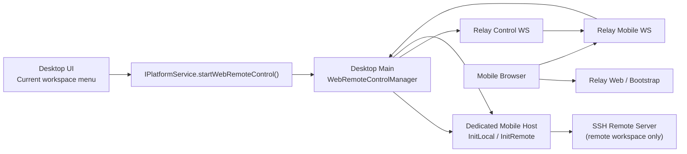

# Mobile Remote Access Minimal Run Plan (Historical Plan)

> **Deprecated:** This document describes the already-removed in-repo relay and remote-control-dedicated host plan, retained for historical records only.
> The current implementation selects the external relay by endpoint: production is `wss://zcode.z.ai/ws`, standard test is
> `wss://zcode.z.ai/ws`. The default QR code entry selects `/remote/v3` or `/remote/v4` by App version;
> the `3.4.0` stable version threshold and pre-release version rules are described in the current architecture document; explicit URL overrides take priority.
> The mobile client connects to the local/remote workspace scope in the single Window Host of the target desktop window through shared-host attachment;
> no mobile-dedicated Host/Agent is started. Current facts are defined by [Web Remote Control Architecture](./web-remote-control-architecture.md).

Related documents:

- `todo/web-remote-control.md`
- `docs/remote-workspace-session-in-current-window.md`

## 0. Conclusion First

If this round is done as "**minimal run, ignoring security for now**," it is recommended **not** to continue using the "open a local WebSocket server inside the host process, then bridge from the main process to the relay" plan from `todo/web-remote-control.md`, but to instead use this path that is closer to the current code status:

1. The Desktop main **spawns a Web remote control dedicated host process** after the user clicks "Enable Web Remote Control"
2. This host is not usable by the renderer; the main holds its `MessagePort` itself
3. The main establishes a control connection with the relay
4. After the mobile client connects, the relay allocates a session data WebSocket to the main
5. The main directly bridges: `relay data ws <-> MessagePort <-> host ChannelServer`
6. The mobile client reuses `packages/web`, just changing the service entry from the local `/ws` to the relay's mobile ws

The reasons are straightforward:

1. **The current code is no longer the "one host = one activeServices" model.**
   Historical implementations were "base host + remote workspace session host"; the current contract has been unified to exposing remote workspace service scope by workspaceKey within a single Host.
2. **Starting a mobile host separately unifies local / remote handling.**
   Local workspaces start `init-local`; remote workspaces start `init-remote`; both get a complete `IServiceAccessor`.
3. **No need to add a local ws server to the existing host.**
   Directly reuse the already-working `MessagePortProtocol + ChannelServer`; the overall changes are smaller and the risk is lower.
4. **It does not affect the path currently used by the desktop renderer.**
   Web remote control is a side-capability; failure is unlikely to corrupt the main window's RPC path.

Additionally, although there are already `packages/relay/dist/*` in the repository, there is currently **no corresponding source/package definition**, so it should be treated as a historical artifact, not as the baseline for this implementation. This round needs to re-build the relay as a formal package in the monorepo.

## 0.1 Historical Implementation Notes Filled In

Around "session lifecycle and error pages" and "stabilizing SSH remote", this early implementation phase additionally covered:

1. The relay keeps a short-lived tombstone for ended mobile sessions and records the close reason
2. The mobile web lands on an explicit error page in the following scenarios, rather than staying loading:
   - The link has expired
   - The session has been occupied by another page
   - The desktop has disconnected or stopped sharing
   - The relay is unavailable / connection abnormal
3. The Desktop main retains `error + failure reason` when Web remote control ends abnormally, rather than directly returning to `idle`
4. In SSH remote mode, the mobile-dedicated host waits for the remote host to truly `Connected` before starting the bridge, avoiding the mobile client getting stuck in initialization

The product boundaries maintained by this historical phase:

1. Web remote control only supports entering **already opened** workspaces on the Desktop
2. Does not support creating Docker / SSH / WSL workspaces on the mobile client
3. Does not support disconnection reconnection and session recovery

The current implementation has evolved to shared-host attachment + in-place recovery: the mobile `/remote` connects to the local/remote workspace scope in the single Window Host of the target desktop window, without creating a dedicated mobile host; the mobile message stream uses
`replayable` snapshot/replay recovery, while the desktop continues with `continuous` direct stream. The subsequent chapters of this document are retained only as records of the early minimal plan.

## 1. Scope and Boundaries

### This Round's Goals

1. The current desktop workspace can generate a Web remote control QR code
2. After scanning the QR code, the mobile browser opens a UI reusing `packages/web`
3. The mobile client can access service capabilities consistent with the current desktop workspace
4. At least two types of workspaces are supported:
   - Local workspaces
   - SSH remote workspaces

### Explicitly Out of Scope

1. No TLS / OAuth / token validation closed loop
2. No desktop confirmation dialog
3. No multiple mobile devices connecting simultaneously
4. No disconnection reconnection / session recovery
5. No real-time sync with the current desktop tab / current task
6. No read-only permission control
7. No cross-device broadcast consistency guarantee

### The Minimal Product Definition for This Round

"Minimal run" is defined as:

1. The desktop initiates "Enable Web Remote Control" from the current workspace
2. After the mobile client scans the QR code, it can directly enter that workspace
3. The mobile client can at least complete file browsing, basic chat, and basic terminal connection
4. When the desktop disables Web remote control, the mobile connection immediately becomes invalid

## 2. Current Constraints

## 2.1 Desktop Current State

The current service structure of the desktop is:

- The App has 1 main workspace window and 1 Host Process
- The Host maintains 1 CLI per workspace by workspaceKey
- The renderer receives base services through `MessagePort`
- The remote workspace tab combines "base services + remote workspace services" into a single `IServiceAccessor`

This means:

1. **The remote workspace scope inside the Host only exposes services related to that workspace**
   There are no global capabilities like `setting/credential/oauth/modelProvider` locally
2. **The base host cannot represent the current remote tab**
   Because the current tab truly uses file/system/terminal/zcode task/session from another remote session host

Therefore, if Web remote control directly "borrows the existing host," it will easily encounter incomplete service issues in the local / remote scenarios.

## 2.2 Web Current State

`packages/web/src/main.tsx` currently has only two entry points:

1. `/ws`
2. `/ws/remote/:id`

And the `Root` already supports `initialWorkspaceAbsPath`, which is important for Web remote control, because we can let the mobile client **directly land on the target workspace** without first entering the project selection page.

## 2.3 Relay Current State

The current `packages/relay/` only has compiled artifacts, without:

- `src/`
- `package.json`
- `tsconfig.json`
- build/dev scripts

So the relay this round should be treated as **re-packaging**, not iterating on existing source code.

## 3. Recommended Solution

## 3.1 Overall Architecture



## 3.2 Key Design Decisions

### Decision A: Create a Dedicated Mobile Host Every Time Web Remote Control is Enabled

Do not reuse the renderer's current path.

Reasons:

1. Lifecycle is easier to manage
2. Local / remote is unified
3. Failure surface is smaller
4. The main can directly hold the `MessagePort` for bridging

### Decision B: Split the Relay into Control and Data Planes

It is recommended to split into two types of ws:

1. **Desktop control ws**
   - Used for tunnel registration
   - Used to notify "a mobile session has connected"
2. **Desktop session data ws**
   - One per mobile session
   - After entering the bridge, only binary RPC frames are transmitted, without mixing control messages

This avoids:

1. Reusing JSON control messages and binary streams in the same ws
2. Base64 wrapping RPC frames
3. Writing an additional session multiplexing protocol on both the relay / main ends

### Decision C: Web Remote Control is Directed at "Workspaces", Not "Windows"

The UI must pass the current workspace context to the main when initiating:

- Local workspace: `workspacePath`
- Remote workspace: `workspacePath + remoteSessionId`

The main then determines whether the current mobile host should start `init-local` or `init-remote` based on `remoteSessionId`.

## 4. Module-by-Module Plan

## 4.1 `packages/shared`

Add Web remote control domain types, recommended as independent files, e.g.:

- `packages/shared/src/mobile-access.ts`

Recommended contents:

```ts
export interface WebRemoteControlContext {
  workspacePath: string;
  remoteSessionId?: string;
}

export interface WebRemoteControlStartResult {
  status: "running";
  sessionId: string;
  qrUrl: string;
  connectUrl: string;
  workspacePath: string;
}

export interface WebRemoteControlStatus {
  status: "idle" | "starting" | "running" | "error";
  sessionId?: string;
  qrUrl?: string;
  connectUrl?: string;
  workspacePath?: string;
  error?: string;
}
```

Also extend:

- `packages/shared/src/channels.ts`
  - `PlatformChannels.StartWebRemoteControl`
  - `PlatformChannels.StopWebRemoteControl`
  - `PlatformChannels.GetWebRemoteControlStatus`
- `packages/shared/src/platform.ts`
  - `IPlatformService.startWebRemoteControl(context)`
  - `IPlatformService.stopWebRemoteControl()`
  - `IPlatformService.getWebRemoteControlStatus()`

If relay control messages need to share types, add:

- `DesktopControlMessage`
- `RelayControlMessage`

## 4.2 `packages/desktop/src/main`

This is the main battlefield of this round; it is recommended to create a dedicated module, e.g.:

- `packages/desktop/src/main/webRemoteControlManager.ts`

Responsibilities:

1. Receive `start/stop/status` initiated by the UI
2. Determine whether the current workspace is local or remote
3. Start a dedicated host process for Web remote control
4. Retain the `MessagePort` for this host
5. Establish the relay control ws
6. When the mobile session truly connects, establish the relay data ws
7. Responsible for the `MessagePort <-> relay data ws` binary bridge
8. Responsible for unified cleanup after the session ends

It is recommended to maintain inside the main:

```ts
interface WebRemoteControlRuntime {
  windowId: number;
  workspacePath: string;
  remoteSessionId?: string;
  remoteTarget?: RemoteTarget;
  hostProcess: ElectronUtilityProcess;
  messagePort: MessagePortMain;
  controlSocket: WebSocket;
  dataSocket?: WebSocket;
  relayTunnelId: string;
  sessionId: string;
  qrUrl: string;
  status: "starting" | "running" | "stopped" | "error";
}
```

The current remote session tracking structure also needs to be adjusted:

- Currently, `remoteWorkspaceSessionProcessMap` only records `process + webContentsId`
- This round needs to at least add `target`
- Otherwise, the main cannot restore the `RemoteTarget` needed by `init-remote` from the `remoteSessionId`

### Why Not Modify the Host Here

Because the host already supports:

- `InitLocal`
- `InitRemote`
- `MessagePortProtocol`
- `ChannelServer`

The main only needs to extract the spawn logic slightly, allowing "**do not send the port to the renderer, but keep it in the main**", which is sufficient.

## 4.3 `packages/desktop/src/preload`

Extend the `window.zcode` bridge:

- `startWebRemoteControl(context)`
- `stopWebRemoteControl()`
- `getWebRemoteControlStatus()`

Only keep the main IPC forwarding; do not place business logic.

## 4.4 `packages/desktop/src/renderer/src/main.tsx`

Connect the new capabilities to `desktopPlatform`:

- `startWebRemoteControl`
- `stopWebRemoteControl`
- `getWebRemoteControlStatus`

## 4.5 `packages/ui`

The UI minimal processing; no new complex pages; only a lightweight entry + status panel.

Recommended entry point locations:

1. The more menu of the current workspace
2. Or the tool entry at the workspace sidebar footer

Minimal interactions:

1. Click "Web Remote Control"
2. Display a dialog / popover
3. Internally:
   - QR code
   - Copy link button
   - Current status
   - Close access button

This round does not include:

1. Connected device list
2. Permission settings
3. Mobile connection confirmation dialog

Notes:

1. UI logs uniformly go through `packages/ui/src/logger.ts`
2. Text needs to be bilingual (Chinese / English)
3. New UI must be compatible with 4 themes
4. Reuse the existing dialog/button/tooltip system according to `DESIGN.md`; do not start a new visual style

## 4.6 `packages/web`

Web remote control mode reuses the existing web UI, but adds a bootstrap path.

Recommended flow:

1. The mobile client opens `https://relay-domain/r/<token>`
2. The web entry reads the `token`
3. First request `GET /api/remote-control/bootstrap/<token>`
4. Receive:
   - `workspacePath`
   - `wsUrl`
5. Then `connectViaWebSocket(wsUrl)`
6. Use the `workspacePath` as `Root.initialWorkspaceAbsPath`
7. Also turn off `restoreSession` to avoid the mobile client bringing in residual tab state from the local browser

This round, the mobile web should clarify two points:

1. **Directly land on the workspace**
2. **Do not restore previous local browser sessions**

## 4.7 `packages/relay`

This round, re-build the relay as a formal package in the monorepo, recommended directory:

```text
packages/relay/
  package.json
  tsconfig.json
  src/
    index.ts
    entry.ts
    server.ts
    sessionManager.ts
    tunnelManager.ts
    bridge.ts
    types.ts
```

### Roles

1. Manage desktop tunnels
2. Generate Web remote control sessions
3. Maintain token -> session mappings
4. Provide the mobile bootstrap API
5. Connect the mobile ws and the desktop data ws
6. Provide health checks

### Minimal Interface

```text
GET  /health
WS   /ws/desktop/control
POST /api/remote-control/sessions
GET  /api/remote-control/bootstrap/:token
WS   /ws/remote-control/:token
WS   /ws/desktop/session/:sessionId
GET  /r/:token
```

### Key Notes

`GET /r/:token` can have two implementations:

1. Production mode: directly return the web build product entry
2. Development mode: forward/redirect to the web dev server

For minimal implementation, it is recommended that the relay support an environment variable:

- `WEB_REMOTE_CONTROL_ORIGIN`

When present, use the dev redirect / proxy; when absent, use the local static resource.

## 5. Protocol Recommendations

## 5.1 Desktop Enabling Web Remote Control

1. The UI calls `startWebRemoteControl({ workspacePath, remoteSessionId? })`
2. The main determines:
   - No `remoteSessionId` -> start `InitLocal`
   - With `remoteSessionId` -> find the corresponding `RemoteTarget`, start `InitRemote`
3. The main establishes the relay control ws
4. The relay returns `tunnelId`
5. The main calls `POST /api/remote-control/sessions`
6. The relay returns:
   - `sessionId`
   - `token`
   - `connectUrl`
   - `qrUrl`
7. The main returns the result to the renderer

## 5.2 Mobile Client Access

1. The mobile client opens `/r/:token`
2. The page pulls the bootstrap
3. The page connects to `ws/mobile/:token`
4. The relay finds the corresponding session and notifies the desktop control ws:

```ts
{
  type: ("mobile-session-request", sessionId);
}
```

5. The main immediately establishes `ws/desktop/session/:sessionId` after receiving the notification
6. After the relay has the mobile ws and the desktop session ws ready, it starts transmitting binary data as-is
7. The main locally bridges:

```text
desktop session ws <-> MessagePortMain <-> host ChannelServer
```

## 5.3 Close

When either end closes:

1. The relay closes the other ws
2. The main destroys the mobile host
3. The main cleans up the runtime map
4. The UI status returns to idle

## 6. Phase-by-Phase Implementation Plan

## Phase 0: Re-packaging and Scaffolding

Goal: Turn the relay from "only a dist historical remnant" into a formal package.

Tasks:

1. Create `packages/relay/package.json`
2. Create `packages/relay/src/*`
3. Connect root scripts:
   - `pnpm --filter @zcode/relay dev`
   - `pnpm --filter @zcode/relay build`
4. Add the relay to the root `typecheck`
5. Add the relay to the root `lint`

Exit criteria:

1. `packages/relay` can independently dev/build
2. The root build chain recognizes this package

## Phase 1: Local Path Unblocking (No UI First)

Goal: First prove that "relay data ws <-> main MessagePort <-> host RPC" works.

Tasks:

1. The main supports creating a mobile host and retaining the port
2. The relay supports three types of connections: desktop control / session / mobile
3. The web connects to the relay first using a temporary URL parameter mode
4. Manually input the token to verify that the local workspace can open

Exit criteria:

1. No QR dependency; manually opening the URL already shows the local workspace from the mobile client
2. At least one operation succeeds for the file service and terminal service

## Phase 2: Desktop UI Closed Loop

Goal: Connect the "enable Web remote control -> display QR code -> close access" into the product UI.

Tasks:

1. Add start/stop/status to `IPlatformService`
2. Connect the preload / renderer bridge
3. Add the entry and QR code layer to the UI
4. Add the copy link, error prompt, and close button

Exit criteria:

1. The user does not need to manually拼 the URL
2. The full Web remote control can be started and closed from the desktop UI

## Phase 3: SSH Remote Workspace Support

Goal: Connect the current remote workspace to the same flow.

Tasks:

1. Add `target` to the main's `remoteWorkspaceSessionProcessMap`
2. Support `remoteSessionId` in `startWebRemoteControl(context)`
3. The main creates the mobile host using `InitRemote`
4. The mobile web directly reaches the remote workspace path

Exit criteria:

1. Initiate Web remote control from the SSH remote tab
2. The mobile client sees the remote file system and the remote terminal

## Phase 4: Stability and Wrap-up

Goal: Make this path a sustainably maintainable capability, not a one-time demo.

Tasks:

1. Add logging
2. Add abnormal cleanup
3. Add the most critical unit/integration tests
4. Update the development documentation and debugging commands

Exit criteria:

1. The mobile client disconnecting mid-stream does not leave zombie host / ws sessions
2. Scenarios such as relay restart, desktop shutdown, can complete cleanup

## 7. Minimal Logging Plan

### Main Logging

Uniformly use `packages/desktop/src/main/logger.ts`; recommended prefixes:

- `[mobile-access] start`
- `[mobile-access] relay-control-connected`
- `[mobile-access] session-created`
- `[mobile-access] data-bridge-open`
- `[mobile-access] stop`
- `[mobile-access] cleanup`

### UI Logging

Uniformly use `packages/ui/src/logger.ts`; only log low-frequency events, e.g.:

- Opening the dialog
- Copying the link
- The user clicking close

### Relay Logging

The relay maintains its own structured prefixes, e.g.:

- `[relay] tunnel-registered`
- `[relay] session-created`
- `[relay] mobile-connected`
- `[relay] desktop-session-connected`
- `[relay] bridge-closed`

## 8. Testing Recommendations

At least the following categories must be covered this round:

1. Relay `SessionManager` unit tests
2. Relay desktop/mobile matching and timeout cleanup unit tests
3. The main `WebRemoteControlManager` lifecycle unit tests
4. Web bootstrap unit tests

Manual regression cases must at least include:

1. Local workspace QR scan success
2. SSH remote workspace QR scan success
3. After the desktop disables access, the mobile connection immediately becomes invalid
4. After the mobile actively disconnects, the desktop status returns to idle
5. No residual relay sessions when the desktop exits

## 9. Risks and Trade-offs

### Risk 1: Remote Workspace Parsing Still Depends on Existing `remoteSessionId`

This is the current minimal path, but it shows that Web remote control still depends on "the renderer knows which remote session lies behind the current workspace."

This round accepts this coupling; if the repository introduces a true `workspaceId / workspaceDescriptor` later, upgrade it together.

### Risk 2: The Mobile Host Will Duplicate Create Local Global Services

For example, `setting / credential / oauth / modelProvider` will all start again in the new host.

This round accepts this because:

1. This unifies local / remote
2. The architecture is cleaner
3. Get it working first

If resource optimization is needed later, consider splitting "global local services" and "workspace services" into composable host assembly methods.

### Risk 3: The Web UI May Expose Desktop Interaction Issues on Mobile

This round first accepts that the mobile adaptation of the desktop UI is imperfect; only ensure it works.

Optimize specifically for the mobile layout later.

## 10. Recommended Implementation Order

It is recommended to start in the following order:

1. Re-build `packages/relay`
2. The main-side mobile host + MessagePort bridge
3. The web mobile bootstrap
4. Get the local workspace working
5. The desktop UI QR code entry
6. Get the SSH remote workspace working
7. Testing and documentation wrap-up

## 11. One-Sentence Version

The most stable minimal plan for this round is: **Make Web remote control into "a dedicated host session held by the main + relay control/data dual channels + the web reusing existing UI to directly reach the workspace mode"**, rather than continuing to assume that a unified `activeServices` representing the current local / remote workspace exists inside the host.

## 12. Current Implementation Status

As of the current worktree, this path has completed the minimal skeleton:

1. `packages/relay` has been formally packaged, possessing basic entries for desktop control, mobile bootstrap, and desktop/mobile data ws
2. The desktop main has connected `WebRemoteControlManager` and can spawn a dedicated host for the current workspace and build sessions through the relay
3. The web supports the `remoteControlToken + relayOrigin` bootstrap mode; the mobile client can directly reach the target workspace
4. The desktop UI already has the sidebar entry and QR code dialog layer
5. Both local workspaces and SSH remote workspaces are modeled by the same initiation interface

Additionally, the most critical stability fixes have been filled in:

1. The relay caches RPC frames sent by the mobile client before the bridge is established, avoiding the first-screen initialization request being swallowed after scanning the QR code
2. The desktop main retains the Web remote control error state, avoiding dropping directly back to `idle` after the bridge fails
3. The QR code dialog polls the current Web remote control status, able to see `running -> active / error` changes
4. In SSH remote mode, the main waits for the mobile host to complete the remote connection first before starting the bridge RPC, avoiding the mobile client getting stuck in initialization for a long time
5. The Docker / WSL detection under the mobile web has been proxied back to the desktop main through the relay control socket, no longer incorrectly using the web fallback's fixed `false / []`

One clear boundary is still retained:

1. "Create new remote session" in the Web remote control page has not been supplemented with the `MessagePort` injection path
2. Therefore, the mobile page currently only supports accessing **the current workspace already initiated and opened by the desktop**
3. If "creating new SSH / Docker / WSL connections on the mobile page" is supported in the future, a separate protocol for mobile takeover of remote sessions needs to be designed

## 13. Local Debugging Commands

The current minimal debugging is recommended to be started in the following order:

1. Start the relay
   - `pnpm dev:relay`
2. Start the web
   - `pnpm dev:web`
3. Start the desktop, pointing to the relay
   - `ZCODE_WEB_REMOTE_CONTROL_RELAY_URL=http://localhost:8787 pnpm dev:desktop`

One additional environmental convention needs to be supplemented for debugging:

1. The relay needs to know which web address the mobile client should jump to after scanning the QR code
2. For local development, set `WEB_REMOTE_CONTROL_ORIGIN=http://localhost:5173`

Therefore, a more complete relay startup example is:

```bash
WEB_REMOTE_CONTROL_ORIGIN=http://localhost:5173 pnpm dev:relay
```
