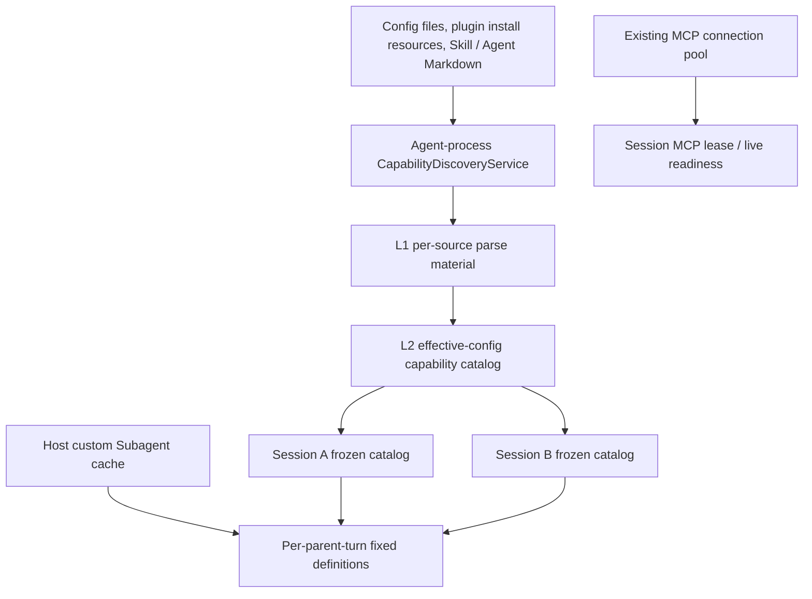
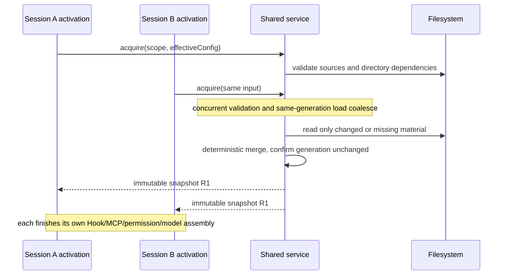

# Workspace external capability discovery cache

> Status: design draft, 2026-10-09; not implemented, performance acceptance not done. This document gives recommended decisions; candidate tests are not recorded as covered.
> Scope: reuse of external-config discovery, read and parse results across new and cold-resumed sessions inside one Agent process.
> Layers touched: option-source, persistence (in-memory cache only), recovery. Runtime execution state and message delivery protocol keep their existing owners.

## 1. Goal and current state

Goal: after Session A of a workspace has loaded its capabilities, Session B does not re-read or re-parse unchanged Skills, plugin manifests, plugin Agent Markdown and config bodies. Necessary file-metadata validation is still allowed; a hit does not promise zero filesystem operations.

Today `createZCodeApp()` calls `createConfig()`, `resolveStartupPlugins()` and `loadPluginAgentTemplates()` on every App creation and creates its own `NodeSkillAdapter`. `ensureContextInitialized()` stores discovery results in the local Runtime, which cannot give another Runtime a parse cache.

Existing capabilities are reused; no new owner is created:

| Existing fact                                  | Current owner                                 | Treatment                                                   |
| ---------------------------------------------- | --------------------------------------------- | ----------------------------------------------------------- |
| User/project Subagent parse snapshot           | Local Host `createSubagentRuntimeConfigCache` | Kept; local init and new parent turns keep reading the Host |
| Skill/plugin reference catalogs                | `AgentRuntime` / session App                  | Kept frozen; a new Runtime builds a new snapshot from shared material |
| MCP live connections and tool lists            | Existing MCP adapter / connection pool        | Default session isolation and explicit workspace isolation kept |
| Plugin install files, config files, Markdown   | Filesystem and existing config write entries  | Remain authoritative; the cache is not a new persistence source |
| Provider Registry, accounts, credentials, Hook trust | Their existing owners                   | Still read when execution facts are needed; never restored from the capability cache |

Related fact docs: [Skill catalog lifecycle](ui/conversation-skill-catalog-lifecycle.md), [Subagent refresh by parent context](subagent-runtime-refresh.md), [Workspace plugins](plugins/workspace-level-plugin-architecture.md), [cold resume](v4-refactor/17-cold-resume-runtime-activation.md).

## 2. Recommended boundaries

1. Phase 1 is an in-process cache only. The Agent rebuilds after restart; the on-disk `plugins/cache` keeps representing installed resources only and is not a parse cache.
2. A hit and a miss must produce identical capabilities, priorities, namespaces, diagnostics and disable rules. The optimization removes repeated work; it never widens executable capability.
3. New, cold-resumed and forked Apps may reuse shared parse material. An already-initialized session keeps its own immutable catalog and is not hot-updated.
4. Custom Subagents keep the existing independent rule: read from the Host at initialization and at each new parent turn, fixed within the turn. They are not frozen to the session lifetime. Plugin Agents cache only the raw template; model overrides are re-merged per parent context under the existing rule.
5. `SessionStart` timing is unchanged. Hook output, execution results and "already ran" flags are not cached. Whether browsing history triggers execution is a separate lifecycle decision.
6. MCP tool-declaration waiting, live readiness, permissions, sampling, elicitation and App ownership are unchanged. The planned [MCP tool catalog cache](mcp-async-tool-catalog-cache.md) is an independent optimization and not an implemented dependency.

## 3. Single owner and two cache levels

At `app-server` startup, bootstrap creates one `CapabilityDiscoveryService` and injects it into each App; the standalone CLI creates the same implementation in its own process. It is never a module-level singleton, so tests, embedded calls and different config sources do not share state.

The adapter owns file I/O, the parse cache, watchers, generation and concurrency scheduling. Bootstrap owns config-layer merging, dependency wiring and the final per-activation projection. Core consumes only strictly typed immutable results and never imports adapter implementations. Names are proposed contracts, not existing APIs.

Side-effecting preparation (plugin seed, offline config migration, install transactions) stays with the original owners; only resource revisions published after success may enter the cache. Do not memoize `createConfig()` or `createZCodeApp()` as a whole, which would skip migration, storage opening and session assembly together.



| Level               | Stored                                                                                                           | Not stored                                                                                                         |
| ------------------- | ---------------------------------------------------------------------------------------------------------------- | ------------------------------------------------------------------------------------------------------------------ |
| L1 source parse     | Config AST/validation result, manifest and component declarations, Skill metadata, plugin Agent templates, source diagnostics and dependency list | Clients, process handles, session history, model objects, Hook execution, credential-service lookups |
| L2 effective catalog | Plugin identities merged by config, Skill catalog, plugin Agent template index, MCP/Hook config declaration templates | Session-specific interpolated paths, broker tokens, current OAuth headers, trust approvals, final model availability, tool execution state |
| Session / parent turn | The snapshot finally accepted by this activation / parent context, plus existing runtime state                 | Other sessions' writable references, shared accepted input queue                                                   |

Sensitive fields from config files held in L1 stay config-sensitive: memory only, never persisted, logged or dumped. Environment variables and credential references keep their declared form and are resolved at the existing execution-assembly boundary.

The CLI does not build a second updatable parse cache for local custom Subagents; it holds only the copy the Host returned for that turn. A standalone CLI or remote without a Host port may route its existing file-loading path through L1, but does not gain the local Host's per-parent-turn refresh semantics.

## 4. Keys and source identity

`sessionId` and bare cwd are not valid shared keys. Definitions:

```text
workspaceKey = workspaceIdentity?.trim() || workspacePath
scope = ownerInstanceEpoch + workspaceKey + remoteSessionId (when a remote logical attachment exists)

L1 key = scope + sourceKind + logicalPath + canonicalPath
       + parserVersion + discoveryPolicy + sourceRevision

L2 key = scope + effectiveDiscoveryFingerprint + dependencyRevisionVector
```

`ownerInstanceEpoch` is an in-process isolation id rebuilt on restart. A remote request must first verify `workspaceIdentity`, `remoteSessionId` and the existing Host binding before selecting the target Agent owner; without remote identity it must not fall back to a same-path local cache. Caches are not shared across windows or Agent processes.

`effectiveDiscoveryFingerprint` must cover:

- User/project config sources, storage root, priority-ordered capability roots; each root's source, scope, namespace and symlink policy.
- Plugin install-manifest revision, enabled/disabled/suppressed state, version/install-content revision, relevant options.
- Skill-disabled paths, feature flags, built-in resource version, CLI/session overrides that affect discovery.
- Environment inputs that affect path resolution; if a result really depends on account or identity, an opaque revision of that source is included. A dependency must not be omitted just because the current implementation happens not to use it.

Equivalent objects use deterministic serialization; arrays keep the product priority order and are never sorted for dedup. A hash collision is not treated as equivalence: each entry also stores an internal canonical descriptor for verification. Keys containing sensitive material are never logged.

Phase 1 L1 is isolated by scope and targets multiple sessions of one workspace. User/plugin ASTs are not reused across workspaces until source permissions and namespaces are verified. The Host's existing user-Subagent sharing is unchanged.

## 5. Acquire, freeze and shared loading

Proposed internal contract:

```ts
interface CapabilityDiscoveryService {
  acquire(
    input: DiscoveryInput,
    options: {
      freshness: "validate-sources" | "force-reload";
      signal?: AbortSignal;
    },
  ): Promise<Readonly<CapabilityDiscoverySnapshot>>;
  invalidate(input: DiscoveryInvalidation): void;
  dispose(): Promise<void>;
}
```

`DiscoveryInput` accepts only verified scope, discovery config and source revisions; no UI-supplied global cache key. A snapshot holds `snapshotId`, dependency revisions, immutable material and diagnostics, and no mutable session fields.



- One shared Promise per key + generation. Register the flight before starting I/O; after waiting for a concurrency permit, re-check cache and revision.
- A hit still completes source freshness validation first; an existing entry never skips new/deleted-file checks. Concurrent activations share the in-flight validation; no short TTL replaces validation.
- A consumer cancelling cancels only its own wait, not other waiters' loading. In phase 1 a bounded load may finish for later use even if all waiters leave; owner dispose must cancel all I/O and forbid late publication.
- Shared results are read-only. Code that mutates fields such as `PluginLoadOutcome.skillRoots` must derive new objects or copy at the session assembly boundary; wire returns defensive copies.
- Cache eviction only drops service-held references; initialized session snapshots are unaffected. Reclaiming a Runtime does not clear the in-process shared cache.
- The Skill cache pins only catalog metadata; explicit `Skill` tool body reads, dynamic lookup, truncation and error semantics follow existing rules, and bodies are not frozen permanently.

## 6. Source validation and invalidation

Every L1 material needs an explicit dependency list: files read, directories scanned, candidate-but-missing paths, symlinks and targets, config ancestor candidates, plugin install records and built-in resource revision. Otherwise new files and directory rebuilds cannot invalidate an old empty result.

### 6.1 Freshness rules

Phase 1 validates mutable sources asynchronously on every activation: directory member list and file `dev/ino/size/mtime/ctime` fingerprints at the highest platform precision. Current discovery depth and ancestor boundaries are kept; recursion is not widened to add capability. Only changed items are read, checksummed and parsed; an unreliable fingerprint counts as changed.

File fingerprints are checked before and after the first read; dependency revisions before and after scan/build. A detected change discards the candidate and retries. In-place replacements that metadata cannot detect are covered by file-event-forced dirty or explicit force reload; this is not a filesystem transaction guarantee against arbitrary concurrent external writes. Tests must cover same-length writes, atomic replace and mtime-preserving writes.

For immutable built-in assets managed by release version, the post-install resource revision may replace per-file validation. Inline, local-dev paths and user-editable marketplace install directories are never immutable by version number alone.

Watchers are early invalidation and avoid wasted builds, not the sole correctness source. Events may coalesce, but the first valid event immediately bumps the generation and marks dirty before async refresh; debounce only merges I/O and does not decide staleness.

### 6.2 Invalidation matrix

| Event                                                    | Invalidated scope                                                         | Running sessions                                                       |
| -------------------------------------------------------- | ------------------------------------------------------------------------- | ---------------------------------------------------------------------- |
| Skill added/modified/deleted, root changed               | Affected L1; L2 depending on it                                           | Keep frozen catalog; new Runtime re-acquires                           |
| Plugin install/upgrade/uninstall/suppressed/toggle/options | Install index, matching templates and L2; plugin-linked Skill/Agent/MCP/Hook together | Existing plugin lifecycle; cache does not force refresh |
| User/project config change                               | L2 depending on that config; dependencies rebuilt when discovery roots change | Existing runtime-setting effect rules unchanged                    |
| Host custom Subagent change                              | Existing Host watcher; CLI does not copy the owner                        | Read at next parent context; current turn/child unchanged              |
| Trust revoke, account/credential switch                  | Existing live validation acts at once; discovery-affecting revisions also invalidate | Old cache never substitutes for existing execution checks   |
| Watcher lost / directory deleted and rebuilt / remote connection generation change | Source unhealthy; old entries lose hit eligibility; listeners and validation rebuilt | Existing snapshots untouched; errors follow existing runtime logic |
| Explicit refresh                                         | Force reload bypassing L1/L2 for the scope, never reusing an old flight   | Settings/workspace queries get current values; session queries still use this session |
| Runtime eviction / normal UI unsubscribe                 | Process cache not invalidated                                             | Releases that Runtime's own references                                 |
| Agent shutdown                                           | Cancel flights, close watchers, clear cache                               | Wrapped up by the existing runtime lifecycle                           |

Existing plugin/config write entries inside the CLI invalidate synchronously after a successful write, before responding. Host config writes add no cross-Host ACK barrier: new activations' source validation and existing watchers discover changes. The Subagent contract "each Host observes independently" is kept; no new config broadcast protocol.

Workspace directory queries without a session and explicit Settings refresh keep using the current authoritative read path; phase 1 does not make them return L2 directly. A later hookup must keep current directory semantics and force reload. Draft prewarm invalidation keeps the existing management entry; a new snapshot never replaces an already-promoted formal Runtime in place.

### 6.3 Late results and errors

```text
generation 7 starts reading
    -> file changes: generation 8, old entry dirty
    -> generation 7 completes: neither written to cache nor returned to a new Runtime whose acquire is unfinished
    -> acquire re-fetches generation 8
```

Publication checks owner epoch, entry token and the full dependency revision vector, avoiding ABA after LRU delete and rebuild. Invalidation affects both cache write-back and in-flight waiters; it is not enough to stop the old result entering the cache while still returning it to Session B.

If continuous edits prevent a stable read, rebuild at most 3 times because of source changes, then return the identifiable `sources_changed_during_load` and retry through the existing init retry entry, never by sleeping. Ordinary I/O errors follow the current loader's diagnostic/failure rules and the failed Promise is removed at once; an empty catalog is never cached long-term and an old success is never silently reused as current.

Deterministic parse errors may cache diagnostics against the source fingerprint. A missing optional directory may cache an empty result, but its parent directory and candidate paths enter the dependencies. Results degraded by I/O faults do not enter reusable L2; the next activation can recover.

## 7. Concurrency and memory budget

Initial internal constants, to be tuned with real fixtures and not user settings:

| Item                          | Initial value | Constraint                                                                 |
| ----------------------------- | ------------- | -------------------------------------------------------------------------- |
| Concurrent distinct effective-catalog builds | 4 | Same key coalesces; the wait queue is cancellable                      |
| Root scans                    | 8             | One owner-wide semaphore, not 8 per session                                |
| File read/parse tasks         | 32            | Owner-global cap, not per root; CPU parsing is batched and yields the event loop |
| Completed L2 / L1 entries     | 64 / 512      | LRU, also bounded by the byte budget                                       |
| Cache-retained data           | 32 MiB estimated | Excludes session-held snapshots, which metrics record separately; an over-limit entry can be returned but not retained |
| Queued distinct acquire keys  | 64            | Over the limit returns structured busy, retryable via the existing retry entry; no unbounded queue |

Only small text and needed metadata are read; full Skill bodies, Hook stdout and image assets are not cached. Removing an unreferenced source index also releases its watcher, reverse dependencies and revision bookkeeping; in-flight sources are not cleaned early. Eviction at the budget limit does not change capability results.

Converting today's synchronous file discovery to async I/O inside the adapter is a prerequisite; wrapping synchronous `readdirSync/readFileSync` in `Promise.all()` does not relieve CLI event-loop blocking. After concurrent completion, results merge in the original roots priority and stable path order, keeping same-name/same-path rules and diagnostic order.

## 8. MCP, Hook and multi-client boundaries

- The MCP cache covers only discovery and parsing of config declaration templates. Runtime cwd, environment, broker data and auth headers are produced at the existing assembly boundary and then handed to the existing pool's full config key; default `session` isolation is never silently changed to `workspace`.
- Existing workspace MCP pool entries are reused as usual. A cache hit does not mean connected and does not skip live tool schema, permissions, sampling/elicitation routing or MCP App session ownership checks.
- Hooks cache declarations only; trust checks and execution stay with the original owner. One session having executed does not let another skip.
- Host custom-Subagent snapshot, plugin templates, user model overrides and the current Provider Registry each keep their own source. A parent turn reads the full Host snapshot, then merges frozen plugin templates and current overrides; the final profile is not a permanent cross-turn cache.
- Desktop is fixed `desktop-continuous`; mobile is fixed `web-remote-replayable`. Both access the same existing Host/Agent; the cache lives in neither renderer, relay nor desktop main, creates no new runtime, and holds no projection, seq, queue or owner lease.
- `workspacePath` is for file execution; isolation uses workspaceKey. Remote requests carry `workspaceIdentity`/`remoteSessionId` end to end; reconnect does not replay config side effects. Windows paths, case and symlink resolution reuse existing path utilities.
- History-first is independent of this cache: reading history needs no acquire; runtime init may use the cache but a hit cannot mark execution readiness complete directly. Init failure still preserves history.

## 9. Impact Brief

### Feature Summary and UI Surface Matrix

Mode is planning: only design and candidate verification. No new UI, schema persistence or user setting; model selection, queue and Hook event contracts are unchanged.

| User scenario / entry          | Shared implementation                    | Display / draft and default source                         | Validation and commit                 | Authoritative owner / sink                 | Mode / isolation                            |
| ------------------------------ | ---------------------------------------- | ---------------------------------------------------------- | ------------------------------------- | ------------------------------------------ | ------------------------------------------- |
| Open history `SessionPane`     | activation -> `createZCodeApp`           | History projection; draft stays in renderer                | Original runtime readiness and send command | CLI Runtime, persisted transcript    | desktop continuous / mobile replayable unchanged |
| `/`, `$` Skill Picker          | `useSkills` -> `getSkillReferenceCatalog` | Frozen catalog with a session, current workspace without one | Original query and canonical mention | Runtime or filesystem; no new UI cache      | Old-scope requests must not backfill new scope |
| `@` plugin Picker              | plugin reference catalog                 | Current session's frozen identities                        | Original reference validation and input submit | session App catalog / transcript    | Does not extend plugin enablement           |
| Skill/plugin settings page     | Skills/Plugins service                   | Current disk state and page draft                          | Original install/toggle/refresh entries | Files and install records                | Settings refresh does not hot-update formal sessions |
| Subagent settings / parent-turn start | Host runtime config, plugin templates | Form draft; latest Host snapshot for the parent turn   | Original save / model availability / launch | Markdown, state, parent-turn definitions | Current child model unchanged              |
| MCP settings / tool execution  | MCP config, existing connection pool     | Live state; no cache-connected state                       | Original connect/auth/permission/call | live adapter / original config file        | Session isolation and trusted routing kept  |

### Shared and divergent behavior

Shared: adapter parsing and deterministic catalog merge. Each UI keeps its own draft, each domain keeps its own validation and commit; user/project config still decides defaults and overrides. Persistence is unchanged; recovery only changes where the Runtime's material comes from. Skills/plugins are fixed per session, Subagents per parent context, MCP state is live; they cannot be unified under one refresh rule.

### Feature relationships, state owners and commit sinks

| Level          | Source -> edge -> target                              | Reason / evidence                                                                   |
| -------------- | ----------------------------------------------------- | ----------------------------------------------------------------------------------- |
| must-inspect   | bootstrap -> assembles -> discovery service           | `createZCodeApp`, `resolveStartupPlugins`, `NodeSkillAdapter`                       |
| must-inspect   | cache snapshot -> frozen material -> Runtime catalog  | `ensureContextInitialized`, `getSkillReferenceCatalog`, `getPluginReferenceCatalog` |
| must-inspect   | Host Subagents -> provides definitions -> new parent context | `createSubagentRuntimeConfigCache`, `subagent-runtime-refresh.md`            |
| should-inspect | settings/install write entries -> change sources -> cache validation | `createSkillsService`, workspace plugin config and install records   |
| conditional    | remote attachment -> selects owner -> scope           | Remote identity bound to the current logical session                                |
| invariant-only | cached MCP declaration -> assembles -> pool / live client | `createMcpConnectionPool`; unauthorized live state is not shared                |
| invariant-only | cache -> does not own -> CommandInbox / projection    | Three current remote fact docs and the conversation protocol                        |
| evidence-only  | existing unit tests -> verification baseline -> new tests | Tests listed below only prove existing semantics, not that the cache is implemented |

L1/L2 owner is the new adapter service; authoritative inputs come from the file/config owners; the only cache mutations are acquire publication, invalidate and dispose. After a session installs a snapshot, the cache never writes back to it. The Host Subagent cache and MCP pool do not change owner.

### Codegraph evidence

Codegraph was used with direct callers and one-hop owners as the main scope (target depth 2). The tool has no strict depth parameter, so full two-level reachability is not claimed; static same-name relations are navigation only, and conclusions rest on source and fact docs.

| Seed                               | Direct callers / key chain                             | Existing test evidence                                                          |
| ---------------------------------- | ------------------------------------------------------ | ------------------------------------------------------------------------------- |
| `resolveStartupPlugins`            | `createZCodeApp`, protocol MCP list                    | bootstrap `plugins.test.ts`, `visualize-skill-gate.test.ts`                     |
| `createZCodeApp`                   | protocol entrypoint, standalone/embedded calls         | bootstrap `mcp-project-config.test.ts`, `provider-registry-app-runtime.test.ts` |
| `getSkillReferenceCatalog`         | protocol server, UI `useSkills`                        | bootstrap `skill-reference-catalog.test.ts`                                     |
| `getPluginReferenceCatalog`        | protocol server, MCP App notification                  | bootstrap `plugin-reference-protocol.test.ts`                                   |
| `createSubagentRuntimeConfigCache` | `createSubagentsService` -> service collection         | services `subagentRuntimeConfig.test.ts`, watcher tests                         |
| `createMcpConnectionPool`          | MCP adapter factory -> protocol entrypoint             | adapters `mcp-connection-pool.test.ts`, appConnections tests                    |

### Graph drift candidates and graph delta

- The new cache owner does not exist yet; proposed additions: `capability.workspace-capability-discovery-cache`, `state.capability-discovery-cache` and a bootstrap injection service, linked to existing `state.session-skill-catalog` and `state.plugin-reference-session-catalog`.
- Existing `capability.subagents` should gain the parent-context refresh and Host cache doc relations; this is a graph-drift-candidate to verify.
- The tool-catalog-cache node in the graph may describe planning; no runtime wiring can be inferred from it.
- Only the proposed delta is recorded now. The formal semantic graph, conversation catalog and coverage matrix have adjacent ongoing work and this design is not approved for implementation, so proposed nodes and candidate cases are not registered as existing behavior.

## 10. Decisions and verification handoff

### Clarification log, boundary decisions, unresolved questions

| Decision                                                              | Source / status                  | Meaning                                       |
| --------------------------------------------------------------------- | -------------------------------- | --------------------------------------------- |
| Design a multi-session cache for one workspace                        | Explicit user request            | Authorizes design, not runtime code           |
| Session catalog frozen, Subagent updated per parent turn, MCP isolated by default | Existing contract, accepted | Cache must preserve                      |
| In-process two-level cache, metadata validation, global concurrency caps | This document, pending design review | Numbers may change with benchmarks      |
| Disk persistence / cross-process sharing / MCP tool advertisement cache | Pruned for this phase          | Separate protocol and invalidation cost       |

No open question blocks the design. A requirement that "no discovery after Agent process restart" or "a hit does zero filesystem operations" needs the phase-1 scope and freshness contract changed explicitly, never silently relaxed during implementation.

### Domain scope, concept map and dimensions

Main domains: capability discovery, session lifecycle, config authority/persistence, multi-client identity. Key concepts are source revision, effective config, frozen snapshot, live execution fact, mapped to source, cache, Runtime and existing execution owners.

| Dimension   | Representative values                                                         | High-risk crossing              |
| ----------- | ----------------------------------------------------------------------------- | ------------------------------- |
| Lifecycle   | First miss, same-process hit, Runtime eviction, process restart               | eviction x frozen snapshot      |
| Race        | Same key, different keys, cancel, load during invalidation, dispose           | invalidation x late completion  |
| Config      | Equivalent/different override, toggle, plugin update, trust change            | config identity x reuse         |
| Files       | Add, modify, delete, rename, symlink, permission error, watcher loss          | source health x freshness       |
| Environment | local, SSH/WSL/Docker, same path with different identity                      | remote scope x cache key        |
| Client      | desktop continuous, mobile replayable, both at once                           | delivery x single owner         |

### Candidate combinations and accepted cases

C01-C13 are recommended implementation cases with status `undefined` (awaiting design review; not unknown product semantics). The existing freeze/isolation invariants are accepted, but all new cache evidence is planned. No new unit/E2E has been run; nothing is claimed covered.

| ID  | Setup -> Action                                                      | Guard / effect to assert                                                          | Evidence layer / E2E status                       |
| --- | -------------------------------------------------------------------- | --------------------------------------------------------------------------------- | ------------------------------------------------- |
| C01 | Fixed workspace, A done -> cold-create B                             | Unchanged body reads and parses are 0; metadata validation allowed; result equals the uncached path | adapter + bootstrap, planned          |
| C02 | Empty cache, create 10 sessions at once                              | At most one parse per source/generation; stable ordering; global concurrency peak within bounds | controlled Promise + I/O counters, planned |
| C03 | A/B share a flight -> cancel A                                       | B succeeds; A receives no result; after dispose no late result is published       | adapter, planned                                  |
| C04 | Pause an old read -> modify file/config -> release                   | Old generation neither written back nor handed to a new Runtime; no ABA hit       | adapter + bootstrap, planned                      |
| C05 | Warm A -> install/disable Skill or plugin -> new B                   | A catalog fixed; B latest; Settings current; draft prewarm keeps existing invalidation | Desktop UI + Agent snapshot/files, planned |
| C06 | Same workspace with different roots/options/override; different identity same path | No false hit; same name from different source and symlink policy preserved | adapter/protocol, planned                  |
| C07 | Host custom Agent and plugin template -> change model override -> new parent turn | Template parse reused; new turn uses the new override; old turn/child unchanged | services + core + provider fixture, planned |
| C08 | First file EACCES/missing -> fix/create                              | Failed empty result not cached; new root discovered; next acquire recovers        | real temp filesystem, planned                     |
| C09 | Watcher lost, root atomic replace, same-length rewrite preserving mtime | Validation detects the dependency change or forces a re-read; no untrusted cache reuse | macOS/Windows/Linux fixture, planned      |
| C10 | Runtime eviction, cache LRU, oversized entry, process restart        | Eviction does not affect accepted snapshots; oversized entry usable but not retained; restart misses | adapter + process harness, planned |
| C11 | Two sessions with the same MCP config, session vs workspace isolation | Session isolation does not merge; workspace reuses per existing rules; a hit never fakes connected | MCP pool + auth/elicitation/App regression, planned |
| C12 | Desktop/mobile cold-subscribe at once; same path with different remote identity | Same owner may share material; different identities do not; continuous/replayable recovery boundaries unchanged | protocol + remote fixture, planned |
| C13 | Slow/failed cache load while history-first runs                      | History stays readable; readiness not early; retry is single-flight; no new input queue | gateway + Desktop E2E, planned                |

Pruning: theme/language/all models are not fully permuted since UI and model selection do not change; one narrow-screen/dual-client entry represents them. Not every MCP tool is enumerated; representatives are plain tool, auth, elicitation, sampling/App routing. Hook timing adjustment and disk cache are separate features; this phase only asserts Hooks are neither skipped nor duplicated by hit/miss.

### Matrix backfill and E2E handoff

Once the design is confirmed and implementation starts, backfill C05/C12/C13 into the conversation case catalog and coverage matrix, C07 into the Subagent refresh verification matrix, and put core cache cases in adapter/bootstrap tests. Reuse existing S08, MCP pool, Subagent watcher and cold-resume tests; do not overwrite or replace adjacent history-first case numbers.

E2E starts as manual-review/pending. Fixtures use temp directories, controlled plugin/Skill files and fixed provider replay; load/invalidate order is controlled by latches/Promises, never sleeps. Docker runs isolated singletons first, then joins the conversation/plugins preset. Real phone/SSH/WSL/Docker runs not yet connected stay as open follow-ups.

## 11. Metrics, order of work and rollback

Each activation aggregates one `capability.discovery.completed`: hit/miss/shared-flight, validate/read/parse/merge stage durations, body reads, parses, candidate rebuilds, entry count/estimated bytes/concurrency peak. Fields contain no file content, sensitive keys or credentials. High-frequency lookups use debug only; invalidation counts are aggregated, with no per-file production info.

Benchmarks cover: first session in a fresh process, second session in the same process, 10 concurrent sessions, file change, rebuild after Runtime eviction. Record runtime-ready and history-first-frame durations separately, plus first-turn MCP wait and Hook time, which are not cache gains. Accept first by C01/C02 work-count assertions, then compare same-machine p50/p95 and event-loop latency; no millisecond targets are promised up front.

Order of work:

1. Add stage timing and controllable-loader tests; make the shared discovery path real async I/O, keeping order and capability contract.
2. Introduce L1, source validation, shared loading, generation and capacity management inside the existing adapter; cover config/plugin/Skill/plugin Agent first, keeping the original public call paths.
3. Bootstrap injects the process owner, wires L2 and immutable session assembly, connects write-entry invalidation, and completes old-vs-new equivalence tests.
4. Run C01-C13 and related regressions; measure on dev/production CLI builds actually launched; report first-paint and initialization separately.

No new cache toggle UI. Development can compare against an injected no-cache implementation; production rollback withdraws the bootstrap cache wiring and keeps the same async loader. The two paths must not maintain different discovery rules.

Verification gate: before implementation run the architecture check and read the relevant module context; implement spec-first with tests written first. After implementation run root typecheck/lint, CLI typecheck/lint, affected adapter/core/bootstrap/services tests and interaction E2E. This round commits only the design document; check results go in the delivery note and are not treated as implementation acceptance.
