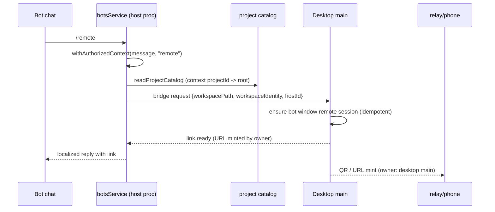

# Bots: adopt project identity `[hostId, projectId]` with persisted-state migration

Status: draft for PR `feat(bots): adopt upstream project identity [hostId, projectId] with persisted-state migration`.
Related: `specs/bot-remote-command.md` (`/remote`), `specs/upstream-sync-final-ledger.md` (`## bots`).

## 1. Problem

The fork's bot workspace identity is the remote workspace identity string
`remote:server:<owner>:<path>` (or an `ssh://…` authority form) plus `workspacePath`.
Upstream 3.16.1 moved bot workspaces to the project catalog: a candidate id is
`projectSelectionId([hostId, projectId])`, and the context carries `projectId`, `hostId`,
`additionalDirectories`. Four bot test files (18 tests) encode the upstream model and are red on
`origin/integration`. Upstream tests are not edited to match the fork; the fork moves.

## 2. Owners

| Concern                                              | Single owner                                                                                                                                                  |
| ---------------------------------------------------- | ------------------------------------------------------------------------------------------------------------------------------------------------------------- |
| Project catalog (candidates, roots, hosts)           | `project-catalog` (`readProjectCatalog(deps)`), fed by `projectService` and `remoteProjectService`                                                            |
| Project execution snapshot (`additionalDirectories`) | `projectService.prepareSession`, called only by `bindProject`                                                                                                 |
| Bot context and bot config persistence               | `BotsRepo` (`bots/repo.ts`), always via `updateContext` / `writeConfig` under the file lock                                                                   |
| Legacy identity -> project mapping                   | `upgradeLegacyContext` (single mapper, used by lazy upgrade and by the startup migration)                                                                     |
| Remote identity string build/parse                   | `@zcode/shared` `remote-workspace-identity.ts` only (`buildRemoteHostWorkspaceIdentity`, `remoteHostIdFromWorkspaceIdentity`, `parseRemoteWorkspaceIdentity`) |
| `/remote` link minting                               | Desktop main (unchanged); bot process only sends the bridge request                                                                                           |

## 3. Id mapping (lossless, no string guessing)

- Legacy identity `I = remote:server:<owner>:<path>` (or any authority form) splits as
  `hostId = remoteHostIdFromWorkspaceIdentity(I)` and `path = parseRemoteWorkspaceIdentity(I).workspacePath`.
  The round trip `buildRemoteHostWorkspaceIdentity(hostId, path) === I` must hold; otherwise the key is unmappable.
- Local (no identity): `hostId = ownerHostId ?? "local"`, legacy id is the bare path.
- New candidate id: `projectSelectionId(project)`, a JSON array string `[hostId, projectId]`.
- The fork `/remote` bridge still receives `workspacePath` and `workspaceIdentity`. For a
  project on a remote Host, `workspaceIdentity = buildRemoteHostWorkspaceIdentity(hostId, primaryRootPath)`
  is derived from `hostId`, never hand-written in business code.

## 4. Migration algorithm (persisted state)

Files (all under the app config dir, all v3 schema, unchanged shape):
`bot-config.v3.json` (`bots[].allowedWorkspaces`), `bot-state.v3.json` (`bots[key]`: `workspaceId`,
`workspaceIdentity`, `workspacePath`, `hostId`, `projectId`, `additionalDirectories`).

Trigger: `botsService.ensureBotStorageMigrated` (before any bot read), once per process after the v3
files exist. A failure is logged and never blocks bot reads; unmigrated entries keep their legacy form and
are retried on the next start and by the lazy path. The migration is not inside `repo.readState`, because
the project catalog is not available there.

Steps (`botsService.migratePersistedBotProjectIdentities`):

1. Plan the config: map each `allowedWorkspaces` key with `normalizeBotWorkspaceIdentities` +
   `normalizeConfiguredAllowedWorkspaces`, which use the upstream `resolveCanonicalWorkspaceId` rule. A remote
   key maps only to the single candidate whose `workspaceIdentity` equals it. Zero or several candidates
   keep the key verbatim (unmappable).
2. Plan the state: for each entry without `hostId`, call `upgradeLegacyContext`. Only an entry that gets a
   unique `projectId` is written; an unmatched entry is left unchanged.
3. Backup, once, before the first write: `BotsRepo.backupBeforeProjectIdentityMigration()` copies
   `bot-config.v3.json` and `bot-state.v3.json` to `bot-config.v3.pre-project-identity.json` and
   `bot-state.v3.pre-project-identity.json` with `COPYFILE_EXCL`, each under its file lock. An existing backup
   is never overwritten. No backup is written when nothing changes.
4. Write: the config through `writeBotConfig`; the contexts through `repo.updateContext` (a context that
   already has `hostId` is left alone).
5. Idempotent: a value already in `[hostId, projectId]` form, or a context that already has `hostId`, is
   skipped. A second run writes nothing and leaves the files byte-identical.
6. Known semantics: the upstream lazy upgrade (`readContext`) can still record `hostId` on an unmatched
   remote context with `projectId: null`, and keeps its legacy `workspaceId`. Such a context resolves no
   candidate, so it authorizes nothing new. The migration itself never writes an unmatched context.

No new state version key is added. The schema shape does not change, so the upstream build (same v3
reader) keeps reading the file. Any fork-only marker would live in a `fork_`-prefixed sidecar file, never in
`setting.json`; none is needed because the migration is idempotent per entry.

No new state version key is added. The schema shape does not change, so the upstream build (same v3
reader) keeps reading the file. The fork-only marker, if needed, lives in a `fork_`-prefixed sidecar file,
never in `setting.json`.

## 5. No widening

- Only an exact `(hostId, rootPath)` match against an existing catalog project is mapped. No project is created.
- Multiple matches (same cwd in several projects) leave the key unmapped; upstream rule "same cwd in
  multiple projects does not widen permission".
- `additionalDirectories` are never copied into a migrated context. They come only from `bindProject`
  (`prepareSession`), which runs on a user action.
- An unmappable key is kept verbatim. It matches no new candidate, so it authorizes nothing new. The
  bot loses access to that workspace until it is re-bound. This is a deliberate loss, not a widening.

## 6. Rollback

- Restore `bot-config.v3.json` and `bot-state.v3.json` from the `*.pre-project-identity.json` copies.
- A fork build that reads the migrated file sees `[hostId, projectId]` keys it does not know, so it
  degrades to unauthorized for those bots. Restoring the copies is the only supported downgrade.

## 7. `/remote` flow

Owner of the runtime and URL minting: desktop main. The bot only requests and forwards.

## 8. Acceptance scenarios

1. Upstream bot tests (`botsProjectBinding`, `botsService.permissionsWorkspace`, `botsService.messageFlow`,
   `botsService.groups`) pass with the upstream id format, with no assertion loosened.
2. `botsService.remoteLink` passes: `workspaceIdentity` stays `remote:server:test-owner:/tmp/workspace`.
3. Legacy state with a unique remote project: after startup the context has `hostId`, `projectId`,
   and `workspaceId = [hostId, projectId]`; the allowed key is `[hostId, projectId]`.
4. Legacy key with no matching project: kept verbatim; authorization is not widened.
5. Same cwd in two projects: not mapped; no new candidate is authorized.
6. Migration run twice: second run writes nothing (files byte-identical).
7. Backup files exist before the first migrated write and are not overwritten by a later run.
8. `/remote` from a private chat with the migrated context dispatches the bridge request with the derived
   `workspaceIdentity`, and fails with the existing localized error when the workspace is not authorized.
9. Production wiring: `node.ts` passes `projectService`, `remoteProjectService`, and `ownerHostId` to
   `createBotsService`; `remoteWorkspaceServiceCollection.ts` passes the remote Host's `hostId`.

## 9. Change ledger

- Port: `botsService.ts` is the upstream 0a1fc56d model merged onto the fork. The three-way merge had 5
  conflict regions; all were resolved by hand. The fork `/remote` types (`mintWebRemoteLink`) and
  `ZCodeAgentAppRuntimePreferences` import are kept. `BotRemoteWorkspaceTarget` gains optional `hostId`, and
  `BotRemoteWorkspaceService` gains optional `resolveWorkspace`.
- `workspaceHelpers.ts`: restored to upstream. The fork's path-based `resolveCanonicalWorkspaceId` rewrite
  kept legacy path/identity keys from matching the project candidate, which failed the upstream
  permissionsWorkspace test. The upstream rule is a single unique `workspaceIdentity` match, which is the
  exact-match rule of section 4 step 1.
- Migration: `BotsRepo.backupBeforeProjectIdentityMigration` (new), `config.ts` backup file names (new),
  `botsService.ensureBotStorageMigrated` now also runs `ensureProjectIdentityMigrated`.
- Wiring: `node.ts` passes `projectService`, `remoteProjectService`, `ownerHostId: projectStorageHostId`.
  `remoteWorkspaceServiceCollection.ts` passes the Host's project channel when present; a Host without it
  (the legacy remote RPC contract has no project channel) gets an empty catalog, and `prepareSession` throws
  `Remote Bot project binding unavailable`. Throwing at construction broke `hostRemoteWorkspaceServices.test.ts`
  (13 tests), so that was rejected.
- Tests changed: none of the four upstream test files (`botProjectBinding`, `permissionsWorkspace`,
  `messageFlow`, `groups`) and no assertion was edited. `botsService.fixtures.ts` gained a no-op
  `backupBeforeProjectIdentityMigration` on the in-memory repo; that is test infrastructure, not an expectation.
  New: `botsProjectIdentityMigration.test.ts` (5 tests, real file-backed repo: migration, idempotency,
  unknown key, two projects with the same identity, unmatched context).
- Not changed: fork `/remote` tests (`botsService.remoteLink`) pass with fork identities; `specs/bot-remote-command.md`
  behavior is unchanged.
