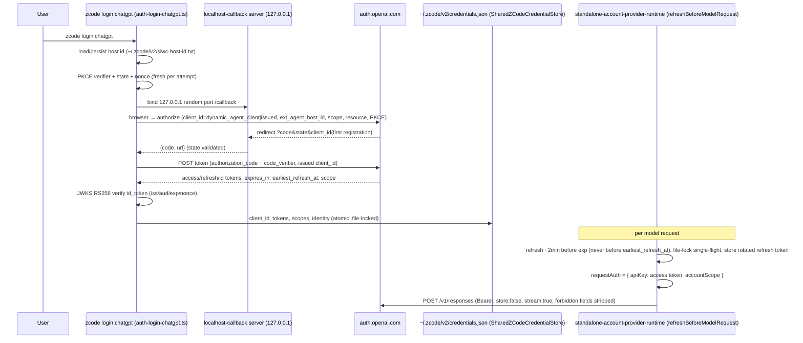

# ChatGPT Plan Sign-in (SIWC)

Sign in with a ChatGPT (Plus/Pro) account through OpenAI's official **Sign in with
ChatGPT (SIWC)** token-sharing program and run agent LLM calls under that user's
ChatGPT plan against the public OpenAI Responses API.

This is an official OpenAI program (preview, launched ~2026-09-28). It is NOT the
gray-zone reuse of Codex CLI credentials: nothing in this feature touches
`chatgpt.com/backend-api` or Codex's client id.

## Background (Current Source Behavior)

- The only provider OAuth logins are z.ai / BigModel "Coding Plan" flows, which are
  NOT standard OAuth: the CLI calls `POST {base}/oauth/cli/init` and polls
  (`apps/zcode-cli/packages/adapters/src/auth/cli-oauth.ts`). Login orchestration
  lives in `apps/zcode-cli/packages/bootstrap/src/auth-login.ts`
  (`loginZCodeCli`, `loginBigmodelCodingPlan`, `configureCodingPlanApiKey`,
  `persistStandaloneCodingPlanConnection`) with contract types in
  `auth-login-contract.ts` (`CodingPlanProviderId = "bigmodel" | "zai"`). SIWC
  (loopback + PKCE + dynamic client registration) is new plumbing added beside it,
  not a modification of `cli-oauth.ts`.
- A provider-agnostic loopback callback server already exists and binds
  `127.0.0.1` literally on a random port, validates `state`, maps OAuth `error`
  to a structured error, and accepts `authCode` or `code`
  (`apps/zcode-cli/packages/adapters/src/auth/localhost-callback.ts`). It returns
  the full callback URL, so extra query params (SIWC returns the issued
  `client_id` and `iss`) are already tolerated.
- Credentials are stored in `~/.zcode/v2/credentials.json` via
  `SharedZCodeCredentialStore`
  (`apps/zcode-cli/packages/adapters/src/auth/shared-credentials.ts`):
  AES-256-GCM (`credential-cipher.ts`, prefix `enc:v1:`), file-locked
  read-modify-write, atomic writes. Existing key style: `oauth:zai:access_token`,
  `oauth:active_provider`, `zcodejwttoken`, ….
- Cross-process refresh single-flight (rotation-safe, 45 s file lock) exists for
  MCP OAuth: `apps/zcode-cli/packages/adapters/src/mcp/oauth-refresh.ts`.
- Model transport for OpenAI Responses already works: `api.type
"openai-responses"` routes through the Vercel AI SDK `@ai-sdk/openai`
  (`apps/zcode-cli/packages/adapters/src/model/model-execution.ts`, POST
  `{baseUrl}/responses`, SSE). The builtin catalog ships an `openai` template at
  `https://api.openai.com/v1` (`config/provider/zcode-builtin.json`,
  `config.providerConfigRules.templateRules`). No new wire format is needed.
- The model-execution fetch chain is ordered: proxy fetch → endpoint-routing →
  request-security → business-error detection → `model-option-map-fetch.ts`
  (injects `max_output_tokens` / reasoning effort from catalog `modelConfigRules`)
  → per-protocol compat fetches (`openai-responses-json-compat.ts`,
  `anthropic-stream-compat.ts`). Nothing sets `store` today; the AI SDK only
  sends `store` when `providerOptions.openai.store` is set.
- Per-request auth: `applyModelRequestAuth` (model-execution.ts) turns
  `requestAuth = { apiKey, accountScope }` into `Authorization: Bearer` for the
  openai provider kind. The standalone-CLI auth owner is
  `apps/zcode-cli/packages/bootstrap/src/app/standalone-account-provider-runtime.ts`
  (`refreshBeforeModelRequest`, `accountScope` = sha256 of provider/family/
  identity/oauth material).
- Provider access union is `api-key | zhipu-coding-plan-api-key | zhipu-account`
  (`packages/provider/src/config/provider-config.ts`; schema in
  `provider-data-schema.ts`). `zhipu-account` switches on in ~10 sites (CLI
  adapters, bootstrap runtime, packages/provider resolver/sources, services,
  UI) and triggers zcode-gateway routing and zhipu-specific behavior in some of
  them — a chatgpt provider must NOT reuse it.
- Model provider families: `packages/shared/src/model-provider-family.ts`
  (`MODEL_PROVIDER_FAMILY_SPECS`: zai, bigmodel). Builtin account provider ids:
  `packages/shared/src/model-provider-types.ts` (`BUILTIN_MODEL_PROVIDER_IDS`).
  Builtin provider entries live in `config/provider/zcode-builtin.json` under
  `config.providerConfigRules.providerRules`; per-provider model rules under
  `config.modelConfigRules.builtinProviderModelRules`.
- Desktop OAuth (`packages/services/src/oauth/`) is pinned to zai/bigmodel and
  uses a `zcode://oauth/callback` deep link, which SIWC cannot use (SIWC requires
  an `http://127.0.0.1:{port}/...` redirect). Desktop login is Phase 2.
- Recorded removal of official codex/claude/gemini OAuth presets:
  `docs/model-provider-presets.md`. This feature intentionally supersedes that
  removal FOR chatgpt only (see the note added there).

## Product Rules

### Provider identity

- OAuth provider id constant: `chatgpt` (`CHATGPT_PROVIDER_ID`). Model provider
  family: `chatgpt`. Builtin account provider id: `account:chatgpt-plan`
  (label "ChatGPT Plan", models like `gpt-6.1-sol`) — this base id remains in
  the builtin catalog ONLY as the template rule; at runtime the registry
  exposes per-account entries `account:chatgpt-plan:<accountKey>` (see
  "Multi-account profiles").
- New access-type member `chatgpt-account` in the provider access union. It must
  not trigger endpoint routing to the zcode gateway, zhipu PAT resolution, or
  zhipu header stripping.
- ChatGPT is a SEPARATE identity domain from zai/bigmodel: signing in never
  writes `zcodejwttoken` or `oauth:active_provider`, and zai/bigmodel
  exclusivity logic must not fire on it (and vice versa).
- The provider family is hidden until the user signs in (mirrors zai/bigmodel);
  per-account entries appear/disappear with the signed-in account set.

### Login (OAuth 2.0 Authorization Code + PKCE, dynamic client registration)

- `zcode login chatgpt` (CLI, Phase 1) and a Desktop settings button (Phase 2)
  open the system browser at `https://auth.openai.com/api/accounts/authorize`
  with:
  - `response_type=code`, `redirect_uri=http://127.0.0.1:{port}/callback`
    (literally `127.0.0.1`, never `localhost`; only the port varies),
  - PKCE `code_challenge_method=S256` with base64url(SHA-256(verifier))
    without padding; fresh verifier, `state`, and `nonce` per attempt,
  - `scope=openid profile email offline_access resource.invoke
chatgpt.tokens.use.direct`,
  - `resource=https://api.openai.com/v1`,
  - `ext_agent_host_id`: stable per host, generated once and persisted (not a
    secret), reused across sign-ins,
  - first registration per account: `client_id=dynamic_agent_client` plus
    `agent_name_hint=ZCode`; re-auth of a known account: reuse the account's
    issued `client_id` and the host id, omit `agent_name_hint`, send the
    retained `id_token` as `id_token_hint` (may be expired) and optionally the
    saved email as `login_hint`. When OTHER accounts are already signed in, the
    add-account flow deliberately sends NO `id_token_hint` / `login_hint` (the
    account picker then comes from OpenAI); hints are per-account slot data,
    never global.
- The loopback callback on first registration carries the issued real
  `client_id` (looks like `oaiapp_...`) as a query param — capture and persist
  it. All later OAuth calls (exchange, refresh, re-auth, revoke) use the issued
  client id, never `dynamic_agent_client`. Losing it forces re-registration and
  breaks refresh.
- Token exchange: form-encoded POST to
  `https://auth.openai.com/api/accounts/oauth/token` with
  `grant_type=authorization_code`, issued `client_id`, `code`,
  `code_verifier`, the same `redirect_uri` and `resource`. No client secret.
- Once the loopback callback settles, the host claims that pending login before
  exchanging the one-time authorization code. Concurrent polls must not redeem
  the same code twice; callback errors must still clear pending state and close
  the loopback server.
- Response fields: `access_token`, `refresh_token`, `id_token`, `token_type`,
  `expires_in`, `scope`, `earliest_refresh_at`.
- ID-token verification: RS256 against OpenAI's JWKS
  (`https://auth.openai.com/.well-known/openid-configuration` → `jwks_uri`,
  cache with refresh on unknown `kid`), implemented with `node:crypto`
  (`createPublicKey({ key: jwk, format: "jwk" })`) — no new dependency. Check
  `iss = https://auth.openai.com`, `aud` = issued client id, `exp`, and the
  `nonce`. `sub` is the account identity. Access-token `aud` is
  `https://api.openai.com/v1`.

### Entitlement (consent gating)

- If granted scopes lack `chatgpt.tokens.use.direct`: login succeeds as
  identity only; the provider is provisioned but NOT entitled (no inference on
  this path); the picker shows it disabled with a "plan not enabled" state.
- Re-consent after opt-in re-runs OAuth with the saved client id and the full
  scope set (`prompt=consent` supported; do not force consent every time).
- Granted scopes are persisted.

### Token lifecycle (request-time)

- Access token: 1 hour. Proactive refresh ~2 min before `exp`, never before
  `earliest_refresh_at`.
- Refresh: form-encoded POST, `grant_type=refresh_token`, issued `client_id`,
  `refresh_token`, `resource=https://api.openai.com/v1`; omit `scope` to keep
  the grant. Every refresh returns a NEW refresh token (30-day rotation);
  always store the latest replacement atomically when the credential store
  supports batch writes. The host credential service exposes sequential saves,
  so it must save the replacement refresh token before the access token.
- Refreshes are serialized across processes via a dedicated per-account file
  lock `siwc-chatgpt.<accountKey>.refresh` (single-flight, imitating
  `mcp/oauth-refresh.ts`). Concurrent refresh of the SAME account =
  `refresh_token_reused` = fatal → forced re-auth; different accounts refresh
  independently and in parallel.
- Terminal refresh errors (`invalid_grant`, `invalid_refresh_token`,
  `token_expired`, `refresh_token_expired`, `refresh_token_invalidated`,
  `refresh_token_reused`) clear ONLY that account's credentials and surface a
  structured "re-sign-in" state for it; other accounts are untouched.
- The resolver returns `{ apiKey: <raw SIWC access token>, accountScope }`;
  existing `applyModelRequestAuth` turns it into the Bearer header. Raw token
  semantics on both CLI and Desktop (no conversion).

### Logout / revocation

- Revoke BEFORE clearing tokens: POST to the `revocation_endpoint` from OIDC
  discovery with `token=<refresh_token>`,
  `token_type_hint=refresh_token`, `client_id=<issued>`. Empty HTTP 200 =
  success (even for already-invalid tokens). Retry 5xx/network with backoff; if
  revocation cannot be confirmed, clear local tokens and inform the user.
- Retain the account→client_id mapping and host id after logout for future
  sign-ins. Logout is per account (see "Multi-account profiles"); it never
  touches other accounts' registrations.

### Storage

Same store, same encryption (`~/.zcode/v2/credentials.json`), keyed per account
(`accountKey = sha256(sub).slice(0,16)` hex — no PII in keys, ids, or logs):

- `oauth:chatgpt:accounts` — index, JSON array
  `[{accountKey, sub, email, name, addedAt}]` (not a secret)
- Per account (`<K>` = accountKey):
  - `oauth:chatgpt:<K>:client_id` (issued client id — per registration)
  - `oauth:chatgpt:<K>:access_token` (raw SIWC access token)
  - `oauth:chatgpt:<K>:refresh_token`
  - `oauth:chatgpt:<K>:id_token`
  - `oauth:chatgpt:<K>:user_info`
  - `oauth:chatgpt:<K>:scopes`
  - `oauth:chatgpt:<K>:access_expires_at`, `oauth:chatgpt:<K>:earliest_refresh_at`
  - `account-provider:account:chatgpt-plan:<K>:identity` (= sub)
  - `account-provider:account:chatgpt-plan:<K>:auth-source` = `oauth`
- Legacy pre-multi-account flat keys (`oauth:chatgpt:client_id`, …) are
  migrated once — idempotently, under the credential store file lock — into the
  slot of the (single) legacy account, then removed.
- Key-name builders live in `@zcode/shared` (pure string functions) so the
  host service and the CLI resolver cannot drift; the refresh lock file is
  `siwc-chatgpt.<K>.refresh` (per account, same name on host and CLI).

Host id: persisted once at `~/.zcode/v2/siwc-host-id.txt` (0600, plain text;
not a secret). Format: `urn:uuid:` URI. One host id serves ALL account
registrations (per official profiles guidance).

### Multi-account profiles (parallel accounts, per-session binding)

Official basis: OpenAI's profiles-and-sessions guidance — the app "needs to
manage multiple account registrations so users can choose an existing ChatGPT
account or add another"; each registration keeps its own client id and
credentials (even for the same email); switching accounts does not sign out
other saved accounts; logout ends only that account's renewable session.

- **Account identity**: `accountKey = sha256(sub).slice(0,16)` (hex). Display
  label = email (or name fallback); the email never enters the provider id.
- **Provider entries**: the runtime registry derives one provider entry per
  signed-in account — id `account:chatgpt-plan:<accountKey>`, config cloned
  from the builtin catalog template rule (api `openai-responses` @
  `https://api.openai.com/v1`, the template's model list),
  `providerName` = the account's email, `access.type = chatgpt-account`. The
  catalog's `builtinProviderModelRules` for `account:chatgpt-plan` are cloned
  per entry as well (exact providerId match, `model-config.ts`) so models keep
  `enabled` / `contextWindow`. The base entry id itself is NOT published; with
  zero accounts the family is hidden. Sessions or defaults still referencing
  the base id resolve to `selectionIssue` → the user re-picks (accepted
  breakage, user decision).
- **Derivation sites** (single owner each): the Desktop host config-source
  wrapper (`packages/services/src/node.ts`, composed over
  `providerConfigRuntime.configService`) and the CLI standalone runtime
  (`standalone-account-provider-runtime.ts`). Both enumerate the signed-in
  account set from the credential store; a change in the set bumps the
  registry revision (picker and sessions refresh through the existing
  `onDidChange` / `onChatGptPlanSessionChange` paths).
- **Session binding**: each conversation stores `ModelSelection
{providerId, modelId}` — picking an account's entry binds the session to
  that account. The existing `expectedAccountScope` (sha256 of clientId+sub)
  pinning keeps protecting a session from silently running on another account;
  scope mismatch remains a hard error (`siwc_account_scope_invalidated`).
- **Entitlement is per account**: consent (the `chatgpt.tokens.use.direct`
  grant) is evaluated per account slot; an identity-only account shows its
  entry disabled with the "plan not enabled" state, while other accounts stay
  usable.
- **Login modes**: `startLogin({reauthAccountKey?})` — add-account (default):
  fresh registration (`dynamic_agent_client` + `agent_name_hint`, no hints);
  re-auth: that account's `client_id` + `id_token_hint`/`login_hint`. The
  completed login persists into the slot derived from the verified `sub`:
  a new sub adds an account, a known sub replaces only that account's token
  family. One pending login at a time (unchanged).
- **Logout**: per account — revoke that account's refresh token, clear its
  slot and index entry; other accounts and their client ids are retained.
  CLI `zcode logout` revokes ALL chatgpt accounts (simple, predictable);
  Desktop signs out per account row.
- **Telemetry**: per-account provider ids contain only a hash — safe to keep
  unredacted (extend the builtin allowlist in `telemetryRedaction.ts`).
- **Identification on the wire is unchanged**: no protocol schema changes;
  per-account ids are ordinary provider ids flowing through the existing
  `ModelSelection` / provider-runtime-headers surfaces.

Never log or expose tokens, codes, or account ids in plain text; redact
authorize/token URLs containing `id_token_hint` from logs. Protected local
storage only — never browser storage, source control, analytics, or URLs.
ChatGPT tokens are never sent to the Railway relay or any remote host
(inference stays on the host where the agent runs).

### Inference surface (request shaping)

- Endpoint: ONLY `POST https://api.openai.com/v1/responses` with
  `Authorization: Bearer <access_token>`. The token is never pointed at
  ChatGPT `backend-api` endpoints.
- `store: false` and `stream: true` are REQUIRED on every request. Context goes
  in the `input` array (full stateless replay each turn);
  `previous_response_id` must be omitted over HTTP.
- System prompt via `instructions` / developer messages ONLY — explicit
  `{type:"message", role:"system"}` input items are rejected; remap any to
  `instructions`.
- A `siwc-compat-fetch` wrapper applied ONLY to `chatgpt-account` providers,
  ordered AFTER `model-option-map-fetch` (so it strips what catalog rules
  injected), deletes all unsupported fields, forces `store:false` /
  `stream:true`, and guarantees no system-role input items.
- Unsupported request fields (must never be sent): `background`,
  `conversation`, `max_output_tokens`, `max_tool_calls`, `metadata`,
  `moderation`, `multi_agent`, `prompt`, `prompt_cache_retention`,
  `safety_identifier`, `temperature`, `top_logprobs`, `top_p`, `truncation`,
  `user`, `previous_response_id`.
- `providerOptions.openai.store = false` is injected at the options layer so
  the AI SDK also adds `include: ["reasoning.encrypted_content"]` for reasoning
  models and the stateless-replay reasoning strip behaves correctly.
- The non-streaming `generateText` path must not be used for chatgpt-account
  models (SIWC requires `stream: true`); force the streaming path and
  aggregate.
- Tools: function/custom tools only. No image generation, file search, Code
  Interpreter, native computer use, hosted MCP/connectors, `tool_search`, or
  top-level `programmatic_tool_calling`.
- Body compression: after strip/serialize, if the body exceeds ~1 MiB
  (1048576 bytes), compress with `node:zlib` `zstdCompressSync`
  (feature-detected; `gzipSync` fallback) and set `content-encoding: zstd` (or
  `gzip`). Implemented as a provider-agnostic transport util (threshold +
  zstd/gzip + feature-detect), default-off for every other provider; other
  endpoints may adopt it only after endpoint-by-endpoint verification.
  Compression applies ONLY to the request body (responses are SSE).
- Prompt-cache headers: stable `session-id` per session (children/subagents
  share the parent's id), plus `thread-id` and `x-client-request-id`. (Not to
  be confused with `ext_agent_host_id`, an authorize-time param only.)
- Success semantics: a stream is successful ONLY after the terminal
  `response.completed` event. `response.incomplete`, `response.failed`, and
  interrupted streams are distinct failure modes.

### Error taxonomy and recovery

Direct-admission errors may return `{"detail":"..."}` without a standard error
object — treat as diagnostic text; preserve HTTP status, body shape, code, and
request id.

| Condition                                  | Code                                                                                                                                                 | Recovery                                                                                                                             |
| ------------------------------------------ | ---------------------------------------------------------------------------------------------------------------------------------------------------- | ------------------------------------------------------------------------------------------------------------------------------------ |
| Signed identity not accepted               | HTTP 401                                                                                                                                             | Check selected account + granted scopes                                                                                              |
| Policy/region blocked                      | HTTP 403                                                                                                                                             | Surface restriction; do not retry                                                                                                    |
| Direct routing unavailable                 | HTTP 503                                                                                                                                             | Preserve credentials; bounded-backoff retry                                                                                          |
| Plan unavailable for user/workspace/policy | `subscription_sharing_user_not_eligible` (403)                                                                                                       | Explain; never retry or loop through OAuth                                                                                           |
| Plan usage limit hit                       | `subscription_sharing_usage_limit_exceeded` (429)                                                                                                    | Pause plan requests; show "Manage usage" → `https://chatgpt.com/settings/usage`; do NOT infer reset time or assume the plan is empty |
| Usage check failed                         | `subscription_sharing_usage_unavailable` (503)                                                                                                       | Preserve credentials; bounded-backoff retry                                                                                          |
| Unsupported field/tool/model               | `subscription_sharing_unsupported_capability` (400)                                                                                                  | Inspect `error.param`, remove it; never retry the same body                                                                          |
| Wrong method/endpoint                      | `subscription_sharing_route_not_supported` (403)                                                                                                     | Fix the request path/method                                                                                                          |
| Subscriber context invalid                 | `subscription_sharing_invalid_user` (401)                                                                                                            | Preserve request id; diagnose credential failure; full re-sign-in after confirmed revocation or terminal refresh error               |
| Scope not authorized                       | `chatpass_v2_scope_not_authorized` / `chatpass_v2_invalid_authorization_context` (403)                                                               | Check client/grant config; do not retry, do not switch billing                                                                       |
| User info unavailable                      | `subscription_sharing_user_unavailable` (503)                                                                                                        | Preserve credentials; bounded-backoff retry                                                                                          |
| Refresh token unusable                     | `invalid_grant`, `invalid_refresh_token`, `token_expired`, `refresh_token_expired`, `refresh_token_invalidated`, `refresh_token_reused` (on refresh) | Clear tokens; full OAuth re-run with saved client id                                                                                 |
| Client misconfigured                       | `invalid_client`                                                                                                                                     | Config bug — fix code, not user action                                                                                               |

- OpenAI does NOT proactively notify about user-initiated disconnects; detect
  on next request/refresh, stop using the token set, ask the user to sign in
  again.
- Temporary network failures keep credentials (bounded-backoff retry).
- NEVER silently switch to another billing path.

### Model catalog

- Phase 1: static curated list in `config/provider/zcode-builtin.json` seeded
  from opencode's verified live set (2026-10-13): `gpt-5.5`, `gpt-5.5-fast`,
  `gpt-5.6-luna`, `gpt-5.6-luna-fast`, `gpt-5.6-sol`, `gpt-5.6-sol-fast`,
  `gpt-5.6-terra`, `gpt-5.6-terra-fast`, `gpt-6-astra`, `gpt-6-astra-fast`,
  `gpt-6-luna`, `gpt-6-luna-fast`, `gpt-6-sol`, `gpt-6-sol-fast`,
  `gpt-6.1-sol`, `gpt-6.1-sol-fast`. To be confirmed against a real
  `GET /v1/models` dump (`visibility == "list"`, `supported_in_api`) when a
  test account is available; the list stays in the builtin JSON so it is
  trivially editable.
- Phase 3: dynamic per-account catalog refresh (`GET /v1/models`), refresh on
  account switch; "pro" reasoning modes are not plan-eligible; no
  effort-update advertising (`supportsEffortUpdates: false`); native
  `/responses/compact` is unavailable — summary-style compaction only.

### Usage limits

- Plus plans have a 5-hour usage window shared across ALL apps using the plan
  (including ChatGPT itself). On plan-limit errors the UI shows "Manage usage"
  linking `https://chatgpt.com/settings/usage`.
- **Passive usage-window capture**: OpenAI reports plan usage on model RESPONSE
  headers (`x-codex-primary-used-percent`, `x-codex-primary-window-minutes`,
  `x-codex-primary-reset-at`, and the `x-codex-secondary-*` weekly triplet).
  ZCode captures them passively — only from responses to requests it already
  sends — and ONLY on `chatgpt-account` providers. There are NO fallback
  endpoints and NO extra network calls to learn usage.
- **Capture rules**: `used-percent` is required per window (tolerant numeric
  parse; missing, whitespace-only, or garbage skips that window; the explicit
  string `0` remains valid); `window-minutes` and `reset-at`
  are optional (`reset-at` is an RFC3339 string kept verbatim, never parsed into
  local clock math on the agent side). A snapshot requires the primary (5h)
  window; a secondary-only reading is ignored. When no headers are present the
  feature is simply absent: SIWC preview tokens may not carry them (live
  verification pending), and the UI shows nothing in that case.
- **Transport** (additive; old payloads must keep validating): the adapter fetch
  chain stores the latest snapshot and the bound provider id in a per-bound-model
  mutable capture (same threading pattern as `RawRequestBodyCapture`); the runner
  attaches them to the turn-completion usage payload as `providerRateLimits` and
  `providerRateLimitProviderId` (shape:
  `{primary: {usedPercent, windowMinutes?, resetsAt?}, secondary?}`). The CLI
  emits a typed host notification from the durable completion event, independent
  of legacy `session/event` delivery subscriptions, so V4-only conversations also
  record usage. The host attributes the snapshot only from the carried provider id,
  never by reading the session's current model after completion. The
  `workspace/generateText` result usage schema gained the same strict optional
  fields.
- **Host state**: the host `SiwcAuthService` keeps the LATEST snapshot per
  accountKey in an in-memory Map (never persisted, never logged; snapshots
  contain no tokens and no PII). OAuth status/logout and usage recording share
  the same service instance, so Settings reads recorded usage and logout clears
  that account's cached snapshot.
- **Display**: the Settings → ChatGPT Plan account row shows, when a snapshot
  exists, `5h window: {percent}%` (+ ` · resets {time}` when `resetsAt` is
  present and parseable) and `Weekly: {percent}%` for the secondary window.
  The model picker badge deliberately does NOT show usage: the in-memory host
  state has no change-notification channel to the renderer, so a picker badge
  would render stale percentages in a high-visibility surface. Revisit only
  with a usage-updated event.

### Branding (Phase 2, Desktop UI)

- Sign-in button: exactly **"Continue with ChatGPT"**, black, ChatGPT logo,
  equal prominence with other sign-in options.
- First sign-in confirmation modal: heading **"You're using your ChatGPT
  plan"**, primary action **"Got it"**, ChatGPT logo above the heading;
  explains that eligible AI requests use the ChatGPT plan and usage is managed
  in ChatGPT settings; dismissible; shown ONCE.
- Login status polling is serialized: schedule the next poll only after the
  current poll settles, and ignore completions after the settings view unmounts.
- Active indicator: **"Using ChatGPT plan"** with logo, near the
  composer/model selector.
- Usage-limit state: **"Manage usage"** primary (no "Buy app credits" — we do
  not sell credits).
- Copy distinguishes ChatGPT plan usage from app-level subscriptions.
- Provider icon: reuse the OpenAI entries in
  `packages/ui/src/assets/provider-icons/model-provider-logo-sources.json`.

### Host-side (Desktop) decisions (Phase 2)

- Login/logout/status ride `IOAuthService` (`startChatGptPlanLogin` / `pollChatGptPlanLogin`
  / `getChatGptPlanStatus` / `logoutChatGptPlan`) implemented by a dedicated
  `SiwcAuthService` in `packages/services/src/oauth/siwc/`; the loopback listener runs in the
  host process (the `zcode://` deep link is unusable for SIWC). The zai/bigmodel flow,
  `oauth:active_provider`, and `zcodejwttoken` are never touched.
- Detached ChatGPT Plan account refresh failures after login or logout emit a warning with
  the failure as log context; the warning message is not a correlation/trace ID.
- Hosted-agent request auth: the host answers `interaction/requestProviderRuntimeHeaders`
  for `account:chatgpt-plan` via the same resolver semantics (stable clientId+subject scope,
  force-refresh after a rejected token, the SAME `siwc-chatgpt.refresh` cross-process lock
  file as the CLI so Desktop and CLI refreshes serialize).
- `PROVIDER_PROVISIONING_OAUTH_CREDENTIAL_KEYS` (providerProvisioningSource.ts) exports
  credentials into provisioning envelopes for other environments. ChatGPT plan keys are
  deliberately NOT added: provisioning other (remote) environments with plan tokens is out
  of scope and forbidden by the storage rules; the local desktop host resolves auth itself.

### Phasing / scope

- Phase 1 (this spec's product code): CLI adapters SIWC client
  (`apps/zcode-cli/packages/adapters/src/auth/siwc/`), orchestration
  (`apps/zcode-cli/packages/bootstrap/src/auth-login-chatgpt.ts`), `zcode login
chatgpt`, token resolver, compat fetch, provider family + builtin catalog,
  error mapping. Desktop picks up the same shared credentials later (same
  file, same keys).
- Phase 2: Desktop UI (settings button, branding above, hosted-runtime token
  resolution via `interaction/requestProviderRuntimeHeaders` semantics; loopback
  listener in the host process — the `zcode://` deep link is unusable). Web
  (packages/web) OAuth stays out of scope.
- Phase 3 (CURRENT): multi-account profiles (parallel per-account provider
  entries, per-session binding, per-account login/logout/entitlement — see
  "Multi-account profiles"). Deferred from the original Phase 3 scope: dynamic
  catalog refresh, telemetry polish.

## State Owners and Event Order

- Single owner of credential writes: `SharedZCodeCredentialStore` (file lock,
  read-modify-write, atomic). Never write `credentials.json` directly.
- Single owner of request-time refresh: the SIWC token resolver (CLI adapters),
  called from `standalone-account-provider-runtime`. Desktop Phase 2 adds its
  own host-side owner writing the same keys.

## Verification

- Phase 1 units (no network; fixture data): SIWC PKCE/URL/token-client/JWKS/
  host-id (`apps/zcode-cli/packages/adapters/tests/siwc-*.test.ts`), login/
  logout persistence mirroring `auth-login.test.ts`
  (`apps/zcode-cli/packages/bootstrap/tests/`), compat-fetch wire tests
  asserting the exact JSON body (store:false, stream:true, no forbidden
  fields, no system-role items, Bearer = access token, zstd compression over
  1 MiB), resolver refresh single-flight, entitlement gating, runner retry on
  `subscription_sharing_invalid_user`.
- Multi-account units (no network): flat→per-account key migration
  (idempotent, under lock); account index upsert/removal; per-account refresh
  lock isolation (parallel accounts, single-flight per account); add-account
  vs re-auth authorize-URL shaping (hints present/absent); per-account
  terminal-failure clearing leaves other accounts intact; registry derivation
  clones provider entries AND `builtinProviderModelRules` and bumps revision
  on account-set change (Desktop wrapper + CLI standalone runtime); account
  entitlement map; prefix predicates (`isChatGptPlanAccountProviderId`) at all
  former exact-equality sites; picker renders per-account groups
  (email label).
- Commands (run from repo root unless noted):
  - `pnpm --dir apps/zcode-cli/packages/adapters exec vitest run tests/<file>`
    (per-package vitest)
  - `pnpm --dir apps/zcode-cli check` (full CLI workspace check)
  - `pnpm typecheck`
  - `pnpm lint`
  - `pnpm architecture:check --changed`
- Manual/live verification (user-assisted): `zcode login chatgpt` with a real
  Plus/Pro account, a `GET /v1/models` dump, and a real agent turn. No real
  tokens in code, logs, or reports.

## References (official SIWC docs, verified 2026-10-12)

- Program hub: https://developers.openai.com/siwc
- Token sharing (OSS): https://developers.openai.com/siwc/token-sharing-open-source
- Sign-in flow: https://developers.openai.com/siwc/token-sharing-open-source/sign-in
- Models & inference: https://developers.openai.com/siwc/token-sharing-open-source/models-and-inference
- Token reference: https://developers.openai.com/siwc/token-sharing-open-source/token-reference
- Errors & recovery: https://developers.openai.com/siwc/token-sharing-open-source/errors-and-recovery
- Preview limitations: https://developers.openai.com/siwc/token-sharing-open-source/preview-limitations
- Profiles & sessions: https://developers.openai.com/siwc/token-sharing-open-source/profiles-and-sessions
- UI/UX guidelines: https://developers.openai.com/siwc/ui-ux-guidelines
- Self-hosted VMs: https://developers.openai.com/siwc/token-sharing-open-source/self-hosted-vms
- Reference implementation (opencode, official SIWC path):
  `github.com/anomalyco/opencode` `packages/core/src/plugin/provider/chatgpt.ts`
