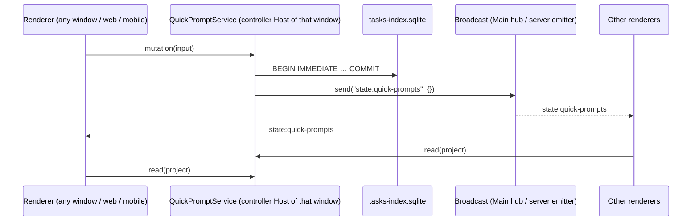

# Composer quick prompts

Status: implementation in progress (ZCO-49). Mockups: Design canvas "Composer Quick Prompts" —
accepted boards A, C, G, I, J, K, L, F2; rejected B, D, E.

## Problem

Users retype the same prompts ("review the diff", "write tests", project-specific "run e2e"). There
is no place to save a prompt and reuse it in one click. Upstream's draft suggested prompts
(`ConversationDraftSuggestedPromptsContainer`) are server-provided, not editable and only show on an
empty draft; plugin Example Prompts (CONTEXT.md) belong to the plugin store.

## Glossary

**Quick prompt**: a user-saved, named composer content (text plus composer mentions: `/` commands,
`$` skills, `@` files) that the composer can insert or send. Every quick prompt has a scope.
_Avoid_: "sticker", "prompt template", "snippet", "shortcut" (Example Prompt owns "prompt template"
and "shortcut" in CONTEXT.md).

**Scope**: `global` (available in every project) or `project` (available only in one project).

**Pinned**: a quick prompt flag; pinned quick prompts form the row above the composer.

**Hidden in a project**: a per-project mark that keeps one pinned global quick prompt out of that
project's row.

## Product rules

### Placement

1. **Row above the composer**. Rendered inside `ConversationComposer` directly above the input
   surface, in new-session drafts and existing sessions, so it follows the composer's hide and width
   rules. Chips show the name only. The row scrolls horizontally on every platform; an edge fade
   shows only on a side that has hidden content (left once scrolled away from the start, right while
   more chips are off-screen), so a row that fits shows no fade. There is no overflow popover and no
   collapse control.
2. **Row content** for a session's project P: pinned global quick prompts not hidden in P, in global
   order, then pinned project quick prompts of P, in their order. A session with no project
   (`projectId === null`) or in a legacy single-root project shows pinned globals only.
3. The row ends with a `+` chip that opens the editor, whatever the draft holds (rule 14).
4. **"/" panel**. The slash panel gains a fourth section, "Quick prompts", listing every quick
   prompt available in the session (globals not hidden in P + P's quick prompts), pinned or not,
   matched by name and text. The section is not offered inside the quick prompt editor's own body
   field.
5. No shortcuts, icons or variables. A quick prompt may carry an optional color label (rules 22-24).
6. First run: no quick prompt at all → the row shows only the `+` chip with the label "Add a quick
   prompt" and a one-line hint.

### Using a quick prompt

7. **Click** on a chip, or **Enter** on a "/" item, inserts the quick prompt's content at the caret,
   with its mentions as mention chips (the stored editor nodes, rule 21). In the "/" panel the typed
   `/query` token is replaced. Clicking a chip does not move the caret (mouse-down does not take
   focus).
8. **⌘-click** (Ctrl-click on Windows/Linux) on a chip: when the draft is empty, the content is
   inserted and the composer's own submit runs (same path as pressing Send: queue admission,
   held-queue confirmation, history). When the draft is not empty, ⌘-click only inserts — the draft
   is never sent implicitly.
9. Hovering a chip shows a preview: name, scope and the text (clamped), with the hint
   "Click — insert · ⌘ Click — send · Right-click — edit".
10. Quick prompts work in incognito sessions.

### Scope rules for mentions

11. A **project** quick prompt may contain any composer mention.
12. A **global** quick prompt may contain `/` commands and skills whose scope is `user` or `plugin`;
    it may not contain `@` file/directory mentions, workspace-scope skills, session (`#`) mentions
    or subagent mentions. Saving or switching to Global is disabled with an explanation while such a
    mention is present.

### Creating and editing

13. **Default scope**: created from a session that has a project → `project` (pinned); from a
    session without the project → `global` (pinned); in Settings → the list whose `+` was used. The
    scope stays changeable; the last choice is not remembered.
14. **No "Save draft"**: the row offers no shortcut that turns the current draft into a quick
    prompt; a typed draft does not change the `+` chip. Quick prompts are created in the editor only.
15. **Editor**: name (required, ≤ 40 characters after trim), body (required, non-blank) = the
    composer's prompt editor with `/`, `$`, `@` triggers (not Enter-to-submit), scope (project /
    global), **Duplicate**, **Delete**. No other fields. Save stays disabled until a stored body has
    loaded into the editor; if it cannot be loaded, only the name can be saved. Attachments and
    contexts are never part of a quick prompt. The dialog has exactly two dismissal/commit controls:
    the header ✕ (close) and the footer **Save**; the embedded prompt editor renders no cancel ✕
    and no send arrow of its own.
16. Editing a global quick prompt from a session shows "This quick prompt is global. Changes apply
    in every project." with **Duplicate to <project>** (independent project copy, pinned) and
    **Edit everywhere**.
17. **Right-click** on a chip (desktop): **Edit…**, **Hide in this project** (global chips; "Remove
    from row" for project chips, which unpins), **Delete…** (confirm; for globals "Delete
    everywhere"). Mobile has no menu.
18. **Limits**: body ≤ 8000 characters of canonical text; at most 50 global quick prompts and 50 per
    project; at the limit create actions are disabled with an explanation.
19. Removing a project does not delete its quick prompts; Settings lists such projects as
    unavailable so their quick prompts can be deleted or made global (when rule 12 allows).

### Settings → Quick prompts

20. A Settings section "Quick prompts" (desktop and web): a project picker (current project
    preselected), then **<Project> quick prompts** and **Global quick prompts** lists. Each row:
    name, one-line preview, a **Pinned** switch; global rows also show **Shown in <project>** (the
    hidden mark); drag to reorder within a list; "…" menu with Edit, Duplicate, Delete. "+ New quick
    prompt" per list. When the selected project is not the window's project, the editor's mention
    panel is off (its file search would run against the wrong host); existing mention chips are kept.

### Mobile web and remote control

21. Row and "/" section are available, chips ≥ 36px. Tap inserts; long-press opens a bottom sheet
    with the preview and **Send now** (same rule 8 behaviour). No create, edit, hide or delete on
    mobile: every web-remote-replayable connection — the desktop Host attachment and a Source
    Server's `/ws` — gets a read-only service that rejects mutations with `quick-prompt.read-only`.

### Color label

22. **Palette**: a fixed set of seven hues — `red`, `orange`, `yellow`, `green`, `blue`, `violet`,
    `pink` — plus **none** (the default and the only state of legacy prompts). No free-form hex. A
    quick prompt has at most one color; the color is independent of scope and pinning.
23. **Where it shows**: a small dot before the name on the chip in the row above the composer
    (desktop and mobile web; the chip stays a neutral outline, the name keeps the standard text
    color), and the same dot before the name in Settings rows. The hover preview and the "/" panel
    are unchanged. The dot is decoration: the accessible name of a chip stays the quick prompt name.
    Each hue's dot token keeps 3:1 or higher against the card surface of its theme (white in light,
    neutral-800 / `#2b2b2b` in dark), so light themes use darker steps for the pale hues
    (`orange-600`, `yellow-700`, `green-600`).
24. **Where it is set**: the editor (rule 15) gains a **Color** row of eight swatches (the seven
    hues and a dashed "No color" swatch), below Name and above Scope, one selected at a time, each
    with an accessible name. A new prompt starts with no color; Duplicate copies the color. Color
    does not affect rule 12.

## Storage and ownership

Quick prompts are user preferences read by every window and by mobile through the desktop Host, so
they live in the controller Host's `tasks-index.sqlite`, following AGENTS.md "Shared Databases and
Fork Divergence". Never `setting.json`, never renderer storage.

```sql
CREATE TABLE IF NOT EXISTS fork_quick_prompts (
  prompt_id TEXT PRIMARY KEY,         -- uuid
  scope TEXT NOT NULL,                -- 'global' | 'project'
  host_id TEXT,                       -- NULL for global
  project_id TEXT,                    -- NULL for global
  name TEXT NOT NULL,
  body_markdown TEXT NOT NULL,        -- canonical prompt markdown ($getPromptMarkdown)
  body_nodes TEXT NOT NULL,           -- JSON: serialized Lexical paragraph nodes of the body
  pinned INTEGER NOT NULL,
  position INTEGER NOT NULL,          -- order within (scope, host_id, project_id)
  created_at INTEGER NOT NULL,
  updated_at INTEGER NOT NULL
);
CREATE TABLE IF NOT EXISTS fork_quick_prompt_hidden (
  host_id TEXT NOT NULL,
  project_id TEXT NOT NULL,
  prompt_id TEXT NOT NULL,
  PRIMARY KEY (host_id, project_id, prompt_id)
);
```

- Additive migration `9003_fork_quick_prompts` in the `tasks_schema_migration` ledger, checked and
  applied in one `BEGIN IMMEDIATE` transaction (the 9001 pattern) because several Host processes
  open the same file. Upstream definitions untouched; the upstream checksum pin test must not list
  the fork id.
- **Project identity** is the pair (`host_id`, `project_id`) stored in two columns — never one
  encoded string (both ids may contain `:`) and never derived from a path (a root may belong to
  several projects). The renderer takes it from the session's task in the project tree, or from the
  draft's `draftProjectId` + host.
- Deleting a quick prompt deletes its hidden marks in the same transaction.
- **Color column**: a second additive migration `9004_fork_quick_prompt_color` in the same ledger
  adds `fork_quick_prompts.color TEXT` (NULL = none). The `9003` DDL string and its checksum stay
  untouched; both migrations are checked and applied in order inside the same `BEGIN IMMEDIATE`
  transaction. Older fork builds select explicit columns and never write `color`, so they keep
  working on the shared file.
- **Color value contract**: the stored value is the palette name (rule 22). The repository keeps the
  raw column value and normalizes only when building a `QuickPrompt`: an unknown, empty or
  non-string value reads as `null` (none) and never fails the read of the prompt or its snapshot. An
  update writes `color` only when the input carries the field (`undefined` = unchanged, `null` =
  clear), so renaming a prompt saved by a newer build with a hue this build does not know keeps that
  raw value. Writes validate with the palette enum; an unknown hue sent by a client is stored as
  none instead of rejecting the whole write.
- Wire shape: `QuickPrompt.color: QuickPromptColor | null` (always present on reads, so mobile chips
  render it through the unchanged read-only attachment); `QuickPromptCreateInput.color?` and
  `QuickPromptUpdateInput.color?` are optional.

### Owners and event order



- The database is the only truth. Desktop runs one Host per window, so each window's Host runs its
  own service instance on the same file; no in-memory revision or cache is authoritative.
- The broadcast carries no data; every receiver re-reads. Renderers keep a request serial and drop
  responses older than the latest request (the `useTaskGroups` pattern).
- Service shape follows TaskGroups: contract + descriptor in `packages/services`, channel name in
  `packages/shared/src/channels.ts`, registered in `createLocalServices`, proxied by
  `remoteServiceAccess`, allowlisted for mobile as a read-only scoped service, routed to the
  controller in remote-workspace service collections (including the `state:quick-prompts` broadcast
  split). Not part of the remote-workspace RPC contract.
- Every write is validated (zod): scope/project consistency, rule 12 for globals (checked on the
  stored nodes), limits.

## Telemetry and logging

- No telemetry event in v1. Never reuse `promptTemplateTelemetry` (it sends full prompt text).
- Service logs use `createServiceLogger`; quick prompt names and bodies never go to logs.

## Acceptance scenarios

1. First run: only "Add a quick prompt"; creating one from a project session makes a pinned project
   quick prompt shown in the row.
2. Click inserts at the caret with mention chips intact; the caret does not move; the "/" panel does
   not open.
3. ⌘-click with an empty draft sends via the composer path (queued when busy); with a non-empty
   draft it only inserts.
4. "/" + query lists matching quick prompts; Enter replaces the token with the content.
5. Editor body containing `@file`: Global is disabled with the explanation; saved as project quick
   prompt. A typed draft keeps the row's `+` chip (no "Save draft").
6. Hide in this project: the global chip disappears in this project only; other projects keep it; a
   newly pinned global appears in every project that has not hidden it.
7. Edit a global from a session → banner; Duplicate to <project> creates an independent pinned copy.
8. Delete removes the chip in every window without reload.
9. Two windows on the same data: a change in one shows in the other; a stale response is ignored.
10. Mobile remote: row scrolls, tap inserts, long-press Send now follows rule 8; no edit entry;
    mutations are rejected by the read-only scope.
11. Limits: the 51st global quick prompt cannot be created.
12. Incognito session shows and uses quick prompts.
13. Upstream build and older fork builds open the shared DB with the fork tables present.
14. Color: a legacy prompt (no color) renders exactly as before; picking a hue in the editor shows
    the dot on its chip and Settings row after save; picking "No color" removes it; Duplicate keeps
    the color; a new prompt is uncolored; an unknown stored value shows no dot and the prompt still
    works; a rename never erases a stored value; the mobile row shows the dot.

Interaction scenarios 2–5, 7 and 10 need desktop/web E2E coverage.

## Out of scope (documented for later)

- **Team layer**: quick prompts committed to the repository and shared through git, shown read-only
  next to project ones. Upstream already uses `.zcode/` in repositories (`workflows`, `agents`,
  `skills`); the file name must not collide with a future upstream file.
- Variables, Import/Export, sync across machines, shortcuts, icons, free-form colors, tinted chips,
  a color filter or grouping, color in the "/" panel, attachments, a toolbar palette, new-session
  cards, per-project ordering of globals.

## Implementation notes

- The CLI Skill tool resolves skills by name; the mention path is only a hint to the model. Global
  quick prompts therefore store user/plugin skill mentions path-less, so they work in
  remote-workspace sessions.
