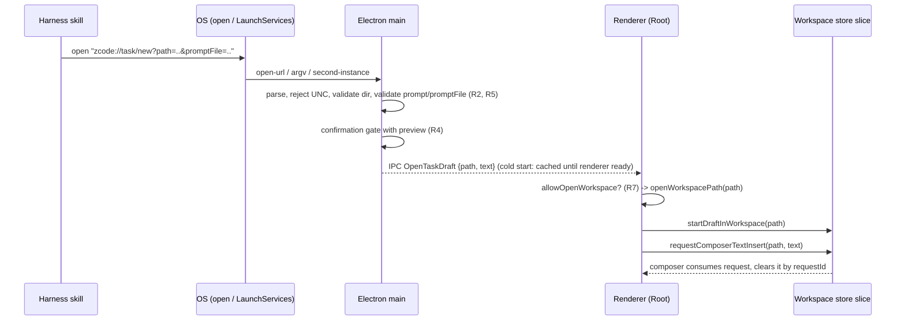

# Deep link: start a task draft (`zcode://task/new`)

Status: draft for implementation
Scope: Desktop only (`packages/desktop` main + preload, `packages/ui` root effects, `packages/shared` platform contract)

## 1. Problem

Other agent harnesses (Claude Code, Codex, ...) can prepare a precise implementation plan, but cannot hand it to ZCode.
Today `zcode://workspace/open?path=` only opens a folder. The user must open the project, create a task and paste the plan by hand.

Goal: one clickable link that opens ZCode on the right project with the task text already in the composer, ready to review and send.

## 2. Product rules

R1. **Route.** `zcode://task/new?path=<abs-dir>&prompt=<text>` or `...&promptFile=<abs-file>`. No scheme prefix or namespace is added;
the fork and upstream share the `zcode` scheme and a future upstream route of the same name is an accepted risk.

R2. **Parameters (v1).**

| Param        | Required       | Meaning                                                                |
| ------------ | -------------- | ---------------------------------------------------------------------- |
| `path`       | yes            | Absolute local project directory. Same validation as `workspace/open`. |
| `prompt`     | one of the two | Task text, URL-encoded UTF-8. Max 8 000 characters after decoding.     |
| `promptFile` | one of the two | Absolute path to a UTF-8 text file holding the task text.              |

Unknown parameters are ignored. A link with neither or both of `prompt` / `promptFile` is rejected (logged, nothing opens).
Empty or whitespace-only task text is rejected.

R3. **Draft only.** The link never sends. It fills the composer of a new draft in the target workspace. The user reviews and presses Send.

R4. **Confirmation.** The existing external-workspace confirmation gate is reused (no new dialog component). Its copy for this route
additionally shows the project path and the first 400 characters of the task text, so the user sees what will be inserted.
Cancel means nothing is cached and nothing is delivered.
Confirming authorizes opening the path and inserting the draft only; it does not establish Workspace Hook Trust.

R5. **`promptFile` reading (main process, async).**

- `realpath` both the file and the project; the file must be a regular file whose real path is inside the project's real path.
  Symlinks that leave the project are rejected. Files outside the project are rejected (no override).
- UNC / network paths are rejected before any filesystem probe (same helper as `workspace/open`).
- Size limit 256 KiB, UTF-8 decoding with failure on invalid bytes.
- The file is read once, before the confirmation, and that same text feeds both the preview and the insert, so the content shown is
  the content inserted (no second read).

R6. **Existing draft is never discarded.** A fresh draft is started with `startDraftInWorkspace`, then the text is inserted with the
composer mode `prepend-text`: an empty composer receives the task text; a composer that already holds unsent text keeps it, and the
task text is placed before it separated by a blank line. The composer persists drafts per scope, so `startDraftInWorkspace` alone does
not clear typed text and `replace` would destroy it.

R7. **Platform gating.** The renderer honors `allowOpenWorkspace`; when false the request is ignored with a log line.
Web and mobile remote do not support the route: `IPlatformService.onOpenTaskDraft` is optional like `onOpenWorkspacePath`,
and only the Desktop platform implements it. Remote workspaces (`workspaceIdentity`) are out of scope; identity key is the local path.

R8. **Cold start and second instance.** Cold start (macOS `open-url` before the first window, Windows/Linux argv) records the request in the
same startup slot used by `workspace/open` and is consumed exactly once through `startupDeepLinkConsumptionGate`. The prompt travels
with the request and is delivered after renderer ready. Warm start goes through `handleDeepLink`; second-instance uses
`createDeepLinkSingleInstanceData` (already URL-encoded, ASCII-only).

R9. **Logging.** `info` for accepted/rejected route with reason codes, prompt length, and file size. Never log prompt text, file contents
or full file paths beyond the project path already logged by the workspace route.

R10. **Window routing.** The default target is the first application window. When another window already lists the project in Main's
`windowWorkspaceMap` (the same registry `ActivateOrSetWorkspace` uses), that window is the target instead: the confirmation dialog is parented
to it, the `OpenTaskDraft` payload is sent to it (or bound to its webContents id until its renderer is ready), and it is focused.
Main only chooses the destination; it still holds no task state, and the receiving renderer remains the single owner of draft state.
The owner lookup has no side effects (no `FocusTab`); the renderer's own `openWorkspacePath` activates the tab. Only exact path matches count.

## 3. Interfaces

- `packages/desktop/src/main/desktopDeepLinkUrl.ts`: `isTaskNewUrl`, `extractTaskNewRequest(parsedUrl) -> { path, prompt? , promptFile? } | null`;
  `isCompleteDeepLinkUrl` requires `path` and exactly one of `prompt` / `promptFile`. Parser refactor into a route table is NOT part of this change.
- `packages/desktop/src/main/*`: new `TaskDraftRequest { path, text }` resolved in main (after R4/R5) and sent over a new channel in
  `packages/shared/src/channels.ts`; preload exposes `onOpenTaskDraft`.
- `packages/shared/src/platform.ts`: `onOpenTaskDraft?(handler: (payload: { path: string; text: string }) => void): () => void`.
- `packages/ui/src/root/useRootPlatformEffects.ts`: handler runs, in this order: `openWorkspacePath(path)` (tab dedup, recent projects) ->
  `startDraftInWorkspace(path)` -> `requestComposerTextInsert(path, text, undefined, undefined, "prepend-text")`.
  `prepend-text` is a new `ComposerTextInsertRequest` mode implemented in `applyExternalTextInsertRequestToComposer`.
  Main routes the draft to the window that already has the folder open (R10), so the owning window's tab is always present and the insert is not skipped.
  If the tab is still missing in the receiving window (for example it was just closed), the insert is skipped and a warning is logged.
  The insert request is held in the workspace slice (`composerTextInsertRequest`) until the composer consumes it, so it survives a late mount.

## 4. Owners and event order

Single owner of validation and file reading: Main. Single owner of draft state: the workspace store slice. Renderer never reads files.
Idempotency: a repeated link creates another draft (no dedup id in v1).

## 5. Acceptance scenarios

1. Warm app, `prompt` link, existing workspace tab: confirmation shows the preview; confirm -> tab activated, new draft, text in composer, nothing sent.
2. Cold start (app not running) via macOS `open-url` and via Windows argv: window opens on the project with the draft filled; the URL is not replayed.
3. `promptFile` inside the project: content inserted; file outside the project, symlink escaping the project, directory, > 256 KiB, invalid UTF-8: rejected, nothing opens.
4. Both `prompt` and `promptFile`, or neither: rejected.
5. UNC `path` or `promptFile`: rejected without `stat`; non-existent `path`: rejected.
6. Cancel in the confirmation: no IPC and no cached request.
7. Composer already contains unsent text: that text is kept, the task text is placed before it with a blank line in between.
8. Cyrillic, spaces, `%`, `&`, `#` in `prompt` and in paths survive URL encoding, second-instance encoding and Windows `--` argv.
9. `allowOpenWorkspace=false`: ignored. Web / mobile: route not registered.
10. Workspace Hook Trust is unchanged after confirming.
11. Folder already open in a second window: the draft is delivered to that window, not to the first window.

## 6. Tests

- Parser: `desktopDeepLinkUrl` cases for R2 (neither/both params, empty, over-limit, extra params).
- Main: prompt-file reader (R5) with symlink escape, size, encoding, UNC; confirmation preview and cancel path; cold-start slot consumed once.
- UI: root effect order (open -> draft -> insert) and R6 against a pre-filled draft; `allowOpenWorkspace=false`.
- E2E: warm and cold start link click produces a filled, unsent composer.

## 7. Out of scope (future)

`model`, `mode`, `branch`/`worktree`, `attachments`, dedup `id`, a `zcode handoff` CLI,
and the parser route-table refactor (touches OAuth/payment parsing; separate PR).

## 8. Harness skill

`.agents/skills/handoff-to-zcode` tells other harnesses to write the plan to `<project>/.zcode/handoff/<id>.md`, build the link with
`scripts/build-link.mjs` (encodes paths, refuses plans outside the project) and print it with an `open` command for macOS.
