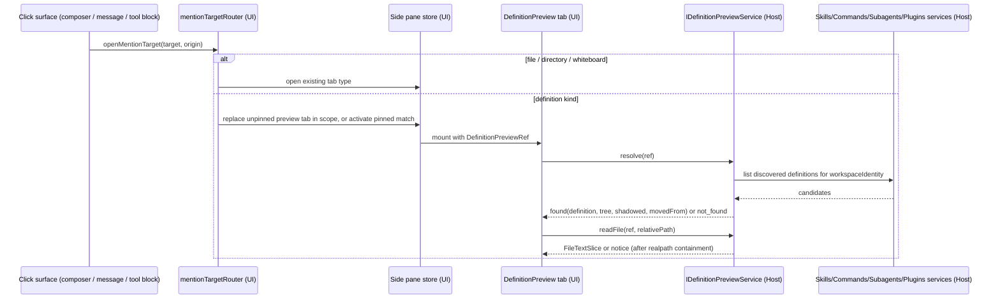

# Definition preview pane

Opening a mention opens it in the right side pane, so the user can read a skill, command, subagent or
plugin (and its folder) without leaving the conversation. Files, directories and whiteboards route to
the side-pane tabs that already exist; one new tab type covers definitions. v1 is read-only.

Term: a **definition** is a skill, command, subagent or plugin defined by files on disk. The word
"resource" is avoided because `packages/ui/src/resource-manager` already uses it for system
resource usage; "builtin" follows CONTEXT.md (**Builtin Plugin**) and means shipped with the app.

Design agreed in chat review 2026-10-22 (mockup: right side pane, folder tree on the left, file
content on the right).

## Current state (verified 2026-10-22)

- Sent messages render mentions as styled `<span>` chips with no click behaviour
  (`packages/ui/src/v4/ConversationUserInputContent.tsx`).
- Mention markdown (`packages/ui/src/mentions/mentionMarkdown.ts`):
  - skill → `[$label](<SKILL.md path>)`, or bare `$label` when the path is missing;
  - plugin → `[@label](plugin://name@marketplace)`;
  - subagent → `@label`, command → `/label`, session → `#id`; no path for any of these.
  - `parseMentionMarkdown` drops every link destination except the plugin id, so a sent skill
    mention reaches the UI as a name only, even when the markdown carries its path.
- The `Skill` tool-call block (`packages/ui/src/ToolCallBlocks/renderers/skill.tsx`) knows only the
  skill name from `toolCall.input`; its header click expands and collapses the block.
- Data the host already has:
  - `SkillSummary` carries `body`, `path` (realpath) and `sourcePath` (symlink), plus scope, enabled
    and pluginName (`packages/shared/src/skills-types.ts`);
  - `AgentSummary` carries `path`, `scope`, `source` and `readOnly`
    (`packages/shared/src/subagents-types.ts`). Built-in agents (`source: "built-in"`) have a
    pseudo-path such as `built-in:Explore`, which is not a file;
  - `UserCommand` and `PluginCommand` both carry `filePath` (`PluginCommand` re-declares it after
    the `Omit`) (`packages/shared/src/command-types.ts`); `ZCodeSlashCommand.source` separates
    builtin from custom commands;
  - `IPluginsService` is retired (`getOverview` returns a stub). Plugin roots come from
    `IPluginManagementService.listPlugins` (`rootPath`, `packageStatus: "missing"`), which runs
    through the Agent process. Host-side resolution also exists in
    `packages/services/src/plugins/installedPluginRoots.ts` and `officialPluginCache.ts`.
- `ISkillsService.buildPromptContext` activates every enabled skill with the mentioned name; there
  is no single runtime winner when names collide.
- `createLocalServices` (`packages/services/src/node.ts`) builds the service collection for both the
  desktop local host and the server host (`createServerHostServices` calls it).
- Code Viewer caps text reads at `FILE_VIEWER_MAX_TEXT_BYTES = 256 KiB`
  (`packages/ui/src/lib/codeViewer.ts`).
- Side pane (`docs/ui/side-pane-tabs.md`, `packages/ui/src/lib/workspaceSidePane.ts`):
  - tabs are a typed union, scoped by `workspaceKey` and `ownerTaskId`, and held in memory only;
    they are not persisted across reloads, so a new tab type adds no storage format;
  - Code Viewer reuses one tab per `sourceKey` and renders `.md` as rendered markdown.
- `fileService.readTextFile` and the other file read methods accept any absolute path, with no root
  confinement. The separate audit of 2026-10-22 rated this a pre-existing debt; the real exposure is
  the unauthenticated loopback `/ws` of the standalone web server, which is tracked separately. This
  feature must not add another unconfined read path.
- The primary modifier is already platform-scoped in `matchesPrimaryModifier`
  (`packages/ui/src/lib/keyboardShortcuts.ts`): Cmd on Apple platforms, Ctrl elsewhere, and both
  pressed together do not count. It is not exported yet.
- Remote attachments allow the `Skills`, `Subagents`, `Plugins` and `File` channels
  (`packages/desktop/src/host/windowHostAttachmentRpcPolicy.ts`).

## Product rules

1. **Routing table.** Opening a mention opens its target in the right side pane:

   | Mention           | Target                                                        |
   | ----------------- | ------------------------------------------------------------- |
   | file              | existing Code Viewer tab (`sourceKey` reuse)                  |
   | directory         | existing file manager tab                                     |
   | whiteboard        | existing whiteboard tab                                       |
   | skill             | definition preview: skill folder tree + file content          |
   | plugin            | definition preview: plugin install folder tree + file content |
   | subagent          | definition preview: the agent `.md` file (no tree)            |
   | command (custom)  | definition preview: the command `.md` file (no tree)          |
   | command (builtin) | not openable                                                  |
   | session           | not openable in v1 (keeps today's behaviour)                  |

2. **Where a mention opens, and how:**
   - **Composer:** primary-modifier click (Cmd+click on macOS, Ctrl+click on Windows and Linux).
     A plain click keeps today's caret behaviour. While the modifier is held over an openable chip,
     the chip shows a pointer cursor and an underline. Hovering shows a hint naming the shortcut.
   - **Sent messages:** a plain click on the chip. Openable chips are buttons: focusable, opened by
     Enter or Space, and with a pointer cursor.
   - **`Skill` tool block:** a plain click on the skill name, which is styled as a link. Clicking
     anywhere else in the header still expands and collapses the block.
   - **Mobile web:** tapping a sent-message chip or a tool-block name opens the preview in the
     existing side-pane overlay. The composer has no modifier, so it opens nothing.
3. **Openability is decided without a resolve call.** A chip is openable when:
   - it is a link-form mention (a skill with a path, a plugin with an id, a file or directory), or
   - it is a bare token (`$name`, `@name`, `/name`) whose name exists in the list for that kind
     that the UI has already loaded (skills, subagents, commands), and the command is not
     `source: "builtin"`.

   Everything else (builtin commands, sessions in v1, plain `@word` text that names no subagent)
   has no pointer cursor, no underline, no hint and no button role. A link-form mention whose
   definition has since been deleted is still openable and opens to "not found" (rule 6).

4. **One preview tab per scope.** At most one unpinned definition-preview tab exists per
   `workspaceKey + ownerTaskId`. Opening another definition replaces that tab's content and activates
   it. The user pins it with the pin action in its header or by double-clicking the tab. A pinned tab
   becomes an ordinary tab, and the next open creates a new preview tab. Opening a definition that a
   pinned tab already shows activates that pinned tab instead. Tab keys use the resolved
   identity: `definition:<kind>:<resolved path>`.
5. **Current on-disk version.** The preview shows the definition as it is on disk now, not as the
   agent loaded it at send time. When a mention carries a path and the resolved definition lives at a
   different path, a banner says the definition has moved since the message was sent. The hint is
   normalized the way `normalizeMarkdownDestination` does it and compared with both
   `SkillSummary.path` (the realpath) and `sourcePath` (the symlink), so a symlinked skill never
   shows a false "moved" banner.
6. **Not found.** When the definition cannot be resolved (renamed, deleted, uninstalled, or out of
   scope for the current workspace), the tab shows a "not found" state with the name and kind, and
   offers no actions except close. A disabled definition is found: it renders normally with a
   "disabled" badge.
7. **Ambiguous names.** When a name matches more than one definition (for example a skill in both
   workspace and user scope), the preview shows one of them and lists the others in the header as
   "also defined in". The runtime has no single winner (`buildPromptContext` activates every
   enabled match), so the display order is explicit, not a runtime claim:
   1. a candidate matching `hintPath`;
   2. enabled before disabled;
   3. scope `workspace` > `user` > `plugin`;
   4. path, ascending.
8. **Read-only.** No editing in v1. Header actions:
   - insert the mention into the composer;
   - open in the external editor, only for local, user- or workspace-owned files;
   - reveal in the file manager, only on local desktop.

   Builtin definitions (bundled with the app), plugin-cache definitions and remote workspaces hide the
   editor and file-manager actions.

9. **Rendering.**
   - The header shows the kind icon, name, scope badge, enabled state and, when it applies, the
     source (builtin or plugin name).
   - The tree lists the definition root. Selecting a file renders it with the existing Code Viewer
     content renderers: markdown rendered, code highlighted, binary or oversized files shown as a
     notice.
   - YAML frontmatter of `SKILL.md` and agent or command `.md` files renders as a compact metadata
     card above the body.
   - Single-file definitions (subagent, command) hide the tree.
   - In a plugin tree, files inside `skills/`, `commands/` and `agents/` render in the same tab. No
     second renderer is built for nested definitions.
   - On a narrow pane, the tree collapses into a file picker above the content.
   - **Links and images inside a previewed file.**
     - A relative link resolves against the definition root, and clicking it selects that file in
       the tree. A link that leaves the root, or names a missing file, is shown but does nothing.
     - A relative image is read through `IDefinitionPreviewService`, never through `fileService`.
     - External URLs keep today's external-link behaviour.
   - **Tab title and overview.** The tab title is the definition name and the icon is the kind
     icon. In the tab overview search it matches by name, root display path and kind. An unpinned
     preview tab does not enter "recently closed", like the new-tab page; a pinned one does.
10. **Freshness.** The preview re-resolves on tab activation and when the matching store reports a
    change (skill store refresh, command, subagent or plugin list invalidation). There is no polling
    and no file watcher in v1.

## Interfaces

- **Mention target (UI, additive):** `parseMentionMarkdown` keeps the skill link destination as an
  optional `path` on the `skill` part. File and directory parts keep their destination. Consumers
  must tolerate its absence (bare `$name`, older messages).
- **Definition reference (shared):** the only thing the client sends.

  ```ts
  type DefinitionPreviewKind = "skill" | "command" | "subagent" | "plugin";
  interface DefinitionPreviewRef {
    kind: DefinitionPreviewKind;
    name: string; // skill/command/subagent name; plugin manifest name
    pluginId?: string; // name@marketplace, plugins and plugin-owned definitions
    hintPath?: string; // path carried by the mention; a hint, never trusted as a root
    workspacePath: string;
    workspaceIdentity?: string;
    remoteSessionId?: string;
  }
  ```

- **Modules.** New files need managed modules, so the feature adds two of them to
  `architecture-policy.yaml`, modelled on `gen-ui-protocol` and `gen-ui-service`:
  - `definition-preview-protocol` (`packages/shared/src/definition-preview`, exported as
    `@zcode/shared/definition-preview`): ref and result types, zod schemas and limits;
  - `definition-preview-service` (`packages/services/src/definition-preview`): the service, with
    `domain`, `app` and `adapters` layers.
- **Service:** `IDefinitionPreviewService` on the literal channel `"definition-preview"`, as gen-ui
  does, so the upstream `ServiceChannels` file stays untouched.
  - It is **stateless**: each call re-resolves the ref and re-derives the root, so calls are
    idempotent and nothing is cached in the service.
  - The `app` layer reads the catalogs through a port (`listSkills`, `listAgents`, `listCommands`,
    and in slice 4 `listPlugins`). `createLocalServices` builds the port from closures over the
    existing service instances, and the module never imports a concrete service.
  - `resolve(ref)` returns either `{ status: "not_found" }` or
    `{ status: "found", definition, tree, truncated, shadowed, movedFrom? }`.
    - `definition` holds the display fields (kind, name, scope, enabled, entry path, plugin name,
      description), `rootPath`, `entryRelativePath`, `singleFile` and `userOwned`.
    - `userOwned` is true for workspace- and user-scoped, writable definitions. The UI combines it
      with its own local/remote knowledge to decide whether to show the editor and file-manager
      actions.
    - `tree` is an array of `{ relativePath, kind: "file" | "directory" | "link", size? }`.
      `truncated` is true when the entry cap was hit.
  - `readFile({ ref, relativePath })` returns one of:
    - `text` with the content;
    - `binary` or `too_large`, with the size (and the limit, for `too_large`);
    - `not_found`;
    - `rejected`, when the path is invalid or fails confinement.

    The whole file is read up to the cap; there are no offset or length parameters.

  - Both validate their input at runtime with the zod schemas from
    `@zcode/shared/definition-preview`.

- **Registration.** Register the service wherever `ISkillsService` and `IGenUiService` are wired
  today. Keep each edit to an upstream file small:
  - `createLocalServices` (`packages/services/src/node.ts`), which covers both the local host and
    the server host;
  - the service accessor (`packages/services/src/accessor.ts`);
  - the remote workspace proxy list (`packages/desktop/src/host/remoteWorkspaceServiceCollection.ts`);
  - the client proxy (`packages/client/src/remoteServiceAccess.ts`);
  - the attachment allowlist (`packages/desktop/src/host/windowHostAttachmentRpcPolicy.ts`), so
    mobile web remote can read previews.

  `sourceSettingsServiceCollection.ts` serves Source settings pages, not workspace content, so it
  gets no entry.

- **Remote and version skew.** Remote workspaces call the same service on the workspace's host
  through the in-window connection registry. A host built without the channel (older fork build or
  upstream build) answers with an unknown-channel or unknown-method error. The tab maps that error
  to a "preview isn't available on this host" state instead of a generic failure.
- **Renderer reuse.** `MarkdownPreviewContent` takes the content as a string and
  `MessageResponse` accepts `onOpenFileLink`, so text and links can be injected without a path.
  Local images are read inside `MarkdownImage`, and there is no reader injection for them yet.
  Slice 2 adds an optional local-image reader prop. Until it lands, relative images render as
  alt-text placeholders.
- **Side pane tab (UI, in memory):**

  ```ts
  interface DefinitionPreviewSidePaneTab {
    id: string;
    type: "definition-preview";
    ref: DefinitionPreviewRef;
    selectedRelativePath?: string;
    pinned: boolean;
    ownerTaskId?: string | null;
    workspaceKey?: string | null;
    openedAt?: number;
  }
  ```

  The tab stores only the reference and the selection, never file contents.

- **Router (UI, single owner):** `openMentionTarget(target, origin)` in
  `packages/ui/src/lib/mentionTargetRouter.ts`. It maps a mention target to the routing-table
  action. Composer, sent messages and tool blocks call the router and nothing else. Export a
  pointer-event variant of `matchesPrimaryModifier` instead of re-deriving the platform rule.

## Boundaries and security

- The client never sends a root. The service derives each root from its own discovery results for
  the given workspace identity:
  - skill: `dirname(SkillSummary.path)`;
  - subagent: `AgentSummary.path`, a single file. A built-in agent (`built-in:*` pseudo-path)
    resolves to "not found";
  - command (user or plugin): `filePath`, a single file;
  - plugin (slice 4): the plugin root. Slice 4 chooses between `listPlugins` → `rootPath` (needs
    the Agent runtime) and the host-side resolution in `installedPluginRoots.ts`. A plugin with
    `packageStatus: "missing"` resolves to "not found". Until slice 4, the `plugin` kind always
    resolves to "not found".
- `hintPath` only selects among discovered candidates. A hint that matches no candidate is ignored,
  and the resolver falls back to name precedence.
- **Containment** uses the same rule as `readGenUiDocument`:
  - Validate `relativePath` as a string first. Split on `/` and `\`. Reject empty, `.` and `..`
    segments, NUL bytes, absolute paths, drive letters (`C:`) and UNC paths.
  - `realpath` the root once.
  - Below the root, every symlink is listed in the tree as a link and is never read or descended
    into, wherever it points.
  - Read by walking the segments with `lstat`, then opening with `O_NOFOLLOW` (where it exists).
    The opened handle's `dev`/`ino` must equal the walk's `lstat`.
  - Node has no `openat()`, so intermediate directories cannot be pinned by descriptor. To cover
    that, the check is repeated after open: the file's current `realpath` must be inside the
    root, and the `lstat` identity at that path must equal the opened handle's. A file reached
    through a directory swapped for a symlink at any moment fails this check.
  - Identities are compared as BigInt (`{ bigint: true }` stats), because 64-bit inode numbers on
    NTFS and some Linux filesystems exceed Number precision.
  - Threat model: a race requires local write access to the definition folder, which already
    implies read access as the user. These checks keep remote and mobile clients from turning
    such a race, or a planted symlink, into reads outside the root.
  - The readable set follows the same rules as the tree (hidden directories, depth limit). The
    entry cap limits only what is listed: a file past the cap stays readable, so a relative link
    from a previewed file still opens it.
  - On Windows, junctions must report as links (`isSymbolicLink()`). Node's `lstat` reports
    junctions as symbolic links, but this is not yet verified on a Windows machine; the adapter
    tests run on macOS and Linux only.
  - A Host-derived single-file root (agent or command file) or directory root may itself be a
    symlink, as with imported skills. The root is followed once through `realpath`; only entries
    below it are refused when they are links.
  - Single-file definitions accept only their own basename as `relativePath`.
  - Log rejections at `warn` through `createServiceLogger`, without the path.
- **Limits** live in `@zcode/shared/definition-preview`:
  - the tree walk depth is `MAX_SKILL_SCAN_DEPTH`;
  - the tree entry count is bounded, and the result reports `truncated: true` when the cap is hit;
  - the ignore rules from `skill-scan-policy.ts` are reused;
  - text reads are capped at 256 KiB, matching Code Viewer's `FILE_VIEWER_MAX_TEXT_BYTES`.

  Oversized files return a notice instead of their content, and so do binary files, detected with a
  fatal UTF-8 decode.

- This feature does not change `fileService` and does not route preview reads through it.



The UI owns only tab layout, selection and pin state. Resolution, roots and file contents belong
to the host and are re-fetched; they are never cached as facts in the UI. A late `resolve` response
for a ref the tab no longer shows is dropped, using the tab's ref identity.

## Slices

Architecture: the unmanaged `services` module forbids new files (`unmanaged-new-file`), so the
service and protocol live in the two managed modules listed under Interfaces. UI changes stay in
the `ui` module, using the existing `@/` aliases.

1. **Service (M), for skill, command and subagent.** The shared protocol module, the managed
   service module with `IDefinitionPreviewService` (`resolve`, `readFile`), containment and limits,
   and the registrations listed above. The `plugin` kind resolves to "not found" until slice 4.

   Status (2026-10-22): implemented in `packages/shared/src/definition-preview` and
   `packages/services/src/definition-preview`, and wired into `createLocalServices`, the accessor,
   the client proxy, the remote workspace collections and the mobile allowlist. The service has no
   UI consumer until slice 2.

   Verified catalog behaviour:
   - `subagentsService.list` defaults to `allRuntimeScopes`, and `agents` is the runtime-effective
     set after `applyRuntimePrecedence`, including plugin and disabled agents. For subagents the
     preview therefore shows the runtime winner, and shadowed agents do not appear.
   - `commandsService.list().commands` contains both user and plugin commands.
   - `skillsService.list` ignores the provider argument (discovery is fixed to `glm`), so the ref
     needs no provider field.

   The lists are not cached. One `resolve` costs one discovery pass, measured at 75–220 ms with
   188 skills on the development machine, and every `readFile` pays the same again. That's
   acceptable per click; revisit only if profiling shows otherwise.

   Carried into slice 2:
   - Verify that mention and `Skill` tool labels use the same name as the catalog, especially for
     plugin skills and commands, where a label could be namespaced (`plugin:name`). Matching is
     exact today.
   - The parser unescapes the markdown destination (`<…>`, percent escapes) before setting
     `hintPath`, so encoded paths don't show a false "moved" banner. Windows paths that differ
     only in case still would; decide whether to compare them case-insensitively there.

2. **Tab and router plus sent messages (M).** The `definition-preview` tab type with preview and pin
   semantics, the router, openable sent-message chips for skills, commands, subagents and plugins,
   the `parseMentionMarkdown` skill path, the not-found, moved and host-unavailable states, and the
   local-image reader prop.

   Docs: update `docs/ui/side-pane-tabs.md` (the governing doc for tabs) with the
   `definition-preview` tab rules, and add cases to
   `docs/testing/side-pane-tabs-e2e-case-catalog.md`. Check the header and badge layout against
   DESIGN.md.

3. **Composer and tool block (S).** Primary-modifier click and hint on composer chips, and the
   skill name link in the `Skill` tool block.
4. **Plugins and existing tabs (S–M).** Choose the plugin root source and add `listPlugins` to the
   catalog port, then add the plugin folder tree and route file, directory and whiteboard
   mentions to their existing tabs.

## Acceptance scenarios

- In a sent message, clicking a `$skill` chip opens a preview tab with the skill tree, with
  `SKILL.md` selected and rendered. Clicking `references/x.md` renders that file.
- Clicking a second skill chip replaces the preview tab's content and leaves one preview tab. After
  pinning, the next click creates a new preview tab. Clicking the pinned skill again activates the
  pinned tab.
- In the composer, Cmd+click (macOS) or Ctrl+click (Windows, Linux) on a skill chip opens the
  preview. A plain click places the caret. Ctrl+click on macOS does not open it.
- Clicking the skill name in a `Skill` tool block opens the preview. Clicking the rest of the
  header toggles the block.
- After a skill is deleted, clicking its chip in an old message shows "not found". A disabled skill
  shows the "disabled" badge.
- A skill folder containing a symlink that points outside it lists the link but refuses to read it,
  and nothing outside the root is returned.
- In a remote workspace, the preview resolves on the remote host and hides the editor and
  file-manager actions.
- On mobile web remote control, tapping a sent-message skill chip opens the preview overlay.
- Builtin command chips (`/clear`) are not interactive. Plain text `@someone` that names no
  subagent is not interactive.
- In a previewed `SKILL.md`, clicking the relative link `references/schemas.md` selects that file
  in the tree. A link to `../../outside.md` does nothing.
- Against a host without the definition-preview channel, the tab shows "preview isn't available
  on this host".

## Tests

- Services unit tests:
  - resolution: path hint, name precedence, shadowed list, not found, disabled;
  - containment: `..`, absolute paths, symlink escape, depth and entry limits, binary and
    oversized files;
  - schema validation.
- UI unit tests:
  - router mapping;
  - preview-tab replace, pin and dedupe within a scope, and scope isolation across tasks;
  - `parseMentionMarkdown` skill path, including old messages without it;
  - primary-modifier pointer helper.
- E2E: sent-message chip click, composer modifier click, tool-block name click, not-found state,
  and the mobile web tap.
- i18n: every new key in en-US, uk-UA and zh-CN.

## Non-goals (v1)

- Editing definitions in the preview.
- Peek popover on hover (variant B of the mockup); revisit if the pane feels heavy for a glance.
- Settings → Skills and the Plugins detail dialogs; they keep their metadata dialogs. Adding
  "Open in panel" there is a follow-up once the tab exists.
- Showing the version the agent loaded at send time.
- File watchers for live updates.
- Confining `fileService` reads, and the web server `/ws` hardening (tracked separately).

## Decisions on former open questions (2026-10-22)

1. **Session mentions stay non-openable in v1**, which keeps today's behaviour: the chip is a plain
   `<span>`. `parseMentionMarkdown` also keeps only the label of `[label](#sess_…)`, so the session
   id isn't available to route on. Opening the session is a follow-up that first has to keep the id
   on the parsed part.
2. **Only the `Skill` tool block gets a link in v1.** Subagent names in `Task`/agent tool blocks are
   a follow-up, not part of this spec.
