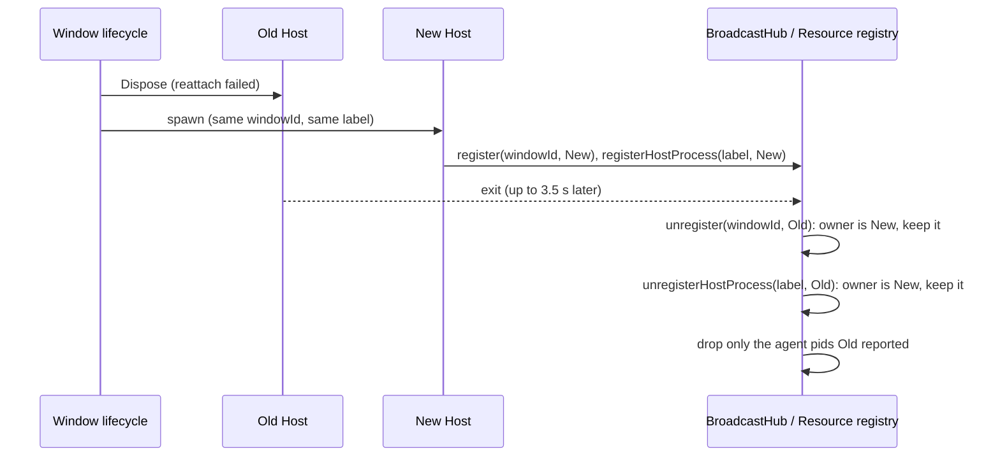

# Desktop audit fixes: October 25

Three confirmed defects from the October 2026 code audit. Main owns all three; no protocol,
storage or setting.json changes.

## Clear All Data confirmation

Owner: `clearAllDataAndRelaunch` in `packages/desktop/src/main/desktopCommandHandlers.ts`.

- Nothing is cleared before the user confirms. The Coding Plan and Rewards webview partitions are
  cleared together with the rest of the data, after the confirmation, never before it.
- The dialog (title, message, detail, both buttons) follows the current application locale, with
  one entry per supported `Locale`; an unknown locale falls back to the default locale.

Acceptance:

1. Cancel leaves the webview partitions, `~/.zcode/v2` and the app process untouched.
2. Confirm clears the partitions, deletes the data directory and relaunches, as before.
3. With `en-US` the dialog text is English; with `uk-UA` it is Ukrainian; `zh-CN` keeps Chinese.

## Opening local paths in the default app

Owner: `openPathInDefaultApp` in `packages/desktop/src/main/desktopMainIpcHelpers.ts`. It is the
single path for the `OpenExternalFile` IPC, `file:` URLs in the `OpenExternal` IPC and the
web-remote `openExternalFile` platform proxy.

"Open in default app" is for documents. A target that the OS would run as a program is not
opened: Main reveals it in the file manager instead, logs a warning and returns
`{ success: false, error: "executable-target-blocked" }`. A deliberate launch stays possible from
the file manager. No dialog is shown, because the request can come from a phone while nobody is
at the desktop.

The check runs on the resolved target (after `realpath`):

- macOS and Linux: a regular file with any execute bit; a directory ending in `.app`; the
  extensions `.app`, `.command`, `.tool`, `.terminal`, `.fileloc`, `.pkg`, `.mpkg`, `.jar`,
  `.desktop`, `.appimage`, `.run`.
- Windows: every extension in `PATHEXT`, plus `.exe`, `.com`, `.bat`, `.cmd`, `.ps1`, `.vbs`,
  `.vbe`, `.js`, `.jse`, `.wsf`, `.wsh`, `.msc`, `.scr`, `.pif`, `.cpl`, `.hta`, `.msi`, `.msp`,
  `.lnk`, `.url`, `.reg`, `.jar`, `.appref-ms`, `.application`. Trailing dots and spaces are
  stripped before the extension is read, since Windows ignores them.
- Extensions compare case-insensitively. When `stat` fails the path is passed to `openPath`
  unchanged, so the OS reports its own error.

Acceptance:

1. A local `.html` or `.pdf` still opens with `shell.openPath`.
2. An `.app` bundle, a `.command` file or a file with an execute bit is revealed, not opened.
3. On Windows `evil.EXE.` and `run.bat` are revealed, not opened.
4. `shell.openPath` is never called for a blocked target.

## Host registrations across a window reload

Owner: the exit handler of `spawnHostProcess` in `packages/desktop/src/main/desktopHostProcess.ts`.

A normal renderer reload reattaches to the live Host. When reattach fails, the old Host is
disposed (force kill after up to 3.5 s) and a new Host is spawned at once under the same
`windowId` and label. The old Host's late exit must only remove its own registrations.

- `BroadcastHub.unregister(windowId, child)` and `unregisterHostProcess(label, child)` act only when
  `child` is the current owner of the key. A stale exit leaves the registration, the resource
  sample state and the window's broadcast claims in place; the old Host's uncommitted reservations
  expire by the existing TTL.
- The agent pids a Host reported are removed one by one on its exit, never by label, so the new
  Host's agents stay listed.

Acceptance:

1. After the old Host exits, the new Host still receives broadcasts from other windows.
2. After the old Host exits, the resource manager still lists the new Host and its agents.
3. A Host that exits while still the owner removes its registration as before.
