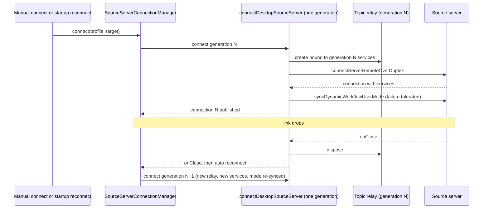

# Desktop Upstream Sync (3.16.1, PR series 1-3)

Status: in progress. Base `aac47556` (v3.15.1), target `0a1fc56d` (v3.16.1). `pendingUpstreamCommit` is `0a1fc56d` (full SHA `0a1fc56d279fd1001f78387bd81aec1c26767411`). Upstream `main` has moved on to `3c5b2276`; it is not the target.

## Scope

Package `packages/desktop` (src, test, test/e2e, tooling). Services, shared, UI and web are owned by other slices. Only tiny additive exports may be added there, and they are listed below.

Classification of `git diff aac47556 0a1fc56d -- packages/desktop` against the fork (HEAD at slice start):

| Bucket | Meaning                                   | Action                                                                                             |
| ------ | ----------------------------------------- | -------------------------------------------------------------------------------------------------- |
| A      | upstream added, fork has no file          | checkout upstream                                                                                  |
| Bm     | upstream modified, fork did not touch     | checkout upstream                                                                                  |
| C      | modified on both sides                    | hand merge: upstream structure, fork code hunks re-applied; comment and test-copy churn is ignored |
| D      | upstream deleted                          | delete                                                                                             |
| R      | upstream renamed                          | move; fork hunks re-applied to the new path                                                        |
| Eadd   | upstream added, fork already has the path | hand merge                                                                                         |

Fork features that must survive: incognito, session deletion cascade, worktree open/identity, deep links (`specs/deeplink-new-task.md`), voice dictation, resource telemetry (`specs/resource-telemetry-toggle.md`), bots `/remote`, self-hosted relay server, `fork_workspace_pins`, OAuth callback page, English e2e copy.

## Slicing

1. PR 1 (this document's first revision): database-startup move, additive host and test files, the e2e additions that typecheck, and the deferrals listed below.
2. PR 2: web remote relay move (`src/main/web-remote-relay/`), the `webRemoteControl*` merge as one unit, preload and renderer platform.
3. PR 3: `src/main/index.ts` (deep links), `autoUpdater.ts`, remaining hard files, `tsconfig.main.json` / `tsconfig.remote-main.json`, `wdio.conf.ts`, and prepare scripts.

Each PR is stacked on the previous one and targets `integration`.

## Startup storage ordering (owner and event order)

Owners: the Host (`src/host/database-startup/hostDatabaseStartup.ts`) owns the startup state. The storage worker (`host/tasksStorageWorker.js`, built from `src/host/database-startup/tasksStorageWorker.ts`) owns the migration work. Services (`project-storage/startup.ts`) owns the migration and index maintenance. Main owns none of this.

```mermaid
sequenceDiagram
  participant Main as Main process
  participant Host as Host (hostDatabaseStartup)
  participant W as tasksStorageWorker
  participant Svc as Services startup (project-storage)
  Main->>Host: start Host
  Host->>W: spawn worker with { path } (single generation; timeout owned by Host)
  W->>Svc: prepareTasksIndexStorage(path, onProgress)
  Svc-->>W: progress frames (checking, migrating, committing, maintaining, ready)
  W-->>Host: progress / done / failed frames (validated)
  Host-->>Main: DatabaseStartupState updates
  Note over Host,W: Host starts only after done. failed keeps structured error and committed migration facts.
```

Deferred in PR 1: upstream's worker also receives the legacy settings snapshot (`createSettingService().get()` as a third argument) so project seeds are migrated before the Host starts. The fork services startup API is still two-argument. This needs the services startup-entry sync and is tracked with the services slice. Until then the worker keeps the fork call shape, marked `DEFERRED` in the source.

## Deferred (not in PR 1)

PR 1 keeps the fork's version of every file whose upstream version would not compile or pass against the fork's current source. The list is the set of upstream paths in `deferred.txt` in the PR 1 working scratch (about 90 paths). Groups:

- Source-server and controller-remote wiring: `src/host/connectDesktopSourceServer.ts`, `connectSourceServerTarget.ts`, `sourceServer*.ts`, `botRemoteWorkspaceResolver.ts`, `remoteWorkspacePreparation.ts`, `remoteWorkspaceRpcContract.ts`, `serverRemoteDuplexTransport.ts`, `sourceSettingsServiceCollection.ts`, `windowHostAttachmentRpcPolicy.ts`, `serverRemoteConnection.ts`, `windowTopicResourceRelay.ts`, `botGroupTaskScope.ts`. They need services and shared exports from the services and shared slices, and the `host/index.ts` wiring (PR 3).
- Renderer remote bridges: `remoteWorkspaceServicePortBridge.ts` and its test, `sourceSettingsServicePortBridge.ts`. They move with the source-server group.
- Additive modules kept in PR 1 with no importer in PR 1 (they typecheck and their unit tests pass): `remoteWorkspacePreparation.ts`, `serverRemoteDuplexTransport.ts`, `sourceServerOperationLogs.ts`, `sourceServerStartupReconnect.ts`, `preload/remoteWorkspaceBindBridge.ts`. Their wiring lands in PR 3.
- Plugin sandbox: `src/main/pluginSandbox/*`, `src/preload/pluginSandbox/hostBridge.ts`, `src/renderer/src/plugin-sandbox/*`. `pluginSandbox/host.ts` imports `browserScreenshotActivityController.ts`, which is a fork-changed file. Lands with the dynamic plugin UI work.
- Embedded browser permission contract: `src/main/embedded-browser-permission-contract/*` and its unit test. Lands with `embeddedBrowserPermissionPolicy.ts` (fork-changed) in PR 3.
- Tests whose subject is a fork-changed source file: upstream tests such as `desktopRemoteSessions`, `desktopMainIpcRemoteTelemetry`, `desktopTrayBadge`, `desktopCronScheduler`, `codingPlanUpgradeMockServer`, `desktopBrowserViewIpc`, `desktopWindowLifecycle`, `e2eConversationPreparation`, and others. They are reverted to the fork version and move with their source in PR 2 or PR 3.
- Web remote relay and `webRemoteControl*` (PR 2). Includes `desktopWebRemoteControlIpc.ts`, its test, `webRemoteControlV2Http`, and `webRemoteControlManagerV2` tests.
- E2e helper `e2e-ssh-remote-release-assets.ts` and the SSH release test. The upstream script `prepare:remote-assets` was removed from `package.json`, which the fork helper still calls. Lands with `package.json` in PR 3.
- Fork e2e cases `workspace-removal-runtime-release.test.ts` and `workspace-sidebar-project-controls.test.ts`. They use `waitForRestoredWorkspaceItems`, which upstream removed from `helpers/workspace-agent-warmup.ts` in favor of `waitForRestoredProjects`. Migrate them to the project vocabulary with the fork's sidebar UI sync.
- Upstream-deleted e2e cases removed in PR 1: `conversation-session-grouped-archive-resurrection` (+ fixture) and `conversation-session-grouped-header-pin-visibility` (manual-review pending + fixture).
- `wdio.conf.ts`: PR 1 adds one option to the fork call, marked `TEMPORARY (PR 1)`. The full sync is PR 3.
- `tsconfig.main.json`, `tsconfig.remote-main.json`, `src/main/index.ts`, `autoUpdater.ts`, `prepare-*` scripts: PR 3. The main tsconfig does not resolve `@desktop/*` for the taken `host` files; it is not a CI gate in PR 1 (root `pnpm typecheck` covers host and e2e).
- Locale-switch e2e cases that fail the English e2e copy rule (`scripts/check-test-copy.mjs`): `settings/settings-client-language-header`, `manual-review/pending/web-remote-control-auth-gate`, `conversation-session-archive-management`, `conversation-session-project-composer`, `conversation-session-project-missing-primary-root`, `conversation-session-r3-ui-pairwise`. Re-add with the translation follow-up PR or with a fork English variant.
- Upstream `package.json` changes (`imports` map for `#src/*` and `#e2e/*`, `test:auto-update-install-reentry-smoke`, and the removed `prepare:remote-assets`): PR 3.

## PR 3 slice (branch `claude/upstream-sync-desktop-3`)

Stacked on `claude/upstream-sync-desktop-1` (#210) with `origin/integration` merged in. The `.staged-file-size-exemptions` and e2e import conflicts were resolved as the union (see the merge commit).

Decisions in this slice:

- `package.json`: integration already carries the upstream dependency bumps (`@larksuiteoapi/node-sdk` 1.75.0, `ws` 8.22, `transcribe-cpp`) through the services sync. They are kept, not reverted to the 0a1fc56d pins, to keep the lockfile consistent with services. `prepare:remote-assets` is restored as a fork divergence: `prepare-runtime-assets.mjs` (fork), `docs/bootstrap.md`, `wdio.conf.ts` and `fork-release.yml` (`ZCODE_SKIP_REMOTE_ASSETS`) still use it, and `scripts/prepare-prebuilds.mjs` exists in the repo. Upstream removed it. Remove this divergence only when the fork release path stops using it.
- `tsconfig.main.json`: taken from upstream (`noEmit`, `rootDir: src`, `src/shared` and `src/scheduler` included), English reference comment kept. `tsconfig.main` is not a root `pnpm typecheck` gate. Its error count fell from about 477 to about 421 lines (mostly unbuilt project references). `tsconfig.remote-main.json` is identical on both sides and includes relay files, so it is untouched.
- `src/main/index.ts`: three-way merge; the relay-coupled hunks are kept verbatim from the fork (see below). Upstream hunks applied: `appSettingsPatchSchema` typing for `syncImmediateAppSettings`, Electron `net.fetch` URL normalization for telemetry, `getClientLanguage` for help config and client-config fetcher, the context-prompt prewarm moved after the persisted locale is read, linux tray late-creation unread replay, and the `protocolUrl &&` guard for startup deep links.
- `src/main/desktopContextPromptRollout.ts`: upstream (fork changed only one comment, which is kept in English).
- `src/main/autoUpdater.ts`: NOT merged in this slice (design decision needed, see below).

Deferred in this slice, with reasons:

- `src/main/index.ts` relay-coupled hunks (kept as fork, untouched): `createNodeWebRemoteControlRelayAuthProvider` and `createWebRemoteControlRelayAuthStorageProvider` replaced by the relay v2 `createWebRemoteControlDeviceStorage`; `prepareProjectWorkspace` / `cancelProjectPreparation` manager options; removal of `restorePreviouslyEnabledWebRemoteControl` and `syncWebRemoteControlTasks`.
- `src/main/index.ts` source-server and bot wiring: upstream moved `handleBotRemoteWorkspace*Request` handlers out of the window-host bridge (into the source-server resolver group). The fork keeps them, including the fork `/remote` link handler. `attachSourceSettings` (needs `InternalChannels.SourceSettingsServicePort`, which the shared slice does not yet provide) is deferred.
- `src/main/index.ts` hunks that depend on fork-diverged files: `browserGuestManager.updateViewportFromRenderer` (fork kept its `desktopZoomFactor` argument) and `desktopHostProcess` `onPluginTelemetry` and `remoteAssets` host options (the fork `desktopHostProcess.ts` lacks them, and it was changed on both sides).
- `applyApplicationLocale` posting `HostMessageTypes.ApplicationLocaleChanged` to Hosts: the constant does not exist in `packages/shared` on this branch. Needs the shared slice.
- `src/main/autoUpdater.ts`: both sides rewrote the quit-and-install state machine. The fork has a "3.15.3 parity" implementation (`quitAndInstallPhase`, `settlingCheckForUpdates`, dictation mute before install, English comments). Upstream 3.16.1 uses `quitAndInstallState` with `isUpdateTargetLocked()` and defers the downloaded publish until the download promise settles (`pendingDownloadedUpdate`). Both are the same concept with different designs. A three-way merge gives 13 conflicts. Decision needed: adopt the upstream state machine and re-apply the fork dictation mute calls (`restoreDictationSystemMuteForShutdown`), or keep the fork machine and document the divergence. Not merged until decided.
- `wdio.conf.ts`: full three-way merge has 18 conflicts across fork e2e fixtures (seed helpers, mock servers, timeouts, `ZCODE_E2E_MOCHA_GREP`, `configureZCodeAgentServerEnv`, `withE2EDesktopBuildLock`). Not merged: the e2e behavior cannot be validated in this environment. The `TEMPORARY (PR 1)` option is still present and must be resolved in the next PR.
- `src/main/pluginSandbox/*`, `src/preload/pluginSandbox/hostBridge.ts`, `src/renderer/src/plugin-sandbox/*`, and `src/main/embedded-browser-permission-contract/*`: not started. They depend on `browserScreenshotActivityController.ts` and `embeddedBrowserPermissionPolicy.ts`, which are fork-changed.
- Source-server wiring (`connectDesktopSourceServer`, `sourceServer*`, `botRemoteWorkspaceResolver`, `remoteWorkspacePreparation`, `serverRemoteDuplexTransport`, `sourceServerOperationLogs`, `sourceServerStartupReconnect`, preload `remoteWorkspaceBindBridge`): not started. `@zcode/services/node` exports `createServerHostServices` (`packages/services/src/node.ts`) on this branch, so the services side exists. The host wiring is the next step.
- Database startup 2-argument ordering gap: `prepareTasksIndexStorage(path, onProgress)` in `packages/services/src/project-storage/startup.ts` still has no third (legacy settings) argument, so `src/host/database-startup/tasksStorageWorker.ts` keeps the 2-argument `DEFERRED` call. Services-owned: fix in the services startup sync, not here.
- Reverted desktop tests (about 63) whose subject files are not yet synced: not re-synced in this slice.

## Compatibility members (remove in the final desktop PR)

- None in PR 1.

## Verification (PR 1)

- `pnpm typecheck`: green.
- `pnpm test:unit`: green (2107 files passed, 2 skipped).
- `pnpm lint`, `pnpm architecture:check`, `pnpm fmt`: green.

## PART 4 (branch `claude/upstream-sync-desktop-4`, stacked on PART 3)

Status: partial. Groups A, D, E (partial), F landed. Group C (source-server wiring) is blocked on the services exports in PR #214, so it is not in this PR. Target is `0a1fc56d`; `main` moved on and is not the target.

Method (how the fork side was classified):

- Fork changes are measured against the fork tip `origin/claude/upstream-sync-desktop-3` (cbffd950), not against HEAD. Once a commit lands, HEAD no longer shows the fork's intent.
- A file whose only fork-side changes are comments (Chinese to English translation) takes upstream code verbatim. The spec's comment churn rule applies. The check counts changed lines that are not comment-only in the raw `git diff`; a transpile-based comparison misses type-only and formatting changes, so it is not used as the decision.
- A test whose fork file equals base takes upstream. A test whose fork file has non-comment changes keeps the fork version.

Landed:

- Group A (`4d4b956c`): `browserScreenshotActivityController.ts` and `embeddedBrowserPermissionPolicy.ts` take upstream, because their fork-side changes are comment translations and formatting only. The fork's `onDisplayMediaRequest` reflow is dropped, which is formatting only. The `originFromUrl` origin normalization in `checkPermission` is upstream's change, and it is now in the file. Plugin sandbox (`main/pluginSandbox/*`, `preload/pluginSandbox/hostBridge.ts`, `renderer/src/plugin-sandbox/*`) and `main/embedded-browser-permission-contract/*` take upstream. No file in these groups imports relay modules.
- Group D (`bd410fa4`): `browserGuestManager.ts` and its test take upstream, because the fork changed only comments. The viewport update no longer takes `desktopZoomFactor`. `desktopHostProcess.ts` adds the plugin telemetry dispatch and the `remoteAssets` init field, and forwards off-peak `lifecycleManaged`. The fork's `/remote` web-remote link handler and its three bot handlers stay. `main/index.ts` gets the 3-argument viewport call, `onPluginTelemetry`, `remoteAssets`, and `ApplicationLocaleChanged` posted to every window Host. `shared/validation.ts` gets additive schemas copied from `0a1fc56d`: `hostApplicationLocaleChangedMessageSchema`, `hostPluginTelemetryResponseSchema`, and the off-peak `lifecycleManaged` field, with a local `localeSchema` import.
- Group E partial (`a8ba7771`, and the batch that followed): 24 source and test files take upstream where the fork had only comment changes, including the host attachment and telemetry helpers, desktop tray, crash capture, scheduler protocol, off-peak settlement, and their tests. `desktopBrowserViewIpc.test.ts`, `promptAttachmentTransferService.test.ts`, `startupWorkspace.test.ts`, `desktopClientConfigLanguageHeader.test.ts`, `desktopTrayBadge.test.ts`, `desktopWindowLifecycle.test.ts`, `fileApplicationOpening.test.ts`, `hostMessagePortGuard.test.ts`, `offPeakDispatchSettlement.test.ts`, `embeddedBrowserPermissionPolicy.test.ts`, and `e2eProviderConfigSeedBoundary.test.ts` take upstream and pass.
- Group F (`07fc9a49`): `wdio.conf.ts` takes upstream and re-applies the fork's e2e wiring (see the wdio bullets below). `prepare-runtime-assets.mjs` takes upstream and re-applies the fork's `ZCODE_SKIP_REMOTE_ASSETS` gate and the `prepare:macos-apple-fm` step. `test/e2e/helpers/coding-plan-upgrade-mock-server.ts` takes upstream.

Ownership (unchanged in this PART):

- Bot `/remote` link: owned by the fork's window-Host bridge in `main/index.ts` and `desktopHostProcess.ts`. The bot reconnect, connection-status and runtime-port handlers stay in the fork's main process. Upstream moved them to the source-server resolver, which is group C.
- Locale: `main/index.ts` owns `currentApplicationLocale` and posts `ApplicationLocaleChanged` to every window Host. The Host side (`host/index.ts`) does not handle the message yet, so the Host ignores it until group C lands.
- Owner/event-order diagram for source-server connect and reconnect: not written. It lands with group C, after the code it describes is on this branch.

Deferred (ledger):

- Group C, blocked on #214: `host/connectDesktopSourceServer.ts`, `connectSourceServerTarget.ts`, `sourceServer*.ts`, `botRemoteWorkspaceResolver.ts`, `remoteWorkspaceRpcContract.ts`, `sourceSettingsServiceCollection.ts`, `windowHostAttachmentRpcPolicy.ts`, `windowHostControllerProjection.ts`, `windowHostControllerService.ts`, `windowHostSessionsIndexObserver.ts`. They import `ISourceServerWorkspaceService`, `UpdateConnectionProfileInput`, `migrateControllerRemoteWorkspaceIdentity`, `ControllerRemoteIdentityMigrationReport`, `WindowHostTaskUnreadSignal`, `ServiceExposurePolicy`, and the `source-server-workspace` and `window-controller` service modules. #214's tree provides them, and this branch does not have them. The attempt compiled with 60+ errors and was reverted.
- `host/index.ts`: fork kept. Upstream diff is about 1361 lines added and 307 removed. Blocked by group C.
- `main/index.ts`: `attachSourceSettings` deferred, because it needs the `source-settings` scope in `windowHostAttachmentRegistry`. Relay-coupled hunks stay on the fork side: `createNodeWebRemoteControlRelayAuthProvider`, `createWebRemoteControlRelayAuthStorageProvider`, `prepareProjectWorkspace`, `cancelProjectPreparation`, `restorePreviouslyEnabledWebRemoteControl`, `syncWebRemoteControlTasks`. The fork's bot handlers stay.
- `windowHostAttachmentRegistry.ts`, `windowRemoteConnectionRegistry.ts`, `remoteWorkspaceServiceCollection.ts`, `renderer/src/remoteWorkspaceSessionServices.ts`, `preload/index.ts`, `renderer/src/desktopPlatform.ts`, `renderer/src/main.tsx`: fork kept. They are group C or relay-adjacent.
- `remotePromptAttachments.ts`: fork kept. Upstream renamed `createRemotePromptAttachmentSessionService` and `createRemotePromptAttachmentTaskService`, and the fork `host/index.ts` still imports the old names.
- `main/desktopRemoteSessions.ts`, `main/desktopMainIpcRemote.ts`, and their tests `desktopRemoteSessions.test.ts`, `desktopMainIpcRemoteTelemetry.test.ts`: fork kept. The upstream tests depend on the group C connect path, and 37 and 4 cases fail against the upstream sources.
- `main/desktopCronScheduler.ts` and `desktopCronScheduler.test.ts`: fork kept. Upstream's cron-run message carries a frozen project snapshot that the fork shared `cron-run` schema does not accept.
- `offPeakHostDispatch.test.ts`: fork kept. Upstream calls `zcodeTaskService.listTasks`, which the services on this branch do not provide.
- `codingPlanUpgradeMockServer.test.ts`, `customOpenAIProviderStore.test.ts`, `desktopAppWorkspaceReadiness.test.ts`: fork kept. They fail against the synced sources. Not triaged further.
- Upstream unit tests not added because they fail against this branch: `e2eConversationPreparation`, `e2eToolFullAccess`, `e2eUnreadContextContract`, `e2eV4WindowSize`, `modelProviderRestartWorkspace`, `pluginMarketStartupCredentials`.
- `prepare-agent-node-bundle.mjs`: fork kept. Upstream moves the plugin list to `scripts/official-plugin-packages.mjs` and needs `apps/zcode-cli/packages/office-runtime`, which does not exist on this branch. The fork's Node 26 settings stay.
- `autoUpdater.ts`: unchanged, per the decision to keep the fork's quit-and-install state machine.
- `wdio.conf.ts`: web-remote-control auth-gate fixture (`prepareWebRemoteControlAuthGateFixture`) removed, because it is relay e2e and out of scope. The `createE2EStartupCredentialSeed` call drops `accountMock` and `remoteProfile`. The fork helper does not take them, and its accountless spec list and zai identity removal are fork behavior. Upstream's default-empty credential rule conflicts with that, so it needs a product decision. The fork's `seedDeleteAllArchivedTasksFixture` seed is restored with `await`; the fork called it without `await` although the helper is async.
- `package.json`: untouched in this PART. Upstream's `imports` map, `test:auto-update-install-reentry-smoke`, and the removal of `prepare:remote-assets` are still pending, and they belong to PART 3's package.json decisions.
- Relay: no relay file was touched. No file in this PART imports relay v2 types. `ws` dependencies are unchanged.

Verification (this PART):

- `pnpm typecheck`: green.
- `pnpm lint`: 0 errors, 75 warnings. The baseline warning count was not captured before this PART.
- `pnpm architecture:check`: OK, 0 violations.
- `pnpm fmt:check`: green. `node scripts/fork-format-pending.mjs --fetch`: no pending upstream commit.
- `pnpm test:pre-push`: green (13 passed).
- `node scripts/check-test-copy.mjs`: green.
- `node --test scripts/run-pre-commit-checks.test.mjs scripts/check-staged-file-tokens.test.mjs`: 26 passed.
- Desktop unit tests excluding e2e: 323 files and 2497 tests passed.
- Full `pnpm test`: run after the last commit; the result is recorded in the PR body.
- wdio dry check: a plain `tsx` import fails on `istanbul-lib-coverage` named exports in `e2e-node-coverage.ts`, which this PART does not touch, so the pre-existing loader problem is not caused by the merge. The dry check is an esbuild bundle of `wdio.conf.ts`, which resolves every relative import.

## Group C status (branch `claude/sync-desktop-group-c`)

Status: the #214 service exports are on `origin/integration` (`source-server-workspace`, `window-controller`, `ServiceExposurePolicy`, `WindowHostTaskUnreadSignal`, `controllerRemoteIdentityMigration`), so the PART 4 blocker is gone. The group C source port is not in this change. The fork still lacks the upstream modules it needs, listed below, and porting them is a separate, larger change. This change records the owner/event-order design so that port starts from an agreed model.

Fork files missing on this branch (upstream at `0a1fc56d`): `botRemoteWorkspaceResolver.ts`, `connectDesktopSourceServer.ts`, `connectSourceServerTarget.ts`, `remoteWorkspaceRpcContract.ts`, `sourceServerConnectionManager.ts`, `sourceServerDirectory.ts`, `sourceServerManagementService.ts`, `sourceServerMigrationCounts.ts`, `sourceServerRecoveryPolicy.ts`, `sourceServerReleaseResolver.ts`, `windowHostControllerProjection.ts`, `windowHostControllerService.ts`. The fork keeps `sourceServerOperationLogs.ts` and `sourceServerStartupReconnect.ts`, which need a diff against upstream before they are replaced.

Owner and event order for source-server connect and reconnect (upstream behavior, to be ported as-is):

- Owner of the physical Source connection: `SourceServerConnectionManager` (host). Manual connect enters through `connectSourceServerTarget`, which asks `SourceServerDirectory` for the profile and credentials. Startup and automatic reconnect enter through `sourceServerStartupReconnect`. Both end in `connectDesktopSourceServer`.
- Each physical connection generation owns one topic-resource relay and one set of services. A reconnect creates a new generation. It never reuses the previous relay or services.
- Order inside one generation: create relay bound to this generation's services, connect over the duplex, then read the desktop's dynamic-workflow user mode and push it with `syncDynamicWorkflowUserMode` before the connection is published. A missing or old Source that rejects the sync is reported through `onModeSyncError` and the connection still succeeds.
- Close order: a generation's `onClose` disposes its relay first, then calls the manager's `onClose`. Failed connect disposes the relay and the partial connection, then rethrows.



Ledger for this change:

- The port is not done here. Its size is about 1446 added lines in `host/index.ts` plus the modules above. It needs a dedicated change with its own compile and test run.
- Locale: the Host does not yet track `ApplicationLocaleChanged`. Upstream stores it in a module variable that is read only by the group C client-language resolver. Adding the variable alone would be unused and would fail `noUnusedLocals`, so it lands with the resolver.
- `InternalChannels.SourceSettingsServicePort` already exists in `packages/shared/src/channels.ts`. The `attachSourceSettings` port is blocked by the group C scope work, not by the channel.
