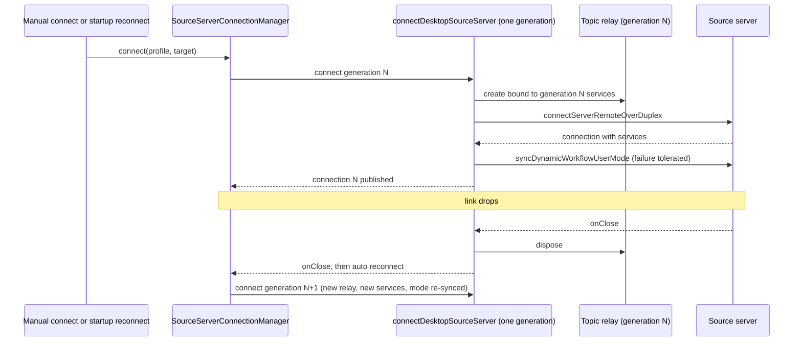

# Desktop Upstream Sync (3.16.1, PR series 1-3)

Status: merged. Base `aac47556` (v3.15.1), target `0a1fc56d` (v3.16.1) (`pendingUpstreamCommit` removed; upstream `main` at `3c5b2276` was never the target). Open items are the deferrals below.
Full history: `git show 97a0d8e4:specs/desktop-upstream-sync.md`.

## Scope and rules

Package `packages/desktop` (src, test, test/e2e, tooling). Services, shared, UI and web are owned by other slices; only the tiny additive exports listed by those slices land here.

Classification of `git diff <base> <target> -- packages/desktop` against the fork:

| Bucket | Meaning                                   | Action                                                                                             |
| ------ | ----------------------------------------- | -------------------------------------------------------------------------------------------------- |
| A      | upstream added, fork has no file          | checkout upstream                                                                                  |
| Bm     | upstream modified, fork did not touch     | checkout upstream                                                                                  |
| C      | modified on both sides                    | hand merge: upstream structure, fork code hunks re-applied; comment and test-copy churn is ignored |
| D      | upstream deleted                          | delete                                                                                             |
| R      | upstream renamed                          | move; fork hunks re-applied to the new path                                                        |
| Eadd   | upstream added, fork already has the path | hand merge                                                                                         |

Fork features that must survive: incognito, session deletion cascade, worktree open/identity, deep links (`specs/deeplink-new-task.md`), voice dictation, resource telemetry (`specs/resource-telemetry-toggle.md`), bots `/remote`, self-hosted relay server, `fork_workspace_pins`, OAuth callback page, English e2e copy.

Merge method (how the fork side was classified):

- Fork changes are measured against the fork tip of the previous slice, not HEAD; once a commit lands, HEAD no longer shows the fork's intent.
- A file whose only fork-side changes are comments (Chinese → English translation) takes upstream verbatim; comment churn never blocks upstream code. The check counts changed lines that are not comment-only in the raw `git diff` (a transpile-based comparison misses type-only and formatting changes).
- A test whose fork file equals base takes upstream; a test with non-comment fork changes keeps the fork version.

## Startup storage ordering (owner and event order)

Owners: the Host (`src/host/database-startup/hostDatabaseStartup.ts`) owns the startup state. The storage worker (`host/tasksStorageWorker.js`) owns the migration work. Services (`project-storage/startup.ts`) own migration and index maintenance. Main owns none of this.

```mermaid
sequenceDiagram
  participant Main as Main process
  participant Host as Host (hostDatabaseStartup)
  participant W as tasksStorageWorker
  participant Svc as Services startup (project-storage)
  Main->>Host: start Host
  Host->>W: spawn worker with { path } (single generation; timeout owned by Host)
  W->>Svc: prepareTasksIndexStorage(path, onProgress)
  Svc-->>W: progress frames (checking, migrating, committing, maintaining, ready)
  W-->>Host: progress / done / failed frames (validated)
  Host-->>Main: DatabaseStartupState updates
  Note over Host,W: Host starts only after done. failed keeps structured error and committed migration facts.
```

Deferred (open): upstream's worker also receives the legacy settings snapshot as a third argument so project seeds are migrated before the Host starts. The fork services startup API is still two-argument (`prepareTasksIndexStorage(path, onProgress)` in `packages/services/src/project-storage/startup.ts`), so `src/host/database-startup/tasksStorageWorker.ts` keeps the 2-argument `DEFERRED` call. Services-owned: fix in the services startup-entry sync, not in desktop.

## Decisions kept

- `package.json`: the upstream dependency bumps (`@larksuiteoapi/node-sdk` 1.75.0, `ws` 8.22, `transcribe-cpp`) came in through the services sync and are kept, not reverted to the `0a1fc56d` pins. `prepare:remote-assets` is restored as a fork divergence: `prepare-runtime-assets.mjs` (fork), `docs/bootstrap.md`, `wdio.conf.ts` and `fork-release.yml` (`ZCODE_SKIP_REMOTE_ASSETS`) still use it. Upstream removed it. Remove this divergence only when the fork release path stops using it.
- Upstream `package.json` changes still pending: the `imports` map for `#src/*` and `#e2e/*`, `test:auto-update-install-reentry-smoke` (belong with the `prepare:remote-assets` decision).
- `tsconfig.main.json`: upstream version (`noEmit`, `rootDir: src`, `src/shared` and `src/scheduler` included). It is not a root `pnpm typecheck` gate. `tsconfig.remote-main.json` is identical on both sides.
- `src/main/index.ts`: three-way merge; relay-coupled hunks kept verbatim from the fork: `createNodeWebRemoteControlRelayAuthProvider` / `createWebRemoteControlRelayAuthStorageProvider` replaced by the relay v2 `createWebRemoteControlDeviceStorage`, `prepareProjectWorkspace` / `cancelProjectPreparation` manager options, removal of `restorePreviouslyEnabledWebRemoteControl` and `syncWebRemoteControlTasks`.
- `autoUpdater.ts`: fork version kept. Both sides rewrote the quit-and-install state machine; the fork keeps its "3.15.3 parity" implementation (`quitAndInstallPhase`, `settlingCheckForUpdates`, dictation mute before install). Upstream's `quitAndInstallState` / `isUpdateTargetLocked()` / `pendingDownloadedUpdate` is not adopted. To adopt it later, re-apply the fork dictation mute calls (`restoreDictationSystemMuteForShutdown`) onto the upstream machine.
- `wdio.conf.ts`: upstream version with the fork e2e wiring re-applied (seed helpers, mock servers, timeouts, `ZCODE_E2E_MOCHA_GREP`, `configureZCodeAgentServerEnv`, `withE2EDesktopBuildLock`). The web-remote-control auth-gate fixture is removed (relay e2e, out of scope). `createE2EStartupCredentialSeed` drops `accountMock` and `remoteProfile`: the fork helper's accountless spec list and zai identity removal conflict with upstream's default-empty credential rule — still needs a product decision.
- Bot `/remote` link: owned by the fork's window-Host bridge in `main/index.ts` and `desktopHostProcess.ts`. The bot reconnect, connection-status and runtime-port handlers stay in the fork's main process. Upstream moved them to the source-server resolver (group C, not ported).
- Locale: `main/index.ts` owns `currentApplicationLocale` and posts `ApplicationLocaleChanged` to every window Host. The Host side does not handle the message until group C lands (adding the Host-side variable alone would be unused and fail `noUnusedLocals`; it lands with the group C client-language resolver).

## Group C status (source-server wiring) — not ported

The #214 service exports (`source-server-workspace`, `window-controller`, `ServiceExposurePolicy`, `WindowHostTaskUnreadSignal`, `controllerRemoteIdentityMigration`) are on `integration`, but the group C source port is still a separate, larger change (about 1446 added lines in `host/index.ts` plus the modules below). This section records the owner/event-order design so that port starts from an agreed model.

Fork files still missing (upstream at `0a1fc56d`): `botRemoteWorkspaceResolver.ts`, `connectDesktopSourceServer.ts`, `connectSourceServerTarget.ts`, `remoteWorkspaceRpcContract.ts`, `sourceServerConnectionManager.ts`, `sourceServerDirectory.ts`, `sourceServerManagementService.ts`, `sourceServerMigrationCounts.ts`, `sourceServerRecoveryPolicy.ts`, `sourceServerReleaseResolver.ts`, `windowHostControllerProjection.ts`, `windowHostControllerService.ts`. The fork keeps `sourceServerOperationLogs.ts` and `sourceServerStartupReconnect.ts`; diff them against upstream before replacing. `@zcode/services/node` already exports `createServerHostServices`, so the services side exists.

Owner and event order for source-server connect and reconnect (upstream behavior, to be ported as-is):

- Owner of the physical Source connection: `SourceServerConnectionManager` (host). Manual connect enters through `connectSourceServerTarget`, which asks `SourceServerDirectory` for the profile and credentials. Startup and automatic reconnect enter through `sourceServerStartupReconnect`. Both end in `connectDesktopSourceServer`.
- Each physical connection generation owns one topic-resource relay and one set of services. A reconnect creates a new generation and never reuses the previous relay or services.
- Order inside one generation: create relay bound to this generation's services, connect over the duplex, then read the desktop's dynamic-workflow user mode and push it with `syncDynamicWorkflowUserMode` before the connection is published. A missing or old Source that rejects the sync is reported through `onModeSyncError` and the connection still succeeds.
- Close order: a generation's `onClose` disposes its relay first, then calls the manager's `onClose`. Failed connect disposes the relay and the partial connection, then rethrows.



## Deferred ledger (open)

- `host/index.ts`: fork kept (upstream diff about 1361 added / 307 removed). Blocked by group C.
- `main/index.ts` `attachSourceSettings`: deferred; needs the `source-settings` scope in `windowHostAttachmentRegistry`. `InternalChannels.SourceSettingsServicePort` already exists in `packages/shared/src/channels.ts`, so the port is blocked by the group C scope work, not the channel.
- `windowHostAttachmentRegistry.ts`, `windowRemoteConnectionRegistry.ts`, `renderer/src/remoteWorkspaceSessionServices.ts`, `preload/index.ts`, `renderer/src/desktopPlatform.ts`, `renderer/src/main.tsx`: fork kept (group C or relay-adjacent).
- `remotePromptAttachments.ts`: identical to upstream `0a1fc56d` (the fork's remote prompt-attachment services were removed with the local-global collection; see `specs/upstream-sync-final-ledger.md`, section `local-global collection removal`).
- Tests kept on the fork side because their subjects are not synced or fail against the synced sources: `desktopRemoteSessions.test.ts` (37 cases fail on the group C connect path), `desktopMainIpcRemoteTelemetry.test.ts` (4), `desktopCronScheduler.test.ts` (upstream's cron-run message carries a frozen project snapshot the fork shared `cron-run` schema does not accept), `offPeakHostDispatch.test.ts` (upstream calls `zcodeTaskService.listTasks`, not provided on this branch), `codingPlanUpgradeMockServer.test.ts`, `customOpenAIProviderStore.test.ts`, `desktopAppWorkspaceReadiness.test.ts` (not triaged), plus upstream tests not added: `e2eConversationPreparation`, `e2eToolFullAccess`, `e2eUnreadContextContract`, `e2eV4WindowSize`, `modelProviderRestartWorkspace`, `pluginMarketStartupCredentials`. Locale-switch e2e cases that fail the English e2e copy rule (`scripts/check-test-copy.mjs`) re-land with the translation follow-up or a fork English variant.
- Fork e2e cases `workspace-removal-runtime-release.test.ts` and `workspace-sidebar-project-controls.test.ts` still use `waitForRestoredWorkspaceItems` (upstream removed it from `helpers/workspace-agent-warmup.ts` in favor of `waitForRestoredProjects`); they migrate to the project vocabulary with the fork's sidebar UI sync.
- `prepare-agent-node-bundle.mjs`: fork kept. Upstream moves the plugin list to `scripts/official-plugin-packages.mjs` and needs `apps/zcode-cli/packages/office-runtime`, which does not exist on this branch.
- Relayed `webRemoteControl*` and the web remote relay landed as one unit (PR 2); no relay file in this series imports relay v2 types and `ws` dependencies are unchanged.

Verification at the final slices: `pnpm typecheck`, `pnpm lint` (0 errors), `pnpm architecture:check`, `pnpm fmt:check`, `pnpm test:pre-push`, `scripts/check-test-copy.mjs` and the desktop unit suite (excluding e2e) were green; full `pnpm test` results are in the PR bodies.
