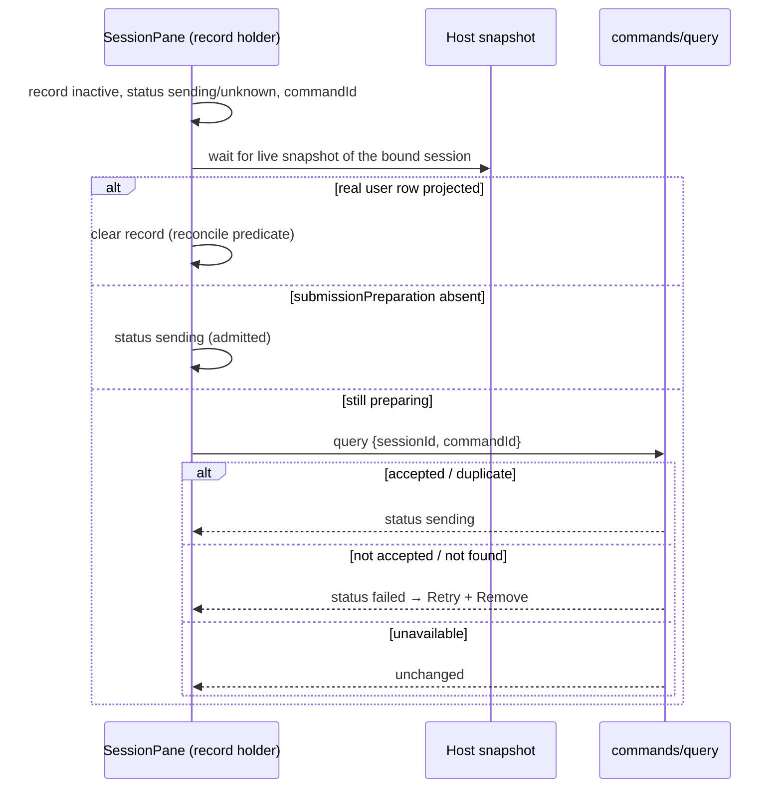

# First submission: instant chat UX (target)

Status: **product target for implementation** (2026-10-21). This document tells
agents **how the experience should feel** and what to optimize for. It does **not**
replace durability, identity, or recovery rules in
[`first-submission-lifecycle.md`](./first-submission-lifecycle.md) (FSL) or worktree
contracts in [`composer-worktree-setup-steps.md`](./composer-worktree-setup-steps.md)
and [`ui-draft-send-path.md`](./ui-draft-send-path.md). Those specs remain the
source of truth for **correctness**; this spec is the source of truth for
**perceived speed and non-blocking interaction**.

## North star (one sentence)

After the user passes synchronous eligibility checks and clicks Send, they must
**immediately** feel they are **in the conversation** with their **full message
visible as sent**, while the composer stays **free for the next draft**; everything
before the model (session reservation, worktree, uploads, runtime, admission) runs
**in the background** without holding the Send button hostage for the whole
pipeline; only failures and unresolved outcomes surface under the message.

## Three clocks (do not conflate them)

| Clock             | User question                 | Target                                                                                                                                                                                                                                                                          |
| ----------------- | ----------------------------- | ------------------------------------------------------------------------------------------------------------------------------------------------------------------------------------------------------------------------------------------------------------------------------- |
| **P1 — Perceive** | “Did my message go in?”       | **&lt; 1 frame after click** (same React commit): full text (+ attachments/context chips) appears as the **primary user turn** in the conversation column, not a secondary preview strip.                                                                                       |
| **P2 — Navigate** | “Am I in this task/chat?”     | **Immediately after P1** (first async beat — see _P2 bind moment_ below): pane binds to a **stable session identity** (real `sessionId`), normal chat chrome (header, timeline, composer dock), sidebar may lag but **must not gate** opening the conversation (FSL bind rule). |
| **P3 — Model**    | “When does the agent answer?” | **Whenever preparation + admission complete**; TTFT and setup are **not** part of P1/P2. No progress label under the message; never block P1/P2 on LLM or runtime ready.                                                                                                        |

**P2 bind moment (single write point, decided 2026-10-21).** The pane binds when
the Host reservation identity — `{sessionId, commandId}` — is durably recorded:
the plain path binds at the `createSession` dispatch envelope (the session id is
client-proposed and stable across the ACK), the worktree path at the reservation
ACK. The bind is the only write point and is gated by navigation ownership
(FSL rule 7): a late identity never steals focus, and a pane returning to the
draft reconciles from the persisted first-submission record. IUX01's "same frame"
promises the user turn and the chat chrome (centered draft gone) in the click
commit; the real `sessionId` lands at P2, not in the same frame.

Reference apps (e.g. Craft Agents / PI Desktop in Harness) optimize by treating P1+P2
as **optimistic local truth** and reconciling with the server later. ZCode must reach
the **same user-visible outcome** while keeping FSL invariants (one session per
submission, command-id reconciliation, no duplicate dispatch).

## What “cool” means (product)

1. **No “dead Send”** — The submit control must not stay in a global `pending` state
   for the entire Host/Git/runtime chain. At most a brief local ack (one frame) or a
   per-submission status line; the user can start typing the **next** message right
   away (FSL rule 7).
2. **No draft limbo** — Avoid leaving the user on the centered “new task” empty state
   with only a header preview while `sessionId === null`. P2 should flip to bound
   session in the **same turn** as P1, before any network round-trip when possible
   (synchronous local session slot or immediate navigation to reserved id).
3. **One message, one identity** — Optimistic UI is allowed; **two user bubbles**
   for the same submission is not. Reconcile by `submissionId` / `commandId` (FSL
   rule 6), not by text match.
4. **Forks are honest** — Worktree, incognito, attachments, branch checkout, and
   queue choice are **visible preparation**, not silent blocking. The error status
   sits **under the frozen message**; Retry on the **same** session (FSL rule 4)
   lives in the composer's recovery card of that session (see _Retry surface_).
5. **Sidebar is async** — Task list rows remain Host-owned; a missing sidebar line
   must not mean “still on draft screen.” Conversation bind uses Host reservation
   identity directly (FSL owners section).

## Target flow (all first-send variants)

```text
User: Send (eligibility OK)
  │
  ├─ P1+P2 (sync, renderer): freeze submission snapshot; show user turn; bind pane to sessionId
  │     (reserve id locally or from last prewarm slot; persist recovery scope)
  │
  ├─ Composer: clear only the *submitted* snapshot; leave editor usable (next draft)
  │
  └─ Background pipeline (async, per variant):
        plain → submissionPreparation + config + admission
        worktree → worktreePreparation + Git + marker sync + activate + admission
        incognito → create route + reupload + admission
        then → CommandInbox → runtime → LLM (P3)
```

Worktree and plain paths should **feel the same** at P1+P2 even if background steps
differ. Today worktree is closer to this target than plain durable send; **plain
must catch up**, not worktree regressing to slower plain behavior.

## Comparison anchor (Harness / Craft / PI — patterns only)

| Pattern                                          | Adopt for ZCode                                 | Do not copy blindly                                                            |
| ------------------------------------------------ | ----------------------------------------------- | ------------------------------------------------------------------------------ |
| Empty or immediate `sessionId` before first text | Yes — user always “in a chat” after Send        | Our prewarm/incognito/worktree markers differ; use `ui-draft-send-path` routes |
| Optimistic user row in timeline                  | Yes — satisfies P1                              | Must reconcile with V4 projection + `commandId`; no second queue in UI         |
| `optimisticMessageId`-style correlation          | Yes — conceptually `submissionId` + `commandId` | Protocol already has command ledger; do not bypass CommandInbox                |
| Clear composer before network returns            | Yes — for **submitted** slice only              | FSL: next draft must not be wiped; functional updates / separate scope         |
| `await sendMessage` for whole UI                 | **No** — that is the anti-pattern to remove     | Keep await only inside background worker, not on submit button                 |

## Anti-patterns (current gaps agents should fix)

These are **UX bugs relative to this target**, not permission to violate FSL:

1. **Bind chat only after `sendText` accepted** on the plain durable path — violates P2.
2. **`pending === true` for full `runSend`** — violates “no dead Send”.
3. **`submissionReady` false for entire active first submission** — blocks next draft;
   conflicts with FSL rule 7 unless worktree-only exception.
4. **Preview in `headerSlot` without authoritative user row** — acceptable only as
   **sub-millisecond** bridge; if it persists past P2, P1 is not met.
5. **Centered draft layout while `hasFirstSubmission`** — user is neither in empty
   state nor full chat; minimize duration to zero.

## Invariants (must not break while optimizing UX)

Carry forward from FSL and related specs without reinterpretation:

- One first submission per workspace identity + `submissionId`; no double Send.
- Unknown command outcome → reconcile original `commandId`; no auto re-send with new id.
- Worktree: runtime only in verified execution cwd; single admission of frozen input.
- Incognito: no incompatible prewarm; profile frozen at creation.
- Remote: `workspaceIdentity` end to end; no path-only matching.
- No new `setting.json` keys; fork storage rules unchanged.
- Desktop continuous vs mobile replayable semantics preserved.

## Acceptance (user-observable)

Agents should add or extend **mounted UI tests** and desktop E2E candidates for
these; unit tests alone are insufficient for P1/P2.

| ID    | Action                                | Must observe                                                                                                                                                                                                                                                                    |
| ----- | ------------------------------------- | ------------------------------------------------------------------------------------------------------------------------------------------------------------------------------------------------------------------------------------------------------------------------------- |
| IUX01 | Plain text, first Send on draft       | Same frame: user turn visible + chat chrome without the centered draft (`sessionId` binds at the P2 moment, first async beat); typing the next draft is never blocked; a second Send follows ordinary session readiness (`runtimeReady`), never an active-first-submission lock |
| IUX02 | Double-click Send; then a new draft   | A repeat of the same submission (no editor change since the claim) dispatches nothing: one session, one user turn, one admission attempt. A genuinely new draft typed after the bind dispatches through the ordinary send path once the frozen input is admitted                |
| IUX03 | Type next message during worktree Git | First message frozen; second draft intact; no owner steal                                                                                                                                                                                                                       |
| IUX04 | Navigate away before background ACK   | Focus unchanged; return shows same session + message; no duplicate send                                                                                                                                                                                                         |
| IUX05 | Slow Host (held reservation)          | User still in chat with message, not blank draft screen; no progress label under the message                                                                                                                                                                                    |
| IUX06 | Admission ACK before projection       | At most one user turn; brief “syncing” ok; no second bubble                                                                                                                                                                                                                     |
| IUX07 | Preparation failure                   | Same session, message remains, Retry works; composer not globally locked                                                                                                                                                                                                        |
| IUX08 | Sidebar slow                          | Conversation usable before sidebar row appears                                                                                                                                                                                                                                  |
| IUX09 | Restart mid-preparation               | Recovery without auto-dispatch; explicit continue                                                                                                                                                                                                                               |

## Suggested architecture direction (for implementers)

Order matters; later steps assume earlier ones.

1. **Split submit transaction** — Synchronous: freeze the submission snapshot,
   **claim the draft** (editor cleared in the same commit, persist echo suppressed),
   render the optimistic user turn, fire the background chain. `pending` UI state
   covers only this synchronous phase; the repeat-submit idempotency ref stays
   armed until bind/remount or restore. Asynchronous (one closure that survives
   composer unmount): reservation → uploads → `sendText` → scope moves, reading
   only the frozen snapshot, module draft stores, and the reserved session id —
   never the composer's live owner/scope.
2. **Unify P1+P2 across plain and worktree** — Same navigation moment; background
   pipeline injects only failure / unresolved-outcome rows (worktree setup steps
   keep their own rows).
3. **Authoritative projection as reconcile, not gate** — Hide the optimistic row
   only when a real `realUser` row is visible in the window: strict
   `sourceCommandId` match first, with the fresh-session fallback (any `realUser`
   row in this session's window — the first submission is definitionally the
   first user row of a fresh session; guards against optional `sourceCommandId`
   in projected rows). Queue-item visibility alone must NOT hide the row (that
   was the header-preview blink); during the admitted-queue phase the row shows
   the synchronizing status. Never show two bubbles for one submission.
4. **Composer pending scope** — `pending` only for the synchronous submit phase
   plus the repeat-submit idempotency guard, not for the entire pipeline. Next
   draft uses separate scope/generation (already in the draft store).
5. **Reservation before await** — Fire `createSession(submissionPreparation)` or
   worktree preparation without awaiting completion before P2; bind once at the
   P2 moment; handle failure on the bound session's timeline.
6. **Telemetry** — Keep TTFT from admission/runtime; do not attribute setup wait
   to “Send latency” in product analytics. This change audits existing points
   only; no new instrumentation.

## Flag lifetimes (decided 2026-10-21)

| Flag                                    | Set             | Cleared                                                 |
| --------------------------------------- | --------------- | ------------------------------------------------------- |
| `pending` (UI)                          | freeze          | background chain fired (same tick)                      |
| repeat-submit ref (owner token)         | freeze          | the P2 bind, restore, or chain end — by its owner only  |
| repeat-click guard                      | draft claim     | any editor change after the claim, restore, or Retry    |
| `activeFirstSubmissions` entry          | freeze          | real-row projection accept or failure restore           |
| optimistic user row                     | P1 commit       | reconcile predicate above                               |
| first-submission `submissionReady` lock | —               | removed; ordinary session readiness gates the next Send |
| retry arm (`retryFirstSubmissionRef`)   | Retry / Restore | the retry freeze, or a scope/owner change               |

**Second Send after bind (decided 2026-10-21).** The repeat-submit ref is an owner
token (the `submissionId`), not a shared boolean: the bind releases it, and a chain's
`finally` releases it only while that chain still owns it, so a later send's guard is
never cleared by an earlier chain. A double click is recognized by the content
revision, not by blocking the composer: the claim records `{submissionId, revision}`
and a submit at that same revision is the same submission (nothing new dispatches);
any editor change after the claim makes the next Send a new draft. That new draft
takes the ordinary send path, and the CLI `CommandInbox` serializes its admission.
One ordering barrier stays: while the bound session's snapshot still reports
`submissionPreparation` (the frozen `sendText` has not executed yet), Send is disabled
with a visible reason instead of silently dropping the click. Without it a foreign
input admitted first would reorder the frozen message behind it (SessionPane still
sends the frozen `sendText` after activation, which acknowledges `input-admitted`
without a receipt), and the bridge's `executeCommand` hook marks the preparation
`active` on _any_ `sendText` to a preparing session, so reconciliation's "marker absent
⇒ admitted" shortcut would mark a never-run frozen record `sending`. When the record is
settled (`failed`, or `preparing` after restart) the barrier names it as needing Retry
or Remove, never as "still being delivered".

**Known limitation (CLI follow-up, not fixed here).** The barrier lives in this
composer only: mobile remote control and other windows can still send into a
preparing session. The CLI should flip the preparation marker only for the frozen
submission's own `sendText`, and return `preparedActivation` so the UI skips the
frozen `sendText` on `input-admitted`.

## Status under the message (decided 2026-10-21)

No progress label: while a first submission is active the optimistic turn itself is
the feedback, so «Preparing conversation…» and its spinner are gone (they also could
not tell reservation, runtime start and admission apart). `FirstSubmissionStatus`
renders only what the user must act on or wait out knowingly — `failed` (send
failed), `unknown` (outcome being checked), and an inactive `sending` record
(recovered after restart, waiting for the conversation) — plus the frozen-context
chip. An inactive `preparing` record (restart mid-preparation) shows no label; the
composer card says the message is unsent and offers Retry. With nothing to show the
component renders nothing.
The `failed` line uses the destructive tokens (`text-destructive`, DESIGN.md status
colors); `unknown` and `sending` keep the subtle foreground. The optimistic row is
non-interactive: it carries no row actions (pin, fork, edit, attachment open/preview)
because its negative `rowId` names no Host row.

## Retry surface for a failed first submission (decided 2026-10-21)

The composer owns submit, so Retry is a composer surface that drives the one
existing send path; the pane never calls into the composer.

- **Where.** The composer's recovery card (`ComposerWorktreeRecovery`) shows a
  settled first-submission record of its scope — the bound session, or the draft for
  a record that never got a Host identity. It stays hidden while the submission is
  active (`activeFirstSubmissions`), so it never flashes during the in-flight window.
  The status line under the optimistic turn keeps naming the failure; the card does
  not repeat the message text (the turn already shows it).
- **Retry = restore + the ordinary submit.** Retry restores the frozen record into
  the composer through `applyWorktreeRecoveryDraft` (arms `retryFirstSubmissionRef`)
  and then runs the ordinary `submit()` — the same pattern as the worktree
  failure-return modal's Retry. The send reuses the frozen `submissionId` and
  reservation: a bound session short-circuits `prepareFirstSubmission` on its
  matching `submissionPreparation` and activates with `expectedSubmissionId`.
  Activation is idempotent on the Host (`already-active` / `input-admitted`
  receipts under the per-session preparation lock); input is admitted only by the
  tracked `sendText`.
- **One record, no blink.** Retry does not clear the record: it is moved, if needed,
  to the composer's own recovery scope for that `submissionId`, which the retry
  freeze overwrites in place (status `failed` → `preparing`), so the optimistic turn
  stays on screen and exactly one record per `submissionId` exists.
- **When Retry is offered.** Status `failed`, or `preparing` on an inactive record
  (restart mid-preparation, before any `sendText` command existed — IUX09's explicit
  continue). Status `sending` / `unknown` means a `sendText` command exists with an
  unresolved outcome: no Retry until reconciliation (below) decides it (FSL rule 4 —
  reconcile the original command id, never resend under a new one); the status line
  reports it and the card offers only Remove.
- **Guards.** Retry and the ordinary submit share one predicate (`getSubmitBlockReason`).
  When it blocks (runtime not ready, remote unavailable, another send in progress,
  attachments not ready) Retry is disabled and the concrete reason is shown under it,
  tied to the button with `aria-describedby`; the check runs before the restore, so a
  blocked Retry never moves the text into the editor. Retry is also disabled while the
  editor holds another draft (the card says so) or while frozen attachments are
  missing (existing reattach / remove-missing actions). There is no "already clicked"
  lock: the retry freeze marks the submission active, which hides the card, so a
  no-op can never lock Retry. Rapid clicks collapse in the request counter.
- **Remove** (replaces Dismiss for first-submission records) returns the frozen text,
  contexts and attachments to the editor and deletes the record. It never calls the
  Host: no cancel, no delete, so an already-admitted command is never withdrawn. For a
  reserved record the restored composer draft keeps `firstSubmission` (submission id
  and reservation), so the next Send still activates the prepared session with
  `expectedSubmissionId` instead of stranding it. **Remove on an unresolved record**
  (`sending` / `unknown`) restores a copy that is not sendable: the composer keeps
  the submission with its unresolved status, Send is disabled with a visible reason,
  and the copy is held until a decision reaches the command registry — a live
  ACK/projection, or the pane's reconciliation result
  (`reportReconciledResolution`). Accepted: the submission is dropped and the
  unsettled-submission ledger clears the unedited editor (no duplicate). Failed or
  discarded: the copy becomes an ordinary Retry of the same submission and
  reservation. Remove is disabled while the submission is active or the editor holds
  another draft.
- **Copy.** A `failed` record that never had a `sendText` command says the message
  was not sent ("Unsent message saved" / "Failed to send"). Once a command existed
  (for example a failure reconciled from an unknown outcome) the copy says delivery
  could not be confirmed, never that the message was unsent.

## Reconciliation of unresolved outcomes (decided 2026-10-21)

A persisted first submission in `sending` / `unknown` that is not active in this
renderer (chain ended with a lost ACK, or the app restarted) is reconciled by the pane
that holds the record, on mount and whenever its inputs change — never by a timer.
Durable Host facts decide before the command query, because an `accepted` ACK does not
survive a CLI restart and a query `unknown` therefore does not prove non-admission:

| Facts (bound session's live snapshot, then `commands/query`)                     | Record becomes                                     |
| -------------------------------------------------------------------------------- | -------------------------------------------------- |
| a real user row is projected                                                     | cleared by the reconcile predicate (already owned) |
| reserved record and `submissionPreparation` absent (input admitted)              | `sending` — synchronizing, no Retry                |
| query `accepted` / `duplicate`                                                   | `sending` — synchronizing until the row projects   |
| still `preparing` and query `rejected` / `failed` / `stale` / `noop` / `unknown` | `failed` — Retry and Remove                        |
| query throws or reports `fault.command.queryUnavailable`                         | unchanged — re-checked on the next input change    |

The query uses the command's own bucket: the reserved session id for `sendText`.
Only a reserved (plain) record may treat a missing `submissionPreparation` as proof of
admission — that marker flips when its `sendText` executes. A worktree record never has
that marker (its `worktreePreparation` completes at activation, before any input), so it
always goes to the command query. Residual risk, not closed here: after a CLI restart the
command ledger may answer `unknown` for an input that was admitted but not yet projected;
Retry then reactivates (`already-active`/`input-admitted` is not surfaced to the UI) and
sends again. Surfacing that activation receipt is a CLI/protocol follow-up.



## Verification

- `pnpm typecheck`, `pnpm lint`, architecture check on touched modules.
- Focused tests: `firstSubmissionPreview`, `firstSubmissionProjection`, late ACK /
  worktree dispatch harnesses, SessionPane bind tests — updated for IUX01–IUX09.
- Report any E2E not run.

### Telemetry audit (step 6, 2026-10-21)

No attribution shifted relative to the pre-change base (`388a7944`): every telemetry
call site in `ConversationComposer.runSend` (`recordSendClick` / `sendTime`,
`localTtft.start`, `settleSendResult`, `sendAction.*`) and SessionPane's
`reportDraftCreated` is unchanged. Moving `pending` and the bind earlier touches no
telemetry: the early bind calls `handleDraftSessionCreated` without a `messageId`,
so it reports nothing, and `session_create` still reports at `sendText` accept.
Local TTFT keeps its renderer click clock plus the `dispatch` checkpoint, so setup
(click → dispatch) stays separable from admission → first output. Pre-existing, not
introduced here: `send_result`'s cost spans click → accepted and includes reservation
and upload wait on both base and head; separating it needs new instrumentation,
which this change does not add.

### Desktop E2E status (2026-10-21)

Not run. The wdio suite needs a built renderer (`packages/desktop/out`), the CLI
bundle (`apps/zcode-cli/packages/cli/dist/zcode.cjs`) and a packaged app binary;
none exist in the working checkout and the local E2E environment is known broken.
No IUX-specific Desktop scenario has been authored yet; IUX01–IUX09 are covered by
mounted composer/pane tests and component tests only, which do not prove Desktop
rendering latency or restart behavior (FSL acceptance note).

## Related documents

- [`first-submission-lifecycle.md`](./first-submission-lifecycle.md) — durability,
  recovery, bind semantics.
- [`ui-draft-send-path.md`](./ui-draft-send-path.md) — prewarm vs create routes.
- [`composer-worktree-setup-steps.md`](./composer-worktree-setup-steps.md) — Git and
  activation pipeline.
- [`docs/task-first-submit-visibility.md`](../docs/task-first-submit-visibility.md)
  — historical sidebar timing (superseded for visibility by FSL).

## Agent handoff prompt (paste into task)

When implementing first-send UX, read this file and FSL together. **Goal:** P1+P2
instant, P3 async. **Do not** wait for `sendText` accepted to bind the pane on plain
send. **Do not** hold `pending` across the full Host pipeline. **Do** show one user
turn immediately, bind `sessionId` immediately, free the composer for the next draft,
run reservation/worktree/upload/runtime in the background, reconcile projection by
`commandId`, and keep all FSL failure/retry/identity rules.
