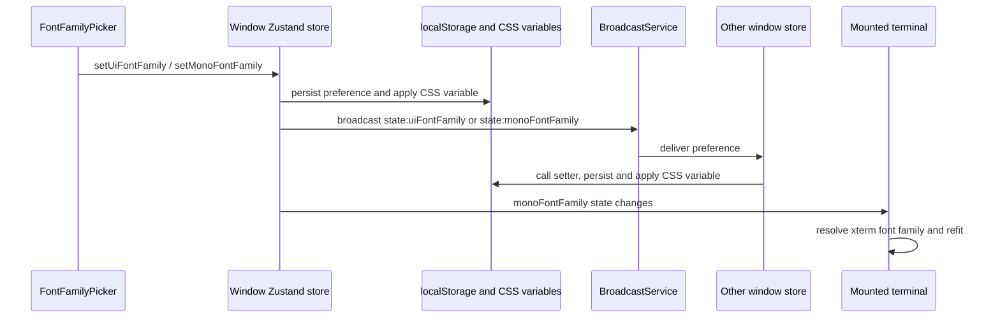

# Fonts (UI and mono typography, bundled defaults, custom override)

> Status: implementation. Decisions fixed before coding; the code must match this document.
>
> Landmarks: `packages/ui/src/styles.css`, `packages/ui/src/lib/uiFonts.ts`, `packages/ui/src/lib/uiFontSize.ts` (precedent), `packages/ui/src/store/index.ts`, `packages/ui/src/terminal/TerminalSession.tsx`, `packages/ui/src/settingsCodePreview.tsx`.

## 0. Problem

The app shipped with the Tailwind default sans stack and a CJK-patched mono stack. The product decision: ship **Inter** as the default UI font and **JetBrains Mono** as the default code/terminal font, and let the user override both with any locally installed font family, with a reset-to-default action.

## 1. Decisions

| #   | Decision                                                                                                                                                                                                                                                                                                                                                                                                                                                                                                                                                                                                                                                                                                                                                                                                                                                                                                                                                                                                                                                  |
| --- | --------------------------------------------------------------------------------------------------------------------------------------------------------------------------------------------------------------------------------------------------------------------------------------------------------------------------------------------------------------------------------------------------------------------------------------------------------------------------------------------------------------------------------------------------------------------------------------------------------------------------------------------------------------------------------------------------------------------------------------------------------------------------------------------------------------------------------------------------------------------------------------------------------------------------------------------------------------------------------------------------------------------------------------------------------- |
| D1  | Both fonts are **bundled** via `@fontsource-variable/inter` and `@fontsource-variable/jetbrains-mono` (approved by the user). `index.css` of each package covers all subsets (latin, cyrillic, cyrillic-ext, …) through `unicode-range`; the browser downloads only the subsets actually rendered.                                                                                                                                                                                                                                                                                                                                                                                                                                                                                                                                                                                                                                                                                                                                                        |
| D2  | Registered family names: `Inter Variable` (wght 100–900) and `JetBrains Mono Variable`. Both stacks keep system fallbacks after the bundled name: UI → `-apple-system, "Segoe UI", system-ui…`; mono → the existing CJK-safe stack (Consolas → YaHei → PingFang → Noto Sans CJK → monospace), enforced by `packages/ui/test/codeFontStack.test.ts`.                                                                                                                                                                                                                                                                                                                                                                                                                                                                                                                                                                                                                                                                                                       |
| D3  | Default state = **no CSS override**: `--font-sans` and `--font-mono` are defined once in the `@theme` block of `styles.css`; a custom user font is applied at runtime via `document.documentElement.style.setProperty("--font-sans"/"--font-mono", …)` (same mechanism as `--ui-font-size`). Reset = `removeProperty`, so the stylesheet default takes over again. `html` font-size is never touched.                                                                                                                                                                                                                                                                                                                                                                                                                                                                                                                                                                                                                                                     |
| D4  | One `--font-mono` override covers code blocks (`font-mono` utility), diff viewers (`--diffs-font-family: var(--font-mono)` in `code-viewer.tsx` / `diff-viewer.tsx`) and markdown inline code. No per-consumer overrides.                                                                                                                                                                                                                                                                                                                                                                                                                                                                                                                                                                                                                                                                                                                                                                                                                                 |
| D5  | The terminal (xterm.js) does not read CSS variables: `TerminalSession.tsx` composes the family explicitly. Precedence: the **terminal-specific** font setting (`AppSettings.terminalFontFamily`, returned with `fontFamilySource: "custom"`) wins as-is — it is the more specific setting and its UI copy already promises to override the terminal font. Otherwise the appearance mono font (if set) is **prepended** to the service-resolved stack (detected profile or fallback), and the resolved stack already ends in the JetBrains Mono–leading `DEFAULT_TERMINAL_FONT_FAMILY`, so missing glyphs still fall through. Mounted sessions re-apply the family and refit on store change; detached side-pane sessions pick it up on remount (same trade-off as the WebGL toggle).                                                                                                                                                                                                                                                                      |
| D6  | Settings live in the Appearance section as two rows (UI font, code/terminal font), both controlled by `settings/FontFamilyPicker.tsx`. Where the Local Font Access API exists (Electron renderer; Chrome web after a permission prompt) the control is a searchable combobox modeled on the Copilot.app font picker: a Default option (sentinel `__default__` → null), a "Bundled" group (Inter Variable / JetBrains Mono Variable), and an "Installed fonts" group fed by `window.queryLocalFonts()` (deduped families, loaded lazily on first open — the API needs user activation — and cached module-wide across both rows). Environments without the API (Safari/Firefox web) or a permission denial fall back to a free-text input with a reset button. A stored family that is no longer installed is shown with a not-found hint instead of being auto-reset: unlike the Copilot host list, our enumeration can fail, and auto-reset would silently wipe the setting. System font enumeration is renderer-only — no IPC, no main-process changes. |
| D7  | Persistence and sync mirror `uiFontSizePx`: localStorage keys `zcode-ui-font-family` / `zcode-mono-font-family`, both fields in `BROADCAST_FIELDS` so all windows follow, values normalized (trim, length cap, empty → null).                                                                                                                                                                                                                                                                                                                                                                                                                                                                                                                                                                                                                                                                                                                                                                                                                             |
| D8  | `share-ui` (public share pages) is not touched. Dev tools (`e2e-report`, `stream-animate`) consume `styles.css` incidentally and inherit the fonts; that is accepted.                                                                                                                                                                                                                                                                                                                                                                                                                                                                                                                                                                                                                                                                                                                                                                                                                                                                                     |

## 2. Acceptance scenarios

1. Fresh install (no stored values): UI renders in Inter Variable everywhere; code blocks, diffs and terminal render in JetBrains Mono Variable (or the detected profile font before the terminal applies defaults).
2. Typing an installed font name (e.g. `SF Mono`) into the code-font row updates code blocks, diffs and the live terminal without restart; a second window follows via broadcast.
3. Reset returns the UI to the bundled defaults and clears localStorage.
4. Typing a font that is not installed shows the not-found hint; the UI keeps the previous rendering (fallback chain).
5. UI font-size setting still works independently; icons/spacing/radii do not scale (unchanged `--ui-font-size` contract, `packages/ui/test/uiFontSize.test.ts`).

## 3. Out of scope

- Font weight/size customization beyond the existing size settings.
- Downloadable/importable font files (custom = locally installed families only).
- Applying the custom fonts to share pages.
