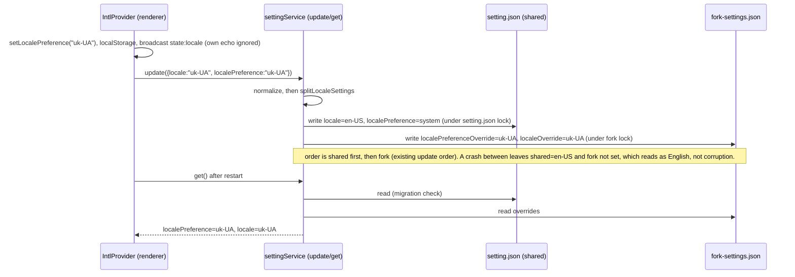
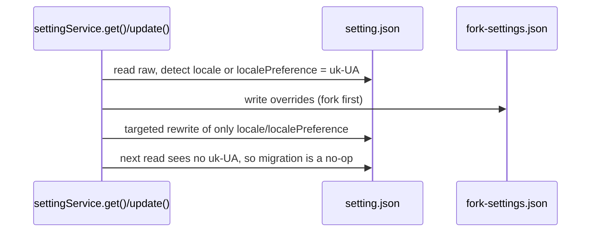

# Fork Locale Storage (ISSUE-045)

Owner: `packages/services/src/setting/settingService.ts` (the only reader that produces the effective
locale and the only writer of both stores). Pure rules: `packages/shared/src/forkLocaleSettings.ts`.
Stores: `~/.zcode/v2/setting.json` (shared with the installed upstream app) and
`~/.zcode/v2/fork-settings.json` (fork sidecar, see `specs/settings-read-snapshot.md`).

## Problem

The fork adds `uk-UA` to the shared settings schema and persists it in the shared
`setting.json` keys `locale` / `localePreference`. The upstream app allows only
`zh-CN | en-US` (plus `system` for the preference). When upstream read such a file it failed schema
validation, returned defaults, and wrote them back, wiping about 20 unrelated keys.

## Rules

1. **Upstream-compat invariant.** After any write or migration, `setting.json` holds
   `locale in {zh-CN, en-US}` and `localePreference in {system, zh-CN, en-US}`. `uk-UA` never reaches
   that file.
2. **Fork override is the only place uk-UA is stored.** Two `fork-settings.json` keys, both literal
   `"uk-UA"` or absent:
   - `localePreferenceOverride`: the user's preference is Українська.
   - `localeOverride`: the resolved language is uk-UA. Set when the preference is Українська, or when
     the preference is `system` and the OS language resolves to uk-UA.
     Absent means "use shared". Neither key is ever written as `en-US` or `zh-CN`.
3. **Effective values** (owner: `settingService.get()`, applied after the snapshot merge):
   - `localePreference = localePreferenceOverride ?? shared.localePreference`
   - `locale = localeOverride ?? localePreferenceOverride ?? shared.locale`
     Consumers (IntlProvider, bots `serviceLocale`, web and mobile remote) read only `get()` and need no change.
4. **Write split** (owner: `splitLocaleSettings`, called only from `settingService.update()`).
   Input is the normalized patch, so `localePreference` is always present when `locale` is.
   - Preference `uk-UA`: fork gets both override keys. Shared gets `locale: en-US`,
     `localePreference: system`. The upstream app therefore falls back to English or system, which
     is the documented upstream-valid choice (uk-UA's `serviceLocale` is also en-US).
   - Preference `system`, `zh-CN` or `en-US`: fork clears `localePreferenceOverride`. It sets
     `localeOverride` only when `locale` is uk-UA (system resolved to uk). Otherwise it clears it.
     Shared gets `localePreference` as given and `locale` as given, with uk-UA mapped to `en-US`.
   - Only `localePreference` present: shared gets the preference, and the fork clears its overrides.
5. **Legacy migration** (one time, on the first read or write that sees the legacy file).
   Trigger: raw `locale` or raw `localePreference` is `uk-UA`. The raw `localePreference` is
   `locale` when the key is absent, the same rule as `migrateLegacyLocalePreference`.
   Action: apply the write split to the raw values, then:
   a. write the fork override (fork first, so a crash can only leave the fork ahead);
   b. rewrite only the two shared keys in the raw JSON (targeted write, no schema re-parse, so
   unrelated and unknown keys are kept byte-for-byte as objects).
   Idempotent: after step b the trigger no longer matches, so later reads do nothing.
   Locale-only legacy files (`locale: uk-UA` with no preference key) take the preference-uk branch.
6. **Broadcast and loopback.** `state:locale` payloads still carry `{preference, resolvedLocale}` from
   `IntlProvider`, which already suppresses its own echo through `ignoredLocalLocaleBroadcastPayloadRef`.
   This feature adds no broadcast and changes no receiver. Receivers take the resolved value from the
   payload, not from a settings re-read, so a window cannot downgrade `system` to a fixed language.
7. **Desktop, Web, remote.** Desktop and Web both call the same `settingService` through RPC. Desktop
   main process has no settings-based locale source: native menus receive the renderer's effective
   locale through `platform.setApplicationLocale`. The `settingsFile` read in
   `packages/desktop/src/main/index.ts` is not used for locale.
8. **Never in `setting.json` as a fork key.** Fork state uses the sidecar only (AGENTS.md, "Shared
   Databases and Fork Divergence").

## Owners and event order

Migration on read (legacy file):

## Acceptance scenarios

1. Pick Українська in Settings. `setting.json` `locale` and `localePreference` hold upstream values, and
   the number of top-level keys is unchanged. `fork-settings.json` holds both override keys.
2. Restart the app. The UI is still Ukrainian, and `get()` reports `uk-UA` for both fields.
3. Pick English (or 中文, or System) in Settings. Both override keys are absent from
   `fork-settings.json`, and `setting.json` has the matching upstream values.
4. A legacy `setting.json` with `locale` and `localePreference` = `uk-UA` and unrelated keys:
   the first read sets the fork override and rewrites only the two shared keys. The second read leaves
   the file byte-identical.
5. A legacy file with `locale: uk-UA` and `localePreference: system` (system resolved to uk): effective
   preference is `system`, effective locale is `uk-UA`, shared locale becomes `en-US`.
6. An unrelated `update()` on a legacy uk file migrates first, so the uk value never reaches the
   upstream-shaped rewrite.
7. Native menu in Ukrainian: after the renderer resolves uk-UA it calls `setApplicationLocale("uk-UA")`
   as today. The menu shows the uk-UA labels. Unchanged path, covered by existing desktop menu tests.
8. Bots: `serviceLocale` for uk-UA is en-US, via `toServiceLocale(effective locale)`.

## Risks (not blocking)

- Upstream app after a fork uk choice shows English or system, because shared keys hold upstream-valid
  values by design.
- Two-file write (shared then fork). A crash between them leaves English, not corruption.
- Before the fork migrates a legacy file, a running upstream build can still read uk-UA and reset it.
  The fix ships in the fork and only protects after the first fork read.
- System preference on Ukrainian OS keeps `localeOverride` set. The renderer's startup check compares
  effective `locale` to the resolved language, so it does not rewrite on every launch.
