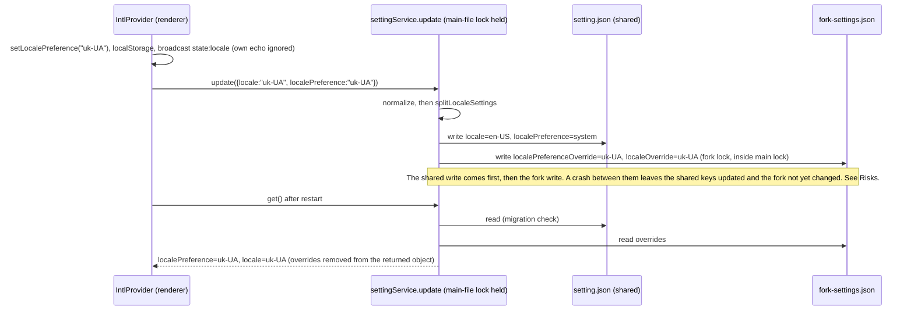
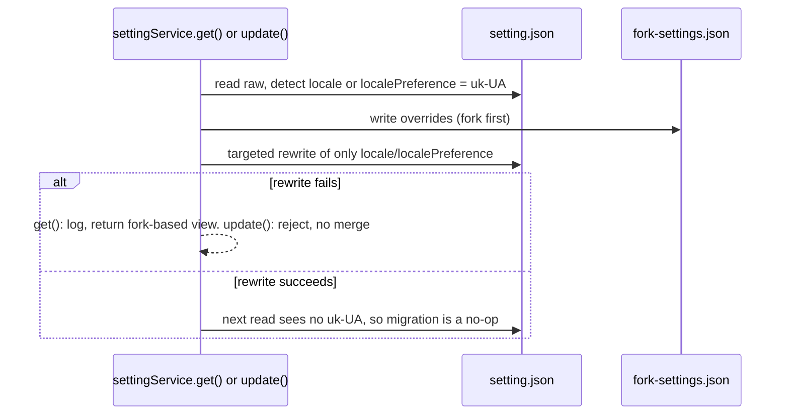

# Fork Locale Storage (ISSUE-045)

Owner: `packages/services/src/setting/settingService.ts` (the only reader that produces the effective
locale and the only writer of both stores). Pure rules: `packages/shared/src/forkAppSettings.ts`
(locale section). The architecture policy keeps `packages/shared` unmanaged, so the rules live in
that existing file. Stores: `~/.zcode/v2/setting.json` (shared with the installed upstream app) and
`~/.zcode/v2/fork-settings.json` (fork sidecar, see `specs/settings-read-snapshot.md`).

## Problem

The fork adds `uk-UA` to the shared settings schema and persists it in the shared `setting.json`
keys `locale` / `localePreference`. The upstream app allows only `zh-CN | en-US` (plus `system` for
the preference). When upstream read such a file it failed schema validation, returned defaults, and
wrote them back, wiping about 20 unrelated keys.

## Rules

1. **Upstream-compat invariant.** After any write or migration, `setting.json` holds
   `locale in {zh-CN, en-US}` and `localePreference in {system, zh-CN, en-US}`. `uk-UA` never reaches
   that file.
2. **Fork override is the only place uk-UA is stored.** Two `fork-settings.json` keys, each either the
   literal `"uk-UA"` or absent:
   - `localePreferenceOverride`: the user's preference is Українська.
   - `localeOverride`: the resolved language is uk-UA. It is set only when the preference is Українська,
     or when the preference is `system` and the OS language resolves to uk-UA.
     Neither key is ever stored as `en-US` or `zh-CN`. Neither key is a field of `AppSettings`, is listed
     in `FORK_SETTING_KEYS`, or can be set from a generic settings patch. Only the locale split writes
     them, and only the locale resolution reads them.
3. **Effective values** (owner: `settingService.get()`, applied after the snapshot merge). The override
   keys are removed from the returned object:
   - `localePreference = localePreferenceOverride ?? shared.localePreference`
   - `locale = localeOverride ?? localePreferenceOverride ?? shared.locale`
     Consumers (IntlProvider, bots copy selection, web and mobile remote) read only `get()` and need no
     change.
4. **Write split** (owner: `splitLocaleSettings`, called only from `settingService.update()`). Input is
   the normalized patch, so `localePreference` is present whenever `locale` is.
   - Preference `uk-UA`: fork gets both override keys. Shared gets `locale: en-US`,
     `localePreference: system`. The upstream app falls back to English or system. This is the documented
     upstream-valid choice; uk-UA's `serviceLocale` is also en-US.
   - Preference `system`, `zh-CN` or `en-US`: fork clears `localePreferenceOverride`. It sets
     `localeOverride` only when the preference is `system` and `locale` is uk-UA (system resolved to
     Ukrainian). Otherwise it clears it. Shared gets `localePreference` as given, and `locale` as given
     with uk-UA mapped to `en-US`. A fixed preference with no `locale` in the patch sets the shared locale
     to that preference, so an en-US left over from a Ukrainian pick cannot leak through. A `system`
     preference with no `locale` leaves the shared locale unchanged.
   - Locale keys in a generic patch are never forwarded to the fork route. The split output replaces
     them.
5. **Legacy migration** (one time, on the first read or write that sees the legacy file). Trigger: raw
   `locale` or raw `localePreference` is `uk-UA`. The raw `localePreference` falls back to `locale` when
   the key is absent, the same rule as `migrateLegacyLocalePreference`. Action: apply the write split to
   the raw values, then:
   a. write the fork override (fork first, so a crash leaves the fork ahead);
   b. rewrite only the two shared keys in the raw JSON (targeted write, no schema re-parse, so unrelated
   and unknown keys are kept).
   Idempotent: after step b the trigger no longer matches, so later reads do nothing.
   Locale-only legacy files (`locale: uk-UA` with no preference key) take the preference-uk branch.
6. **Failure handling.** `get()` logs a failed migration and returns the effective view built from the
   fork (the fork override is already written). It does not reject, and the next read retries. `update()`
   rejects with `settings.locale-migration-failed` and does not merge, so it never writes the zh-CN
   default over the uk-UA file.
7. **Write ordering and lock order.** `update()` holds the main-file lock across the shared write and the
   fork write, and takes the fork lock inside it. Lock order is always main file, then fork file, the
   same as the migration and seeding paths. Two instances therefore serialize, and the last update wins.
   The two-instance test in `packages/services/test/forkLocaleStorage.test.ts` covers this.
8. **Broadcast and loopback.** `state:locale` payloads still carry `{preference, resolvedLocale}` from
   `IntlProvider`, which already suppresses its own echo through `ignoredLocalLocaleBroadcastPayloadRef`.
   This feature adds no broadcast and changes no receiver. Receivers take the resolved value from the
   payload, not from a settings re-read, so a window cannot downgrade `system` to a fixed language.
9. **Hosts.** Every host reads the locale through `settingService.get()`: the Desktop main bootstrap
   (`packages/desktop/src/main/index.ts`, `mainSettingService.get()` sets `currentApplicationLocale`),
   the Web server and the window Host. The renderer then pushes its effective locale with
   `platform.setApplicationLocale`, so the native menu follows the same value. The raw `settingsFile`
   path in that file is used only for zoom and window size.
10. **Immediate sync payload.** `appSettingsSyncPatchSchema` (in `forkAppSettings.ts`) omits the locale
    keys before validation. A locale key in the sync payload is ignored and never rejects the other
    fields. Locale changes go through `settingService.update` only.
11. **Full-object patches.** `useSettingService` sends patches that can carry the whole settings object,
    including the effective locale pair. A full object read before a locale change can replay that
    older pair. This is an existing property of full-object patches, not a new one, and it is recorded
    as a risk below.
12. **Never in `setting.json` as a fork key.** Fork state uses the sidecar only (AGENTS.md, "Shared
    Databases and Fork Divergence").

## Owners and event order

Migration on read (legacy file):

## Acceptance scenarios

1. Pick Українська in Settings. `setting.json` `locale` and `localePreference` hold upstream values, and
   the set of top-level keys is unchanged. `fork-settings.json` holds both override keys. `get()` does
   not expose the override keys.
2. Restart the app. The UI is still Ukrainian, and `get()` reports `uk-UA` for both fields.
3. Pick English (or 中文, or System) in Settings. Both override keys are absent from
   `fork-settings.json`, and `setting.json` has the matching upstream values.
4. A legacy `setting.json` with `locale` and `localePreference` = `uk-UA` and unrelated keys: the first
   read sets the fork override and rewrites only the two shared keys. The second read leaves the file
   byte-identical.
5. A legacy file with `locale: uk-UA` and `localePreference: system` (system resolved to Ukrainian):
   effective preference is `system`, effective locale is `uk-UA`, shared locale becomes `en-US`.
6. An unrelated `update()` on a legacy uk file migrates first, so the uk-UA value never reaches the
   upstream-shaped rewrite. If the migration cannot finish, the update rejects and the file is unchanged.
7. Two instances in one process: a uk-UA pick is held open after its shared write, a later en-US pick
   waits for it, and the final state is en-US with no fork override.
8. Native menu in Ukrainian: after the renderer resolves uk-UA it calls `setApplicationLocale("uk-UA")`
   as today. The menu shows the uk-UA labels. Covered by the existing desktop menu tests.
9. Bots: the bot copy selection keeps Ukrainian. `normalizeBotMessageLocale` in
   `packages/services/src/bots/messages.ts` does not collapse uk-UA to en-US, so Ukrainian users get
   Ukrainian copy from the effective locale. Only external services (website, feedback, community links)
   use `serviceLocale`, which maps uk-UA to en-US.
10. Immediate sync with a uk-UA locale key: the other fields in the same payload still apply.

## Risks (not blocking)

- Upstream app after a fork uk choice shows English or system, because shared keys hold upstream-valid
  values by design.
- Shared-first ordering, in both directions. A crash between the shared write and the fork write leaves
  the shared keys updated and the fork not yet changed. Picking English after Ukrainian crashes between
  the two writes, and the old uk-UA override survives, so the next read shows Ukrainian. Picking
  Ukrainian crashes the other way and shows English until the user repeats the pick. Neither case
  corrupts the file, and the fix is a re-pick. The order was kept to match the existing update path.
- Before the fork migrates a legacy file, a running upstream build can still read uk-UA and reset it.
  The fork fix protects the file only after the first fork read.
- Full-object patches (rule 11) can replay an older locale pair if a caller sends a settings object read
  before a locale change. Call sites should send only changed keys.
- System preference on Ukrainian OS keeps `localeOverride` set. The renderer's startup check compares
  effective `locale` to the resolved language, so it should not rewrite on every launch.
- `packages/services/src/bots/botsService.ts` (about line 1906) shows a Chinese hint for Ukrainian users.
  This predates this change and is not fixed here.
