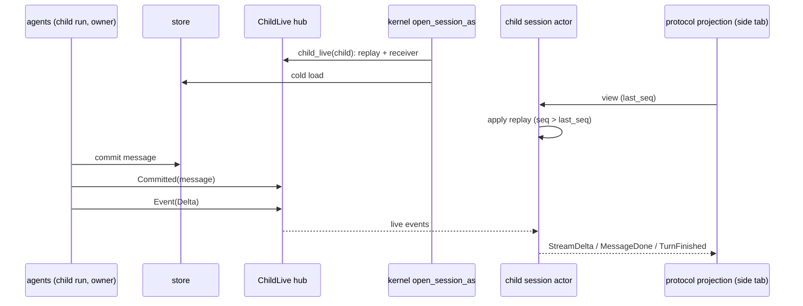

# Rust agent parity (zcode-rs as the desktop conversation agent)

Status: in progress. Tracking file for bringing `zcode-rs` (`packages/rust-cli`) to parity with the Node agent for everything the desktop UI drives. Runtime selection, storage preparation and the Host gate are specified in `specs/fork-agent-runtime-selection.md`; this file owns the parity matrix, the verification gate and the order of work.

## Goal

With `agentRuntime: rust` the desktop behaves and looks the same as with Node: every desktop flow that works on Node works on Rust, with the same rows, cards, panels and errors on screen, and the same records in the shared `db.sqlite`. The UI, Host and Main are unchanged; only the conversation agent process differs.

## Definition of "1:1"

A feature is at parity when all of these hold:

1. **Desktop E2E.** Every desktop E2E spec covering it that passes on Node also passes with `ZCODE_E2E_AGENT_RUNTIME=rust` (same spec, same replay fixtures, no Rust-only branches in the spec). The E2E specs assert on the rendered UI, so a pass is the visual 1:1 check for that flow.
2. **No protocol gaps on the path.** The Rust agent log of that run has no `protocol.method.unsupported` or `protocol.command.unsupported` event for the flow.
3. **Shared storage.** Records written by one runtime are read correctly by the other (cross-runtime reopen), checked by a test where the feature persists state.
4. **Rust gates.** `cargo fmt --check`, `cargo clippy --workspace --all-targets -- -D warnings` and `cargo nextest run --workspace` pass (the PR check job).

## How gaps are found

- `zcode-rs` logs every request it does not serve at `info`: `protocol.method.unsupported` (method name) and `protocol.command.unsupported` (v4 command kind). The log carries names only, never params.
- The desktop E2E suite runs with `ZCODE_E2E_AGENT_RUNTIME=rust` and `ZCODE_FORK_RUST_AGENT_PATH=<binary>`. The Rust agent log lands in the E2E home (`.zcode/rust-cli/log/*.jsonl`); Host logs in `.e2e-artifacts/<run>/runtime-logs`.
- A spec that fails on Rust and passes on Node is a parity gap. A spec that fails on both is not counted.

## Out of scope (stay on Node or stay refused)

These are JavaScript by nature or tied to Node-only runtimes. In Rust mode they are refused with a stable code or hidden by a capability flag, never silently dropped. Listed here so the matrix does not count them as gaps:

- JS plugin runtimes and plugin UI surfaces (`plugins/*`, `mcp/ui*`) beyond what `zcode-rs` `ext` already serves.
- Dynamic workflows (`workflows/*`, `v4/conversation/workflowRun*`, `startSavedWorkflow`, `resumeWorkflowRun`, `amendWorkflowRunSettings`).
- Office runtime, node-repl host.
- ACP external agents (decision pending with the owner).
- ChatGPT Plan account access (needs a live account to verify).

## Parity matrix

Filled from the Rust E2E run; one row per method family or command group. Status: `gap`, `done` (all four checks), `refused` (out of scope, stable code).

| Area                                                                                                     | Node owner                                                                                                                                                             | Rust status                                                                                                                                                                                                                                                                                                                                                                                                                                                                                                                                                                                                                                                                                                                                                                                                                                                                                                                                                                                                                                                                                                                                                                                                                                                                                                                                                                                                                                                                                                                                                                                                                                                                                                                                                                                                                                                                                                                                                                                                                                                                                                                                                                                                                                                                                                                                                                                                                                                                                                                                                                                                                                                                                                                                                                                                                                                                                                                                                                                                                                                                                                                                                                                                                                                          | Verified by                                                                                                                               |
| -------------------------------------------------------------------------------------------------------- | ---------------------------------------------------------------------------------------------------------------------------------------------------------------------- | -------------------------------------------------------------------------------------------------------------------------------------------------------------------------------------------------------------------------------------------------------------------------------------------------------------------------------------------------------------------------------------------------------------------------------------------------------------------------------------------------------------------------------------------------------------------------------------------------------------------------------------------------------------------------------------------------------------------------------------------------------------------------------------------------------------------------------------------------------------------------------------------------------------------------------------------------------------------------------------------------------------------------------------------------------------------------------------------------------------------------------------------------------------------------------------------------------------------------------------------------------------------------------------------------------------------------------------------------------------------------------------------------------------------------------------------------------------------------------------------------------------------------------------------------------------------------------------------------------------------------------------------------------------------------------------------------------------------------------------------------------------------------------------------------------------------------------------------------------------------------------------------------------------------------------------------------------------------------------------------------------------------------------------------------------------------------------------------------------------------------------------------------------------------------------------------------------------------------------------------------------------------------------------------------------------------------------------------------------------------------------------------------------------------------------------------------------------------------------------------------------------------------------------------------------------------------------------------------------------------------------------------------------------------------------------------------------------------------------------------------------------------------------------------------------------------------------------------------------------------------------------------------------------------------------------------------------------------------------------------------------------------------------------------------------------------------------------------------------------------------------------------------------------------------------------------------------------------------------------------------------------------- | ----------------------------------------------------------------------------------------------------------------------------------------- |
| Shared task runtime routing (`sessionWorkspaceRouting`)                                                  | `bootstrap/zcode-protocol/server.ts`                                                                                                                                   | done: capability reported; requests are routed by `sessionId` and per-workspace topics                                                                                                                                                                                                                                                                                                                                                                                                                                                                                                                                                                                                                                                                                                                                                                                                                                                                                                                                                                                                                                                                                                                                                                                                                                                                                                                                                                                                                                                                                                                                                                                                                                                                                                                                                                                                                                                                                                                                                                                                                                                                                                                                                                                                                                                                                                                                                                                                                                                                                                                                                                                                                                                                                                                                                                                                                                                                                                                                                                                                                                                                                                                                                                               | `conversation-session-first-send`                                                                                                         |
| `renameSession`, `switchModelConfig`, `switchCollaborationMode`, `compact`                               | `handlers/session-mgmt.ts`, `model-config.ts`, `goal-compact.ts`                                                                                                       | ported (`fork/session_config.rs`): kernel `Rename`, `SetModel`, `SetMode`/`SetPlan`, `Compact`; a switch to the value in effect is `noop` `config.unchanged`                                                                                                                                                                                                                                                                                                                                                                                                                                                                                                                                                                                                                                                                                                                                                                                                                                                                                                                                                                                                                                                                                                                                                                                                                                                                                                                                                                                                                                                                                                                                                                                                                                                                                                                                                                                                                                                                                                                                                                                                                                                                                                                                                                                                                                                                                                                                                                                                                                                                                                                                                                                                                                                                                                                                                                                                                                                                                                                                                                                                                                                                                                         | gate: `v4-rename`, `v4-model-switch`, `model-config`, `v4-compact`, `compact`, `v4-plan-shortcut`                                         |
| Row actions (`canEdit`/`editDisposition`, `canRetry`, `canFork`)                                         | `product-projection.ts` `materializeCommandRowActions`                                                                                                                 | ported (`projection/actions.rs`), same rules, including `canRewindFiles` (see "Turn file change summary")                                                                                                                                                                                                                                                                                                                                                                                                                                                                                                                                                                                                                                                                                                                                                                                                                                                                                                                                                                                                                                                                                                                                                                                                                                                                                                                                                                                                                                                                                                                                                                                                                                                                                                                                                                                                                                                                                                                                                                                                                                                                                                                                                                                                                                                                                                                                                                                                                                                                                                                                                                                                                                                                                                                                                                                                                                                                                                                                                                                                                                                                                                                                                            | unit tests; gate: `v4-edit`, `v4-fork`                                                                                                    |
| `editUserQuery`, `retryTurn`, `forkAssistant`                                                            | `handlers/fork-edit-retry.ts`                                                                                                                                          | ported (`fork/row_commands.rs`): edit and retry are kernel `Rewind{conversation}` + resubmit (edit preempts a running turn like Node); fork is `ForkFromInput`; `workspaceMode: rewind` is the "Edit with file rewind" row                                                                                                                                                                                                                                                                                                                                                                                                                                                                                                                                                                                                                                                                                                                                                                                                                                                                                                                                                                                                                                                                                                                                                                                                                                                                                                                                                                                                                                                                                                                                                                                                                                                                                                                                                                                                                                                                                                                                                                                                                                                                                                                                                                                                                                                                                                                                                                                                                                                                                                                                                                                                                                                                                                                                                                                                                                                                                                                                                                                                                                           | gate: `v4-edit`, `v4-fork`, `v4-fork-edit-branch`                                                                                         |
| History rewrite (`HistoryRewritten`)                                                                     | Node `RewindTriggered` projection                                                                                                                                      | the projection is rebuilt from a fresh view and every started subscription gets a new snapshot (`live.rs`), like the TUI                                                                                                                                                                                                                                                                                                                                                                                                                                                                                                                                                                                                                                                                                                                                                                                                                                                                                                                                                                                                                                                                                                                                                                                                                                                                                                                                                                                                                                                                                                                                                                                                                                                                                                                                                                                                                                                                                                                                                                                                                                                                                                                                                                                                                                                                                                                                                                                                                                                                                                                                                                                                                                                                                                                                                                                                                                                                                                                                                                                                                                                                                                                                             | `v4-edit`                                                                                                                                 |
| Permission deny text                                                                                     | `bootstrap/permission-options.ts` `buildPermissionDeniedContent`                                                                                                       | ported: the tool result of a deny with feedback is Node's text (`... the user said:\n<feedback>`); a deny without feedback stays the plain rejection                                                                                                                                                                                                                                                                                                                                                                                                                                                                                                                                                                                                                                                                                                                                                                                                                                                                                                                                                                                                                                                                                                                                                                                                                                                                                                                                                                                                                                                                                                                                                                                                                                                                                                                                                                                                                                                                                                                                                                                                                                                                                                                                                                                                                                                                                                                                                                                                                                                                                                                                                                                                                                                                                                                                                                                                                                                                                                                                                                                                                                                                                                                 | `tools` unit tests; gate: `v4-permission`                                                                                                 |
| Token budget prompt                                                                                      | Node has none                                                                                                                                                          | the app-server turns `ContextConfig.token_budget` off: no "Token budget" system section and no total-tokens reminder (TUI and print keep it)                                                                                                                                                                                                                                                                                                                                                                                                                                                                                                                                                                                                                                                                                                                                                                                                                                                                                                                                                                                                                                                                                                                                                                                                                                                                                                                                                                                                                                                                                                                                                                                                                                                                                                                                                                                                                                                                                                                                                                                                                                                                                                                                                                                                                                                                                                                                                                                                                                                                                                                                                                                                                                                                                                                                                                                                                                                                                                                                                                                                                                                                                                                         | `context` unit tests; gate: `v4-permission`                                                                                               |
| `session/lifecycle/getState`                                                                             | `bootstrap/session-lifecycle/controller.ts`                                                                                                                            | ported (`fork/methods.rs`): an open session is `ready`, a stored one `unloaded`, an unknown id is `sessionUnavailable`; generation and revision are 0, `lastError` null                                                                                                                                                                                                                                                                                                                                                                                                                                                                                                                                                                                                                                                                                                                                                                                                                                                                                                                                                                                                                                                                                                                                                                                                                                                                                                                                                                                                                                                                                                                                                                                                                                                                                                                                                                                                                                                                                                                                                                                                                                                                                                                                                                                                                                                                                                                                                                                                                                                                                                                                                                                                                                                                                                                                                                                                                                                                                                                                                                                                                                                                                              | gate: `v4-vertical-slice`                                                                                                                 |
| Compact timeline markers                                                                                 | `product-projection.ts` `onCompactLifecycle`                                                                                                                           | ported (`projection/markers.rs`): one `timelineMarker` row per compaction, `running` then `success`/`failed`; a compaction still running when its turn ends settles as `cancelled` (turn interrupted) or `failed` and its compact work ends, like Node's `interrupted` compaction (before: the marker stayed `Compressing context` and the row actions stayed withheld after Stop); on the desktop (`CompactConfig.blocking` false) an automatic compaction never summarizes everything and too little history is Node's `skipped` compaction: `KernelEvent::CompactSkipped`, one `noop` row ("Context is up to date; no compression needed"), no summary request and no failure counted (before: no marker, and past the window Rust summarized everything where Node skipped). Gap: a manual `/compact` with too little history ends as a failed turn with a `failed` marker, where Node shows `noop`; a cold projection shows stored compact boundaries as `success` with `tokensBefore`                                                                                                                                                                                                                                                                                                                                                                                                                                                                                                                                                                                                                                                                                                                                                                                                                                                                                                                                                                                                                                                                                                                                                                                                                                                                                                                                                                                                                                                                                                                                                                                                                                                                                                                                                                                                                                                                                                                                                                                                                                                                                                                                                                                                                                                                          | `projection` and `compact` unit tests; gate: `v4-compact`, `compact`, `goal-run-cases`                                                    |
| `thoughtLevels`                                                                                          | `app/session-facade.ts` `listThoughtLevels`                                                                                                                            | from the model catalog entry of the selected model (`reasoning_levels`), read on a cold open                                                                                                                                                                                                                                                                                                                                                                                                                                                                                                                                                                                                                                                                                                                                                                                                                                                                                                                                                                                                                                                                                                                                                                                                                                                                                                                                                                                                                                                                                                                                                                                                                                                                                                                                                                                                                                                                                                                                                                                                                                                                                                                                                                                                                                                                                                                                                                                                                                                                                                                                                                                                                                                                                                                                                                                                                                                                                                                                                                                                                                                                                                                                                                         | gate: `v4-model-switch`                                                                                                                   |
| AskUserQuestion and ExitPlanMode asks                                                                    | `product-projection.ts` `createPendingInteractionFromPermissionEvent`, `interaction-broker.ts`                                                                         | ported (`projection/elicitation.rs`): `userInput` pending interactions with structured questions (plan approval is one `approve` question); `resolveInteraction {action, content}` maps to the kernel answers like Node's broker                                                                                                                                                                                                                                                                                                                                                                                                                                                                                                                                                                                                                                                                                                                                                                                                                                                                                                                                                                                                                                                                                                                                                                                                                                                                                                                                                                                                                                                                                                                                                                                                                                                                                                                                                                                                                                                                                                                                                                                                                                                                                                                                                                                                                                                                                                                                                                                                                                                                                                                                                                                                                                                                                                                                                                                                                                                                                                                                                                                                                                     | unit tests; gate: `ask-user-question-keyboard-navigation`, `plan-mode-capabilities`                                                       |
| `deleteSession`                                                                                          | `handlers/session-mgmt.ts`                                                                                                                                             | ported (`fork/session_delete.rs`): refused while a turn runs; closes the actor, soft-deletes, emits `session.removed` on the sessions index                                                                                                                                                                                                                                                                                                                                                                                                                                                                                                                                                                                                                                                                                                                                                                                                                                                                                                                                                                                                                                                                                                                                                                                                                                                                                                                                                                                                                                                                                                                                                                                                                                                                                                                                                                                                                                                                                                                                                                                                                                                                                                                                                                                                                                                                                                                                                                                                                                                                                                                                                                                                                                                                                                                                                                                                                                                                                                                                                                                                                                                                                                                          | unit tests; gate: `v4-delete`                                                                                                             |
| Queue commands (`deleteQueueItem`, `editQueueItem`, `reorderQueueItem`, `setAutoDrain`, `sendQueuedNow`) | `handlers/queue.ts`                                                                                                                                                    | ported (`fork/queue.rs`) on kernel `Dequeue`, `EditQueued`, `ReorderQueued`, `HoldQueue`; the kernel owns the hold, the projection shows `autoDrain` after an accepted `setAutoDrain`; `sendQueuedNow` restores the user's hold after the promotion                                                                                                                                                                                                                                                                                                                                                                                                                                                                                                                                                                                                                                                                                                                                                                                                                                                                                                                                                                                                                                                                                                                                                                                                                                                                                                                                                                                                                                                                                                                                                                                                                                                                                                                                                                                                                                                                                                                                                                                                                                                                                                                                                                                                                                                                                                                                                                                                                                                                                                                                                                                                                                                                                                                                                                                                                                                                                                                                                                                                                  | `session` unit tests; gate: `v4-queue`, `queue-operations`, `running-queue`, `v4-sendnow`                                                 |
| `v4/conversation/plans`                                                                                  | `conversation-topic-publisher.ts` `getPlans`                                                                                                                           | ported (`projection/plans.rs`): settled ExitPlanMode rows with a non-blank plan in the row window, newest first, with `atSeq`/`atLogEpoch`                                                                                                                                                                                                                                                                                                                                                                                                                                                                                                                                                                                                                                                                                                                                                                                                                                                                                                                                                                                                                                                                                                                                                                                                                                                                                                                                                                                                                                                                                                                                                                                                                                                                                                                                                                                                                                                                                                                                                                                                                                                                                                                                                                                                                                                                                                                                                                                                                                                                                                                                                                                                                                                                                                                                                                                                                                                                                                                                                                                                                                                                                                                           | unit tests; gate: `plan-mode-capabilities`                                                                                                |
| `v4/conversation/workflowRuns`, `session/debug`                                                          | `v4-gateway.ts`, `session-debug`                                                                                                                                       | answered empty (`runs: []`; no debug rounds) instead of `-32601`: zcode-rs has no dynamic workflows and keeps no per-request debug records                                                                                                                                                                                                                                                                                                                                                                                                                                                                                                                                                                                                                                                                                                                                                                                                                                                                                                                                                                                                                                                                                                                                                                                                                                                                                                                                                                                                                                                                                                                                                                                                                                                                                                                                                                                                                                                                                                                                                                                                                                                                                                                                                                                                                                                                                                                                                                                                                                                                                                                                                                                                                                                                                                                                                                                                                                                                                                                                                                                                                                                                                                                           | gate logs (no `protocol.method.unsupported`)                                                                                              |
| Stop holds the queue                                                                                     | `handlers/session-flow.ts` `holdFollowingQueue` (`specs/stop-queue-hold.md`)                                                                                           | ported (`commands.rs` `stop`): a stop that cancels a turn with queued inputs holds the kernel queue before the interrupt and projects `autoDrain: false`, `pauseReason: stopped`; nothing to stop releases the hold; `setAutoDrain(false)` is `manual`                                                                                                                                                                                                                                                                                                                                                                                                                                                                                                                                                                                                                                                                                                                                                                                                                                                                                                                                                                                                                                                                                                                                                                                                                                                                                                                                                                                                                                                                                                                                                                                                                                                                                                                                                                                                                                                                                                                                                                                                                                                                                                                                                                                                                                                                                                                                                                                                                                                                                                                                                                                                                                                                                                                                                                                                                                                                                                                                                                                                               | unit tests; gate: `queue-operations`, `v4-queue`, `v4-stop-queue`                                                                         |
| Attachments sent by path, named image placeholder                                                        | `attachment-path-reference.ts`, `filePartToContentBlock`, provider media projection                                                                                    | ported (`protocol-zcode/attachments.rs`, `node-records/attached_file.rs`, `model/media.rs`): a binary desktop file (not image, video, PDF or text-like) and an image over the inline limit go as Node's three-line `Attached <mime>: <path>` note, stored as a `local_ref` / `metadata_only` part with `pathReferenceText` and replayed verbatim; a non-vision endpoint sees `[Attached <mime>: <file name>]`                                                                                                                                                                                                                                                                                                                                                                                                                                                                                                                                                                                                                                                                                                                                                                                                                                                                                                                                                                                                                                                                                                                                                                                                                                                                                                                                                                                                                                                                                                                                                                                                                                                                                                                                                                                                                                                                                                                                                                                                                                                                                                                                                                                                                                                                                                                                                                                                                                                                                                                                                                                                                                                                                                                                                                                                                                                        | gate: `v4-attachment`, `attachment-resume`                                                                                                |
| Session titles                                                                                           | core `runtime/methods/title-generation-sidecar.ts`                                                                                                                     | ported (`cli/assemble`, `session/title_model.rs`): the app-server generates the first-input title like the Node desktop agent, with Node's prompt verbatim (`prompts/title/node-system.txt`) and the normalized input as the whole user message; the TUI keeps its own prompt                                                                                                                                                                                                                                                                                                                                                                                                                                                                                                                                                                                                                                                                                                                                                                                                                                                                                                                                                                                                                                                                                                                                                                                                                                                                                                                                                                                                                                                                                                                                                                                                                                                                                                                                                                                                                                                                                                                                                                                                                                                                                                                                                                                                                                                                                                                                                                                                                                                                                                                                                                                                                                                                                                                                                                                                                                                                                                                                                                                        | gate: `v4-plan-shortcut`                                                                                                                  |
| Plan exit declined without feedback                                                                      | core `tool/executor/turn-control.ts` `withPlanExitDeniedTurnStop`                                                                                                      | ported (`tools/plan_mode.rs`, `ToolCallOutput::stop_turn`): the turn ends after the result, through the same path as a hook's `continue: false`; feedback keeps the turn going                                                                                                                                                                                                                                                                                                                                                                                                                                                                                                                                                                                                                                                                                                                                                                                                                                                                                                                                                                                                                                                                                                                                                                                                                                                                                                                                                                                                                                                                                                                                                                                                                                                                                                                                                                                                                                                                                                                                                                                                                                                                                                                                                                                                                                                                                                                                                                                                                                                                                                                                                                                                                                                                                                                                                                                                                                                                                                                                                                                                                                                                                       | gate: `plan-mode-capabilities`                                                                                                            |
| Plan mode tool boundary                                                                                  | core `permission/service.ts` `checkPlanMode` (`mode.plan.nonReadOnly`)                                                                                                 | ported (`policy` `PolicyGate::with_node_plan_mode`, on for the app-server): in plan mode anything that would ask is denied with Node's reason, without the auto classifier; the plan file and read-only tools still run; the TUI keeps its plan-mode asks. The desktop projection settles the denied call's row like Node's `PermissionDenied` (`cancelled`, no output, so no `Failed` label), live and on a cold read (matched by the denial text, the only trace the stored result keeps). Before: an `error` row shown as `Failed`                                                                                                                                                                                                                                                                                                                                                                                                                                                                                                                                                                                                                                                                                                                                                                                                                                                                                                                                                                                                                                                                                                                                                                                                                                                                                                                                                                                                                                                                                                                                                                                                                                                                                                                                                                                                                                                                                                                                                                                                                                                                                                                                                                                                                                                                                                                                                                                                                                                                                                                                                                                                                                                                                                                                | gate: `plan-mode-capabilities`                                                                                                            |
| Held queue after Stop                                                                                    | bootstrap `projection-state.ts` `computeInputRouting`, `applyHeldQueueDisposition`                                                                                     | ported (`protocol-zcode/projection/state.rs` `input_routing`, `commands.rs` `held_queue_choice`): a finished turn with a paused, non-empty queue routes input as `choice` (`heldQueueInputRequiresChoice`); `sendText` then needs `heldQueueDisposition` (`clearQueueAndSend` drops the items and releases the hold, `keepQueueAndSend` keeps them) and a stale `expectedHeldQueueItemIds` is refused                                                                                                                                                                                                                                                                                                                                                                                                                                                                                                                                                                                                                                                                                                                                                                                                                                                                                                                                                                                                                                                                                                                                                                                                                                                                                                                                                                                                                                                                                                                                                                                                                                                                                                                                                                                                                                                                                                                                                                                                                                                                                                                                                                                                                                                                                                                                                                                                                                                                                                                                                                                                                                                                                                                                                                                                                                                                |
| One queued input per turn                                                                                | bootstrap queue drain (one item per turn)                                                                                                                              | ported (`session` `SessionDeps::one_input_per_turn`, on for the app-server through `Extensions::node_desktop`): queued inputs are not merged into one turn; the TUI keeps merging                                                                                                                                                                                                                                                                                                                                                                                                                                                                                                                                                                                                                                                                                                                                                                                                                                                                                                                                                                                                                                                                                                                                                                                                                                                                                                                                                                                                                                                                                                                                                                                                                                                                                                                                                                                                                                                                                                                                                                                                                                                                                                                                                                                                                                                                                                                                                                                                                                                                                                                                                                                                                                                                                                                                                                                                                                                                                                                                                                                                                                                                                    |
| Edit after Stop                                                                                          | bootstrap `fork-edit-retry.ts`                                                                                                                                         | fixed (`protocol-zcode/live.rs` `Live::rebuilds`, `fork/row_commands.rs` `rewind_to`): the resubmitted input reaches the kernel only after the projection is rebuilt from the cut history, so the new turn's rows are not skipped                                                                                                                                                                                                                                                                                                                                                                                                                                                                                                                                                                                                                                                                                                                                                                                                                                                                                                                                                                                                                                                                                                                                                                                                                                                                                                                                                                                                                                                                                                                                                                                                                                                                                                                                                                                                                                                                                                                                                                                                                                                                                                                                                                                                                                                                                                                                                                                                                                                                                                                                                                                                                                                                                                                                                                                                                                                                                                                                                                                                                                    |
| Turn file change summary                                                                                 | bootstrap `product-projection.ts` turn header `fileChanges`, `canRewindFiles`                                                                                          | ported (`protocol-zcode/projection/mod.rs` `file_changes`, `actions.rs`): `FileChanges` events sum per turn into the header's `fileChanges` (`files`, `additions`, `deletions`, `state: active`); `actions.canRewindFiles` only on a finished turn with rewindable changes and no pending interaction                                                                                                                                                                                                                                                                                                                                                                                                                                                                                                                                                                                                                                                                                                                                                                                                                                                                                                                                                                                                                                                                                                                                                                                                                                                                                                                                                                                                                                                                                                                                                                                                                                                                                                                                                                                                                                                                                                                                                                                                                                                                                                                                                                                                                                                                                                                                                                                                                                                                                                                                                                                                                                                                                                                                                                                                                                                                                                                                                                |
| Edit with file rewind                                                                                    | bootstrap `fork-edit-retry.ts` `workspaceMode: rewind`, `previewWorkspaceFileRewind`                                                                                   | ported (`session/rewind.rs` `preview`, `SessionHandle::rewind_preview`, `fork/row_commands.rs` `workspace_rewind`): the preview is a dry run (hash check through `rewind_prepare`, token released without apply); unsafe files or no file to restore return `disposition: blocked` with Node's reason codes and preview; otherwise the kernel rewinds files and conversation (`RewindScope::Both`). Shell changes are not checkpointed, so `ignoredFiles` is always empty                                                                                                                                                                                                                                                                                                                                                                                                                                                                                                                                                                                                                                                                                                                                                                                                                                                                                                                                                                                                                                                                                                                                                                                                                                                                                                                                                                                                                                                                                                                                                                                                                                                                                                                                                                                                                                                                                                                                                                                                                                                                                                                                                                                                                                                                                                                                                                                                                                                                                                                                                                                                                                                                                                                                                                                            |
| `v4/conversation/rowsRange`, snapshot tail window                                                        | `conversation-topic-publisher.ts` `getWireSnapshotForProfile`, `getRowsRange`; `PROTOCOL_V4_LIMITS.snapshotTailWindowRows` (60), `rowsRangeMaxLimit` (200)             | ported (`projection/rows_range.rs`, `server.rs` `rows_range`): the snapshot carries the last 60 rows with the full `totalCount`/`firstRowId`; older rows come from the cursor read (`rowId < beforeRowId`, ascending, `hasMore`); `residency: resident-only` never opens a stored session (`proto.sessionNotResident`), so `residentRowsRange` is reported. The plans catalog reads the whole branch, not the window. Before: a 200-row window and no cursor read, older history unreachable                                                                                                                                                                                                                                                                                                                                                                                                                                                                                                                                                                                                                                                                                                                                                                                                                                                                                                                                                                                                                                                                                                                                                                                                                                                                                                                                                                                                                                                                                                                                                                                                                                                                                                                                                                                                                                                                                                                                                                                                                                                                                                                                                                                                                                                                                                                                                                                                                                                                                                                                                                                                                                                                                                                                                                         | unit tests; gate: `v4-load-older`                                                                                                         |
| Session lifecycle (`session/lifecycle/getState`, `session/lifecycle/changed`)                            | bootstrap `session-lifecycle/`, `zcode-protocol/session-residency.ts` `onChange`                                                                                       | ported (`lifecycle.rs`, `server.rs`): per-session monotonic `revision`; a cold open announces `ready`, a close `unloaded`. Before: always revision 0 and no notification, so the App kept the `unloaded` it read before subscribing and blocked Send after a restart. `starting`/`stopping`/`faulted` are never reported (activation is synchronous and does not fail after it is reported); `session/lifecycle/{ensureReady,stop,restart}` are ported too: stop closes the bridge and ends the kernel actor (`EndReason::Other`, like session delete) without waiting for a busy turn (Node's `assertCanStop` is a no-op), restart is stop plus a cold open (`unloaded`, then `ready`); before they answered `-32601`, so the task menu's restart toasted `taskList.restartUnsupported`                                                                                                                                                                                                                                                                                                                                                                                                                                                                                                                                                                                                                                                                                                                                                                                                                                                                                                                                                                                                                                                                                                                                                                                                                                                                                                                                                                                                                                                                                                                                                                                                                                                                                                                                                                                                                                                                                                                                                                                                                                                                                                                                                                                                                                                                                                                                                                                                                                                                             | unit tests; gate: `attachment-resume`                                                                                                     |
| Per-turn file summary and rewind (`v4/conversation/fileChanges`, `fileRewindPreview`, `applyFileRewind`) | `v4-gateway.ts` `fileChanges`/`fileRewindPreview`, core `runtime/methods/file-rewind.ts`                                                                               | ported (`session/turn_files.rs`, `fork/file_summary.rs`): the kernel selects the checkpoints of one turn (`SessionHandle::turn_file_changes`, `turn_rewind_preview`, `Command::RewindTurnFiles`); stale `baseLogEpoch`/`baseRevision` are `proto.staleLogEpoch`/`proto.staleRevision`; an unsafe preview returns `applied: false` with Node's text; an applied rewind emits `TurnFilesReverted` and the header shows `state: reverted` without `canRewindFiles`. A cold projection rebuilds the header from the stored checkpoints                                                                                                                                                                                                                                                                                                                                                                                                                                                                                                                                                                                                                                                                                                                                                                                                                                                                                                                                                                                                                                                                                                                                                                                                                                                                                                                                                                                                                                                                                                                                                                                                                                                                                                                                                                                                                                                                                                                                                                                                                                                                                                                                                                                                                                                                                                                                                                                                                                                                                                                                                                                                                                                                                                                                   | `session` and `projection` unit tests; gate: `v4-rewind-files`                                                                            |
| Bash direct output (desktop layout, retention, preview, limit)                                           | adapters `node-execution-adapter-run.ts`, `bash-file-output.ts`, `bash-output-preview.ts`; core `tool/handlers/bash.ts`, `task-output-bash.ts`                         | ported, gated on `node_desktop` (`env-local` `set_bash_outputs`, `tools/bash.rs`, `tools/bash_preview.rs`, `projection/bash_progress.rs`): `<tmp>/zcode-bash-<uid>/<session>/<toolCallId>-stdout.log` (0700 root, 0600 file), stdout and stderr merged in write order; a foreground file that fits inline (30000 bytes) is deleted after the settlement read, larger and background files are kept; at most one `bash_progress` a second with Node's `outputPreview`; 5 GiB limit checked every 5 s (`Command killed: output file exceeded 5GB`); an open failure is an error naming the errno (`EISDIR`); a failed settlement read (`CommandEvent::Finished.output_unreadable`) gives Node's `<bash output unavailable ...>`; TaskOutput reads the head while running and the tail after. Remote workspaces: exec-server does not carry `output_unreadable`, so env-remote keeps the `output_bytes < total` fallback. TUI and print keep their layout and texts                                                                                                                                                                                                                                                                                                                                                                                                                                                                                                                                                                                                                                                                                                                                                                                                                                                                                                                                                                                                                                                                                                                                                                                                                                                                                                                                                                                                                                                                                                                                                                                                                                                                                                                                                                                                                                                                                                                                                                                                                                                                                                                                                                                                                                                                                                     | `env-local`, `tools` unit tests; gate: `bash-direct-output`                                                                               |
| Queue item kinds and frozen execution state                                                              | bootstrap queue intent (`sendText`/`sendGoalCommand`/`compact`, `modelSelection`, `mode`, `planEnabled`)                                                               | ported: the kernel owns each queued item's `kind` and `execution` (`QueuedInput`, `Command::SubmitWith`); the app-server no longer sends `SetModel`/`SetMode`/`SetPlan` on admission, the state frozen with the item is applied when it drains (`Session::submitted_execution`), and the projection reads kind and state from the kernel queue (no protocol-side copy). `sendQueuedNow` keeps the item's kind and state; a queued goal shows the typed `/goal X`, like Node (before: the objective without `/goal`)                                                                                                                                                                                                                                                                                                                                                                                                                                                                                                                                                                                                                                                                                                                                                                                                                                                                                                                                                                                                                                                                                                                                                                                                                                                                                                                                                                                                                                                                                                                                                                                                                                                                                                                                                                                                                                                                                                                                                                                                                                                                                                                                                                                                                                                                                                                                                                                                                                                                                                                                                                                                                                                                                                                                                  | `session` (`submit_with_tests.rs`) and `projection` unit tests; gate: `running-queue`, `v4-queue`, `v4-sendnow`                           |
| Compact lock                                                                                             | bootstrap `goal-compact.ts` `compactOperationLock`                                                                                                                     | ported: a second `compact` while one runs or is queued is rejected by the kernel (`COMPACT_LOCKED`) and answered with reason code `compactOperationLock`; a queued compact item cannot be edited; idle behind a held queue that has inputs, `compact` joins the queue tail (`admitted: "queue"`, `SubmitWith.behind_held`) instead of bypassing the queued intent, like Node                                                                                                                                                                                                                                                                                                                                                                                                                                                                                                                                                                                                                                                                                                                                                                                                                                                                                                                                                                                                                                                                                                                                                                                                                                                                                                                                                                                                                                                                                                                                                                                                                                                                                                                                                                                                                                                                                                                                                                                                                                                                                                                                                                                                                                                                                                                                                                                                                                                                                                                                                                                                                                                                                                                                                                                                                                                                                         | `session` unit tests; gate: `v4-compact`, `compact`, `v4-rewind-queue-background`                                                         |
| Context blocking limit                                                                                   | core `runtime/methods/compact.ts` `autoCompactIfNeeded` (no pre-request limit)                                                                                         | ported: the app-server (`node_desktop`) has no blocking limit (`CompactConfig.blocking` false), so a turn whose prompt is past the window is still sent and the provider's answer decides, like Node; auto compaction is unchanged. The TUI and `-p` keep the blocking limit (`docs/specs/rust-cli/compact.md` §2.2)                                                                                                                                                                                                                                                                                                                                                                                                                                                                                                                                                                                                                                                                                                                                                                                                                                                                                                                                                                                                                                                                                                                                                                                                                                                                                                                                                                                                                                                                                                                                                                                                                                                                                                                                                                                                                                                                                                                                                                                                                                                                                                                                                                                                                                                                                                                                                                                                                                                                                                                                                                                                                                                                                                                                                                                                                                                                                                                                                 | `compact` unit test `the_desktop_never_blocks`; gate: `goal-run-cases` (a 240-token model window)                                         |
| Full access from a permission ask                                                                        | bootstrap `permission-options.ts` `fullAccess`                                                                                                                         | ported (`Command::GrantFullAccess`): the session switches to bypass and rewrites the mode of every queued item that froze one, keeping their plan state; the kernel then emits `PermissionGranted`, projected as `config.permissionGrant.interactionId` so the composer draft adopts the new mode (Node `SessionModeChanged`); a plan switch by the plan tools emits `PlanTransition`, projected as `config.planTransition`                                                                                                                                                                                                                                                                                                                                                                                                                                                                                                                                                                                                                                                                                                                                                                                                                                                                                                                                                                                                                                                                                                                                                                                                                                                                                                                                                                                                                                                                                                                                                                                                                                                                                                                                                                                                                                                                                                                                                                                                                                                                                                                                                                                                                                                                                                                                                                                                                                                                                                                                                                                                                                                                                                                                                                                                                                          | `session` unit tests; gate: `permission-full-access`                                                                                      |
| Independent plan state (`independentPlanState`)                                                          | bootstrap `server.ts` capabilities                                                                                                                                     | reported `true` by the app-server: plan is a separate flag from the mode in the kernel (`ExecutionState`), so yolo plus plan is effective Plan; the desktop capability override for zcode-rs is removed                                                                                                                                                                                                                                                                                                                                                                                                                                                                                                                                                                                                                                                                                                                                                                                                                                                                                                                                                                                                                                                                                                                                                                                                                                                                                                                                                                                                                                                                                                                                                                                                                                                                                                                                                                                                                                                                                                                                                                                                                                                                                                                                                                                                                                                                                                                                                                                                                                                                                                                                                                                                                                                                                                                                                                                                                                                                                                                                                                                                                                                              | `session` unit tests; gate: `plan-mode-capabilities`, `v4-plan-shortcut`                                                                  |
| `skills/referenceCatalog` (Composer `/` skill panel)                                                     | bootstrap `zcode-protocol/skill-reference-catalog.ts`                                                                                                                  | ported (`fork/skills.rs`, `SkillCatalog::references`): file skills of the workspace, user and plugin sources (built-ins excluded), `id` `glm:<scope>:<SKILL.md path>`, `enabled: true`, `pluginName` for plugin skills; with a `sessionId` the session must exist (fails closed) and `authority` is `session`. zcode-rs keeps no frozen per-session catalog, so both authorities read the current discovery. Before: `-32601`, so the panel listed no skills                                                                                                                                                                                                                                                                                                                                                                                                                                                                                                                                                                                                                                                                                                                                                                                                                                                                                                                                                                                                                                                                                                                                                                                                                                                                                                                                                                                                                                                                                                                                                                                                                                                                                                                                                                                                                                                                                                                                                                                                                                                                                                                                                                                                                                                                                                                                                                                                                                                                                                                                                                                                                                                                                                                                                                                                         | `ext` and `protocol-zcode` unit tests                                                                                                     |
| Session tree erase (`session/treeCounts`, `session/eraseTree`)                                           | adapters `session-tree-delete.ts`, `fork-usage-detached.ts`                                                                                                            | ported (`fork/session_tree.rs`, node-store `session_tree.rs`, `fork_usage_rollup.rs`): the counts and the erase run over the same tree query as Node (side chats, subagents, forks that survive keep their files), the erase refuses a running session, closes the live ones, moves the erased sessions' usage into the protected rollup tables in the same transaction and removes `<root>/cli/{artifacts,image-cache,pdf-cache,video-cache,sessions}/<id>`. Cross-checked against Node on one seeded `db.sqlite`: the same ids erased, the same rollup and protected rows, the same DDL and `9001`/`9002` checksums, and Node erases on a database Rust wrote. Before: `-32601`                                                                                                                                                                                                                                                                                                                                                                                                                                                                                                                                                                                                                                                                                                                                                                                                                                                                                                                                                                                                                                                                                                                                                                                                                                                                                                                                                                                                                                                                                                                                                                                                                                                                                                                                                                                                                                                                                                                                                                                                                                                                                                                                                                                                                                                                                                                                                                                                                                                                                                                                                                                    | `node-store` and `protocol-zcode` unit tests; Node/Rust cross-check                                                                       |
| `session/subagents` (subagent directory pane)                                                            | bootstrap `zcode-protocol/subagent-session-query.ts`                                                                                                                   | ported (`fork/subagents.rs`, node-store `subagent_rows.rs`): Node's candidate fallback chains, `subagent_child` filter, child outcome, running/ended split, sorting and base64url cursor paging. zcode-rs keeps no spawn/stop events and no background-task registry, so the kernel's live subagent table stands in for them (status, start and end times; `Killed` reads as `cancelled`, there is no `lost` from the live side). Before: `-32601`                                                                                                                                                                                                                                                                                                                                                                                                                                                                                                                                                                                                                                                                                                                                                                                                                                                                                                                                                                                                                                                                                                                                                                                                                                                                                                                                                                                                                                                                                                                                                                                                                                                                                                                                                                                                                                                                                                                                                                                                                                                                                                                                                                                                                                                                                                                                                                                                                                                                                                                                                                                                                                                                                                                                                                                                                   | `node-store` and `protocol-zcode` unit tests                                                                                              |
| App Usage (`v4/usage/stats`, `v4/conversation/usage`)                                                    | adapters `fork-usage-query.ts` `queryAppUsageWithRollup`, `usage.ts`, bootstrap `usage-stats-run.ts`, `usage-stats-builder.ts`                                         | ported (`fork/usage.rs`, node-store `usage_v4.rs`, `fork_usage_query.rs`, `fork_usage_rollup.rs`): the store reads the shared rollup first (recomputed before each read; Node's read debounce is not ported) and falls back to the raw tables like Node, failing with `usage_rollup_unavailable` for filters, windows past the 30-day raw retention and detached usage state; the protocol layer plans spans and composes the snapshot like Node's builder. Before: `-32601`                                                                                                                                                                                                                                                                                                                                                                                                                                                                                                                                                                                                                                                                                                                                                                                                                                                                                                                                                                                                                                                                                                                                                                                                                                                                                                                                                                                                                                                                                                                                                                                                                                                                                                                                                                                                                                                                                                                                                                                                                                                                                                                                                                                                                                                                                                                                                                                                                                                                                                                                                                                                                                                                                                                                                                                         | `node-store` and `protocol-zcode` unit tests                                                                                              |
| Session list reconcile (`v4/sessionsIndex/reconcile`)                                                    | bootstrap `zcode-protocol/v4-bridge.ts` `reconcileSessions`                                                                                                            | ported: the stored row (soft-deleted rows included) decides `exists` and `deleted`, a row from another workspace answers `exists: false`, titles normalize like `normalizeStoredTitleSource`, `titleUpdatedAt` is sent. zcode-rs stores the App's `workspaceId` as the session directory and serves local workspaces only, so Node's remote-identity branch is not ported. Before: always `deleted: false`, so the App task index never recorded a delete                                                                                                                                                                                                                                                                                                                                                                                                                                                                                                                                                                                                                                                                                                                                                                                                                                                                                                                                                                                                                                                                                                                                                                                                                                                                                                                                                                                                                                                                                                                                                                                                                                                                                                                                                                                                                                                                                                                                                                                                                                                                                                                                                                                                                                                                                                                                                                                                                                                                                                                                                                                                                                                                                                                                                                                                            | `node-store` and `protocol-zcode` unit tests (the delete E2E specs fail on both runtimes in this environment)                             |
| Guarded single-use ask (dangerous command in `guarded`)                                                  | core `permission/service.ts` `guardedSingleUseAsk`, bootstrap `permission-options.ts` `approvalMode: "user-once"`                                                      | ported: the ask carries `once`, the App gets only allow once and deny, without full access. Before: "Always allow in this project" and full access were offered                                                                                                                                                                                                                                                                                                                                                                                                                                                                                                                                                                                                                                                                                                                                                                                                                                                                                                                                                                                                                                                                                                                                                                                                                                                                                                                                                                                                                                                                                                                                                                                                                                                                                                                                                                                                                                                                                                                                                                                                                                                                                                                                                                                                                                                                                                                                                                                                                                                                                                                                                                                                                                                                                                                                                                                                                                                                                                                                                                                                                                                                                                      | `guarded-batch-delete` E2E, `protocol-zcode` and `runtime` tests                                                                          |
| Subagent rows and snapshot `subagents` (composer, status panel and summary counts, side-pane actions)    | bootstrap `product-projection.ts` `onSubagentSpawned` / `onSubagentStopped` / `materializeSubagentProjection`                                                          | ported (`protocol-zcode` `projection/subagent_rows.rs`). zcode-rs has no spawn/stop events: the child's first progress on its Agent call spawns the `subagent` row, the Agent result display settles a foreground child or marks a background launch, and the kernel subagent table (`subagent_changes`) settles background children and reports waiting/blocked. The manifest is derived from the rows and its revision moves only on a semantic change. Before: no `subagent` rows and a static empty manifest, so every count read 0. Not ported: subagent rows of a cold-opened session (cold replay has no result display)                                                                                                                                                                                                                                                                                                                                                                                                                                                                                                                                                                                                                                                                                                                                                                                                                                                                                                                                                                                                                                                                                                                                                                                                                                                                                                                                                                                                                                                                                                                                                                                                                                                                                                                                                                                                                                                                                                                                                                                                                                                                                                                                                                                                                                                                                                                                                                                                                                                                                                                                                                                                                                      | `subagent-parallel-projection` E2E, `protocol-zcode` projection tests                                                                     |
| Background works and `cancelBackgroundWork` (running-works panel, Stop of a resumed subagent)            | bootstrap `product-projection.ts` `onBackgroundTaskLifecycle` / `resumedSubagentBackgroundWorkDelta`; `interaction-background.ts` `cancelBackgroundWork`               | ported for subagents and background shell commands (`projection/subagent_rows.rs`, `projection/background_shells.rs`, `fork/background_work.rs`, `agents` user stop and SendMessage tool use). Before: static empty `backgroundWorks` and `proto.unsupportedCommand`                                                                                                                                                                                                                                                                                                                                                                                                                                                                                                                                                                                                                                                                                                                                                                                                                                                                                                                                                                                                                                                                                                                                                                                                                                                                                                                                                                                                                                                                                                                                                                                                                                                                                                                                                                                                                                                                                                                                                                                                                                                                                                                                                                                                                                                                                                                                                                                                                                                                                                                                                                                                                                                                                                                                                                                                                                                                                                                                                                                                 | `send-message-resume-stop`, `v4-background-work`, `v4-rewind-queue-background` E2E, `protocol-zcode` projection tests, `agents` lib tests |
| Goals (`sendGoalCommand`, `pauseGoal`, `resumeGoal`, snapshot `goal`)                                    | core `runtime/methods/target.ts`, contracts `tools/target.ts` `formatGoalContinuationPrompt`, bootstrap `goal-compact.ts`, `projection-state.ts` `computeAvailability` | partial, gated on `node_desktop` (`SessionDeps::desktop_goals`; the session actor stays the single goal owner, persisted as `goal_status` attachments): the model reads Node's continuation prompt (a `target_continuation` meta message) when a goal is set or resumed and after each not-met verification that names a next action; `PauseGoal` aborts the running turn and keeps the goal paused across a restart; `ResumeGoal` is refused while a turn runs (`activeTurn`) or with plan on (`guard.planGoalMutuallyExclusive`) and starts a model-only continuation turn; `KernelEvent::GoalChanged` is the snapshot `goal` (`active`, `verifying`, `notSatisfied`, `paused`, `verified`, `failed`, with `verifications`) and the `pauseGoal` / `resumeGoal` availability, the rest of Node's availability table (fork, compact, sendQueuedNow) included; the `/goal X` row shows the typed text; like Node, `/goal X` is a control turn with no model call and the continuation runs in its own model-only turn once that one completed (`continue_goal_after_set`), so pausing the continuation leaves no `Stopped` on the goal row; the control turn's header carries `executionKind: "controlOnly"` (`KernelEvent::TurnControlOnly`), so the App shows no work footer for it and its usage is not counted; the snapshot `summaryTitle` is the session title when the goal was the first input (Node `goalSummaryTargetID`), else a `goal_summary_title` request to the title model (`SideSource::GoalSummaryTitle`), with Node's fallback, the normalized objective, when no request can run or it gives nothing. Completion is Node's verifier (specs/fork-rust-goal-verifier.md): after each completed main turn of an active goal a side request (`SideSource::GoalVerification`, Node's prompt and JSON parse, fail-open) decides it, each step is a Node `target_completion_verification` session entry and a `goalVerify` timeline marker, and the control shows a `goalVerifier` work while it runs; before, completion was the TUI's stop-time evaluation, with no `verifying` / `notSatisfied` status, marker or `verifications`. Gaps: a goal summary request waits for no running session title request (it falls back instead); goal time is wall time while active. The goal is also written to Node's `session_target` row (`Fact::GoalTargetSaved` / `GoalTargetCleared`, written by the actor whenever the snapshot goal changes and at each turn end, the single write path; status `active` / `paused`, a met or impossible goal `complete`; the running stretch as `active_run_started_at` with `active_run_last_seen_at` the write time), so a cold load restores the summary title and the time used (`LoadedSession::goal_target`, an interrupted stretch counted up to its last write like Node `recoverInterruptedSessionTargetRun`) and still shows a met or impossible goal, and Node reads the same goal from a Rust session. The `goal_status` attachments stay the authority for which goal is set and its status; the row only fills the summary and time of the goal with the same target. Before: the summary title and time were in memory only (a cold load showed the objective and 0 s, and a finished goal disappeared) | `session` unit tests; gate: `v4-goal`                                                                                                     |

### Not ported yet (answer `-32601`, logged as `protocol.method.unsupported`)

- Automations and every legacy `session/*` method they drive (`automation/*`, `session/create`, `session/send`, `session/resume`, `session/stop`, `session/messages`, `session/events`, `session/subscribe`, ...), `offPeak/*`.
- `lsp/*`, `mcp/list`, `mcp/readResource`, `workspace/mcp/trust`, `workspace/hooks/trustGrant`.
- `workspace/generateText`, `workspace/cancelGenerateText`, `provider/testModelConnectivity`, `subagents/readRuntimeConfig`.
- `process/childProcesses`, `process/networkCapture`, `session/cancelBackgroundTask`, `topic/resource/*`.
- The out-of-scope families above (`plugins/*`, `mcp/ui*`, `workflows/*`, browser and computer-use interactions).

## Gate

The PR gate is the curated spec list below, run one spec at a time (`pnpm test:e2e -- --spec <file>` with `ZCODE_E2E_AGENT_RUNTIME=rust`), never with `ZCODE_E2E_MAX_INSTANCES>1` on the shared `.e2e-home` (workers wipe each other's HOME). A failing gate spec is rerun under Node: a failure on both runtimes is not a parity gap.

`first-send`, `stop-empty`, `v4-vertical-slice`, `v4-permission`, `permission-full-access`, `ask-user-question-keyboard-navigation`, `v4-model-switch`, `model-config`, `v4-rename`, `v4-compact`, `compact`, `v4-edit`, `v4-fork`, `v4-rewind-files`, `v4-delete`, `v4-queue`, `queue-operations`, `running-queue`, `v4-sendnow`, `v4-attachment`, `attachment-resume`, `v4-goal`, `tool-actions`, `bash-direct-output`, `v4-plan-shortcut`, `plan-mode-capabilities`, `v4-input-control`, `v4-load-older`, `context-window-cold-resume`, `tool-history-order`, `v4-stop-queue`, `interrupted-actions`, `background-file-diff`, `guarded-batch-delete`, `subagent-parallel-projection`, `send-message-resume-stop`, `v4-background-work`, `v4-rewind-queue-background`, `running-send-now`, `compact-manual-queue`, `running-actions`, `subagent-interaction-delegate`, `background-bash-output`, `background` (all under `test/e2e/conversation-session/conversation-session-*.test.ts`).

Subagents follow Node under `node_desktop` (`AgentsConfig::node_desktop`): an `Agent` call runs in the foreground unless it passes `run_in_background: true` (Node `agent.ts` `run_in_background === true`), the fork subagent mode is off unless `fork_subagent` is set explicitly, and the Agent description and `run_in_background` parameter carry Node's text in place of the zcode-rs "background by default" guidance (`agents` `desktop_prompt.rs`). A foreground child is announced (`ToolProgress {agentId}`) before its first model response. The TUI keeps upstream zcode-rs behaviour (background by default, fork on in interactive sessions).

SendMessage resume and background works follow Node under `node_desktop` too:

- The resume tool result reads Node's `resumed it in the background with your message. You'll be notified when it finishes.` (core `subagent/runner.ts`). zcode-rs keeps no per-agent output file, so Node's trailing `Output: <file>` is absent.
- The resumed run belongs to the SendMessage call: its completion notification carries that call's `<tool-use-id>`.
- The snapshot `backgroundWorks` lists the running background children of the kernel subagent table (`kind: "subagent"`, `workId` = agentId, `cancellable: true`, `blocked` = waiting, `childSessionId`). An ended child leaves the list (the UI reads only running works).
- Running background shell commands and monitors are `kind: "bash"` works (`workId` = the shell task id, the Bash call's `description` as title, else the command line). The kernel background ledger (`SessionHandle::background_tasks`) owns them; the adapter re-reads it after a tool result, a background notification, a turn end, a history rebuild and a `cancelBackgroundWork`, and once when the session's topic opens, so a command already running is listed from the open (a subagent's child session opened in a side tab, a session reopened while its command runs). Before, such a command appeared only after the next ledger change.
- A finished child that runs again in the background reopens its `subagent` row (`running`, `backgrounded`, `workId`; the `parentToolCallId` anchor is kept), like Node `onSubagentSpawned` on an existing row.
- `cancelBackgroundWork` is the user's `Command::StopTask` (the TUI `/tasks` path). The stop notification reads `was stopped by user` (Node `stoppedBy: "user"`); a model TaskStop keeps `was stopped by ZCode`. A refusal is Node's `fault.command.backgroundWorkCancelRejected.not_running` / `.not_found`.

Background results, stops and queue promotion follow Node under `node_desktop`:

- A turn woken by a background `<task-notification>` (no command, no user row) carries Node's turn header `origin: "backgroundResult"` with `originMeta {backgroundSource: "subagent" | "bash", workId, title}` (bootstrap `product-projection.ts`; UI `ConversationTurnGroup.tsx` `resolveBackgroundResultTitle`). The title is the quoted name in the notification summary (`Agent "..." finished`, `Background command "..."`). A single agent notification also carries Node's `subagentResult` (`completed` / `killed`, or `failed` with the reason from the summary, bounded to 2,000 characters like `localAgentSubagentResult`). Cold reads rebuild the same header (`projection/background_result.rs`, `projection/cold.rs`). Several notifications that open one turn title it like Node `resolveBackgroundTaskNotificationOriginMeta`: the first task's source and work id, the first three titles joined with `·` and `+N` for the rest, no meta when any of them is untitled. With the desktop drain (`one_input_per_turn`) the notifications that open a turn are stored like Node `persistBackgroundTaskNotificationBatch`: one user message with one text block per notification, `source` / `metadata.source` / `semantics.source` `background_task`, `metadata.inputPresentation: "task_notification"`, `metadata.originMeta` (the batch meta), `semantics.kind: "background_notification"`, anchor origin `backgroundResult`, and each part tagged `runtimeMessage.source: "legacy_synthetic"` (`node-store/src/notices.rs`). Reading it back maps `background_task` to the kernel's `task-notification` origin; a Node-written notification (no `rustCli` marker, bare `<task-notification>` envelopes) is read as the same message, each envelope behind the notification preamble the model saw (`node-records/src/notices.rs`). Earlier the Rust read dropped Node's notifications, so a Node session's background result turns merged into the previous turn. A notification delivered again is found among the blocks of that message and only acked. The TUI keeps one message per notification. Node's cold read opens a turn only for these sources (`getConversationModelOnlyTurnTriggerSource`); the earlier Rust source `task-notification` showed no background turn on a Node read. Difference kept: the assistant reply after a notification keeps the previous message as `parentID`, where Node points it at the notification message. On a cold read, consecutive notifications with no assistant message between them form one turn, so a notification turn that ended without an assistant reply merges with the next one on a cold read (live keeps them apart).
- Stopping a background command (TaskStop or `cancelBackgroundWork`) still records its terminal notice, so the parent wakes with `<status>killed</status>` like Node (`BackgroundTask::notify_stop`, read by env-local `stop`). The TUI keeps the silent stop of shell-permissions.md §2.6.
- The model's TaskStop of a running agent returns after the agent has stopped (`Live::left_running`), so its `was stopped by ZCode` notification joins the same model request as the tool result (Node).
- A Bash call that hits its timeout and cannot move to the background reads Node's `<error>Command was aborted before completion</error>` (`tools` `bash_output::aborted`). A command moved to the background is titled by its description (`moved to the background (ID: ...)`).
- `sendQueuedNow` reserves the queue item before it promotes it; a second promotion of the same item is refused with Node's `guard.queueItemReserved` and does not interrupt the first (`protocol-zcode` `reservations.rs`).
- A manual compact marker carries `sourceCommandId` (the compact command id), which the UI uses to pair the started and finished markers.
- `compact` freezes the App's `modelSelection` on the compaction, so a queued compaction summarizes with the model chosen when it was submitted, not with a later menu choice (Node `SessionPane` pins the Composer selection).
- `forkAssistant` is accepted while a turn runs when its target is a completed turn, not the running one (`SessionDeps::fork_while_running`; Node's stable-target fork). The TUI keeps refusing a fork while busy.
- A topic opened on a session that already has history numbers its live patches after the view's `last_seq`, the sequence the session log uses (`TopicLog::with_base`), so a reopened topic does not restart at 0.
- A subagent's ask (permission, question, plan approval) reaches the parent's `pendingInteractions` with Node's `payload.origin` `{kind: "subagent", agentId, agentType, childSessionId, description, parentSessionId, parentToolCallId}` (`InteractionRequest` `origin`, written by the innermost subagent). A foreground subagent may call AskUserQuestion, delegated to the parent like Node, which only removes the plan tools from subagents; the TUI and background subagents keep it disallowed.
- `v4/conversation/backgroundBashOutput` returns the tail (8 KiB) of a background command's output file with its status, `read_failed` with `ENOENT` / `EFBIG`, or `unavailable` (Node `readBackgroundBashOutput`). The status of a finished command comes from the ledger, else from its `<task-notification>`; Rust `killed` reads Node `cancelled`.

Side-pane tab of a running subagent (Node: the child's own conversation topic streams its run). The child run is owned by the agents crate and writes the child session directly; the tab's topic opens the child session's actor on the same store. So that the tab streams the run without a second write path:

- The agents crate publishes the child run as `ChildLive` events per child session (node_desktop only): `Started`, each query `Event` (stream deltas, tool start/progress/finish), `Committed(message)` after a message is stored, and `Finished(outcome)` on every exit (a drop guard covers an aborted run). It keeps a replay of the current run: the messages stored during it and the events since the last stored message (deltas merged, the latest progress per tool).
- `AgentSignals::child_live` returns that replay and a live receiver taken under one lock. The kernel takes it before the cold load of the child session; the actor applies it after it has served its first view, so the replayed events get sequence numbers after the projection's `last_seq`.
- The actor turns the events into its own `TurnStarted` / `StreamDelta` / `ToolStarted` / `ToolProgress` / `ToolDone` / `MessageDone` / `TurnFinished` log events. A mirrored message goes only into the actor's in-memory history (it is already stored); one it already has is skipped, and if a streamed draft was open for it the actor emits `HistoryRewritten` so the projection rebuilds. If the live receiver falls behind, the actor resubscribes, reloads the history from the store and emits `HistoryRewritten`.
- While a mirrored run is live the view reports `running` and the actor rejects commands that would start its own turn with `activeTurn`.
- A child session cold-loaded while its run is live ends on the run's own unanswered input. The resume repairs (interrupted tool results, the `No response requested.` sentinel) are skipped for it: the run stores its reply. Before this, the side tab showed a `No response requested.` row next to the streamed reply.

- Turn header tokens: Node sums `outputTokens` over every model response of a turn (`product-projection.ts` on each main-turn `ModelComplete`). The Rust projection adds each stored assistant message's output tokens to the header as it arrives; before, the header showed only the last response (a tool call plus a reply of 16 + 12 tokens read 12 instead of 28).
- First-input title timing: Node's desktop agent always has a provider runtime-headers port, so `shouldDeferSessionTitleForRuntimeHeaders` holds and the first-input title request starts only after the turn completed (core `turn.ts` `maybeStartDeferredSessionTitleGeneration`); a turn that is interrupted or fails makes no attempt, and since Node counts `turnNumber` on completed turns only, the next input is still the first and is titled once its turn completes. A `/goal` control turn starts its title at once (`control-only-turn.ts`, no defer flag). The Rust app-server (`TitleModel::node_prompt`) does the same (`session` `title.rs` `after_turn`, `rearmed`). Before, it started the request when the input was stored, so a running first turn already showed the generated title (`v4-queue`). The Node desktop retry (specs/session-title-polish.md §6) is ported too: a session makes at most two title requests (`TitleState::attempts`; only requests that reach the title model count). A later input of at least 10 code points retries when the earlier attempt gave no title (an empty reply, an error) or the first input was too short (`hi`), when no title request is running or waiting for its turn, the actor is not settled and the stored title is still automatic (`title_source` `default` or `first_input`, `LoadedSession::title_pending`, so a session reopened with a generated or custom title makes no request). The retry seed is the first input this actor saw when it has at least 10 code points, with its message id, else the current input. Settled (no more requests): a generated title was stored or refused by the store, the user renamed the session, a custom title was found, or the seed message was rewound away; like Node, these are checked again right before the request, so a rename while the first turn runs drops its deferred request. `/goal` inputs stay first-turn-only. The TUI keeps one attempt. Difference kept: Node also titles selection side chats; the Rust app-server opens no side chats. Before: one attempt, so a session that started with `hi` or whose first title request failed kept its first-input title for good.
- Whole JSON replies: Node's title sidecar is a non-streaming call, so the desktop E2E replays answer it with a whole JSON message. The Rust title request streams; a response body that ends without a single SSE frame and parses as an Anthropic message (`"type": "message"`) is read as that message (`StreamDecoder::whole`, up to 8 MiB). Before, it failed with `stream ended before message_stop` and the task kept its first-input title. Any other body stays a truncated stream. `whole` is a required decoder method, so the trace tape's recording wrapper forwards it (a default would let a wrapper drop it, which is how the first version stayed ineffective whenever tracing was on, as in E2E).

Row-target validation follows Node `validateRowTarget` / `resolveRowActionTarget`: a row action whose row the projection no longer holds, or whose entity id does not match, is refused with status `stale` and `proto.staleTarget`; a row that holds the target but does not offer the action is `rejected` with `guard.actionUnavailable` (`projection/actions.rs` `TargetMiss`, used by edit, retry, fork and the per-turn file summary). Like Node's inbox (`remember: false`), a `stale` ack is not remembered, so the same command id is checked again once the projection has the row.

`background-notification-batch` is not in the gate: its context-usage checks read the Node agent's `context_usage_snapshot` log lines from `ZCODE_LOG_DIR`, which the Rust agent does not write. With those checks stubbed out, both cases pass on Rust: the three launches, the batched request with one text block per notification, and the merged `A · B` title.

`stop-tool-results` is Node-only and not in the gate: its fixture drives Node internals (the Node agent's tool barriers and Bash hook, a write lock on the Node tool result table, Node agent logs), which have no counterpart in the Rust agent.

`changes-group-responsive-file-summary` is not in the gate: its first assertion waits for the running `Changes` group, which only exists while the replayed turn runs. The replay adds no delay to `tool-use` fixtures, and the Rust agent finishes the five replayed tool calls in about 100 ms, so the running state is gone before the first poll. Without that assertion, the rest of the spec passes on Rust: the four unique files and the chips or `+N` at both widths.

The default runtime stays `node`, so specs outside the gate keep their Node behaviour; the matrix lists the gaps that remain.

## Order of work

1. Gap discovery run (all `conversation-session` specs, then settings, ui-shell, plugins).
2. Command kinds the kernel already has: `switchModelConfig`, `switchCollaborationMode`, `compact`, `forkAssistant`, `applyFileRewind`, `editUserQuery`, `retryTurn`, `renameSession`.
3. Agent-owned state without kernel support yet: queue operations, `deleteSession`, goals, feedback and pins, hook review, plan state, usage, file changes.
4. Fork features: incognito, execution worktree, usage rollup, draft cleanup.
5. Packaging the binary in `fork-release.yml` (macOS arm64, Windows x64) with the Apache-2.0 `LICENSE`/`NOTICE`.
6. Default runtime stays `node` until every in-scope row is `done`; flipping it is a separate change backed by a full Rust E2E run.
