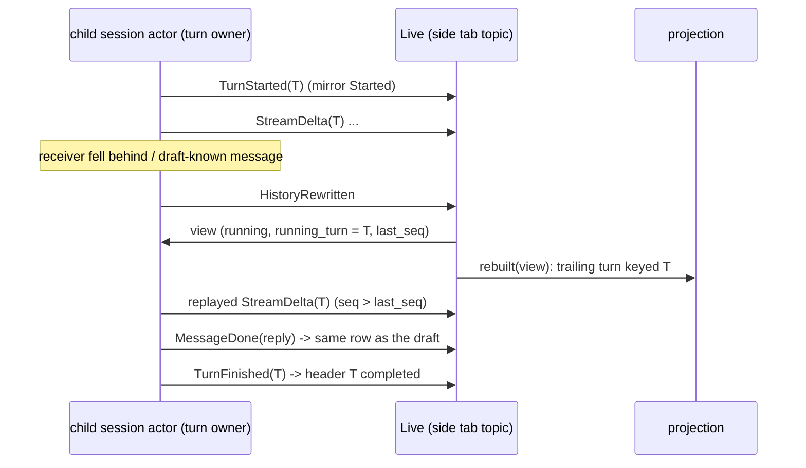
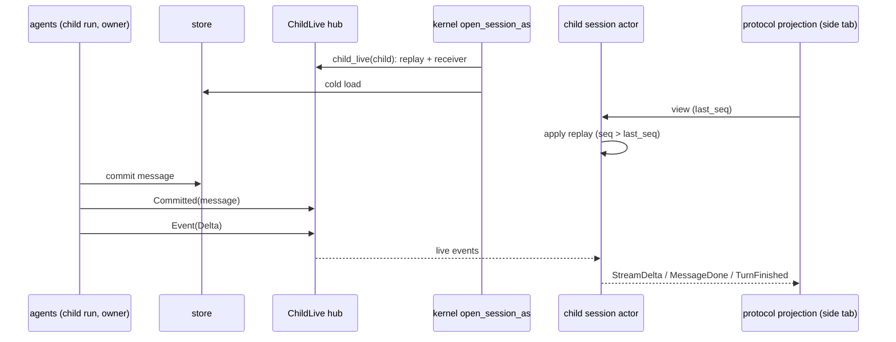

# Rust agent parity (zcode-rs as the desktop conversation agent)

Status: in progress. Tracking file for bringing `zcode-rs` (`packages/rust-cli`) to parity with the Node agent for everything the desktop UI drives. Runtime selection, storage preparation and the Host gate are specified in `specs/fork-agent-runtime-selection.md`; this file owns the parity matrix, the verification gate and the order of work.

## Goal

With `agentRuntime: rust` the desktop behaves and looks the same as with Node: every desktop flow that works on Node works on Rust, with the same rows, cards, panels and errors on screen, and the same records in the shared `db.sqlite`. The UI, Host and Main are unchanged; only the conversation agent process differs.

## Definition of "1:1"

A feature is at parity when all of these hold:

1. **Desktop E2E.** Every desktop E2E spec covering it that passes on Node also passes with `ZCODE_E2E_AGENT_RUNTIME=rust` (same spec, same replay fixtures, no Rust-only branches in the spec). The E2E specs assert on the rendered UI, so a pass is the visual 1:1 check for that flow.
2. **No protocol gaps on the path.** The Rust agent log of that run has no `protocol.method.unsupported` or `protocol.command.unsupported` event for the flow.
3. **Shared storage.** Records written by one runtime are read correctly by the other (cross-runtime reopen), checked by a test where the feature persists state.
4. **Rust gates.** `cargo fmt --check`, `cargo clippy --workspace --all-targets -- -D warnings` and `cargo nextest run --workspace` pass (the PR check job).

## How gaps are found

- `zcode-rs` logs every request it does not serve at `info`: `protocol.method.unsupported` (method name) and `protocol.command.unsupported` (v4 command kind). The log carries names only, never params.
- The desktop E2E suite runs with `ZCODE_E2E_AGENT_RUNTIME=rust` and `ZCODE_FORK_RUST_AGENT_PATH=<binary>`. The Rust agent log lands in the E2E home (`.zcode/rust-cli/log/*.jsonl`); Host logs in `.e2e-artifacts/<run>/runtime-logs`.
- A spec that fails on Rust and passes on Node is a parity gap. A spec that fails on both is not counted.

## Out of scope (stay on Node or stay refused)

These are JavaScript by nature or tied to Node-only runtimes. In Rust mode they are refused with a stable code or hidden by a capability flag, never silently dropped. Listed here so the matrix does not count them as gaps:

- JS plugin runtimes and plugin UI surfaces (`plugins/*`, `mcp/ui*`) beyond what `zcode-rs` `ext` already serves.
- Dynamic workflows (`workflows/*`, `v4/conversation/workflowRun*`, `startSavedWorkflow`, `resumeWorkflowRun`, `amendWorkflowRunSettings`).
- Office runtime, node-repl host.
- ACP external agents (decision pending with the owner).
- ChatGPT Plan account access (needs a live account to verify).

## Parity matrix

Filled from the Rust E2E run; one row per method family or command group. Status: `gap`, `done` (all four checks), `refused` (out of scope, stable code).

| Area                                                                                                     | Node owner                                                                                                                                                             | Rust status                                                                                                                                                                                                                                                                                                                                                                                                                                                                                                                                                                                                                                                                                                                                                                                                                                                                                                                                                                                                                                                                                                                                                                                                                                                                                                                                                                                                                                                                                                                                                                                                                                                                                                                                                                                                                                                                                                                                                                                                                                                                                                                                                                                                                                                                                                                                                                                                                                                                                                                                                                                                                                                                                                                                                                                                                                                                                                                                                                                                                                                                                                                                                                                                                                                          | Verified by                                                                                                                                                                      |
| -------------------------------------------------------------------------------------------------------- | ---------------------------------------------------------------------------------------------------------------------------------------------------------------------- | -------------------------------------------------------------------------------------------------------------------------------------------------------------------------------------------------------------------------------------------------------------------------------------------------------------------------------------------------------------------------------------------------------------------------------------------------------------------------------------------------------------------------------------------------------------------------------------------------------------------------------------------------------------------------------------------------------------------------------------------------------------------------------------------------------------------------------------------------------------------------------------------------------------------------------------------------------------------------------------------------------------------------------------------------------------------------------------------------------------------------------------------------------------------------------------------------------------------------------------------------------------------------------------------------------------------------------------------------------------------------------------------------------------------------------------------------------------------------------------------------------------------------------------------------------------------------------------------------------------------------------------------------------------------------------------------------------------------------------------------------------------------------------------------------------------------------------------------------------------------------------------------------------------------------------------------------------------------------------------------------------------------------------------------------------------------------------------------------------------------------------------------------------------------------------------------------------------------------------------------------------------------------------------------------------------------------------------------------------------------------------------------------------------------------------------------------------------------------------------------------------------------------------------------------------------------------------------------------------------------------------------------------------------------------------------------------------------------------------------------------------------------------------------------------------------------------------------------------------------------------------------------------------------------------------------------------------------------------------------------------------------------------------------------------------------------------------------------------------------------------------------------------------------------------------------------------------------------------------------------------------------------- | -------------------------------------------------------------------------------------------------------------------------------------------------------------------------------- |
| Shared task runtime routing (`sessionWorkspaceRouting`)                                                  | `bootstrap/zcode-protocol/server.ts`                                                                                                                                   | done: capability reported; requests are routed by `sessionId` and per-workspace topics                                                                                                                                                                                                                                                                                                                                                                                                                                                                                                                                                                                                                                                                                                                                                                                                                                                                                                                                                                                                                                                                                                                                                                                                                                                                                                                                                                                                                                                                                                                                                                                                                                                                                                                                                                                                                                                                                                                                                                                                                                                                                                                                                                                                                                                                                                                                                                                                                                                                                                                                                                                                                                                                                                                                                                                                                                                                                                                                                                                                                                                                                                                                                                               | `conversation-session-first-send`                                                                                                                                                |
| `renameSession`, `switchModelConfig`, `switchCollaborationMode`, `compact`                               | `handlers/session-mgmt.ts`, `model-config.ts`, `goal-compact.ts`                                                                                                       | ported (`fork/session_config.rs`): kernel `Rename`, `SetModel`, `SetMode`/`SetPlan`, `Compact`; a switch to the value in effect is `noop` `config.unchanged`                                                                                                                                                                                                                                                                                                                                                                                                                                                                                                                                                                                                                                                                                                                                                                                                                                                                                                                                                                                                                                                                                                                                                                                                                                                                                                                                                                                                                                                                                                                                                                                                                                                                                                                                                                                                                                                                                                                                                                                                                                                                                                                                                                                                                                                                                                                                                                                                                                                                                                                                                                                                                                                                                                                                                                                                                                                                                                                                                                                                                                                                                                         | gate: `v4-rename`, `v4-model-switch`, `model-config`, `v4-compact`, `compact`, `v4-plan-shortcut`                                                                                |
| Row actions (`canEdit`/`editDisposition`, `canRetry`, `canFork`)                                         | `product-projection.ts` `materializeCommandRowActions`                                                                                                                 | ported (`projection/actions.rs`), same rules, including `canRewindFiles` (see "Turn file change summary")                                                                                                                                                                                                                                                                                                                                                                                                                                                                                                                                                                                                                                                                                                                                                                                                                                                                                                                                                                                                                                                                                                                                                                                                                                                                                                                                                                                                                                                                                                                                                                                                                                                                                                                                                                                                                                                                                                                                                                                                                                                                                                                                                                                                                                                                                                                                                                                                                                                                                                                                                                                                                                                                                                                                                                                                                                                                                                                                                                                                                                                                                                                                                            | unit tests; gate: `v4-edit`, `v4-fork`                                                                                                                                           |
| `editUserQuery`, `retryTurn`, `forkAssistant`                                                            | `handlers/fork-edit-retry.ts`                                                                                                                                          | ported (`fork/row_commands.rs`): edit and retry are kernel `Rewind{conversation}` + resubmit (edit preempts a running turn like Node); fork is `ForkFromInput`; `workspaceMode: rewind` is the "Edit with file rewind" row                                                                                                                                                                                                                                                                                                                                                                                                                                                                                                                                                                                                                                                                                                                                                                                                                                                                                                                                                                                                                                                                                                                                                                                                                                                                                                                                                                                                                                                                                                                                                                                                                                                                                                                                                                                                                                                                                                                                                                                                                                                                                                                                                                                                                                                                                                                                                                                                                                                                                                                                                                                                                                                                                                                                                                                                                                                                                                                                                                                                                                           | gate: `v4-edit`, `v4-fork`, `v4-fork-edit-branch`                                                                                                                                |
| History rewrite (`HistoryRewritten`)                                                                     | Node `RewindTriggered` projection                                                                                                                                      | the projection is rebuilt from a fresh view and every started subscription gets a new snapshot (`live.rs`), like the TUI                                                                                                                                                                                                                                                                                                                                                                                                                                                                                                                                                                                                                                                                                                                                                                                                                                                                                                                                                                                                                                                                                                                                                                                                                                                                                                                                                                                                                                                                                                                                                                                                                                                                                                                                                                                                                                                                                                                                                                                                                                                                                                                                                                                                                                                                                                                                                                                                                                                                                                                                                                                                                                                                                                                                                                                                                                                                                                                                                                                                                                                                                                                                             | `v4-edit`                                                                                                                                                                        |
| Permission deny text                                                                                     | `bootstrap/permission-options.ts` `buildPermissionDeniedContent`                                                                                                       | ported: the tool result of a deny with feedback is Node's text (`... the user said:\n<feedback>`); a deny without feedback stays the plain rejection                                                                                                                                                                                                                                                                                                                                                                                                                                                                                                                                                                                                                                                                                                                                                                                                                                                                                                                                                                                                                                                                                                                                                                                                                                                                                                                                                                                                                                                                                                                                                                                                                                                                                                                                                                                                                                                                                                                                                                                                                                                                                                                                                                                                                                                                                                                                                                                                                                                                                                                                                                                                                                                                                                                                                                                                                                                                                                                                                                                                                                                                                                                 | `tools` unit tests; gate: `v4-permission`                                                                                                                                        |
| Token budget prompt                                                                                      | Node has none                                                                                                                                                          | the app-server turns `ContextConfig.token_budget` off: no "Token budget" system section and no total-tokens reminder (TUI and print keep it)                                                                                                                                                                                                                                                                                                                                                                                                                                                                                                                                                                                                                                                                                                                                                                                                                                                                                                                                                                                                                                                                                                                                                                                                                                                                                                                                                                                                                                                                                                                                                                                                                                                                                                                                                                                                                                                                                                                                                                                                                                                                                                                                                                                                                                                                                                                                                                                                                                                                                                                                                                                                                                                                                                                                                                                                                                                                                                                                                                                                                                                                                                                         | `context` unit tests; gate: `v4-permission`                                                                                                                                      |
| `session/lifecycle/getState`                                                                             | `bootstrap/session-lifecycle/controller.ts`                                                                                                                            | ported (`fork/methods.rs`): an open session is `ready`, a stored one `unloaded`, an unknown id is `sessionUnavailable`; generation and revision are 0, `lastError` null                                                                                                                                                                                                                                                                                                                                                                                                                                                                                                                                                                                                                                                                                                                                                                                                                                                                                                                                                                                                                                                                                                                                                                                                                                                                                                                                                                                                                                                                                                                                                                                                                                                                                                                                                                                                                                                                                                                                                                                                                                                                                                                                                                                                                                                                                                                                                                                                                                                                                                                                                                                                                                                                                                                                                                                                                                                                                                                                                                                                                                                                                              | gate: `v4-vertical-slice`                                                                                                                                                        |
| Compact timeline markers                                                                                 | `product-projection.ts` `onCompactLifecycle`                                                                                                                           | ported (`projection/markers.rs`): one `timelineMarker` row per compaction, `running` then `success`/`failed`; a compaction still running when its turn ends settles as `cancelled` (turn interrupted) or `failed` and its compact work ends, like Node's `interrupted` compaction (before: the marker stayed `Compressing context` and the row actions stayed withheld after Stop); on the desktop (`CompactConfig.blocking` false) an automatic compaction never summarizes everything and too little history is Node's `skipped` compaction: `KernelEvent::CompactSkipped`, one `noop` row ("Context is up to date; no compression needed"), no summary request and no failure counted (before: no marker, and past the window Rust summarized everything where Node skipped). A desktop `/compact` with too little history is Node's healthy no-op too: the compactor answers `OrchestrationError::Skipped` with Node's text, the session emits `CompactSkipped`, records the text as the command's stdout and completes the turn, and the announced marker settles as `noop` (before: a failed turn with a `failed` marker); the TUI keeps `Not enough messages to compact.`. A cold projection shows stored compact boundaries as `success` with `tokensBefore`                                                                                                                                                                                                                                                                                                                                                                                                                                                                                                                                                                                                                                                                                                                                                                                                                                                                                                                                                                                                                                                                                                                                                                                                                                                                                                                                                                                                                                                                                                                                                                                                                                                                                                                                                                                                                                                                                                                                                                                                 | `projection` and `compact` unit tests; gate: `v4-compact`, `compact`, `goal-run-cases`                                                                                           |
| Model switch timeline markers                                                                            | `product-projection.ts` `onTurnStarted` (`lastTurnModel`)                                                                                                              | ported (`projection/model_change.rs`): when a turn starts with a provider or model other than the previous turn's, a `timelineMarker` row in lane `lightBoundary` (`marker: {type: "modelChange", fromProvider, fromModel, toProvider, toModel, toThought}`, key `model-change:<turn>:<from>-><to>`) comes before its `turnHeader`; no marker on the first turn of a regular session; the first turn of a subagent child session (`SessionKind::Subagent`) instead gets a source-less marker (key `model-initial:<turn>:<provider>/<model>`, `marker: {type: "modelChange", toProvider, toModel, toThought}`, the "Using <model>" line), like Node's `previousModelSelection: null` at the child spawn (`core/runtime/methods/subagent.ts`, `onModelSelected` `sourceLess`), live and cold (before: the child side tab had no "Using" line); a reasoning change alone is no switch (before: Rust drew no "Model switched" divider). A cold projection draws the stored switches like Node's cold resume: node-store reads each assistant message's `providerId` / `modelId` / `reasoningLevel` (`LoadedSession.message_models`, highspeed providers and timeline events left out), the session actor adds each committed reply's model (`SessionView.message_models`), and a cold turn runs on the model of its first reply; so a switch made before closing draws the divider on the first turn after reopening. A session with no stored models takes the current selection as the previous model                                                                                                                                                                                                                                                                                                                                                                                                                                                                                                                                                                                                                                                                                                                                                                                                                                                                                                                                                                                                                                                                                                                                                                                                                                                                                                                                                                                                                                                                                                                                                                                                                                                                                                                                                                  | `projection` unit tests; gate: `compact-manual-queue` (held-queue screenshot); `v4-model-switch` fails before the divider on both runtimes (thought-level trigger not clickable) |
| Model request retry count                                                                                | adapters `model/retry-policy.ts` `ZCODE_MODEL_RETRY_MAX_RETRIES`                                                                                                       | ported (`cli/assemble/options.rs` `model_retry`, shared by the app-server, TUI and `-p`): a non-negative integer (a fraction is floored) replaces the default 10 retries after the first request; `0` sends each model request once, so a 429 or 5xx ends the turn at once. An empty or invalid value keeps the default. Before: Rust ignored the variable and retried up to 10 times. Not ported: `ZCODE_MODEL_RETRY_BASE_DELAY_MS`, `ZCODE_MODEL_RETRY_BACKOFF_FACTOR`, `ZCODE_MODEL_RETRY_MAX_DELAY_MS` (Rust keeps its own backoff, model.md §5)                                                                                                                                                                                                                                                                                                                                                                                                                                                                                                                                                                                                                                                                                                                                                                                                                                                                                                                                                                                                                                                                                                                                                                                                                                                                                                                                                                                                                                                                                                                                                                                                                                                                                                                                                                                                                                                                                                                                                                                                                                                                                                                                                                                                                                                                                                                                                                                                                                                                                                                                                                                                                                                                                                                 | unit tests; gate: `model-switch-restore-repro`                                                                                                                                   |
| `thoughtLevels`                                                                                          | `app/session-facade.ts` `listThoughtLevels`                                                                                                                            | from the model catalog entry of the selected model (`reasoning_levels`), read on a cold open                                                                                                                                                                                                                                                                                                                                                                                                                                                                                                                                                                                                                                                                                                                                                                                                                                                                                                                                                                                                                                                                                                                                                                                                                                                                                                                                                                                                                                                                                                                                                                                                                                                                                                                                                                                                                                                                                                                                                                                                                                                                                                                                                                                                                                                                                                                                                                                                                                                                                                                                                                                                                                                                                                                                                                                                                                                                                                                                                                                                                                                                                                                                                                         | gate: `v4-model-switch`                                                                                                                                                          |
| AskUserQuestion and ExitPlanMode asks                                                                    | `product-projection.ts` `createPendingInteractionFromPermissionEvent`, `interaction-broker.ts`                                                                         | ported (`projection/elicitation.rs`): `userInput` pending interactions with structured questions (plan approval is one `approve` question); `resolveInteraction {action, content}` maps to the kernel answers like Node's broker                                                                                                                                                                                                                                                                                                                                                                                                                                                                                                                                                                                                                                                                                                                                                                                                                                                                                                                                                                                                                                                                                                                                                                                                                                                                                                                                                                                                                                                                                                                                                                                                                                                                                                                                                                                                                                                                                                                                                                                                                                                                                                                                                                                                                                                                                                                                                                                                                                                                                                                                                                                                                                                                                                                                                                                                                                                                                                                                                                                                                                     | unit tests; gate: `ask-user-question-keyboard-navigation`, `plan-mode-capabilities`                                                                                              |
| `deleteSession`                                                                                          | `handlers/session-mgmt.ts`                                                                                                                                             | ported (`fork/session_delete.rs`): refused while a turn runs; closes the actor, soft-deletes, emits `session.removed` on the sessions index                                                                                                                                                                                                                                                                                                                                                                                                                                                                                                                                                                                                                                                                                                                                                                                                                                                                                                                                                                                                                                                                                                                                                                                                                                                                                                                                                                                                                                                                                                                                                                                                                                                                                                                                                                                                                                                                                                                                                                                                                                                                                                                                                                                                                                                                                                                                                                                                                                                                                                                                                                                                                                                                                                                                                                                                                                                                                                                                                                                                                                                                                                                          | unit tests; gate: `v4-delete`                                                                                                                                                    |
| Queue commands (`deleteQueueItem`, `editQueueItem`, `reorderQueueItem`, `setAutoDrain`, `sendQueuedNow`) | `handlers/queue.ts`                                                                                                                                                    | ported (`fork/queue.rs`) on kernel `Dequeue`, `EditQueued`, `ReorderQueued`, `HoldQueue`; the kernel owns the hold, the projection shows `autoDrain` after an accepted `setAutoDrain`; `sendQueuedNow` restores the user's hold after the promotion                                                                                                                                                                                                                                                                                                                                                                                                                                                                                                                                                                                                                                                                                                                                                                                                                                                                                                                                                                                                                                                                                                                                                                                                                                                                                                                                                                                                                                                                                                                                                                                                                                                                                                                                                                                                                                                                                                                                                                                                                                                                                                                                                                                                                                                                                                                                                                                                                                                                                                                                                                                                                                                                                                                                                                                                                                                                                                                                                                                                                  | `session` unit tests; gate: `v4-queue`, `queue-operations`, `running-queue`, `v4-sendnow`                                                                                        |
| `v4/conversation/plans`                                                                                  | `conversation-topic-publisher.ts` `getPlans`                                                                                                                           | ported (`projection/plans.rs`): settled ExitPlanMode rows with a non-blank plan in the row window, newest first, with `atSeq`/`atLogEpoch`                                                                                                                                                                                                                                                                                                                                                                                                                                                                                                                                                                                                                                                                                                                                                                                                                                                                                                                                                                                                                                                                                                                                                                                                                                                                                                                                                                                                                                                                                                                                                                                                                                                                                                                                                                                                                                                                                                                                                                                                                                                                                                                                                                                                                                                                                                                                                                                                                                                                                                                                                                                                                                                                                                                                                                                                                                                                                                                                                                                                                                                                                                                           | unit tests; gate: `plan-mode-capabilities`                                                                                                                                       |
| `v4/conversation/workflowRuns`, `session/debug`                                                          | `v4-gateway.ts`, `session-debug`                                                                                                                                       | answered empty (`runs: []`; no debug rounds) instead of `-32601`: zcode-rs has no dynamic workflows and keeps no per-request debug records                                                                                                                                                                                                                                                                                                                                                                                                                                                                                                                                                                                                                                                                                                                                                                                                                                                                                                                                                                                                                                                                                                                                                                                                                                                                                                                                                                                                                                                                                                                                                                                                                                                                                                                                                                                                                                                                                                                                                                                                                                                                                                                                                                                                                                                                                                                                                                                                                                                                                                                                                                                                                                                                                                                                                                                                                                                                                                                                                                                                                                                                                                                           | gate logs (no `protocol.method.unsupported`)                                                                                                                                     |
| Stop holds the queue                                                                                     | `handlers/session-flow.ts` `holdFollowingQueue` (`specs/stop-queue-hold.md`)                                                                                           | ported (`commands.rs` `stop`): a stop that cancels a turn with queued inputs holds the kernel queue before the interrupt and projects `autoDrain: false`, `pauseReason: stopped`; nothing to stop releases the hold; `setAutoDrain(false)` is `manual`                                                                                                                                                                                                                                                                                                                                                                                                                                                                                                                                                                                                                                                                                                                                                                                                                                                                                                                                                                                                                                                                                                                                                                                                                                                                                                                                                                                                                                                                                                                                                                                                                                                                                                                                                                                                                                                                                                                                                                                                                                                                                                                                                                                                                                                                                                                                                                                                                                                                                                                                                                                                                                                                                                                                                                                                                                                                                                                                                                                                               | unit tests; gate: `queue-operations`, `v4-queue`, `v4-stop-queue`                                                                                                                |
| A failed turn pauses the queue                                                                           | core `runtime/methods/turn.ts` (non-cancel `TurnError`: `queueAutoDrain = false`), `product-projection.ts` `onTurnError`                                               | ported (desktop only, `SessionDeps::error_holds_queue`): when a main-loop turn (a prompt, a notice or a bash turn; not a manual `/compact` turn) ends `Failed` while inputs wait, the session actor holds the queue (the same hold as Stop) instead of starting the next input, and the projection sets `queue.autoDrain: false`, `pauseReason: "error"`. `setAutoDrain(true)` (Continue) releases it and starts the head, FIFO. A failed manual compaction and the goal verifier do not pause, like Node. Before: Rust started the next queued input right after the failed turn. The TUI and `-p` keep draining                                                                                                                                                                                                                                                                                                                                                                                                                                                                                                                                                                                                                                                                                                                                                                                                                                                                                                                                                                                                                                                                                                                                                                                                                                                                                                                                                                                                                                                                                                                                                                                                                                                                                                                                                                                                                                                                                                                                                                                                                                                                                                                                                                                                                                                                                                                                                                                                                                                                                                                                                                                                                                                    |
| Input ledger (`session_input`)                                                                           | core `runtime/methods/events.ts` (`TurnSteerQueued`/`TurnSteerDiscarded`), `steering.ts` `discardPersistedPendingSteerInputs`, bootstrap `persistent-command-facts.ts` | ported (see "Input ledger" below): an input queued behind a running turn is admitted to `session_input`, leaves it promoted, cancelled or discarded, and a restart settles what was left as `discarded`/`session_resumed`; `commands/query` answers such a command with Node's failed ACK. Before: Rust wrote no row, so a queued input lost in a restart stayed `accepted`                                                                                                                                                                                                                                                                                                                                                                                                                                                                                                                                                                                                                                                                                                                                                                                                                                                                                                                                                                                                                                                                                                                                                                                                                                                                                                                                                                                                                                                                                                                                                                                                                                                                                                                                                                                                                                                                                                                                                                                                                                                                                                                                                                                                                                                                                                                                                                                                                                                                                                                                                                                                                                                                                                                                                                                                                                                                                          | `queued-command-restart`, node-store and session unit tests                                                                                                                      |
| Attachments sent by path, named image placeholder                                                        | `attachment-path-reference.ts`, `filePartToContentBlock`, provider media projection                                                                                    | ported (`protocol-zcode/attachments.rs`, `node-records/attached_file.rs`, `model/media.rs`): a binary desktop file (not image, video, PDF or text-like) and an image over the inline limit go as Node's three-line `Attached <mime>: <path>` note, stored as a `local_ref` / `metadata_only` part with `pathReferenceText` and replayed verbatim; a non-vision endpoint sees `[Attached <mime>: <file name>]`                                                                                                                                                                                                                                                                                                                                                                                                                                                                                                                                                                                                                                                                                                                                                                                                                                                                                                                                                                                                                                                                                                                                                                                                                                                                                                                                                                                                                                                                                                                                                                                                                                                                                                                                                                                                                                                                                                                                                                                                                                                                                                                                                                                                                                                                                                                                                                                                                                                                                                                                                                                                                                                                                                                                                                                                                                                        | gate: `v4-attachment`, `attachment-resume`                                                                                                                                       |
| Session titles                                                                                           | core `runtime/methods/title-generation-sidecar.ts`                                                                                                                     | ported (`cli/assemble`, `session/title_model.rs`): the app-server generates the first-input title like the Node desktop agent, with Node's prompt verbatim (`prompts/title/node-system.txt`) and the normalized input as the whole user message; the TUI keeps its own prompt                                                                                                                                                                                                                                                                                                                                                                                                                                                                                                                                                                                                                                                                                                                                                                                                                                                                                                                                                                                                                                                                                                                                                                                                                                                                                                                                                                                                                                                                                                                                                                                                                                                                                                                                                                                                                                                                                                                                                                                                                                                                                                                                                                                                                                                                                                                                                                                                                                                                                                                                                                                                                                                                                                                                                                                                                                                                                                                                                                                        | gate: `v4-plan-shortcut`                                                                                                                                                         |
| Plan exit declined without feedback                                                                      | core `tool/executor/turn-control.ts` `withPlanExitDeniedTurnStop`                                                                                                      | ported (`tools/plan_mode.rs`, `ToolCallOutput::stop_turn`): the turn ends after the result, through the same path as a hook's `continue: false`; feedback keeps the turn going                                                                                                                                                                                                                                                                                                                                                                                                                                                                                                                                                                                                                                                                                                                                                                                                                                                                                                                                                                                                                                                                                                                                                                                                                                                                                                                                                                                                                                                                                                                                                                                                                                                                                                                                                                                                                                                                                                                                                                                                                                                                                                                                                                                                                                                                                                                                                                                                                                                                                                                                                                                                                                                                                                                                                                                                                                                                                                                                                                                                                                                                                       | gate: `plan-mode-capabilities`                                                                                                                                                   |
| Plan mode tool boundary                                                                                  | core `permission/service.ts` `checkPlanMode` (`mode.plan.nonReadOnly`)                                                                                                 | ported (`policy` `PolicyGate::with_node_plan_mode`, on for the app-server): in plan mode anything that would ask is denied with Node's reason, without the auto classifier; the plan file and read-only tools still run; the TUI keeps its plan-mode asks. The desktop projection settles the denied call's row like Node's `PermissionDenied` (`cancelled`, no output, so no `Failed` label), live and on a cold read (matched by the denial text, the only trace the stored result keeps). Before: an `error` row shown as `Failed`                                                                                                                                                                                                                                                                                                                                                                                                                                                                                                                                                                                                                                                                                                                                                                                                                                                                                                                                                                                                                                                                                                                                                                                                                                                                                                                                                                                                                                                                                                                                                                                                                                                                                                                                                                                                                                                                                                                                                                                                                                                                                                                                                                                                                                                                                                                                                                                                                                                                                                                                                                                                                                                                                                                                | gate: `plan-mode-capabilities`                                                                                                                                                   |
| Held queue after Stop                                                                                    | bootstrap `projection-state.ts` `computeInputRouting`, `applyHeldQueueDisposition`                                                                                     | ported (`protocol-zcode/projection/state.rs` `input_routing`, `commands.rs` `held_queue_choice`): a finished turn with a paused, non-empty queue routes input as `choice` (`heldQueueInputRequiresChoice`); `sendText` then needs `heldQueueDisposition` (`clearQueueAndSend` drops the items and releases the hold, `keepQueueAndSend` keeps them) and a stale `expectedHeldQueueItemIds` is refused                                                                                                                                                                                                                                                                                                                                                                                                                                                                                                                                                                                                                                                                                                                                                                                                                                                                                                                                                                                                                                                                                                                                                                                                                                                                                                                                                                                                                                                                                                                                                                                                                                                                                                                                                                                                                                                                                                                                                                                                                                                                                                                                                                                                                                                                                                                                                                                                                                                                                                                                                                                                                                                                                                                                                                                                                                                                |
| One queued input per turn                                                                                | bootstrap queue drain (one item per turn)                                                                                                                              | ported (`session` `SessionDeps::one_input_per_turn`, on for the app-server through `Extensions::node_desktop`): queued inputs are not merged into one turn; the TUI keeps merging                                                                                                                                                                                                                                                                                                                                                                                                                                                                                                                                                                                                                                                                                                                                                                                                                                                                                                                                                                                                                                                                                                                                                                                                                                                                                                                                                                                                                                                                                                                                                                                                                                                                                                                                                                                                                                                                                                                                                                                                                                                                                                                                                                                                                                                                                                                                                                                                                                                                                                                                                                                                                                                                                                                                                                                                                                                                                                                                                                                                                                                                                    |
| Edit after Stop                                                                                          | bootstrap `fork-edit-retry.ts`                                                                                                                                         | fixed (`protocol-zcode/live.rs` `Live::rebuilds`, `fork/row_commands.rs` `rewind_to`): the resubmitted input reaches the kernel only after the projection is rebuilt from the cut history, so the new turn's rows are not skipped                                                                                                                                                                                                                                                                                                                                                                                                                                                                                                                                                                                                                                                                                                                                                                                                                                                                                                                                                                                                                                                                                                                                                                                                                                                                                                                                                                                                                                                                                                                                                                                                                                                                                                                                                                                                                                                                                                                                                                                                                                                                                                                                                                                                                                                                                                                                                                                                                                                                                                                                                                                                                                                                                                                                                                                                                                                                                                                                                                                                                                    |
| Turn file change summary                                                                                 | bootstrap `product-projection.ts` turn header `fileChanges`, `canRewindFiles`                                                                                          | ported (`protocol-zcode/projection/mod.rs` `file_changes`, `actions.rs`): `FileChanges` events sum per turn into the header's `fileChanges` (`files`, `additions`, `deletions`, `state: active`); `actions.canRewindFiles` only on a finished turn with rewindable changes and no pending interaction                                                                                                                                                                                                                                                                                                                                                                                                                                                                                                                                                                                                                                                                                                                                                                                                                                                                                                                                                                                                                                                                                                                                                                                                                                                                                                                                                                                                                                                                                                                                                                                                                                                                                                                                                                                                                                                                                                                                                                                                                                                                                                                                                                                                                                                                                                                                                                                                                                                                                                                                                                                                                                                                                                                                                                                                                                                                                                                                                                |
| Edit with file rewind                                                                                    | bootstrap `fork-edit-retry.ts` `workspaceMode: rewind`, `previewWorkspaceFileRewind`                                                                                   | ported (`session/rewind.rs` `preview`, `SessionHandle::rewind_preview`, `fork/row_commands.rs` `workspace_rewind`): the preview is a dry run (hash check through `rewind_prepare`, token released without apply); unsafe files or no file to restore return `disposition: blocked` with Node's reason codes and preview; otherwise the kernel rewinds files and conversation (`RewindScope::Both`). Shell changes are not checkpointed, so `ignoredFiles` is always empty                                                                                                                                                                                                                                                                                                                                                                                                                                                                                                                                                                                                                                                                                                                                                                                                                                                                                                                                                                                                                                                                                                                                                                                                                                                                                                                                                                                                                                                                                                                                                                                                                                                                                                                                                                                                                                                                                                                                                                                                                                                                                                                                                                                                                                                                                                                                                                                                                                                                                                                                                                                                                                                                                                                                                                                            |
| `v4/conversation/rowsRange`, snapshot tail window                                                        | `conversation-topic-publisher.ts` `getWireSnapshotForProfile`, `getRowsRange`; `PROTOCOL_V4_LIMITS.snapshotTailWindowRows` (60), `rowsRangeMaxLimit` (200)             | ported (`projection/rows_range.rs`, `server.rs` `rows_range`): the snapshot carries the last 60 rows with the full `totalCount`/`firstRowId`; older rows come from the cursor read (`rowId < beforeRowId`, ascending, `hasMore`); `residency: resident-only` never opens a stored session (`proto.sessionNotResident`), so `residentRowsRange` is reported. The plans catalog reads the whole branch, not the window. Before: a 200-row window and no cursor read, older history unreachable                                                                                                                                                                                                                                                                                                                                                                                                                                                                                                                                                                                                                                                                                                                                                                                                                                                                                                                                                                                                                                                                                                                                                                                                                                                                                                                                                                                                                                                                                                                                                                                                                                                                                                                                                                                                                                                                                                                                                                                                                                                                                                                                                                                                                                                                                                                                                                                                                                                                                                                                                                                                                                                                                                                                                                         | unit tests; gate: `v4-load-older`                                                                                                                                                |
| Session lifecycle (`session/lifecycle/getState`, `session/lifecycle/changed`)                            | bootstrap `session-lifecycle/`, `zcode-protocol/session-residency.ts` `onChange`                                                                                       | ported (`lifecycle.rs`, `server.rs`): per-session monotonic `revision`; a cold open announces `ready`, a close `unloaded`. Before: always revision 0 and no notification, so the App kept the `unloaded` it read before subscribing and blocked Send after a restart. `starting`/`stopping`/`faulted` are never reported (activation is synchronous and does not fail after it is reported); `session/lifecycle/{ensureReady,stop,restart}` are ported too: stop closes the bridge and ends the kernel actor (`EndReason::Other`, like session delete) without waiting for a busy turn (Node's `assertCanStop` is a no-op), restart is stop plus a cold open (`unloaded`, then `ready`); before they answered `-32601`, so the task menu's restart toasted `taskList.restartUnsupported`                                                                                                                                                                                                                                                                                                                                                                                                                                                                                                                                                                                                                                                                                                                                                                                                                                                                                                                                                                                                                                                                                                                                                                                                                                                                                                                                                                                                                                                                                                                                                                                                                                                                                                                                                                                                                                                                                                                                                                                                                                                                                                                                                                                                                                                                                                                                                                                                                                                                             | unit tests; gate: `attachment-resume`                                                                                                                                            |
| Per-turn file summary and rewind (`v4/conversation/fileChanges`, `fileRewindPreview`, `applyFileRewind`) | `v4-gateway.ts` `fileChanges`/`fileRewindPreview`, core `runtime/methods/file-rewind.ts`                                                                               | ported (`session/turn_files.rs`, `fork/file_summary.rs`): the kernel selects the checkpoints of one turn (`SessionHandle::turn_file_changes`, `turn_rewind_preview`, `Command::RewindTurnFiles`); stale `baseLogEpoch`/`baseRevision` are `proto.staleLogEpoch`/`proto.staleRevision`; an unsafe preview returns `applied: false` with Node's text; an applied rewind emits `TurnFilesReverted` and the header shows `state: reverted` without `canRewindFiles`. A cold projection rebuilds the header from the stored checkpoints                                                                                                                                                                                                                                                                                                                                                                                                                                                                                                                                                                                                                                                                                                                                                                                                                                                                                                                                                                                                                                                                                                                                                                                                                                                                                                                                                                                                                                                                                                                                                                                                                                                                                                                                                                                                                                                                                                                                                                                                                                                                                                                                                                                                                                                                                                                                                                                                                                                                                                                                                                                                                                                                                                                                   | `session` and `projection` unit tests; gate: `v4-rewind-files`                                                                                                                   |
| Bash direct output (desktop layout, retention, preview, limit)                                           | adapters `node-execution-adapter-run.ts`, `bash-file-output.ts`, `bash-output-preview.ts`; core `tool/handlers/bash.ts`, `task-output-bash.ts`                         | ported, gated on `node_desktop` (`env-local` `set_bash_outputs`, `tools/bash.rs`, `tools/bash_preview.rs`, `projection/bash_progress.rs`): `<tmp>/zcode-bash-<uid>/<session>/<toolCallId>-stdout.log` (0700 root, 0600 file), stdout and stderr merged in write order; a foreground file that fits inline (30000 bytes) is deleted after the settlement read, larger and background files are kept; at most one `bash_progress` a second with Node's `outputPreview`; 5 GiB limit checked every 5 s (`Command killed: output file exceeded 5GB`); an open failure is an error naming the errno (`EISDIR`); a failed settlement read (`CommandEvent::Finished.output_unreadable`) gives Node's `<bash output unavailable ...>`; TaskOutput reads the head while running and the tail after. Remote workspaces: exec-server does not carry `output_unreadable`, so env-remote keeps the `output_bytes < total` fallback. TUI and print keep their layout and texts                                                                                                                                                                                                                                                                                                                                                                                                                                                                                                                                                                                                                                                                                                                                                                                                                                                                                                                                                                                                                                                                                                                                                                                                                                                                                                                                                                                                                                                                                                                                                                                                                                                                                                                                                                                                                                                                                                                                                                                                                                                                                                                                                                                                                                                                                                     | `env-local`, `tools` unit tests; gate: `bash-direct-output`                                                                                                                      |
| Queue item kinds and frozen execution state                                                              | bootstrap queue intent (`sendText`/`sendGoalCommand`/`compact`, `modelSelection`, `mode`, `planEnabled`)                                                               | ported: the kernel owns each queued item's `kind` and `execution` (`QueuedInput`, `Command::SubmitWith`); the app-server no longer sends `SetModel`/`SetMode`/`SetPlan` on admission, the state frozen with the item is applied when it drains (`Session::submitted_execution`), and the projection reads kind and state from the kernel queue (no protocol-side copy). `sendQueuedNow` keeps the item's kind and state; a queued goal shows the typed `/goal X`, like Node (before: the objective without `/goal`)                                                                                                                                                                                                                                                                                                                                                                                                                                                                                                                                                                                                                                                                                                                                                                                                                                                                                                                                                                                                                                                                                                                                                                                                                                                                                                                                                                                                                                                                                                                                                                                                                                                                                                                                                                                                                                                                                                                                                                                                                                                                                                                                                                                                                                                                                                                                                                                                                                                                                                                                                                                                                                                                                                                                                  | `session` (`submit_with_tests.rs`) and `projection` unit tests; gate: `running-queue`, `v4-queue`, `v4-sendnow`                                                                  |
| Compact lock                                                                                             | bootstrap `goal-compact.ts` `compactOperationLock`                                                                                                                     | ported: a second `compact` while one runs or is queued is rejected by the kernel (`COMPACT_LOCKED`) and answered with reason code `compactOperationLock`; a queued compact item cannot be edited; idle behind a held queue that has inputs, `compact` joins the queue tail (`admitted: "queue"`, `SubmitWith.behind_held`) instead of bypassing the queued intent, like Node                                                                                                                                                                                                                                                                                                                                                                                                                                                                                                                                                                                                                                                                                                                                                                                                                                                                                                                                                                                                                                                                                                                                                                                                                                                                                                                                                                                                                                                                                                                                                                                                                                                                                                                                                                                                                                                                                                                                                                                                                                                                                                                                                                                                                                                                                                                                                                                                                                                                                                                                                                                                                                                                                                                                                                                                                                                                                         | `session` unit tests; gate: `v4-compact`, `compact`, `v4-rewind-queue-background`                                                                                                |
| Context blocking limit                                                                                   | core `runtime/methods/compact.ts` `autoCompactIfNeeded` (no pre-request limit)                                                                                         | ported: the app-server (`node_desktop`) has no blocking limit (`CompactConfig.blocking` false), so a turn whose prompt is past the window is still sent and the provider's answer decides, like Node; auto compaction is unchanged. The TUI and `-p` keep the blocking limit (`docs/specs/rust-cli/compact.md` §2.2)                                                                                                                                                                                                                                                                                                                                                                                                                                                                                                                                                                                                                                                                                                                                                                                                                                                                                                                                                                                                                                                                                                                                                                                                                                                                                                                                                                                                                                                                                                                                                                                                                                                                                                                                                                                                                                                                                                                                                                                                                                                                                                                                                                                                                                                                                                                                                                                                                                                                                                                                                                                                                                                                                                                                                                                                                                                                                                                                                 | `compact` unit test `the_desktop_never_blocks`; gate: `goal-run-cases` (a 240-token model window)                                                                                |
| Full access from a permission ask                                                                        | bootstrap `permission-options.ts` `fullAccess`                                                                                                                         | ported (`Command::GrantFullAccess`): the session switches to bypass and rewrites the mode of every queued item that froze one, keeping their plan state; the kernel then emits `PermissionGranted`, projected as `config.permissionGrant.interactionId` so the composer draft adopts the new mode (Node `SessionModeChanged`); a plan switch by the plan tools emits `PlanTransition`, projected as `config.planTransition`                                                                                                                                                                                                                                                                                                                                                                                                                                                                                                                                                                                                                                                                                                                                                                                                                                                                                                                                                                                                                                                                                                                                                                                                                                                                                                                                                                                                                                                                                                                                                                                                                                                                                                                                                                                                                                                                                                                                                                                                                                                                                                                                                                                                                                                                                                                                                                                                                                                                                                                                                                                                                                                                                                                                                                                                                                          | `session` unit tests; gate: `permission-full-access`                                                                                                                             |
| Independent plan state (`independentPlanState`)                                                          | bootstrap `server.ts` capabilities                                                                                                                                     | reported `true` by the app-server: plan is a separate flag from the mode in the kernel (`ExecutionState`), so yolo plus plan is effective Plan; the desktop capability override for zcode-rs is removed                                                                                                                                                                                                                                                                                                                                                                                                                                                                                                                                                                                                                                                                                                                                                                                                                                                                                                                                                                                                                                                                                                                                                                                                                                                                                                                                                                                                                                                                                                                                                                                                                                                                                                                                                                                                                                                                                                                                                                                                                                                                                                                                                                                                                                                                                                                                                                                                                                                                                                                                                                                                                                                                                                                                                                                                                                                                                                                                                                                                                                                              | `session` unit tests; gate: `plan-mode-capabilities`, `v4-plan-shortcut`                                                                                                         |
| `skills/referenceCatalog` (Composer `/` skill panel)                                                     | bootstrap `zcode-protocol/skill-reference-catalog.ts`                                                                                                                  | ported (`fork/skills.rs`, `SkillCatalog::references`): file skills of the workspace, user and plugin sources (built-ins excluded), `id` `glm:<scope>:<SKILL.md path>`, `enabled: true`, `pluginName` for plugin skills; with a `sessionId` the session must exist (fails closed) and `authority` is `session`. zcode-rs keeps no frozen per-session catalog, so both authorities read the current discovery. Before: `-32601`, so the panel listed no skills                                                                                                                                                                                                                                                                                                                                                                                                                                                                                                                                                                                                                                                                                                                                                                                                                                                                                                                                                                                                                                                                                                                                                                                                                                                                                                                                                                                                                                                                                                                                                                                                                                                                                                                                                                                                                                                                                                                                                                                                                                                                                                                                                                                                                                                                                                                                                                                                                                                                                                                                                                                                                                                                                                                                                                                                         | `ext` and `protocol-zcode` unit tests                                                                                                                                            |
| Session tree erase (`session/treeCounts`, `session/eraseTree`)                                           | adapters `session-tree-delete.ts`, `fork-usage-detached.ts`                                                                                                            | ported (`fork/session_tree.rs`, node-store `session_tree.rs`, `fork_usage_rollup.rs`): the counts and the erase run over the same tree query as Node (side chats, subagents, forks that survive keep their files), the erase refuses a running session, closes the live ones, moves the erased sessions' usage into the protected rollup tables in the same transaction and removes `<root>/cli/{artifacts,image-cache,pdf-cache,video-cache,sessions}/<id>`. Cross-checked against Node on one seeded `db.sqlite`: the same ids erased, the same rollup and protected rows, the same DDL and `9001`/`9002` checksums, and Node erases on a database Rust wrote. Before: `-32601`                                                                                                                                                                                                                                                                                                                                                                                                                                                                                                                                                                                                                                                                                                                                                                                                                                                                                                                                                                                                                                                                                                                                                                                                                                                                                                                                                                                                                                                                                                                                                                                                                                                                                                                                                                                                                                                                                                                                                                                                                                                                                                                                                                                                                                                                                                                                                                                                                                                                                                                                                                                    | `node-store` and `protocol-zcode` unit tests; Node/Rust cross-check                                                                                                              |
| `session/subagents` (subagent directory pane)                                                            | bootstrap `zcode-protocol/subagent-session-query.ts`                                                                                                                   | ported (`fork/subagents.rs`, node-store `subagent_rows.rs`): Node's candidate fallback chains, `subagent_child` filter, child outcome, running/ended split, sorting and base64url cursor paging. zcode-rs keeps no spawn/stop events and no background-task registry, so the kernel's live subagent table stands in for them (status, start and end times; `Killed` reads as `cancelled`, there is no `lost` from the live side). Before: `-32601`                                                                                                                                                                                                                                                                                                                                                                                                                                                                                                                                                                                                                                                                                                                                                                                                                                                                                                                                                                                                                                                                                                                                                                                                                                                                                                                                                                                                                                                                                                                                                                                                                                                                                                                                                                                                                                                                                                                                                                                                                                                                                                                                                                                                                                                                                                                                                                                                                                                                                                                                                                                                                                                                                                                                                                                                                   | `node-store` and `protocol-zcode` unit tests                                                                                                                                     |
| App Usage (`v4/usage/stats`, `v4/conversation/usage`)                                                    | adapters `fork-usage-query.ts` `queryAppUsageWithRollup`, `usage.ts`, bootstrap `usage-stats-run.ts`, `usage-stats-builder.ts`                                         | ported (`fork/usage.rs`, node-store `usage_v4.rs`, `fork_usage_query.rs`, `fork_usage_rollup.rs`): the store reads the shared rollup first (recomputed before each read, without Node's read debounce; raw rows are never pruned since 3.18.0, see `specs/fork-agent-runtime-selection.md` "Usage rollup in Rust mode") and falls back to the raw tables like Node, failing with `usage_rollup_unavailable` for filters, windows past the 30-day raw retention and detached usage state; the protocol layer plans spans and composes the snapshot like Node's builder. Before: `-32601`                                                                                                                                                                                                                                                                                                                                                                                                                                                                                                                                                                                                                                                                                                                                                                                                                                                                                                                                                                                                                                                                                                                                                                                                                                                                                                                                                                                                                                                                                                                                                                                                                                                                                                                                                                                                                                                                                                                                                                                                                                                                                                                                                                                                                                                                                                                                                                                                                                                                                                                                                                                                                                                                              | `node-store` and `protocol-zcode` unit tests                                                                                                                                     |
| Session list reconcile (`v4/sessionsIndex/reconcile`)                                                    | bootstrap `zcode-protocol/v4-bridge.ts` `reconcileSessions`                                                                                                            | ported: the stored row (soft-deleted rows included) decides `exists` and `deleted`, a row from another workspace answers `exists: false`, titles normalize like `normalizeStoredTitleSource`, `titleUpdatedAt` is sent. zcode-rs stores the App's `workspaceId` as the session directory and serves local workspaces only, so Node's remote-identity branch is not ported. Before: always `deleted: false`, so the App task index never recorded a delete                                                                                                                                                                                                                                                                                                                                                                                                                                                                                                                                                                                                                                                                                                                                                                                                                                                                                                                                                                                                                                                                                                                                                                                                                                                                                                                                                                                                                                                                                                                                                                                                                                                                                                                                                                                                                                                                                                                                                                                                                                                                                                                                                                                                                                                                                                                                                                                                                                                                                                                                                                                                                                                                                                                                                                                                            | `node-store` and `protocol-zcode` unit tests (the delete E2E specs fail on both runtimes in this environment)                                                                    |
| Guarded single-use ask (dangerous command in `guarded`)                                                  | core `permission/service.ts` `guardedSingleUseAsk`, bootstrap `permission-options.ts` `approvalMode: "user-once"`                                                      | ported: the ask carries `once`, the App gets only allow once and deny, without full access. Before: "Always allow in this project" and full access were offered                                                                                                                                                                                                                                                                                                                                                                                                                                                                                                                                                                                                                                                                                                                                                                                                                                                                                                                                                                                                                                                                                                                                                                                                                                                                                                                                                                                                                                                                                                                                                                                                                                                                                                                                                                                                                                                                                                                                                                                                                                                                                                                                                                                                                                                                                                                                                                                                                                                                                                                                                                                                                                                                                                                                                                                                                                                                                                                                                                                                                                                                                                      | `guarded-batch-delete` E2E, `protocol-zcode` and `runtime` tests                                                                                                                 |
| Subagent rows and snapshot `subagents` (composer, status panel and summary counts, side-pane actions)    | bootstrap `product-projection.ts` `onSubagentSpawned` / `onSubagentStopped` / `materializeSubagentProjection`                                                          | ported (`protocol-zcode` `projection/subagent_rows.rs`). zcode-rs has no spawn/stop events: the child's first progress on its Agent call spawns the `subagent` row, the Agent result display settles a foreground child or marks a background launch, and the kernel subagent table (`subagent_changes`) settles background children and reports waiting/blocked. The manifest is derived from the rows and its revision moves only on a semantic change. Before: no `subagent` rows and a static empty manifest, so every count read 0. Not ported: subagent rows of a cold-opened session (cold replay has no result display)                                                                                                                                                                                                                                                                                                                                                                                                                                                                                                                                                                                                                                                                                                                                                                                                                                                                                                                                                                                                                                                                                                                                                                                                                                                                                                                                                                                                                                                                                                                                                                                                                                                                                                                                                                                                                                                                                                                                                                                                                                                                                                                                                                                                                                                                                                                                                                                                                                                                                                                                                                                                                                      | `subagent-parallel-projection` E2E, `protocol-zcode` projection tests                                                                                                            |
| Background works and `cancelBackgroundWork` (running-works panel, Stop of a resumed subagent)            | bootstrap `product-projection.ts` `onBackgroundTaskLifecycle` / `resumedSubagentBackgroundWorkDelta`; `interaction-background.ts` `cancelBackgroundWork`               | ported for subagents and background shell commands (`projection/subagent_rows.rs`, `projection/background_shells.rs`, `fork/background_work.rs`, `agents` user stop and SendMessage tool use). Before: static empty `backgroundWorks` and `proto.unsupportedCommand`                                                                                                                                                                                                                                                                                                                                                                                                                                                                                                                                                                                                                                                                                                                                                                                                                                                                                                                                                                                                                                                                                                                                                                                                                                                                                                                                                                                                                                                                                                                                                                                                                                                                                                                                                                                                                                                                                                                                                                                                                                                                                                                                                                                                                                                                                                                                                                                                                                                                                                                                                                                                                                                                                                                                                                                                                                                                                                                                                                                                 | `send-message-resume-stop`, `v4-background-work`, `v4-rewind-queue-background` E2E, `protocol-zcode` projection tests, `agents` lib tests                                        |
| Goals (`sendGoalCommand`, `pauseGoal`, `resumeGoal`, snapshot `goal`)                                    | core `runtime/methods/target.ts`, contracts `tools/target.ts` `formatGoalContinuationPrompt`, bootstrap `goal-compact.ts`, `projection-state.ts` `computeAvailability` | partial, gated on `node_desktop` (`SessionDeps::desktop_goals`; the session actor stays the single goal owner, persisted as `goal_status` attachments): the model reads Node's continuation prompt (a `target_continuation` meta message) when a goal is set or resumed and after each not-met verification that names a next action; `PauseGoal` aborts the running turn and keeps the goal paused across a restart; `ResumeGoal` is refused while a turn runs (`activeTurn`) or with plan on (`guard.planGoalMutuallyExclusive`) and starts a model-only continuation turn; `KernelEvent::GoalChanged` is the snapshot `goal` (`active`, `verifying`, `notSatisfied`, `paused`, `verified`, `failed`, with `verifications`) and the `pauseGoal` / `resumeGoal` availability, the rest of Node's availability table (fork, compact, sendQueuedNow) included; the `/goal X` row shows the typed text; like Node, `/goal X` is a control turn with no model call and the continuation runs in its own model-only turn once that one completed (`continue_goal_after_set`), so pausing the continuation leaves no `Stopped` on the goal row; the control turn's header carries `executionKind: "controlOnly"` (`KernelEvent::TurnControlOnly`), so the App shows no work footer for it and its usage is not counted; the snapshot `summaryTitle` is the session title when the goal was the first input (Node `goalSummaryTargetID`), else a `goal_summary_title` request to the title model (`SideSource::GoalSummaryTitle`), with Node's fallback, the normalized objective, when no request can run or it gives nothing. Completion is Node's verifier (specs/fork-rust-goal-verifier.md): after each completed main turn of an active goal a side request (`SideSource::GoalVerification`, Node's prompt and JSON parse, fail-open) decides it, each step is a Node `target_completion_verification` session entry and a `goalVerify` timeline marker, and the control shows a `goalVerifier` work while it runs; before, completion was the TUI's stop-time evaluation, with no `verifying` / `notSatisfied` status, marker or `verifications`. Gaps: a goal summary request waits for no running session title request (it falls back instead); goal time is wall time while active. The goal is also written to Node's `session_target` row (`Fact::GoalTargetSaved` / `GoalTargetCleared`, written by the actor whenever the snapshot goal changes and at each turn end, the single write path; status `active` / `paused`, a met or impossible goal `complete`; the running stretch as `active_run_started_at` with `active_run_last_seen_at` the write time), so a cold load restores the summary title and the time used (`LoadedSession::goal_target`, an interrupted stretch counted up to its last write like Node `recoverInterruptedSessionTargetRun`) and still shows a met or impossible goal, and Node reads the same goal from a Rust session. The `goal_status` attachments stay the authority for which goal is set and its status; the row only fills the summary and time of the goal with the same target. Before: the summary title and time were in memory only (a cold load showed the objective and 0 s, and a finished goal disappeared) | `session` unit tests; gate: `v4-goal`                                                                                                                                            |

### Not ported yet (answer `-32601`, logged as `protocol.method.unsupported`)

- Automations and every legacy `session/*` method they drive (`automation/*`, `session/create`, `session/send`, `session/resume`, `session/stop`, `session/messages`, `session/events`, `session/subscribe`, ...), `offPeak/*`.
- `lsp/*`, `mcp/list`, `mcp/readResource`, `workspace/mcp/trust`, `workspace/hooks/trustGrant`.
- `workspace/generateText`, `workspace/cancelGenerateText`, `provider/testModelConnectivity`, `subagents/readRuntimeConfig`.
- `process/childProcesses`, `process/networkCapture`, `session/cancelBackgroundTask`, `topic/resource/*`.
- The out-of-scope families above (`plugins/*`, `mcp/ui*`, `workflows/*`, browser and computer-use interactions).

## Gate

The PR gate is the curated spec list below, run one spec at a time (`pnpm test:e2e -- --spec <file>` with `ZCODE_E2E_AGENT_RUNTIME=rust`), never with `ZCODE_E2E_MAX_INSTANCES>1` on the shared `.e2e-home` (workers wipe each other's HOME). A failing gate spec is rerun under Node: a failure on both runtimes is not a parity gap.

`first-send`, `stop-empty`, `v4-vertical-slice`, `v4-permission`, `permission-full-access`, `ask-user-question-keyboard-navigation`, `v4-model-switch`, `model-config`, `v4-rename`, `v4-compact`, `compact`, `v4-edit`, `v4-fork`, `v4-rewind-files`, `v4-delete`, `v4-queue`, `queue-operations`, `running-queue`, `v4-sendnow`, `v4-attachment`, `attachment-resume`, `v4-goal`, `tool-actions`, `bash-direct-output`, `v4-plan-shortcut`, `plan-mode-capabilities`, `v4-input-control`, `v4-load-older`, `context-window-cold-resume`, `tool-history-order`, `v4-stop-queue`, `interrupted-actions`, `background-file-diff`, `guarded-batch-delete`, `subagent-parallel-projection`, `send-message-resume-stop`, `v4-background-work`, `v4-rewind-queue-background`, `running-send-now`, `compact-manual-queue`, `running-actions`, `subagent-interaction-delegate`, `background-bash-output`, `background` (all under `test/e2e/conversation-session/conversation-session-*.test.ts`).

Subagents follow Node under `node_desktop` (`AgentsConfig::node_desktop`): an `Agent` call runs in the foreground unless it passes `run_in_background: true` (Node `agent.ts` `run_in_background === true`), the fork subagent mode is off unless `fork_subagent` is set explicitly, and the Agent description and `run_in_background` parameter carry Node's text in place of the zcode-rs "background by default" guidance (`agents` `desktop_prompt.rs`). A foreground child is announced (`ToolProgress {agentId}`) before its first model response. The TUI keeps upstream zcode-rs behaviour (background by default, fork on in interactive sessions).

SendMessage resume and background works follow Node under `node_desktop` too:

- The resume tool result reads Node's `resumed it in the background with your message. You'll be notified when it finishes.` (core `subagent/runner.ts`). zcode-rs keeps no per-agent output file, so Node's trailing `Output: <file>` is absent.
- The resumed run belongs to the SendMessage call: its completion notification carries that call's `<tool-use-id>`.
- The snapshot `backgroundWorks` lists the running background children of the kernel subagent table (`kind: "subagent"`, `workId` = agentId, `cancellable: true`, `blocked` = waiting, `childSessionId`). An ended child leaves the list (the UI reads only running works).
- Running background shell commands and monitors are `kind: "bash"` works (`workId` = the shell task id, the Bash call's `description` as title, else the command line). The kernel background ledger (`SessionHandle::background_tasks`) owns them; the adapter re-reads it after a tool result, a background notification, a turn end, a history rebuild and a `cancelBackgroundWork`, and once when the session's topic opens, so a command already running is listed from the open (a subagent's child session opened in a side tab, a session reopened while its command runs). Before, such a command appeared only after the next ledger change.
- A finished child that runs again in the background reopens its `subagent` row (`running`, `backgrounded`, `workId`; the `parentToolCallId` anchor is kept), like Node `onSubagentSpawned` on an existing row.
- `cancelBackgroundWork` is the user's `Command::StopTask` (the TUI `/tasks` path). The stop notification reads `was stopped by user` (Node `stoppedBy: "user"`); a model TaskStop keeps `was stopped by ZCode`. A refusal is Node's `fault.command.backgroundWorkCancelRejected.not_running` / `.not_found`.

Background results, stops and queue promotion follow Node under `node_desktop`:

- Each `<task-notification>` block that names a `<tool-use-id>` settles that tool row like Node `applyBackgroundTaskNotificationBlock` (`product-projection.ts`), live and cold (`projection/background_result.rs`): `failed` / `lost` → `error` with `error {code: "fault.runtime.backgroundTaskFailed", message}`, `stopped` / `killed` → `cancelled`, anything else → `success`; `output.text` is the block's `<result>`, else `<summary>`, else the error; `endedAt` is the notification time. Tags are read inside each block only (Node `parseZCodeBackgroundTaskNotifications`), and the single-notification `subagentResult` gives the status and error only when the message holds exactly one block. Before: the Agent card kept the launch acknowledgement's `success`, so a merged batch with failed agents showed them as completed.
- A background agent that fails on a provider rate limit or overload reports the provider's own message after `failed: ` in its notification on the desktop (`Finished::failure`; Node's background runner picks the root-cause message with `selectExecutionErrorMessage`). A foreground Agent call and the TUI keep the kernel's formatted error.
- A turn woken by a background `<task-notification>` (no command, no user row) carries Node's turn header `origin: "backgroundResult"` with `originMeta {backgroundSource: "subagent" | "bash", workId, title}` (bootstrap `product-projection.ts`; UI `ConversationTurnGroup.tsx` `resolveBackgroundResultTitle`). The title is the quoted name in the notification summary (`Agent "..." finished`, `Background command "..."`). A single agent notification also carries Node's `subagentResult` (`completed` / `killed`, or `failed` with the reason from the summary, bounded to 2,000 characters like `localAgentSubagentResult`). Cold reads rebuild the same header (`projection/background_result.rs`, `projection/cold.rs`). Several notifications that open one turn title it like Node `resolveBackgroundTaskNotificationOriginMeta`: the first task's source and work id, the first three titles joined with `·` and `+N` for the rest, no meta when any of them is untitled. With the desktop drain (`one_input_per_turn`) the notifications that open a turn are stored like Node `persistBackgroundTaskNotificationBatch`: one user message with one text block per notification, `source` / `metadata.source` / `semantics.source` `background_task`, `metadata.inputPresentation: "task_notification"`, `metadata.originMeta` (the batch meta), `semantics.kind: "background_notification"`, anchor origin `backgroundResult`, and each part tagged `runtimeMessage.source: "legacy_synthetic"` (`node-store/src/notices.rs`). Reading it back maps `background_task` to the kernel's `task-notification` origin; a Node-written notification (no `rustCli` marker, bare `<task-notification>` envelopes) is read as the same message, each envelope behind the notification preamble the model saw (`node-records/src/notices.rs`). Earlier the Rust read dropped Node's notifications, so a Node session's background result turns merged into the previous turn. A notification delivered again is found among the blocks of that message and only acked. The TUI keeps one message per notification. Node's cold read opens a turn only for these sources (`getConversationModelOnlyTurnTriggerSource`); the earlier Rust source `task-notification` showed no background turn on a Node read. Difference kept: the assistant reply after a notification keeps the previous message as `parentID`, where Node points it at the notification message. On a cold read, consecutive notifications with no assistant message between them form one turn, so a notification turn that ended without an assistant reply merges with the next one on a cold read (live keeps them apart).
- Stopping a background command (TaskStop or `cancelBackgroundWork`) still records its terminal notice, so the parent wakes with `<status>killed</status>` like Node (`BackgroundTask::notify_stop`, read by env-local `stop`). The TUI keeps the silent stop of shell-permissions.md §2.6.
- The model's TaskStop of a running agent returns after the agent has stopped (`Live::left_running`), so its `was stopped by ZCode` notification joins the same model request as the tool result (Node).
- A Bash call that hits its timeout and cannot move to the background reads Node's `<error>Command was aborted before completion</error>` (`tools` `bash_output::aborted`). A command moved to the background is titled by its description (`moved to the background (ID: ...)`).
- `sendQueuedNow` reserves the queue item before it promotes it; a second promotion of the same item is refused with Node's `guard.queueItemReserved` and does not interrupt the first (`protocol-zcode` `reservations.rs`).
- A manual compact marker carries `sourceCommandId` (the compact command id), which the UI uses to pair the started and finished markers.
- `compact` freezes the App's `modelSelection` on the compaction, so a queued compaction summarizes with the model chosen when it was submitted, not with a later menu choice (Node `SessionPane` pins the Composer selection).
- `forkAssistant` is accepted while a turn runs when its target is a completed turn, not the running one (`SessionDeps::fork_while_running`; Node's stable-target fork). The TUI keeps refusing a fork while busy.
- A topic opened on a session that already has history numbers its live patches after the view's `last_seq`, the sequence the session log uses (`TopicLog::with_base`), so a reopened topic does not restart at 0.
- A subagent's ask (permission, question, plan approval) reaches the parent's `pendingInteractions` with Node's `payload.origin` `{kind: "subagent", agentId, agentType, childSessionId, description, parentSessionId, parentToolCallId}` (`InteractionRequest` `origin`, written by the innermost subagent). A foreground subagent may call AskUserQuestion, delegated to the parent like Node, which only removes the plan tools from subagents; the TUI and background subagents keep it disallowed.
- `v4/conversation/backgroundBashOutput` returns the tail (8 KiB) of a background command's output file with its status, `read_failed` with `ENOENT` / `EFBIG`, or `unavailable` (Node `readBackgroundBashOutput`). The status of a finished command comes from the ledger (it keeps the command's terminal record after the notice is acknowledged), else, after a process restart, from its `<task-notification>`; Rust `killed` reads Node `cancelled`. The detail pane stops polling at the first answer that is not `output`, so a command the session started never reads `unavailable` once its status is known:
  - Stopped: Node's `killTask` marks the task `killed` at once. The env ledger reports a stopped command whose process has not exited yet as `killed` (it left the background list at the stop, and its notice is recorded only at the exit); before, it was unknown in between.
  - Ended: the env ledger writes a background command's terminal record (status, kind, output file) at the command's exit, under the lock that takes it off the background list and records its notice, and the detail pane reads it after the ack (`Background::ended_background_command`), like Node's execution record that "stays queryable" once the task leaves the active list (section "Subagent child sessions: one owner for background-command notices"). A stopped command whose notice is suppressed reads `killed` the same way.
  - Notified (fallback after a restart, when the in-memory ledger is gone): the projection remembers a command's terminal status from the kernel's `BackgroundWork` event (appended when the notice reaches the session, before the notice is acknowledged), and from every `<task-notification>` it projects: the meta user message that opened a turn, a notification merged into a user turn, and a notification merged at a tool boundary (the `queued_command` attachment in `task-notification` mode; it records only, it settles no tool row, as Node applies notification blocks only to a turn they open). Before, the attachment case recorded nothing, so a command that ended while a turn ran read `unavailable` after its notice was acknowledged.
  - `outputPath` is the file the command writes, as in Node: under node_desktop `<root>/<session>/<toolCallId>-stdout.log`, not the `<scratch>/<session>/tasks/<task>.output` symlink the ledger reads through. The env ledger reports it with the command (`BackgroundInfo::output`, local machines only), and the projection keeps the `<output-file>` of the notification after the ledger forgets the command.

Side-pane tab of a running subagent (Node: the child's own conversation topic streams its run). The child run is owned by the agents crate and writes the child session directly; the tab's topic opens the child session's actor on the same store. So that the tab streams the run without a second write path:

- The agents crate publishes the child run as `ChildLive` events per child session (node_desktop only): `Started`, each query `Event` (stream deltas, tool start/progress/finish), `Committed(message)` after a message is stored, and `Finished(outcome)` on every exit (a drop guard covers an aborted run). It keeps a replay of the current run: the messages stored during it and the events since the last stored message (deltas merged, the latest progress per tool).
- `AgentSignals::child_live` returns that replay and a live receiver taken under one lock. The kernel takes it before the cold load of the child session; the actor applies it after it has served its first view, so the replayed events get sequence numbers after the projection's `last_seq`.
- The actor turns the events into its own `TurnStarted` / `StreamDelta` / `ToolStarted` / `ToolProgress` / `ToolDone` / `MessageDone` / `TurnFinished` log events. A mirrored message goes only into the actor's in-memory history (it is already stored); one it already has is skipped, and if a streamed draft was open for it the actor emits `HistoryRewritten` so the projection rebuilds. If the live receiver falls behind, the actor resubscribes, reloads the history from the store and emits `HistoryRewritten`.
- While a mirrored run is live the view reports `running` and the actor rejects commands that would start its own turn with `activeTurn`.
- The view also names the running turn (`SessionView::running_turn`, owner: the session actor; its own running turn, else the mirrored run's turn). A projection rebuilt from a view while that turn runs keys the trailing turn by this id instead of the cold `<user message id>:turn:<n>`, so the events that follow (`StreamDelta`, `ToolInputStarted`, `MessageDone`, `FileChanges`, `TurnFinished`) land on the rebuilt turn. Before, a side tab whose child fell behind or got a draft-known message during a run rebuilt mid-run and then drew the reply twice (the replayed draft under the mirror's turn, the commit under the cold turn), and its turn header stayed `running` after the run ended (`TurnFinished` missed the cold header). Seen as the `conversation-session-subagent-side-tabs` SAT01 flake on Rust (`E2E_SIDE_TAB_CHILD_4_DONE` twice). Acceptance: the projection unit test (rebuild with a running turn, then delta, commit and finish give one reply row and a completed header) and SAT01 passing repeatedly on Rust.



- A child session cold-loaded while its run is live ends on the run's own unanswered input. The resume repairs (interrupted tool results, the `No response requested.` sentinel) are skipped for it: the run stores its reply. Before this, the side tab showed a `No response requested.` row next to the streamed reply.



- A reply cut off by Stop: Node closes the streaming text and reasoning rows with the turn (`closeStreamingRows("interrupted")`), so the stopped reply's `assistantText` row is `interrupted` and the UI shows no Copy / Like / Dislike / Pin row under it (`ConversationRowView`, `state === "complete"`). The Rust query keeps the partial reply (`finish_aborted`) and commits it with no `stop_reason`; the projection remembers the turn's last such message and, when the turn ends interrupted, closes that message's text and reasoning rows `interrupted`, live and cold. Any other message, and every message of a turn that ends normally, stays `complete` as before; a new assistant message clears the mark, so only the reply cut off at the end is affected. Before: the partial message settled `complete` on commit, so the turn end found no streaming row and the stopped reply showed the action row (`v4-stop-queue`, `goal-run-cases`).
- The fork child's divider: Node shows a forked session's origin as a `timelineMarker` row (`onSessionForked`, cold from the stored `session_fork` timeline part or the fork notice's `forkContext`), lane `turnTailBoundary`, key `fork:<parent>:<target message>`, `marker: {type: "forkNotice", parentSessionId, parentRowId: 0}`, in the latest copied turn; the UI draws the clickable "derived from" divider that opens the parent. The parent's timeline shows nothing. Rust reads the stored fork notice back as the `fork` attachment, now with its `forkContext` as data (`node-records` `hydrate`), and the projection turns that attachment into the same row (parent from the context, else the session's parent; target `unknown` when not stored). Before: the Rust fork child had no divider (`v4-fork`).
- A tool call stopped by Stop: Node settles it `cancelled` with no error (`onToolCallError`, `ToolCancelled`, before the cancelled turn), so the row shows no `Failed` label. The Rust query answers every call cut off by a user Stop with the rejection text (`REJECT_MESSAGE`, an error result); the projection keeps such a result `error` until the turn ends and an interrupted turn settles those rows `cancelled` without output, live and cold. A rejection in a turn that goes on (a declined question) stays as it was. Before: the stopped `Terminal sleep 60` row read `Failed` (`stop-empty`).
- Turn header tokens: Node sums `outputTokens` over every model response of a turn (`product-projection.ts` on each main-turn `ModelComplete`). The Rust projection adds each stored assistant message's output tokens to the header as it arrives; before, the header showed only the last response (a tool call plus a reply of 16 + 12 tokens read 12 instead of 28).
- First-input title timing: Node's desktop agent always has a provider runtime-headers port, so `shouldDeferSessionTitleForRuntimeHeaders` holds and the first-input title request starts only after the turn completed (core `turn.ts` `maybeStartDeferredSessionTitleGeneration`); a turn that is interrupted or fails makes no attempt, and since Node counts `turnNumber` on completed turns only, the next input is still the first and is titled once its turn completes. A `/goal` control turn starts its title at once (`control-only-turn.ts`, no defer flag). The Rust app-server (`TitleModel::node_prompt`) does the same (`session` `title.rs` `after_turn`, `rearmed`). Before, it started the request when the input was stored, so a running first turn already showed the generated title (`v4-queue`). The Node desktop retry (specs/session-title-polish.md §6) is ported too: a session makes at most two title requests (`TitleState::attempts`; only requests that reach the title model count). A later input of at least 10 code points retries when the earlier attempt gave no title (an empty reply, an error) or the first input was too short (`hi`), when no title request is running or waiting for its turn, the actor is not settled and the stored title is still automatic (`title_source` `default` or `first_input`, `LoadedSession::title_pending`, so a session reopened with a generated or custom title makes no request). The retry seed is the first input this actor saw when it has at least 10 code points, with its message id, else the current input. Settled (no more requests): a generated title was stored or refused by the store, the user renamed the session, a custom title was found, or the seed message was rewound away; like Node, these are checked again right before the request, so a rename while the first turn runs drops its deferred request. `/goal` inputs stay first-turn-only. The TUI keeps one attempt. Difference kept: Node also titles selection side chats; the Rust app-server opens no side chats. Before: one attempt, so a session that started with `hi` or whose first title request failed kept its first-input title for good.
- Blank first input title: Node creates the session on its first input and titles it with that input (`titleFromInput`, source `first_input`); an input with no text (an attachment-only message) keeps the `New session` placeholder with source `default` instead of `Untitled session`, and the first real input later replaces the placeholder (core `runtime/methods/events.ts` `persistSession`, `applyFirstInputTitleForPersistedSession`). Rust does the same: node-store writes `New session` (`default`) for a blank user input and the first-input title otherwise, both only while the source is `default`; the session actor keeps the same title in memory and emits it. A session the user renamed to the literal `New session` would take the next input's title in memory only (the store refuses it as `custom`). Before: an attachment-only first message titled the session `Untitled session` for good (`v4-attachment` T06).
- Whole JSON replies: Node's title sidecar is a non-streaming call, so the desktop E2E replays answer it with a whole JSON message. The Rust title request streams; a response body that ends without a single SSE frame and parses as an Anthropic message (`"type": "message"`) is read as that message (`StreamDecoder::whole`, up to 8 MiB). Before, it failed with `stream ended before message_stop` and the task kept its first-input title. Any other body stays a truncated stream. `whole` is a required decoder method, so the trace tape's recording wrapper forwards it (a default would let a wrapper drop it, which is how the first version stayed ineffective whenever tracing was on, as in E2E).

Row-target validation follows Node `validateRowTarget` / `resolveRowActionTarget`: a row action whose row the projection no longer holds, or whose entity id does not match, is refused with status `stale` and `proto.staleTarget`; a row that holds the target but does not offer the action is `rejected` with `guard.actionUnavailable` (`projection/actions.rs` `TargetMiss`, used by edit, retry, fork and the per-turn file summary). Like Node's inbox (`remember: false`), a `stale` ack is not remembered, so the same command id is checked again once the projection has the row.

`background-notification-batch` is not in the gate: its context-usage checks read the Node agent's `context_usage_snapshot` log lines from `ZCODE_LOG_DIR`, which the Rust agent does not write. With those checks stubbed out, both cases pass on Rust: the three launches, the batched request with one text block per notification, and the merged `A · B` title.

`stop-tool-results` is Node-only and not in the gate: its fixture drives Node internals (the Node agent's tool barriers and Bash hook, a write lock on the Node tool result table, Node agent logs), which have no counterpart in the Rust agent.

`changes-group-responsive-file-summary` is not in the gate: its first assertion waits for the running `Changes` group, which only exists while the replayed turn runs. The replay adds no delay to `tool-use` fixtures, and the Rust agent finishes the five replayed tool calls in about 100 ms, so the running state is gone before the first poll. Without that assertion, the rest of the spec passes on Rust: the four unique files and the chips or `+N` at both widths.

Context window in the App projection: Node publishes the model's own window as `usage.contextWindow.maxTokens` (the configured or catalog window, with an explicit override) and no `contextWindow` for a model it does not know (`product-projection.ts` seed, `maxTokens: null` → `contextWindow: null`). The Rust compaction owner computes the footer's effective window (window minus the summary reserve, 980,000 for a 1M model) and falls back to 200,000 for an unknown model. `ContextOccupancy` and `KernelEvent::ContextUsage` therefore also carry `window_tokens` (`CompactConfig::model_window`: `None` when neither the model limits nor the card know the model), and `protocol-zcode` publishes it as `maxTokens`, or `contextWindow: null` when it is `None`. The TUI footer and the thresholds keep the effective window. Spec: `context-window-cold-resume`.

Manual compaction scope: Node `selectCompactEntries` keeps recent rounds verbatim only for automatic and reactive compaction (`shouldPreserveRecent`); a manual `/compact` summarizes every round and writes no preserved segment. The Rust compaction ladder started at one kept round for every trigger, so a manual summary request left out the last reply and the boundary kept it verbatim. The ladder now starts at zero kept rounds for `CompactTrigger::Manual` (`compact/src/engine.rs`); the prompt-too-long steps are unchanged. Spec: `context-window-cold-resume` (the manual compact fixture matches the last reply).

User-message layout on OpenAI-compatible protocols: Node folds reminders into tool results and merges adjacent user content only on Anthropic Messages (`resolveModelRequestCapabilities` `foldRemindersIntoToolResults`, `provider-request-messages.ts` `mergesAdjacentUserContent`). On OpenAI Chat Completions and Responses every user entry is its own user message, and each reminder is a separate string message in session order, so the fork notice comes before the child prompt. The Rust agent used to merge on every protocol and, for GLM, always used mid-conversation system turns (upstream F121), which on OpenAI lowering put the folded reminders after the prompt in the same array message. Now:

- `ModelCapabilities.separate_user_messages` (platform catalog and site rules: true unless the protocol is Anthropic Messages) sets `NormalizeOptions.separate_user_messages`: `query/src/normalize.rs` then pushes every user message, reminder and media attachment as its own message, with no newline join and no tool-result fold. The results of one reply stay one message: the executor stores each result separately and pairing reads only the first user message after the reply, so split results became missing-result errors;
- `model/src/openai/lower.rs` never merges adjacent user items (Node's OpenAI path has no merge);
- the F121 GLM forcing of `supports_mid_conversation_system` applies to Anthropic Messages only, like the F121 reasoning patch; on OpenAI protocols GLM follows its configuration, as on Node.

Anthropic Messages requests are unchanged. Spec: `v4-fork`.

The default runtime stays `node`, so specs outside the gate keep their Node behaviour; the matrix lists the gaps that remain.

## Input ledger (`session_input`)

Node keeps a durable row per input that waits behind a running turn (contracts `session-store.port.ts`, "session_input ledger"). The Rust agent writes the same rows through the store, so a restart can tell the App what happened to a queued input.

Owner: the session actor, which owns the queue (`session/src/inbox.rs`). The inbox journals each change of a queued input; the actor writes the journal once per loop iteration (the same single write path as the goal row), as best-effort facts: a failed write is logged (`session_input.write_failed`) and never fails the command or the turn, like Node's `session_input.admit_failed`.

| Change in the queue                                                             | Row                                                                                                                                                                                                                                                                                                                                                       |
| ------------------------------------------------------------------------------- | --------------------------------------------------------------------------------------------------------------------------------------------------------------------------------------------------------------------------------------------------------------------------------------------------------------------------------------------------------- |
| An input is queued behind a running turn (`Submit`/`SubmitWith`, bash, content) | upsert `admitted`, id `queue_<commandId>`, `delivery` `queue` or `guide` (a steer), `kind` `sendText`/`sendGoalCommand`/`compact` (a bash-mode or content input is `sendText`), payload `{text, conversationInputIntent: {sourceCommandId, queueItemId, kind, text, delivery, dispatch: {state: "queued"}}}`; the next `admitted_sequence` of the session |
| A queued input is edited (`EditQueued`)                                         | the same upsert: kind, delivery, payload and `time_updated` change, the sequence is kept                                                                                                                                                                                                                                                                  |
| It starts a turn, joins a batched turn or is absorbed at a tool boundary        | `promoted`, the next `promoted_sequence` (`promoted_message_id` stays null: the message is written by the turn, not by the actor)                                                                                                                                                                                                                         |
| The user removes it (`Dequeue`)                                                 | `cancelled`, reason `user_removed`                                                                                                                                                                                                                                                                                                                        |
| A UserPromptSubmit hook drops a steer                                           | `cancelled`, reason `hook_blocked`                                                                                                                                                                                                                                                                                                                        |
| The session is opened from the store                                            | every `admitted` row: `promoted` when its command is in the transcript (`anchor.sourceCommandId`), else `discarded`, reason `session_resumed` (Node `discardPersistedPendingSteerInputs`)                                                                                                                                                                 |

Only `admitted` rows change (Node's `where status = 'admitted'`). Inputs the agent queues itself (the SessionStart hook's first input) get no row. None of these writes touch `session.time_updated`, so a reopened task keeps its sidebar time.

`commands/query` reads the row of a command that is not in the in-memory ACK table, before the stored command facts (the Rust agent stores an `accepted` fact for every queued input, Node stores none for `sendText`): `discarded`/`session_resumed` answers `failed` with `fault.command.inputDiscardedOnRestart`, "Input was discarded when the CLI restarted; confirm before resending." and `result: {type: "inputDisposition", delivery}`; any other `discarded` or `cancelled` row answers `failed` with the reason when it starts with `fault.`/`proto.`/`guard.`, else `fault.command.inputCancelled`, "Input was cancelled before it entered the transcript." An `admitted` row is not settled by a query: the sweep runs when the session opens. Node settles it at query time too when the session is not live; on Rust such a query falls through to the stored `accepted` fact, and the App removes the pending command silently either way.

```mermaid
sequenceDiagram
    participant App
    participant Adapter as protocol-zcode
    participant Actor as session actor
    participant Store as node-store (session_input)
    App->>Adapter: sendText (turn running)
    Adapter->>Actor: SubmitWith (Queue)
    Actor->>Actor: inbox.push_input, journal Admitted
    Actor-->>Adapter: Accepted
    Actor->>Store: InputAdmitted (end of loop iteration)
    Note over App,Store: restart: the queue was in memory only
    App->>Adapter: open session
    Adapter->>Actor: open (cold)
    Actor->>Store: InputsResumed (admitted → discarded/session_resumed)
    App->>Adapter: commands/query
    Adapter->>Store: settled_input(commandId)
    Store-->>Adapter: discarded/session_resumed, delivery queue
    Adapter-->>App: failed, inputDiscardedOnRestart, inputDisposition
```

## Plan mode follows Node 3.17 (inline plan)

Node 3.17 takes the plan as the `plan` parameter of ExitPlanMode (required, trimmed non-empty, at most 20000 UTF-16 code units, optional `allowedPrompts`); the plan file is no longer named to the model. The reminders (`plan_mode` full and sparse, the subagent variant with AskUserQuestion only when visible, `plan_mode_exit`) carry Node's texts byte for byte and never give a plan file path. There is no `plan_mode_reentry` reminder any more: re-entering plan mode gets the ordinary full reminder (old transcripts that contain one still count as an entry for the cadence). ExitPlanMode's approval interaction carries the input plan. After approval the Rust agent writes the raw plan to `<workspace>/.zcode/plans/plan-<session>.md` (write failures are logged, the approval still applies), as Node does for compaction continuity and `/plan`. The policy still lets the model write that file in plan mode (Node's policy has no such exception): a deliberate difference, kept for now.

## Guided steer rows and plan-approval feedback (Node 3.17)

Node shows every input it drains into a running turn with delivery `guide` as a `userInput` row inside that turn: origin `realUser`, `guided: true`, `sourceCommandId` the steer's command (else its pending input id), `clientId` when known (`product-projection.ts`, drain). The cold path inlines it too (`metadata.turnSteerDelivery: "guide"`, `transcript-hydration.ts`), so a reload does not split the turn. The model sees the steer in the `user_steer` wrapper as a mid-turn attachment.

A denied ExitPlanMode with custom feedback (`turn-control.ts` `withPlanExitDeniedTurnStop`) answers the tool call with `The plan was not approved by the user.` and steers the feedback into the running turn (`source: "plan_approval_feedback"`, delivery `guide`); the turn continues. A denial without feedback still ends the turn after the result.

Rust:

- Owner of the stored fact: the `queued_command` attachment (`commandMode: prompt`) that the query loop commits when it absorbs a steer at a tool boundary (no new stored format; the Node build already reads these attachments). Its `data` now also carries `sourceCommandId` (the absorbed command) for a typed steer, or `steerSource: "plan_approval_feedback"` for plan feedback. The model text is unchanged (the `user_steer` wrapper, kernel-api `queued_command::steer_text`).
- Projection (live `MessageDone` and cold, one function `rows.rs` `message`): such an attachment becomes a `userInput` row in the current turn: `text` the raw prompt, origin `realUser`, `guided: true`, `sourceCommandId` and `rootSourceCommandId` the stored command (the attachment id when none), `clientId` from the input facts when known. It never opens a turn. An attachment without either key (older transcripts, a coordinator steer into a subagent) shows no row, as before.
- ExitPlanMode feedback: the tool result is Node's denial text (an error result) and the tool's follow-up message is the feedback as such an attachment (`steerSource: "plan_approval_feedback"`), committed right after the tool result (`ToolCallOutput::new_messages`). The feedback is no longer inside the tool result. The model sees it as Node sends a sourced steer (`steering.ts` gives the guide presentation only to an input without `source`): the plain feedback text as a user text block after the tool result, never wrapped in the `user_steer` reminder and never folded into the tool result or a system turn (query `normalize`, `queued_command::sourced`).
- Edit (Node: a drained guide row registers the same canonical edit target as a typed input; `fork-edit-retry.ts` `editUserQuery`): the latest real-user row offers Edit also when it is guided. Editing it cuts the conversation back to before the guided message and sends the new text as a new turn; with `workspaceMode: "rewind"` the files of the whole turn are restored first (Node passes the turn row's message ids), in the same kernel command.
  - Kernel (owner of the cut): `Command::Rewind { target, scope }` and the rewind preview accept a guided steer attachment (`queued_command::guided`) as `target`. The conversation is cut at `target`. The file anchor is the turn's opening message: the nearest earlier typed input (`rewind_plan::selectable`) or background-task notification, else `target` itself; checkpoints are undone from that anchor (`rewind_plan::files_anchor`). For a typed input the anchor is the input, as before. `/rewind` and Fork keep listing typed inputs only.
  - Store: unchanged. The guided attachment is a Node message row with its own id, so the Node `conversation_rewind` record targets an existing message (`targetMessageID`).
  - Protocol: the edit reads the old content from the guided attachment's prompt when the target is guided.

Event order (one session actor): tool results commit, then the tool's follow-up messages (plan feedback), then absorbed steers; each commit emits `MessageDone` and the projection upserts the guided row. The next model request carries the tool result first and the steer after it.

Acceptance:

- Projection: for [prompt, assistant tool_use, tool result, guided attachment, assistant] the live and cold rows match, there is one turn, and the guided row is `realUser` with `guided: true` and its own `sourceCommandId`; an attachment without the keys shows no row; a latest guided row offers `canEdit` (rewind) and the prompt row does not; the reply still offers `canRetry`.
- Kernel: a rewind to a guided attachment cuts before it and keeps the earlier part of the turn; its code scope undoes the checkpoints of the whole turn (from the typed input); a non-guided attachment is refused; `files_anchor` stops at a notification opener.
- Tools: a denied ExitPlanMode with feedback returns Node's denial text without the feedback and one follow-up attachment with the feedback and `steerSource`; without feedback the turn stops.
- E2E (when allowed): `plan-approval-feedback-user-message`, `running-guide-steer`, `background-guide-steer` and `turn-steer-probe` on both runtimes; the gate's queue and steer specs stay green.

## MCP tools in plan mode (Node `checkPlanMode`)

Node (`permission/service.ts`, plan enabled) decides an MCP tool call in this order: a project deny rule denies; a project ask rule asks (the normal options); then the plan gate: `destructiveHint: true` denies with `Plan mode only allows read-only, non-destructive tools` before the server is called; a tool without `readOnlyHint: true` asks before any allow rule (`mode.plan.mcp`, options without "always allow", because a rule remembered in plan mode would not apply); a `readOnlyHint` tool goes on to the allow rules and otherwise asks with the normal options (MCP tools always need approval). Annotations count only when they are literally `true`.

Rust (app-server, `PolicyGate::with_node_plan_mode`): the gate reads `Tool::is_read_only` and the new `Tool::is_destructive` (default false; the MCP tool sets it from `annotations.destructiveHint == true`) for tools that carry `mcp_info`. After the inner chain, `chain::plan_mcp` keeps a denial and an ask-rule ask, turns the rest into the denial for a destructive tool or a single-use ask (`once`, no suggestions: the projection offers allow once and deny only) for a tool that is not read-only, and leaves a read-only tool's result alone. The outer layer then passes such an ask to the user in plan mode (no classifier) instead of denying it; with no one to answer (`avoid_prompts`) it is denied. Other tools keep the existing node-plan rule (anything that would ask is denied). The TUI (no node plan) is unchanged.

Acceptance:

- Policy unit tests (node plan on, plan mode): a non-read-only, non-destructive MCP tool asks once even with an allow rule; a destructive one is denied with Node's text even with an allow rule; a deny rule keeps its own text; an ask rule asks normally; a `readOnlyHint` tool is allowed by an allow rule and otherwise asks normally; a built-in tool that would ask is still denied.
- MCP unit test: `destructiveHint: true` sets `is_destructive`; a missing or false hint does not.
- E2E (when allowed): `conversation-session-plan-mode-mcp-permission` on both runtimes.

## Tool rows while the tool input streams (Node `tool_input_start`)

Node opens a `toolCall` row as soon as the model starts a tool call (`product-projection.ts` `openToolRow` on `tool_input_start`): status `inputStreaming`, `inputText` empty, then appends each `tool_input_delta` to `inputText` (file tools throttled); the scheduled call later upserts the row with the full `input` and `inputText`. A row still `inputStreaming` when the stream ends without a call is cancelled. The desktop shows the tool block (for ExitPlanMode, the plan preview) before the arguments are complete, and a session switched away and back finds the row in the snapshot.

Rust used to open the row only at `ToolStarted` (after the stream), so nothing was shown while a long input streamed (`plan-session-switch-restore` waits for the ExitPlanMode block during the stream).

- Kernel: the query loop emits `QueryEvent::ToolInputStarted { message, index, tool_use, name }` when the model stream starts a `tool_use` block; the session maps it to `KernelEvent::ToolInputStarted { turn, response, index, tool_use, name }` (stored in the session event log like other state events, so a replaying client rebuilds the row). The input deltas stay `StreamDelta` with `BlockDelta::InputJson`.
- Projection (owner of the row): `ToolInputStarted` appends the row (`inputStreaming`, `inputText: ""`) unless it exists, and remembers the block (turn, response, index); an `InputJson` delta of that block appends to `inputText` (`row.delta`). The committed assistant message finalizes the row: `input` and `inputText` from the stored `tool_use`, status `running` (Rust opened its rows as `running` at that point before; Node keeps `inputStreaming` until the tool starts). `ToolStarted` on a row still `inputStreaming` sets the final input too. Open rows are cancelled at turn end as before. Rows from stored history are unchanged (they come from the stored `tool_use`). Write and Edit publish their streaming input at most once a second, the first delta at once (Node `ZCODE_FILE_STREAMING_TOOL_INPUT_PREVIEW_MIN_INTERVAL_MS`); the rest arrives with the committed call.

Event order (one session actor): `ToolInputStarted` → `StreamDelta(InputJson)`… → `MessageDone(assistant)` → `ToolStarted` → interaction / `ToolDone`.

Acceptance:

- Projection: `ToolInputStarted` then two `InputJson` deltas give one `inputStreaming` row whose `inputText` is the joined text; the committed assistant message turns it `running` with the final `input`; a turn that ends while it is `inputStreaming` cancels it; a second `ToolInputStarted` for the same call adds no row; a Write call publishes its first delta and holds the next one inside the second.
- Query: a streamed `tool_use` block emits `ToolInputStarted` before its input deltas.
- E2E (when allowed): `conversation-session-plan-session-switch-restore` on both runtimes; the gate's tool specs stay green.

## Plan file reference after compaction (Node `readApprovedPlanFileReferenceEntry`)

Node keeps an approved plan across compaction (`plan-file-continuity.ts`, `compact-active.ts`; `docs/plan-mode-plan-file-compact-continuity.md`). After a successful compact it reads the deterministic plan file `<workspaceRoot>/.zcode/plans/plan-<sanitized session>.md` (at most `PLAN_MODE_MAX_PLAN_CHARS * 4 + 1024` bytes) and, when the file exists and its content is not blank, adds a `plan_file_reference` system-reminder attachment:

```text
A plan file exists from plan mode at: <path>

Plan contents:

<content>

If this plan is relevant to the current work and not already complete, continue working on it.
```

It is added in every permission mode (the plan was approved, so the session is usually no longer in plan mode). Compaction attachment order: file restore → plan file → plan reminder → the rest.

Rust used to send only the plan-mode reminder (and only in plan mode), so after a compact the model lost the approved plan text.

- Owner: context (`PromptAssembler::post_compact_parts`), the first entry of its post-compact attachments; the compact engine already places file restore before them. The path is `PlanFiles::in_workspace(..).path(agent)`, the same path ExitPlanMode writes.
- Read: `stat` for kind and size, then `read_file`; content is the raw bytes, decoded as UTF-8 (lossy), not trimmed. Not found, not a regular file, or blank after trimming → no attachment. Larger than the byte cap or a read error → no attachment and a `warn` (Node fails the compact; Rust keeps the compact because the attachment is only continuity). Data: `{ "planFilePath": <path> }`.
- File restore skips what Node's `restorePostCompactFiles` excludes (`excludedPaths`), so nothing already in the context is sent twice: the plan file, the instruction files in the context prefix, and the auto-memory `MEMORY.md`. Owner of the list: context (`PostCompactContext::restore_exclusions`; plan file from `PlanFiles`, instruction files from the rule cache of the window being compacted, `MEMORY.md` under the configured memory dir); the compact engine asks for it before choosing files, for subagents too. A context without the method excludes nothing. Node's path skips (`/.codex/memories/`, `/docs/superpowers/plans/`, `/.git/`, either separator) apply too. Paths are compared as stored (Node normalizes them first). The exclusions apply before the five-file cap, as in Node.

Acceptance:

- Context unit tests: an existing plan file yields the attachment with Node's text first among the post-compact attachments, in default mode too; a missing file, a blank file and a file over the cap yield none; in plan mode the plan reminder follows the reference.
- Compact unit tests: excluded and skipped paths are not restore candidates and do not take one of the five places; the engine passes the context's exclusions to file restore.
- Context unit test: the exclusions list the plan file, the loaded instruction files and `MEMORY.md`.
- E2E (when allowed): `conversation-session-plan-file-compact-continuity` on both runtimes.

## SendMessage to a running agent (Node 3.17)

Node 3.17 steers a SendMessage for a running local agent into its active turn (`message-steering.ts`, delivery `steered`) and answers `Message msg_<uuid> was sent to its active turn for local agent <agentId>.`. The Rust mailbox already delivers at the same boundary (the next model request); the tool result text follows Node. A finished agent still resumes in the background as before.

The running child absorbs the message at that boundary in Node's `coordinator_steer` form (`incoming-message.ts`): `The coordinator sent a message while you were working:\n<message>\n\nAddress this before completing your current task.`, as a `<system-reminder>` attachment. Owner: the steer's sender (`Steered.from`, kernel-api `SteerSender`); the child mailbox sets `Coordinator`, the session's queued prompts set `User`, and the query loop picks the wrapper (`query/src/texts.rs`). Acceptance: `query/src/texts_tests.rs`, and the `conversation-session-background` case "running background Agent 可以通过 SendMessage 收到 steer 消息" on Rust.

## Fork from a turn opened by a notification

Rule (Node `product-projection.ts` `materializeCommandRowActions`): an `assistantText` row offers `canFork` when the session is not compacting, the row is `complete`, its turn header is `completedSuccess`, and the row is the latest `assistantText` of its turn that has an assistant message id. The turn needs no typed user row, so a turn opened by a background task notification (a meta user message, origin `task-notification`) offers Fork like any other turn. The Rust projection (`projection/actions.rs` `refresh_actions`) follows this rule; it no longer requires a `realUser` row in the turn.

Target: a Fork always goes through the assistant reply the row carries (Node `forkAssistant`: copy the history through that reply). The protocol resolves it with `Projection::fork_target` (owner: the projection's row state; the row must offer `canFork` now and its entity id must match, else `proto.staleTarget` or `guard.actionUnavailable`). The command is `Command::ForkFromAssistant { assistant }` (kernel owner: `session/src/fork_input.rs`). It copies the stored history through `assistant` into a new session, files untouched, like `ForkFromInput`.

Kernel guards (the projection decides what is offered; the kernel decides only what is safe to copy):

- A message that is not an assistant reply (user, tool result, notification, resume sentinel, unknown id) is refused: `<id> is not a message to fork from`.
- A running turn is not a fork target. While a turn runs, `ForkFromAssistant` is refused: `a turn is running; fork after it finishes` (no fork at all unless `SessionDeps::fork_while_running`). With `fork_while_running`, the running turn starts at its opening user message (`Running::prompt`: the typed input, or the last notification of a notification turn); a reply before it is a completed turn and forks, a reply from it on is refused. Without a stored prompt (compaction) the last selectable (human) input bounds the running turn.
- `/fork` in the TUI keeps `ForkFromInput` and its rules (`rewind_plan::selectable`). Its through-point is unchanged.

Event order (one session actor, serial): the projection upserts `canFork` on the reply when `TurnFinished(Success)` arrives; a Fork command read after that sees the offer; the kernel reads the in-memory history, checks the guards, then `SessionStore::fork` writes the child in one step; the protocol opens the child and announces it. A command that arrives before `TurnFinished` finds no offer and is refused by the protocol (`guard.actionUnavailable`).

Acceptance:

- Projection: the final reply of a notification turn offers `canFork` (and nothing else when no user row exists); a reply inside a notification turn that is not the latest does not; a notification turn still running or ending in `Interrupted` offers nothing; a stale entity id is `proto.staleTarget`.
- Kernel: forking through a notification turn's reply copies exactly the messages through that reply (the notification and the work after it that precede the reply are included, later messages are not); the running guards above; a non-assistant id is refused.
- Protocol: `fork` on a notification reply sends `ForkFromAssistant` with that reply's id.

## Workspace writes refuse symlinked targets (Node fs adapter)

Node writes workspace files with `atomic: true` (every caller: Write, Edit, apply-patch, file rewind, workspace fork, the approved plan file), and its `atomicWrite` refuses a target that is a symlink (`lstat`, then `O_NOFOLLOW`): `Refusing to write through symlink: <path>. Resolve the symlink and pass the real target path explicitly.` The Rust local machine (`env-local` `files::put_file`, also behind the remote exec-server) used to write through the link. It now refuses the same way: an `lstat` check before the write and `O_NOFOLLOW` on Unix opens (ELOOP maps to the same error). Symlinked parent directories are still followed, as in Node. The Rust write stays in place (inode, mode and hard links kept) instead of Node's temp-file rename. Acceptance: executor-host contract case `writes_refuse_a_symlinked_target` (local and loopback machines).

## Guides after a reply without tool calls, and guides in system turns (Node 3.17)

Node 3.17 (`turn-stop.ts` `finishModelStepWithoutToolCalls`, `turn-guide-drain.ts` `drainInlineGuideForNextRequest`, `system-reminder/incoming-message.ts`):

- A reply without tool calls is a continuation boundary for a pending guide. Before the Stop hooks, the pending guides join the same active turn after the reply and the turn requests the model again; the turn finishes once. Background notices are not taken there; they open their own turn after this one.
- A drained guide is a `mid_turn` input (`user_steer`). With mid-conversation system turns (MCS) it is folded into the run's system message (blank-line separated); with no user/tool anchor (right after a text-only reply) the run's MCS text falls back to one wrapped user reminder. Without MCS it is a wrapped user reminder, folded into the last tool result when it follows one.

The Rust agent used to end the turn after such a reply and start a new turn with the guide as plain typed input, and with MCS it sent a guide as unwrapped user text (port decision F13). Now:

- Owner: the query loop (`run.rs` `reply_ended`). On a normal completion it first takes the steers waiting in the lane (`RunSink::take_steered_prompts`, the session actor's claim with `prompts_only`: UserPromptSubmit screening, slash commands and the hook barrier work as at a tool boundary). Taken steers are committed as `queued_command` attachments and the loop requests again; with none, the Stop hooks run as before. Subagent and compaction sinks take none (default).
- Model request (`query` `normalize`): a typed steer has no branch of its own any more; it is a system-role attachment, so MCS folds it into the run's system message and the existing fallback wraps it when no user message precedes. Sourced steers (plan feedback) stay plain user text (section above).
- Projection and store: unchanged. The drained steer is the same guided row inside the running turn.
- Execution state (`session` `steering.rs` `settle_steering`): Node's drain applies the last drained input's intent (`applyRuntimeExecutionState`). The Rust session applies the last absorbed guide's frozen permission mode and Plan switch to the running turn, at a tool boundary and after a text-only reply, like a user `SetMode` / `SetPlan`. The guide's model is not switched mid-run (known difference below).
- File mentions: Node's drain resolves only the input's explicit attachments and parses no `@path` text. An absorbed guide likewise keeps its text as typed; inputs with attachments never steer (they are admitted as queue items).
- Admission (`protocol-zcode` `commands.rs` `admission`): Node steers only into an active turn (`prompt-admission.ts` `canSteer`). While the session runs a job without a turn (the goal completion verifier), a guide is admitted as a future queue item (`delivery.admitted: "queue"`), so the queue panel shows it instead of a pending guide row; it starts its own turn after the job.

Acceptance:

- Session: a steer sent while the model answers without tool calls joins that turn after the reply; one `TurnFinished`; the queue is empty (`steer_tests.rs`).
- Session: an absorbed guide's mode and Plan switch apply to the running turn (`submit_with_tests.rs`).
- Query: with system turns a steer after a tool result folds into the system message; after a text reply it is one wrapped user reminder (`normalize_tests.rs`).
- Admission: a guide while a turn runs is `guide`; while only a session job runs it is `queue` (`commands_tests.rs`).
- E2E: `conversation-session-running-guide-steer` P06 MCS and non-MCS, and "goal verifier 运行中发送消息".

## Send now from the composer while a turn runs (Node `forceStartNow`)

Node `session-flow.ts`: a `sendText` with `requestedDelivery: "startNow"` (the composer's modifier-key send in queue mode, `resolveOppositeFollowupDelivery`) never queues. It takes the foreground promotion lease, preempts the active turn (`preemptActiveTurnAndWait`, the goal is paused like any cancelled turn) and starts the input as the next turn. No queue item appears. Rust queued such an input like any other.

- Owner: `protocol-zcode` `commands.rs` `send_text_now`. Every explicit `startNow` text takes this path, whatever the projected phase (Node `forceStartNow`): an idle projection can lag behind a promotion that holds the lease. Before: only a projected `Running` session did, so a start-now input could bypass the lease and start ahead of the promoted input. It runs the same steps as `sendQueuedNow`:
  - reserve the foreground (`Command::ReserveForeground`, the lease, owned by `send-now:<commandId>` like Node); while another promotion owns it the input fails (`status: "failed"`, `fault.command.inputRejected`, `send now foreground promotion is busy`; Node throws `V4InputAdmissionRejectedError` and the gateway answers every thrown command error with `failed`) and that lease is left alone;
  - `Interrupt` and wait for `TurnFinished`, or the verifier's end (`fork::settle_running_turn`);
  - submit the input to the now idle session (`admitted: "startNow"`);
  - release the reservation.
- The reservation is not the user's hold (`HoldQueue`, `autoDrain`): while it is held the session starts no turn on its own, neither a queued input nor a waiting background notice nor cron (Node `dequeueNextRunnableBatch` returns only the promoted command). It emits no `QueueChanged`. Releasing it while idle resumes the drain as a turn end would.
- The reservation has one owner (`lease`, Node's `leaseId`; `sendQueuedNow` uses `queue-promotion:<commandId>`), as Node `acquireForegroundPromotionLease` / `releaseForegroundPromotionLease`: another owner's take is refused with `session.foregroundBusy` (Node `conflict`), the owner's repeat take is accepted, and only the owner's release ends it. While a lease is held only its owner's input starts: a `SubmitWith` that does not name the owner (`lease`) is queued as if busy (Node's admission sees `hasActiveOrQueuedTurnWork`), and drains after the promoted turn once the lease is released. `sendQueuedNow` and `send_text_now` name their lease on their submit. `sendQueuedNow`'s `guard.queuePromotionBusy` is `failed`, as in Node (`V4QueuePromotionLeaseUnavailableError` is thrown). So of two promotions of different items the second is refused (`sendQueuedNow`: `guard.queuePromotionBusy`), and the first one's release cannot open the foreground the other still holds. Before: one shared flag, so the first release ended the lease while the second waited for its `SubmitWith`, a release lease could slip in, and the second dequeued item was lost.
- Only text inputs take this path; `sendGoalCommand` keeps its own admission. A failed preemption fails with `fault.command.inputRejected` (`status: "failed"`, a thrown error in Node too).
- The interrupted turn keeps its user message, so the new request lists the earlier prompt first and the new text after it, in the order the user typed them.

Acceptance:

- Unit: only an explicit `startNow` preempts (`commands_tests.rs`); a reserved foreground keeps a waiting notice behind the promoted input, and the foreground lease has one owner (`lane_tests.rs` `the_foreground_lease_has_one_owner`) and only its submit starts while it is held (`only_the_owners_submit_starts_while_the_foreground_is_held`); a start-now `sendText` to a session whose projection is idle still takes the lease and fails while another promotion owns it (`fork/queue_tests.rs`); `sendQueuedNow` is refused with `guard.queuePromotionBusy` while another promotion owns the foreground (`fork/queue_tests.rs`).
- E2E: `conversation-session-modified-submit-delivery` M06k, MCS and non-MCS.

## Conversation telemetry facts (Node `conversation-telemetry-facts.ts`)

Node sends one `v4/telemetry/event` notification per runtime fact (`ConversationTelemetryFactNormalizer`, `v4-gateway.ts` `emitLiveTelemetryFact`). The Host validates each one with the strict `conversationTelemetryFactSchema` and the renderer engine (`conversationTelemetryEngine.ts`) turns them into the `/event/report` events `agent_step` and `message_completion`. A fact with an unknown field is dropped by the Host, so the Rust facts carry exactly the schema's fields.

- Owner: `protocol-zcode` `telemetry.rs` (`Telemetry`), one per open session `Live`, fed by the same `SessionSink::event` calls as the projection, after the `skip_through` check. A rebuild (`HistoryRewritten`) and a resubscribe replay emit nothing: facts are live only, like Node's.
- Notification params are the bare fact. Facts are written in `flush`, after the frames of the same batch.
- Identity:
  - `eventId` is `"{sessionId}:{scope}{seq}:{n}"` (kernel event seq, fact index within that event; `scope` is empty for kernel-event facts and `table-` for the subagent-table facts emitted when the row table changes), `eventSeq` is the kernel seq.
  - `sourceCommandId` is the turn's command (`TurnStarted.command`). A turn the kernel opened without a command (a background notification wake) gets a fresh UUID v7, Node's synthetic input ID.
  - `memoryEnabled` is omitted (the Rust agent has no memory feature); `turnId` is the kernel turn ID.
- Kinds:

| Kind                   | Rust source                                                                                                                                                                                                                                                                                                                                                                |
| ---------------------- | -------------------------------------------------------------------------------------------------------------------------------------------------------------------------------------------------------------------------------------------------------------------------------------------------------------------------------------------------------------------------- |
| `turn.started`         | `TurnStarted`. A wake turn is held until its first notification message (`MessageDone`, user `Meta`), which gives `inputSource: "background_task"` and `backgroundSource` (`bash`, `subagent`; `background_origin::origin_meta`). Control-only turns (`TurnControlOnly`) carry `executionKind: "controlOnly"`.                                                             |
| `model.request.status` | Synthesized (no kernel request event): `model_request_started` on the first `StreamDelta`/`ToolInputStarted` of a `(turn, response)`, `model_request_completed` on that response's assistant `MessageDone`. One UUID v7 `requestId` per response; `attempt` 1, `maxAttempts` 1, `transport` `"sse"`, `querySource` `main_turn` (`subagent` in a child).                    |
| `usage.delta`          | The assistant `MessageDone` `usage`, with the same `requestId`.                                                                                                                                                                                                                                                                                                            |
| `stream.chunk`         | Every text and thought delta, `firstChunk` true for the first of each channel in a response.                                                                                                                                                                                                                                                                               |
| `tool.lifecycle`       | `ToolInputStarted` → `scheduled` (or `ToolStarted` when no input streamed), `ToolStarted` → `started`, `ToolDone` → `completed` / `failed` (error output), with `durationMs`.                                                                                                                                                                                              |
| `subagent.lifecycle`   | The projection's subagent rows: `spawned` when a row appears or a settled row runs again (a `SendMessage` resume), `stopped` when it settles; `background`, `agentId`, `agentType`, `childSessionId`, `parentToolCallId` (omitted when unknown: the schema requires a non-empty value). Nested agents come from the kernel table (see "Child runs" below).                 |
| `turn.terminal`        | `TurnFinished`: `success` / `interrupted` / `failed`, `resultType`, `durationMs`, `tokenCount` (turn usage), `toolCallCount`, `backgroundSubagentResultConsumed` (the turn consumed a subagent notification: in the meta user message that opened it, merged into a user turn, or merged at a tool boundary as a `queued_command` attachment in `task-notification` mode). |

- Child sessions: the parent `Live` reads each subagent run through the agents crate's run feed and emits the child's facts under `childSessionId` (`turn.started` with `inputSource: "subagent"`, requests, usage, tools, `turn.terminal`). A `Live` opened on a child session itself (a side tab) emits no telemetry: the parent reports the child, so a fact is never counted twice.
- Provider identity: `providerId` and `modelId` from the selection of the run that made the request (the parent turn's selection, or the child run's own selection, which a subagent definition with its own model changes), `providerKind` from the catalog protocol, `providerHostname` from the catalog entry's base URL host only (never the URL, path or credentials).

```
kernel SessionEvent ─▶ Live::event ─┬─▶ Projection ─▶ frames
                                    └─▶ Telemetry ─▶ pending facts
kernel subagent table ─▶ Live::subagents_changed ─▶ child watches (one per child session)
child run feed (ChildLive) ─▶ child watch ─▶ Live::child_event ─▶ Telemetry(child) ─▶ pending facts
Live::flush ─▶ frames ─▶ v4/telemetry/event × n ─▶ Host (strict schema) ─▶ renderer engine ─▶ /event/report
```

Known differences: no `model_request_failed` / `model_retry_scheduled` / `model_stream_stalled` (the kernel has no per-attempt events), no `permission.lifecycle`, `workflow.lifecycle` or `compaction.terminal` yet, and no tool `performance` block.

### Child runs

Node's child runtimes push their events into the parent's sink, so every child run reaches the normalizer as it happens. The Rust parent reads child runs from the agents crate (`AgentSignals::child_run`, `agents/src/mirror.rs`); these rules keep every run read once.

- Run feed: `ChildLive::Started` carries a process-wide run number and the run's `ModelSelection`. `child_run(child)` returns the current run so far plus the live stream, like the side tab's `child_live`. When the child is not running, it returns instead the last finished run that no subscriber read live (kept when `Finished` is published with no receiver, at most 16 runs, dropped on the child's next `Started` or when taken). `child_live` (the side tab) is unchanged: a finished run replays nothing there.
- Watch set: the owner is `Live`; its input is the kernel subagent table (`SessionHandle::subagents`), which lists nested agents too. On every table change, before the row update, each entry without an open watch gets one when it is running, parked (it finished but keeps background children and wakes again), or changed since the last read (a run may have finished before the watch subscribed); entries already settled at the first read are only recorded. That first read runs in the pump right after the open (`Live::prime_child_runs`), so the first change after it can tell a fast child that finished unread from an old one. A `Live` without telemetry (a side tab on a child session) opens no watches. Rows that appear in the event stream start a watch as well. A watch ends only at its run's `Finished` or when its feed ends; the table never closes one. The agents crate publishes `Finished` before the table settles, so when a settled entry reaches the pump, its run may still wait unread in the watch's feed. A watch whose entry settled with no run left to read (a parked agent killed before its wake) stays idle until the child's next run or until the parent `Live` closes.
- Each run read once: `Live` keeps one child record per child session for the lifetime of the parent `Live` (its `Telemetry`, the last run number read, the open watch). A run whose number is not above the last one read is skipped, so a retained replay and a live stream of the same run never both count. Each run gets a fresh UUID v7 turn ID, and its facts use the event ID scope `"{turnId}-"`, so IDs stay unique across runs and across a reopened parent.
- A watch that fell behind (the broadcast dropped items) ends, and a new watch continues the same run. The replay lists every committed message of the run in order, so the committed messages past those already read are read from it (their requests, usage and the turn's token count), and so is a replayed `Finished` (the run ended before the new watch subscribed); the replay's in-progress events cannot be told apart from those read and are skipped, so stream and tool facts lost to the lag stay lost.
- Resumes: a `SendMessage` resume moves a settled row back to `running`; that is a new `spawned` (Node emits `SubagentSpawned` with `background: true` again for the resumed run), and the resumed run is read like any other. `spawned` carries the current parent turn (the `SendMessage` turn) and `stopped` carries the turn of its `spawned`, falling back to the row's launch turn. `parentToolCallId` stays the Agent call: Node reports the `SendMessage` call there, and the Rust row does not know which `SendMessage` call resumed it.
- Parked wake: Rust only (Node seals the child, see "Known differences kept on purpose"). The row stays `running` while parked, so the wake run is read but there is no new lifecycle pair.
- Nested agents: Rust only (Node's child runtimes run with `subagents.enabled: false`; Rust allows the Agent tool down to `MAX_SPAWN_DEPTH`). A nested entry (`owner` set) reports `subagent.lifecycle` under the owning child's `sessionId`, as Node's gateway would for a detached child session, without `parentToolCallId`; its run is read like any other child. The parent log sequence does not move for a nested agent's change and names no event of the child session, so the nested facts take the child record's own sequence of table reads under a scope fresh per parent `Live` (`eventId` `{ownerSessionId}:table-{uuid}-{n}:{i}`), unique even when two reads share a parent log sequence or a reopened parent restarts the count.
- Replayed runs: a run read from a replay has merged text deltas (one `stream.chunk` per merged block) and replay-time timestamps, so its durations are near zero. Only a run that finished before its watch subscribed or that was already running when the watch opened is affected.

Acceptance:

- Unit: `telemetry_tests.rs` (a plain turn, a tool turn, a wake turn, a background subagent with its child facts, a resumed subagent's second lifecycle pair, a subagent without its call ID); every fact passes the schema field lists and the non-empty fields. `mirror_tests.rs` (a run that finished with no subscriber is replayed once to `child_run`, not to `child_live`). `child_runs_tests.rs` (a run that finished before the watch, a resumed run as a new turn, the child run's own model, a nested agent under its owner, a parked agent's watch, a watch that fell behind and the messages it lost, settled agents at the open, an agent that settles before its watch read the run, two nested reads at one parent sequence, nested facts of a reopened parent, a run that finished while its watch was behind), all read once with unique event IDs.
- E2E: `conversation-session-background` telemetry cases on Rust (BG13, BG18 and the two background control cases).

## Subagent child sessions: one owner for background-command notices

The env ledger notifies a background command's end once per session, and the first subscriber to acknowledge it removes it for every other subscriber. A subagent's child session had two subscribers: the agents crate forwarder (`shell_notices::watch`, which routes the notice to the agent's mailbox, wakes a parked agent, or sends it to the top-level session; agents.md §5.2) and the actor of the child session opened for a side tab (every session actor subscribes to its own notices).

- Owners:
  - Delivery: the agents forwarder is the only consumer of a `SessionKind::Subagent` session's notices. The child session actor does not subscribe, so it never starts its own turn from a notice. Only the agents crate runs turns in a child session (the desktop side tab is read-only).
  - Command status: the env ledger. It writes the terminal record at the command's exit (`env-local` `supervise.rs` and `socket.rs`, the two exit sites), keeps the newest 64 per session, and drops them with `close_session(forget)`. Only the new read `Background::ended_background_command` answers from them; a remote executor answers it over the exec wire (`background.ended_background_command`, below). `background_command`, `shell_state.background` (the commands `-p` waits for) and `stop` are unchanged: TaskStop, TaskOutput and the monitors read a `background_command` record as "the notice is still pending", so it still forgets the command at the ack.
  - The projection's `BackgroundWork` / `<task-notification>` status stays the fallback after a process restart.
  - A stop beats an exit that is not finalized yet. The supervisor may have seen the process exit (code 0) and still be cleaning up when TaskStop is accepted (the task is still in `background`). From the stop on, the ledger reads `killed`, like Node's `killTask`, which marks the task killed at once and for good. When the exit is then finalized under the ledger lock, a task still in `stopping` or `stopped` settles as `Outcome::Cancelled` with the kill exit code (`SessionShell::settle_stop`, at both exit sites). This covers the terminal record, the notice of a stop that notifies (`killed`, "was stopped", like Node's killed notification), and the command's receipt. Before, the finalization wrote `completed` over the `killed` the ledger had already reported.
- Event order:

```text
command exits ──► env ledger (one lock): leaves `background`, notice pending, ended record (completed)
                     │ notice signal wakes the subscribers of session S
                     ▼
S = subagent child:  agents forwarder ──deliver (mailbox | resume | top-level)──► ack: notice gone, record stays
                     (child session actor: no subscription)
S = top-level:       session actor ──BackgroundWork, enqueue──► commit ──► ack: notice gone, record stays
detail pane poll ──► backgroundBashOutput ──► background_command(S, task): running | stopping (killed) | pending notice
                     └─ none ──► ended_background_command(S, task): ended record ──► status
```

- Before (BGV04 "子会话冷恢复后仍能读取原后台 Bash" failed about 1 in 3 runs, also on `fork`): when the forwarder acknowledged first, the child tab's projection never saw the status, `backgroundBashOutput` answered `unavailable` and the pane stopped polling while it showed `running`. When the actor saw the notice too, it started its own model request in the child session next to the agent's live run (container logs, 2026-11-11: 9 of 14 runs failed the first way; both passing runs with logs took the second).
- Acceptance:
  - Unit tests: `env-local` `shell_registry_tests.rs` (an acknowledged command still answers its terminal status and output file from `ended_command`, while `background_command`, `stop` and `shell_state.background` forget it; a silently stopped command keeps a `killed` record after its exit; the per-session bound), `session` `notice_tests.rs` (a subagent child session's actor neither records, acknowledges nor opens a turn for a notice; the top-level cases are unchanged), `session` `tasks_tests.rs` (the detail window of an acknowledged command reads its terminal record).
  - Unit test `env-local` `shell_registry_tests.rs` `a_stop_accepted_before_the_exit_is_finalized_wins`: a stop accepted after the exit was seen but before it was finalized settles `killed`, for a notifying and a silent stop; without a stop the exit stands. The test uses the session ledger directly, because the interleaving is decided under the ledger lock.
  - E2E on Rust in the container: BGV04 5 of 5; `background-bash-output`, `background` and `subagent-side-tabs` no worse than on `fork`.

### After a restart, and on a remote executor

Two cases the section above left open. Neither worked before it either: then the side tab's actor acknowledged the notice and started a turn of its own.

- **Gap A: no consumer after a process restart.** `shell_notices::watch` started only in `AgentTool::call`, and the child session actor no longer subscribes. When a command of an old child session ends on a resident remote executor after the restart, its notice stays pending and is never acknowledged. (Local commands die with the process.)
- **Gap B: no status on a remote executor.** A foreground child finishes, and its background command ends later. The notice goes to the top-level session, so the child's history never gets the `<task-notification>`. The remote executor answered `ended_background_command` with the default `None`, so the child tab's detail pane read `unavailable`.

Owners:

- **Delivery (Gap A): still one forwarder per child session, owned by the agents crate.**
  - **Owner: one registry entry per child (`routes::Routes`), kept inside the `Live` state under the same mutex as the agents.** An entry maps a child to its top-level session. Claiming a child that has an entry is a no-op, so no second subscriber can start while the entry exists. The child session actor still never subscribes.
  - Three places claim children:
    - `AgentTool::call`, for a new child, as before. It does not mark the top-level session open: the running agent keeps the child wanted.
    - `Live::restart` (SendMessage resumes a finished or parked agent), in the same Live section that makes the agent running again. After `/clear` a finished nested child's entry has left; the restart makes it wanted again, so it claims the child again, and SendMessage starts the forwarder before the resumed run, so a command of that run has a consumer from its first turn.
    - The kernel, when it opens a top-level session from the store (`open_session_as`) or creates one (`create_session_as`). It calls `AgentSignals::session_opened(meta)` after every step that can fail or be dropped at an await (load, session rules, restore) and in the same poll as starting the actor, so an open that fails is never open for the agents and nothing has to be undone. For a session that is not `SessionKind::Subagent`, the agents crate marks it open and asks the store for its persisted subagent children (`StoreQueries::subagent_child_ids`: the descendants reached through `subagent_child` rows only), then claims each, with this session as the top-level session.
  - The walk stops at any other task type. A side chat or workflow child runs its own actor and is a top-level session for the agents it spawns, so its subagents are adopted when that session is opened.
  - The forwarder finds the live agent by its child session when a notice arrives, not by an id captured at spawn. If the agent runs or is parked, the notice goes to its mailbox or resumes it, as before. If no live agent owns the child (it finished, or it ran before the restart), the notice goes to the top-level session through `signals::Hub` (`routing::deliver`). The Hub keeps the notice until the session actor commits it, so a forwarder may deliver before the actor subscribes.
  - The trigger is the top-level session's open, not the child's. A child's notices are then consumed from the moment its top-level session opens, exactly like the top-level session's own notices. The root is known without walking parent links, and it works when no side tab is ever opened.
  - **One desired-state function:** `want(C) = !erased(C) && (T open || a live agent owns C)`, for child C of top-level session T. Its inputs:
    - `T open`: set by `session_opened`; cleared when the kernel starts closing T (`AgentSignals::session_closing`, called from `Closer::closing`, before T's actor exits).
    - `a live agent owns C`: an agent of C is running or parked. It changes only under the Live lock.
    - `erased(C)`: C or T was erased (`sessions_erased`).
  - **One lock for every decision.** Under the Live lock: the `want` check, the push into the mailbox or the Hub, recording `delivered`, and every registry transition (open, close, erase, claim, a forwarder's exit). Every change of the agents ends with `Routes::reconcile` in the same section: an entry that is no longer wanted is marked inactive and its task is woken (a `watch`). Reconcile never removes an entry.
  - **One exit point.** Only the entry's own task removes it, under the Live lock:
    - at a safe point (before waiting for the next notice, or after an ack), when the entry is inactive;
    - when it refuses a notice (`!want`), in the same section that refused it. The notice is not acknowledged and stays pending in the executor's ledger, like T's own notices while T is closed. The next open of T adopts the child again, and the new forwarder reads the pending notice from the ledger;
    - when the merged notice stream ends.
      A monitor's terminal notice is handed to the monitor's task (`MonitorBoard::take`), which delivers it with the monitor's last lines and acknowledges it itself. That hand-over is not a safe point: the forwarder waits until the monitor's task has acknowledged it, so the entry covers the delegated ack too. The monitor's task first waits for its event stream to end, which follows the command's end that the notice reports. When the monitor's task no longer takes the notice (it had already found the command gone), the forwarder delivers and acknowledges it itself.
      The ack is network IO, so it runs outside the lock. That is safe because the entry outlives the task's last ack. A reopen between a delivery and its ack finds the entry, claims nothing, and makes it active again, so the same task carries on and the notice is not delivered twice.
  - `/clear` and `/resume` close T while its background subagents keep running (agents.md §4.1.2). Their children stay wanted through their running or parked agent and still get their command notices. When such an agent finishes, reconcile wakes its forwarder, which leaves without waiting for a notice.
  - A nested agent that a background subagent spawns after `/clear` is wanted through its own running agent. It does not reopen T, so nothing is acknowledged into the Hub of a closed session.
  - Adoption carries T's open generation and the erase epoch it read the store under. Each claim checks, in the claim's section, that T is still open at that generation (else it claims nothing) and that no erase happened since (else it reads the store again). An adoption that read the store before an erase does not claim an erased child.
  - Hub(T) keeps what it already holds across T's close; T's actor commits it when T reopens.
  - **Erase guard** (Node `findRunningSessionIds`, which adds the running detached subagents of `getDetachedChildSessionFacts()`; parent decision 2026-11-11: Node parity). `erase_tree` and `treeCounts` count as running both the bridged sessions with a running turn and the child sessions of running subagents (`Kernel::running_agent_sessions`, answered by the agents from the Live state: `Running` only, not `Parked`, not erased). A tree with a running subagent is refused with it in `blockedRunningSessionIds`; nothing is erased and the agents are not told, so the subagent keeps running and its notices are delivered as usual. A parked subagent does not block: the erase ends it as stopped (below), as Node's close settles its parked work.
  - **Erase** (`session/eraseTree`, Node `deleteSessionTree`). Node closes the tree's runtimes; its `ExecutionPort.close` settles their background tasks as cancelled, and late notifications are dropped with an info log (`runtime.background_task_notification.shutdown_dropped`). Rust matches it with `Kernel::sessions_erased(ids)`, which `erase_tree` calls after the rows are gone, with every erased id:
    - Under the Live lock, the agents crate marks the erased sessions (not open, entries of erased children or roots unwanted, erase epoch bumped), ends their live agents, and drops their Hub channels, logging the dropped count at info.
    - Ending the live agents of erased children (`routing::end_erased`), as a user stop of a parked agent does and as Node's runtime close cancels an erased session: a parked one ends now as stopped. A running one is not aborted: the guard above refused the erase, so one reaches here only when it started between the guard and the row erase (see Known limits); its run settles as erased, without parking or resuming. Each agent of an erased child is marked erased, a finished one too: its ending notice reaches only an owner that is not erased itself, never a Hub, and its leftover mailbox is dropped with its session. So an owner parked on an erased child resumes with the child's stop notice instead of waiting for it forever. A foreground erased child's owner hears of it from its own Agent call only. An erased agent, finished or live, is no longer addressable by SendMessage (a restart would claim a forwarder for the erased child and its resume would fail on the deleted row). A delivery decided after that section refuses; one decided before it is already in the Hub that the erase drops. Even a child a live agent owns is no longer wanted.
    - Outside the lock, the kernel closes every erased session on every machine with `forget` (`Commands::close_session(id, true)`, as session close does on exit): the children's background commands are cancelled and their pending notices dropped at the source, so a resident remote executor does not keep them. A reconnecting machine gets the close in the background, as in `closing.rs`.
    - This is new behaviour: before, erasing a tree left a subagent child's background command running.
  - Soft delete (`delete_session`) refuses an open session, so the close above already made its unowned children unwanted. A soft-deleted session is not erased; its children's notices stay pending until it is opened again.
  - **Lock order:** Live, then the Hub or the monitor board (leaf locks that never take Live); no store or network IO under Live; the kernel's session table lock is not held when it calls the agents' hooks.

- **Command status (Gap B): still the execution environment's ledger, now also over the exec wire.**
  - The exec protocol gets `background.ended_background_command` (`Op::EndedBackgroundCommand`, kind `read`, capability `background`). `exec-server` answers it from the executor's own ledger. `env-remote` implements `Background::ended_background_command` with it.
  - An executor older than this op answers it per call with `unsupported`; it does not drop the connection (`RequestHeader::parse`). So no new capability bit is needed, and `env-remote` reads `unsupported` as `None` (an executor that keeps no record).
  - Why the wire and not the child's projection:
    - The ledger is already the one owner of a command's terminal status (above). Writing the status into the child's projection from the agents crate would add a second writer to a session whose actor owns its log. It would also give two sources of the same fact: the ledger locally, the projection remotely.
    - A resident executor keeps its ledger across a client restart, so the detail pane keeps its status after a restart too. A projection write would be lost if the restart came before it was stored.
  - The projection's `BackgroundWork` / `<task-notification>` status stays the fallback when the ledger has no record: a local command after a restart, or a record pushed out by 64 newer ones.

Event order:

```text
kernel open_session_as / create_session_as(top-level T) ──► agents.session_opened(T):
    [Live] T open at generation g; erase epoch e
    └─ store.subagent_child_ids(T) ──► [Live] T open at g? erase epoch still e?
                                         yes: claim each child C (no-op if C has an entry)
                                         epoch changed: read the store again
                                         T closed or reopened: claim nothing
AgentTool::call (new child C) ───────► [Live] claim C (its running agent keeps it wanted)
SendMessage restarts C's agent ──────► [Live] agent running; claim C (no-op if C has an entry) ──► start, then resume
kernel Closer::closing(T) ───────────► agents.session_closing(T): [Live] T closed; reconcile
agent finishes / parks / resumes ────► [Live] state change; reconcile
protocol erase_tree ──► guard: bridged running turns ∪ kernel.running_agent_sessions(tree) ──► non-empty: refused
                   ──► rows erased ──► kernel.sessions_erased(ids):
                                       [Live] mark erased, epoch += 1, end live agents of erased children
                                              (parked: stopped now, notice to a non-erased owner; running: only
                                              marked, see the guard),
                                              Hub.forget(ids); reconcile ──► (outside) resume the woken owners
                                       then every machine: close_session(id, forget) ──► commands cancelled,
                                                                                          notices dropped

command of C ends on machine M ──► M's ledger (one lock): leaves `background`, notice pending, ended record
    │ merged notice stream of C (all machines, follows reconnects)
    ▼
forwarder(C) ──► [Live] want(C)?
                   no: remove the entry; exit without ack (notice pending on M until T reopens)
                   yes: live agent owning C? running: mailbox | parked: resume
                                             none: Hub(T) ──► T's actor commits ──► Hub ack
                 (a watched monitor's terminal notice: handed to the monitor's task, which delivers it and acks;
                  the forwarder waits for that ack before its next safe point)
             ──► (outside the lock) ack to M: notice gone, ended record stays on M
             ──► [Live] entry inactive? remove it and exit : wait for the next notice or a wake

child tab detail pane ──► backgroundBashOutput(C, task) ──► for each machine: background_command (running | pending)
                                                       └─ none ──► ended_background_command
                                                                    local: env-local ledger
                                                                    remote: wire background.ended_background_command
                                                                            ──► executor ledger
                                                       └─ none ──► projection fallback
```

Child entry states:

```text
                     claim (no entry)
   (no entry) ─────────────────────────► active ◄────────────┐
       ▲                                   │                   │ reconcile: want again
       │                                   │ reconcile:        │ (reopen, while the task
       │                                   │ want = false      │  is between deliver and ack)
       │                                   ▼                   │
       ├──── task at a safe point ◄──── inactive ──────────────┘
       │     [Live] remove, exit
       │
       └──── task refuses a notice: [Live] !want → remove in the same section, exit without ack
```

Known limits (stated, not fixed):

- After the forwarder's ack the notice lives only in the in-memory Hub until the top-level actor commits it. A second restart in between loses it. A live forwarder has the same window.
- A top-level session that is never opened after a restart leaves its children's remote notices pending, as it leaves its own.
- A delivery decided just before `Closer::closing(T)` puts the notice in Hub(T) and acknowledges it; T's actor may exit before committing it. It is kept in memory until T reopens, which is the first window above.
- The monitor's own delivery path does not check `want`: after an erase, a child's monitor that ends can still put its notice in the Hub of the erased top-level session (memory only; nothing reads it).
- The erase guard and the row erase are not one critical section (in Node either): a parked subagent woken by a notice between them runs on while its session is erased. It is marked erased (not addressable, its ending reaches only a live owner) and is not aborted, so its run can still write into the erased child session.

Acceptance:

- Unit tests:
  - `agents` `shell_notices_tests.rs`:
    - Starting a forwarder twice for one child delivers and acknowledges each notice once.
    - Opening a top-level session adopts its persisted subagent children, routes their notices to that session and acknowledges them.
    - Opening a subagent session adopts nothing, not even its own nested subagent.
    - Closing a top-level session stops the forwarder of a child with no live agent (its notice stream is dropped), and reopening starts exactly one again, which delivers the pending notice.
    - Closing a top-level session keeps the forwarder of a child whose agent runs; its notice still reaches the mailbox. A notice of a child with no live agent while its top-level session is closed is not acknowledged and not put in the Hub.
    - A close that lands while adoption reads the store starts no forwarder.
    - Erasing stops the forwarders of erased children, including one a live agent owns, and drops the erased sessions' Hub notices.
    - Review findings of the first lifecycle (each failed on it before this design): a reopen while the forwarder acknowledges starts no second consumer (#1); erase waits for a delivery that holds the Live lock (#2); erasing a child while adoption reads the store starts no forwarder for it (#3); a forwarder kept for a running agent stops when the agent finishes, without a notice (#4); a nested agent after `/clear` does not reopen the top-level session (#5); a reopen right after a refused notice still delivers it (#6).
    - Round 3 (each failed before its fix): a nested agent restarted with SendMessage after `/clear` gets a forwarder again and its new command is acknowledged; erasing a parked child ends it and its parked owner resumes.
    - Round 4 (Node parity of the erase guard): a running background agent is reported running and a parked one is not (fails when `Parked` counts); the agent then keeps running, a command notice that ends meanwhile reaches it and its own notice reaches the top-level session; an erase that races a running agent does not abort it; an agent that had finished before its subtree was erased is not restarted by SendMessage (review of df5d9c772; the call failed with "session not found").
  - `protocol-zcode` `session_tree_tests.rs`: a running subagent in the tree blocks `session/eraseTree` (`blockedRunningSessionIds`, nothing erased, `sessions_erased` not called) and `treeCounts` reports it running (fails when the guard ignores `running_agent_sessions`); without one the same tree is erased.
  - `agents` `monitors_tests.rs`: a close and reopen while a monitor acknowledges its terminal notice delivers it once (round 3; it was delivered twice).
  - `agents` `routes_tests.rs`: a reopen before the task looks keeps the same entry; only the entry's task removes it; an adoption claims only for its own open and erase epoch; an erased child is not wanted.
  - `runtime` `adopt_tests.rs`: the kernel's open of a top-level session starts exactly one forwarder for its persisted child (fails when the `session_opened` call is removed); an open that fails after the load (its session rules cannot be read) adopts nothing and acknowledges nothing (failed when the hook ran right after the load); creating a top-level session runs the same hook (fails when that call is removed); closing it ends that forwarder's subscription; `sessions_erased` closes each erased id on the machine with `forget`.
  - `node-store` `session_tree_tests.rs`: `subagent_child_ids` returns the subagent descendants through `subagent_child` rows only. It does not return a side chat or what the side chat spawned. (The `kernel-api` memory store implements the same walk for the agents tests.)
  - `executor-host` contract test (both executor kinds): an acknowledged command answers its ended record over the wire, while `background_command` answers `None`.
  - `exec-wire`: the new op is a `read` in the `background` capability, and an executor that does not know an op answers that call with `unsupported`.
- E2E on Rust in the container: `background-bash-output` (BGV04), `subagent-side-tabs` and `background` no worse than on `fork`. A resident remote executor across a process restart is not reproduced by the desktop E2E. The contract test and the agents unit tests cover it.

## Subagent child sessions stay out of the sessions index (Node `publishCurrentSummaryToIndex`)

A subagent's child session (`SessionKind::Subagent`, Node `subagent_child`) is not a task. Node's cold list skips it and its gateway publishes no sessions-index row for it, so the Host task index never admits it and the sidebar lists only the parent.

- Owner: `protocol-zcode` `Live`. A `Live` opened on a child session (a side tab, or the child of a reopened session) keeps its conversation topic and frames, but `write` sends no `session.upserted` row to `Topics`. The cold list (`node-store` `list`) already skips the child.
- Before: a side tab on Rust published the child's summary, and the sidebar listed "Side tab N" / "Background side tab" next to the parent (container screenshots, 2026-11-11, on `origin/fork` too).
- Acceptance:
  - Unit test: `listed_in_sessions_index` excludes a subagent child and keeps interactive and forked sessions.
  - E2E: `conversation-session-subagent-side-tabs` on Rust in the container; the sidebar screenshot lists only the parent task, like Node.

## Incognito sessions (Node `specs/incognito-session.md`)

`zcode-rs` implements incognito sessions with the Node row shape and reports `incognitoSession` and `incognitoPromptToggles` from `runtime/capabilities`; the Host hello override no longer turns them off. The product rules, the 13 profile keys and the Settings defaults are owned by `specs/incognito-session.md`; this section owns where each key is enforced in `zcode-rs`.

- Owners:
  - Stored fact: the session row's `fork_incognito` column (NULL = normal session, JSON profile = incognito), written by the `node-store` session create in the same upsert as the row, `fork_incognito = coalesce(session.fork_incognito, excluded.fork_incognito)`, so it is set once and a later write (fork copy, reconcile) never clears or replaces it. No migration: the column comes from Node's `9001_fork_session_incognito`, which storage preparation runs before `zcode-rs` starts. A database without the column (a standalone `zcode-rs` run) creates normal sessions as before and fails an incognito create (`fault.command.createSessionFailed`, no row written), never downgrades it.
  - Profile type: `kernel-api` `incognito::IncognitoProfile`, the 13 booleans in Node's key order. The wire parse is strict (all 13 keys, no others, no `version`): an invalid profile fails the command with `proto.invalidPayload` before any row exists. The stored parse falls back to the lockdown profile (every key off) for damaged JSON or an unknown or missing key, like Node's `parseStoredIncognitoProfile`; a present column never reads as a normal session.
  - In memory: one process-wide `kernel-api` `incognito::IncognitoProfiles` map, session id to profile, filled from `SessionMeta.incognito` where a session's meta is materialized: the kernel create, the kernel open (cold load, also a prepared session's open) and the subagent spawn (the child's meta carries the parent's profile and its row stores it, like Node's child rows), and by a prepared worktree's activation, which freezes the profile of a row that had none (below). A profile, once set, never changes, so entries are not removed. Every gate below reads this map by the session id it already has (`ContextRequest.session`, `ToolUseContext.session`, `HookEvent.session`, the snapshot's session).
  - Sessions index: every row of an incognito session carries top-level `incognito: true` (live row, prepared row, cold row); reconcile entries do not carry it, like Node. The profile itself is not projected.
- First submission (`durableFirstSubmission`): the reservation `createSession{submissionPreparation, incognito}` writes the profile into the reserved row. A repeated reservation must carry an equal profile; an existing prewarmed session is adopted only when neither side is incognito. The activation `createSession{preparedSessionId, expectedSubmissionId, incognito}` compares the requested profile with the stored one (absent is not equal to present) and refuses a mismatch with "Prepared submission does not match the frozen incognito profile". `incognito` together with `worktreePreparation` is refused with `proto.invalidPayload`, like Node.
- Prepared execution worktree: the reserved row has no profile; the profile rides on the activation `createSession{preparedSessionId, expectedAttemptId, executionWorktree, incognito}` (Node `v4-bridge.ts`). The frozen choice is the row's profile if the row has one, else the prepared entry's in-memory choice (`Server::prepared_incognito`, Node's `prepared.incognito`; tri-state: absent = not chosen yet, `null` = normal, a profile). Like Node, that in-memory choice covers warm retries only: after a restart a normal session's choice is gone, and an incognito one is in the row. A request that differs from the frozen choice (absent is not equal to present) is refused with "Prepared worktree session does not match the requested incognito profile", checked before the `already-active` return. Otherwise the activation freezes the choice before the config, the move (which releases the held SessionStart) and `firstInput`, in this order: the in-memory choice (also `null` for a normal session), then for a profile the row (`StoreQueries::set_incognito`: `update … where fork_incognito is null`, the same profile again is a no-op, another one an error) and `IncognitoProfiles` (`Kernel::freeze_incognito`), the actor's meta (`Command::SetIncognito`, which a fork of the session copies) and the projection's flag. A failed step fails the activation before the move: SessionStart stays held, no input is admitted and the preparation stays retryable, like the guarded config refusal. The stored marker never holds the choice: its data is exactly what Node's `persistPreparedWorktreeStatus` writes, and `worktreePreparation` (snapshot meta, sessions-index row, update results) keeps Node's `worktreePreparationStateSchema` fields. A key Node does not write is dropped on read, as Node's `parsePreparedWorktreeEntry` drops it. Before its activation a prepared session runs nothing that could leak: SessionStart is held, its commands are refused (`refuse_before_activation`), and no turn starts until an input runs, so no model request, message, title, memory extraction or conversation telemetry fact (all come from a turn) exists before the activation.
- Event order:

```text
UI send (incognito draft) ──createSession{submissionPreparation, incognito}──► zcode-rs reserve
   └─ node-store create: row + fork_incognito (one upsert) ──► IncognitoProfiles[s] = profile ──► index row incognito:true
UI ──createSession{preparedSessionId, expectedSubmissionId, incognito}──► activate: stored == requested? else refuse
UI ──createSession{preparedSessionId, expectedAttemptId, incognito}──► worktree activate: (row ?? in-memory choice) == requested? else refuse
   └─ in-memory choice ─► row fork_incognito (once) + IncognitoProfiles[s] ─► actor SetIncognito ─► move (SessionStart) ─► firstInput
turn in s ──► context build / tool snapshot / tool call / hook run / agent listing ──► IncognitoProfiles[s] ──► gate per key
Agent tool in s ──► child meta (incognito = profile of s) ──► child row fork_incognito ──► IncognitoProfiles[child]
cold open of s (either runtime) ──► row fork_incognito ──► SessionMeta.incognito ──► IncognitoProfiles[s]
```

- Per-key gates (a key that is `false` removes what the row lists; `true` keeps the normal behavior):

| Key                     | Rust gate                                                                                                                                                                                                                                                   | Note                                                                                              |
| ----------------------- | ----------------------------------------------------------------------------------------------------------------------------------------------------------------------------------------------------------------------------------------------------------- | ------------------------------------------------------------------------------------------------- |
| `projectInstructions`   | rule files (AGENTS.md, CLAUDE.md and the rules directories) and nested rules are not loaded, also by `/cd` (`DirectoryRules` takes the moving session)                                                                                                      | the auto-memory index follows `memory`                                                            |
| `skills`                | no skills listing and no skill mentions; the Skill tool stays                                                                                                                                                                                               | Node drops only the listing                                                                       |
| `hooks`                 | `HookEngine::run` runs no hook for the session                                                                                                                                                                                                              |                                                                                                   |
| `plugins`               | plugin MCP servers (`McpScope::Plugin`) leave the tool snapshot, plugin skills leave the listing and the Skill tool, plugin agents leave the agent catalog, plugin hooks do not run                                                                         |                                                                                                   |
| `mcp`                   | non-plugin MCP servers leave the tool snapshot (tools, instructions, pending servers); WaitForMcpServers and the MCP resource tools read every server, so they stay only while both `mcp` and `plugins` are kept                                            | connections stay process-wide; only their use is gated                                            |
| `customAgents`          | the agent catalog lists and spawns built-in agents only                                                                                                                                                                                                     | built-in model overrides do not exist in `zcode-rs`                                               |
| `memory`                | the auto-memory index and the memory directory are not loaded                                                                                                                                                                                               | recall, extraction and dream do not exist in `zcode-rs`; Node's dream skips the row by its column |
| `outputStyle`           | the configured output style (settings `outputStyle`) is not applied to the system prompt                                                                                                                                                                    |                                                                                                   |
| `systemPromptOverrides` | `--system-prompt` and `--append-system-prompt` are not applied; the git context follows `environment` alone                                                                                                                                                 | the desktop agent normally passes neither                                                         |
| `identity`              | the identity block and the intro sentence leave the system prompt, with `--system-prompt` too and in a subagent child; the security notice stays                                                                                                            |                                                                                                   |
| `harness`               | the `# Harness` block, the ZCode Desktop Context section, Communication, Pronouns and Session guidance leave; the confirm-first Caution paragraph stays as the floor. A subagent child's Notes give way to that paragraph; its launcher-messages note stays | Context management and Working style stay (core)                                                  |
| `environment`           | the environment and model announcements (also the post-compaction ones) and the git session context leave; the date stays                                                                                                                                   |                                                                                                   |
| `automationTools`       | CronCreate, CronDelete and CronList leave the snapshot                                                                                                                                                                                                      | OffPeak, workflow and ListModels tools do not exist in `zcode-rs`                                 |

- Tool gates apply twice through one predicate (`kernel-api` `IncognitoToolGate`, implemented in `ext`): the session's tool snapshot leaves the tool out, and the executor pipeline refuses a call of a gated tool by name (the model can name a tool from older history) with the "No such tool available" result, before any hook or permission check.
- Every path that builds a tool or MCP list for the model or for `/context` reads the session's snapshot (`ToolRegistry::snapshot(session)`), never the global `tools()` or the global MCP view: the main loop's step, the post-compaction listings (`deferred_tools_delta`), ToolSearch (its candidates, the servers it names, waits for and reports as still connecting), the wait before a direct call of a connecting server's tool (both when it starts and when it ends: a server outside the snapshot never prolongs it), the session catalog (`SessionCatalog`: tools, skills through `skills_in(workspace, session)` so `plugins` off drops plugin skills, and `mcp_servers`, the servers the snapshot shows), which feeds headless `system/init` (`tools`, `skills`, `slash_commands`, `mcp_servers`), and `/context`. Global reads that remain: the registry layers forwarding `tools()` to each other, `/context` without a session (no profile exists), the post-compaction MCP instructions without a view (filtered by the profile in `ext`), the MCP connection handle used only to wait for a change (ToolSearch judges each change by the session's servers; the direct-call wait starts only for a server the session's snapshot shows and judges each change by those servers only, and the executor gate refuses a tool the profile removes), the declared-WaitForMcpServers flag, the Settings MCP server list (UI, not the model), and WaitForMcpServers and the resource tools, which a session keeps only while both `mcp` and `plugins` are kept, when its servers equal the global ones.
- `/context` lists the rule files and the memory index through the same gated read as the prompt, so it never shows a file the profile excludes.
- A tool call resolves its name through the session (`ToolRegistry::find_for`: the executor, the direct-call MCP wait, the input rewrite and the deferred-tools listing, which judges each name's `alwaysLoad` by the session's tool). Two servers can expose the same tool name (`plugin_demo_api` and the plugin server `plugin:demo:api` both give `mcp__plugin_demo_api__…`); an incognito session's lookup sees only the servers its profile keeps, the same as its snapshot, so the advertised tool is the one that runs and a hidden namesake never answers.
- A plain `createSession` of an id that already exists goes through only for an untouched prewarm under the same profile (absent differs from present). An untouched prewarm is the one rule 5 of `specs/fork-agent-runtime-selection.md` lets a reservation adopt: no submission marker, no messages, no queued input, no running turn, the same workspace. Every other existing id is refused (`proto.invalidPayload`, "sessionId already exists"), like Node, because a repeat would reset the session's runtime state and the row keeps its first profile. Node refuses every existing id because it keeps a prewarm deferred.
- A soft-deleted id (`time_deleted` set) loads as not found, but its row stays. Both the plain create and the reservation read the row with its deletion time (`StoreQueries::reconcile_row`) and refuse a deleted id before any write ("sessionId already exists", and "cannot be reserved: it was deleted" for a reservation), like Node, so the upsert never rewrites the deleted row's metadata or `fork_incognito`.
- An explicit `incognito: null` is refused with `proto.invalidPayload`, like Node's `.optional()` schema. A stored value that is not text (a BLOB, a number) reads as lockdown, like Node's `parseStoredIncognitoProfile`; it never fails the load or the list.
- A normal session (`incognito` absent) is byte-identical to before: the system prompt template, its cache block and the tool order do not change.
- Acceptance:
  - Rust unit tests: wire parse (strict, invalid fails) and stored parse (Node `JSON.stringify` output reads back equal; damaged, unknown or `version` keys read as lockdown); `node-store` create writes the column once, a repeat create keeps it, fork copies it, a database without the column refuses an incognito create; reservation, repeat, adopt refusal and activation mismatch; a worktree activation freezes the in-memory choice, the row, the kernel profile and the actor's meta before the move and the first input, refuses another profile on a retry or a repeat and accepts the same one, and a failed freeze leaves the session unmoved and retryable (`worktree_tests.rs`); `node-store` freezes a reserved row's profile once; a prepared session sends nothing before its activation and its first request after a frozen lockdown profile equals a session created with it (runtime `lib_tests.rs`); a plain create repeats only an untouched prewarm under the same profile; a soft-deleted row is reported by the reconcile read and refused before the write; a call resolves to the session's tool when a hidden server shares its name (ext registry and the query loop, also after a wait); `/cd` loads no rule files without `projectInstructions`; the stored marker and `worktreePreparation` are Node's shape, with no `incognito` key after a failed attempt or the activation; the deferred-tools listing keeps a session's deferred tool when a hidden `alwaysLoad` server shares its name; index rows carry `incognito: true`; with an all-off profile the built request has the security notice and Caution only, no rule files, skills listing, MCP or Cron tools, and each key switched on brings back only its own sections; a session's snapshot, ToolSearch (candidates and the still-connecting note), the post-compaction listings, the direct-call MCP wait (start and end), the session catalog and headless `system/init`, `/context` and the pipeline agree per profile (a subagent child is gated by the profile its spawn records from the parent); the pipeline refuses a gated tool call.
  - Interop: a row written by `zcode-rs` reads as the same profile in Node (`getSession`), and a Node-written row opens in `zcode-rs` with the same gates.
  - E2E: `conversation-session-incognito-draft` on Rust in the container, no worse than on Node.

## ZCode Desktop Context system section (Node `context/sections/desktop.ts`, 3.17.2)

Node adds a "ZCode Desktop Context" section to the system prompt of desktop sessions. It has the Interactive views bullets (Gen UI), the Files & URLs link rules and the `::code-comment{...}` directive. Rust had no such section. The 3.18 move of the section to a dynamic meta-user block is not ported here; it belongs to the 3.18 sync.

- Switch: the Host's server-side rollout (`desktopContextPromptRollout.ts`). Main passes `ZCODE_DESKTOP_CONTEXT_PROMPT_ENABLED`, services `resolveZCodeAgentPresentationSurface` decides, and `applyPresentationSurfaceToCommand` adds `--surface desktop` to the agent command. That command is the same for both runtimes. Node turns the argument into `presentationSurface: "zcode_desktop"`. Rust `app-server` now reads it too (`Controller::desktop_context` → `ContextConfig::desktop`). Without `--surface desktop` (rollout off, terminal, `-p`, TUI), neither runtime has the section.
- Conditions, as in Node `ContextBuilder.build`:
  - Main sessions only. Subagents get none: Node's child builder uses the agent prompt as a custom prompt, and Rust's `SubagentContext` replaces the system blocks.
  - A custom system prompt drops it (Node `hasCustomSystemPrompt`; Rust `--system-prompt` path).
  - Node also drops it for workflow actors (not ported to Rust) and for the incognito `harness` toggle. Rust drops it for an incognito profile without `harness` ("Incognito sessions"), in the request and in the `/context` sections.
- Text: byte for byte Node's (`prompts/system/desktop_context.txt` with the Interactive views lines from `desktop_gen_ui.txt` or `desktop_gen_ui_none.txt`). The Gen UI directory, when named, is the shared `getGenUiOutputDirectory`: `ZCODE_GEN_UI_OUTPUT_ROOT` resolved like Node's `path.resolve` (`.`, `..`, repeated and trailing separators) and joined with the hex SHA-256 of `JSON.stringify([workspacePath, sessionId])`, written with `JSON.stringify` (`context` `desktop.rs`). Node neither cleans nor caps the directory on the agent side; the 5 MB file limit is in the Host reader (`readGenUiDocument`), which both runtimes share.
- Position: Node puts the section in the stable system message right after the identity body and before Dynamic Behavior. Rust puts it at the end of its static block (after the lean body, joined by a blank line), before the session block that starts with Communication. That block is then cached `{ephemeral}` like Node's stable message, not `scope: global`, because the section can name a per-session directory. `/context` lists it as "ZCode Desktop Context" after "Core instructions".
- `runtime/capabilities` `genUiContext` stays `false` and its code is not touched here; see "Open gaps". It does not depend on this section.
- Gen UI (parent decision 2026-11-11: full parity). The Host sets `ZCODE_GEN_UI_OUTPUT_ROOT` for every agent it starts. Rust names the session's directory there and creates it on the primary env first (`Files::ensure_dir`, once per session, `context` `desktop::Directories`). As in Node `ensureGenUiOutputDirectory`, a failure fails the request rather than naming a directory that does not exist. Without the variable, the section has Node's "No visualization output directory is supplied" line. On the desktop surface the official `visualize` plugin now loads (`PluginSources::view_host`), like Node's protocol entry (`filterVisualizeSkillRoots(roots, true)`), so the skill the section names exists. The TUI, `-p` and an app-server without `--surface desktop` still skip it (`NodeDependency::ViewHost`). The key is the session's workspace as Node fixes it at runtime start (`config.workspacePath`): Rust binds the directory to the session on its first request (`desktop::Directories`, the single owner) and keeps it when EnterWorktree or `/cd` moves the workspace; that move is not persisted, so a resumed session starts from the same workspace. An empty root is no root (Node `!genUiOutputRoot`); a relative root or workspace fails the request with Node's error "Gen UI output root and workspace must be absolute". A child session neither names nor creates a directory, in its own steps or in its auto-compaction (which keeps the agent id but runs as `QuerySource::Compact` through the main assembler): Node children do not inherit the surface or the root. The guard is the request's agent id, not its source.
- Acceptance:
  - `ext` unit tests: `visualize` loads with `view_host` and is skipped without it (both `select.rs` branches); the Skill tool loads a `visualize:visualize` plugin skill with its base directory, which the skill's relative `scripts/render.py` needs. The plugin is skills and assets only (no hooks, MCP servers or dependencies), so the generic plugin loader covers it. The Skill tool's result shape differs from Node's (`<skill_content>` with the base directory after the body) for every skill; that is outside this section.
  - `context` unit tests: the section equals Node's text with and without a directory (copied from Node's output, not retyped); the directory equals Node's hash for fixed inputs, also for a root that needs resolving; it stays with the session after a workspace change; a relative root and a directory that cannot be created fail the request; a subagent build creates nothing; the section closes the static block before Communication; a custom prompt drops it.
  - E2E in the container (2026-11-11): `first-send`, `context-window-cold-resume`, `v4-compact` and `subagent-parallel-projection` pass 4/4 on Node and 4/4 on Rust, with every model request dumped. The section sits in the same requests on both runtimes: main turns and the compaction summary carry it; subagent, title and sidecar requests do not. It is byte-equal to Node's apart from the run's home path and the session hash, and closes the second system block (`ephemeral`) on both. No replay fixture matches on text from the section (checked: no `bodyIncludes` or `bodyExcludes` entry occurs in it).
  - `visualize` in the request: a fresh E2E home has no official plugin cache on Rust (see "Open gaps", bundled plugins), so a second Rust run (`first-send`, `subagent-parallel-projection`, 2/2) copied the `visualize` plugin into the home's `cache/zcode-plugins-official/visualize/<version>` before the app starts (container script only). With it, Rust lists `visualize:visualize` in main and subagent requests exactly as Node does.

## Execution worktree (Node `v4-bridge.ts` prepared worktree, `execution-worktree-*.md`)

The agent never runs `git worktree add`: the renderer's worktree service creates the worktree. The agent owns three things, as on Node:

- the prepared session identity;
- the preparation marker;
- the session's execution directory.

The Host gate no longer refuses `createSession` with `worktreePreparation`/`executionWorktree` or `updateWorktreePreparation` in Rust mode.

**Inbound schema:** `protocol-zcode/schema/inbound.json` is generated as a whole from the App's zod schemas by `scripts/fork-rust-agent/inbound-schema.mts`, with the conversion the upstream generator used (`z.toJSONSchema(schema, {io: "input"})`; that generator is not in this repository): every `commandPayloadSchemas` entry, the `v4/command` envelope (`commandEnvelopeSchema`; its `type` enum is checked before the payload), `requiresBaseRevision` / `requiresBaseLogEpoch` (`COMMANDS_REQUIRING_BASE_REVISION` / `ROW_TARGETING_COMMANDS`), the params of the methods zcode-rs validates and the provider-headers reply. `pnpm rust-agent:inbound-schema:check` fails when the file is out of date; it runs in the PR checks job next to the frozen-migrations check (a zod change alone makes the file stale, so not in the path-gated Rust job) and in `verify:pre-push`. `inbound.rs` mirrors the zod superRefine rules. Without the update and createSession entries every update was refused, first as invalid params (`/type`), then as `unknown command type`. The full sync added `setRowPinned` (also to both CAS lists), `setExternalAgentConfigOption` and `sendText.firstSubmissionId`: the two commands were refused as invalid params (`/type`) and now reach the command path, which answers `proto.unsupportedCommand` (not ported); an empty `firstSubmissionId` is now `proto.invalidPayload` (`commands_missing_from_the_inbound_schema_reach_the_command_path`).

**Persisted shape (shared with Node, no new migration):**

- the `session` row columns `execution_directory` / `execution_branch` (fork migration `9002_fork_session_execution_worktree`, applied by Node storage preparation). They are set once: a write keeps a non-NULL value (Node's `coalesce(session.execution_*, excluded.execution_*)`). `directory`/`path`/`project_id` stay the parent workspace, so the session is listed under it;
- the `session_entry` marker `v4/worktree_preparation:<sessionId>` (type `v4/worktree_preparation`), with data exactly `{attemptId?, branchName, targetPath, baseBranch?, status, failureMessage?}` and `status` one of `preparing | failed | cancelled | active`.

**Owners:**

| Fact                                             | Owner                                                                                                                                                                                                                                                               | Readers                                                                                                                                                                                                                                                                                    |
| ------------------------------------------------ | ------------------------------------------------------------------------------------------------------------------------------------------------------------------------------------------------------------------------------------------------------------------- | ------------------------------------------------------------------------------------------------------------------------------------------------------------------------------------------------------------------------------------------------------------------------------------------ |
| marker                                           | protocol-zcode `worktree.rs`: reserve, update and activate, serialized per session by one gate                                                                                                                                                                      | snapshot `meta.worktreePreparation` and the sessions-index row while the status is `preparing`, `failed` or `cancelled`                                                                                                                                                                    |
| execution columns                                | protocol-zcode activation or `Kernel::create_session_in_worktree` (direct route), both through `StoreQueries::set_execution_worktree` (node-store `fork_execution_worktree.rs`; the call fails when the columns are absent)                                         | node-store `load` (the cwd); `StoreQueries::execution_worktree` (the listing workspace, the `executionWorktree` summary)                                                                                                                                                                   |
| cwd (`meta.workspace.root`)                      | session actor: the root it starts with (`create_session_in_worktree`, a cold open) or `Command::SetExecutionRoot` (prepared activation; a session from `Kernel::create_prepared_session` or `Kernel::open_prepared_session` runs SessionStart only after this move) | tools, shell, context. A cold open loads `execution_directory ?? directory` (node-store `run_in_worktree`). A worktree that is gone stays the root, as in Node's resume (`execution-worktree-missing-handling.md` §2), so tools fail on the missing directory and never run in the parent. |
| listing workspace (sessions-index topic)         | `Live`, set at open from the stored row's `directory`                                                                                                                                                                                                               | the sessions index, `context.register`                                                                                                                                                                                                                                                     |
| `executionWorktree` / `executionWorktreeMissing` | `Live` (live row); `cold_row` (stored row). A directory stat when the summary is built: Node's observation, not a session event                                                                                                                                     | the Host task index (sidebar badge, PR row, worktree cleanup and erase)                                                                                                                                                                                                                    |

**Event order (prepared worktree):**

```text
Renderer                 Host gate        protocol-zcode (worktree.rs)            node-store / actor
   | createSession{worktreePreparation} ->|-> reserve (gate held) ---------------> create_prepared_session (parent
   |                                      |                                         root, SessionStart held)
   |                                      |   put marker preparing --------------> session_entry
   |<---------------- {sessionId} --------|   Live: meta + row carry worktreePreparation (phase draft), restored
   |                                      |   from the store by the open that makes the projection
   | subscribe conversation/<id>          |   (actor at the parent root, idle; no input is admitted)
   | git worktree add (Host Git service)  |
   | updateWorktreePreparation{status} -->|-> CAS on attemptId/status ------------> put marker
   |<-- {worktreePreparationUpdated} -----|   fresh snapshot + row
   | createSession{preparedSessionId,     |
   |   expectedAttemptId, executionWorktree, config, firstInput?}
   |                                    ->|-> activate (gate held): check the marker, workspace, path == targetPath,
   |                                      |   branch; target = the stored worktree if any, else the path;
   |                                      |   the target is a directory; incognito == frozen choice
   |                                      |   freeze incognito: in-memory choice (prepared_incognito)
   |                                      |     (a profile) set_incognito -------> session.fork_incognito (once)
   |                                      |     IncognitoProfiles, SetIncognito -> actor meta
   |                                      |   SetExecutionRoot(target) -----------> actor: shell cwd + meta root,
   |                                      |                                         then SessionStart (in the worktree)
   |                                      |   set_execution_worktree -------------> session.execution_* (set once)
   |                                      |   config (model / mode / plan)
   |                                      |   firstInput (createSession command id) -> actor queue (behind SessionStart)
   |                                      |   put marker active -----------------> session_entry
   |<-- {sessionId, preparedActivation: "materialized", input?}   meta/row drop worktreePreparation, row gains executionWorktree
```

Activation outcomes follow Node's `createSessionRecord` prepared branch:

- **refused:** no marker, a status other than `preparing`/`active`, or an attempt that does not match. The message is `Prepared worktree session is unavailable`.
- **refused:** a different workspace (the client's `workspaceId`, already the key `workspaceIdentity?.trim() || workspacePath`, compared as is with the row's key `workspace_id ?? directory`, `StoreQueries::session_workspace_key`, as Node compares `prepared.workspace.workspaceKey`; never the actor's root), a missing path, a `path` other than `targetPath`, or a mismatched `branchName`. The message is `Prepared worktree session does not match the requested workspace`.
- **refused:** a path that is not a directory. The message is `Execution worktree path does not exist or is not a directory: <path>`.
- **refused:** an `incognito` that differs from the frozen choice (the row's profile, else the in-memory choice; see "Incognito sessions"), checked before `already-active`. The message is `Prepared worktree session does not match the requested incognito profile`.
- **`already-active`:** the marker is `active` (a repeat, warm or cold). Nothing is re-applied.
- **`input-admitted`:** the session already holds a client's input: a committed typed message with its command, or a queued input. SessionStart's messages and its `initial_user_message` (command prefix `session-start-`, kernel-api `SESSION_START_INPUT`) do not count. The marker is healed to `active`.
- **`materialized`:** otherwise. The draft's config (Node `applyRequestedSessionConfig`: model, mode, plan switch and a non-default `followupMode`, which reaches the open projection and the server's table) is applied before the move, because the move releases the held SessionStart and Node runs SessionStart in the first turn, after the config; without a model in the config the session takes `firstInput.modelSelection`, as an ordinary createSession does (Node makes the first turn's model the session's when it starts). A refused config step is logged and the session keeps its settings, except when the config or `firstInput` asks for `guarded` (Node rethrows): the activation then fails before the move, so SessionStart stays held, nothing is admitted with the previous permission mode and the preparation stays retryable; a submission activation fails the same way. `firstInput` (text and attachments) follows the move; the result carries `input` when the session accepted it. If the active marker then fails to store, the session is materialized (Node has its runtime record) and only the receipt is missing: the process-local `Server::unreceipted` set lets its commands through the before-activation gate, which heals the marker. `firstInput` goes through the same `Command::SubmitWith` as `sendText`: its `mode`, `planEnabled` and `modelSelection` override the session's own field by field (Node `resolveExecutionState(payload, current)`), so `planEnabled: true` alone runs the turn in plan mode. One resolver (`commands::resolve_execution`) serves the createSession config, the draft config and every input: the legacy `mode: "plan"` is no mode (the current one stays) and turns plan on only without an explicit `planEnabled`, so config `edit` with `{mode: "plan", planEnabled: false}` runs in edit with plan off.

The move comes before the column write: a refused move (a busy actor) stores nothing, so a retry may name another worktree. A column write that fails after the move fails the activation; the marker stays `preparing` and a retry moves and stores again. The retry names the parent `workspaceId`, which still matches: the row's `directory` is the parent although the actor already runs in the worktree. Because the columns are set once, a worktree an earlier attempt stored is the target of every later attempt, so the actor and the store always agree.

As in Node's handler (`preparedSessionId && (!expectedSubmissionId || firstInput)`), a worktree activation completes the marker before the ACK.

A submission activation (`preparedSessionId` + `expectedSubmissionId`) whose `workspaceId` is not the workspace key the reservation is listed under (`workspace_id ?? directory`, as for the worktree activation), or with `executionWorktree` or `expectedAttemptId`, is refused with Node's `Prepared submission does not match the requested workspace or submission` (`v4-bridge.ts`), never activated without the worktree or in another workspace (`a_submission_activation_in_another_workspace_is_refused`; a Node row whose `workspace_id` differs from its `directory` is activated with the identity, not the path: `activations_compare_the_listed_workspace_key_not_the_directory`, both activations).

A cold open reads the marker, the execution facts and a preparing submission before the bridge opens and hands them to the projection when it is made (`live::Restored`). Only the open that makes the projection uses them and starts the session's watchers, so a concurrent open never writes them again over an activation.

A prepared session reopened cold before its activation (an agent restart) keeps SessionStart held: while the marker is not `active` (`preparing`, `failed` or `cancelled`, the statuses in which the live actor still holds it), `Server::live` opens the session through `Kernel::open_prepared_session` before the bridge's own open finds it open. The hook never runs in the parent checkout and no turn starts there; it runs when the activation moves the session, with source `resume`. A session that is already open keeps its state. Closing a session whose SessionStart is still held (a prepared session deleted before its activation) runs no SessionEnd, as Node has no runtime for it (`Request::EndMeta`). A marker that cannot be read fails the cold open (`worktree::facts`) rather than opening the session like an ordinary one; only the cold sessions-index row reads it leniently. Every activation attempt sends `SetExecutionRoot`, admitted input or not: the move is idempotent (a session already at the root only releases the held SessionStart, a no-op when nothing is held), so a restart between the admitted `firstInput` and the active marker still runs SessionStart on the retry.

Before its activation a prepared session fails closed like Node, where it has no runtime record yet: while the marker is not `active`, every command whose Node handler starts with `requireRecord` (`record-access.ts`: `sendText`, `stop`, the queue, model and goal commands, and the rest) is refused with Node's ack (`failed`, `fault.command.executionFailed`, `v4 command session not found: <id>`), so no turn runs in the parent checkout. `deleteSession`, `updateWorktreePreparation`, reads and subscriptions pass (`worktree::refuse_before_activation`; test `input_before_the_activation_is_refused_like_node`).

**`updateWorktreePreparation`:** ports `assertWorktreePreparationMutation`:

- stale when the marker is `active`, or carries an attempt other than `expectedAttemptId`;
- cancelled unless the update is a `preparing` retry with a new attempt id.

The `worktreePreparation` override replaces branch, path, base and attempt. Node also refuses an update once a runtime exists. Rust opens the actor on subscribe, so the marker status decides instead (`active` is stale).

**Direct route:** `createSession` with `executionWorktree` and no `preparedSessionId` has no marker:

1. check that the path is a directory (before anything is created);
2. `Kernel::create_session_in_worktree` stores the row with the parent workspace, sets the execution columns, then starts the actor with the worktree as its root, so SessionStart and the first turn run in the worktree as on Node. A refused column write (a database without Node's columns) deletes the new row;
3. open the session (its facts come from the stored columns) and admit the first input.

**Reserve:**

- refuses `preparedSessionId`, `firstInput`, `executionWorktree`, `config`, `permissionScope` and `incognito` (`proto.invalidPayload`); the profile comes with the activation;
- creates a fresh session id, ignoring the payload `sessionId` as Node does.

**Not ported yet (follow-ups):**

- the model-context `Execution worktree` system section (`execution-worktree-model-context.md`);
- Forks and subagent children of a worktree session follow the existing Rust copy rules.

**Missing worktree guard** (Node `getMissingExecutionWorktreeToolError`): the tool pipeline refuses every tool that runs in the workspace (`MachineParam::RunsThere`: Bash, Read, Write, Edit, NotebookEdit, Glob, Grep, Monitor; the same set as Node's workspace, git and system scopes plus Read, Grep and Glob) before validation while the root of a session that runs in an execution worktree is not a directory (`tools` `missing_workspace`, message `Working directory is missing or unavailable: <root>. Workspace and terminal actions are blocked until it is restored.`). Write and Edit check again when they write, since the directory can go while a permission prompt is open and both create parent directories. The worktree is never recreated as an ordinary directory. As in Node, only a session with an execution worktree is guarded: an ordinary session whose directory was deleted or renamed keeps its tools (a Read of an existing absolute path works). The fact is the session actor's `execution_worktree` (set when it is created in a worktree, by a cold load of the execution columns, `LoadedSession::execution_worktree`, or by `SetExecutionRoot`), read through `RunView::execution_worktree` only when the root is missing; a subagent takes its spawning session's. The row's `executionWorktreeMissing` is reported.

**Known differences:**

- `executionWorktreeMissing` is a `stat` when the actor opens, at activation, and when a stored row is built; it is not re-read on each live summary. A remote environment is not checked from this machine.
- Prepared route: the actor exists at the parent while the worktree is prepared (the renderer subscribes), idle, with SessionStart held until the activation moves it, also after a cold reopen. A retry after a move whose SessionStart hook still runs is refused while the actor is busy (`fault.command.executionFailed`).
- A client's input that a turn has taken but not yet committed (UserPromptSubmit still running) is not seen by the `input-admitted` check; it matters only when an earlier activation admitted the input and could not store the active marker.
- After activation the title is the Rust default until the auto title (Node keeps `Worktree <branch>`).
- A database without Node's execution columns (a Rust-only database that Node storage preparation never migrated) refuses worktree sessions: `set_execution_worktree` returns `Unsupported`, and no session is left behind.

**Tests:**

- `cli/tests/worktree_resume.rs`: a session stored the Node way (node-store `testing` `node_worktree_session`: migration `9002` DDL and Node's column write) resumed with a real `zcode-rs -p --resume` from the parent checkout. `pwd` is the worktree and `Write x.txt` lands there. With the worktree deleted, `pwd` fails, `Write` is refused, the parent gets no file and the worktree is not recreated. Before this port the cold open loaded `directory` and ran in the parent.
- `cli/tests/worktree_commands.rs`: a real `zcode-rs app-server --stdio` process gets `v4/command` requests: `createSession` with `worktreePreparation`, then `updateWorktreePreparation` failed and cancelled (accepted), then a late update (refused).
- `cli/tests/worktree_resume.rs` also sends an `Edit` with an empty `old_string`: refused with the worktree gone, and the worktree is not recreated. An ordinary session whose stored directory was deleted reads an existing absolute path (refused before the guard was narrowed).
- protocol-zcode `worktree_tests.rs`: the prepare → update → activate flow, the refusals, the direct route, and a stored worktree that is gone (cold row and live summary carry `executionWorktreeMissing`, listed under the parent). Through `commands::command` with real envelopes: `updateWorktreePreparation` failed and cancelled, a schema refusal, a superRefine refusal, and a submission activation with a worktree. The activation admits `firstInput` after the move and the config, with a SessionStart message already in the history; a refused move stores nothing and a retry into another worktree leaves the actor and the columns together; a column write that fails after the move still accepts a retry with the parent `workspaceId`; a prepared session reopened cold opens through `open_prepared_session`, an ordinary one does not. Incognito: the activation freezes the profile before the move and the first input, a retry or repeat with another choice is refused and the same one passes, and a failed freeze leaves the session unmoved. `commands_tests.rs`: `planEnabled` without `mode` keeps the session mode and turns plan on.
- session `workspace_tests.rs`: a prepared session, created or reopened cold, runs SessionStart only after `SetExecutionRoot`, with the worktree as its workspace.
- node-store `fork_execution_worktree_tests.rs`: set-once, no columns, cold open in the worktree (`execution_worktree` set, `session_workspace_key` the parent directory, or the row's `workspace_id` when Node wrote one), missing worktree stays the root.

**Interop:** `node_interop` `worktree-write` writes an activated session (marker and execution columns) through `NodeStore` into a database that Node storage preparation migrated; Node's `createSqliteSessionStore` (`getSession`, `sessionEntries`, `listSessions`) reads it with `directory` = parent and the execution fields set. The reverse: a session that Node's store writes with `executionDirectory` and a marker is read by `worktree-read` with the root on the worktree and the same marker. Checked on 2026-11-11 with a scratch `tsx` script; it is not part of a suite.

## Upstream 3.18 native worktree: divergence

Upstream 3.18.0 (`docs/git/worktree.md`, capability `worktreeCwd`) ships its own worktree sessions with a different shape. The fork merged 3.18.0 on 2026-11-12 (#402); Rust still reports `worktreeCwd: false`, so the Host hides managed worktrees for Rust workspaces. This section records what reconciling the two shapes involves (gap B1 below).

| Aspect                    | Fork execution worktree (this section, Node and Rust)                                                          | Upstream 3.18 managed worktree                                                                                                              |
| ------------------------- | -------------------------------------------------------------------------------------------------------------- | ------------------------------------------------------------------------------------------------------------------------------------------- |
| `session.directory`       | parent workspace; the cwd in `execution_directory` / `execution_branch` (9002)                                 | the worktree (the cwd); no new session columns                                                                                              |
| marker                    | `session_entry` `v4/worktree_preparation` (preparing → active)                                                 | timeline part `worktree_creation` in the first message → `timelineMarker worktreeCreated`                                                   |
| owner of `git worktree`   | renderer worktree service; the agent holds a prepared session                                                  | Host `IManagedWorktreeService` with an in-memory creation record; Host `tasks.worktree_root`                                                |
| protocol                  | `createSession` `worktreePreparation` / `preparedSessionId` + `executionWorktree`, `updateWorktreePreparation` | `createSession` `cwd` + `worktreeCreation`, `forkAssistant.targetCwd`, `session/releaseUnderDirectory`, `workspace` on cold-restore entries |
| listing                   | the agent lists by `directory` (the parent)                                                                    | Host whitelist; the agent does not scan worktree sessions                                                                                   |
| permissions / memory      | derived from the cwd                                                                                           | derived from the source-repo path (Hook Trust resolver)                                                                                     |
| agent without the feature | Host gate refusal                                                                                              | Host checks `worktreeCwd`; the UI disables the entry                                                                                        |

**Shared-database risk, both ways:** an upstream build opening a fork worktree session reads `directory` and runs it in the parent checkout. A fork build opening an upstream worktree session reads `directory` = the worktree, so it runs in the right place, but it does not list the session under the project.

**What carries over at the sync:**

- the split between the listing workspace and the cwd (`Live` `listed`, the row's `workspaceId`);
- the create-time root (`create_session_in_worktree`) and `Command::SetExecutionRoot`;
- the not-a-directory check;
- the `executionWorktreeMissing` stat and the fail-closed root with the `Write` guard.

The marker, the prepare / update / activate compare-and-set and the execution-column read and write are fork-shape only. Rust keeps reading them for as long as fork-shape sessions exist in the database.

## Upstream 3.18.0 gaps (wave 2)

Gap map from 2026-11-12, upstream `a9fe401e` (3.17.2) to `b95ebaffe` (3.18.0). Rust's `inbound.json` is generated from the 3.18.0 zod schemas, so new command shapes pass validation. They then reach `commands.rs` `unsupported()` (`proto.unsupportedCommand`). Unknown `v4/*` methods answer `-32601`. Node's capability list (`zcode-protocol/server.ts` `runtime/capabilities`) adds `highspeedCardOwner`, `providerRegistryRefresh`, `pluginDiscoveryUi`, `worktreeCwd`, `extensionInputSource`, `conversationQuoteComment` and `pluginExtensionSummary`; Rust reports none of them.

### (a) Broken in Rust today, no Host gate

| Id  | Item                                                                                                                        | Node 3.18                                                                              | Rust today                                                                                                                                                             | Rule after the port                                                                                                           |
| --- | --------------------------------------------------------------------------------------------------------------------------- | -------------------------------------------------------------------------------------- | ---------------------------------------------------------------------------------------------------------------------------------------------------------------------- | ----------------------------------------------------------------------------------------------------------------------------- |
| A1  | Queued-item edit lock: `lockQueueItemEdit`, `releaseQueueItemEdit`, `editQueueItem.editorId`, snapshot `queueItem.editLock` | core `steering.ts` (`editLockVerdict`); UI `composer-edit-mode/useComposerEditMode.ts` | unsupported, so the UI shows `chat.composerEdit.lockFailed.generic` and never enters edit mode. `fork/queue.rs` `EditPayload` carries only `queueItemId` and `newText` | The lock and its verdicts follow Node. `editQueueItem` keeps the full Node payload (attachments, model selection, mode, plan) |
| A2  | `applyQueueItemsConfig`                                                                                                     | `command.ts`; UI `composer-edit-mode/queueConfigApply.ts`                              | unsupported                                                                                                                                                            | Applies model and mode to queued items like Node. Depends on A1                                                               |
| A3  | `session/releaseUnderDirectory`                                                                                             | Host `zcodeAgentService.ts`, `managed-worktree-tasks/removal.ts`                       | `-32601`, so removing a managed worktree fails with `session-close-failed` and the worktree stays                                                                      | Releases the Rust sessions whose cwd is under the directory, then answers like Node                                           |

### A1 and A2: product rules and acceptance cases

Scope: the Rust kernel's queue (`session/src/inbox.rs`, `lane.rs`, `actor.rs`) owns the lock and the edits; `protocol-zcode/src/fork/queue.rs` maps the App commands to kernel commands. Node reference: `bootstrap/.../handlers/queue.ts` and `core/.../methods/steering.ts` (`editLockVerdict`, `lockPendingInputEdit`, `releasePendingInputEdit`, `editPendingInputById`, `clearAllPendingInputs`). The shared schema says the lock is "not persisted; discarded when the CLI process exits", so this agent keeps it in memory with no timeout and writes no session event for it (decision: nothing replays it; a restarted agent has no locks, and the App sees only the snapshot of the running process).

**Owner.** The lock is a field of the queued item in the session actor's inbox. It is projected through `QueueChanged` (`QueuedInput.edit_lock`) and nowhere else. The protocol keeps only the reservation (`Live::reserve_promotion`) that already serializes `sendQueuedNow`; lock and promotion take that same reservation guard for the one command that needs mutual exclusion, so a lock and a promotion of one item never overlap.

**Rules: lock (`lockQueueItemEdit {queueItemId, editorId}`).**

1. A compact item is refused (`guard.queueItemNotEditable`).
2. The item is reserved or promoting (protocol reservation held): `guard.queueItemReserved`.
3. No such queued item: noop `queue.itemMissing`.
4. Locked by another editor: `guard.queueItemEditLocked`.
5. Locked by the same editor: accepted, no change (idempotent). The original lock keeps its `clientId` and `inputOrigin`.
6. Otherwise the item gets `editLock {editorId, clientId, inputOrigin?}` where `clientId` is the envelope's and `inputOrigin` the trusted envelope field. One `QueueChanged`.

**Rules: while locked.**

7. Auto-drain stops at the item: when the next thing to start is a locked queued input, no turn starts and the queue is not paused or failed. The notices in front of it still run.
8. Batching stops before a locked input (the same stop as 7).
9. `deleteQueueItem` (Dequeue), `reorderQueueItem` (of the locked item) and `sendQueuedNow` are refused with `guard.queueItemEditLocked`. (`sendQueuedNow` reads the lock from the queue view before reserving, and the actor's Dequeue refuses it if a lock raced in.)
10. Clear-all (`clearQueueAndSend`) removes locked items with their lock (`ClearQueued`, not guarded).
11. Running-turn guides (lane inputs absorbed at a tool boundary) are not held by the lock. Node does the same (`drainPendingInputUnlocked` checks reservations only). Recorded as a parity point, not a bug.

**Rules: edit (`editQueueItem`).**

12. Compact: `guard.queueItemNotEditable`. Checked before the lock, as in Node.
13. Lock verdict: with `editorId`, the lock must be held by that editor, else `guard.queueEditLockLost` (also when the item is gone). Without `editorId`, a locked item is refused with `guard.queueItemEditLocked`.
14. No such queued item (and no editorId): noop `queue.itemMissing`.
15. The edit keeps the input's place, delivery, and screening. Omitted fields keep the original value, on the item and on its intent (Node `editedIntent`):
    - `newText` replaces the text, the intent text, and the typed text block of an input with attachments.
    - `conversationQuotes` replaces the intent's quotes.
    - `attachments` replaces the intent's `attachmentRefs` as given (`[]` included) and the content the turn will get: the protocol resolves the refs into content blocks before it sends the edit (Node maps them before the write-back, so a ref that cannot be resolved refuses the edit and changes nothing). Non-empty refs make the queued input a content input (typed text block first, then the attachments); `[]` makes it a text input again. A running-turn guide (lane input) keeps text only, because Rust never steers content into a running turn (see deviations).
    - `sendQueuedNow` submits the input the kernel's `Dequeue` hands back (`CommandResult::Dequeued {input, content}`): text, kind, execution state, intent (quotes, `attachmentRefs`, so the chips) and content all come from the queue's state when the item is removed (Node `handlers/queue.ts` takes the intent and the attachments from one item). The queue view read before the running turn settles is used only to refuse a missing or locked item; an `editQueueItem` that lands while the turn settles is what the promoted turn submits. Before: the content came from the dequeue but the text and intent from that earlier view, so the model saw the edit while the transcript and chips showed the old item.
    - `modelSelection` is stored on the intent as the App sent it; `mode` when non-empty; `planEnabled` when present.
    - The frozen execution state is resolved from the edited intent's `mode` and `planEnabled` (the edit's value, else the intent's earlier value) against the item's own frozen state (or the session's state when the item had none), with `resolve_execution`, as Node resolves the intent when the item starts (`applyRuntimeExecutionState`). So a mode-only edit keeps a `planEnabled` the intent already had; with no `planEnabled` anywhere, a known mode turns plan off, as in Node.
    - A model change removes the `highspeed` key from the intent (Node `dropHighspeed`). The change is judged against the intent's stored `modelSelection` (Node compares the payload with the item's selection), else against the item's frozen selection.
16. With `editorId`, a successful edit releases the lock. Then, if the agent is idle, the drain is re-evaluated (rule 19).

**Rules: release (`releaseQueueItemEdit {queueItemId}`).**

17. No lock on the item: noop `queue.editLockMissing`.
18. Otherwise the lock is removed, one `QueueChanged`.
19. After a release, when the agent is idle, the drain is re-evaluated: an idle session whose head is the released item starts it. A busy session only clears the lock; the turn end drains.

**Rules: applyQueueItemsConfig (A2).**

20. For each id: skip if missing, compact, not queued (reserved or promoting) or locked. Otherwise apply `modelSelection` and/or `mode` in place, keeping text, quotes, attachments and plan, under rule 15's resolution and highspeed drop.
21. None applied: noop `queue.itemMissing`. At least one applied: accepted, one `QueueChanged`.

**Projection.** The queue item snapshot carries `editLock` while locked (strict shape). The chips of a queued input are held by the protocol's input metadata (`InputMeta.attachments`), as before; an `editQueueItem` with `attachments` updates them after the kernel accepted the edit. The kernel's queued input carries the resolved content and the intent's `attachmentRefs` (rule 15), so the turn and the stored intent follow the edit too.

**Known deviations from Node (kept on purpose).**

- Attachments on a running-turn guide: Node steers attachments; Rust never steers content into a running turn (`admission`, `with_attachments`), so an attachment edit of a guide updates its intent refs and chips while the guide stays text.
- Full access rewrites the `mode` of every queued input's intent that has a frozen state (Node rewrites the items named in the grant).
- Highspeed credentials: Node stages them in memory and drops them on edit. Rust has no staged credentials, so only the `highspeed` intent key is removed.
- Editing a missing item now answers noop `queue.itemMissing` (Node 3.18 `editQueueItem` throws the noop). The earlier Rust answer was accepted.

**Acceptance cases (Rust tests).**

- Kernel, `session/src/queue_edit_tests.rs`: lock accepted, idempotent for the same editor, refused for another editor, missing item is noop; the lock appears in the queue view with editor, client and origin; a locked head stops the drain after a turn end and a release starts it; delete and reorder refused while locked; clear-all removes a locked item; edit without the lock refused, with the wrong editor `lockLost`, with the holder releases the lock; release without a lock is `queue.editLockMissing`.
- Kernel, `session/src/inbox_tests.rs`: compact refused for lock and edit; batching stops before a locked input; a full payload edit (quotes, model, mode, plan) resolves against the item's state and writes `modelSelection`, `mode` and `planEnabled` on the intent; a mode-only edit keeps the intent's `planEnabled`, and with none a known mode turns plan off; a model change removes `highspeed`; an attachment edit turns a text input into a content input and `[]` turns it back, with `attachmentRefs` on the intent; a text edit of a content input replaces its typed text block; full access rewrites the intent's `mode`; apply skips locked, compact and missing items and reports none applied.
- Protocol, `projection/projection_tests.rs`: `editLock` is projected while locked and gone after release; an attachment update changes the item's chips. `fork/queue_tests.rs`: `editQueueItem` sends the App's raw `modelSelection` and the resolved attachment content to the kernel, and an invalid attachment ref refuses the edit before the kernel sees it; `sendQueuedNow` submits the input `Dequeue` handed back, not the one it read before the edit. Kernel, `session/src/dequeue_tests.rs`: a dequeued content input hands back its content, and a dequeued input is the edited one.

### A3: product rules and acceptance cases

**A3 rules (`session/releaseUnderDirectory`).** Node: `releaseSessionsUnderDirectory` (`apps/zcode-cli/packages/bootstrap/src/zcode-protocol/server-operations.ts`, `releaseSessionsUnderDirectory`), params `zcodeSessionReleaseUnderDirectoryParamsSchema` (`packages/shared/src/zcode-protocol/index.ts`, strict `{directory}`), result `{released, busy}`. The Host calls it on every agent of the workspace before a managed worktree is removed (`packages/services/src/managed-worktree-tasks/removal.ts` `releaseCliSessionsUnder`, `packages/services/src/zcode-agent/zcodeAgentService.ts` `releaseSessionsUnderDirectory`), with no `worktreeCwd` capability gate, so the method must answer on Rust while `worktreeCwd` stays `false` (B1). A `-32601` makes the Host fail with `session-close-failed` and keep the worktree.

- Params: `directory` is a non-empty string and the only field. A missing or empty `directory`, or any other field, is invalid params.
- Candidates: the open sessions only (Node's resident map). A stored session that is not open is not touched.
- Under the directory: the session's cwd is inside it (`Live::cwd`, Node `record.workspace.workspacePath`). The cwd is the execution worktree path when the session runs in one, else the root it was opened on. The listed key is not the cwd: a worktree session is listed under its project. The test is component-wise (`PathStyle::is_within`, the shared `env_path` helper): equal paths match, `/a/b` does not match `/a/bc`, and separators and Windows case follow the path style.
- Busy (Node `readSessionBusyState`): a turn or compaction is running, queued input waits, an interaction is pending, a background command or subagent still runs (Node's `hasResidencyBlockingWork` includes registry background tasks), or a first submission is still preparing (Node's lifecycle not ready). A preparing submission is accepted input that has not started, so it counts as busy; this is a choice Node does not state directly.
- The busy facts come from their owners, never from the event projection (which the event pump updates later). Node checks them and starts the unload with no await in between; Rust gets the same guarantee from a release lease held by the session actor:
  1. The protocol sends `Command::ReserveRelease {reserved: true, lease}` to every candidate, with one lease owner per release. The actor answers from its own state: busy (`session.busy`) when a turn, compaction or job runs, an input is queued or in the lane, an interaction is pending, a promotion holds the foreground (`ReserveForeground`, held by `sendQueuedNow` from its `Dequeue` to its `SubmitWith`, as Node keeps the promotion `inFlight`), or another release holds the lease. Otherwise it takes the lease for that owner and accepts; the owner taking it again is accepted.
     Only the owner's return ends the lease. Another release's return is accepted and changes nothing, so two overlapping releases never open a session the other is closing.
  2. While the lease is held the actor refuses every other command (`session.releasing`) and starts no turn on its own (queued notices and cron wait). So no input admitted after the check can reach a session that is about to close.
  3. With the leases held, the protocol reads the background registry (`SessionHandle::background_tasks`) and the protocol's own preparation; neither can start new work while the actor holds the lease.
  4. Any busy candidate: each lease taken is returned (`reserved: false`, which resumes the drain like a turn end), nothing is closed, and the answer is `{released: [], busy: [busy ids]}`. Otherwise every candidate is closed while it holds the lease.
     No timeouts: the lease ends by the explicit return or by the close.
- Otherwise each candidate is deactivated the way `session/lifecycle/stop` unloads it: bridge entry closed, kernel actor ended with `EndReason::Other`, `unloaded` announced. Nothing else changes: no store writes, no draft drop, no soft delete, no `session.removed`, no sessions-index row removal, no follow-up preference change. The session opens again later.
- Answer `{released: [ids], busy: []}`. Both lists are sorted by session id. Node uses Map order; the Host reads membership and length only (deviation).
- No match, or no open session: `{released: [], busy: []}`, a success, never an error.

Acceptance cases (`fork/release_under_directory_tests.rs`): (1) an idle session under the directory is released and a session outside it is not; (2) a worktree session listed under the project is released by the worktree directory and not by the project directory; (3) a sibling prefix (`/x/repo2` for `/x/repo`) and a directory whose child is named differently are not matched, and a Windows directory matches a cwd written with the other separator and case (`C:\Repo\wt` and `c:/repo/WT`) but not `C:\Repo\wt2`; (4) one busy session makes the whole answer busy, closes nothing, and returns the lease the idle session took; (5) each busy fact on its own (the actor refusing the lease, a running background work, a preparing submission) is busy, and a projection that still shows an old busy state does not make an idle session busy; (6) no match answers empty success; (7) invalid params are refused, including an extra field; (8) the method is routed to the handler (not `-32601`). Kernel, `session/src/lane_tests.rs`: the lease is refused while a turn runs, an input is queued, an interaction is pending or a promotion holds the foreground; another owner can neither take it nor end it; a held lease refuses a submit with `session.releasing` and starts no queued notice; the owner's return restores commands and drains.

### Shared database check (before any purge work)

Upstream adds session-store migration `0025_session_permanent_deletion` (`session_purge`, `session_runtime_presence`, and triggers that abort writes while a purge is pending) and tasks-index migration `0007_task_permanent_deletion` (`task_purge`). Rust references none of these tables. It is not yet confirmed whether a purge sees a Rust-run session as live, or how Rust handles the `session-data.deleting` abort. Upstream migration definitions stay untouched; fork additions use `9001_fork_*`.

### (b) Hidden because Rust reports the capability false

- **B1 `worktreeCwd`**: `createSession.cwd` and `worktreeCreation`, `forkAssistant.targetCwd`, `workspace` on cold-restore entries, and `subscribe.worktreeSessionIds`. L, and it needs a design first. Until then Rust rejects a received `cwd` or `targetCwd` explicitly instead of creating the session in the workspace directory.
- **B2 `stopSubagent` and `runningSubagentSummary.stopControl`**: the status-panel Stop button for running subagents is hidden on Rust.
- **B3 Permission `modeSwitch` (`choose` / `fullAccessOnly`) and the `allowAndSwitchGuarded` grant**: Rust once-asks offer no full-access switch.
- **B4 `extensionInputSource`**: the Host refuses extension-originated input for Rust.
- **B5 `conversationQuoteComment`**: the selection-comment entry is hidden. It is cheap if Rust's `conversation_quote` already keeps `comment` and `agent`.
- `pluginDiscoveryUi` stays out of scope (plugins). `highspeedCardOwner`, `providerRegistryRefresh` and `pluginExtensionSummary` are cosmetic.

### (c) Model-facing, telemetry and skew-safe

- Background subagent stall reminder (core `subagent-stall-reminder.ts`, config `subagents.backgroundStallNotifyMs`): absent in Rust and model-facing.
- `v4/conversation/contextComposition`, `v4/telemetry/model-request-metrics` and `v4/storage/sessionData/deletion*`: absent; the Host treats their absence as unsupported.

Order: A1 then A2, then A3, then the database check, then B2, B3 and B5, then B4, then the stall reminder. B1 waits for a design agreed with the user.

## Known differences kept on purpose

- **Background agents that still hold background commands.** Rust parks such an agent and wakes it when the command finishes (agents.md §5.2 rule 5, user decision 2026-11-05). Node seals the child, and the upstream case "background subagent 内部 background Bash 完成后只做 child cleanup" expects no wake, so it fails on Rust by design.

- **A guide's model inside the running turn.** Node switches the loop's model to a drained guide's selection (unless the turn's model is fixed) and rebuilds the context prefix. The Rust run keeps one model selection per run; the guide's mode and Plan switch apply, and the next input carries its own selection. Porting it needs a per-request selection in the query loop.

## Open gaps (not yet ported)

- **Gen UI widget state (`genUiContext`).** Rust reports `runtime/capabilities` `genUiContext: false` and does not implement the `sendText.genUiContext` input path (widget `modelContent` sent to the model as `<untrusted_gen_ui_state>`); Node reports `true`. The Host's `ensureGenUiContextSupport` therefore keeps widget state away from Rust sessions. Visualizations themselves work ("ZCode Desktop Context" above); only the widget-state round trip is missing.
- **Background Bash result turn stays expanded.** In `conversation-session-background` "background Bash 完成后复用同一 notification/wake 链路" the completed notification turn's work history stays open on Rust. The render unit matches Node (header `completedSuccess`, final reply with `canFork`, `assistantHistoryDefaultOpen: false`), so the open state is UI-local `historyOpen` left over from an earlier frame; the frame order that leaves it set is not identified yet. It is not Rust-only: the case fails on Node too, run alone (`it.only`) and in a full gate run (2026-11-09, `background` 25/26 on Node); the component matches upstream 3.17.2.
- **Plan-mode specs outside the gate.** `plan-approval-feedback-user-message`, `plan-session-switch-restore` and `plan-file-compact-continuity` pass on Rust (E2E 2026-11-10). `plan-mode-mcp-permission` fails on Node too ("v4 权限弹窗没有出现"), so it does not cover "MCP tools in plan mode" yet; that section is backed by unit tests only.
- **Nested subagents.** Node's child runtimes run with `subagents.enabled: false`, so a Node subagent cannot launch another; the Rust Agent tool stays available to subagents down to `MAX_SPAWN_DEPTH` in node_desktop mode too. The telemetry for nested agents is defined ("Child runs"), but whether node_desktop should hide the Agent tool from subagents is not decided.
- **Guides in a running turn (`running-guide-steer`).** One case ("guide 模式下 running 中发送引导消息…") fails on Node too; the Rust-only cases are covered by "Guides after a reply without tool calls, and guides in system turns" above.

## Order of work

1. Gap discovery run (all `conversation-session` specs, then settings, ui-shell, plugins).
2. Command kinds the kernel already has: `switchModelConfig`, `switchCollaborationMode`, `compact`, `forkAssistant`, `applyFileRewind`, `editUserQuery`, `retryTurn`, `renameSession`.
3. Agent-owned state without kernel support yet: queue operations, `deleteSession`, goals, feedback and pins, hook review, plan state, usage, file changes.
4. Fork features: incognito, execution worktree, usage rollup, draft cleanup.
5. Packaging the binary in `fork-release.yml` (macOS arm64, Windows x64) with the Apache-2.0 `LICENSE`/`NOTICE`.
6. Default runtime stays `node` until every in-scope row is `done`; flipping it is a separate change backed by a full Rust E2E run.
