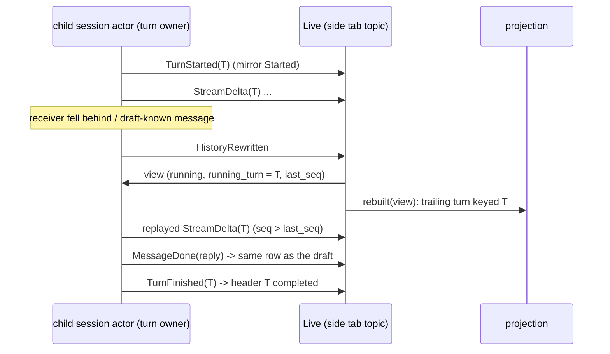
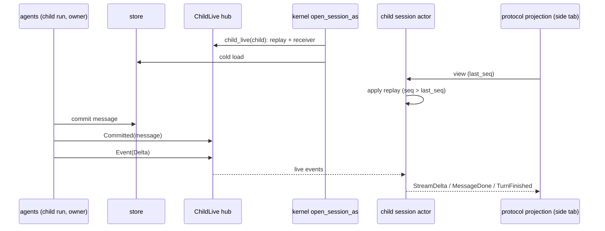
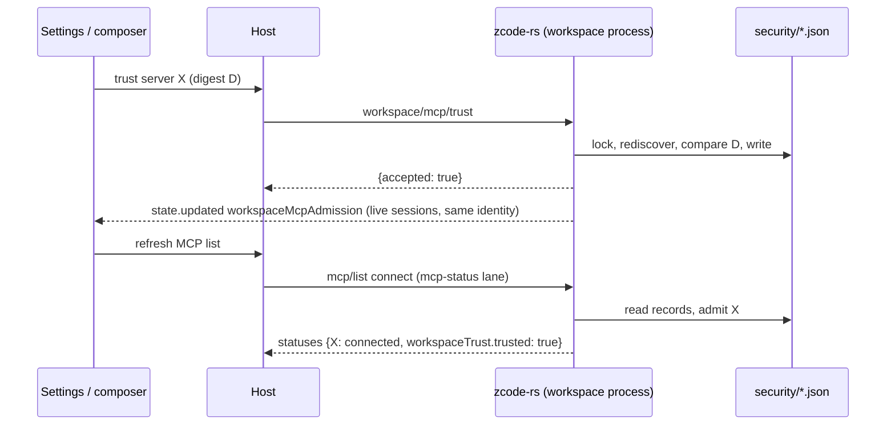
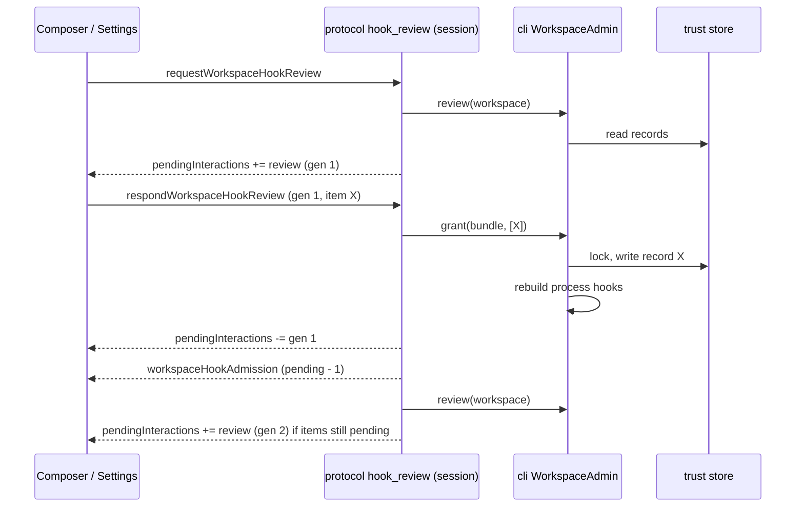
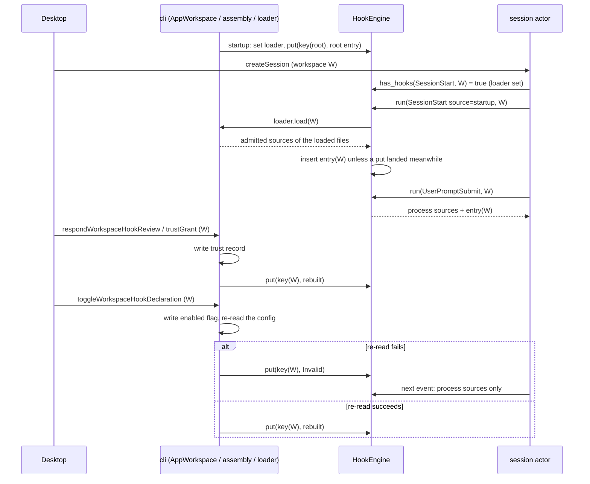
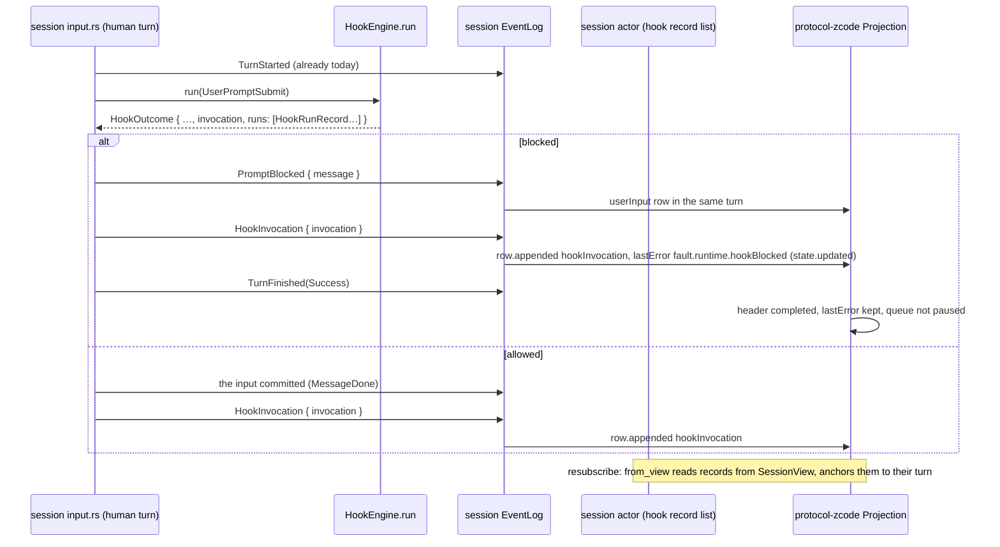

# Rust agent parity (zcode-rs as the desktop conversation agent)

Status: in progress. Tracking file for bringing `zcode-rs` (`packages/rust-cli`) to parity with the Node agent for everything the desktop UI drives. Runtime selection, storage preparation and the Host gate are specified in `specs/fork-agent-runtime-selection.md`; this file owns the parity matrix, the verification gate and the order of work.

## Goal

With `agentRuntime: rust` the desktop behaves and looks the same as with Node: every desktop flow that works on Node works on Rust, with the same rows, cards, panels and errors on screen, and the same records in the shared `db.sqlite`. The UI, Host and Main are unchanged; only the conversation agent process differs.

## Definition of "1:1"

A feature is at parity when all of these hold:

1. **Desktop E2E.** Every desktop E2E spec covering it that passes on Node also passes with `ZCODE_E2E_AGENT_RUNTIME=rust` (same spec, same replay fixtures, no Rust-only branches in the spec). The E2E specs assert on the rendered UI, so a pass is the visual 1:1 check for that flow.
2. **No protocol gaps on the path.** The Rust agent log of that run has no `protocol.method.unsupported` or `protocol.command.unsupported` event for the flow.
3. **Shared storage.** Records written by one runtime are read correctly by the other (cross-runtime reopen), checked by a test where the feature persists state.
4. **Rust gates.** `cargo fmt --check`, `cargo clippy --workspace --all-targets -- -D warnings` and `cargo nextest run --workspace` pass (the PR check job).

## How gaps are found

- `zcode-rs` logs every request it does not serve at `info`: `protocol.method.unsupported` (method name) and `protocol.command.unsupported` (v4 command kind). The log carries names only, never params.
- The desktop E2E suite runs with `ZCODE_E2E_AGENT_RUNTIME=rust` and `ZCODE_FORK_RUST_AGENT_PATH=<binary>`. The Rust agent log lands in the E2E home (`.zcode/rust-cli/log/*.jsonl`); Host logs in `.e2e-artifacts/<run>/runtime-logs`.
- A spec that fails on Rust and passes on Node is a parity gap. A spec that fails on both is not counted.

## Out of scope (stay on Node or stay refused)

These are JavaScript by nature or tied to Node-only runtimes. In Rust mode they are refused with a stable code or hidden by a capability flag, never silently dropped. Listed here so the matrix does not count them as gaps:

- JS plugin runtimes and plugin UI surfaces (`plugins/*`, `mcp/ui*`) beyond what `zcode-rs` `ext` already serves. Plugin management (the `plugins/*` methods of "F1+F2 forwarded methods" in `specs/fork-rust-node-helper.md`) is forwarded to the Node helper when the Host configures one. `mcp/ui*`, `mcp/readResource` and `plugins/mentionItems` are forwarded for helper-hosted plugin servers (F3); **not ported yet:** MCP Apps on MCP servers Rust runs itself (refused with `proto.forkRustAgent.mcpUiServerNotHelperHosted`; F7, "MCP Apps on Rust-hosted servers" in `specs/fork-rust-node-helper.md`), and app-provided tools (`helper/appTools/*`, F3b in `specs/fork-rust-node-helper.md`).
- Dynamic workflows (`workflows/*`, `v4/conversation/workflowRun*`, `startSavedWorkflow`, `resumeWorkflowRun`, `amendWorkflowRunSettings`). Saved workflows (`workflows/*`) and run-history reads (`v4/conversation/workflowRun*`) are forwarded to the Node helper; running a workflow is the helper's last family (F5).
- Office runtime: served through the Node helper since F3 (`specs/fork-rust-node-helper.md`); without a helper command the Office plugins stay skipped.
- node-repl host (F4, not ported yet).

ChatGPT Plan account models run in Rust hosted mode: `specs/fork-rust-chatgpt-plan.md` (standalone `zcode-rs` refuses them; the Host owns sign-in and refresh).

## Parity matrix

Filled from the Rust E2E run; one row per method family or command group. Status: `gap`, `done` (all four checks), `refused` (out of scope, stable code).

| Area                                                                                                          | Node owner                                                                                                                                                                                                                                                                                            | Rust status                                                                                                                                                                                                                                                                                                                                                                                                                                                                                                                                                                                                                                                                                                                                                                                                                                                                                                                                                                                                                                                                                                                                                                                                                                                                                                                                                                                                                                                                                                                                                                                                                                                                                                                                                                                                                                                                                                                                                                                                                                                                                                                                                                                                                                                                                                                                                                                                                                                                                                                                                                                                                                                                                                                                                                                                                                                                                                                                                                                                                                                                                                                                                                                                                                                          | Verified by                                                                                                                                                                                                                     |
| ------------------------------------------------------------------------------------------------------------- | ----------------------------------------------------------------------------------------------------------------------------------------------------------------------------------------------------------------------------------------------------------------------------------------------------- | -------------------------------------------------------------------------------------------------------------------------------------------------------------------------------------------------------------------------------------------------------------------------------------------------------------------------------------------------------------------------------------------------------------------------------------------------------------------------------------------------------------------------------------------------------------------------------------------------------------------------------------------------------------------------------------------------------------------------------------------------------------------------------------------------------------------------------------------------------------------------------------------------------------------------------------------------------------------------------------------------------------------------------------------------------------------------------------------------------------------------------------------------------------------------------------------------------------------------------------------------------------------------------------------------------------------------------------------------------------------------------------------------------------------------------------------------------------------------------------------------------------------------------------------------------------------------------------------------------------------------------------------------------------------------------------------------------------------------------------------------------------------------------------------------------------------------------------------------------------------------------------------------------------------------------------------------------------------------------------------------------------------------------------------------------------------------------------------------------------------------------------------------------------------------------------------------------------------------------------------------------------------------------------------------------------------------------------------------------------------------------------------------------------------------------------------------------------------------------------------------------------------------------------------------------------------------------------------------------------------------------------------------------------------------------------------------------------------------------------------------------------------------------------------------------------------------------------------------------------------------------------------------------------------------------------------------------------------------------------------------------------------------------------------------------------------------------------------------------------------------------------------------------------------------------------------------------------------------------------------------------------------- | ------------------------------------------------------------------------------------------------------------------------------------------------------------------------------------------------------------------------------- |
| Shared task runtime routing (`sessionWorkspaceRouting`)                                                       | `bootstrap/zcode-protocol/server.ts`                                                                                                                                                                                                                                                                  | done: capability reported; requests are routed by `sessionId` and per-workspace topics                                                                                                                                                                                                                                                                                                                                                                                                                                                                                                                                                                                                                                                                                                                                                                                                                                                                                                                                                                                                                                                                                                                                                                                                                                                                                                                                                                                                                                                                                                                                                                                                                                                                                                                                                                                                                                                                                                                                                                                                                                                                                                                                                                                                                                                                                                                                                                                                                                                                                                                                                                                                                                                                                                                                                                                                                                                                                                                                                                                                                                                                                                                                                                               | `conversation-session-first-send`                                                                                                                                                                                               |
| `renameSession`, `switchModelConfig`, `switchCollaborationMode`, `compact`                                    | `handlers/session-mgmt.ts`, `model-config.ts`, `goal-compact.ts`                                                                                                                                                                                                                                      | ported (`fork/session_config.rs`): kernel `Rename`, `SetModel`, `SetMode`/`SetPlan`, `Compact`; a switch to the value in effect is `noop` `config.unchanged`                                                                                                                                                                                                                                                                                                                                                                                                                                                                                                                                                                                                                                                                                                                                                                                                                                                                                                                                                                                                                                                                                                                                                                                                                                                                                                                                                                                                                                                                                                                                                                                                                                                                                                                                                                                                                                                                                                                                                                                                                                                                                                                                                                                                                                                                                                                                                                                                                                                                                                                                                                                                                                                                                                                                                                                                                                                                                                                                                                                                                                                                                                         | gate: `v4-rename`, `v4-model-switch`, `model-config`, `v4-compact`, `compact`, `v4-plan-shortcut`                                                                                                                               |
| Row actions (`canEdit`/`editDisposition`, `canRetry`, `canFork`)                                              | `product-projection.ts` `materializeCommandRowActions`                                                                                                                                                                                                                                                | ported (`projection/actions.rs`), same rules, including `canRewindFiles` (see "Turn file change summary")                                                                                                                                                                                                                                                                                                                                                                                                                                                                                                                                                                                                                                                                                                                                                                                                                                                                                                                                                                                                                                                                                                                                                                                                                                                                                                                                                                                                                                                                                                                                                                                                                                                                                                                                                                                                                                                                                                                                                                                                                                                                                                                                                                                                                                                                                                                                                                                                                                                                                                                                                                                                                                                                                                                                                                                                                                                                                                                                                                                                                                                                                                                                                            | unit tests; gate: `v4-edit`, `v4-fork`                                                                                                                                                                                          |
| `editUserQuery`, `retryTurn`, `forkAssistant`                                                                 | `handlers/fork-edit-retry.ts`                                                                                                                                                                                                                                                                         | ported (`fork/row_commands.rs`): edit and retry are kernel `Rewind{conversation}` + resubmit (edit preempts a running turn like Node); fork is `ForkFromInput`; `workspaceMode: rewind` is the "Edit with file rewind" row                                                                                                                                                                                                                                                                                                                                                                                                                                                                                                                                                                                                                                                                                                                                                                                                                                                                                                                                                                                                                                                                                                                                                                                                                                                                                                                                                                                                                                                                                                                                                                                                                                                                                                                                                                                                                                                                                                                                                                                                                                                                                                                                                                                                                                                                                                                                                                                                                                                                                                                                                                                                                                                                                                                                                                                                                                                                                                                                                                                                                                           | gate: `v4-edit`, `v4-fork`, `v4-fork-edit-branch`                                                                                                                                                                               |
| History rewrite (`HistoryRewritten`)                                                                          | Node `RewindTriggered` projection                                                                                                                                                                                                                                                                     | the projection is rebuilt from a fresh view and every started subscription gets a new snapshot (`live.rs`), like the TUI                                                                                                                                                                                                                                                                                                                                                                                                                                                                                                                                                                                                                                                                                                                                                                                                                                                                                                                                                                                                                                                                                                                                                                                                                                                                                                                                                                                                                                                                                                                                                                                                                                                                                                                                                                                                                                                                                                                                                                                                                                                                                                                                                                                                                                                                                                                                                                                                                                                                                                                                                                                                                                                                                                                                                                                                                                                                                                                                                                                                                                                                                                                                             | `v4-edit`                                                                                                                                                                                                                       |
| Permission deny text                                                                                          | `bootstrap/permission-options.ts` `buildPermissionDeniedContent`                                                                                                                                                                                                                                      | ported: the tool result of a deny with feedback is Node's text (`... the user said:\n<feedback>`); a deny without feedback stays the plain rejection                                                                                                                                                                                                                                                                                                                                                                                                                                                                                                                                                                                                                                                                                                                                                                                                                                                                                                                                                                                                                                                                                                                                                                                                                                                                                                                                                                                                                                                                                                                                                                                                                                                                                                                                                                                                                                                                                                                                                                                                                                                                                                                                                                                                                                                                                                                                                                                                                                                                                                                                                                                                                                                                                                                                                                                                                                                                                                                                                                                                                                                                                                                 | `tools` unit tests; gate: `v4-permission`                                                                                                                                                                                       |
| Token budget prompt                                                                                           | Node has none                                                                                                                                                                                                                                                                                         | the app-server turns `ContextConfig.token_budget` off: no "Token budget" system section and no total-tokens reminder (TUI and print keep it)                                                                                                                                                                                                                                                                                                                                                                                                                                                                                                                                                                                                                                                                                                                                                                                                                                                                                                                                                                                                                                                                                                                                                                                                                                                                                                                                                                                                                                                                                                                                                                                                                                                                                                                                                                                                                                                                                                                                                                                                                                                                                                                                                                                                                                                                                                                                                                                                                                                                                                                                                                                                                                                                                                                                                                                                                                                                                                                                                                                                                                                                                                                         | `context` unit tests; gate: `v4-permission`                                                                                                                                                                                     |
| `session/lifecycle/getState`                                                                                  | `bootstrap/session-lifecycle/controller.ts`                                                                                                                                                                                                                                                           | ported (`fork/methods.rs`): an open session is `ready`, a stored one `unloaded`, an unknown id is `sessionUnavailable`; generation and revision are 0, `lastError` null                                                                                                                                                                                                                                                                                                                                                                                                                                                                                                                                                                                                                                                                                                                                                                                                                                                                                                                                                                                                                                                                                                                                                                                                                                                                                                                                                                                                                                                                                                                                                                                                                                                                                                                                                                                                                                                                                                                                                                                                                                                                                                                                                                                                                                                                                                                                                                                                                                                                                                                                                                                                                                                                                                                                                                                                                                                                                                                                                                                                                                                                                              | gate: `v4-vertical-slice`                                                                                                                                                                                                       |
| Compact timeline markers                                                                                      | `product-projection.ts` `onCompactLifecycle`                                                                                                                                                                                                                                                          | ported (`projection/markers.rs`): one `timelineMarker` row per compaction, `running` then `success`/`failed`; a compaction still running when its turn ends settles as `cancelled` (turn interrupted) or `failed` and its compact work ends, like Node's `interrupted` compaction (before: the marker stayed `Compressing context` and the row actions stayed withheld after Stop); on the desktop (`CompactConfig.blocking` false) an automatic compaction never summarizes everything and too little history is Node's `skipped` compaction: `KernelEvent::CompactSkipped`, one `noop` row ("Context is up to date; no compression needed"), no summary request and no failure counted (before: no marker, and past the window Rust summarized everything where Node skipped). A desktop `/compact` with too little history is Node's healthy no-op too: the compactor answers `OrchestrationError::Skipped` with Node's text, the session emits `CompactSkipped`, records the text as the command's stdout and completes the turn, and the announced marker settles as `noop` (before: a failed turn with a `failed` marker); the TUI keeps `Not enough messages to compact.`. A cold projection shows stored compact boundaries as `success` with `tokensBefore`                                                                                                                                                                                                                                                                                                                                                                                                                                                                                                                                                                                                                                                                                                                                                                                                                                                                                                                                                                                                                                                                                                                                                                                                                                                                                                                                                                                                                                                                                                                                                                                                                                                                                                                                                                                                                                                                                                                                                                                                 | `projection` and `compact` unit tests; gate: `v4-compact`, `compact`, `goal-run-cases`                                                                                                                                          |
| Model switch timeline markers                                                                                 | `product-projection.ts` `onTurnStarted` (`lastTurnModel`)                                                                                                                                                                                                                                             | ported (`projection/model_change.rs`): when a turn starts with a provider or model other than the previous turn's, a `timelineMarker` row in lane `lightBoundary` (`marker: {type: "modelChange", fromProvider, fromModel, toProvider, toModel, toThought}`, key `model-change:<turn>:<from>-><to>`) comes before its `turnHeader`; no marker on the first turn of a regular session; the first turn of a subagent child session (`SessionKind::Subagent`) instead gets a source-less marker (key `model-initial:<turn>:<provider>/<model>`, `marker: {type: "modelChange", toProvider, toModel, toThought}`, the "Using <model>" line), like Node's `previousModelSelection: null` at the child spawn (`core/runtime/methods/subagent.ts`, `onModelSelected` `sourceLess`), live and cold (before: the child side tab had no "Using" line); a reasoning change alone is no switch (before: Rust drew no "Model switched" divider). A cold projection draws the stored switches like Node's cold resume: node-store reads each assistant message's `providerId` / `modelId` / `reasoningLevel` (`LoadedSession.message_models`, highspeed providers and timeline events left out), the session actor adds each committed reply's model (`SessionView.message_models`), and a cold turn runs on the model of its first reply; so a switch made before closing draws the divider on the first turn after reopening. A session with no stored models takes the current selection as the previous model                                                                                                                                                                                                                                                                                                                                                                                                                                                                                                                                                                                                                                                                                                                                                                                                                                                                                                                                                                                                                                                                                                                                                                                                                                                                                                                                                                                                                                                                                                                                                                                                                                                                                                                                                                  | `projection` unit tests; gate: `compact-manual-queue` (held-queue screenshot); `v4-model-switch` fails before the divider on both runtimes (thought-level trigger not clickable)                                                |
| Model request retry count                                                                                     | adapters `model/retry-policy.ts` `ZCODE_MODEL_RETRY_MAX_RETRIES`                                                                                                                                                                                                                                      | ported (`cli/assemble/options.rs` `model_retry`, shared by the app-server, TUI and `-p`): a non-negative integer (a fraction is floored) replaces the default 10 retries after the first request; `0` sends each model request once, so a 429 or 5xx ends the turn at once. An empty or invalid value keeps the default. Before: Rust ignored the variable and retried up to 10 times. Not ported: `ZCODE_MODEL_RETRY_BASE_DELAY_MS`, `ZCODE_MODEL_RETRY_BACKOFF_FACTOR`, `ZCODE_MODEL_RETRY_MAX_DELAY_MS` (Rust keeps its own backoff, model.md §5)                                                                                                                                                                                                                                                                                                                                                                                                                                                                                                                                                                                                                                                                                                                                                                                                                                                                                                                                                                                                                                                                                                                                                                                                                                                                                                                                                                                                                                                                                                                                                                                                                                                                                                                                                                                                                                                                                                                                                                                                                                                                                                                                                                                                                                                                                                                                                                                                                                                                                                                                                                                                                                                                                                                 | unit tests; gate: `model-switch-restore-repro`                                                                                                                                                                                  |
| `thoughtLevels`                                                                                               | `app/session-facade.ts` `listThoughtLevels`                                                                                                                                                                                                                                                           | from the model catalog entry of the selected model (`reasoning_levels`), read on a cold open                                                                                                                                                                                                                                                                                                                                                                                                                                                                                                                                                                                                                                                                                                                                                                                                                                                                                                                                                                                                                                                                                                                                                                                                                                                                                                                                                                                                                                                                                                                                                                                                                                                                                                                                                                                                                                                                                                                                                                                                                                                                                                                                                                                                                                                                                                                                                                                                                                                                                                                                                                                                                                                                                                                                                                                                                                                                                                                                                                                                                                                                                                                                                                         | gate: `v4-model-switch`                                                                                                                                                                                                         |
| AskUserQuestion and ExitPlanMode asks                                                                         | `product-projection.ts` `createPendingInteractionFromPermissionEvent`, `interaction-broker.ts`                                                                                                                                                                                                        | ported (`projection/elicitation.rs`): `userInput` pending interactions with structured questions (plan approval is one `approve` question); `resolveInteraction {action, content}` maps to the kernel answers like Node's broker                                                                                                                                                                                                                                                                                                                                                                                                                                                                                                                                                                                                                                                                                                                                                                                                                                                                                                                                                                                                                                                                                                                                                                                                                                                                                                                                                                                                                                                                                                                                                                                                                                                                                                                                                                                                                                                                                                                                                                                                                                                                                                                                                                                                                                                                                                                                                                                                                                                                                                                                                                                                                                                                                                                                                                                                                                                                                                                                                                                                                                     | unit tests; gate: `ask-user-question-keyboard-navigation`, `plan-mode-capabilities`                                                                                                                                             |
| `deleteSession`                                                                                               | `handlers/session-mgmt.ts`                                                                                                                                                                                                                                                                            | ported (`fork/session_delete.rs`): refused while a turn runs; closes the actor, soft-deletes, emits `session.removed` on the sessions index                                                                                                                                                                                                                                                                                                                                                                                                                                                                                                                                                                                                                                                                                                                                                                                                                                                                                                                                                                                                                                                                                                                                                                                                                                                                                                                                                                                                                                                                                                                                                                                                                                                                                                                                                                                                                                                                                                                                                                                                                                                                                                                                                                                                                                                                                                                                                                                                                                                                                                                                                                                                                                                                                                                                                                                                                                                                                                                                                                                                                                                                                                                          | unit tests; gate: `v4-delete`                                                                                                                                                                                                   |
| Queue commands (`deleteQueueItem`, `editQueueItem`, `reorderQueueItem`, `setAutoDrain`, `sendQueuedNow`)      | `handlers/queue.ts`                                                                                                                                                                                                                                                                                   | ported (`fork/queue.rs`) on kernel `Dequeue`, `EditQueued`, `ReorderQueued`, `HoldQueue`; the kernel owns the hold, the projection shows `autoDrain` after an accepted `setAutoDrain`; `sendQueuedNow` restores the user's hold after the promotion                                                                                                                                                                                                                                                                                                                                                                                                                                                                                                                                                                                                                                                                                                                                                                                                                                                                                                                                                                                                                                                                                                                                                                                                                                                                                                                                                                                                                                                                                                                                                                                                                                                                                                                                                                                                                                                                                                                                                                                                                                                                                                                                                                                                                                                                                                                                                                                                                                                                                                                                                                                                                                                                                                                                                                                                                                                                                                                                                                                                                  | `session` unit tests; gate: `v4-queue`, `queue-operations`, `running-queue`, `v4-sendnow`                                                                                                                                       |
| `v4/conversation/plans`                                                                                       | `conversation-topic-publisher.ts` `getPlans`                                                                                                                                                                                                                                                          | ported (`projection/plans.rs`): settled ExitPlanMode rows with a non-blank plan in the row window, newest first, with `atSeq`/`atLogEpoch`                                                                                                                                                                                                                                                                                                                                                                                                                                                                                                                                                                                                                                                                                                                                                                                                                                                                                                                                                                                                                                                                                                                                                                                                                                                                                                                                                                                                                                                                                                                                                                                                                                                                                                                                                                                                                                                                                                                                                                                                                                                                                                                                                                                                                                                                                                                                                                                                                                                                                                                                                                                                                                                                                                                                                                                                                                                                                                                                                                                                                                                                                                                           | unit tests; gate: `plan-mode-capabilities`                                                                                                                                                                                      |
| `v4/conversation/workflowRuns`, `session/debug`                                                               | `v4-gateway.ts`, `session-debug`                                                                                                                                                                                                                                                                      | answered empty (`runs: []`; no debug rounds) instead of `-32601`: zcode-rs keeps no per-request debug records; `workflowRuns` is forwarded to the Node helper when one is configured (read from the dwf journal, `specs/fork-rust-node-helper.md`) and stays `runs: []` without one                                                                                                                                                                                                                                                                                                                                                                                                                                                                                                                                                                                                                                                                                                                                                                                                                                                                                                                                                                                                                                                                                                                                                                                                                                                                                                                                                                                                                                                                                                                                                                                                                                                                                                                                                                                                                                                                                                                                                                                                                                                                                                                                                                                                                                                                                                                                                                                                                                                                                                                                                                                                                                                                                                                                                                                                                                                                                                                                                                                  | gate logs (no `protocol.method.unsupported`)                                                                                                                                                                                    |
| Stop holds the queue                                                                                          | `handlers/session-flow.ts` `holdFollowingQueue` (`specs/stop-queue-hold.md`)                                                                                                                                                                                                                          | ported (`commands.rs` `stop`): a stop that cancels a turn with queued inputs holds the kernel queue before the interrupt and projects `autoDrain: false`, `pauseReason: stopped`; nothing to stop releases the hold; `setAutoDrain(false)` is `manual`                                                                                                                                                                                                                                                                                                                                                                                                                                                                                                                                                                                                                                                                                                                                                                                                                                                                                                                                                                                                                                                                                                                                                                                                                                                                                                                                                                                                                                                                                                                                                                                                                                                                                                                                                                                                                                                                                                                                                                                                                                                                                                                                                                                                                                                                                                                                                                                                                                                                                                                                                                                                                                                                                                                                                                                                                                                                                                                                                                                                               | unit tests; gate: `queue-operations`, `v4-queue`, `v4-stop-queue`                                                                                                                                                               |
| A failed turn pauses the queue                                                                                | core `runtime/methods/turn.ts` (non-cancel `TurnError`: `queueAutoDrain = false`), `product-projection.ts` `onTurnError`                                                                                                                                                                              | ported (desktop only, `SessionDeps::error_holds_queue`): when a main-loop turn (a prompt, a notice or a bash turn; not a manual `/compact` turn) ends `Failed` while inputs wait, the session actor holds the queue (the same hold as Stop) instead of starting the next input, and the projection sets `queue.autoDrain: false`, `pauseReason: "error"`. `setAutoDrain(true)` (Continue) releases it and starts the head, FIFO. A failed manual compaction and the goal verifier do not pause, like Node. Before: Rust started the next queued input right after the failed turn. The TUI and `-p` keep draining                                                                                                                                                                                                                                                                                                                                                                                                                                                                                                                                                                                                                                                                                                                                                                                                                                                                                                                                                                                                                                                                                                                                                                                                                                                                                                                                                                                                                                                                                                                                                                                                                                                                                                                                                                                                                                                                                                                                                                                                                                                                                                                                                                                                                                                                                                                                                                                                                                                                                                                                                                                                                                                    |
| Input ledger (`session_input`)                                                                                | core `runtime/methods/events.ts` (`TurnSteerQueued`/`TurnSteerDiscarded`), `steering.ts` `discardPersistedPendingSteerInputs`, bootstrap `persistent-command-facts.ts`                                                                                                                                | ported (see "Input ledger" below): an input queued behind a running turn is admitted to `session_input`, leaves it promoted, cancelled or discarded, and a restart settles what was left as `discarded`/`session_resumed`; `commands/query` answers such a command with Node's failed ACK. Before: Rust wrote no row, so a queued input lost in a restart stayed `accepted`                                                                                                                                                                                                                                                                                                                                                                                                                                                                                                                                                                                                                                                                                                                                                                                                                                                                                                                                                                                                                                                                                                                                                                                                                                                                                                                                                                                                                                                                                                                                                                                                                                                                                                                                                                                                                                                                                                                                                                                                                                                                                                                                                                                                                                                                                                                                                                                                                                                                                                                                                                                                                                                                                                                                                                                                                                                                                          | `queued-command-restart`, node-store and session unit tests                                                                                                                                                                     |
| Attachments sent by path, named image placeholder                                                             | `attachment-path-reference.ts`, `filePartToContentBlock`, provider media projection                                                                                                                                                                                                                   | ported (`protocol-zcode/attachments.rs`, `node-records/attached_file.rs`, `model/media.rs`): a binary desktop file (not image, video, PDF or text-like) and an image over the inline limit go as Node's three-line `Attached <mime>: <path>` note, stored as a `local_ref` / `metadata_only` part with `pathReferenceText` and replayed verbatim; a non-vision endpoint sees `[Attached <mime>: <file name>]`                                                                                                                                                                                                                                                                                                                                                                                                                                                                                                                                                                                                                                                                                                                                                                                                                                                                                                                                                                                                                                                                                                                                                                                                                                                                                                                                                                                                                                                                                                                                                                                                                                                                                                                                                                                                                                                                                                                                                                                                                                                                                                                                                                                                                                                                                                                                                                                                                                                                                                                                                                                                                                                                                                                                                                                                                                                        | gate: `v4-attachment`, `attachment-resume`                                                                                                                                                                                      |
| Session titles                                                                                                | core `runtime/methods/title-generation-sidecar.ts`                                                                                                                                                                                                                                                    | ported (`cli/assemble`, `session/title_model.rs`): the app-server generates the first-input title like the Node desktop agent, with Node's prompt verbatim (`prompts/title/node-system.txt`) and the normalized input as the whole user message; the TUI keeps its own prompt                                                                                                                                                                                                                                                                                                                                                                                                                                                                                                                                                                                                                                                                                                                                                                                                                                                                                                                                                                                                                                                                                                                                                                                                                                                                                                                                                                                                                                                                                                                                                                                                                                                                                                                                                                                                                                                                                                                                                                                                                                                                                                                                                                                                                                                                                                                                                                                                                                                                                                                                                                                                                                                                                                                                                                                                                                                                                                                                                                                        | gate: `v4-plan-shortcut`                                                                                                                                                                                                        |
| Plan exit declined without feedback                                                                           | core `tool/executor/turn-control.ts` `withPlanExitDeniedTurnStop`                                                                                                                                                                                                                                     | ported (`tools/plan_mode.rs`, `ToolCallOutput::stop_turn`): the turn ends after the result, through the same path as a hook's `continue: false`; feedback keeps the turn going                                                                                                                                                                                                                                                                                                                                                                                                                                                                                                                                                                                                                                                                                                                                                                                                                                                                                                                                                                                                                                                                                                                                                                                                                                                                                                                                                                                                                                                                                                                                                                                                                                                                                                                                                                                                                                                                                                                                                                                                                                                                                                                                                                                                                                                                                                                                                                                                                                                                                                                                                                                                                                                                                                                                                                                                                                                                                                                                                                                                                                                                                       | gate: `plan-mode-capabilities`                                                                                                                                                                                                  |
| Plan mode tool boundary                                                                                       | core `permission/service.ts` `checkPlanMode` (`mode.plan.nonReadOnly`)                                                                                                                                                                                                                                | ported (`policy` `PolicyGate::with_node_plan_mode`, on for the app-server): in plan mode anything that would ask is denied with Node's reason, without the auto classifier; the plan file and read-only tools still run; the TUI keeps its plan-mode asks. The desktop projection settles the denied call's row like Node's `PermissionDenied` (`cancelled`, no output, so no `Failed` label), live and on a cold read (matched by the denial text, the only trace the stored result keeps). Before: an `error` row shown as `Failed`                                                                                                                                                                                                                                                                                                                                                                                                                                                                                                                                                                                                                                                                                                                                                                                                                                                                                                                                                                                                                                                                                                                                                                                                                                                                                                                                                                                                                                                                                                                                                                                                                                                                                                                                                                                                                                                                                                                                                                                                                                                                                                                                                                                                                                                                                                                                                                                                                                                                                                                                                                                                                                                                                                                                | gate: `plan-mode-capabilities`                                                                                                                                                                                                  |
| Held queue after Stop                                                                                         | bootstrap `projection-state.ts` `computeInputRouting`, `applyHeldQueueDisposition`                                                                                                                                                                                                                    | ported (`protocol-zcode/projection/state.rs` `input_routing`, `commands.rs` `held_queue_choice`): a finished turn with a paused, non-empty queue routes input as `choice` (`heldQueueInputRequiresChoice`); `sendText` then needs `heldQueueDisposition` (`clearQueueAndSend` drops the items and releases the hold, `keepQueueAndSend` keeps them) and a stale `expectedHeldQueueItemIds` is refused                                                                                                                                                                                                                                                                                                                                                                                                                                                                                                                                                                                                                                                                                                                                                                                                                                                                                                                                                                                                                                                                                                                                                                                                                                                                                                                                                                                                                                                                                                                                                                                                                                                                                                                                                                                                                                                                                                                                                                                                                                                                                                                                                                                                                                                                                                                                                                                                                                                                                                                                                                                                                                                                                                                                                                                                                                                                |
| One queued input per turn                                                                                     | bootstrap queue drain (one item per turn)                                                                                                                                                                                                                                                             | ported (`session` `SessionDeps::one_input_per_turn`, on for the app-server through `Extensions::node_desktop`): queued inputs are not merged into one turn; the TUI keeps merging                                                                                                                                                                                                                                                                                                                                                                                                                                                                                                                                                                                                                                                                                                                                                                                                                                                                                                                                                                                                                                                                                                                                                                                                                                                                                                                                                                                                                                                                                                                                                                                                                                                                                                                                                                                                                                                                                                                                                                                                                                                                                                                                                                                                                                                                                                                                                                                                                                                                                                                                                                                                                                                                                                                                                                                                                                                                                                                                                                                                                                                                                    |
| Edit after Stop                                                                                               | bootstrap `fork-edit-retry.ts`                                                                                                                                                                                                                                                                        | fixed (`protocol-zcode/live.rs` `Live::rebuilds`, `fork/row_commands.rs` `rewind_to`): the resubmitted input reaches the kernel only after the projection is rebuilt from the cut history, so the new turn's rows are not skipped                                                                                                                                                                                                                                                                                                                                                                                                                                                                                                                                                                                                                                                                                                                                                                                                                                                                                                                                                                                                                                                                                                                                                                                                                                                                                                                                                                                                                                                                                                                                                                                                                                                                                                                                                                                                                                                                                                                                                                                                                                                                                                                                                                                                                                                                                                                                                                                                                                                                                                                                                                                                                                                                                                                                                                                                                                                                                                                                                                                                                                    |
| Turn file change summary                                                                                      | bootstrap `product-projection.ts` turn header `fileChanges`, `canRewindFiles`                                                                                                                                                                                                                         | ported (`protocol-zcode/projection/mod.rs` `file_changes`, `actions.rs`): `FileChanges` events sum per turn into the header's `fileChanges` (`files`, `additions`, `deletions`, `state: active`); `actions.canRewindFiles` only on a finished turn with rewindable changes and no pending interaction                                                                                                                                                                                                                                                                                                                                                                                                                                                                                                                                                                                                                                                                                                                                                                                                                                                                                                                                                                                                                                                                                                                                                                                                                                                                                                                                                                                                                                                                                                                                                                                                                                                                                                                                                                                                                                                                                                                                                                                                                                                                                                                                                                                                                                                                                                                                                                                                                                                                                                                                                                                                                                                                                                                                                                                                                                                                                                                                                                |
| Edit with file rewind                                                                                         | bootstrap `fork-edit-retry.ts` `workspaceMode: rewind`, `previewWorkspaceFileRewind`                                                                                                                                                                                                                  | ported (`session/rewind.rs` `preview`, `SessionHandle::rewind_preview`, `fork/row_commands.rs` `workspace_rewind`): the preview is a dry run (hash check through `rewind_prepare`, token released without apply); unsafe files or no file to restore return `disposition: blocked` with Node's reason codes and preview; otherwise the kernel rewinds files and conversation (`RewindScope::Both`). Shell changes are not checkpointed, so `ignoredFiles` is always empty                                                                                                                                                                                                                                                                                                                                                                                                                                                                                                                                                                                                                                                                                                                                                                                                                                                                                                                                                                                                                                                                                                                                                                                                                                                                                                                                                                                                                                                                                                                                                                                                                                                                                                                                                                                                                                                                                                                                                                                                                                                                                                                                                                                                                                                                                                                                                                                                                                                                                                                                                                                                                                                                                                                                                                                            |
| `v4/conversation/rowsRange`, snapshot tail window                                                             | `conversation-topic-publisher.ts` `getWireSnapshotForProfile`, `getRowsRange`; `PROTOCOL_V4_LIMITS.snapshotTailWindowRows` (60), `rowsRangeMaxLimit` (200)                                                                                                                                            | ported (`projection/rows_range.rs`, `server.rs` `rows_range`): the snapshot carries the last 60 rows with the full `totalCount`/`firstRowId`; older rows come from the cursor read (`rowId < beforeRowId`, ascending, `hasMore`); `residency: resident-only` never opens a stored session (`proto.sessionNotResident`), so `residentRowsRange` is reported. The plans catalog reads the whole branch, not the window. Before: a 200-row window and no cursor read, older history unreachable                                                                                                                                                                                                                                                                                                                                                                                                                                                                                                                                                                                                                                                                                                                                                                                                                                                                                                                                                                                                                                                                                                                                                                                                                                                                                                                                                                                                                                                                                                                                                                                                                                                                                                                                                                                                                                                                                                                                                                                                                                                                                                                                                                                                                                                                                                                                                                                                                                                                                                                                                                                                                                                                                                                                                                         | unit tests; gate: `v4-load-older`                                                                                                                                                                                               |
| Session lifecycle (`session/lifecycle/getState`, `session/lifecycle/changed`)                                 | bootstrap `session-lifecycle/`, `zcode-protocol/session-residency.ts` `onChange`                                                                                                                                                                                                                      | ported (`lifecycle.rs`, `server.rs`): per-session monotonic `revision`; a cold open announces `ready`, a close `unloaded`. Before: always revision 0 and no notification, so the App kept the `unloaded` it read before subscribing and blocked Send after a restart. `starting`/`stopping`/`faulted` are never reported (activation is synchronous and does not fail after it is reported); `session/lifecycle/{ensureReady,stop,restart}` are ported too: stop closes the bridge and ends the kernel actor (`EndReason::Other`, like session delete) without waiting for a busy turn (Node's `assertCanStop` is a no-op), restart is stop plus a cold open (`unloaded`, then `ready`); before they answered `-32601`, so the task menu's restart toasted `taskList.restartUnsupported`                                                                                                                                                                                                                                                                                                                                                                                                                                                                                                                                                                                                                                                                                                                                                                                                                                                                                                                                                                                                                                                                                                                                                                                                                                                                                                                                                                                                                                                                                                                                                                                                                                                                                                                                                                                                                                                                                                                                                                                                                                                                                                                                                                                                                                                                                                                                                                                                                                                                             | unit tests; gate: `attachment-resume`                                                                                                                                                                                           |
| Per-turn file summary and rewind (`v4/conversation/fileChanges`, `fileRewindPreview`, `applyFileRewind`)      | `v4-gateway.ts` `fileChanges`/`fileRewindPreview`, core `runtime/methods/file-rewind.ts`                                                                                                                                                                                                              | ported (`session/turn_files.rs`, `fork/file_summary.rs`): the kernel selects the checkpoints of one turn (`SessionHandle::turn_file_changes`, `turn_rewind_preview`, `Command::RewindTurnFiles`); stale `baseLogEpoch`/`baseRevision` are `proto.staleLogEpoch`/`proto.staleRevision`; an unsafe preview returns `applied: false` with Node's text; an applied rewind emits `TurnFilesReverted` and the header shows `state: reverted` without `canRewindFiles`. A cold projection rebuilds the header from the stored checkpoints                                                                                                                                                                                                                                                                                                                                                                                                                                                                                                                                                                                                                                                                                                                                                                                                                                                                                                                                                                                                                                                                                                                                                                                                                                                                                                                                                                                                                                                                                                                                                                                                                                                                                                                                                                                                                                                                                                                                                                                                                                                                                                                                                                                                                                                                                                                                                                                                                                                                                                                                                                                                                                                                                                                                   | `session` and `projection` unit tests; gate: `v4-rewind-files`                                                                                                                                                                  |
| Bash direct output (desktop layout, retention, preview, limit)                                                | adapters `node-execution-adapter-run.ts`, `bash-file-output.ts`, `bash-output-preview.ts`; core `tool/handlers/bash.ts`, `task-output-bash.ts`                                                                                                                                                        | ported, gated on `node_desktop` (`env-local` `set_bash_outputs`, `tools/bash.rs`, `tools/bash_preview.rs`, `projection/bash_progress.rs`): `<tmp>/zcode-bash-<uid>/<session>/<toolCallId>-stdout.log` (0700 root, 0600 file), stdout and stderr merged in write order; a foreground file that fits inline (30000 bytes) is deleted after the settlement read, larger and background files are kept; at most one `bash_progress` a second with Node's `outputPreview`; 5 GiB limit checked every 5 s (`Command killed: output file exceeded 5GB`); an open failure is an error naming the errno (`EISDIR`); a failed settlement read (`CommandEvent::Finished.output_unreadable`) gives Node's `<bash output unavailable ...>`; TaskOutput reads the head while running and the tail after. Remote workspaces: exec-server does not carry `output_unreadable`, so env-remote keeps the `output_bytes < total` fallback. TUI and print keep their layout and texts                                                                                                                                                                                                                                                                                                                                                                                                                                                                                                                                                                                                                                                                                                                                                                                                                                                                                                                                                                                                                                                                                                                                                                                                                                                                                                                                                                                                                                                                                                                                                                                                                                                                                                                                                                                                                                                                                                                                                                                                                                                                                                                                                                                                                                                                                                     | `env-local`, `tools` unit tests; gate: `bash-direct-output`                                                                                                                                                                     |
| Queue item kinds and frozen execution state                                                                   | bootstrap queue intent (`sendText`/`sendGoalCommand`/`compact`, `modelSelection`, `mode`, `planEnabled`)                                                                                                                                                                                              | ported: the kernel owns each queued item's `kind` and `execution` (`QueuedInput`, `Command::SubmitWith`); the app-server no longer sends `SetModel`/`SetMode`/`SetPlan` on admission, the state frozen with the item is applied when it drains (`Session::submitted_execution`), and the projection reads kind and state from the kernel queue (no protocol-side copy). `sendQueuedNow` keeps the item's kind and state; a queued goal shows the typed `/goal X`, like Node (before: the objective without `/goal`)                                                                                                                                                                                                                                                                                                                                                                                                                                                                                                                                                                                                                                                                                                                                                                                                                                                                                                                                                                                                                                                                                                                                                                                                                                                                                                                                                                                                                                                                                                                                                                                                                                                                                                                                                                                                                                                                                                                                                                                                                                                                                                                                                                                                                                                                                                                                                                                                                                                                                                                                                                                                                                                                                                                                                  | `session` (`submit_with_tests.rs`) and `projection` unit tests; gate: `running-queue`, `v4-queue`, `v4-sendnow`                                                                                                                 |
| Compact lock                                                                                                  | bootstrap `goal-compact.ts` `compactOperationLock`                                                                                                                                                                                                                                                    | ported: a second `compact` while one runs or is queued is rejected by the kernel (`COMPACT_LOCKED`) and answered with reason code `compactOperationLock`; a queued compact item cannot be edited; idle behind a held queue that has inputs, `compact` joins the queue tail (`admitted: "queue"`, `SubmitWith.behind_held`) instead of bypassing the queued intent, like Node                                                                                                                                                                                                                                                                                                                                                                                                                                                                                                                                                                                                                                                                                                                                                                                                                                                                                                                                                                                                                                                                                                                                                                                                                                                                                                                                                                                                                                                                                                                                                                                                                                                                                                                                                                                                                                                                                                                                                                                                                                                                                                                                                                                                                                                                                                                                                                                                                                                                                                                                                                                                                                                                                                                                                                                                                                                                                         | `session` unit tests; gate: `v4-compact`, `compact`, `v4-rewind-queue-background`                                                                                                                                               |
| Context blocking limit                                                                                        | core `runtime/methods/compact.ts` `autoCompactIfNeeded` (no pre-request limit)                                                                                                                                                                                                                        | ported: the app-server (`node_desktop`) has no blocking limit (`CompactConfig.blocking` false), so a turn whose prompt is past the window is still sent and the provider's answer decides, like Node; auto compaction is unchanged. The TUI and `-p` keep the blocking limit (`docs/specs/rust-cli/compact.md` §2.2)                                                                                                                                                                                                                                                                                                                                                                                                                                                                                                                                                                                                                                                                                                                                                                                                                                                                                                                                                                                                                                                                                                                                                                                                                                                                                                                                                                                                                                                                                                                                                                                                                                                                                                                                                                                                                                                                                                                                                                                                                                                                                                                                                                                                                                                                                                                                                                                                                                                                                                                                                                                                                                                                                                                                                                                                                                                                                                                                                 | `compact` unit test `the_desktop_never_blocks`; gate: `goal-run-cases` (a 240-token model window)                                                                                                                               |
| Full access from a permission ask                                                                             | bootstrap `permission-options.ts` `fullAccess`                                                                                                                                                                                                                                                        | ported (`Command::GrantPermissionMode`, B3): the session switches to bypass (or guarded for `allowAndSwitchGuarded`) and rewrites the mode of every queued item that froze one, keeping their plan state; the kernel then emits `PermissionGranted`, projected as `config.permissionGrant.interactionId` so the composer draft adopts the new mode (Node `SessionModeChanged`); a plan switch by the plan tools emits `PlanTransition`, projected as `config.planTransition`                                                                                                                                                                                                                                                                                                                                                                                                                                                                                                                                                                                                                                                                                                                                                                                                                                                                                                                                                                                                                                                                                                                                                                                                                                                                                                                                                                                                                                                                                                                                                                                                                                                                                                                                                                                                                                                                                                                                                                                                                                                                                                                                                                                                                                                                                                                                                                                                                                                                                                                                                                                                                                                                                                                                                                                         | `session` unit tests; gate: `permission-full-access`                                                                                                                                                                            |
| Independent plan state (`independentPlanState`)                                                               | bootstrap `server.ts` capabilities                                                                                                                                                                                                                                                                    | reported `true` by the app-server: plan is a separate flag from the mode in the kernel (`ExecutionState`), so yolo plus plan is effective Plan; the desktop capability override for zcode-rs is removed                                                                                                                                                                                                                                                                                                                                                                                                                                                                                                                                                                                                                                                                                                                                                                                                                                                                                                                                                                                                                                                                                                                                                                                                                                                                                                                                                                                                                                                                                                                                                                                                                                                                                                                                                                                                                                                                                                                                                                                                                                                                                                                                                                                                                                                                                                                                                                                                                                                                                                                                                                                                                                                                                                                                                                                                                                                                                                                                                                                                                                                              | `session` unit tests; gate: `plan-mode-capabilities`, `v4-plan-shortcut`                                                                                                                                                        |
| `skills/referenceCatalog` (Composer `/` skill panel)                                                          | bootstrap `zcode-protocol/skill-reference-catalog.ts`                                                                                                                                                                                                                                                 | ported (`fork/skills.rs`, `SkillCatalog::references`): file skills of the workspace, user and plugin sources (built-ins excluded), `id` `glm:<scope>:<SKILL.md path>`, `enabled: true`, `pluginName` for plugin skills; with a `sessionId` the session must exist (fails closed) and `authority` is `session`. zcode-rs keeps no frozen per-session catalog, so both authorities read the current discovery. Before: `-32601`, so the panel listed no skills                                                                                                                                                                                                                                                                                                                                                                                                                                                                                                                                                                                                                                                                                                                                                                                                                                                                                                                                                                                                                                                                                                                                                                                                                                                                                                                                                                                                                                                                                                                                                                                                                                                                                                                                                                                                                                                                                                                                                                                                                                                                                                                                                                                                                                                                                                                                                                                                                                                                                                                                                                                                                                                                                                                                                                                                         | `ext` and `protocol-zcode` unit tests                                                                                                                                                                                           |
| Session tree erase (`session/treeCounts`, `session/eraseTree`)                                                | adapters `session-tree-delete.ts`, `fork-usage-detached.ts`                                                                                                                                                                                                                                           | ported (`fork/session_tree.rs`, node-store `session_tree.rs`, `fork_usage_rollup.rs`): the counts and the erase run over the same tree query as Node (side chats, subagents, forks that survive keep their files), the erase refuses a running session, closes the live ones, moves the erased sessions' usage into the protected rollup tables in the same transaction and removes `<root>/cli/{artifacts,image-cache,pdf-cache,video-cache,sessions}/<id>`. Cross-checked against Node on one seeded `db.sqlite`: the same ids erased, the same rollup and protected rows, the same DDL and `9001`/`9002` checksums, and Node erases on a database Rust wrote. Before: `-32601`                                                                                                                                                                                                                                                                                                                                                                                                                                                                                                                                                                                                                                                                                                                                                                                                                                                                                                                                                                                                                                                                                                                                                                                                                                                                                                                                                                                                                                                                                                                                                                                                                                                                                                                                                                                                                                                                                                                                                                                                                                                                                                                                                                                                                                                                                                                                                                                                                                                                                                                                                                                    | `node-store` and `protocol-zcode` unit tests; Node/Rust cross-check                                                                                                                                                             |
| `session/subagents` (subagent directory pane)                                                                 | bootstrap `zcode-protocol/subagent-session-query.ts`                                                                                                                                                                                                                                                  | ported (`fork/subagents.rs`, node-store `subagent_rows.rs`): Node's candidate fallback chains, `subagent_child` filter, child outcome, running/ended split, sorting and base64url cursor paging. zcode-rs keeps no spawn/stop events and no background-task registry, so the kernel's live subagent table stands in for them (status, start and end times; `Killed` reads as `cancelled`, there is no `lost` from the live side). Before: `-32601`                                                                                                                                                                                                                                                                                                                                                                                                                                                                                                                                                                                                                                                                                                                                                                                                                                                                                                                                                                                                                                                                                                                                                                                                                                                                                                                                                                                                                                                                                                                                                                                                                                                                                                                                                                                                                                                                                                                                                                                                                                                                                                                                                                                                                                                                                                                                                                                                                                                                                                                                                                                                                                                                                                                                                                                                                   | `node-store` and `protocol-zcode` unit tests                                                                                                                                                                                    |
| App Usage (`v4/usage/stats`, `v4/conversation/usage`)                                                         | adapters `fork-usage-query.ts` `queryAppUsageWithRollup`, `usage.ts`, bootstrap `usage-stats-run.ts`, `usage-stats-builder.ts`                                                                                                                                                                        | ported (`fork/usage.rs`, node-store `usage_v4.rs`, `fork_usage_query.rs`, `fork_usage_rollup.rs`): the store reads the shared rollup first (recomputed before each read, without Node's read debounce; raw rows are never pruned since 3.18.0, see `specs/fork-agent-runtime-selection.md` "Usage rollup in Rust mode") and falls back to the raw tables like Node, failing with `usage_rollup_unavailable` for filters, windows past the 30-day raw retention and detached usage state; the protocol layer plans spans and composes the snapshot like Node's builder. Before: `-32601`                                                                                                                                                                                                                                                                                                                                                                                                                                                                                                                                                                                                                                                                                                                                                                                                                                                                                                                                                                                                                                                                                                                                                                                                                                                                                                                                                                                                                                                                                                                                                                                                                                                                                                                                                                                                                                                                                                                                                                                                                                                                                                                                                                                                                                                                                                                                                                                                                                                                                                                                                                                                                                                                              | `node-store` and `protocol-zcode` unit tests                                                                                                                                                                                    |
| Session list reconcile (`v4/sessionsIndex/reconcile`)                                                         | bootstrap `zcode-protocol/v4-bridge.ts` `reconcileSessions`                                                                                                                                                                                                                                           | ported: the stored row (soft-deleted rows included) decides `exists` and `deleted`, a row from another workspace answers `exists: false`, titles normalize like `normalizeStoredTitleSource`, `titleUpdatedAt` is sent. zcode-rs stores the App's `workspaceId` as the session directory and serves local workspaces only, so Node's remote-identity branch is not ported. Before: always `deleted: false`, so the App task index never recorded a delete                                                                                                                                                                                                                                                                                                                                                                                                                                                                                                                                                                                                                                                                                                                                                                                                                                                                                                                                                                                                                                                                                                                                                                                                                                                                                                                                                                                                                                                                                                                                                                                                                                                                                                                                                                                                                                                                                                                                                                                                                                                                                                                                                                                                                                                                                                                                                                                                                                                                                                                                                                                                                                                                                                                                                                                                            | `node-store` and `protocol-zcode` unit tests (the delete E2E specs fail on both runtimes in this environment)                                                                                                                   |
| Guarded single-use ask (dangerous command in `guarded`)                                                       | core `permission/service.ts` `guardedSingleUseAsk`, bootstrap `permission-options.ts` `approvalMode: "user-once"`                                                                                                                                                                                     | ported: the ask carries `once`, the App gets only allow once and deny, without full access. Before: "Always allow in this project" and full access were offered                                                                                                                                                                                                                                                                                                                                                                                                                                                                                                                                                                                                                                                                                                                                                                                                                                                                                                                                                                                                                                                                                                                                                                                                                                                                                                                                                                                                                                                                                                                                                                                                                                                                                                                                                                                                                                                                                                                                                                                                                                                                                                                                                                                                                                                                                                                                                                                                                                                                                                                                                                                                                                                                                                                                                                                                                                                                                                                                                                                                                                                                                                      | `guarded-batch-delete` E2E, `protocol-zcode` and `runtime` tests                                                                                                                                                                |
| Subagent rows and snapshot `subagents` (composer, status panel and summary counts, side-pane actions)         | bootstrap `product-projection.ts` `onSubagentSpawned` / `onSubagentStopped` / `materializeSubagentProjection`                                                                                                                                                                                         | ported (`protocol-zcode` `projection/subagent_rows.rs`). zcode-rs has no spawn/stop events: the child's first progress on its Agent call spawns the `subagent` row, the Agent result display settles a foreground child or marks a background launch, and the kernel subagent table (`subagent_changes`) settles background children and reports waiting/blocked. The manifest is derived from the rows and its revision moves only on a semantic change. Before: no `subagent` rows and a static empty manifest, so every count read 0. Not ported: subagent rows of a cold-opened session (cold replay has no result display)                                                                                                                                                                                                                                                                                                                                                                                                                                                                                                                                                                                                                                                                                                                                                                                                                                                                                                                                                                                                                                                                                                                                                                                                                                                                                                                                                                                                                                                                                                                                                                                                                                                                                                                                                                                                                                                                                                                                                                                                                                                                                                                                                                                                                                                                                                                                                                                                                                                                                                                                                                                                                                      | `subagent-parallel-projection` E2E, `protocol-zcode` projection tests                                                                                                                                                           |
| Background works and `cancelBackgroundWork` (running-works panel, Stop of a resumed subagent)                 | bootstrap `product-projection.ts` `onBackgroundTaskLifecycle` / `resumedSubagentBackgroundWorkDelta`; `interaction-background.ts` `cancelBackgroundWork`                                                                                                                                              | ported for subagents and background shell commands (`projection/subagent_rows.rs`, `projection/background_shells.rs`, `fork/background_work.rs`, `agents` user stop and SendMessage tool use). Before: static empty `backgroundWorks` and `proto.unsupportedCommand`                                                                                                                                                                                                                                                                                                                                                                                                                                                                                                                                                                                                                                                                                                                                                                                                                                                                                                                                                                                                                                                                                                                                                                                                                                                                                                                                                                                                                                                                                                                                                                                                                                                                                                                                                                                                                                                                                                                                                                                                                                                                                                                                                                                                                                                                                                                                                                                                                                                                                                                                                                                                                                                                                                                                                                                                                                                                                                                                                                                                 | `send-message-resume-stop`, `v4-background-work`, `v4-rewind-queue-background` E2E, `protocol-zcode` projection tests, `agents` lib tests                                                                                       |
| Goals (`sendGoalCommand`, `pauseGoal`, `resumeGoal`, snapshot `goal`)                                         | core `runtime/types.ts` `commandKind` and `runtime/methods/steering.ts` (`sendGoalCommand` admission), `runtime/methods/target.ts` (the goal continuation turn), contracts `tools/target.ts` `formatGoalContinuationPrompt`, bootstrap `goal-compact.ts`, `projection-state.ts` `computeAvailability` | partial, gated on `node_desktop` (`SessionDeps::desktop_goals`; the session actor stays the single goal owner, persisted as `goal_status` attachments): the model reads Node's continuation prompt (a `target_continuation` meta message) when a goal is set or resumed and after each not-met verification that names a next action; `PauseGoal` aborts the running turn and keeps the goal paused across a restart; `ResumeGoal` is refused while a turn runs (`activeTurn`) or with plan on (`guard.planGoalMutuallyExclusive`) and starts a model-only continuation turn; `KernelEvent::GoalChanged` is the snapshot `goal` (`active`, `verifying`, `notSatisfied`, `paused`, `verified`, `failed`, with `verifications`) and the `pauseGoal` / `resumeGoal` availability, the rest of Node's availability table (fork, compact, sendQueuedNow) included; the `/goal X` row shows the typed text; like Node, `/goal X` is a control turn with no model call and the continuation runs in its own model-only turn once that one completed (`continue_goal_after_set`), so pausing the continuation leaves no `Stopped` on the goal row; the control turn's header carries `executionKind: "controlOnly"` (`KernelEvent::TurnControlOnly`), so the App shows no work footer for it and its usage is not counted; the snapshot `summaryTitle` is the session title when the goal was the first input (Node `goalSummaryTargetID`), else a `goal_summary_title` request to the title model (`SideSource::GoalSummaryTitle`), with Node's fallback, the normalized objective, when no request can run or it gives nothing. Completion is Node's verifier (specs/fork-rust-goal-verifier.md): after each completed main turn of an active goal a side request (`SideSource::GoalVerification`, Node's prompt and JSON parse, fail-open) decides it, each step is a Node `target_completion_verification` session entry and a `goalVerify` timeline marker, and the control shows a `goalVerifier` work while it runs; before, completion was the TUI's stop-time evaluation, with no `verifying` / `notSatisfied` status, marker or `verifications`. Gaps: a goal summary request waits for no running session title request (it falls back instead); goal time is wall time while active. The goal is also written to Node's `session_target` row (`Fact::GoalTargetSaved` / `GoalTargetCleared`, written by the actor whenever the snapshot goal changes and at each turn end, the single write path; status `active` / `paused`, a met or impossible goal `complete`; the running stretch as `active_run_started_at` with `active_run_last_seen_at` the write time), so a cold load restores the summary title and the time used (`LoadedSession::goal_target`, an interrupted stretch counted up to its last write like Node `recoverInterruptedSessionTargetRun`) and still shows a met or impossible goal, and Node reads the same goal from a Rust session. The `goal_status` attachments stay the authority for which goal is set and its status; the row only fills the summary and time of the goal with the same target. Before: the summary title and time were in memory only (a cold load showed the objective and 0 s, and a finished goal disappeared) | `session` unit tests; gate: `v4-goal`                                                                                                                                                                                           |
| Workspace model calls (`workspace/generateText`, `cancelGenerateText`, `provider/testModelConnectivity`)      | core `workspace-generate-text.ts`, bootstrap `server.ts` (operation table), `workspace-model-runtime.ts`                                                                                                                                                                                              | ported (`fork/workspace_model.rs`), see "Workspace model calls" below. Before: `-32601`, so the test button and the commit message generator failed on Rust                                                                                                                                                                                                                                                                                                                                                                                                                                                                                                                                                                                                                                                                                                                                                                                                                                                                                                                                                                                                                                                                                                                                                                                                                                                                                                                                                                                                                                                                                                                                                                                                                                                                                                                                                                                                                                                                                                                                                                                                                                                                                                                                                                                                                                                                                                                                                                                                                                                                                                                                                                                                                                                                                                                                                                                                                                                                                                                                                                                                                                                                                                          | `protocol-zcode` `fork/workspace_model_tests.rs`; E2E `provider-connectivity-prompt`, `provider-reasoning-fallback`                                                                                                             |
| WebSearch permission                                                                                          | core `tool/handlers/websearch.ts` (`needsApproval: false`), `permission/service.ts` `checkBuildMode`/`checkPlanMode`                                                                                                                                                                                  | ported (`policy` `PolicyGate::own_check`, on with `with_node_plan_mode`): allowed without asking in every mode and under plan, after deny and ask rules; see **WebSearch needs no approval**. Before: asked in default mode and was denied under plan                                                                                                                                                                                                                                                                                                                                                                                                                                                                                                                                                                                                                                                                                                                                                                                                                                                                                                                                                                                                                                                                                                                                                                                                                                                                                                                                                                                                                                                                                                                                                                                                                                                                                                                                                                                                                                                                                                                                                                                                                                                                                                                                                                                                                                                                                                                                                                                                                                                                                                                                                                                                                                                                                                                                                                                                                                                                                                                                                                                                                | `policy` unit tests                                                                                                                                                                                                             |
| Legacy `session/cancelBackgroundTask`                                                                         | bootstrap `server-operations.ts` `cancelBackgroundTask`                                                                                                                                                                                                                                               | ported (`fork/background_task.rs`): `Command::StopTask` on a resident session, Node's `{cancelled, reason?, snapshot?, status, taskId}`; see the section below. Before: `-32601`                                                                                                                                                                                                                                                                                                                                                                                                                                                                                                                                                                                                                                                                                                                                                                                                                                                                                                                                                                                                                                                                                                                                                                                                                                                                                                                                                                                                                                                                                                                                                                                                                                                                                                                                                                                                                                                                                                                                                                                                                                                                                                                                                                                                                                                                                                                                                                                                                                                                                                                                                                                                                                                                                                                                                                                                                                                                                                                                                                                                                                                                                     | `protocol-zcode` unit tests (no App caller, no E2E)                                                                                                                                                                             |
| `process/childProcesses` (Host resource sampler)                                                              | bootstrap `zcode-protocol/process-child-processes.ts`, adapters `mcp/telemetry.ts`                                                                                                                                                                                                                    | ported (`env-local` `LocalMcpTransport` process table, `fork/child_processes.rs`): live stdio MCP servers as `{pid, serverName, mcpSource, pluginName?}`; see the section below. Before: `-32601`, so the sampler counted every MCP server process as the agent's own                                                                                                                                                                                                                                                                                                                                                                                                                                                                                                                                                                                                                                                                                                                                                                                                                                                                                                                                                                                                                                                                                                                                                                                                                                                                                                                                                                                                                                                                                                                                                                                                                                                                                                                                                                                                                                                                                                                                                                                                                                                                                                                                                                                                                                                                                                                                                                                                                                                                                                                                                                                                                                                                                                                                                                                                                                                                                                                                                                                                | `env-local` and `protocol-zcode` unit tests                                                                                                                                                                                     |
| `subagents/readRuntimeConfig` (CLI → Host, gated by `session/requestRuntimePreferences`)                      | bootstrap `server-operations.ts` `readSubagentRuntimeConfig`, core `subagent/definitions.ts`, bootstrap `app/create-app.ts`                                                                                                                                                                           | ported (`protocol-zcode` `subagent_config.rs`, `agents` `AgentCatalog`): the Host snapshot replaces the agent files once per parent run; disabled agents absent, full model selections, the built-in and plugin agent overrides apply. Before: the files were read, disabled agents stayed, overrides ignored                                                                                                                                                                                                                                                                                                                                                                                                                                                                                                                                                                                                                                                                                                                                                                                                                                                                                                                                                                                                                                                                                                                                                                                                                                                                                                                                                                                                                                                                                                                                                                                                                                                                                                                                                                                                                                                                                                                                                                                                                                                                                                                                                                                                                                                                                                                                                                                                                                                                                                                                                                                                                                                                                                                                                                                                                                                                                                                                                        | `protocol-zcode` and `agents` unit tests; desktop E2E `subagents/*-catalog-refresh`, `*-runtime-refresh`, `*-built-in-subagent-model-overrides`, `*-runtime-catalog-reasoning`, `plugins/runtime/plugin-subagent-override-cold` |
| MCP settings list and workspace MCP trust (`mcp/list`, `workspace/mcp/trust`)                                 | bootstrap `zcode-protocol/mcp.ts` `listMcpServers` / `setWorkspaceMcpTrust`, `workspace-mcp-trust/index.ts`                                                                                                                                                                                           | ported (`cli` `config/mcp_trust.rs`, `frontends/app_workspace.rs`, `protocol-zcode` `fork/workspace_trust.rs`): see "Workspace MCP trust, the MCP settings list and Hook trust grants". Before: `-32601`, the Settings MCP list showed every row as an error and the trust button failed                                                                                                                                                                                                                                                                                                                                                                                                                                                                                                                                                                                                                                                                                                                                                                                                                                                                                                                                                                                                                                                                                                                                                                                                                                                                                                                                                                                                                                                                                                                                                                                                                                                                                                                                                                                                                                                                                                                                                                                                                                                                                                                                                                                                                                                                                                                                                                                                                                                                                                                                                                                                                                                                                                                                                                                                                                                                                                                                                                             | `cli` and `protocol-zcode` unit tests, Node golden digests, E2E `workspace-mcp-trust`                                                                                                                                           |
| Workspace Hook trust grant from Settings (`workspace/hooks/trustGrant`)                                       | bootstrap `zcode-protocol/workspace-hook-trust.ts`, `workspace-hook-trust-cli.ts` `grantWorkspaceHookTrust`                                                                                                                                                                                           | ported: same store, records and checks as `zcode hooks trust grant`; an accepted grant reloads the process's hook snapshot. Before: `-32601`                                                                                                                                                                                                                                                                                                                                                                                                                                                                                                                                                                                                                                                                                                                                                                                                                                                                                                                                                                                                                                                                                                                                                                                                                                                                                                                                                                                                                                                                                                                                                                                                                                                                                                                                                                                                                                                                                                                                                                                                                                                                                                                                                                                                                                                                                                                                                                                                                                                                                                                                                                                                                                                                                                                                                                                                                                                                                                                                                                                                                                                                                                                         | `cli` unit tests, E2E `hook-trust`                                                                                                                                                                                              |
| Workspace Hook review commands (`requestWorkspaceHookReview` and the three others, see below)                 | bootstrap `app/workspace-hook-review-controller.ts`, core `hooks/workspace-hook-review-flow.ts`, `interaction-background.ts`                                                                                                                                                                          | ported (`protocol-zcode` `fork/hook_review.rs`, cli `frontends/app_workspace.rs`): see "Workspace hook review flow". Before: `proto.unsupportedCommand`, so Settings never switched to the workspace scope                                                                                                                                                                                                                                                                                                                                                                                                                                                                                                                                                                                                                                                                                                                                                                                                                                                                                                                                                                                                                                                                                                                                                                                                                                                                                                                                                                                                                                                                                                                                                                                                                                                                                                                                                                                                                                                                                                                                                                                                                                                                                                                                                                                                                                                                                                                                                                                                                                                                                                                                                                                                                                                                                                                                                                                                                                                                                                                                                                                                                                                           | `protocol-zcode` and `cli` unit tests, fork Vitest golden, E2E `hook-trust` HK05–HK07                                                                                                                                           |
| MCP App resource read (`mcp/readResource`)                                                                    | bootstrap `zcode-protocol/mcp-ui/protocol.ts` `readMcpUiResource`                                                                                                                                                                                                                                     | ported as Node's answer for an instance this process never issued (zcode-rs has no `mcp/uiOpenInstance`): `-32603` `MCP App instance is no longer authorized` after the session check. Before: `-32601`                                                                                                                                                                                                                                                                                                                                                                                                                                                                                                                                                                                                                                                                                                                                                                                                                                                                                                                                                                                                                                                                                                                                                                                                                                                                                                                                                                                                                                                                                                                                                                                                                                                                                                                                                                                                                                                                                                                                                                                                                                                                                                                                                                                                                                                                                                                                                                                                                                                                                                                                                                                                                                                                                                                                                                                                                                                                                                                                                                                                                                                              | `protocol-zcode` unit test                                                                                                                                                                                                      |
| Topic resources (`ReadTopicResource`, reverse requests `topic/resource/read` and `topic/resource/cancel`)     | core `tool/handlers/read-topic-resource.ts`, `tool/topic-resource/reader.ts`, bootstrap `zcode-protocol/topic-resource-port.ts`                                                                                                                                                                       | ported (`tools/read_topic_resource.rs`, `protocol-zcode/topic_resource.rs`; the input's `botGroupSource` is kept in the intent, user rows and queue items), app-server only; see `specs/fork-rust-topic-resource.md`. Not ported: `ReplyToChannel` / `bot/channel/reply`, the bot-source model guidance (`withConversationQuotes` `botSource`), the group task permission scope (`ensureGroupTaskPermissionScope`)                                                                                                                                                                                                                                                                                                                                                                                                                                                                                                                                                                                                                                                                                                                                                                                                                                                                                                                                                                                                                                                                                                                                                                                                                                                                                                                                                                                                                                                                                                                                                                                                                                                                                                                                                                                                                                                                                                                                                                                                                                                                                                                                                                                                                                                                                                                                                                                                                                                                                                                                                                                                                                                                                                                                                                                                                                                   |
| Network panel capture (`process/networkCapture` control, `process/networkRequests` batches)                   | `shared/src/node/networkCapture.ts` `createNodeNetworkCapture`, bootstrap `zcode-protocol/server.ts`, `transport.ts`                                                                                                                                                                                  | ported (`protocol-zcode/src/network_capture.rs`, `net` `RequestObserver`, specs/fork-rust-network-capture.md): the control is applied inline in arrival order (`Service::control`), egress requests and WebSocket upgrades are batched like Node (100 per batch plus `dropped`, 250 ms, Node's URL sanitization), MCP requests are unobserved. Before: the control notification was ignored and the panel had no `cli` rows                                                                                                                                                                                                                                                                                                                                                                                                                                                                                                                                                                                                                                                                                                                                                                                                                                                                                                                                                                                                                                                                                                                                                                                                                                                                                                                                                                                                                                                                                                                                                                                                                                                                                                                                                                                                                                                                                                                                                                                                                                                                                                                                                                                                                                                                                                                                                                                                                                                                                                                                                                                                                                                                                                                                                                                                                                          | `net`, `protocol-core`, `protocol-zcode`, `env-local` unit tests                                                                                                                                                                |
| Language servers (`lsp/preferences/get`, `lsp/preferences/set`, `lsp/status`; LSP section of the plugin page) | bootstrap `zcode-protocol/lsp.ts` `requireLspHost`; `app/lsp-runtime-hub.ts`, `app/lsp-preferences.ts` (the host Rust lacks)                                                                                                                                                                          | stage 1 ported (`specs/fork-rust-lsp.md`): the app-server's cli `lsp::Host` answers through the kernel-api `LanguageServers` port. `lsp/preferences/get`/`set` use the same `<cliStorageRoot>/fork_lsp_preferences.json` sidecar as Node (same strict shape, same text, checked by one golden file in a Rust test and a fork Vitest). `lsp/status` resolves the enabled plugins' `.lsp.json` / manifest `lspServers` declarations for the requested workspace (`ext::plugins::lsp`: merge, validation, templates, extension conflicts) and reports each server as `not_installed` or `stopped` by Node's install probe; the official `typescript-lsp` plugin is now default-enabled as in Node. Params are checked first against the strict App schemas in `inbound.json` (`-32602`); a host error answers `-32603`; a process without the host (TUI, `-p`) answers `-32000`. Runtime D1 ported: the process-wide server pool (start, restart budget, idle stop, 4-process cap, graceful stop, ledger-tracked process groups), JSON-RPC over stdio, document sync with diagnostics freshness, diagnostics after Edit/Write attached to the next main-thread model request, Read's prewarm, and `lsp/status` overlaying the running state of the same identity key; turning code intelligence off stops every server. zcode-rs has no LSP client crate; the client is written in `cli::lsp::runtime`. D2 ported: the `LSP` agent tool (all seven operations, Node's schema generated into `prompts/tools/LSP.json`, Node's error codes and texts, positions, projection and model text checked against goldens from Node's own code), offered on the main thread only when code intelligence is on and a declared server is installed, recomputed before each main-thread run and on every `lsp/preferences/set`, hidden from every subagent (`specs/fork-rust-lsp.md` "Tool (D2)"). Kept differences (D2): the result budget counts characters, a cancelled call has no tool-specific text, the built-in Explore description does not list `LSP`. Kept differences: the server env is the stdio-server projection (as MCP stdio servers), and Windows `.cmd` shims are spawned directly. Kept difference: the generated schema keeps `nonEmptyString` as `minLength: 1` without zod's trim, so a whitespace-only `workspacePath` is not refused with `-32602`.                                                                                                                                                                                                                                                                                                                                                                                                                                                                                                                                                                                                                                                                                                                                                                                                                                                                                                       |

### Not ported yet (answer `-32601`, logged as `protocol.method.unsupported`)

- Automations and off-peak tasks: the run path (`session/create`, `session/resume`, the `sendText` automation fields) and the Cron / OffPeak tools that call the Host's `automation/*` and `offPeak/*` (agent→Host requests, which the agent never answers). Plan, owners and acceptance in [fork-rust-automations.md](fork-rust-automations.md); `session/send`, `session/messages`, `session/events`, `session/subscribe` and `session/stop` stay `-32601` there on purpose.
- `topic/resource/*` are agent-to-Host reverse requests, not Host methods; see the topic resources row.
- `subagents/readRuntimeConfig` is not an inbound method: the CLI sends it to the Host (see **Subagent runtime config** below).
- The out-of-scope families above (`plugins/*`, `mcp/ui*`, `workflows/*`, browser and computer-use interactions).

## Gate

The PR gate is the curated spec list below, run one spec at a time (`pnpm test:e2e -- --spec <file>` with `ZCODE_E2E_AGENT_RUNTIME=rust`), never with `ZCODE_E2E_MAX_INSTANCES>1` on the shared `.e2e-home` (workers wipe each other's HOME). A failing gate spec is rerun under Node: a failure on both runtimes is not a parity gap.

`first-send`, `stop-empty`, `v4-vertical-slice`, `v4-permission`, `permission-full-access`, `ask-user-question-keyboard-navigation`, `v4-model-switch`, `model-config`, `v4-rename`, `v4-compact`, `compact`, `v4-edit`, `v4-fork`, `v4-rewind-files`, `v4-delete`, `v4-queue`, `queue-operations`, `running-queue`, `v4-sendnow`, `v4-attachment`, `attachment-resume`, `v4-goal`, `tool-actions`, `bash-direct-output`, `v4-plan-shortcut`, `plan-mode-capabilities`, `v4-input-control`, `v4-load-older`, `context-window-cold-resume`, `tool-history-order`, `v4-stop-queue`, `interrupted-actions`, `background-file-diff`, `guarded-batch-delete`, `subagent-parallel-projection`, `send-message-resume-stop`, `v4-background-work`, `v4-rewind-queue-background`, `running-send-now`, `compact-manual-queue`, `running-actions`, `subagent-interaction-delegate`, `background-bash-output`, `background` (all under `test/e2e/conversation-session/conversation-session-*.test.ts`).

`hooks/conversation-session-hooks-lifecycle` (in the `hooks/` subfolder, which the list above does not cover) is not in the gate: HK-LC-01 fails on Node too (container run on 6d9b41880), and HK17 and the other cases in "Open gaps" fail only on Rust. HK17 fails on both runtimes, at different points: Node runs the first-input `/compact` and fails later at the SessionStart details of the follow-up turn (`assertHookTurnDetails` finds 0 of 5 rows; the coverage matrix's 5/5 is the strict-case-local replay `desktop-e2e-20260828-081558-366`, not a current run), while Rust stops at the `/compact` itself (see "Open gaps").

`runtime/conversation-session-unbound-resume` is not in the gate either. DB109 fails on Rust at `fork` a7e2e0481, before the presence work (container run 2026-11-14): `unbound-resume.test.ts:245` expects `thought` `""` and reads `"high"`. It was not run on Node.

Subagents follow Node under `node_desktop` (`AgentsConfig::node_desktop`): an `Agent` call runs in the foreground unless it passes `run_in_background: true` (Node `agent.ts` `run_in_background === true`), the fork subagent mode is off unless `fork_subagent` is set explicitly, and the Agent description and `run_in_background` parameter carry Node's text in place of the zcode-rs "background by default" guidance (`agents` `desktop_prompt.rs`). A foreground child is announced (`ToolProgress {agentId}`) before its first model response. The TUI keeps upstream zcode-rs behaviour (background by default, fork on in interactive sessions).

Subagents launch no subagents under `node_desktop`. Node runs every child runtime with `subagents.enabled: false` (core `runtime/methods/subagent.ts`), so a child has no subagent port: no `Agent` tool (nor its `Task` alias) and no `SendMessage` (core `runtime/helpers/runtime-tools.ts` `includeAgent`, `includeSendMessage`), and so no `agent_listing_delta` (`helpers/agent-listing.ts` lists agents only beside the `Agent` tool). Its `TaskStop` stays.

- Rust removes `Agent`, `SendMessage` and `ListAgents` (Node has no ListAgents tool) from every subagent child's tools (`agents` `toolset.rs`, `ToolRule::node_child`; a fork child through `ForkChildTools`, which also drops `LSP` everywhere), together with the Cron tools. The check comes before the definition's `tools` list, so a profile that names them does not get them back. A call to one gets `No such tool available` from the tool pipeline, and with no `Agent` tool the child's requests carry no agent listing.
- So under `node_desktop` the kernel subagent table has no entry with an `owner`. The desktop telemetry has no nested-agent path any more (it was Rust only). The agents crate keeps its nested paths for the TUI (the owner rules of routing, forwarders and stall reminders), where subagents may still launch subagents down to `MAX_SPAWN_DEPTH`.
- Before: the Rust Agent tool stayed available to subagents down to `MAX_SPAWN_DEPTH` in `node_desktop` too.
- Open gap: the main session under `node_desktop` still has `ListAgents`, which Node does not have.
- Tests: `toolset_tests.rs` (a desktop child, foreground, background, with a `tools` list naming them, and a fork child, has none of them; a TUI child below the depth limit keeps `Agent`), `lib_tests.rs` (a desktop subagent's tools as spawned); E2E `conversation-session-subagent-model-boundary` F-SUBAGENT-018 on Rust.

SendMessage resume and background works follow Node under `node_desktop` too:

- The resume tool result reads Node's `resumed it in the background with your message. You'll be notified when it finishes.` (core `subagent/runner.ts`). zcode-rs keeps no per-agent output file, so Node's trailing `Output: <file>` is absent.
- The resumed run belongs to the SendMessage call: its completion notification carries that call's `<tool-use-id>`.
- The snapshot `backgroundWorks` lists the running background children of the kernel subagent table (`kind: "subagent"`, `workId` = agentId, `cancellable: true`, `blocked` = waiting, `childSessionId`). An ended child leaves the list (the UI reads only running works).
- Running background shell commands and monitors are `kind: "bash"` works (`workId` = the shell task id, the Bash call's `description` as title, else the command line). The kernel background ledger (`SessionHandle::background_tasks`) owns them; the adapter re-reads it after a tool result, a background notification, a turn end, a history rebuild and a `cancelBackgroundWork`, and once when the session's topic opens, so a command already running is listed from the open (a subagent's child session opened in a side tab, a session reopened while its command runs). Before, such a command appeared only after the next ledger change.
- A finished child that runs again in the background reopens its `subagent` row (`running`, `backgrounded`, `workId`; the `parentToolCallId` anchor is kept), like Node `onSubagentSpawned` on an existing row.
- `cancelBackgroundWork` is the user's `Command::StopTask` (the TUI `/tasks` path). The stop notification reads `was stopped by user` (Node `stoppedBy: "user"`); a model TaskStop keeps `was stopped by ZCode`. A refusal is Node's `fault.command.backgroundWorkCancelRejected.not_running` / `.not_found`.

Background results, stops and queue promotion follow Node under `node_desktop`:

- Each `<task-notification>` block that names a `<tool-use-id>` settles that tool row like Node `applyBackgroundTaskNotificationBlock` (`product-projection.ts`), live and cold (`projection/background_result.rs`): `failed` / `lost` → `error` with `error {code: "fault.runtime.backgroundTaskFailed", message}`, `stopped` / `killed` → `cancelled`, anything else → `success`; `output.text` is the block's `<result>`, else `<summary>`, else the error; `endedAt` is the notification time. Tags are read inside each block only (Node `parseZCodeBackgroundTaskNotifications`), and the single-notification `subagentResult` gives the status and error only when the message holds exactly one block. Before: the Agent card kept the launch acknowledgement's `success`, so a merged batch with failed agents showed them as completed.
- A background agent that fails on a provider rate limit or overload reports the provider's own message after `failed: ` in its notification on the desktop (`Finished::failure`; Node's background runner picks the root-cause message with `selectExecutionErrorMessage`). A foreground Agent call and the TUI keep the kernel's formatted error.
- A turn woken by a background `<task-notification>` (no command, no user row) carries Node's turn header `origin: "backgroundResult"` with `originMeta {backgroundSource: "subagent" | "bash", workId, title}` (bootstrap `product-projection.ts`; UI `ConversationTurnGroup.tsx` `resolveBackgroundResultTitle`). The title is the quoted name in the notification summary (`Agent "..." finished`, `Background command "..."`). A single agent notification also carries Node's `subagentResult` (`completed` / `killed`, or `failed` with the reason from the summary, bounded to 2,000 characters like `localAgentSubagentResult`). Cold reads rebuild the same header (`projection/background_result.rs`, `projection/cold.rs`). Several notifications that open one turn title it like Node `resolveBackgroundTaskNotificationOriginMeta`: the first task's source and work id, the first three titles joined with `·` and `+N` for the rest, no meta when any of them is untitled. With the desktop drain (`one_input_per_turn`) the notifications that open a turn are stored like Node `persistBackgroundTaskNotificationBatch`: one user message with one text block per notification, `source` / `metadata.source` / `semantics.source` `background_task`, `metadata.inputPresentation: "task_notification"`, `metadata.originMeta` (the batch meta), `semantics.kind: "background_notification"`, anchor origin `backgroundResult`, and each part tagged `runtimeMessage.source: "legacy_synthetic"` (`node-store/src/notices.rs`). Reading it back maps `background_task` to the kernel's `task-notification` origin; a Node-written notification (no `rustCli` marker, bare `<task-notification>` envelopes) is read as the same message, each envelope behind the notification preamble the model saw (`node-records/src/notices.rs`). Earlier the Rust read dropped Node's notifications, so a Node session's background result turns merged into the previous turn. A notification delivered again is found among the blocks of that message and only acked. The TUI keeps one message per notification. Node's cold read opens a turn only for these sources (`getConversationModelOnlyTurnTriggerSource`); the earlier Rust source `task-notification` showed no background turn on a Node read. Difference kept: the assistant reply after a notification keeps the previous message as `parentID`, where Node points it at the notification message. On a cold read, consecutive notifications with no assistant message between them form one turn, so a notification turn that ended without an assistant reply merges with the next one on a cold read (live keeps them apart).
- Stopping a background command (TaskStop or `cancelBackgroundWork`) still records its terminal notice, so the parent wakes with `<status>killed</status>` like Node (`BackgroundTask::notify_stop`, read by env-local `stop`). The TUI keeps the silent stop of shell-permissions.md §2.6.
- The model's TaskStop of a running agent returns after the agent has stopped (`Live::left_running`), so its `was stopped by ZCode` notification joins the same model request as the tool result (Node).
- A Bash call that hits its timeout and cannot move to the background reads Node's `<error>Command was aborted before completion</error>` (`tools` `bash_output::aborted`). A command moved to the background is titled by its description (`moved to the background (ID: ...)`).
- `sendQueuedNow` reserves the queue item before it promotes it; a second promotion of the same item is refused with Node's `guard.queueItemReserved` and does not interrupt the first (`protocol-zcode` `reservations.rs`).
- A manual compact marker carries `sourceCommandId` (the compact command id), which the UI uses to pair the started and finished markers.
- `compact` freezes the App's `modelSelection` on the compaction, so a queued compaction summarizes with the model chosen when it was submitted, not with a later menu choice (Node `SessionPane` pins the Composer selection).
- `forkAssistant` is accepted while a turn runs when its target is a completed turn, not the running one (`SessionDeps::fork_while_running`; Node's stable-target fork). The TUI keeps refusing a fork while busy.
- A topic opened on a session that already has history numbers its live patches after the view's `last_seq`, the sequence the session log uses (`TopicLog::with_base`), so a reopened topic does not restart at 0.
- A subagent's ask (permission, question, plan approval) reaches the parent's `pendingInteractions` with Node's `payload.origin` `{kind: "subagent", agentId, agentType, childSessionId, description, parentSessionId, parentToolCallId}` (`InteractionRequest` `origin`, written by the innermost subagent). A foreground subagent may call AskUserQuestion, delegated to the parent like Node, which only removes the plan tools from subagents; the TUI and background subagents keep it disallowed.
- `v4/conversation/backgroundBashOutput` returns the tail (8 KiB) of a background command's output file with its status, `read_failed` with `ENOENT` / `EFBIG`, or `unavailable` (Node `readBackgroundBashOutput`). The status of a finished command comes from the ledger (it keeps the command's terminal record after the notice is acknowledged), else, after a process restart, from its `<task-notification>`; Rust `killed` reads Node `cancelled`. The detail pane stops polling at the first answer that is not `output`, so a command the session started never reads `unavailable` once its status is known:
  - Stopped: Node's `killTask` marks the task `killed` at once. The env ledger reports a stopped command whose process has not exited yet as `killed` (it left the background list at the stop, and its notice is recorded only at the exit); before, it was unknown in between.
  - Ended: the env ledger writes a background command's terminal record (status, kind, output file) at the command's exit, under the lock that takes it off the background list and records its notice, and the detail pane reads it after the ack (`Background::ended_background_command`), like Node's execution record that "stays queryable" once the task leaves the active list (section "Subagent child sessions: one owner for background-command notices"). A stopped command whose notice is suppressed reads `killed` the same way.
  - Notified (fallback after a restart, when the in-memory ledger is gone): the projection remembers a command's terminal status from the kernel's `BackgroundWork` event (appended when the notice reaches the session, before the notice is acknowledged), and from every `<task-notification>` it projects: the meta user message that opened a turn, a notification merged into a user turn, and a notification merged at a tool boundary (the `queued_command` attachment in `task-notification` mode; it records only, it settles no tool row, as Node applies notification blocks only to a turn they open). Before, the attachment case recorded nothing, so a command that ended while a turn ran read `unavailable` after its notice was acknowledged.
  - `outputPath` is the file the command writes, as in Node: under node_desktop `<root>/<session>/<toolCallId>-stdout.log`, not the `<scratch>/<session>/tasks/<task>.output` symlink the ledger reads through. The env ledger reports it with the command (`BackgroundInfo::output`, local machines only), and the projection keeps the `<output-file>` of the notification after the ledger forgets the command.

Side-pane tab of a running subagent (Node: the child's own conversation topic streams its run). The child run is owned by the agents crate and writes the child session directly; the tab's topic opens the child session's actor on the same store. So that the tab streams the run without a second write path:

- The agents crate publishes the child run as `ChildLive` events per child session (node_desktop only): `Started`, each query `Event` (stream deltas, tool start/progress/finish), `Committed(message)` after a message is stored, and `Finished(outcome)` on every exit (a drop guard covers an aborted run). It keeps a replay of the current run: the messages stored during it and the events since the last stored message (deltas merged, the latest progress per tool).
- `AgentSignals::child_live` returns that replay and a live receiver taken under one lock. The kernel takes it before the cold load of the child session; the actor applies it after it has served its first view, so the replayed events get sequence numbers after the projection's `last_seq`.
- The actor turns the events into its own `TurnStarted` / `StreamDelta` / `ToolStarted` / `ToolProgress` / `ToolDone` / `MessageDone` / `TurnFinished` log events. A mirrored message goes only into the actor's in-memory history (it is already stored); one it already has is skipped, and if a streamed draft was open for it the actor emits `HistoryRewritten` so the projection rebuilds. If the live receiver falls behind, the actor resubscribes, reloads the history from the store and emits `HistoryRewritten`.
- While a mirrored run is live the view reports `running` and the actor rejects commands that would start its own turn with `activeTurn`.
- The view also names the running turn (`SessionView::running_turn`, owner: the session actor; its own running turn, else the mirrored run's turn). A projection rebuilt from a view while that turn runs keys the trailing turn by this id instead of the cold `<user message id>:turn:<n>`, so the events that follow (`StreamDelta`, `ToolInputStarted`, `MessageDone`, `FileChanges`, `TurnFinished`) land on the rebuilt turn. Before, a side tab whose child fell behind or got a draft-known message during a run rebuilt mid-run and then drew the reply twice (the replayed draft under the mirror's turn, the commit under the cold turn), and its turn header stayed `running` after the run ended (`TurnFinished` missed the cold header). Seen as the `conversation-session-subagent-side-tabs` SAT01 flake on Rust (`E2E_SIDE_TAB_CHILD_4_DONE` twice). Acceptance: the projection unit test (rebuild with a running turn, then delta, commit and finish give one reply row and a completed header) and SAT01 passing repeatedly on Rust.



- A child session cold-loaded while its run is live ends on the run's own unanswered input. The resume repairs (interrupted tool results, the `No response requested.` sentinel) are skipped for it: the run stores its reply. Before this, the side tab showed a `No response requested.` row next to the streamed reply.



- A reply cut off by Stop: Node closes the streaming text and reasoning rows with the turn (`closeStreamingRows("interrupted")`), so the stopped reply's `assistantText` row is `interrupted` and the UI shows no Copy / Like / Dislike / Pin row under it (`ConversationRowView`, `state === "complete"`). The Rust query keeps the partial reply (`finish_aborted`) and commits it with no `stop_reason`; the projection remembers the turn's last such message and, when the turn ends interrupted, closes that message's text and reasoning rows `interrupted`, live and cold. Any other message, and every message of a turn that ends normally, stays `complete` as before; a new assistant message clears the mark, so only the reply cut off at the end is affected. Before: the partial message settled `complete` on commit, so the turn end found no streaming row and the stopped reply showed the action row (`v4-stop-queue`, `goal-run-cases`).
- The fork child's divider: Node shows a forked session's origin as a `timelineMarker` row (`onSessionForked`, cold from the stored `session_fork` timeline part or the fork notice's `forkContext`), lane `turnTailBoundary`, key `fork:<parent>:<target message>`, `marker: {type: "forkNotice", parentSessionId, parentRowId: 0}`, in the latest copied turn; the UI draws the clickable "derived from" divider that opens the parent. The parent's timeline shows nothing. Rust reads the stored fork notice back as the `fork` attachment, now with its `forkContext` as data (`node-records` `hydrate`), and the projection turns that attachment into the same row (parent from the context, else the session's parent; target `unknown` when not stored). Before: the Rust fork child had no divider (`v4-fork`).
- A tool call stopped by Stop: Node settles it `cancelled` with no error (`onToolCallError`, `ToolCancelled`, before the cancelled turn), so the row shows no `Failed` label. The Rust query answers every call cut off by a user Stop with the rejection text (`REJECT_MESSAGE`, an error result); the projection keeps such a result `error` until the turn ends and an interrupted turn settles those rows `cancelled` without output, live and cold. A rejection in a turn that goes on (a declined question) stays as it was. Before: the stopped `Terminal sleep 60` row read `Failed` (`stop-empty`).
- Turn header tokens: Node sums `outputTokens` over every model response of a turn (`product-projection.ts` on each main-turn `ModelComplete`). The Rust projection adds each stored assistant message's output tokens to the header as it arrives; before, the header showed only the last response (a tool call plus a reply of 16 + 12 tokens read 12 instead of 28).
- First-input title timing: Node's desktop agent always has a provider runtime-headers port, so `shouldDeferSessionTitleForRuntimeHeaders` holds and the first-input title request starts only after the turn completed (core `turn.ts` `maybeStartDeferredSessionTitleGeneration`); a turn that is interrupted or fails makes no attempt, and since Node counts `turnNumber` on completed turns only, the next input is still the first and is titled once its turn completes. A `/goal` control turn starts its title at once (`control-only-turn.ts`, no defer flag). The Rust app-server (`TitleModel::node_prompt`) does the same (`session` `title.rs` `after_turn`, `rearmed`). Before, it started the request when the input was stored, so a running first turn already showed the generated title (`v4-queue`). The Node desktop retry (specs/session-title-polish.md §6) is ported too: a session makes at most two title requests (`TitleState::attempts`; only requests that reach the title model count). A later input of at least 10 code points retries when the earlier attempt gave no title (an empty reply, an error) or the first input was too short (`hi`), when no title request is running or waiting for its turn, the actor is not settled and the stored title is still automatic (`title_source` `default` or `first_input`, `LoadedSession::title_pending`, so a session reopened with a generated or custom title makes no request). The retry seed is the first input this actor saw when it has at least 10 code points, with its message id, else the current input. Settled (no more requests): a generated title was stored or refused by the store, the user renamed the session, a custom title was found, or the seed message was rewound away; like Node, these are checked again right before the request, so a rename while the first turn runs drops its deferred request. `/goal` inputs stay first-turn-only. The TUI keeps one attempt. Difference kept: Node also titles selection side chats; the Rust app-server opens no side chats. Before: one attempt, so a session that started with `hi` or whose first title request failed kept its first-input title for good.
- Blank first input title: Node creates the session on its first input and titles it with that input (`titleFromInput`, source `first_input`); an input with no text (an attachment-only message) keeps the `New session` placeholder with source `default` instead of `Untitled session`, and the first real input later replaces the placeholder (core `runtime/methods/events.ts` `persistSession`, `applyFirstInputTitleForPersistedSession`). Rust does the same: node-store writes `New session` (`default`) for a blank user input and the first-input title otherwise, both only while the source is `default`; the session actor keeps the same title in memory and emits it. A session the user renamed to the literal `New session` would take the next input's title in memory only (the store refuses it as `custom`). Before: an attachment-only first message titled the session `Untitled session` for good (`v4-attachment` T06).
- Whole JSON replies: Node's title sidecar is a non-streaming call, so the desktop E2E replays answer it with a whole JSON message. The Rust title request streams; a response body that ends without a single SSE frame and parses as an Anthropic message (`"type": "message"`) is read as that message (`StreamDecoder::whole`, up to 8 MiB). Before, it failed with `stream ended before message_stop` and the task kept its first-input title. Any other body stays a truncated stream. `whole` is a required decoder method, so the trace tape's recording wrapper forwards it (a default would let a wrapper drop it, which is how the first version stayed ineffective whenever tracing was on, as in E2E).

Row-target validation follows Node `validateRowTarget` / `resolveRowActionTarget`: a row action whose row the projection no longer holds, or whose entity id does not match, is refused with status `stale` and `proto.staleTarget`; a row that holds the target but does not offer the action is `rejected` with `guard.actionUnavailable` (`projection/actions.rs` `TargetMiss`, used by edit, retry, fork and the per-turn file summary). Like Node's inbox (`remember: false`), a `stale` ack is not remembered, so the same command id is checked again once the projection has the row.

`background-notification-batch` is not in the gate: its context-usage checks read the Node agent's `context_usage_snapshot` log lines from `ZCODE_LOG_DIR`, which the Rust agent does not write. With those checks stubbed out, both cases pass on Rust: the three launches, the batched request with one text block per notification, and the merged `A · B` title.

`stop-tool-results` is Node-only and not in the gate: its fixture drives Node internals (the Node agent's tool barriers and Bash hook, a write lock on the Node tool result table, Node agent logs), which have no counterpart in the Rust agent.

`changes-group-responsive-file-summary` is not in the gate: its first assertion waits for the running `Changes` group, which only exists while the replayed turn runs. The replay adds no delay to `tool-use` fixtures, and the Rust agent finishes the five replayed tool calls in about 100 ms, so the running state is gone before the first poll. Without that assertion, the rest of the spec passes on Rust: the four unique files and the chips or `+N` at both widths.

Context window in the App projection: Node publishes the model's own window as `usage.contextWindow.maxTokens` (the configured or catalog window, with an explicit override) and no `contextWindow` for a model it does not know (`product-projection.ts` seed, `maxTokens: null` → `contextWindow: null`). The Rust compaction owner computes the footer's effective window (window minus the summary reserve, 980,000 for a 1M model) and falls back to 200,000 for an unknown model. `ContextOccupancy` and `KernelEvent::ContextUsage` therefore also carry `window_tokens` (`CompactConfig::model_window`: `None` when neither the model limits nor the card know the model), and `protocol-zcode` publishes it as `maxTokens`, or `contextWindow: null` when it is `None`. The TUI footer and the thresholds keep the effective window. Spec: `context-window-cold-resume`.

Manual compaction scope: Node `selectCompactEntries` keeps recent rounds verbatim only for automatic and reactive compaction (`shouldPreserveRecent`); a manual `/compact` summarizes every round and writes no preserved segment. The Rust compaction ladder started at one kept round for every trigger, so a manual summary request left out the last reply and the boundary kept it verbatim. The ladder now starts at zero kept rounds for `CompactTrigger::Manual` (`compact/src/engine.rs`); the prompt-too-long steps are unchanged. Spec: `context-window-cold-resume` (the manual compact fixture matches the last reply).

User-message layout on OpenAI-compatible protocols: Node folds reminders into tool results and merges adjacent user content only on Anthropic Messages (`resolveModelRequestCapabilities` `foldRemindersIntoToolResults`, `provider-request-messages.ts` `mergesAdjacentUserContent`). On OpenAI Chat Completions and Responses every user entry is its own user message, and each reminder is a separate string message in session order, so the fork notice comes before the child prompt. The Rust agent used to merge on every protocol and, for GLM, always used mid-conversation system turns (upstream F121), which on OpenAI lowering put the folded reminders after the prompt in the same array message. Now:

- `ModelCapabilities.separate_user_messages` (platform catalog and site rules: true unless the protocol is Anthropic Messages) sets `NormalizeOptions.separate_user_messages`: `query/src/normalize.rs` then pushes every user message, reminder and media attachment as its own message, with no newline join and no tool-result fold. The results of one reply stay one message: the executor stores each result separately and pairing reads only the first user message after the reply, so split results became missing-result errors;
- `model/src/openai/lower.rs` never merges adjacent user items (Node's OpenAI path has no merge);
- the F121 GLM forcing of `supports_mid_conversation_system` applies to Anthropic Messages only, like the F121 reasoning patch; on OpenAI protocols GLM follows its configuration, as on Node.

Anthropic Messages requests are unchanged. Spec: `v4-fork`.

The default runtime stays `node`, so specs outside the gate keep their Node behaviour; the matrix lists the gaps that remain.

## Input ledger (`session_input`)

Node keeps a durable row per input that waits behind a running turn (contracts `session-store.port.ts`, "session_input ledger"). The Rust agent writes the same rows through the store, so a restart can tell the App what happened to a queued input.

Owner: the session actor, which owns the queue (`session/src/inbox.rs`). The inbox journals each change of a queued input; the actor writes the journal once per loop iteration (the same single write path as the goal row), as best-effort facts: a failed write is logged (`session_input.write_failed`) and never fails the command or the turn, like Node's `session_input.admit_failed`.

| Change in the queue                                                             | Row                                                                                                                                                                                                                                                                                                                                                       |
| ------------------------------------------------------------------------------- | --------------------------------------------------------------------------------------------------------------------------------------------------------------------------------------------------------------------------------------------------------------------------------------------------------------------------------------------------------- |
| An input is queued behind a running turn (`Submit`/`SubmitWith`, bash, content) | upsert `admitted`, id `queue_<commandId>`, `delivery` `queue` or `guide` (a steer), `kind` `sendText`/`sendGoalCommand`/`compact` (a bash-mode or content input is `sendText`), payload `{text, conversationInputIntent: {sourceCommandId, queueItemId, kind, text, delivery, dispatch: {state: "queued"}}}`; the next `admitted_sequence` of the session |
| A queued input is edited (`EditQueued`)                                         | the same upsert: kind, delivery, payload and `time_updated` change, the sequence is kept                                                                                                                                                                                                                                                                  |
| It starts a turn, joins a batched turn or is absorbed at a tool boundary        | `promoted`, the next `promoted_sequence` (`promoted_message_id` stays null: the message is written by the turn, not by the actor)                                                                                                                                                                                                                         |
| The user removes it (`Dequeue`)                                                 | `cancelled`, reason `user_removed`                                                                                                                                                                                                                                                                                                                        |
| A UserPromptSubmit hook drops a steer                                           | `cancelled`, reason `hook_blocked`                                                                                                                                                                                                                                                                                                                        |
| The session is opened from the store                                            | every `admitted` row: `promoted` when its command is in the transcript (`anchor.sourceCommandId`), else `discarded`, reason `session_resumed` (Node `discardPersistedPendingSteerInputs`)                                                                                                                                                                 |

Only `admitted` rows change (Node's `where status = 'admitted'`). Inputs the agent queues itself (the SessionStart hook's first input) get no row. None of these writes touch `session.time_updated`, so a reopened task keeps its sidebar time.

`commands/query` reads the row of a command that is not in the in-memory ACK table, before the stored command facts (the Rust agent stores an `accepted` fact for every queued input, Node stores none for `sendText`): `discarded`/`session_resumed` answers `failed` with `fault.command.inputDiscardedOnRestart`, "Input was discarded when the CLI restarted; confirm before resending." and `result: {type: "inputDisposition", delivery}`; any other `discarded` or `cancelled` row answers `failed` with the reason when it starts with `fault.`/`proto.`/`guard.`, else `fault.command.inputCancelled`, "Input was cancelled before it entered the transcript." An `admitted` row is not settled by a query: the sweep runs when the session opens. Node settles it at query time too when the session is not live; on Rust such a query falls through to the stored `accepted` fact, and the App removes the pending command silently either way.

```mermaid
sequenceDiagram
    participant App
    participant Adapter as protocol-zcode
    participant Actor as session actor
    participant Store as node-store (session_input)
    App->>Adapter: sendText (turn running)
    Adapter->>Actor: SubmitWith (Queue)
    Actor->>Actor: inbox.push_input, journal Admitted
    Actor-->>Adapter: Accepted
    Actor->>Store: InputAdmitted (end of loop iteration)
    Note over App,Store: restart: the queue was in memory only
    App->>Adapter: open session
    Adapter->>Actor: open (cold)
    Actor->>Store: InputsResumed (admitted → discarded/session_resumed)
    App->>Adapter: commands/query
    Adapter->>Store: settled_input(commandId)
    Store-->>Adapter: discarded/session_resumed, delivery queue
    Adapter-->>App: failed, inputDiscardedOnRestart, inputDisposition
```

## Plan mode follows Node 3.17 (inline plan)

Node 3.17 takes the plan as the `plan` parameter of ExitPlanMode (required, trimmed non-empty, at most 20000 UTF-16 code units, optional `allowedPrompts`); the plan file is no longer named to the model. The reminders (`plan_mode` full and sparse, the subagent variant with AskUserQuestion only when visible, `plan_mode_exit`) carry Node's texts byte for byte and never give a plan file path. There is no `plan_mode_reentry` reminder any more: re-entering plan mode gets the ordinary full reminder (old transcripts that contain one still count as an entry for the cadence). ExitPlanMode's approval interaction carries the input plan. After approval the Rust agent writes the raw plan to `<workspace>/.zcode/plans/plan-<session>.md` (write failures are logged, the approval still applies), as Node does for compaction continuity and `/plan`. The policy still lets the model write that file in plan mode (Node's policy has no such exception): a deliberate difference, kept for now.

## Guided steer rows and plan-approval feedback (Node 3.17)

Node shows every input it drains into a running turn with delivery `guide` as a `userInput` row inside that turn: origin `realUser`, `guided: true`, `sourceCommandId` the steer's command (else its pending input id), `clientId` when known (`product-projection.ts`, drain). The cold path inlines it too (`metadata.turnSteerDelivery: "guide"`, `transcript-hydration.ts`), so a reload does not split the turn. The model sees the steer in the `user_steer` wrapper as a mid-turn attachment.

A denied ExitPlanMode with custom feedback (`turn-control.ts` `withPlanExitDeniedTurnStop`) answers the tool call with `The plan was not approved by the user.` and steers the feedback into the running turn (`source: "plan_approval_feedback"`, delivery `guide`); the turn continues. A denial without feedback still ends the turn after the result.

Rust:

- Owner of the stored fact: the `queued_command` attachment (`commandMode: prompt`) that the query loop commits when it absorbs a steer at a tool boundary (no new stored format; the Node build already reads these attachments). Its `data` now also carries `sourceCommandId` (the absorbed command) for a typed steer, or `steerSource: "plan_approval_feedback"` for plan feedback. The model text is unchanged (the `user_steer` wrapper, kernel-api `queued_command::steer_text`).
- Projection (live `MessageDone` and cold, one function `rows.rs` `message`): such an attachment becomes a `userInput` row in the current turn: `text` the raw prompt, origin `realUser`, `guided: true`, `sourceCommandId` and `rootSourceCommandId` the stored command (the attachment id when none), `clientId` from the input facts when known. It never opens a turn. An attachment without either key (older transcripts, a coordinator steer into a subagent) shows no row, as before.
- ExitPlanMode feedback: the tool result is Node's denial text (an error result) and the tool's follow-up message is the feedback as such an attachment (`steerSource: "plan_approval_feedback"`), committed right after the tool result (`ToolCallOutput::new_messages`). The feedback is no longer inside the tool result. The model sees it as Node sends a sourced steer (`steering.ts` gives the guide presentation only to an input without `source`): the plain feedback text as a user text block after the tool result, never wrapped in the `user_steer` reminder and never folded into the tool result or a system turn (query `normalize`, `queued_command::sourced`).
- Edit (Node: a drained guide row registers the same canonical edit target as a typed input; `fork-edit-retry.ts` `editUserQuery`): the latest real-user row offers Edit also when it is guided. Editing it cuts the conversation back to before the guided message and sends the new text as a new turn; with `workspaceMode: "rewind"` the files of the whole turn are restored first (Node passes the turn row's message ids), in the same kernel command.
  - Kernel (owner of the cut): `Command::Rewind { target, scope }` and the rewind preview accept a guided steer attachment (`queued_command::guided`) as `target`. The conversation is cut at `target`. The file anchor is the turn's opening message: the nearest earlier typed input (`rewind_plan::selectable`) or background-task notification, else `target` itself; checkpoints are undone from that anchor (`rewind_plan::files_anchor`). For a typed input the anchor is the input, as before. `/rewind` and Fork keep listing typed inputs only.
  - Store: unchanged. The guided attachment is a Node message row with its own id, so the Node `conversation_rewind` record targets an existing message (`targetMessageID`).
  - Protocol: the edit reads the old content from the guided attachment's prompt when the target is guided.

Event order (one session actor): tool results commit, then the tool's follow-up messages (plan feedback), then absorbed steers; each commit emits `MessageDone` and the projection upserts the guided row. The next model request carries the tool result first and the steer after it.

Acceptance:

- Projection: for [prompt, assistant tool_use, tool result, guided attachment, assistant] the live and cold rows match, there is one turn, and the guided row is `realUser` with `guided: true` and its own `sourceCommandId`; an attachment without the keys shows no row; a latest guided row offers `canEdit` (rewind) and the prompt row does not; the reply still offers `canRetry`.
- Kernel: a rewind to a guided attachment cuts before it and keeps the earlier part of the turn; its code scope undoes the checkpoints of the whole turn (from the typed input); a non-guided attachment is refused; `files_anchor` stops at a notification opener.
- Tools: a denied ExitPlanMode with feedback returns Node's denial text without the feedback and one follow-up attachment with the feedback and `steerSource`; without feedback the turn stops.
- E2E (when allowed): `plan-approval-feedback-user-message`, `running-guide-steer`, `background-guide-steer` and `turn-steer-probe` on both runtimes; the gate's queue and steer specs stay green.

## MCP tools in plan mode (Node `checkPlanMode`)

Node (`permission/service.ts`, plan enabled) decides an MCP tool call in this order: a project deny rule denies; a project ask rule asks (the normal options); then the plan gate: `destructiveHint: true` denies with `Plan mode only allows read-only, non-destructive tools` before the server is called; a tool without `readOnlyHint: true` asks before any allow rule (`mode.plan.mcp`, options without "always allow", because a rule remembered in plan mode would not apply); a `readOnlyHint` tool goes on to the allow rules and otherwise asks with the normal options (MCP tools always need approval). Annotations count only when they are literally `true`.

Rust (app-server, `PolicyGate::with_node_plan_mode`): the gate reads `Tool::is_read_only` and the new `Tool::is_destructive` (default false; the MCP tool sets it from `annotations.destructiveHint == true`) for tools that carry `mcp_info`. After the inner chain, `chain::plan_mcp` keeps a denial and an ask-rule ask, turns the rest into the denial for a destructive tool or an independent ask (`independent`, Node `optionsPolicy: "no-always-allow"`; no suggestions: the projection offers allow once and deny only) for a tool that is not read-only, and leaves a read-only tool's result alone. The ask is not `once` (Node sets no `approvalMode: "user-once"` on it), so PermissionRequest hooks run before the user is asked and may allow or deny it, like any other ask (Node `permission-flow.ts` `runHooks`); only `once` (a guarded dangerous command) skips them. A PermissionRequest hook that answers `continue: false` denies the ask before any `hookSpecificOutput` decision is read, with the last such hook's `stopReason` or `Denied by PermissionRequest hook`, and the user is not asked (Node `hooks/output.ts` sets `preventContinuation`; `hook-flow.ts` checks it first). An `allowAlways` answer to an ask that is `once` or `independent` is a deny: the ask offers no always-allow option, and Node's broker treats an option it did not offer as a deny (`interaction-broker.ts`). The outer layer then passes such an ask to the user in plan mode (no classifier) instead of denying it; with no one to answer (`avoid_prompts`) it is denied. Other tools keep the existing node-plan rule (anything that would ask is denied). The TUI (no node plan) is unchanged.

**Plan over a guarded or bypass base mode.** Node checks `context.mode` (the permission mode, `yolo` or `guarded`) next to `planEnabled`. Its plan gate passes a non-destructive MCP tool when the base mode is `yolo` or `guarded` (`service.ts` `checkPlanMode`, `if (context.mode === "yolo" || context.mode === "guarded") return undefined`); a `readOnlyHint` tool passes in every mode. The caller then allows the call (`mode.yolo`). Deny rules, ask rules and `alwaysAsk` still come first, and a destructive tool is still denied. Rust's decision used to see only the effective mode (`Plan`), so it asked for such a tool. Now `ToolUseContext.base_mode` carries the session's permission mode under plan (`ExecutionState.mode`, the same snapshot as `mode`; equal to `mode` when plan is off). When the effective mode is plan and the base mode is guarded or bypass, the MCP call runs the inner chain in the base mode without full access (plan skips Node's early `mode.yolo` allow, so deny and ask rules still apply even over bypass), `chain::plan_mcp` still denies a destructive tool, and keeps the base-mode result for the rest. An ask that remains goes to the user (no classifier).

The same applies to a built-in tool that is read-only and not destructive (Node `if (capability.readOnly && !capability.destructive) return undefined`, then `mode.yolo` allows). An example is WebFetch to a URL that no rule names. Over a guarded or bypass base, such a call runs the inner chain in the base mode without full access. `chain::plan_mcp` stays MCP-only. An ask rule still asks the user, as for MCP. Read-only Bash, Read and Grep calls that plan already allowed keep their result.

The owner of `base_mode` is the session actor (`RunView.base_mode`, set from `ExecutionState`); the query executor copies it with `mode` from the same `RunView`. Not covered here:

- a subagent's view keeps `base_mode` equal to its own `mode` (the live agent table stores only the effective mode), so a subagent under plan behaves as before;
- WebSearch: see **WebSearch needs no approval** below.

**WebSearch needs no approval.** Node's WebSearch capability is read-only, not destructive, with `needsApproval: false` (`core/src/tool/handlers/websearch.ts`), so `checkBuildMode` allows it (`mode.build.readOnly`), edit mode falls through to the same check, and the plan gate allows it (`mode.plan.readOnly`), whatever the base mode. Before that, a project deny rule denies, a project ask rule asks with the normal options, and an auto mode or an auto base denies (`mode.auto.unimplemented`). The tool's own check in Rust asks (`web_search.rs`, the standalone CLI keeps this). Under the Node desktop semantics (`PolicyGate::with_node_plan_mode`, set from `node_desktop`), the gate turns that ask (or a passthrough, since WebSearch has no permission subject) into an allow before the inner chain (`PolicyGate::own_check`). The rules check that runs after a PreToolUse hook already passes the tool's own ask, because it runs under bypass, so a hook's ask reaches the user with the hook's reason. A whole-tool deny rule still denies, an ask rule still asks with the normal options, and the plan gate no longer applies, because the call no longer asks. The subagent view (`base_mode == Plan`) allows it too, as Node's plan gate does. In auto mode and over an auto base the allow does not apply, so the call keeps its earlier result: under plan over an auto base it is denied with Node's text. Known difference, kept: over a plan base (the subagent view) an ask rule on WebSearch is denied by the plan gate, as for every built-in tool, where Node asks.

**Plan over a default or accept-edits base.** Node's gate passes a read-only, non-destructive tool over any base (`if (capability.readOnly && !capability.destructive) return undefined`), and `checkBuildMode` then decides it. When the tool needs approval, the user is asked (`mode.build.sideEffect`). Rust's plan chain already allows a read-only call that needs no approval: read-only Bash, and Read or Grep in the workspace. When it would ask about a read-only, non-destructive built-in tool, which the plan gate would then deny, the call is decided again in the base mode, and an ask goes to the user without the classifier. Examples are WebFetch to an unknown host and Read outside the workspace. Deny and allow rules apply as in the base mode. A view whose base is plan itself (a subagent, or the fallback view) keeps the denial. MCP tools keep their own gate (`chain::plan_mcp`, the independent ask).

**Plan over an auto base (review of #424, finding B).** Node's `checkPermission` denies every call while the base mode is `auto` (`mode.auto.unimplemented`, "Auto mode is reserved but not implemented yet", `permission/service.ts`). That check runs before the plan gate and before the project deny and ask rules, so Node never asks the user here. Rust's base-mode decision for a read-only built-in tool and the independent ask of an MCP tool would both reach the user now that the plan branch asks. So under node plan, an ask that remains over an auto base is denied with Node's text, and it is not classified (the classifier is not used on this path). Other results are unchanged. Rust still allows a read-only call that plan allows, where Node denies it too; that is a known difference, kept. `dontAsk` is not reachable on this path: Node has no `dontAsk` collaboration mode, `automation-port.ts` maps `dontAsk` to `yolo`, and `PermissionMode::from_node_name` never yields `DontAsk`, so `base_decides` never sees it under node plan.

Node checks no file path before the plan gate. So under plan over a bypass or guarded base, Read outside the workspace is allowed, as it is without plan: Rust's Read has no sensitive-file check, and outside-workspace asks are allowed by the bypass category.

Acceptance:

- Policy unit tests (node plan on, plan mode): a non-read-only, non-destructive MCP tool asks (independent, not `once`) even with an allow rule; a destructive one is denied with Node's text even with an allow rule; a deny rule keeps its own text; an ask rule asks normally; a `readOnlyHint` tool is allowed by an allow rule and otherwise asks normally; a built-in tool that would ask is still denied.
- MCP unit test: `destructiveHint: true` sets `is_destructive`; a missing or false hint does not.
- Policy unit tests (node plan on, plan over a guarded or bypass base): a non-read-only, non-destructive MCP tool and a read-only one are allowed; a deny rule denies; an ask rule asks with the normal options; a destructive tool is denied; plan over a default base is unchanged.
- Policy unit tests (node plan on, plan over a guarded or bypass base): WebFetch and WebSearch are allowed; an ask rule on either one still asks; read-only Bash, Read and Grep are still allowed.
- Policy unit tests (node plan on, plan over a default or accept-edits base): WebFetch asks, a deny rule denies, an allow rule allows; over a plan base it is still denied; read-only Bash, Read and Grep are allowed over any base; Read of a secret outside the workspace is allowed over a bypass or guarded base and asks over a default one.
- Policy unit tests (WebSearch, Node desktop semantics on): allowed in default, accept-edits, bypass and guarded mode and under plan over every base (plan included); a deny rule denies, an ask rule asks with the normal options. Under plan over an auto base it is still denied. With the semantics off (standalone CLI) it still asks in default mode.
- Pipeline unit test: a PermissionRequest hook answers an independent ask before the user; a `once` ask still skips the hook.
- Hooks unit tests (engine and fold): a PermissionRequest hook with `continue: false` denies with its `stopReason` (the last one when several stop, Node's default text when it has none), even when it also allows; the existing pipeline test shows a hook deny is answered before the user is asked.
- Gateway unit tests: only an ask that is neither `once` nor independent offers always-allow; `allowAlways` on one that does not is answered as a deny.
- Hooks unit test: `continue: false` without `stopReason` stops with `reason` (Node `stopReason ?? reason`), except for Stop.
- Projection unit test: an independent ask offers allow once and deny only.
- E2E (when allowed): `conversation-session-plan-mode-mcp-permission` on both runtimes.

## Always allow without suggestions, and content rules on MCP tools (Node `permission-options.ts`, `service.ts`)

**Trigger.** In Rust mode, "Always allow in this project" on an MCP tool ask (for example a plugin's `mention_search`) asked again on the next call. The Rust log shows the resolution as `decision: allow, remembered: 0`. Found by `plugin-extension-mention` in the F3 box run.

**Cause.** The Host answered `allowAlways` with the ask's suggestions. Policy gives no suggestions for a tool without a permission subject (MCP tools pass through), so nothing was remembered. Node's protocol projection (`buildProtocolPermissionOptions`) falls back to `defaultPermissionUpdates` when the suggestions are empty: one allow rule for the tool, with content taken from the input (a non-blank string input, otherwise the first non-blank string among `command`, `url`, `file_path`, `path`, `pattern`), or no content.

**Rules.**

- The Host (`commands.rs` `Offered::of`) applies the same fallback when an ask's suggestions are empty. Non-empty suggestions win. An ask that is `once` or `independent` still offers no always-allow, and `allowAlways` on it is a deny.
- A content rule on a tool with no permission subject matches like Node (`ruleSubjects` and `matchesRuleContent`; `policy/src/generic.rs`):
  - The subject is a string input, or the first string field among `command`, `url`, `file_path`, `path`, `pattern`, `patch_text`. With no subject, a content rule does not match.
  - `x:*` matches `x` alone or followed by a space or tab. A `*` matches any text within one line (Node's `.*` has no `s` flag), so a rule never spans a line break the way `x:*` can. Anything else must be equal.
  - Content deny, then ask, then allow rules. A whole-tool deny or ask still comes first. A content deny beats a whole-tool allow.
- Before this, any content rule on an MCP tool was ignored in Rust, including one written by hand. Rules are stored in the shared project settings, so a remembered rule allows the same calls in both builds; the fallback never widens one call's approval to the whole tool when Node would not.
- Known gap: the TUI's ask hides always-allow when there are no suggestions.

**Tests.** Gateway unit tests in `commands_tests.rs` cover the fallback: no subject field gives a whole-tool rule, a `path` input and a string input give a content rule, and suggestions win. Policy unit tests in `lib_tests_generic.rs` cover the matcher: exact path, field order, `patch_text`, prefix, wildcard, content deny over whole-tool allow, and content ask. The E2E is `plugin-extension-mention` on Rust.

## Hook output for PermissionRequest and PostToolUse (Node `hooks/output.ts`, `hook-flow.ts`)

Node turns a hook's JSON output into a `HookRunResult` (`processHookOutput`) and merges the results in run order (`mergeHookRunResult`).

- **PermissionRequest.** Three outputs stop the call: `continue: false`, top-level `decision: "block"`, and exit code 2 (`createExitCodeBlockOutput`: `continue: false` with the stderr as `reason`). Each one sets `preventContinuation` and a deny behavior. `hook-flow.ts` reads `preventContinuation` first and denies with the last stopping hook's `stopReason`, or `Denied by PermissionRequest hook` when there is none. The `stopReason` depends on the output:
  - `continue: false`: `stopReason ?? reason`;
  - `decision: "block"`: `stopReason ?? reason ?? systemMessage`;
  - exit 2: Node `createExitCodeBlockOutput`, read before any JSON on stdout: `trimForPreview(stderr) ?? trimForPreview(stdout) ?? "Hook blocked execution"` (trimmed, cut at 4000 UTF-16 units with `...`). Rust's other events keep their `[command]: stderr` form. The trim is JS `String.prototype.trim` (`rust_cli_base::js::string::trim`, the same set as `trimForPreview`'s `value.trim()`): U+FEFF is removed and U+0085 (NEL) is kept. Rust's `str::trim` and `char::is_whitespace` do the opposite on those two characters, so they are not used for the preview (review of #424, finding A).

  If no hook stops the call, the last `hookSpecificOutput.decision` wins (Node `target.permissionRequestResult = next`). A deny from `hookSpecificOutput` is only a decision: it sets `permissionRequestResult`, not `preventContinuation`, so a later allow wins. Its text is `decision.message ?? "Denied by PermissionRequest hook"`, and an empty message stays empty. If no hook gave a decision, a top-level `decision: "approve"` allows (`Allowed by PermissionRequest hook`). The user is not asked in any of these cases.

  "Last" means config order. Node runs the hooks one by one in that order (`hooks/runner.ts`). Rust runs them concurrently, so the engine sorts PermissionRequest results by their config index before the fold (`outside()` events were already sorted). `output::process` marks a top-level `block` with `HookResult.block_requested` (Node `blockRequested`) and stores its `stopReason`. `fold::permission_request` treats only `prevent`, `block_requested` and exit-2 blocking as a stop. It used to take the first decision, to treat any deny behavior as a stop, and to ignore `continue: false`, `block`, exit 2 and `approve`.

  Not covered: Node also emits `hook_run_blocked` for each hook that stops, including a PostToolUse `continue: false`. Rust does not emit Node's per-hook `hook_run_*` session events at all.

- **PostToolUse.** Node uses only a PostToolUse hook's additional context: `continue: false` does not stop the turn, because `shouldPreventContinuation` covers only PreToolUse, PermissionRequest and UserPromptSubmit. Rust `fold::post_tool_use` used to stop the turn with `Execution stopped by PostToolUse hook`. It now ignores `continue: false` for this event. Blocking output, `updatedToolOutput` and additional context are unchanged.

- **PreToolUse `permissionDecision: "defer"`.** Node's schema (`HookSpecificOutputSchema`) accepts only `allow`, `ask` and `deny`, so a hook answering `defer` fails validation and its output counts as a hook error (`configured-runner-callback.ts`), contributing no decision. Rust used to accept `defer` and rank it above `ask` and `allow` when merging hooks (deny > defer > ask > allow), so `defer` from one hook dropped another hook's `ask` and the permission chain could allow a call that Node prompts for. Rust now refuses `defer` in the PreToolUse schema like any other unknown value (the same `Hook JSON output validation failed` path), and the merge is Node's: deny > ask > last.

- **PreToolUse merge order and fields (review of #429).** Node runs the hooks of one event one by one in config order (`hooks/runner.ts`, the `for` loop at line 83 awaits each callback before the next), so every fold reads results in config order, not completion order. Rust runs the hooks of a batch concurrently, so `HookEngine::run` sorts the results of every event by config index before folding. The `repl_results_merge_in_completion_order` test is renamed to config order.
  - `continue: false` on PreToolUse refuses the call. Node `processHookOutput` (`output.ts:20-28`) sets `permissionBehavior = "deny"` and `preventContinuation`, and `call-runner.ts:371` refuses the call on either one, even when the same hook also says `permissionDecision: "allow"`. Rust folds such a result as a deny: `prevent` contributes `Deny` to the aggregation, so a later allow or ask cannot undo it, and the tool handler is never invoked. The message is `permissionDecisionReason ?? stopReason ?? "Blocked by PreToolUse hook"` (Node `call-runner.ts:376-378`). Before, Rust only set `prevent_continuation`, so the tool ran and the turn stopped afterwards.
  - `updatedInput` is taken from the last hook that sets it, whatever its behavior (Node `output.ts:81-82`: `target.updatedInput = next.updatedInput` for every processed result). A refused call ignores it (Node returns at `call-runner.ts:371` before `:399`). Before, a hook whose behavior lost the merge (an allow under an ask) dropped its input, and a hook without an input cleared an earlier one.
  - The reason is the last truthy `hookPermissionDecisionReason` among hooks that gave a `permissionDecision` (Node `output.ts:88` keeps the last truthy value; `output.ts:122-123` sets it only inside `hookSpecificOutput.permissionDecision`). An ask or a non-blocking deny uses it, so an allow after an ask with a reason changes the ask text to that reason, as Node does. Before, a reason from a hook whose behavior lost the merge was dropped, and a top-level `reason` (with `decision: "approve"` or `"block"`) was recorded as a reason, which Node never does.
  - Node `mergeHookRunResult` assigns `stopReason` unconditionally when the next result prevents: `target.stopReason = next.stopReason` (`output.ts:73-76`). So the last preventing hook decides the text even when it has none, and the refusal falls back to `"Blocked by PreToolUse hook"`. Rust kept an earlier stop reason when a later stop had none. The `hook_stopped_continuation` text reads the same stop reason.
  - Exit code 2 on PreToolUse is Node's synthetic output (`configured-runner-callback.ts:195-211`, `createExitCodeBlockOutput`, read before stdout): `continue: false` with `permissionDecision: "deny"` and reason `trimForPreview(stderr) ?? trimForPreview(stdout) ?? "Hook blocked execution"`. Stdout JSON is not parsed. The reason is the refusal text and takes part in the last-truthy reason merge. Rust used to give `<hook name> hook error: [<command>]: <stderr>`. No Node source produces that format, and no spec records it as a decision (it came with the port, #382), so it is removed for PreToolUse. Other events keep their own text.
  - `onError: "deny"` (`runner.ts:519-531`, `preToolUseDenyOutput`) gives the same shape: `continue: false` with the deny reason `PreToolUse hook failed and its onError is "deny", so the tool call is blocked: <detail>`, with no command prefix.
  - JSON `decision: "block"` on PreToolUse prevents the call (Node `shouldPreventContinuation` includes PreToolUse). Its refusal text is `stopReason ?? reason ?? systemMessage` (`output.ts:39`) through the stop reason, not through a permission reason. A JSON `permissionDecision: "deny"` with no `continue` and no reason refuses with the same text as a prevented call (`hookPermissionDecisionReason ?? stopReason ?? "Blocked by PreToolUse hook"`, `call-runner.ts:376-378`): an earlier prevent's stop reason comes before the default.
  - Default texts, Node strings only. An ask with no reason asks `Tool requires approval by PreToolUse hook` (`hook-flow.ts:230`). A deny with no reason and no stop reason is `Blocked by PreToolUse hook`. An allow has no reason in Rust, because the Rust `Allow` decision carries no message; Node's `Tool was allowed by PreToolUse hook` (`hook-flow.ts:218`) therefore has nothing to replace. The Rust helper `texts::decision_default` (`Hook <name> denied this tool` / `asked for confirmation for this tool`) is removed. Its comment cited `getRuleBehaviorDescription`, which does not exist in `apps/zcode-cli`.
  - PermissionRequest keeps `Denied by PermissionRequest hook` (`texts::DENIED_BY_PERMISSION_REQUEST_HOOK`, Node `hook-flow.ts`), which already matches Node. It does not use the PreToolUse default.

Acceptance:

- Hooks fold unit tests cover the following:
  - `decision: "block"` denies with `stopReason ?? reason ?? systemMessage`, or Node's default text;
  - exit 2 denies with the blocking text;
  - the last stopping hook wins over an earlier decision;
  - the last decision wins;
  - `approve` without a decision allows;
  - a PostToolUse `continue: false` keeps the turn going and still delivers the context.
  - a PreToolUse `continue: false` denies with `permissionDecisionReason ?? stopReason ?? "Blocked by PreToolUse hook"`, also when a later hook allows;
  - the updated input is the last one given, whatever the behavior, and a denied call has none;
  - the ask text is the last truthy reason among the hooks that gave a decision.
- Hooks engine test: a PermissionRequest hook that exits 2 denies.
- Hooks unit tests (third review of #431): a JSON deny with no reason after an earlier stop refuses with that stop reason; an ask with no reason says `Tool requires approval by PreToolUse hook`; a deny with no reason and no stop says `Blocked by PreToolUse hook`.
- Hooks unit tests (second review of #429): a PreToolUse stop without a reason after an earlier stop refuses with `Blocked by PreToolUse hook`; an exit-2 refusal reason takes part in the reason merge (a later allow with a reason gives that reason); the exit-2 reason is stderr, then stdout, then `Hook blocked execution`.
- Hooks engine test: PreToolUse exit 2 refuses with its stderr and ignores a JSON allow on stdout; a JSON `decision: "block"` with only `systemMessage` refuses with that message; `onError: "deny"` gives the bare reason.
- Hooks engine test: PreToolUse exit 2 refuses with the bare reason, not `hook error`.
- Hooks engine test: PreToolUse hooks fold in config order when the first finishes last (two allows with different inputs: the second in config order wins, though it finishes first).
- Pipeline test: a PreToolUse `continue: false` denies and the tool handler is not invoked.

### SessionStart pending slot (Node `runtime/methods/hooks.ts`, `turn.ts`)

Owner: the session actor (`crates/session/src/hooks.rs`, `Actor::pending_session_start`). Nothing else reads or writes the slot.

- **Stage.** `finish_startup` keeps the SessionStart outcome's messages in the slot, in their order (the `hook_success` attachment, then the `hook_additional_context` attachment). A later non-empty result replaces the slot; an empty one leaves it. Node stages the startup, resume and fork results (`turn.ts` `stageSessionStartContext`, `resume.ts`), keeping the latest non-empty one. Rust starts SessionStart for the Clear source too (`/clear` opens a fresh session); Node has no clear source in the runtime, and a fresh session is a startup, so Clear is held the same way.
- **Empty context.** An empty `additionalContext` is no context, for every event: the hook output parser drops it (`crates/hooks/src/output.rs`), as Node's `if (specific.additionalContext)` (`hooks/output.ts`) does. So it makes no context attachment, and a SessionStart(`compact`) run that gives only `""` does not set `session_start_context`.
- **Write.** `Actor::commit_pending_session_start` runs at the top of `start_turn` for every turn except `TurnInput::Bash` and `TurnInput::Compact`. It runs after the session row exists (the kernel stores it at create) and before the turn's `TurnStarted` event, before the UserPromptSubmit hook and before the turn's input is committed. The turn's model request is built after the write, so the first request holds the context before the input. Node writes at `session_persistence` (`turn.ts` around lines 546-550), which comes before `user_prompt_hooks` (around line 640). Node's `/compact`, `/dream` and `/rewind` return before that phase (`turn.ts` around lines 466-500); a typed `/compact` in Rust arrives as a Human input and is not exempt. That is an open divergence: a prewarm with a startup context, compacted first by a typed `/compact`, gets the context written just before the compaction.
- **Dedup.** An additional-context attachment (source `hook_additional_context`, `data.hookEvent` `SessionStart`) whose full text equals the latest such attachment in the history is not written, and the rest of that slot group goes with it. This is Node's `commitPendingSessionStartContext` rule; the group is dropped too so the `hook_success` row does not pile up on every reopen. The comparison happens at write time, because a rewind between the open and the first turn can remove the earlier copy.
- **Failure.** If the write fails, the slot stays and the input's start is rejected with the store's reason (the input's ack is `Rejected`). It is not dropped silently.
- **Initial input and title (desktop).** A SessionStart outcome's `initial_user_message` and `session_title` are ignored under `node_desktop` (`SessionDeps::session_start_extras` off). Node's SessionStart output has neither: `apps/zcode-cli/packages/core/src/hooks/output.ts`, the `case HookEventName.SessionStart` branch, reads only `additionalContext`. Before, `finish_startup` pushed the input to the front of the inbox and called `start_next`, so a prewarm ran a model turn before its first send: the turn put messages and a running state on the session, and the first send's reservation was refused again (`it already has a conversation`). The title did not touch `has_conversation`, but `retitle` marked the session Custom, so `adopt_title` skipped the first-input title (`title.rs`) and auto-generation stayed off. Under the desktop the slot is still staged; the input and the title are dropped, so there is no queue entry, no turn, no message, and the first input titles the session. The TUI and `-p` keep both (`session_start_extras` on, the default).
- **Compaction (dedup).** The SessionStart(`compact`) run is compared with the kept history, as Node's `runCompactSessionStartHooks` compares with `preservedEntries`. The compactor (`crates/compact/src/engine.rs` `finalize`) takes the last SessionStart additional-context attachment in the kept messages (`split.keep`). When the run's context attachment has the same full text, the whole hook group of that run is dropped from `restored`, as the pending dedup drops its group, so `hook_success` does not pile up. A changed text, or no kept context, keeps the group. Node stores no SessionStart `hook_success`, so dropping it here is the same divergence as above.
- **Compaction (clear).** `CompactResult::session_start_context` is true when the compact SessionStart run produced a SessionStart additional-context attachment, whether it was included or dropped as a duplicate (Node `hasContext`). It is false when the hook gave no context. Every compaction commits its batch through `RunSink::commit_compaction(messages, session_start_context)` (`session/src/compact.rs` and `query/src/compaction.rs`). The actor writes the batch and, only after the write succeeds, clears the slot when the flag is true (Node `discardPendingSessionStartContext` after `hasContext`, `compact-active.ts`). With no context from the hook the slot stays, as in Node. The batch's content is not inspected any more, because a duplicate context is no longer in it. Subagent and collect sinks have no slot and ignore the flag.
- **Divergence kept.** Rust persists the SessionStart `hook_success` attachment; Node does not store SessionStart success output. That predates this section and is unchanged.
- **Before.** `finish_startup` appended the messages when the session was created. A draft's prewarm then had messages, so the first send's `createSession` reservation was refused with `it already has a conversation` (`protocol-zcode` `preparation.rs` `reserve_existing`), and every reopen appended the context again.
- **After.** A prewarm has no messages before its first input, so the reservation is adopted unchanged. A reopen whose hook output did not change writes nothing. A refused `createSession` or reservation logs a `warn` with the static reason (`protocol-zcode`).
- **Before (initial input and compaction, findings of the review on #435).** A desktop SessionStart `initial_user_message` ran a turn inside an unsent draft, which put messages on the prewarm (see "Initial input and title"), and a desktop SessionStart `sessionTitle` marked the draft Custom so the first input could not title it. A compaction re-added the SessionStart(`compact`) context even when the kept history already held the same text, and the slot clear depended on finding a context in the committed batch.
- **After (review fixes).** The desktop drops the initial input and the title, so the prewarm stays adoptable and the first input titles it. A compaction whose SessionStart context equals the kept one drops that group and still clears the slot (`CompactResult::session_start_context`, `RunSink::commit_compaction`); a compaction with no hook context keeps the slot.
- **Tests.** `crates/session/src/hooks_tests.rs`: no stored messages before the first input; the first request holds the context before the input; an unchanged context is not written again; a changed one is. Review fixes: under the desktop (`session_start_extras` off) a SessionStart `initial_user_message` and `session_title` leave no queue, no turn, no hook input and no hook title: the first input runs alone and titles the session (`a_desktop_session_start_drops_the_title_and_the_input`, red first on the title); with the flag on it runs as the first turn (`a_session_start_input_runs_as_the_first_turn_when_queued`); a compaction whose SessionStart context duplicates the held one clears the slot, so the next turn does not write the startup context (`a_duplicate_compaction_context_still_clears_the_held_result`), and one that does not clear it when the flag is false (`a_compaction_without_a_session_start_context_keeps_the_held_result`). `crates/hooks/src/output_tests.rs`: an empty `additionalContext` is no context for SessionStart and another event (`an_empty_additional_context_is_no_context`, red first on the attachment); `crates/query/src/compaction_tests.rs`: an in-turn auto compaction whose result has `session_start_context` commits with the flag true (`a_compaction_with_a_session_start_context_commits_with_the_flag`; the query level, because the held slot is written at turn start, so the in-turn path is exercised through the same `RunSink::commit_compaction` the manual `/compact` test covers); `crates/compact/src/hooks_tests.rs`: a context equal to the kept one is not restored and sets `session_start_context` (`a_compact_context_equal_to_the_kept_one_is_not_restored`, red first with the dedup off); a changed one is restored and sets the flag (`a_changed_compact_context_is_restored`); the whole SessionStart(`compact`) group, `hook_success` included, is dropped on a duplicate and restored on a change (`a_duplicate_compact_group_drops_its_hook_success`, `a_changed_compact_group_restores_its_hook_success`); a context only in the summarized part does not count (`a_context_outside_the_kept_history_does_not_stop_the_restore`); no hook context leaves the flag off (`no_compact_context_leaves_the_flag_off`). The protocol side keeps its rule (`has_conversation` is unchanged): `crates/protocol-zcode/src/preparation.rs` `adopts_only_an_untouched_prewarm_in_the_same_workspace` covers the adoption of a prewarm with no conversation. Its fake kernel runs no hooks, so the real prewarm chain is covered by the desktop E2E `hooks/conversation-session-hooks-lifecycle`: before this change every case but HK17 failed on Rust with `Failed to send`; after it the prompts reach the model and HK-UP-ERR-01 passes. `first-send` (no hooks) stays green on Rust.

### Stop continuation cap (Node `MAX_STOP_HOOK_CONTINUATIONS`, `turn-stop.ts`)

Owner: the query loop (`crates/query/src/run.rs` `LoopState`, `stop_hooks.rs`). The rule is a run-wide setting, `RequestLimits::stop_continuations`, set by the runtime from `Extensions::node_desktop` (`assemble::query_parts`); subagent runners inherit it with the rest of `QueryParts`.

- **Node.** `turn.ts` creates `stopHookContinuationCount: 0` once per turn and nothing resets it, also across tool rounds. `shouldContinueAfterStopHooks` continues only while the count is below 3. Only a continuing result writes its Stop context (`persistAnnouncements` inside the `if`); at the cap the turn completes and the context is not stored.
- **Rust under `node_desktop` (`StopContinuations::NodeTurn`).** At most three Stop continuations per run (the four Stop runs give requests 1..4, then the turn completes). A tool round does not reset the count. The fourth blocking outcome is not committed: none of its messages reach the history, so the next turn's request does not carry it. A `prevent_continuation` outcome is unchanged (committed, `stop_hook_prevented`).
- **zcode-rs (`StopContinuations::Consecutive`, the default: TUI and `-p`).** Unchanged: up to eight consecutive blocks, reset by a tool round, the outcome committed before the cap check.
- **`/goal` under `NodeTurn`.** Node checks the goal only after the turn ends and an unmet goal starts a new turn (`inputSource: "goal-continuation"`, a model-only input, core `runtime/methods/target.ts:174` `executeTargetContinuationCommand`, driven by the loop in `runtime/methods/target-continuation-loop.ts` `runActiveTargetContinuationLoop`) with its own `stopHookContinuationCount`. Rust matches that in the query loop (`stop_hooks.rs` `node_turn`): the goal is evaluated only when the Stop hooks let the turn end (none blocked, or the block is past the cap and dropped), never alongside a hook continuation and never after `prevent_continuation`. An unmet verdict always continues (`Continuation::Goal`): it does not count toward the hook cap, it resets the hook count and `stop_hook_active` (`LoopState::after_goal_block`), and it is never written and then ended. Past eight goal continuations in one run the goal is no longer evaluated and the turn ends; Node has no such bound. Under `node_desktop` neither the goal branch nor this bound runs: the session verifies desktop goals after the turn (`goal_verify.rs`) and `session/src/turn.rs` `run_view` hands the query no goal when `desktop_goals` is set, so both are covered only by the query's own tests (the TUI and `-p` use `Consecutive`).
- **Before (goal).** The goal ran together with the Stop hooks and its verdict counted as one more block: after three hook continuations an unmet goal was committed by `goal::report` and the turn then ended at the cap.
- **Before.** The app-server used the zcode-rs cap. In E2E `hooks/conversation-session-hooks-lifecycle` HK-ST-01 the Stop hook blocks every reply that names a step, so Rust sent a fifth request that the replay fixture (four responses, Node's count) does not answer, and the turn stayed `Working`.
- **Tests.** `crates/query/src/stop_hooks_tests.rs`: under `NodeTurn` four blocking outcomes give four Stop runs and four requests, the fourth outcome's message is not in the history, and the turn completes; a tool round between blocks does not reset the count; the default keeps eight consecutive blocks. `crates/query/src/goal_tests.rs`: under `NodeTurn` three hook continuations, a dropped fourth block and an unmet goal continue into a new turn whose hooks count from zero; a goal alone continues past three; a goal never met ends after eight continuations with eight verdicts.

### Tool hook context after the tool result (Node post-batch reminders)

Node delivers a tool hook's additional context (PreToolUse, PostToolUse, PostToolUseFailure) as a post-batch reminder: one `<system-reminder>` each, in hook order, after the tool result; on the non-MCS Messages protocol it is folded into the batch's last tool result after the tool text. This holds whether the call ran or was refused (PreToolUse deny, an `updatedInput` that fails the schema, a PermissionRequest deny).

- **Rust before.** The pipeline (`crates/tools/src/pipeline_hooks.rs` `take_pre`) put PreToolUse messages in `ToolExecution::before`, which the executor commits ahead of the tool result. Normalization (`query/src/normalize.rs`) then sent them as a separate text block of the result's user message, not inside the tool result, so E2E HK-EF-01 found no reminder after the result (`expectToolHookContextsAfterResult`, index -1).
- **Rust under `node_desktop`.** `Pipeline::with_node_hooks(true)` moves the PreToolUse messages to the front of `after` (before the PostToolUse / PostToolUseFailure messages and the tool's own follow-up messages). `fold_into_tool_result` then folds each into the tool result with `\n\n`, Pre before Post. The PreToolUse stop text keeps its place (after everything else, kept only when the call ran or a hook refused it).
- **zcode-rs (default).** Unchanged: PreToolUse messages stay in `before`.
- **Multi-call batches.** Node commits all tool results of a batch first, then every result's hook contexts in result order, then the batch notices (`runtime/helpers/tool-result.ts` `toolBatchModelEntries`), and `foldRemindersIntoToolResults` (`provider-request-messages.ts`) folds those trailing reminders into the batch's last tool result. Under `node_desktop` (`RequestLimits.tool_hook_contexts` `NodeBatch`, set where `Pipeline::with_node_hooks(true)` is) the executor splits each call's `after`: its hook context attachments (source `hook_additional_context`) are held, and the rest (blocking errors, the tool's own follow-up messages such as the Skill body, the PreToolUse stop text) keeps its place right after the call's result. `commit_batch` commits the held contexts once, after the batch's last result, in the order the results were committed. The flush comes after the model's stream ended and every call was committed, so a call that finished while the model still streamed does not commit its context before a later call's result. An aborted call delivers only its refusal (no `after`, so nothing is held); the failed-request path commits no result and no held context; the interrupt and hook-stop endings come after `commit_batch`, so the contexts are already committed. zcode-rs (default `PerCall`) keeps `[before…, result, after…]` per call. Node's batch notices have no Rust counterpart: Node's Read sends `read_truncation_notice` (`formatReadBatchNotice`) for a partial view, and Rust's Read has no partial-view notice (an open gap).
- **Tests.** `crates/tools/src/pipeline_hook_tests.rs`: under node hook order a PreToolUse context of an allowed call comes after the result and before the PostToolUse context, and a PreToolUse deny keeps its context after the refusal; the default keeps it in `before`. `crates/query/src/executor_tests.rs`: under the node batch order a two-call batch commits `[result A, result B, context A, context B]` and the default `[result A, context A, result B, context B]`; a call that finishes while the model still streams keeps its context after the later call's result; a non-context `after` message keeps its place after its own result; the next request folds both contexts into the last tool result.

### Command hook stdin (Node `createCompatibleHookStdin`, `configured-runner-input.ts`)

Node gives a command hook its whole camelCase `HookInput` plus lossless snake_case aliases, and a readable transcript file:

- Base fields: `cwd`, `hookEventName`, `mode` (always present; the Node mode name: `build`, `edit`, `plan`, `yolo`, `guarded`, `auto`), `sessionId`, `timestamp` (ISO), `agentName` (in a subagent), `traceId`, `turnId`, with the aliases `hook_event_name`, `permission_mode` (= `mode`), `session_id`, `agent_type`.
- `transcript_path` and `transcriptPath`: a fresh temp directory `zcode-hook-*` holding `transcript.jsonl`. Stop writes one assistant line with the final reply text, UserPromptSubmit one user line with the prompt (`{"message":{"content":[{"text":…,"type":"text"}],"role":…}}`), every other event an empty file. Each hook run has its own directory, removed when that run's callback ends (its `finally`); a backgrounded (`async`) hook's callback ends with its process.
- Tool events add `toolName`, `toolInput`, `toolCallId` and their aliases `tool_name`, `tool_input`, `tool_use_id`. PermissionRequest is a tool event too, so it carries the call id.
- Per event (`hooks/index.ts`, built in `runtime/methods/hooks.ts` and `tool/executor/hook-flow.ts`): PermissionRequest `permissionSuggestions` / `permission_suggestions`; PostToolUse `toolResponse` / `tool_response` and `toolResultPreview` (`previewHookValue`: a string as is, else its JSON text, cut at 4000 characters plus `...[truncated]`); PostToolUseFailure `error_details` (`{message, type}`, the CoreError type such as `tool_cancelled`, `tool_execution_failed`, `invalid_input`), `error` (its message), `isInterrupt` / `is_interrupt`; Stop `responseText`, `responsePreview` (`truncateForHook`: 4000 characters plus `...`), `stopHookActive` / `stop_hook_active`, `last_assistant_message` (all present, `""` for a reply without text, `runtime/methods/hooks.ts` `runStopHooks`); PreCompact `customInstructions` / `custom_instructions`, `trigger`; SessionStart `model` (`<provider>/<model>`), `source`.

- **Rust before.** `crates/hooks/src/input.rs` `build` wrote the Claude Code shape only: snake_case fields, `transcript_path: ""` (zcode keeps no JSONL transcript), `permission_mode` as the CLI name (`acceptEdits`) and only where the call site passed a mode (not SessionStart). E2E HK-ST-01 and HK-EF-01 failed `assertClaudeCompatibleTrace` (`hookEventName`, `mode`, `sessionId`, `transcriptPath` missing, `transcript_readable` false).
- **Rust under `node_desktop`.** The app-server gives the hook engine `HookPorts::node_stdin` (`NodeStdinPorts`: a `HookTranscripts` port, `rust_cli_runtime::LocalHookTranscripts` under the process temp directory as Node's `os.tmpdir()`, and the clock for `timestamp`). When an event selects a command hook, the engine builds `input::node_compatible` once: the Claude Code fields, then the camelCase fields above that Rust has data for, `mode` and `permission_mode` both the Node mode name.
  - Mode: the call site's mode, else `HookContext::session_mode` (SessionStart, SessionEnd, compact SessionStart, the permission Notification; only the Node stdin reads it), else the default mode's name (`build`), since Node always sends one.
  - Transcript: each command hook run gets its own `zcode-hook-<uuid>/transcript.jsonl` through the port. `LocalHookTranscripts` takes only a single plain name, writes the file new (temp file and rename, mode 0600, directory 0700) and removes only a direct child of its root. A `TranscriptGuard` owns the directory from before the write: a foreground run removes it when the run ends (also after a failed start or a cancel); a backgrounded (`async`) run hands the guard to a task that removes it when the process's event stream ends; a run whose future is dropped (its task torn down) removes it from the guard's drop. The directory's creation and the file's write run as one job on the blocking pool (`HookTranscripts::create` is synchronous), and every removal first waits for it, so a drop that lands during the write removes the directory only after the file exists (a removal racing the write could leave the file behind, or fail on a non-empty directory). The write owns its own cleanup: the job and the guard share a write state; the job marks itself writing before it creates the directory and, once the file is written, removes the directory itself if the guard was dropped meanwhile, because a shutting-down runtime drops the removal task but waits for a blocking job already running. A dropped guard's last resort sets the cancelled flag and removes synchronously only when no write is in flight; a job that starts after it writes nothing. Each removal has one owner: `remove` hands it to a spawned task and awaits that task, so a dropped `remove` neither stops it nor starts a second removal next to it (tokio's `remove_dir_all` runs on `spawn_blocking` and outlives a dropped caller); a removal marks itself started before its first await on `HookTranscripts::remove`, so a removal task dropped after that (the runtime shutting down with the removal in flight) does not remove again: the in-flight `remove_dir_all` runs on the blocking pool, which the shutdown waits for (a removal still queued there when the runtime shuts down is dropped by tokio, and its directory stays); the guard's drop spawns the removal it still holds, and where that task cannot run (no runtime, or the runtime shutting down drops it unpolled) it removes the directory synchronously (`HookTranscripts::remove_blocking`). A failed write logs a warning and sends `transcript_path: ""`; the hook still runs.
  - Process: a foreground run dropped before its command's terminal event sends `Commands::cancel` for it (`command.rs` `CancelOnDrop`; dropping the event stream does not stop the command, `kernel-api/src/machine.rs`), as Node aborts the callback's `signal`. The guard exists before `start_command` (the operation id is the caller's), so a run dropped while its command starts sends the cancel too. On the local environment a start dropped before its command is registered drops the spawned process tree, which the ledger kills (`proc` `Tracked`); on a remote environment the cancel can still reach the executor before the start registers there, and then finds nothing (an open window). The cancel the token sends also disarms the guard once it completed, so a run dropped after it sends no second cancel (a second cancel, from a drop while the first one is being sent, stops nothing more: it finds the command still cancelling, or already gone, and env-local's `unknown_operation` error for a command its shell has dropped is ignored by the caller, so the window is left open). A backgrounded (`async`) hook is cancelled when the token given to `HookRunner::run` fires (Node `runBackgroundHook` links the turn's `parentSignal`, `hooks/runner.ts`); its transcript goes once the process ends. Those tokens fire only on a real abort (the turn's `Abort`: an interrupt, a failed write, closing; the executor's per-call child of it; a cancelled SessionStart job), never when a turn ends normally. The one exception is the permission Notification (Rust-only; Node has no Notification hook event): its token fires when the request is answered, so an async Notification hook is cancelled then. zcode-rs keeps its async hooks detached (D6).
  - The hook runs on the same host as the file: the app-server's primary environment is always local (`cli/src/assemble/mod.rs` refuses a remote primary, and there are no other machines), and hooks run on the local host (remote-exec.md §2).
  - `Pipeline::with_node_hooks(true)` adds `tool_use_id` to the PermissionRequest payload (Claude Code's PermissionRequest input has none; E2E HK-EF-01 finds the record by it) and `error_details` to the PostToolUseFailure payload (`tool_cancelled` for a cancelled or stopped call, `invalid_input`, else `tool_execution_failed`). Its message and the payload's `error` are the raw error message as Node's `error.message` (`hook-flow.ts` `runPostToolUseFailureHooks`, `configured-runner-input.ts`): for a cancel the tool's own message (`Tool::cancel_message`, Node `entry.cancellation.userVisibleMessage` in `executor/timeout.ts` `executeWithTimeout`; the built-in tools take Node's text by name from `tool_names::node_cancel_message`, an MCP tool `MCP tool <name> was cancelled`), `Tool execution cancelled` for a tool Node has no handler for (Node's own fallback), the tool's message for a stop, an invalid input or a failure, untrimmed and not length-limited; the model's tool result keeps the trimmed, limited text. Which errors reach the hook matches Node: schema and tool-specific input validation return before the hooks on both (`call-runner.ts`, `pipeline.rs`); only failures of the call itself run PostToolUseFailure. Node gives a thrown non-CoreError its `error.name` (`Error`, `TypeError`); Rust tool errors are all typed, so it has no such case.
  - HTTP and prompt hooks keep the Claude Code input; the Node stdin is not built for an event without a command hook.
  - `toolResultPreview` previews Rust's `tool_response`, the content blocks given to the model (D3), not Node's raw tool output, so its text differs from Node's for the same call.
- **Not ported.** Fields Rust hook events have no data for: `traceId`, `turnId` (the turn arrives with HK-UP-01), PreToolUse/PermissionRequest `riskLevel` and `sideEffectScope`, PermissionRequest `requestId` and `reason`, Stop `toolCallCount`, the PreCompact/PostCompact token counts, UserPromptSubmit `attachmentsSummary`, PostToolUse `artifactRefs`, the compact SessionStart `model` as `<provider>/<model>` (that event carries no selection; it keeps the model id), and SessionEnd `reason: "close"` (Rust keeps its end reason).
- **zcode-rs (default).** Unchanged: no port, the Claude Code input with `transcript_path: ""`.
- **Tests.**
  - `crates/hooks/src/input_tests.rs`: the camelCase base and tool fields equal to their aliases; the mode in both keys from the call, the session or the default; `timestamp`; the per-event fields; the 4000-character previews; the transcript path in both keys; the transcript text of Stop, UserPromptSubmit and other events.
  - `crates/hooks/src/transcript_tests.rs`: a Stop command hook's stdin names the transcript holding the reply, removed after the run; an async hook's file stays until its process ends; a failed start, a cancel and a dropped run each remove the file; a run dropped during the write removes it after the write; a run dropped at runtime shutdown removes it synchronously; a run dropped at runtime shutdown while the write is on the blocking pool leaves the removal to the write job, which removes the directory after the file (no directory left behind); a dropped run cancels its process, also while its command starts, a finished one sends no cancel, and a run dropped after the token's cancel sends no second one; a `remove` dropped mid-way removes the directory once, and so does a removal in flight when the runtime shuts down; an async hook is cancelled with the turn.
  - `crates/runtime/src/hook_transcripts_tests.rs`: the file is readable until its directory is removed; it is rewritten owner-only (the synchronous `create`); a name must be one plain component; remove (and `remove_blocking`) refuses a directory outside the root; `remove_blocking` removes the directory.
  - `crates/tools/src/pipeline_hook_tests.rs`: `under_node_hooks_the_permission_request_names_the_tool_call` (and the Claude Code input without it), `under_node_hooks_a_failure_names_its_error_type` (type, and the raw message in `error` and `error_details` while the model's text stays limited; a cancel carries the tool's cancel message, or `Tool execution cancelled` for a tool without one). `crates/kernel-api/src/tool_names_tests.rs`: Node's cancel messages of Bash and Agent by name, none for a Rust-only tool. `crates/ext/src/mcp/tool_tests.rs`: an MCP tool's cancel message names its registered name.
  - `crates/hooks/src/input_tests.rs` `node_stop_input_without_reply_text_sends_empty_strings`.
  - `crates/session/src/hooks_tests.rs`: SessionStart, SessionEnd and the permission Notification carry the session mode.

## Tool rows while the tool input streams (Node `tool_input_start`)

Node opens a `toolCall` row as soon as the model starts a tool call (`product-projection.ts` `openToolRow` on `tool_input_start`): status `inputStreaming`, `inputText` empty, then appends each `tool_input_delta` to `inputText` (file tools throttled); the scheduled call later upserts the row with the full `input` and `inputText`. A row still `inputStreaming` when the stream ends without a call is cancelled. The desktop shows the tool block (for ExitPlanMode, the plan preview) before the arguments are complete, and a session switched away and back finds the row in the snapshot.

Rust used to open the row only at `ToolStarted` (after the stream), so nothing was shown while a long input streamed (`plan-session-switch-restore` waits for the ExitPlanMode block during the stream).

- Kernel: the query loop emits `QueryEvent::ToolInputStarted { message, index, tool_use, name }` when the model stream starts a `tool_use` block; the session maps it to `KernelEvent::ToolInputStarted { turn, response, index, tool_use, name }` (stored in the session event log like other state events, so a replaying client rebuilds the row). The input deltas stay `StreamDelta` with `BlockDelta::InputJson`.
- Projection (owner of the row): `ToolInputStarted` appends the row (`inputStreaming`, `inputText: ""`) unless it exists, and remembers the block (turn, response, index); an `InputJson` delta of that block appends to `inputText` (`row.delta`). The committed assistant message finalizes the row: `input` and `inputText` from the stored `tool_use`, status `running` (Rust opened its rows as `running` at that point before; Node keeps `inputStreaming` until the tool starts). `ToolStarted` on a row still `inputStreaming` sets the final input too. Open rows are cancelled at turn end as before. Rows from stored history are unchanged (they come from the stored `tool_use`). Write and Edit publish their streaming input at most once a second, the first delta at once (Node `ZCODE_FILE_STREAMING_TOOL_INPUT_PREVIEW_MIN_INTERVAL_MS`); the rest arrives with the committed call.

Event order (one session actor): `ToolInputStarted` → `StreamDelta(InputJson)`… → `MessageDone(assistant)` → `ToolStarted` → interaction / `ToolDone`.

Acceptance:

- Projection: `ToolInputStarted` then two `InputJson` deltas give one `inputStreaming` row whose `inputText` is the joined text; the committed assistant message turns it `running` with the final `input`; a turn that ends while it is `inputStreaming` cancels it; a second `ToolInputStarted` for the same call adds no row; a Write call publishes its first delta and holds the next one inside the second.
- Query: a streamed `tool_use` block emits `ToolInputStarted` before its input deltas.
- E2E (when allowed): `conversation-session-plan-session-switch-restore` on both runtimes; the gate's tool specs stay green.

## Plan file reference after compaction (Node `readApprovedPlanFileReferenceEntry`)

Node keeps an approved plan across compaction (`plan-file-continuity.ts`, `compact-active.ts`; `docs/plan-mode-plan-file-compact-continuity.md`). After a successful compact it reads the deterministic plan file `<workspaceRoot>/.zcode/plans/plan-<sanitized session>.md` (at most `PLAN_MODE_MAX_PLAN_CHARS * 4 + 1024` bytes) and, when the file exists and its content is not blank, adds a `plan_file_reference` system-reminder attachment:

```text
A plan file exists from plan mode at: <path>

Plan contents:

<content>

If this plan is relevant to the current work and not already complete, continue working on it.
```

It is added in every permission mode (the plan was approved, so the session is usually no longer in plan mode). Compaction attachment order: file restore → plan file → plan reminder → the rest.

Rust used to send only the plan-mode reminder (and only in plan mode), so after a compact the model lost the approved plan text.

- Owner: context (`PromptAssembler::post_compact_parts`), the first entry of its post-compact attachments; the compact engine already places file restore before them. The path is `PlanFiles::in_workspace(..).path(agent)`, the same path ExitPlanMode writes.
- Read: `stat` for kind and size, then `read_file`; content is the raw bytes, decoded as UTF-8 (lossy), not trimmed. Not found, not a regular file, or blank after trimming → no attachment. Larger than the byte cap or a read error → no attachment and a `warn` (Node fails the compact; Rust keeps the compact because the attachment is only continuity). Data: `{ "planFilePath": <path> }`.
- File restore skips what Node's `restorePostCompactFiles` excludes (`excludedPaths`), so nothing already in the context is sent twice: the plan file, the instruction files in the context prefix, and the auto-memory `MEMORY.md`. Owner of the list: context (`PostCompactContext::restore_exclusions`; plan file from `PlanFiles`, instruction files from the rule cache of the window being compacted, `MEMORY.md` under the configured memory dir); the compact engine asks for it before choosing files, for subagents too. A context without the method excludes nothing. Node's path skips (`/.codex/memories/`, `/docs/superpowers/plans/`, `/.git/`, either separator) apply too. Paths are compared as stored (Node normalizes them first). The exclusions apply before the five-file cap, as in Node.

Acceptance:

- Context unit tests: an existing plan file yields the attachment with Node's text first among the post-compact attachments, in default mode too; a missing file, a blank file and a file over the cap yield none; in plan mode the plan reminder follows the reference.
- Compact unit tests: excluded and skipped paths are not restore candidates and do not take one of the five places; the engine passes the context's exclusions to file restore.
- Context unit test: the exclusions list the plan file, the loaded instruction files and `MEMORY.md`.
- E2E (when allowed): `conversation-session-plan-file-compact-continuity` on both runtimes.

## SendMessage to a running agent (Node 3.17)

Node 3.17 steers a SendMessage for a running local agent into its active turn (`message-steering.ts`, delivery `steered`) and answers `Message msg_<uuid> was sent to its active turn for local agent <agentId>.`. The Rust mailbox already delivers at the same boundary (the next model request); the tool result text follows Node. A finished agent still resumes in the background as before.

The running child absorbs the message at that boundary in Node's `coordinator_steer` form (`incoming-message.ts`): `The coordinator sent a message while you were working:\n<message>\n\nAddress this before completing your current task.`, as a `<system-reminder>` attachment. Owner: the steer's sender (`Steered.from`, kernel-api `SteerSender`); the child mailbox sets `Coordinator`, the session's queued prompts set `User`, and the query loop picks the wrapper (`query/src/texts.rs`). Acceptance: `query/src/texts_tests.rs`, and the `conversation-session-background` case "running background Agent 可以通过 SendMessage 收到 steer 消息" on Rust.

## Fork from a turn opened by a notification

Rule (Node `product-projection.ts` `materializeCommandRowActions`): an `assistantText` row offers `canFork` when the session is not compacting, the row is `complete`, its turn header is `completedSuccess`, and the row is the latest `assistantText` of its turn that has an assistant message id. The turn needs no typed user row, so a turn opened by a background task notification (a meta user message, origin `task-notification`) offers Fork like any other turn. The Rust projection (`projection/actions.rs` `refresh_actions`) follows this rule; it no longer requires a `realUser` row in the turn.

Target: a Fork always goes through the assistant reply the row carries (Node `forkAssistant`: copy the history through that reply). The protocol resolves it with `Projection::fork_target` (owner: the projection's row state; the row must offer `canFork` now and its entity id must match, else `proto.staleTarget` or `guard.actionUnavailable`). The command is `Command::ForkFromAssistant { assistant }` (kernel owner: `session/src/fork_input.rs`). It copies the stored history through `assistant` into a new session, files untouched, like `ForkFromInput`.

Kernel guards (the projection decides what is offered; the kernel decides only what is safe to copy):

- A message that is not an assistant reply (user, tool result, notification, resume sentinel, unknown id) is refused: `<id> is not a message to fork from`.
- A running turn is not a fork target. While a turn runs, `ForkFromAssistant` is refused: `a turn is running; fork after it finishes` (no fork at all unless `SessionDeps::fork_while_running`). With `fork_while_running`, the running turn starts at its opening user message (`Running::prompt`: the typed input, or the last notification of a notification turn); a reply before it is a completed turn and forks, a reply from it on is refused. Without a stored prompt (compaction) the last selectable (human) input bounds the running turn.
- `/fork` in the TUI keeps `ForkFromInput` and its rules (`rewind_plan::selectable`). Its through-point is unchanged.

Event order (one session actor, serial): the projection upserts `canFork` on the reply when `TurnFinished(Success)` arrives; a Fork command read after that sees the offer; the kernel reads the in-memory history, checks the guards, then `SessionStore::fork` writes the child in one step; the protocol opens the child and announces it. A command that arrives before `TurnFinished` finds no offer and is refused by the protocol (`guard.actionUnavailable`).

Acceptance:

- Projection: the final reply of a notification turn offers `canFork` (and nothing else when no user row exists); a reply inside a notification turn that is not the latest does not; a notification turn still running or ending in `Interrupted` offers nothing; a stale entity id is `proto.staleTarget`.
- Kernel: forking through a notification turn's reply copies exactly the messages through that reply (the notification and the work after it that precede the reply are included, later messages are not); the running guards above; a non-assistant id is refused.
- Protocol: `fork` on a notification reply sends `ForkFromAssistant` with that reply's id.

## Workspace writes refuse symlinked targets (Node fs adapter)

Node writes workspace files with `atomic: true` (every caller: Write, Edit, apply-patch, file rewind, workspace fork, the approved plan file), and its `atomicWrite` refuses a target that is a symlink (`lstat`, then `O_NOFOLLOW`): `Refusing to write through symlink: <path>. Resolve the symlink and pass the real target path explicitly.` The Rust local machine (`env-local` `files::put_file`, also behind the remote exec-server) used to write through the link. It now refuses the same way: an `lstat` check before the write and `O_NOFOLLOW` on Unix opens (ELOOP maps to the same error). Symlinked parent directories are still followed, as in Node. The Rust write stays in place (inode, mode and hard links kept) instead of Node's temp-file rename. Acceptance: executor-host contract case `writes_refuse_a_symlinked_target` (local and loopback machines).

## Guides after a reply without tool calls, and guides in system turns (Node 3.17)

Node 3.17 (`turn-stop.ts` `finishModelStepWithoutToolCalls`, `turn-guide-drain.ts` `drainInlineGuideForNextRequest`, `system-reminder/incoming-message.ts`):

- A reply without tool calls is a continuation boundary for a pending guide. Before the Stop hooks, the pending guides join the same active turn after the reply and the turn requests the model again; the turn finishes once. Background notices are not taken there; they open their own turn after this one.
- A drained guide is a `mid_turn` input (`user_steer`). With mid-conversation system turns (MCS) it is folded into the run's system message (blank-line separated); with no user/tool anchor (right after a text-only reply) the run's MCS text falls back to one wrapped user reminder. Without MCS it is a wrapped user reminder, folded into the last tool result when it follows one.

The Rust agent used to end the turn after such a reply and start a new turn with the guide as plain typed input, and with MCS it sent a guide as unwrapped user text (port decision F13). Now:

- Owner: the query loop (`run.rs` `reply_ended`). On a normal completion it first takes the steers waiting in the lane (`RunSink::take_steered_prompts`, the session actor's claim with `prompts_only`: UserPromptSubmit screening, slash commands and the hook barrier work as at a tool boundary). Taken steers are committed as `queued_command` attachments and the loop requests again; with none, the Stop hooks run as before. Subagent and compaction sinks take none (default).
- Model request (`query` `normalize`): a typed steer has no branch of its own any more; it is a system-role attachment, so MCS folds it into the run's system message and the existing fallback wraps it when no user message precedes. Sourced steers (plan feedback) stay plain user text (section above).
- Projection and store: unchanged. The drained steer is the same guided row inside the running turn.
- Execution state (`session` `steering.rs` `settle_steering`): Node's drain applies the last drained input's intent (`applyRuntimeExecutionState`). The Rust session applies the last absorbed guide's frozen permission mode and Plan switch to the running turn, at a tool boundary and after a text-only reply, like a user `SetMode` / `SetPlan`. The guide's model is not switched mid-run (known difference below).
- File mentions: Node's drain resolves only the input's explicit attachments and parses no `@path` text. An absorbed guide likewise keeps its text as typed; inputs with attachments never steer (they are admitted as queue items).
- Admission (`protocol-zcode` `commands.rs` `admission`): Node steers only into an active turn (`prompt-admission.ts` `canSteer`). While the session runs a job without a turn (the goal completion verifier), a guide is admitted as a future queue item (`delivery.admitted: "queue"`), so the queue panel shows it instead of a pending guide row; it starts its own turn after the job.

Acceptance:

- Session: a steer sent while the model answers without tool calls joins that turn after the reply; one `TurnFinished`; the queue is empty (`steer_tests.rs`).
- Session: an absorbed guide's mode and Plan switch apply to the running turn (`submit_with_tests.rs`).
- Query: with system turns a steer after a tool result folds into the system message; after a text reply it is one wrapped user reminder (`normalize_tests.rs`).
- Admission: a guide while a turn runs is `guide`; while only a session job runs it is `queue` (`commands_tests.rs`).
- E2E: `conversation-session-running-guide-steer` P06 MCS and non-MCS, and "goal verifier 运行中发送消息".

## Send now from the composer while a turn runs (Node `forceStartNow`)

Node `session-flow.ts`: a `sendText` with `requestedDelivery: "startNow"` (the composer's modifier-key send in queue mode, `resolveOppositeFollowupDelivery`) never queues. It takes the foreground promotion lease, preempts the active turn (`preemptActiveTurnAndWait`, the goal is paused like any cancelled turn) and starts the input as the next turn. No queue item appears. Rust queued such an input like any other.

- Owner: `protocol-zcode` `commands.rs` `send_text_now`. Every explicit `startNow` text takes this path, whatever the projected phase (Node `forceStartNow`): an idle projection can lag behind a promotion that holds the lease. Before: only a projected `Running` session did, so a start-now input could bypass the lease and start ahead of the promoted input. It runs the same steps as `sendQueuedNow`:
  - reserve the foreground (`Command::ReserveForeground`, the lease, owned by `send-now:<commandId>` like Node); while another promotion owns it the input fails (`status: "failed"`, `fault.command.inputRejected`, `send now foreground promotion is busy`; Node throws `V4InputAdmissionRejectedError` and the gateway answers every thrown command error with `failed`) and that lease is left alone;
  - `Interrupt` and wait for `TurnFinished`, or the verifier's end (`fork::settle_running_turn`);
  - submit the input to the now idle session (`admitted: "startNow"`);
  - release the reservation.
- The reservation is not the user's hold (`HoldQueue`, `autoDrain`): while it is held the session starts no turn on its own, neither a queued input nor a waiting background notice nor cron (Node `dequeueNextRunnableBatch` returns only the promoted command). It emits no `QueueChanged`. Releasing it while idle resumes the drain as a turn end would.
- The reservation has one owner (`lease`, Node's `leaseId`; `sendQueuedNow` uses `queue-promotion:<commandId>`), as Node `acquireForegroundPromotionLease` / `releaseForegroundPromotionLease`: another owner's take is refused with `session.foregroundBusy` (Node `conflict`), the owner's repeat take is accepted, and only the owner's release ends it. While a lease is held only its owner's input starts: a `SubmitWith` that does not name the owner (`lease`) is queued as if busy (Node's admission sees `hasActiveOrQueuedTurnWork`), and drains after the promoted turn once the lease is released. `sendQueuedNow` and `send_text_now` name their lease on their submit. `SubmitWith` answers its real admission: `CommandResult::Queued` when the input was queued (busy, behind a held queue, or a foreign lease), `Done` when it started. A `sendText` ACK follows it in both directions like Node (`session-flow.ts` answers from `started.admission.kind`): a started input is `startNow` (a turn that ended between the projection's snapshot and the submit), a queued one `queue` (a turn or lease that appeared), a queued guide stays `guide` (`commands.rs` `acked_delivery`). The remembered admission follows the kernel's too (`Projection::readmit`), so an input predicted `startNow` but queued is shown as a queue item, and one predicted queued but started never is. The correction runs in the session's pump (`Bridged::run`), after the events already received, so its frame is serialized with the pump's frames (Node's topic publisher keeps the order the same way). Before: the ACK said `startNow` and the item stayed hidden from the queue, so a consumer such as the bots service took a waiting input for a running one. `sendQueuedNow`'s `guard.queuePromotionBusy` is `failed`, as in Node (`V4QueuePromotionLeaseUnavailableError` is thrown). So of two promotions of different items the second is refused (`sendQueuedNow`: `guard.queuePromotionBusy`), and the first one's release cannot open the foreground the other still holds. Before: one shared flag, so the first release ended the lease while the second waited for its `SubmitWith`, a release lease could slip in, and the second dequeued item was lost.
- Only text inputs take this path; `sendGoalCommand` keeps its own admission. A failed preemption fails with `fault.command.inputRejected` (`status: "failed"`, a thrown error in Node too).
- The interrupted turn keeps its user message, so the new request lists the earlier prompt first and the new text after it, in the order the user typed them.

Acceptance:

- Unit: only an explicit `startNow` preempts (`commands_tests.rs`); a reserved foreground keeps a waiting notice behind the promoted input, and the foreground lease has one owner (`lane_tests.rs` `the_foreground_lease_has_one_owner`) and only its submit starts while it is held, a foreign submit answering `Queued` (`only_the_owners_submit_starts_while_the_foreground_is_held`); an ordinary `sendText` the kernel queues is acked `delivery: "queue"` (`fork/queue_tests.rs` `a_text_the_kernel_queues_is_acked_as_queued`), the ACK follows the kernel both ways (`commands_tests.rs` `the_ack_follows_the_kernels_admission_both_ways`), and the remembered admission follows it in both event orders (`projection_tests.rs` `the_remembered_admission_follows_the_kernel`); a start-now `sendText` to a session whose projection is idle still takes the lease and fails while another promotion owns it (`fork/queue_tests.rs`); `sendQueuedNow` is refused with `guard.queuePromotionBusy` while another promotion owns the foreground (`fork/queue_tests.rs`).
- E2E: `conversation-session-modified-submit-delivery` M06k, MCS and non-MCS.

## Conversation telemetry facts (Node `conversation-telemetry-facts.ts`)

Node sends one `v4/telemetry/event` notification per runtime fact (`ConversationTelemetryFactNormalizer`, `v4-gateway.ts` `emitLiveTelemetryFact`). The Host validates each one with the strict `conversationTelemetryFactSchema` and the renderer engine (`conversationTelemetryEngine.ts`) turns them into the `/event/report` events `agent_step` and `message_completion`. A fact with an unknown field is dropped by the Host, so the Rust facts carry exactly the schema's fields.

- Owner: `protocol-zcode` `telemetry.rs` (`Telemetry`), one per open session `Live`, fed by the same `SessionSink::event` calls as the projection, after the `skip_through` check. A rebuild (`HistoryRewritten`) and a resubscribe replay emit nothing: facts are live only, like Node's.
- Notification params are the bare fact. Facts are written in `flush`, after the frames of the same batch.
- Identity:
  - `eventId` is `"{sessionId}:{scope}{seq}:{n}"` (kernel event seq, fact index within that event; `scope` is empty for kernel-event facts and `table-` for the subagent-table facts emitted when the row table changes), `eventSeq` is the kernel seq.
  - `sourceCommandId` is the turn's command (`TurnStarted.command`). A turn the kernel opened without a command (a background notification wake) gets a fresh UUID v7, Node's synthetic input ID.
  - `memoryEnabled` is omitted (the Rust agent has no memory feature); `turnId` is the kernel turn ID.
- Kinds:

| Kind                   | Rust source                                                                                                                                                                                                                                                                                                                                                                |
| ---------------------- | -------------------------------------------------------------------------------------------------------------------------------------------------------------------------------------------------------------------------------------------------------------------------------------------------------------------------------------------------------------------------- |
| `turn.started`         | `TurnStarted`. A wake turn is held until its first notification message (`MessageDone`, user `Meta`), which gives `inputSource: "background_task"` and `backgroundSource` (`bash`, `subagent`; `background_origin::origin_meta`). Control-only turns (`TurnControlOnly`) carry `executionKind: "controlOnly"`.                                                             |
| `model.request.status` | Synthesized (no kernel request event): `model_request_started` on the first `StreamDelta`/`ToolInputStarted` of a `(turn, response)`, `model_request_completed` on that response's assistant `MessageDone`. One UUID v7 `requestId` per response; `attempt` 1, `maxAttempts` 1, `transport` `"sse"`, `querySource` `main_turn` (`subagent` in a child).                    |
| `usage.delta`          | The assistant `MessageDone` `usage`, with the same `requestId`.                                                                                                                                                                                                                                                                                                            |
| `stream.chunk`         | Every text and thought delta, `firstChunk` true for the first of each channel in a response.                                                                                                                                                                                                                                                                               |
| `tool.lifecycle`       | `ToolInputStarted` → `scheduled` (or `ToolStarted` when no input streamed), `ToolStarted` → `started`, `ToolDone` → `completed` / `failed` (error output), with `durationMs`.                                                                                                                                                                                              |
| `subagent.lifecycle`   | The projection's subagent rows: `spawned` when a row appears or a settled row runs again (a `SendMessage` resume), `stopped` when it settles; `background`, `agentId`, `agentType`, `childSessionId`, `parentToolCallId` (omitted when unknown: the schema requires a non-empty value).                                                                                    |
| `turn.terminal`        | `TurnFinished`: `success` / `interrupted` / `failed`, `resultType`, `durationMs`, `tokenCount` (turn usage), `toolCallCount`, `backgroundSubagentResultConsumed` (the turn consumed a subagent notification: in the meta user message that opened it, merged into a user turn, or merged at a tool boundary as a `queued_command` attachment in `task-notification` mode). |

- Child sessions: the parent `Live` reads each subagent run through the agents crate's run feed and emits the child's facts under `childSessionId` (`turn.started` with `inputSource: "subagent"`, requests, usage, tools, `turn.terminal`). A `Live` opened on a child session itself (a side tab) emits no telemetry: the parent reports the child, so a fact is never counted twice.
- Provider identity: `providerId` and `modelId` from the selection of the run that made the request (the parent turn's selection, or the child run's own selection, which a subagent definition with its own model changes), `providerKind` from the catalog protocol, `providerHostname` from the catalog entry's base URL host only (never the URL, path or credentials).

```
kernel SessionEvent ─▶ Live::event ─┬─▶ Projection ─▶ frames
                                    └─▶ Telemetry ─▶ pending facts
kernel subagent table ─▶ Live::subagents_changed ─▶ child watches (one per child session)
child run feed (ChildLive) ─▶ child watch ─▶ Live::child_event ─▶ Telemetry(child) ─▶ pending facts
Live::flush ─▶ frames ─▶ v4/telemetry/event × n ─▶ Host (strict schema) ─▶ renderer engine ─▶ /event/report
```

Known differences: no `model_request_failed` / `model_retry_scheduled` / `model_stream_stalled` (the kernel has no per-attempt events), no `permission.lifecycle`, `workflow.lifecycle` or `compaction.terminal` yet, and no tool `performance` block.

### Child runs

Node's child runtimes push their events into the parent's sink, so every child run reaches the normalizer as it happens. The Rust parent reads child runs from the agents crate (`AgentSignals::child_run`, `agents/src/mirror.rs`); these rules keep every run read once.

- Run feed: `ChildLive::Started` carries a process-wide run number and the run's `ModelSelection`. `child_run(child)` returns the current run so far plus the live stream, like the side tab's `child_live`. When the child is not running, it returns instead the last finished run that no subscriber read live (kept when `Finished` is published with no receiver, at most 16 runs, dropped on the child's next `Started` or when taken). `child_live` (the side tab) is unchanged: a finished run replays nothing there.
- Watch set: the owner is `Live`; its input is the kernel subagent table (`SessionHandle::subagents`). On every table change, before the row update, each entry without an open watch gets one when it is running, parked (it finished but keeps background children and wakes again), or changed since the last read (a run may have finished before the watch subscribed); entries already settled at the first read are only recorded. That first read runs in the pump right after the open (`Live::prime_child_runs`), so the first change after it can tell a fast child that finished unread from an old one. A `Live` without telemetry (a side tab on a child session) opens no watches. Rows that appear in the event stream start a watch as well. A watch ends only at its run's `Finished` or when its feed ends; the table never closes one. The agents crate publishes `Finished` before the table settles, so when a settled entry reaches the pump, its run may still wait unread in the watch's feed. A watch whose entry settled with no run left to read (a parked agent killed before its wake) stays idle until the child's next run or until the parent `Live` closes.
- Each run read once: `Live` keeps one child record per child session for the lifetime of the parent `Live` (its `Telemetry`, the last run number read, the open watch). A run whose number is not above the last one read is skipped, so a retained replay and a live stream of the same run never both count. Each run gets a fresh UUID v7 turn ID, and its facts use the event ID scope `"{turnId}-"`, so IDs stay unique across runs and across a reopened parent.
- A watch that fell behind (the broadcast dropped items) ends, and a new watch continues the same run. The replay lists every committed message of the run in order, so the committed messages past those already read are read from it (their requests, usage and the turn's token count), and so is a replayed `Finished` (the run ended before the new watch subscribed); the replay's in-progress events cannot be told apart from those read and are skipped, so stream and tool facts lost to the lag stay lost.
- Resumes: a `SendMessage` resume moves a settled row back to `running`; that is a new `spawned` (Node emits `SubagentSpawned` with `background: true` again for the resumed run), and the resumed run is read like any other. `spawned` carries the current parent turn (the `SendMessage` turn) and `stopped` carries the turn of its `spawned`, falling back to the row's launch turn. `parentToolCallId` stays the Agent call: Node reports the `SendMessage` call there, and the Rust row does not know which `SendMessage` call resumed it.
- Parked wake: Rust only (Node seals the child, see "Known differences kept on purpose"). The row stays `running` while parked, so the wake run is read but there is no new lifecycle pair.
- Replayed runs: a run read from a replay has merged text deltas (one `stream.chunk` per merged block) and replay-time timestamps, so its durations are near zero. Only a run that finished before its watch subscribed or that was already running when the watch opened is affected.

Acceptance:

- Unit: `telemetry_tests.rs` (a plain turn, a tool turn, a wake turn, a background subagent with its child facts, a resumed subagent's second lifecycle pair, a subagent without its call ID); every fact passes the schema field lists and the non-empty fields. `mirror_tests.rs` (a run that finished with no subscriber is replayed once to `child_run`, not to `child_live`). `child_runs_tests.rs` (a run that finished before the watch, a resumed run as a new turn, the child run's own model, a parked agent's watch, a watch that fell behind and the messages it lost, settled agents at the open, an agent that settles before its watch read the run, a run that finished while its watch was behind), all read once with unique event IDs.
- E2E: `conversation-session-background` telemetry cases on Rust (BG13, BG18 and the two background control cases).

## Subagent child sessions: one owner for background-command notices

The env ledger notifies a background command's end once per session, and the first subscriber to acknowledge it removes it for every other subscriber. A subagent's child session had two subscribers: the agents crate forwarder (`shell_notices::watch`, which routes the notice to the agent's mailbox, wakes a parked agent, or sends it to the top-level session; agents.md §5.2) and the actor of the child session opened for a side tab (every session actor subscribes to its own notices).

- Owners:
  - Delivery: the agents forwarder is the only consumer of a `SessionKind::Subagent` session's notices. The child session actor does not subscribe, so it never starts its own turn from a notice. Only the agents crate runs turns in a child session (the desktop side tab is read-only).
  - Command status: the env ledger. It writes the terminal record at the command's exit (`env-local` `supervise.rs` and `socket.rs`, the two exit sites), keeps the newest 64 per session, and drops them with `close_session(forget)`. Only the new read `Background::ended_background_command` answers from them; a remote executor answers it over the exec wire (`background.ended_background_command`, below). `background_command`, `shell_state.background` (the commands `-p` waits for) and `stop` are unchanged: TaskStop, TaskOutput and the monitors read a `background_command` record as "the notice is still pending", so it still forgets the command at the ack.
  - The projection's `BackgroundWork` / `<task-notification>` status stays the fallback after a process restart.
  - A stop beats an exit that is not finalized yet. The supervisor may have seen the process exit (code 0) and still be cleaning up when TaskStop is accepted (the task is still in `background`). From the stop on, the ledger reads `killed`, like Node's `killTask`, which marks the task killed at once and for good. When the exit is then finalized under the ledger lock, a task still in `stopping` or `stopped` settles as `Outcome::Cancelled` with the kill exit code (`SessionShell::settle_stop`, at both exit sites). This covers the terminal record, the notice of a stop that notifies (`killed`, "was stopped", like Node's killed notification), and the command's receipt. Before, the finalization wrote `completed` over the `killed` the ledger had already reported.
- Event order:

```text
command exits ──► env ledger (one lock): leaves `background`, notice pending, ended record (completed)
                     │ notice signal wakes the subscribers of session S
                     ▼
S = subagent child:  agents forwarder ──deliver (mailbox | resume | top-level)──► ack: notice gone, record stays
                     (child session actor: no subscription)
S = top-level:       session actor ──BackgroundWork, enqueue──► commit ──► ack: notice gone, record stays
detail pane poll ──► backgroundBashOutput ──► background_command(S, task): running | stopping (killed) | pending notice
                     └─ none ──► ended_background_command(S, task): ended record ──► status
```

- Before (BGV04 "子会话冷恢复后仍能读取原后台 Bash" failed about 1 in 3 runs, also on `fork`): when the forwarder acknowledged first, the child tab's projection never saw the status, `backgroundBashOutput` answered `unavailable` and the pane stopped polling while it showed `running`. When the actor saw the notice too, it started its own model request in the child session next to the agent's live run (container logs, 2026-11-11: 9 of 14 runs failed the first way; both passing runs with logs took the second).
- Acceptance:
  - Unit tests: `env-local` `shell_registry_tests.rs` (an acknowledged command still answers its terminal status and output file from `ended_command`, while `background_command`, `stop` and `shell_state.background` forget it; a silently stopped command keeps a `killed` record after its exit; the per-session bound), `session` `notice_tests.rs` (a subagent child session's actor neither records, acknowledges nor opens a turn for a notice; the top-level cases are unchanged), `session` `tasks_tests.rs` (the detail window of an acknowledged command reads its terminal record).
  - Unit test `env-local` `shell_registry_tests.rs` `a_stop_accepted_before_the_exit_is_finalized_wins`: a stop accepted after the exit was seen but before it was finalized settles `killed`, for a notifying and a silent stop; without a stop the exit stands. The test uses the session ledger directly, because the interleaving is decided under the ledger lock.
  - E2E on Rust in the container: BGV04 5 of 5; `background-bash-output`, `background` and `subagent-side-tabs` no worse than on `fork`.

### After a restart, and on a remote executor

Two cases the section above left open. Neither worked before it either: then the side tab's actor acknowledged the notice and started a turn of its own.

- **Gap A: no consumer after a process restart.** `shell_notices::watch` started only in `AgentTool::call`, and the child session actor no longer subscribes. When a command of an old child session ends on a resident remote executor after the restart, its notice stays pending and is never acknowledged. (Local commands die with the process.)
- **Gap B: no status on a remote executor.** A foreground child finishes, and its background command ends later. The notice goes to the top-level session, so the child's history never gets the `<task-notification>`. The remote executor answered `ended_background_command` with the default `None`, so the child tab's detail pane read `unavailable`.

Owners:

- **Delivery (Gap A): still one forwarder per child session, owned by the agents crate.**
  - **Owner: one registry entry per child (`routes::Routes`), kept inside the `Live` state under the same mutex as the agents.** An entry maps a child to its top-level session. Claiming a child that has an entry is a no-op, so no second subscriber can start while the entry exists. The child session actor still never subscribes.
  - Three places claim children:
    - `AgentTool::call`, for a new child, as before. It does not mark the top-level session open: the running agent keeps the child wanted.
    - `Live::restart` (SendMessage resumes a finished or parked agent), in the same Live section that makes the agent running again. After `/clear` a finished nested child's entry has left; the restart makes it wanted again, so it claims the child again, and SendMessage starts the forwarder before the resumed run, so a command of that run has a consumer from its first turn.
    - The kernel, when it opens a top-level session from the store (`open_session_as`) or creates one (`create_session_as`). It calls `AgentSignals::session_opened(meta)` after every step that can fail or be dropped at an await (load, session rules, restore) and in the same poll as starting the actor, so an open that fails is never open for the agents and nothing has to be undone. For a session that is not `SessionKind::Subagent`, the agents crate marks it open and asks the store for its persisted subagent children (`StoreQueries::subagent_child_ids`: the descendants reached through `subagent_child` rows only), then claims each, with this session as the top-level session.
  - The walk stops at any other task type. A side chat or workflow child runs its own actor and is a top-level session for the agents it spawns, so its subagents are adopted when that session is opened.
  - The forwarder finds the live agent by its child session when a notice arrives, not by an id captured at spawn. If the agent runs or is parked, the notice goes to its mailbox or resumes it, as before. If no live agent owns the child (it finished, or it ran before the restart), the notice goes to the top-level session through `signals::Hub` (`routing::deliver`). The Hub keeps the notice until the session actor commits it, so a forwarder may deliver before the actor subscribes.
  - The trigger is the top-level session's open, not the child's. A child's notices are then consumed from the moment its top-level session opens, exactly like the top-level session's own notices. The root is known without walking parent links, and it works when no side tab is ever opened.
  - **One desired-state function:** `want(C) = !erased(C) && (T open || a live agent owns C)`, for child C of top-level session T. Its inputs:
    - `T open`: set by `session_opened`; cleared when the kernel starts closing T (`AgentSignals::session_closing`, called from `Closer::closing`, before T's actor exits).
    - `a live agent owns C`: an agent of C is running or parked. It changes only under the Live lock.
    - `erased(C)`: C or T was erased (`sessions_erased`).
  - **One lock for every decision.** Under the Live lock: the `want` check, the push into the mailbox or the Hub, recording `delivered`, and every registry transition (open, close, erase, claim, a forwarder's exit). Every change of the agents ends with `Routes::reconcile` in the same section: an entry that is no longer wanted is marked inactive and its task is woken (a `watch`). Reconcile never removes an entry.
  - **One exit point.** Only the entry's own task removes it, under the Live lock:
    - at a safe point (before waiting for the next notice, or after an ack), when the entry is inactive;
    - when it refuses a notice (`!want`), in the same section that refused it. The notice is not acknowledged and stays pending in the executor's ledger, like T's own notices while T is closed. The next open of T adopts the child again, and the new forwarder reads the pending notice from the ledger;
    - when the merged notice stream ends.
      A monitor's terminal notice is handed to the monitor's task (`MonitorBoard::take`), which delivers it with the monitor's last lines and acknowledges it itself. That hand-over is not a safe point: the forwarder waits until the monitor's task has acknowledged it, so the entry covers the delegated ack too. The monitor's task first waits for its event stream to end, which follows the command's end that the notice reports. When the monitor's task no longer takes the notice (it had already found the command gone), the forwarder delivers and acknowledges it itself.
      The ack is network IO, so it runs outside the lock. That is safe because the entry outlives the task's last ack. A reopen between a delivery and its ack finds the entry, claims nothing, and makes it active again, so the same task carries on and the notice is not delivered twice.
  - `/clear` and `/resume` close T while its background subagents keep running (agents.md §4.1.2). Their children stay wanted through their running or parked agent and still get their command notices. When such an agent finishes, reconcile wakes its forwarder, which leaves without waiting for a notice.
  - A nested agent (TUI only: under `node_desktop` subagents launch no subagents) that a background subagent spawns after `/clear` is wanted through its own running agent. It does not reopen T, so nothing is acknowledged into the Hub of a closed session.
  - Adoption carries T's open generation and the erase epoch it read the store under. Each claim checks, in the claim's section, that T is still open at that generation (else it claims nothing) and that no erase happened since (else it reads the store again). An adoption that read the store before an erase does not claim an erased child.
  - Hub(T) keeps what it already holds across T's close; T's actor commits it when T reopens.
  - **Erase guard** (Node `findRunningSessionIds`, which adds the running detached subagents of `getDetachedChildSessionFacts()`; parent decision 2026-11-11: Node parity). `erase_tree` and `treeCounts` count as running both the bridged sessions with a running turn and the child sessions of running subagents (`Kernel::running_agent_sessions`, answered by the agents from the Live state: `Running` only, not `Parked`, not erased). A tree with a running subagent is refused with it in `blockedRunningSessionIds`; nothing is erased and the agents are not told, so the subagent keeps running and its notices are delivered as usual. A parked subagent does not block: the erase ends it as stopped (below), as Node's close settles its parked work.
  - **Erase** (`session/eraseTree`, Node `deleteSessionTree`). Node closes the tree's runtimes; its `ExecutionPort.close` settles their background tasks as cancelled, and late notifications are dropped with an info log (`runtime.background_task_notification.shutdown_dropped`). Rust matches it with `Kernel::sessions_erased(ids)`, which `erase_tree` calls after the rows are gone, with every erased id:
    - Under the Live lock, the agents crate marks the erased sessions (not open, entries of erased children or roots unwanted, erase epoch bumped), ends their live agents, and drops their Hub channels, logging the dropped count at info.
    - Ending the live agents of erased children (`routing::end_erased`), as a user stop of a parked agent does and as Node's runtime close cancels an erased session: a parked one ends now as stopped. A running one is not aborted: the guard above refused the erase, so one reaches here only when it started between the guard and the row erase (see Known limits); its run settles as erased, without parking or resuming. Each agent of an erased child is marked erased, a finished one too: its ending notice reaches only an owner that is not erased itself, never a Hub, and its leftover mailbox is dropped with its session. So an owner parked on an erased child resumes with the child's stop notice instead of waiting for it forever. A foreground erased child's owner hears of it from its own Agent call only. An erased agent, finished or live, is no longer addressable by SendMessage (a restart would claim a forwarder for the erased child and its resume would fail on the deleted row). A delivery decided after that section refuses; one decided before it is already in the Hub that the erase drops. Even a child a live agent owns is no longer wanted.
    - Outside the lock, the kernel closes every erased session on every machine with `forget` (`Commands::close_session(id, true)`, as session close does on exit): the children's background commands are cancelled and their pending notices dropped at the source, so a resident remote executor does not keep them. A reconnecting machine gets the close in the background, as in `closing.rs`.
    - This is new behaviour: before, erasing a tree left a subagent child's background command running.
  - Soft delete (`delete_session`) refuses an open session, so the close above already made its unowned children unwanted. A soft-deleted session is not erased; its children's notices stay pending until it is opened again.
  - **Lock order:** Live, then the Hub or the monitor board (leaf locks that never take Live); no store or network IO under Live; the kernel's session table lock is not held when it calls the agents' hooks.

- **Command status (Gap B): still the execution environment's ledger, now also over the exec wire.**
  - The exec protocol gets `background.ended_background_command` (`Op::EndedBackgroundCommand`, kind `read`, capability `background`). `exec-server` answers it from the executor's own ledger. `env-remote` implements `Background::ended_background_command` with it.
  - An executor older than this op answers it per call with `unsupported`; it does not drop the connection (`RequestHeader::parse`). So no new capability bit is needed, and `env-remote` reads `unsupported` as `None` (an executor that keeps no record).
  - Why the wire and not the child's projection:
    - The ledger is already the one owner of a command's terminal status (above). Writing the status into the child's projection from the agents crate would add a second writer to a session whose actor owns its log. It would also give two sources of the same fact: the ledger locally, the projection remotely.
    - A resident executor keeps its ledger across a client restart, so the detail pane keeps its status after a restart too. A projection write would be lost if the restart came before it was stored.
  - The projection's `BackgroundWork` / `<task-notification>` status stays the fallback when the ledger has no record: a local command after a restart, or a record pushed out by 64 newer ones.

Event order:

```text
kernel open_session_as / create_session_as(top-level T) ──► agents.session_opened(T):
    [Live] T open at generation g; erase epoch e
    └─ store.subagent_child_ids(T) ──► [Live] T open at g? erase epoch still e?
                                         yes: claim each child C (no-op if C has an entry)
                                         epoch changed: read the store again
                                         T closed or reopened: claim nothing
AgentTool::call (new child C) ───────► [Live] claim C (its running agent keeps it wanted)
SendMessage restarts C's agent ──────► [Live] agent running; claim C (no-op if C has an entry) ──► start, then resume
kernel Closer::closing(T) ───────────► agents.session_closing(T): [Live] T closed; reconcile
agent finishes / parks / resumes ────► [Live] state change; reconcile
protocol erase_tree ──► guard: bridged running turns ∪ kernel.running_agent_sessions(tree) ──► non-empty: refused
                   ──► rows erased ──► kernel.sessions_erased(ids):
                                       [Live] mark erased, epoch += 1, end live agents of erased children
                                              (parked: stopped now, notice to a non-erased owner; running: only
                                              marked, see the guard),
                                              Hub.forget(ids); reconcile ──► (outside) resume the woken owners
                                       then every machine: close_session(id, forget) ──► commands cancelled,
                                                                                          notices dropped

command of C ends on machine M ──► M's ledger (one lock): leaves `background`, notice pending, ended record
    │ merged notice stream of C (all machines, follows reconnects)
    ▼
forwarder(C) ──► [Live] want(C)?
                   no: remove the entry; exit without ack (notice pending on M until T reopens)
                   yes: live agent owning C? running: mailbox | parked: resume
                                             none: Hub(T) ──► T's actor commits ──► Hub ack
                 (a watched monitor's terminal notice: handed to the monitor's task, which delivers it and acks;
                  the forwarder waits for that ack before its next safe point)
             ──► (outside the lock) ack to M: notice gone, ended record stays on M
             ──► [Live] entry inactive? remove it and exit : wait for the next notice or a wake

child tab detail pane ──► backgroundBashOutput(C, task) ──► for each machine: background_command (running | pending)
                                                       └─ none ──► ended_background_command
                                                                    local: env-local ledger
                                                                    remote: wire background.ended_background_command
                                                                            ──► executor ledger
                                                       └─ none ──► projection fallback
```

Child entry states:

```text
                     claim (no entry)
   (no entry) ─────────────────────────► active ◄────────────┐
       ▲                                   │                   │ reconcile: want again
       │                                   │ reconcile:        │ (reopen, while the task
       │                                   │ want = false      │  is between deliver and ack)
       │                                   ▼                   │
       ├──── task at a safe point ◄──── inactive ──────────────┘
       │     [Live] remove, exit
       │
       └──── task refuses a notice: [Live] !want → remove in the same section, exit without ack
```

Known limits (stated, not fixed):

- After the forwarder's ack the notice lives only in the in-memory Hub until the top-level actor commits it. A second restart in between loses it. A live forwarder has the same window.
- A top-level session that is never opened after a restart leaves its children's remote notices pending, as it leaves its own.
- A delivery decided just before `Closer::closing(T)` puts the notice in Hub(T) and acknowledges it; T's actor may exit before committing it. It is kept in memory until T reopens, which is the first window above.
- The monitor's own delivery path does not check `want`: after an erase, a child's monitor that ends can still put its notice in the Hub of the erased top-level session (memory only; nothing reads it).
- The erase guard and the row erase are not one critical section (in Node either): a parked subagent woken by a notice between them runs on while its session is erased. It is marked erased (not addressable, its ending reaches only a live owner) and is not aborted, so its run can still write into the erased child session.

Acceptance:

- Unit tests:
  - `agents` `shell_notices_tests.rs`:
    - Starting a forwarder twice for one child delivers and acknowledges each notice once.
    - Opening a top-level session adopts its persisted subagent children, routes their notices to that session and acknowledges them.
    - Opening a subagent session adopts nothing, not even its own nested subagent.
    - Closing a top-level session stops the forwarder of a child with no live agent (its notice stream is dropped), and reopening starts exactly one again, which delivers the pending notice.
    - Closing a top-level session keeps the forwarder of a child whose agent runs; its notice still reaches the mailbox. A notice of a child with no live agent while its top-level session is closed is not acknowledged and not put in the Hub.
    - A close that lands while adoption reads the store starts no forwarder.
    - Erasing stops the forwarders of erased children, including one a live agent owns, and drops the erased sessions' Hub notices.
    - Review findings of the first lifecycle (each failed on it before this design): a reopen while the forwarder acknowledges starts no second consumer (#1); erase waits for a delivery that holds the Live lock (#2); erasing a child while adoption reads the store starts no forwarder for it (#3); a forwarder kept for a running agent stops when the agent finishes, without a notice (#4); a nested agent after `/clear` does not reopen the top-level session (#5); a reopen right after a refused notice still delivers it (#6).
    - Round 3 (each failed before its fix): a nested agent restarted with SendMessage after `/clear` gets a forwarder again and its new command is acknowledged; erasing a parked child ends it and its parked owner resumes.
    - Round 4 (Node parity of the erase guard): a running background agent is reported running and a parked one is not (fails when `Parked` counts); the agent then keeps running, a command notice that ends meanwhile reaches it and its own notice reaches the top-level session; an erase that races a running agent does not abort it; an agent that had finished before its subtree was erased is not restarted by SendMessage (review of df5d9c772; the call failed with "session not found").
  - `protocol-zcode` `session_tree_tests.rs`: a running subagent in the tree blocks `session/eraseTree` (`blockedRunningSessionIds`, nothing erased, `sessions_erased` not called) and `treeCounts` reports it running (fails when the guard ignores `running_agent_sessions`); without one the same tree is erased.
  - `agents` `monitors_tests.rs`: a close and reopen while a monitor acknowledges its terminal notice delivers it once (round 3; it was delivered twice).
  - `agents` `routes_tests.rs`: a reopen before the task looks keeps the same entry; only the entry's task removes it; an adoption claims only for its own open and erase epoch; an erased child is not wanted.
  - `runtime` `adopt_tests.rs`: the kernel's open of a top-level session starts exactly one forwarder for its persisted child (fails when the `session_opened` call is removed); an open that fails after the load (its session rules cannot be read) adopts nothing and acknowledges nothing (failed when the hook ran right after the load); creating a top-level session runs the same hook (fails when that call is removed); closing it ends that forwarder's subscription; `sessions_erased` closes each erased id on the machine with `forget`.
  - `node-store` `session_tree_tests.rs`: `subagent_child_ids` returns the subagent descendants through `subagent_child` rows only. It does not return a side chat or what the side chat spawned. (The `kernel-api` memory store implements the same walk for the agents tests.)
  - `executor-host` contract test (both executor kinds): an acknowledged command answers its ended record over the wire, while `background_command` answers `None`.
  - `exec-wire`: the new op is a `read` in the `background` capability, and an executor that does not know an op answers that call with `unsupported`.
- E2E on Rust in the container: `background-bash-output` (BGV04), `subagent-side-tabs` and `background` no worse than on `fork`. A resident remote executor across a process restart is not reproduced by the desktop E2E. The contract test and the agents unit tests cover it.

## Subagent child sessions stay out of the sessions index (Node `publishCurrentSummaryToIndex`)

A subagent's child session (`SessionKind::Subagent`, Node `subagent_child`) is not a task. Node's cold list skips it and its gateway publishes no sessions-index row for it, so the Host task index never admits it and the sidebar lists only the parent.

- Owner: `protocol-zcode` `Live`. A `Live` opened on a child session (a side tab, or the child of a reopened session) keeps its conversation topic and frames, but `write` sends no `session.upserted` row to `Topics`. The cold list (`node-store` `list`) already skips the child.
- Before: a side tab on Rust published the child's summary, and the sidebar listed "Side tab N" / "Background side tab" next to the parent (container screenshots, 2026-11-11, on `origin/fork` too).
- Acceptance:
  - Unit test: `listed_in_sessions_index` excludes a subagent child and keeps interactive and forked sessions.
  - E2E: `conversation-session-subagent-side-tabs` on Rust in the container; the sidebar screenshot lists only the parent task, like Node.

## Incognito sessions (Node `specs/incognito-session.md`)

`zcode-rs` implements incognito sessions with the Node row shape and reports `incognitoSession` and `incognitoPromptToggles` from `runtime/capabilities`; the Host hello override no longer turns them off. The product rules, the 13 profile keys and the Settings defaults are owned by `specs/incognito-session.md`; this section owns where each key is enforced in `zcode-rs`.

- Owners:
  - Stored fact: the session row's `fork_incognito` column (NULL = normal session, JSON profile = incognito), written by the `node-store` session create in the same upsert as the row, `fork_incognito = coalesce(session.fork_incognito, excluded.fork_incognito)`, so it is set once and a later write (fork copy, reconcile) never clears or replaces it. No migration: the column comes from Node's `9001_fork_session_incognito`, which storage preparation runs before `zcode-rs` starts. A database without the column (a standalone `zcode-rs` run) creates normal sessions as before and fails an incognito create (`fault.command.createSessionFailed`, no row written), never downgrades it.
  - Profile type: `kernel-api` `incognito::IncognitoProfile`, the 13 booleans in Node's key order. The wire parse is strict (all 13 keys, no others, no `version`): an invalid profile fails the command with `proto.invalidPayload` before any row exists. The stored parse falls back to the lockdown profile (every key off) for damaged JSON or an unknown or missing key, like Node's `parseStoredIncognitoProfile`; a present column never reads as a normal session.
  - In memory: one process-wide `kernel-api` `incognito::IncognitoProfiles` map, session id to profile, filled from `SessionMeta.incognito` where a session's meta is materialized: the kernel create, the kernel open (cold load, also a prepared session's open) and the subagent spawn (the child's meta carries the parent's profile and its row stores it, like Node's child rows), and by a prepared worktree's activation, which freezes the profile of a row that had none (below). A profile, once set, never changes, so entries are not removed. Every gate below reads this map by the session id it already has (`ContextRequest.session`, `ToolUseContext.session`, `HookEvent.session`, the snapshot's session).
  - Sessions index: every row of an incognito session carries top-level `incognito: true` (live row, prepared row, cold row); reconcile entries do not carry it, like Node. The profile itself is not projected.
- First submission (`durableFirstSubmission`): the reservation `createSession{submissionPreparation, incognito}` writes the profile into the reserved row. A repeated reservation must carry an equal profile; an existing prewarmed session is adopted only when neither side is incognito. The activation `createSession{preparedSessionId, expectedSubmissionId, incognito}` compares the requested profile with the stored one (absent is not equal to present) and refuses a mismatch with "Prepared submission does not match the frozen incognito profile". `incognito` together with `worktreePreparation` is refused with `proto.invalidPayload`, like Node.
- Prepared execution worktree: the reserved row has no profile; the profile rides on the activation `createSession{preparedSessionId, expectedAttemptId, executionWorktree, incognito}` (Node `v4-bridge.ts`). The frozen choice is the row's profile if the row has one, else the prepared entry's in-memory choice (`Server::prepared_incognito`, Node's `prepared.incognito`; tri-state: absent = not chosen yet, `null` = normal, a profile). Like Node, that in-memory choice covers warm retries only: after a restart a normal session's choice is gone, and an incognito one is in the row. A request that differs from the frozen choice (absent is not equal to present) is refused with "Prepared worktree session does not match the requested incognito profile", checked before the `already-active` return. Otherwise the activation freezes the choice before the config, the move (which releases the held SessionStart) and `firstInput`, in this order: the in-memory choice (also `null` for a normal session), then for a profile the row (`StoreQueries::set_incognito`: `update … where fork_incognito is null`, the same profile again is a no-op, another one an error) and `IncognitoProfiles` (`Kernel::freeze_incognito`), the actor's meta (`Command::SetIncognito`, which a fork of the session copies) and the projection's flag. A failed step fails the activation before the move: SessionStart stays held, no input is admitted and the preparation stays retryable, like the guarded config refusal. The stored marker never holds the choice: its data is exactly what Node's `persistPreparedWorktreeStatus` writes, and `worktreePreparation` (snapshot meta, sessions-index row, update results) keeps Node's `worktreePreparationStateSchema` fields. A key Node does not write is dropped on read, as Node's `parsePreparedWorktreeEntry` drops it. Before its activation a prepared session runs nothing that could leak: SessionStart is held, its commands are refused (`refuse_before_activation`), and no turn starts until an input runs, so no model request, message, title, memory extraction or conversation telemetry fact (all come from a turn) exists before the activation.
- Event order:

```text
UI send (incognito draft) ──createSession{submissionPreparation, incognito}──► zcode-rs reserve
   └─ node-store create: row + fork_incognito (one upsert) ──► IncognitoProfiles[s] = profile ──► index row incognito:true
UI ──createSession{preparedSessionId, expectedSubmissionId, incognito}──► activate: stored == requested? else refuse
UI ──createSession{preparedSessionId, expectedAttemptId, incognito}──► worktree activate: (row ?? in-memory choice) == requested? else refuse
   └─ in-memory choice ─► row fork_incognito (once) + IncognitoProfiles[s] ─► actor SetIncognito ─► move (SessionStart) ─► firstInput
turn in s ──► context build / tool snapshot / tool call / hook run / agent listing ──► IncognitoProfiles[s] ──► gate per key
Agent tool in s ──► child meta (incognito = profile of s) ──► child row fork_incognito ──► IncognitoProfiles[child]
cold open of s (either runtime) ──► row fork_incognito ──► SessionMeta.incognito ──► IncognitoProfiles[s]
```

- Per-key gates (a key that is `false` removes what the row lists; `true` keeps the normal behavior):

| Key                     | Rust gate                                                                                                                                                                                                                                                   | Note                                                                                              |
| ----------------------- | ----------------------------------------------------------------------------------------------------------------------------------------------------------------------------------------------------------------------------------------------------------- | ------------------------------------------------------------------------------------------------- |
| `projectInstructions`   | rule files (AGENTS.md, CLAUDE.md and the rules directories) and nested rules are not loaded, also by `/cd` (`DirectoryRules` takes the moving session)                                                                                                      | the auto-memory index follows `memory`                                                            |
| `skills`                | no skills listing and no skill mentions; the Skill tool stays                                                                                                                                                                                               | Node drops only the listing                                                                       |
| `hooks`                 | `HookEngine::run` runs no hook for the session                                                                                                                                                                                                              |                                                                                                   |
| `plugins`               | plugin MCP servers (`McpScope::Plugin`) leave the tool snapshot, plugin skills leave the listing and the Skill tool, plugin agents leave the agent catalog, plugin hooks do not run                                                                         |                                                                                                   |
| `mcp`                   | non-plugin MCP servers leave the tool snapshot (tools, instructions, pending servers); WaitForMcpServers and the MCP resource tools read every server, so they stay only while both `mcp` and `plugins` are kept                                            | connections stay process-wide; only their use is gated                                            |
| `customAgents`          | the agent catalog lists and spawns built-in agents only                                                                                                                                                                                                     | the Host snapshot is not read, so the Settings models of the built-ins do not apply               |
| `memory`                | the auto-memory index and the memory directory are not loaded                                                                                                                                                                                               | recall, extraction and dream do not exist in `zcode-rs`; Node's dream skips the row by its column |
| `outputStyle`           | the configured output style (settings `outputStyle`) is not applied to the system prompt                                                                                                                                                                    |                                                                                                   |
| `systemPromptOverrides` | `--system-prompt` and `--append-system-prompt` are not applied; the git context follows `environment` alone                                                                                                                                                 | the desktop agent normally passes neither                                                         |
| `identity`              | the identity block and the intro sentence leave the system prompt, with `--system-prompt` too and in a subagent child; the security notice stays                                                                                                            |                                                                                                   |
| `harness`               | the `# Harness` block, the ZCode Desktop Context section, Communication, Pronouns and Session guidance leave; the confirm-first Caution paragraph stays as the floor. A subagent child's Notes give way to that paragraph; its launcher-messages note stays | Context management and Working style stay (core)                                                  |
| `environment`           | the environment and model announcements (also the post-compaction ones) and the git session context leave; the date stays                                                                                                                                   |                                                                                                   |
| `automationTools`       | CronCreate, CronDelete and CronList leave the snapshot                                                                                                                                                                                                      | OffPeak, workflow and ListModels tools do not exist in `zcode-rs`                                 |

- Tool gates apply twice through one predicate (`kernel-api` `IncognitoToolGate`, implemented in `ext`): the session's tool snapshot leaves the tool out, and the executor pipeline refuses a call of a gated tool by name (the model can name a tool from older history) with the "No such tool available" result, before any hook or permission check.
- Every path that builds a tool or MCP list for the model or for `/context` reads the session's snapshot (`ToolRegistry::snapshot(session)`), never the global `tools()` or the global MCP view: the main loop's step, the post-compaction listings (`deferred_tools_delta`), ToolSearch (its candidates, the servers it names, waits for and reports as still connecting), the wait before a direct call of a connecting server's tool (both when it starts and when it ends: a server outside the snapshot never prolongs it), the session catalog (`SessionCatalog`: tools, skills through `skills_in(workspace, session)` so `plugins` off drops plugin skills, and `mcp_servers`, the servers the snapshot shows), which feeds headless `system/init` (`tools`, `skills`, `slash_commands`, `mcp_servers`), and `/context`. Global reads that remain: the registry layers forwarding `tools()` to each other, `/context` without a session (no profile exists), the post-compaction MCP instructions without a view (filtered by the profile in `ext`), the MCP connection handle used only to wait for a change (ToolSearch judges each change by the session's servers; the direct-call wait starts only for a server the session's snapshot shows and judges each change by those servers only, and the executor gate refuses a tool the profile removes), the declared-WaitForMcpServers flag, the Settings MCP server list (UI, not the model), and WaitForMcpServers and the resource tools, which a session keeps only while both `mcp` and `plugins` are kept, when its servers equal the global ones.
- `/context` lists the rule files and the memory index through the same gated read as the prompt, so it never shows a file the profile excludes.
- A tool call resolves its name through the session (`ToolRegistry::find_for`: the executor, the direct-call MCP wait, the input rewrite and the deferred-tools listing, which judges each name's `alwaysLoad` by the session's tool). Two servers can expose the same tool name (`plugin_demo_api` and the plugin server `plugin:demo:api` both give `mcp__plugin_demo_api__…`); an incognito session's lookup sees only the servers its profile keeps, the same as its snapshot, so the advertised tool is the one that runs and a hidden namesake never answers.
- A plain `createSession` of an id that already exists goes through only for an untouched prewarm under the same profile (absent differs from present). An untouched prewarm is the one rule 5 of `specs/fork-agent-runtime-selection.md` lets a reservation adopt: no submission marker, no messages, no queued input, no running turn, the same workspace. Every other existing id is refused (`proto.invalidPayload`, "sessionId already exists"), like Node, because a repeat would reset the session's runtime state and the row keeps its first profile. Node refuses every existing id because it keeps a prewarm deferred.
- A soft-deleted id (`time_deleted` set) loads as not found, but its row stays. Both the plain create and the reservation read the row with its deletion time (`StoreQueries::reconcile_row`) and refuse a deleted id before any write ("sessionId already exists", and "cannot be reserved: it was deleted" for a reservation), like Node, so the upsert never rewrites the deleted row's metadata or `fork_incognito`.
- An explicit `incognito: null` is refused with `proto.invalidPayload`, like Node's `.optional()` schema. A stored value that is not text (a BLOB, a number) reads as lockdown, like Node's `parseStoredIncognitoProfile`; it never fails the load or the list.
- A normal session (`incognito` absent) is byte-identical to before: the system prompt template, its cache block and the tool order do not change.
- Acceptance:
  - Rust unit tests: wire parse (strict, invalid fails) and stored parse (Node `JSON.stringify` output reads back equal; damaged, unknown or `version` keys read as lockdown); `node-store` create writes the column once, a repeat create keeps it, fork copies it, a database without the column refuses an incognito create; reservation, repeat, adopt refusal and activation mismatch; a worktree activation freezes the in-memory choice, the row, the kernel profile and the actor's meta before the move and the first input, refuses another profile on a retry or a repeat and accepts the same one, and a failed freeze leaves the session unmoved and retryable (`worktree_tests.rs`); `node-store` freezes a reserved row's profile once; a prepared session sends nothing before its activation and its first request after a frozen lockdown profile equals a session created with it (runtime `lib_tests.rs`); a plain create repeats only an untouched prewarm under the same profile; a soft-deleted row is reported by the reconcile read and refused before the write; a call resolves to the session's tool when a hidden server shares its name (ext registry and the query loop, also after a wait); `/cd` loads no rule files without `projectInstructions`; the stored marker and `worktreePreparation` are Node's shape, with no `incognito` key after a failed attempt or the activation; the deferred-tools listing keeps a session's deferred tool when a hidden `alwaysLoad` server shares its name; index rows carry `incognito: true`; with an all-off profile the built request has the security notice and Caution only, no rule files, skills listing, MCP or Cron tools, and each key switched on brings back only its own sections; a session's snapshot, ToolSearch (candidates and the still-connecting note), the post-compaction listings, the direct-call MCP wait (start and end), the session catalog and headless `system/init`, `/context` and the pipeline agree per profile (a subagent child is gated by the profile its spawn records from the parent); the pipeline refuses a gated tool call.
  - Interop: a row written by `zcode-rs` reads as the same profile in Node (`getSession`), and a Node-written row opens in `zcode-rs` with the same gates.
  - E2E: `conversation-session-incognito-draft` on Rust in the container, no worse than on Node.

## ZCode Desktop Context system section (Node `context/sections/desktop.ts`, 3.17.2)

Node adds a "ZCode Desktop Context" section to the system prompt of desktop sessions. It has the Interactive views bullets (Gen UI), the Files & URLs link rules and the `::code-comment{...}` directive. Rust had no such section. The 3.18 move of the section to a dynamic meta-user block is not ported here; it belongs to the 3.18 sync.

- Switch: the Host's server-side rollout (`desktopContextPromptRollout.ts`). Main passes `ZCODE_DESKTOP_CONTEXT_PROMPT_ENABLED`, services `resolveZCodeAgentPresentationSurface` decides, and `applyPresentationSurfaceToCommand` adds `--surface desktop` to the agent command. That command is the same for both runtimes. Node turns the argument into `presentationSurface: "zcode_desktop"`. Rust `app-server` now reads it too (`Controller::desktop_context` → `ContextConfig::desktop`). Without `--surface desktop` (rollout off, terminal, `-p`, TUI), neither runtime has the section.
- Conditions, as in Node `ContextBuilder.build`:
  - Main sessions only. Subagents get none: Node's child builder uses the agent prompt as a custom prompt, and Rust's `SubagentContext` replaces the system blocks.
  - A custom system prompt drops it (Node `hasCustomSystemPrompt`; Rust `--system-prompt` path).
  - Node also drops it for workflow actors (not ported to Rust) and for the incognito `harness` toggle. Rust drops it for an incognito profile without `harness` ("Incognito sessions"), in the request and in the `/context` sections.
- Text: byte for byte Node's (`prompts/system/desktop_context.txt` with the Interactive views lines from `desktop_gen_ui.txt` or `desktop_gen_ui_none.txt`). The Gen UI directory, when named, is the shared `getGenUiOutputDirectory`: `ZCODE_GEN_UI_OUTPUT_ROOT` resolved like Node's `path.resolve` (`.`, `..`, repeated and trailing separators) and joined with the hex SHA-256 of `JSON.stringify([workspacePath, sessionId])`, written with `JSON.stringify` (`context` `desktop.rs`). Node neither cleans nor caps the directory on the agent side; the 5 MB file limit is in the Host reader (`readGenUiDocument`), which both runtimes share.
- Position: Node puts the section in the stable system message right after the identity body and before Dynamic Behavior. Rust puts it at the end of its static block (after the lean body, joined by a blank line), before the session block that starts with Communication. That block is then cached `{ephemeral}` like Node's stable message, not `scope: global`, because the section can name a per-session directory. `/context` lists it as "ZCode Desktop Context" after "Core instructions".
- `runtime/capabilities` `genUiContext` stays `false` and its code is not touched here; see "Open gaps". It does not depend on this section.
- Gen UI (parent decision 2026-11-11: full parity). The Host sets `ZCODE_GEN_UI_OUTPUT_ROOT` for every agent it starts. Rust names the session's directory there and creates it on the primary env first (`Files::ensure_dir`, once per session, `context` `desktop::Directories`). As in Node `ensureGenUiOutputDirectory`, a failure fails the request rather than naming a directory that does not exist. Without the variable, the section has Node's "No visualization output directory is supplied" line. On the desktop surface the official `visualize` plugin now loads (`PluginSources::view_host`), like Node's protocol entry (`filterVisualizeSkillRoots(roots, true)`), so the skill the section names exists. The TUI, `-p` and an app-server without `--surface desktop` still skip it (`NodeDependency::ViewHost`). The key is the session's workspace as Node fixes it at runtime start (`config.workspacePath`): Rust binds the directory to the session on its first request (`desktop::Directories`, the single owner) and keeps it when EnterWorktree or `/cd` moves the workspace; that move is not persisted, so a resumed session starts from the same workspace. An empty root is no root (Node `!genUiOutputRoot`); a relative root or workspace fails the request with Node's error "Gen UI output root and workspace must be absolute". A child session neither names nor creates a directory, in its own steps or in its auto-compaction (which keeps the agent id but runs as `QuerySource::Compact` through the main assembler): Node children do not inherit the surface or the root. The guard is the request's agent id, not its source.
- Acceptance:
  - `ext` unit tests: `visualize` loads with `view_host` and is skipped without it (both `select.rs` branches); the Skill tool loads a `visualize:visualize` plugin skill with its base directory, which the skill's relative `scripts/render.py` needs. The plugin is skills and assets only (no hooks, MCP servers or dependencies), so the generic plugin loader covers it. The Skill tool's result shape differs from Node's (`<skill_content>` with the base directory after the body) for every skill; that is outside this section.
  - `context` unit tests: the section equals Node's text with and without a directory (copied from Node's output, not retyped); the directory equals Node's hash for fixed inputs, also for a root that needs resolving; it stays with the session after a workspace change; a relative root and a directory that cannot be created fail the request; a subagent build creates nothing; the section closes the static block before Communication; a custom prompt drops it.
  - E2E in the container (2026-11-11): `first-send`, `context-window-cold-resume`, `v4-compact` and `subagent-parallel-projection` pass 4/4 on Node and 4/4 on Rust, with every model request dumped. The section sits in the same requests on both runtimes: main turns and the compaction summary carry it; subagent, title and sidecar requests do not. It is byte-equal to Node's apart from the run's home path and the session hash, and closes the second system block (`ephemeral`) on both. No replay fixture matches on text from the section (checked: no `bodyIncludes` or `bodyExcludes` entry occurs in it).
  - `visualize` in the request: a fresh E2E home has no official plugin cache on Rust (see "Open gaps", bundled plugins), so a second Rust run (`first-send`, `subagent-parallel-projection`, 2/2) copied the `visualize` plugin into the home's `cache/zcode-plugins-official/visualize/<version>` before the app starts (container script only). With it, Rust lists `visualize:visualize` in main and subagent requests exactly as Node does.

## Execution worktree (Node `v4-bridge.ts` prepared worktree, `execution-worktree-*.md`)

The agent never runs `git worktree add`: the renderer's worktree service creates the worktree. The agent owns three things, as on Node:

- the prepared session identity;
- the preparation marker;
- the session's execution directory.

The Host gate no longer refuses `createSession` with `worktreePreparation`/`executionWorktree` or `updateWorktreePreparation` in Rust mode.

**Inbound schema:** `protocol-zcode/schema/inbound.json` is generated as a whole from the App's zod schemas by `scripts/fork-rust-agent/inbound-schema.mts`, with the conversion the upstream generator used (`z.toJSONSchema(schema, {io: "input"})`; that generator is not in this repository): every `commandPayloadSchemas` entry, the `v4/command` envelope (`commandEnvelopeSchema`; its `type` enum is checked before the payload), `requiresBaseRevision` / `requiresBaseLogEpoch` (`COMMANDS_REQUIRING_BASE_REVISION` / `ROW_TARGETING_COMMANDS`), the params of the methods zcode-rs validates and the provider-headers reply. `pnpm rust-agent:inbound-schema:check` fails when the file is out of date; it runs in the PR checks job next to the frozen-migrations check (a zod change alone makes the file stale, so not in the path-gated Rust job) and in `verify:pre-push`. `inbound.rs` mirrors the zod superRefine rules. Without the update and createSession entries every update was refused, first as invalid params (`/type`), then as `unknown command type`. The full sync added `setRowPinned` (also to both CAS lists), `setExternalAgentConfigOption` and `sendText.firstSubmissionId`: the two commands were refused as invalid params (`/type`) and now reach the command path, which answers `proto.unsupportedCommand` (not ported); an empty `firstSubmissionId` is now `proto.invalidPayload` (`commands_missing_from_the_inbound_schema_reach_the_command_path`).

**Persisted shape (shared with Node, no new migration):**

- the `session` row columns `execution_directory` / `execution_branch` (fork migration `9002_fork_session_execution_worktree`, applied by Node storage preparation). They are set once: a write keeps a non-NULL value (Node's `coalesce(session.execution_*, excluded.execution_*)`). `directory`/`path`/`project_id` stay the parent workspace, so the session is listed under it;
- the `session_entry` marker `v4/worktree_preparation:<sessionId>` (type `v4/worktree_preparation`), with data exactly `{attemptId?, branchName, targetPath, baseBranch?, status, failureMessage?}` and `status` one of `preparing | failed | cancelled | active`.

**Owners:**

| Fact                                             | Owner                                                                                                                                                                                                                                                               | Readers                                                                                                                                                                                                                                                                                    |
| ------------------------------------------------ | ------------------------------------------------------------------------------------------------------------------------------------------------------------------------------------------------------------------------------------------------------------------- | ------------------------------------------------------------------------------------------------------------------------------------------------------------------------------------------------------------------------------------------------------------------------------------------ |
| marker                                           | protocol-zcode `worktree.rs`: reserve, update and activate, serialized per session by one gate                                                                                                                                                                      | snapshot `meta.worktreePreparation` and the sessions-index row while the status is `preparing`, `failed` or `cancelled`                                                                                                                                                                    |
| execution columns                                | protocol-zcode activation or `Kernel::create_session_in_worktree` (direct route), both through `StoreQueries::set_execution_worktree` (node-store `fork_execution_worktree.rs`; the call fails when the columns are absent)                                         | node-store `load` (the cwd); `StoreQueries::execution_worktree` (the listing workspace, the `executionWorktree` summary)                                                                                                                                                                   |
| cwd (`meta.workspace.root`)                      | session actor: the root it starts with (`create_session_in_worktree`, a cold open) or `Command::SetExecutionRoot` (prepared activation; a session from `Kernel::create_prepared_session` or `Kernel::open_prepared_session` runs SessionStart only after this move) | tools, shell, context. A cold open loads `execution_directory ?? directory` (node-store `run_in_worktree`). A worktree that is gone stays the root, as in Node's resume (`execution-worktree-missing-handling.md` §2), so tools fail on the missing directory and never run in the parent. |
| listing workspace (sessions-index topic)         | `Live`, set at open from the stored row's `directory`                                                                                                                                                                                                               | the sessions index, `context.register`                                                                                                                                                                                                                                                     |
| `executionWorktree` / `executionWorktreeMissing` | `Live` (live row); `cold_row` (stored row). A directory stat when the summary is built: Node's observation, not a session event                                                                                                                                     | the Host task index (sidebar badge, PR row, worktree cleanup and erase)                                                                                                                                                                                                                    |

**Event order (prepared worktree):**

```text
Renderer                 Host gate        protocol-zcode (worktree.rs)            node-store / actor
   | createSession{worktreePreparation} ->|-> reserve (gate held) ---------------> create_prepared_session (parent
   |                                      |                                         root, SessionStart held)
   |                                      |   put marker preparing --------------> session_entry
   |<---------------- {sessionId} --------|   Live: meta + row carry worktreePreparation (phase draft), restored
   |                                      |   from the store by the open that makes the projection
   | subscribe conversation/<id>          |   (actor at the parent root, idle; no input is admitted)
   | git worktree add (Host Git service)  |
   | updateWorktreePreparation{status} -->|-> CAS on attemptId/status ------------> put marker
   |<-- {worktreePreparationUpdated} -----|   fresh snapshot + row
   | createSession{preparedSessionId,     |
   |   expectedAttemptId, executionWorktree, config, firstInput?}
   |                                    ->|-> activate (gate held): check the marker, workspace, path == targetPath,
   |                                      |   branch; target = the stored worktree if any, else the path;
   |                                      |   the target is a directory; incognito == frozen choice
   |                                      |   freeze incognito: in-memory choice (prepared_incognito)
   |                                      |     (a profile) set_incognito -------> session.fork_incognito (once)
   |                                      |     IncognitoProfiles, SetIncognito -> actor meta
   |                                      |   SetExecutionRoot(target) -----------> actor: shell cwd + meta root,
   |                                      |                                         then SessionStart (in the worktree)
   |                                      |   set_execution_worktree -------------> session.execution_* (set once)
   |                                      |   config (model / mode / plan)
   |                                      |   firstInput (createSession command id) -> actor queue (behind SessionStart)
   |                                      |   put marker active -----------------> session_entry
   |<-- {sessionId, preparedActivation: "materialized", input?}   meta/row drop worktreePreparation, row gains executionWorktree
```

Activation outcomes follow Node's `createSessionRecord` prepared branch:

- **refused:** no marker, a status other than `preparing`/`active`, or an attempt that does not match. The message is `Prepared worktree session is unavailable`.
- **refused:** a different workspace (the client's `workspaceId`, already the key `workspaceIdentity?.trim() || workspacePath`, compared as is with the row's key `workspace_id ?? directory`, `StoreQueries::session_workspace_key`, as Node compares `prepared.workspace.workspaceKey`; never the actor's root), a missing path, a `path` other than `targetPath`, or a mismatched `branchName`. The message is `Prepared worktree session does not match the requested workspace`.
- **refused:** a path that is not a directory. The message is `Execution worktree path does not exist or is not a directory: <path>`.
- **refused:** an `incognito` that differs from the frozen choice (the row's profile, else the in-memory choice; see "Incognito sessions"), checked before `already-active`. The message is `Prepared worktree session does not match the requested incognito profile`.
- **`already-active`:** the marker is `active` (a repeat, warm or cold). Nothing is re-applied.
- **`input-admitted`:** the session already holds a client's input: a committed typed message with its command, or a queued input. SessionStart's messages and its `initial_user_message` (command prefix `session-start-`, kernel-api `SESSION_START_INPUT`) do not count. The marker is healed to `active`.
- **`materialized`:** otherwise. The draft's config (Node `applyRequestedSessionConfig`: model, mode, plan switch and a non-default `followupMode`, which reaches the open projection and the server's table) is applied before the move, because the move releases the held SessionStart and Node runs SessionStart in the first turn, after the config; without a model in the config the session takes `firstInput.modelSelection`, as an ordinary createSession does (Node makes the first turn's model the session's when it starts). A refused config step is logged and the session keeps its settings, except when the config or `firstInput` asks for `guarded` (Node rethrows): the activation then fails before the move, so SessionStart stays held, nothing is admitted with the previous permission mode and the preparation stays retryable; a submission activation fails the same way. `firstInput` (text and attachments) follows the move; the result carries `input` when the session accepted it. If the active marker then fails to store, the session is materialized (Node has its runtime record) and only the receipt is missing: the process-local `Server::unreceipted` set lets its commands through the before-activation gate, which heals the marker. `firstInput` goes through the same `Command::SubmitWith` as `sendText`: its `mode`, `planEnabled` and `modelSelection` override the session's own field by field (Node `resolveExecutionState(payload, current)`), so `planEnabled: true` alone runs the turn in plan mode. One resolver (`commands::resolve_execution`) serves the createSession config, the draft config and every input: the legacy `mode: "plan"` is no mode (the current one stays) and turns plan on only without an explicit `planEnabled`, so config `edit` with `{mode: "plan", planEnabled: false}` runs in edit with plan off.

The move comes before the column write: a refused move (a busy actor) stores nothing, so a retry may name another worktree. A column write that fails after the move fails the activation; the marker stays `preparing` and a retry moves and stores again. The retry names the parent `workspaceId`, which still matches: the row's `directory` is the parent although the actor already runs in the worktree. Because the columns are set once, a worktree an earlier attempt stored is the target of every later attempt, so the actor and the store always agree.

As in Node's handler (`preparedSessionId && (!expectedSubmissionId || firstInput)`), a worktree activation completes the marker before the ACK.

A submission activation (`preparedSessionId` + `expectedSubmissionId`) whose `workspaceId` is not the workspace key the reservation is listed under (`workspace_id ?? directory`, as for the worktree activation), or with `executionWorktree` or `expectedAttemptId`, is refused with Node's `Prepared submission does not match the requested workspace or submission` (`v4-bridge.ts`), never activated without the worktree or in another workspace (`a_submission_activation_in_another_workspace_is_refused`; a Node row whose `workspace_id` differs from its `directory` is activated with the identity, not the path: `activations_compare_the_listed_workspace_key_not_the_directory`, both activations).

A cold open reads the marker, the execution facts and a preparing submission before the bridge opens and hands them to the projection when it is made (`live::Restored`). Only the open that makes the projection uses them and starts the session's watchers, so a concurrent open never writes them again over an activation.

A prepared session reopened cold before its activation (an agent restart) keeps SessionStart held: while the marker is not `active` (`preparing`, `failed` or `cancelled`, the statuses in which the live actor still holds it), `Server::live` opens the session through `Kernel::open_prepared_session` before the bridge's own open finds it open. The hook never runs in the parent checkout and no turn starts there; it runs when the activation moves the session, with source `resume`. A session that is already open keeps its state. Closing a session whose SessionStart is still held (a prepared session deleted before its activation) runs no SessionEnd, as Node has no runtime for it (`Request::EndMeta`). A marker that cannot be read fails the cold open (`worktree::facts`) rather than opening the session like an ordinary one; only the cold sessions-index row reads it leniently. Every activation attempt sends `SetExecutionRoot`, admitted input or not: the move is idempotent (a session already at the root only releases the held SessionStart, a no-op when nothing is held), so a restart between the admitted `firstInput` and the active marker still runs SessionStart on the retry.

Before its activation a prepared session fails closed like Node, where it has no runtime record yet: while the marker is not `active`, every command whose Node handler starts with `requireRecord` (`record-access.ts`: `sendText`, `stop`, the queue, model and goal commands, and the rest) is refused with Node's ack (`failed`, `fault.command.executionFailed`, `v4 command session not found: <id>`), so no turn runs in the parent checkout. `deleteSession`, `updateWorktreePreparation`, reads and subscriptions pass (`worktree::refuse_before_activation`; test `input_before_the_activation_is_refused_like_node`).

**`updateWorktreePreparation`:** ports `assertWorktreePreparationMutation`:

- stale when the marker is `active`, or carries an attempt other than `expectedAttemptId`;
- cancelled unless the update is a `preparing` retry with a new attempt id.

The `worktreePreparation` override replaces branch, path, base and attempt. Node also refuses an update once a runtime exists. Rust opens the actor on subscribe, so the marker status decides instead (`active` is stale).

**Direct route:** `createSession` with `executionWorktree` and no `preparedSessionId` has no marker:

1. check that the path is a directory (before anything is created);
2. `Kernel::create_session_in_worktree` stores the row with the parent workspace, sets the execution columns, then starts the actor with the worktree as its root, so SessionStart and the first turn run in the worktree as on Node. A refused column write (a database without Node's columns) deletes the new row;
3. open the session (its facts come from the stored columns) and admit the first input.

**Reserve:**

- refuses `preparedSessionId`, `firstInput`, `executionWorktree`, `config`, `permissionScope` and `incognito` (`proto.invalidPayload`); the profile comes with the activation;
- creates a fresh session id, ignoring the payload `sessionId` as Node does.

**Not ported yet (follow-ups):**

- the model-context `Execution worktree` system section (`execution-worktree-model-context.md`);
- Forks and subagent children of a worktree session follow the existing Rust copy rules.

**Missing worktree guard** (Node `getMissingExecutionWorktreeToolError`): the tool pipeline refuses every tool that runs in the workspace (`MachineParam::RunsThere`: Bash, Read, Write, Edit, NotebookEdit, Glob, Grep, Monitor; the same set as Node's workspace, git and system scopes plus Read, Grep and Glob) before validation while the root of a session that runs in an execution worktree is not a directory (`tools` `missing_workspace`, message `Working directory is missing or unavailable: <root>. Workspace and terminal actions are blocked until it is restored.`). Write and Edit check again when they write, since the directory can go while a permission prompt is open and both create parent directories. The worktree is never recreated as an ordinary directory. As in Node, only a session with an execution worktree is guarded: an ordinary session whose directory was deleted or renamed keeps its tools (a Read of an existing absolute path works). The fact is the session actor's `execution_worktree` (set when it is created in a worktree, by a cold load of the execution columns, `LoadedSession::execution_worktree`, or by `SetExecutionRoot`), read through `RunView::execution_worktree` only when the root is missing; a subagent takes its spawning session's. The row's `executionWorktreeMissing` is reported.

**Known differences:**

- `executionWorktreeMissing` is a `stat` when the actor opens, at activation, and when a stored row is built; it is not re-read on each live summary. A remote environment is not checked from this machine.
- Prepared route: the actor exists at the parent while the worktree is prepared (the renderer subscribes), idle, with SessionStart held until the activation moves it, also after a cold reopen. A retry after a move whose SessionStart hook still runs is refused while the actor is busy (`fault.command.executionFailed`).
- A client's input that a turn has taken but not yet committed (UserPromptSubmit still running) is not seen by the `input-admitted` check; it matters only when an earlier activation admitted the input and could not store the active marker.
- After activation the title is the Rust default until the auto title (Node keeps `Worktree <branch>`).
- A database without Node's execution columns (a Rust-only database that Node storage preparation never migrated) refuses worktree sessions: `set_execution_worktree` returns `Unsupported`, and no session is left behind.

**Tests:**

- `cli/tests/worktree_resume.rs`: a session stored the Node way (node-store `testing` `node_worktree_session`: migration `9002` DDL and Node's column write) resumed with a real `zcode-rs -p --resume` from the parent checkout. `pwd` is the worktree and `Write x.txt` lands there. With the worktree deleted, `pwd` fails, `Write` is refused, the parent gets no file and the worktree is not recreated. Before this port the cold open loaded `directory` and ran in the parent.
- `cli/tests/worktree_commands.rs`: a real `zcode-rs app-server --stdio` process gets `v4/command` requests: `createSession` with `worktreePreparation`, then `updateWorktreePreparation` failed and cancelled (accepted), then a late update (refused).
- `cli/tests/worktree_resume.rs` also sends an `Edit` with an empty `old_string`: refused with the worktree gone, and the worktree is not recreated. An ordinary session whose stored directory was deleted reads an existing absolute path (refused before the guard was narrowed).
- protocol-zcode `worktree_tests.rs`: the prepare → update → activate flow, the refusals, the direct route, and a stored worktree that is gone (cold row and live summary carry `executionWorktreeMissing`, listed under the parent). Through `commands::command` with real envelopes: `updateWorktreePreparation` failed and cancelled, a schema refusal, a superRefine refusal, and a submission activation with a worktree. The activation admits `firstInput` after the move and the config, with a SessionStart message already in the history; a refused move stores nothing and a retry into another worktree leaves the actor and the columns together; a column write that fails after the move still accepts a retry with the parent `workspaceId`; a prepared session reopened cold opens through `open_prepared_session`, an ordinary one does not. Incognito: the activation freezes the profile before the move and the first input, a retry or repeat with another choice is refused and the same one passes, and a failed freeze leaves the session unmoved. `commands_tests.rs`: `planEnabled` without `mode` keeps the session mode and turns plan on.
- session `workspace_tests.rs`: a prepared session, created or reopened cold, runs SessionStart only after `SetExecutionRoot`, with the worktree as its workspace.
- node-store `fork_execution_worktree_tests.rs`: set-once, no columns, cold open in the worktree (`execution_worktree` set, `session_workspace_key` the parent directory, or the row's `workspace_id` when Node wrote one), missing worktree stays the root.

**Interop:** `node_interop` `worktree-write` writes an activated session (marker and execution columns) through `NodeStore` into a database that Node storage preparation migrated; Node's `createSqliteSessionStore` (`getSession`, `sessionEntries`, `listSessions`) reads it with `directory` = parent and the execution fields set. The reverse: a session that Node's store writes with `executionDirectory` and a marker is read by `worktree-read` with the root on the worktree and the same marker. Checked on 2026-11-11 with a scratch `tsx` script; it is not part of a suite.

## Upstream 3.18 native worktree: divergence

Upstream 3.18.0 (`docs/git/worktree.md`, capability `worktreeCwd`) ships its own worktree sessions with a different shape. The fork merged 3.18.0 on 2026-11-12 (#402); Rust still reports `worktreeCwd: false`, so the Host hides managed worktrees for Rust workspaces. This section records what reconciling the two shapes involves (gap B1 below).

| Aspect                    | Fork execution worktree (this section, Node and Rust)                                                          | Upstream 3.18 managed worktree                                                                                                              |
| ------------------------- | -------------------------------------------------------------------------------------------------------------- | ------------------------------------------------------------------------------------------------------------------------------------------- |
| `session.directory`       | parent workspace; the cwd in `execution_directory` / `execution_branch` (9002)                                 | the worktree (the cwd); no new session columns                                                                                              |
| marker                    | `session_entry` `v4/worktree_preparation` (preparing → active)                                                 | timeline part `worktree_creation` in the first message → `timelineMarker worktreeCreated`                                                   |
| owner of `git worktree`   | renderer worktree service; the agent holds a prepared session                                                  | Host `IManagedWorktreeService` with an in-memory creation record; Host `tasks.worktree_root`                                                |
| protocol                  | `createSession` `worktreePreparation` / `preparedSessionId` + `executionWorktree`, `updateWorktreePreparation` | `createSession` `cwd` + `worktreeCreation`, `forkAssistant.targetCwd`, `session/releaseUnderDirectory`, `workspace` on cold-restore entries |
| listing                   | the agent lists by `directory` (the parent)                                                                    | Host whitelist; the agent does not scan worktree sessions                                                                                   |
| permissions / memory      | derived from the cwd                                                                                           | derived from the source-repo path (Hook Trust resolver)                                                                                     |
| agent without the feature | Host gate refusal                                                                                              | Host checks `worktreeCwd`; the UI disables the entry                                                                                        |

**Shared-database risk, both ways:** an upstream build opening a fork worktree session reads `directory` and runs it in the parent checkout. A fork build opening an upstream worktree session reads `directory` = the worktree, so it runs in the right place, but it does not list the session under the project.

**What carries over at the sync:**

- the split between the listing workspace and the cwd (`Live` `listed`, the row's `workspaceId`);
- the create-time root (`create_session_in_worktree`) and `Command::SetExecutionRoot`;
- the not-a-directory check;
- the `executionWorktreeMissing` stat and the fail-closed root with the `Write` guard.

The marker, the prepare / update / activate compare-and-set and the execution-column read and write are fork-shape only. Rust keeps reading them for as long as fork-shape sessions exist in the database.

## Upstream 3.18.0 gaps (wave 2)

Gap map from 2026-11-12, upstream `a9fe401e` (3.17.2) to `b95ebaffe` (3.18.0). Rust's `inbound.json` is generated from the 3.18.0 zod schemas, so new command shapes pass validation. They then reach `commands.rs` `unsupported()` (`proto.unsupportedCommand`). Unknown `v4/*` methods answer `-32601`. Node's capability list (`zcode-protocol/server.ts` `runtime/capabilities`) adds `highspeedCardOwner`, `providerRegistryRefresh`, `pluginDiscoveryUi`, `worktreeCwd`, `extensionInputSource`, `conversationQuoteComment` and `pluginExtensionSummary`; Rust reports none of them.

### (a) Broken in Rust today, no Host gate

| Id  | Item                                                                                                                        | Node 3.18                                                                              | Rust today                                                                                                                                                             | Rule after the port                                                                                                           |
| --- | --------------------------------------------------------------------------------------------------------------------------- | -------------------------------------------------------------------------------------- | ---------------------------------------------------------------------------------------------------------------------------------------------------------------------- | ----------------------------------------------------------------------------------------------------------------------------- |
| A1  | Queued-item edit lock: `lockQueueItemEdit`, `releaseQueueItemEdit`, `editQueueItem.editorId`, snapshot `queueItem.editLock` | core `steering.ts` (`editLockVerdict`); UI `composer-edit-mode/useComposerEditMode.ts` | unsupported, so the UI shows `chat.composerEdit.lockFailed.generic` and never enters edit mode. `fork/queue.rs` `EditPayload` carries only `queueItemId` and `newText` | The lock and its verdicts follow Node. `editQueueItem` keeps the full Node payload (attachments, model selection, mode, plan) |
| A2  | `applyQueueItemsConfig`                                                                                                     | `command.ts`; UI `composer-edit-mode/queueConfigApply.ts`                              | unsupported                                                                                                                                                            | Applies model and mode to queued items like Node. Depends on A1                                                               |
| A3  | `session/releaseUnderDirectory`                                                                                             | Host `zcodeAgentService.ts`, `managed-worktree-tasks/removal.ts`                       | `-32601`, so removing a managed worktree fails with `session-close-failed` and the worktree stays                                                                      | Releases the Rust sessions whose cwd is under the directory, then answers like Node                                           |

### A1 and A2: product rules and acceptance cases

Scope: the Rust kernel's queue (`session/src/inbox.rs`, `lane.rs`, `actor.rs`) owns the lock and the edits; `protocol-zcode/src/fork/queue.rs` maps the App commands to kernel commands. Node reference: `bootstrap/.../handlers/queue.ts` and `core/.../methods/steering.ts` (`editLockVerdict`, `lockPendingInputEdit`, `releasePendingInputEdit`, `editPendingInputById`, `clearAllPendingInputs`). The shared schema says the lock is "not persisted; discarded when the CLI process exits", so this agent keeps it in memory with no timeout and writes no session event for it (decision: nothing replays it; a restarted agent has no locks, and the App sees only the snapshot of the running process).

**Owner.** The lock is a field of the queued item in the session actor's inbox. It is projected through `QueueChanged` (`QueuedInput.edit_lock`) and nowhere else. The protocol keeps only the reservation (`Live::reserve_promotion`) that already serializes `sendQueuedNow`; lock and promotion take that same reservation guard for the one command that needs mutual exclusion, so a lock and a promotion of one item never overlap.

**Rules: lock (`lockQueueItemEdit {queueItemId, editorId}`).**

1. A compact item is refused (`guard.queueItemNotEditable`).
2. The item is reserved or promoting (protocol reservation held): `guard.queueItemReserved`.
3. No such queued item: noop `queue.itemMissing`.
4. Locked by another editor: `guard.queueItemEditLocked`.
5. Locked by the same editor: accepted, no change (idempotent). The original lock keeps its `clientId` and `inputOrigin`.
6. Otherwise the item gets `editLock {editorId, clientId, inputOrigin?}` where `clientId` is the envelope's and `inputOrigin` the trusted envelope field. One `QueueChanged`.

**Rules: while locked.**

7. Auto-drain stops at the item: when the next thing to start is a locked queued input, no turn starts and the queue is not paused or failed. The notices in front of it still run.
8. Batching stops before a locked input (the same stop as 7).
9. `deleteQueueItem` (Dequeue), `reorderQueueItem` (of the locked item) and `sendQueuedNow` are refused with `guard.queueItemEditLocked`. (`sendQueuedNow` reads the lock from the queue view before reserving, and the actor's Dequeue refuses it if a lock raced in.)
10. Clear-all (`clearQueueAndSend`) removes locked items with their lock (`ClearQueued`, not guarded).
11. Running-turn guides (lane inputs absorbed at a tool boundary) are not held by the lock. Node does the same (`drainPendingInputUnlocked` checks reservations only). Recorded as a parity point, not a bug.

**Rules: edit (`editQueueItem`).**

12. Compact: `guard.queueItemNotEditable`. Checked before the lock, as in Node.
13. Lock verdict: with `editorId`, the lock must be held by that editor, else `guard.queueEditLockLost` (also when the item is gone). Without `editorId`, a locked item is refused with `guard.queueItemEditLocked`.
14. No such queued item (and no editorId): noop `queue.itemMissing`.
15. The edit keeps the input's place, delivery, and screening. Omitted fields keep the original value, on the item and on its intent (Node `editedIntent`):
    - `newText` replaces the text, the intent text, and the typed text block of an input with attachments.
    - `conversationQuotes` replaces the intent's quotes.
    - `attachments` replaces the intent's `attachmentRefs` as given (`[]` included) and the content the turn will get: the protocol resolves the refs into content blocks before it sends the edit (Node maps them before the write-back, so a ref that cannot be resolved refuses the edit and changes nothing). Non-empty refs make the queued input a content input (typed text block first, then the attachments); `[]` makes it a text input again. A running-turn guide (lane input) keeps text only, because Rust never steers content into a running turn (see deviations).
    - `sendQueuedNow` submits the input the kernel's `Dequeue` hands back (`CommandResult::Dequeued {input, content}`): text, kind, execution state, intent (quotes, `attachmentRefs`, so the chips) and content all come from the queue's state when the item is removed (Node `handlers/queue.ts` takes the intent and the attachments from one item). The queue view read before the running turn settles is used only to refuse a missing or locked item; an `editQueueItem` that lands while the turn settles is what the promoted turn submits. Before: the content came from the dequeue but the text and intent from that earlier view, so the model saw the edit while the transcript and chips showed the old item.
    - `modelSelection` is stored on the intent as the App sent it; `mode` when non-empty; `planEnabled` when present.
    - The frozen execution state is resolved from the edited intent's `mode` and `planEnabled` (the edit's value, else the intent's earlier value) against the item's own frozen state (or the session's state when the item had none), with `resolve_execution`, as Node resolves the intent when the item starts (`applyRuntimeExecutionState`). So a mode-only edit keeps a `planEnabled` the intent already had; with no `planEnabled` anywhere, a known mode turns plan off, as in Node.
    - A model change removes the `highspeed` key from the intent (Node `dropHighspeed`). The change is judged against the intent's stored `modelSelection` (Node compares the payload with the item's selection), else against the item's frozen selection.
16. With `editorId`, a successful edit releases the lock. Then, if the agent is idle, the drain is re-evaluated (rule 19).

**Rules: release (`releaseQueueItemEdit {queueItemId}`).**

17. No lock on the item: noop `queue.editLockMissing`.
18. Otherwise the lock is removed, one `QueueChanged`.
19. After a release, when the agent is idle, the drain is re-evaluated: an idle session whose head is the released item starts it. A busy session only clears the lock; the turn end drains.

**Rules: applyQueueItemsConfig (A2).**

20. For each id: skip if missing, compact, not queued (reserved or promoting) or locked. Otherwise apply `modelSelection` and/or `mode` in place, keeping text, quotes, attachments and plan, under rule 15's resolution and highspeed drop.
21. None applied: noop `queue.itemMissing`. At least one applied: accepted, one `QueueChanged`.

**Projection.** The queue item snapshot carries `editLock` while locked (strict shape). The chips of a queued input are held by the protocol's input metadata (`InputMeta.attachments`), as before; an `editQueueItem` with `attachments` updates them after the kernel accepted the edit. The kernel's queued input carries the resolved content and the intent's `attachmentRefs` (rule 15), so the turn and the stored intent follow the edit too.

**Known deviations from Node (kept on purpose).**

- Attachments on a running-turn guide: Node steers attachments; Rust never steers content into a running turn (`admission`, `with_attachments`), so an attachment edit of a guide updates its intent refs and chips while the guide stays text.
- Full access rewrites the `mode` of every queued input's intent that has a frozen state (Node rewrites the items named in the grant).
- Highspeed credentials: Node stages them in memory and drops them on edit. Rust has no staged credentials, so only the `highspeed` intent key is removed.
- Editing a missing item now answers noop `queue.itemMissing` (Node 3.18 `editQueueItem` throws the noop). The earlier Rust answer was accepted.

**Acceptance cases (Rust tests).**

- Kernel, `session/src/queue_edit_tests.rs`: lock accepted, idempotent for the same editor, refused for another editor, missing item is noop; the lock appears in the queue view with editor, client and origin; a locked head stops the drain after a turn end and a release starts it; delete and reorder refused while locked; clear-all removes a locked item; edit without the lock refused, with the wrong editor `lockLost`, with the holder releases the lock; release without a lock is `queue.editLockMissing`.
- Kernel, `session/src/inbox_tests.rs`: compact refused for lock and edit; batching stops before a locked input; a full payload edit (quotes, model, mode, plan) resolves against the item's state and writes `modelSelection`, `mode` and `planEnabled` on the intent; a mode-only edit keeps the intent's `planEnabled`, and with none a known mode turns plan off; a model change removes `highspeed`; an attachment edit turns a text input into a content input and `[]` turns it back, with `attachmentRefs` on the intent; a text edit of a content input replaces its typed text block; full access rewrites the intent's `mode`; apply skips locked, compact and missing items and reports none applied.
- Protocol, `projection/projection_tests.rs`: `editLock` is projected while locked and gone after release; an attachment update changes the item's chips. `fork/queue_tests.rs`: `editQueueItem` sends the App's raw `modelSelection` and the resolved attachment content to the kernel, and an invalid attachment ref refuses the edit before the kernel sees it; `sendQueuedNow` submits the input `Dequeue` handed back, not the one it read before the edit. Kernel, `session/src/dequeue_tests.rs`: a dequeued content input hands back its content, and a dequeued input is the edited one.

### A3: product rules and acceptance cases

**A3 rules (`session/releaseUnderDirectory`).** Node: `releaseSessionsUnderDirectory` (`apps/zcode-cli/packages/bootstrap/src/zcode-protocol/server-operations.ts`, `releaseSessionsUnderDirectory`), params `zcodeSessionReleaseUnderDirectoryParamsSchema` (`packages/shared/src/zcode-protocol/index.ts`, strict `{directory}`), result `{released, busy}`. The Host calls it on every agent of the workspace before a managed worktree is removed (`packages/services/src/managed-worktree-tasks/removal.ts` `releaseCliSessionsUnder`, `packages/services/src/zcode-agent/zcodeAgentService.ts` `releaseSessionsUnderDirectory`), with no `worktreeCwd` capability gate, so the method must answer on Rust while `worktreeCwd` stays `false` (B1). A `-32601` makes the Host fail with `session-close-failed` and keep the worktree.

- Params: `directory` is a non-empty string and the only field. A missing or empty `directory`, or any other field, is invalid params.
- Candidates: the open sessions only (Node's resident map). A stored session that is not open is not touched.
- Under the directory: the session's cwd is inside it (`Live::cwd`, Node `record.workspace.workspacePath`). The cwd is the execution worktree path when the session runs in one, else the root it was opened on. The listed key is not the cwd: a worktree session is listed under its project. The test is component-wise (`PathStyle::is_within`, the shared `env_path` helper): equal paths match, `/a/b` does not match `/a/bc`, and separators and Windows case follow the path style.
- Busy (Node `readSessionBusyState`): a turn or compaction is running, queued input waits, an interaction is pending, a background command or subagent still runs (Node's `hasResidencyBlockingWork` includes registry background tasks), or a first submission is still preparing (Node's lifecycle not ready). A preparing submission is accepted input that has not started, so it counts as busy; this is a choice Node does not state directly.
- The busy facts come from their owners, never from the event projection (which the event pump updates later). Node checks them and starts the unload with no await in between; Rust gets the same guarantee from a release lease held by the session actor:
  1. The protocol sends `Command::ReserveRelease {reserved: true, lease}` to every candidate, with one lease owner per release. The actor answers from its own state: busy (`session.busy`) when a turn, compaction or job runs, an input is queued or in the lane, an interaction is pending, a promotion holds the foreground (`ReserveForeground`, held by `sendQueuedNow` from its `Dequeue` to its `SubmitWith`, as Node keeps the promotion `inFlight`), or another release holds the lease. Otherwise it takes the lease for that owner and accepts; the owner taking it again is accepted.
     Only the owner's return ends the lease. Another release's return is accepted and changes nothing, so two overlapping releases never open a session the other is closing.
  2. While the lease is held the actor refuses every other command (`session.releasing`) and starts no turn on its own (queued notices and cron wait). So no input admitted after the check can reach a session that is about to close.
  3. With the leases held, the protocol reads the background registry (`SessionHandle::background_tasks`) and the protocol's own preparation; neither can start new work while the actor holds the lease.
  4. Any busy candidate: each lease taken is returned (`reserved: false`, which resumes the drain like a turn end), nothing is closed, and the answer is `{released: [], busy: [busy ids]}`. Otherwise every candidate is closed while it holds the lease.
     No timeouts: the lease ends by the explicit return or by the close.
- Otherwise each candidate is deactivated the way `session/lifecycle/stop` unloads it: bridge entry closed, kernel actor ended with `EndReason::Other`, `unloaded` announced. Nothing else changes: no store writes, no draft drop, no soft delete, no `session.removed`, no sessions-index row removal, no follow-up preference change. The session opens again later.
- Answer `{released: [ids], busy: []}`. Both lists are sorted by session id. Node uses Map order; the Host reads membership and length only (deviation).
- No match, or no open session: `{released: [], busy: []}`, a success, never an error.

Acceptance cases (`fork/release_under_directory_tests.rs`): (1) an idle session under the directory is released and a session outside it is not; (2) a worktree session listed under the project is released by the worktree directory and not by the project directory; (3) a sibling prefix (`/x/repo2` for `/x/repo`) and a directory whose child is named differently are not matched, and a Windows directory matches a cwd written with the other separator and case (`C:\Repo\wt` and `c:/repo/WT`) but not `C:\Repo\wt2`; (4) one busy session makes the whole answer busy, closes nothing, and returns the lease the idle session took; (5) each busy fact on its own (the actor refusing the lease, a running background work, a preparing submission) is busy, and a projection that still shows an old busy state does not make an idle session busy; (6) no match answers empty success; (7) invalid params are refused, including an extra field; (8) the method is routed to the handler (not `-32601`). Kernel, `session/src/lane_tests.rs`: the lease is refused while a turn runs, an input is queued, an interaction is pending or a promotion holds the foreground; another owner can neither take it nor end it; a held lease refuses a submit with `session.releasing` and starts no queued notice; the owner's return restores commands and drains.

### Session runtime presence on the shared database

Implemented 2026-11-13. Before, Rust registered no presence, so a Node or upstream purge on the shared `~/.zcode/cli/db/db.sqlite` could delete an open Rust session and fail its next turn.

**Upstream schema.** Session-store migration `0025_session_permanent_deletion` (Node `migrations.ts`) creates three things:

- `session_purge`, with state `deleting` or `deleted`;
- `session_runtime_presence(session_id, owner_id, process_id)`, primary key `(session_id, owner_id)`;
- triggers that raise `session-data.deleting` on writes for a session that has any `session_purge` row, in either state.

The triggers cover inserts and updates of `session` (own id or parent; an update only for its own id, or for a parent that changes), `message`, `part`, `session_input`, `session_entry`, `todo`, `model_usage`, `session_target`, `turn_usage`, `tool_usage` and `input_history`, plus `dwf_run` and `workflow_run` through a non-null `parent_session_id`. Two are narrower:

- `session_runtime_presence` has an insert guard only (`session_purge_runtime_guard`);
- a `session_task_link` update is guarded only when one of its ends changes and the new `parent_session_id` is not null. Its insert is always guarded.

Reference triggers also refuse rows that cite a `deleting` session's artifact. The tasks-index migration `0007_task_permanent_deletion` (`task_purge`) does not concern zcode-rs, which never opens `tasks-index.sqlite`.

**Node's protocol** (`sqlite-session-store.ts`, `repositories/sessions.ts`, bootstrap `server-operations.ts`, `session-residency.ts`, `server.ts`, `create-app.ts`):

- **Owner.** One owner per store, `${process.pid}:${randomUUID()}`.
- **Register.** `registerSessionRuntime` runs `insert or ignore` with `process_id = process.pid`. It runs before a record materializes (`materializeSessionRecord`), and the standalone CLI/TUI registers too (`create-app.ts`). A failed materialization unregisters.
- **Release.** `unregisterSessionRuntime` deletes `(session_id, owner_id)` once when the runtime is released (`sqlite-session-store.ts:330-334`). `close()` deletes every row of the owner (`:361-364`), so a release that failed is still cleaned up at close.
- **Liveness.** There is no heartbeat. Liveness is the pid probe in `inspectSessionDeletion` (`process.kill(pid, 0)`, `repositories/sessions.ts:634`; the pid alone, no start time):
  - a foreign row whose pid is gone (`ESRCH`) is deleted there;
  - any other foreign row counts as running, `EPERM` included. An unknown state refuses, by design (the comment at `:541`).
  - On Windows, libuv 1.52.1 (the repo's Node) answers signal 0 with `GetExitCodeProcess` and then `WaitForSingleObject(handle, 0)`, so a process that exited with code 259 (`STILL_ACTIVE`) still reads as gone (`src/win/process.c:1335-1355`). Rust never probes liveness; it only writes rows, and Node probes them. `rust_cli_fs::process_alive`, including its Windows branch, is used here only by the node-store transcription test.
- **Refusal.** `beginSessionDeletion` runs `inspectSessionDeletion` inside `begin immediate` over the session tree. It refuses with `session-data.running` on any of these:
  - a foreign live presence row;
  - an `admitted` `session_input` row;
  - an `active` `session_target` row.

  Admitted inputs and active targets count only before a purge receipt exists.

- **Request gate.** Every request except `v4/storage/sessionData/deletionPreview` and `deletionExecute` runs `assertSessionNotDeleting` first, for each session id it carries: `sessionId`, the conversation topic, and `commands[].sessionId`. A purge row throws a plain `Error("session-data.deleting")`. On the wire that is JSON-RPC `-32603` with the message `session-data.deleting` and no `data.code`. The Host only shows the message; it has no special handling.
- **Lists and reads.** `listSessions` hides sessions that have a purge row (`repositories/sessions.ts:297`). The store's `getSession` returns null for them (`sqlite-session-store.ts:760-764`); the repository `getSession` that write paths use does not filter.

**Rust contract.**

1. **Read-only schema.** `node-store` does not embed 0025, and adds no migration for it. Embedding it would make Rust refuse (`backup_required`) databases that a Node build has not upgraded yet. Rust also does not own upstream migrations. Every presence or purge operation first checks `sqlite_master` for `session_runtime_presence` and `session_purge`. Without them the database has no deletion barrier, and the operations do nothing. Rust mode runs the Node storage preparation first (`fork-agent-runtime/command.ts`), so in practice the tables exist.
2. **Owner.** Each open gets its own `RuntimePresence` with `owner_id = <pid>:<uuid v4>`, Node's format, and `process_id = std::process::id()`. The uuid comes from the store's injected `NodeIds`.
   - Node keeps one owner per process. Every Rust row is foreign to Node either way, and Node's probe treats them the same. `apps/zcode-cli/packages/adapters/tests/fork-rust-runtime-presence.test.ts` runs Node's real `inspectSessionDeletion` and `beginSessionDeletion` against rows written with Rust's insert statement (`node-store/src/fixtures/runtime_presence_insert.sql`, which `presence.rs` includes). It checks four things: the purge refuses while the pid is alive; once the process is gone the row is deleted and the purge goes through; the next insert aborts with `session-data.deleting`; and a Rust row with Node's own pid but another owner is still foreign. The node-store test of the same refusal is a Rust transcription of Node's decision.
   - A fresh owner per open means a late release can never delete the row of a reopen of the same session.
3. **State owner: the runtime session table** (`runtime/src/table.rs`). The guard lives in the `Open` slot and stays through `Closing`. It drops when `Closer::released` removes the slot, after the actor has exited and SessionEnd has run.
   - `open_in` registers after it claims `Loading` and before the cold load.
   - `create_in` registers before `store.create`.

   This is Node's "register before materialize". A failed load or create drops the guard, which deletes the row. Subagent child sessions are created through the agents crate, not the table, so they register nothing. Node registers only runtimes, and a root's presence covers its tree.

4. **The insert is the barrier.** The register is a single `insert or ignore`. When a purge row exists, `session_purge_runtime_guard` aborts it, and the open fails with `StoreError::Deleting`. No actor starts, and the row is not written. The insert serializes with Node's `begin immediate` inspection, so no separate check can race it.
5. **Release.** Dropping the guard deletes its own `(session_id, owner_id)` row on a blocking thread, or inline when no runtime is running.
   - The guard exists before the insert is queued: NodeStore records the entry and builds the guard first, then queues the insert on its blocking thread. An open or a create dropped at that await (the blocking task still runs) drops the guard. The connection orders the two: an insert that finds its entry released or gone writes nothing, and a release that comes after the insert deletes the row. No row outlives a dropped call.
   - NodeStore keeps each row it wrote until its delete succeeds. A delete that fails (the database locked past the busy timeout, for example while Node holds `begin immediate` for its inspection) marks the row released and logs `session_presence.release_failed`. A release task that panics is logged (`session_presence.release_task_failed`); one the runtime shutdown skips leaves its row held for the exit sweep. It is retried by every later release and register, and by a backoff timer the store owns: the timer starts on the failure, retries after 50 ms and doubles the wait up to 30 s while the database stays busy or locked. It stops once no failed release is left. On any other error it logs `session_presence.retry_stopped` once and stops, and the row waits for the next release, register or the exit sweep. It holds the store's connection and rows weakly, so it ends with the store. A guard clears its running flag also when the runtime shutdown drops it. It is a runtime task, so it never keeps the process alive. A long-lived app-server that opens nothing else thus still deletes the row soon after Node's `begin immediate` ends, and Node's next inspection no longer answers `session-data.running`. This keeps Node's guarantee that `close()` deletes by owner whatever an earlier release did.
   - Shutdown is the process entry's (`cli/src/process/mod.rs` `main`). Every frontend (app-server, TUI, `-p`) hands its store to `release_presence_at_exit` when it opens it. After the async runtime has shut down, `main` deletes every row still held (`NodeStore::release_presence_blocking`), skipping past failed deletes. This is Node's order: it settles owned work, then closes the store (`session-facade.ts:304-319`, `:855`). No session task is left to write after the rows are gone, so a purge cannot start while a turn of this process still runs.
   - A crash, SIGKILL or abort leaves rows whose pid is gone, and Node's probe deletes them at its next inspection. A row whose last delete failed at exit is left to the same probe.
6. **Errors.** `StoreError::Deleting` displays as `session-data.deleting`. A node-store write that a purge trigger aborts maps to it: rusqlite `SQLITE_CONSTRAINT_TRIGGER` with that message, found in the error's source chain. It becomes `KernelError::Failed { message: "session-data.deleting" }`, which reaches JSON-RPC as `-32603 session-data.deleting`, as in Node.
   - A turn commit that hits it fails the turn with that message.
   - `session_input` observations still roll back only their savepoint and log.
   - The triggers persist after state `deleted`, so Rust never recreates the purged rows.
7. **Request gate** (`protocol-zcode` `Handler::request`, before inbound validation, in Node's order). It collects session ids as Node's `collectResidencySessionIds` does, skips the two deletion methods, and answers `-32603 session-data.deleting` when any id has a purge row.
8. **Lists and reads.** `list` (`/resume`, `-c`) and `query_sessions` skip sessions with a purge row, as Node's `listSessions` does. The store-level `load` answers `NotFound` for them, as Node's store `getSession` returns null. The repository read that write paths use (`repo::sessions::get`, `facts::live_session`) does not filter, as in Node; a write there meets the triggers instead.
9. **Out of scope.** zcode-rs still does not serve `deletionPreview`, `deletionExecute`, `sessionDataPurge` or `sessionDataMeasure`; they answer `method_not_found` (`protocol-zcode/src/server.rs`). Presence protects Rust sessions from a purge started elsewhere. It does not make Rust a purger. The Host does not gate these calls by runtime, so permanent deletion fails with that error in Rust mode. The Host's handling of that error, including the `reservePermanentDeletion` reservation, was not exercised.

**Remaining gaps.**

- A session opened before a Node build applied 0025 to the database has no row until it is reopened. Rust does not re-register lazily.

Event order (owners in brackets):

```
open/create  [runtime table]  claim Loading
             [node-store]     insert or ignore presence(session, <pid>:<uuid>, pid)
                                -- purge row present -> trigger aborts -> StoreError::Deleting
                                   -> no actor, no row (JSON-RPC -32603 session-data.deleting)
             [node-store]     cold load / create row
             [runtime table]  Open { session, presence }
purge elsewhere [Node]        begin immediate; inspect sees foreign row, pid alive
                                -> session-data.running (refused)
close        [session actor]  SessionEnd, actor exits
             [runtime table]  Closer::released removes slot -> presence drops
             [node-store]     delete (session, owner) on a blocking thread
                                -- delete fails -> row kept, retried by the store's timer (busy only, 50 ms .. 30 s),
                                   every later release and the next open/create
shutdown     [process main]   runtime shut down (no session task left)
             [node-store]     release_presence_blocking: delete every row still held
crash        [Node]           next inspect: kill(pid, 0) = ESRCH -> deletes the stale row
```

### (b) Hidden because Rust reports the capability false

- **B1 `worktreeCwd`**: `createSession.cwd` and `worktreeCreation`, `forkAssistant.targetCwd`, `workspace` on cold-restore entries, and `subscribe.worktreeSessionIds`. L, and it needs a design first. Until then Rust rejects a received `cwd` or `targetCwd` explicitly instead of creating the session in the workspace directory.
- **B2 `stopSubagent` and `runningSubagentSummary.stopControl`**: done (Node `interaction-background.ts` `stopSubagent`, `stopBackgroundTask` with `expectedExecutionId`, `product-projection.ts` `liveSubagentStopControlByChildId`).
  - **Owner: `agents::Live`.** Each entry carries an execution number: 0 at spawn, plus one on every new run (a SendMessage resume, a parked agent's wake, and a run that `routing::settle` replaces in the same lock section for a stranded message or a leftover notice). Every new run goes through `LiveAgent::begin_run`, which bumps it, so a run that ends and restarts in one section still gets a new number, as Node gives every resumed lifecycle a new execution id (core `runner.ts`). `SubagentEntry.execution` reports it. It lives in memory only, like Node's control, which a cold seed strips.
  - **Projection.** `runningSubagentSummary.stopControl = {taskId: agentId, executionId: "<execution>"}` comes only from the live table, for a child the session itself spawned (`owner` absent: Node's `parentSessionId === sessionId`) that is running or parked. It is never derived from rows, so a cold open or a restart shows no control. The map is rebuilt on each table change, so a late end of an old run cannot remove the control of a new run of the same child. A projection rebuilt for a rewritten history (rewind, edit, retry) takes its next table read as a recovery baseline: the runs going then (running or parked) get no control, as Node clears the map when it hydrates ("cold recovery must not re-grant stop capability") and grants a control only on a live `SubagentSpawned`. A later execution of the same agent (a resume or a wake) is a new spawn and gets one (`Subagents::recovering` / `recovered`). Live, the stopped foreground call's row is `cancelled` with `endedAt` and no output or error, like Node's `onToolCallError` for `ToolCancelled`. The change stream coalesces, so one table read can show a later execution of a child whose stop, settle and resume all landed after the previous read. Each entry carries how its previous run ended (`SubagentEntry.previous`, set by `begin_run`), and the projection remembers the execution it last read per agent: on a jump it first closes the still-running row with that ending (`cancelled` for a stop), then the new run reopens it and `stopControl` names the new execution. Node projects the stop and the new spawn as separate facts.
  - **Command.** `stopSubagent {taskId, executionId}` becomes `Command::StopSubagent`, then `Agents::stop_subagent`. One `Live` lock section checks the entry and aborts the run. The abort claims the ending (`LiveAgent::stop_claimed`: running with its abort armed), as Node claims `killed` synchronously (`runner.ts`). Every path reads that one predicate in the `Live` lock section where it acts:
    - a second stop before the run settles is refused: `stopSubagent` as `not_running` (another command id), and TaskStop (`Live::stop`) with `Task <id> is not running (status: killed)`, keeping the first stop's attribution (`was stopped by user` after the user's stop);
    - the status and the subagent table read the claimed run as `killed`, and the claim fires the change notice, so the run leaves the running list and its `stopControl` at the claim, not at the settle;
    - the claim drops the messages already queued to the run (upstream: a stop clears the queued commands sent to it). A SendMessage that arrives after the claim is kept with its call (`LiveAgent::late_messages`). Only the first one resumes the agent and is answered as a resume (`was stopped (killed); resumed it ...`); later ones get the normal steered reply and wait in the resumed run's mailbox, as Node queues a message to the agent that the first one already resumed (`runner.ts`). When the run settles, its killed notice goes out first, then a new run (next execution) takes the first late message, as Node resumes a killed agent a message reaches (`runner.ts`). On the desktop the resumed run belongs to the first message's SendMessage call, so its notification carries that `<tool-use-id>`; the TUI's resumes belong to no call. Before: the message was acked as steered and then dropped at the settle. The stop is the user's (`was stopped by user` notification).
    - An accepted stop claims the ending. When the query already returned (for example `Completed`) but the run has not settled yet, `routing::settle` sees the abort and ends the run as `Killed`: no `Completed` status and no `finished` notification follow an accepted stop, Node claims `killed` before it aborts and the completion keeps it (`runner.ts`). A stopped run reports nothing, even when its query already returned a report: every `Killed` / `KilledByUser` notification is built without `<result>` and `<usage>` (`routing::notice_of`), as Node builds the killed notification without the run's result (`runner.ts`) and leaves out usage for killed (`completion-notification.ts`).
    - A foreground child stopped on its own ends only its Agent call. The parent turn goes on. The Agent tool returns the typed `ToolError::Stopped` with Node's text `Subagent was stopped by user` (`SUBAGENT_STOPPED_BY_USER`) and the call's display. The executor (`tools::Pipeline`) settles it as a failure: it runs `PostToolUseFailure` with `is_interrupt: true`, never `PostToolUse`, as Node's `hook-flow.ts` does for a `ToolCancelled` error, so no `updatedToolOutput` can rewrite it. The result is an error that keeps `display.agent` with `status: "killed"`, so the `SubagentLinked` fact still links the call to its child in the shared database, and cold subagent queries still find it. Live, the projection reads that typed marker (an error whose `display.agent.status` is `killed`, never the text) and settles the Agent row and the child row as `cancelled`, as Node's `onToolCallError` does for `ToolCancelled`. A cold read has no display and settles the call as an error, as Node's hydration does (`synthesizeToolPart` turns an `error` tool part into an error result). When the parent turn itself was interrupted, the call is cancelled with it (`ToolError::Cancelled`), as before.
    - On the desktop, the model's TaskStop returns once the run it claimed has ended (`Live::left_running` with the claimed execution), not once the agent stops running: a late message resumes the agent in the same settle, and Node's `waitForStop` waits for that execution only. Before, the wait could hang on the resumed run.
    - An unknown agent, or one spawned by another session or by a subagent, is refused with `not_found`.
    - A different execution, or an ended agent, is refused with `not_running`.
    - Refusals answer a `failed` ack with `fault.command.subagentStopRejected.<reason>` and Node's message. Node throws `V4SubagentStopRejectedError`, and its gateway turns a thrown domain error into `failed` with the reason code kept (`v4-gateway.ts`); this final ack is what the shared `v4/command_fact` stores and command queries return. Before, Rust answered `rejected`. `stopSubagent` requires a record, like Node's `requireRecord`, so a prepared session refuses it.
  - **Rust-only: a parked agent.** A parked agent still shows as running, so its Stop is accepted when the execution matches. It ends the same way as a `/tasks` stop of a parked agent: as the user's killed run (`KilledByUser`, no report or usage, below), and the background commands in its child session are stopped. The execution check and the parked-to-ended transition happen in one lock section (`routing::stop_parked` with the expected execution): a stale Stop cannot end the agent after another notice woke it and it parked again in a later execution. Node rechecks the execution and claims the task synchronously. The cleanup targets, which are the child session's background commands, are read before that transition, while the agent is still parked in the stopped execution. Once it has ended, a SendMessage may restart it in the same child session, and a later read would list the new run's commands. Node captures the stopped execution's controller before it publishes the terminal state (`runner.ts`). When the transition refuses (the agent woke into a new run while the targets were read), nothing is stopped and the model's TaskStop fails with Node's `Task <id> is not running (status: <status>)` (`task-stop.ts`), never `Successfully stopped`; the user's stops answer with their refusal ack.
  - Event order:
    1. `Live` mints the execution.
    2. `subagent_changes` fires and `Projection::subagent_table` rebuilds the control map.
    3. The `subagents` manifest carries `stopControl`.
    4. The App sends `stopSubagent`.
    5. The actor runs `Agents::stop_subagent`, which checks and aborts (claims) under one lock and fires the `Live` change.
    6. The table reads the claimed run as `killed`, so the control leaves the manifest; a later stop is refused, a later SendMessage waits in `late_messages`.
    7. The run settles as stopped: its killed notice goes out, then a run resumed by a late message starts as the next execution. A waiting TaskStop returns. A table read that missed steps 6 and 7 closes the stopped run's row before it opens the new one.
  - **Payload.** `stopSubagent` is checked against the generated `inbound.json` (Node `command.ts`: zod `.strict()`, both ids `min(1)`) before the kernel: an empty id, a missing id or an extra key is `rejected` with `proto.invalidPayload`, never `not_found` or `not_running` (`inbound_tests.rs`).
  - **Who stopped a parked agent.** On the desktop a stop of a parked agent is Node's killed notification: the model's TaskStop ends it as `Killed` (`was stopped by ZCode`), the user's stops (`stopSubagent`, `cancelBackgroundWork`) as `KilledByUser` (`was stopped by user`), as `completion-notification.ts` words them. Neither forwards the parked report: no `<result>` (Node omits the result of a stopped run, `runner.ts`) and no `<usage>` (excluded for killed). The TUI keeps upstream's `KilledParked` (`was stopped by user`, with the last report and usage).
  - **Known gap: the cleanup machine of a parked stop.** The background commands of a parked agent's child session are read and stopped on the caller's machine (the primary one for the user's stops), not on the subagent's own `machine` (`spawn.rs` `default_machine`). This follows upstream, which asks only the local machine both here and in the keepalive check (`shell_notices::commands_of`, agents.md §5.2). Reading a remote machine would also need that machine's workspace, not `LiveAgent::workspace`. So a parked subagent that ran on a remote machine leaves its remote background commands running when it is stopped. Not fixed in B2.
- **B3 Permission `modeSwitch` (`choose` / `fullAccessOnly`) and the `allowAndSwitchGuarded` grant**: done. Node `product-projection.ts` (permission payload), `interaction-background.ts` `resolveInteraction`, `interaction-registry.ts` `resolvePermissionMode`, `interaction-broker.ts` (the `fullAccess` hook), core `permission-full-access.ts` `grantPermissionMode`. Before: the projection advertised `fullAccessOption` on every ask, subagent asks included, and never `modeSwitch`; a once-ask had no switch at all; `allowAndSwitchGuarded` was answered as a deny; the grant and the answer were two kernel commands, and a refused grant still allowed the tool.
  - **Which asks offer a switch.** Only a permission ask of the session itself (no `origin`; a subagent's ask carries the origin fixed when its run starts, `ChildSink::with_origin`, never looked up in the live agent table at ask time, so an agent already gone from that table still asks with it) that is not an independent confirmation. `InteractionRequest::Permission.independent` is Node's `optionsPolicy`: Rust's only such ask is Plan mode's ask for an MCP tool that is not read-only (Node `service.ts` `mode.plan.mcp`, `optionsPolicy: "no-always-allow"`). It is set by the decision chain (`chain::Inner::Ask.independent`, `PermissionDecision::Ask.independent`) and never inferred in the projection. Rust has no workflow tools and no MCP app tools, Node's other `optionsPolicy` sources. Node's `fullAccessSupported` (the store can commit a grant) is always true for Rust.
  - **Projection** (`projection/rows.rs` `ask`):
    - a once-ask (`once`, Node `approvalMode: "user-once"`, a guarded dangerous command): options `allowOnce`, `deny`, `modeSwitch: "fullAccessOnly"`, no `fullAccessOption`;
    - any other ask that offers a switch: the three options, `modeSwitch: "choose"` and `fullAccessOption` (`fullAccess`, its static response a deny, `Full access requires V4 approval`, for clients that send the option's response verbatim);
    - an ask with `origin` or `independent`: neither field. The independent ask keeps allow once and deny.
  - **Answer.** `resolveInteraction` with `answer.optionId` `fullAccess` grants `bypassPermissions` (Node `yolo`), `allowAndSwitchGuarded` grants `guarded` (`permissionGrantMode`). The protocol sends one kernel command, `Command::GrantPermissionMode { interaction, mode }`; the session actor owns the pending asks and does it all in one step:
    1. the ask must be pending in this session. An ask pending in another live session fails with `Full access is not supported for this interaction` (Node `interaction-registry.ts` checks the ask's session; the protocol looks at the other open sessions' pending asks). An ask pending nowhere is a late answer: `accepted` with no result and no `resolvedBy`, nothing changed (Node `interaction-background.ts`: a miss is an idempotent success, logged `zcode_protocol.v4.interaction_already_resolved`). Plain answers keep their `noop` `proto.alreadyResolved`, unchanged by B3;
    2. it must be a permission ask without `origin` and not `independent`, else `Full access is not supported for this interaction`;
    3. a once-ask takes only `bypassPermissions`, else `Already in autonomous mode` (Node broker hook);
    4. a held promotion or release lease refuses it with `Queue mutation is busy; retry approval` (Node refuses while `pendingInputReservations` or `pendingInputDrains`), since an input it holds outside the queue would keep its old mode;
    5. the mode is committed like a user mode change (plan kept, saved as the project mode, `ModeChanged`), every queued input's frozen mode is rewritten (its plan kept), and `PermissionGranted` follows. The same mode as now is still a grant (Node does not short-circuit);
    6. the ask is answered allow once (no rules remembered) and `InteractionResolved` follows.
       A refusal in steps 2-5, or a failed commit, leaves the ask pending and the mode unchanged, so the user can retry or deny. It is answered `failed` with `fault.command.executionFailed` and the message (Node's errors carry no reason code, so its gateway uses that one).
  - **Ack.** An accepted grant answers `result: {type: "resolveInteraction", resolvedBy: {clientId, optionId}}` with the sending client and the option as sent; the App writes its "recent permission" preference only from that. A plain answer has no result, as before. A `fullAccess` or `allowAndSwitchGuarded` answer to a question or plan approval is refused at step 2.
  - **Event order:** `ModeChanged` (and `QueueChanged` when a queued mode changed), `PermissionGranted`, `InteractionResolved`, then the tool runs. The projection patches `config.mode` and `config.permissionGrant.interactionId` before the ask leaves `pendingInteractions`.
  - **Receipt** (B3 review): step 5 commits, in one store batch with the grant's `ExecutionChanged` and `ProjectModeSet`, `Fact::PermissionGranted` (Node `commitPermissionFullAccess`): node-store writes Node's `runtime/permission_full_access` entry, id `<session>:permission-full-access:<interaction>`, data `{interactionId, event}` where `event` is a `session_mode_changed` with `{mode, planEnabled, previousMode, previousPlanEnabled, source: "command", permissionGrant: {interactionId, queueItemIds}}` (`permissionFullAccessReceiptSchema`, strict at every level; `timestamp` in epoch ms, `sequenceNumber` the count of this session's earlier receipts, `traceId` the session row's). `queueItemIds` are the ledger ids (`queue_<command>`) of the queued inputs the grant rewrites. These are Node's `pendingSteerInputs`: every queued input, steer or later, compaction included, emits `TurnSteerQueued`. Only the SessionStart hook's first input has no ledger row, and Node does not queue it either. their `session_input` rows hold no mode, so nothing else is rewritten in the store. A receipt already stored for the interaction is kept. The same mode as now still commits the execution state and the receipt (Node does not short-circuit). The session actor keeps the last grant's interaction and gives it in `SessionView.permission_grant`; a cold load reads the last receipt (`LoadedSession.permission_grant`, Node `restorePermissionGrantMarker`: an invalid one or another session's is ignored and logged `session.resume.permission_grant_invalid`. Valid means the full strict schema: no unknown key at any level, `mode` guarded or yolo, `previousMode` one of Node's six modes, `source: "command"`, non-empty ids, `sequenceNumber` a non-negative integer (`1.0` included), and `timestamp` a value `new Date()` reads (`z.coerce.date`: a boolean, null, a number within ±8.64e15 ms, or a string in the ECMAScript date-time format. V8's fallback parser also accepts other strings, such as a space for `T`, lowercase `t`/`z`, `+0530`, `Nov 12 2026` and RFC 1123. Rust rejects them on purpose (fail-closed), because Node and Rust write only `toISOString`)), so the projection's `config.permissionGrant` survives a cold read, a reconnect and a rebuild, and Node reading the session finds `lastPermissionGrantId`.
  - **Not applicable:** `fault.permissionGrant.committed.<mode>` and Node's grant resume. Node raises the fault when a grant was committed but the ask was not released, and resumes the grant from the receipt. In Rust the commit and the answer happen in one actor step and pending asks do not survive a restart, so the receipt only restores the adoption key. Node's draft path (grant in memory only) has no Rust counterpart: a node-store draft has no turn yet, so it cannot have a pending ask to grant.
  - **Plan MCP ask and hooks** (fixed after B3): the independent Plan MCP ask used to be `once` too, so it skipped PermissionRequest hooks like a guarded dangerous command; Node runs hooks for it. It is now `independent` only: hooks run, and the projection still offers allow once and deny only (`once || independent`). See "MCP tools in plan mode".
  - **TUI** keeps its own full-access path (allow once, then `SetMode`), unchanged.
- **B4 `extensionInputSource`**: done (2026-11-12). Rust reports the flag `true`, so the Host sends extension-originated input to Rust workspaces. Rules, Node references and acceptance cases:
  - **Accept.** `sendText.source` and `createSession.firstInput.source` take `{kind:"extension", pluginId}` as the shared `conversationInputSourceSchema` defines it. The inbound schema (`schema/inbound.json`, generated by `scripts/fork-rust-agent/inbound-schema.mts`) refuses a malformed source (missing or empty `pluginId`, an extra key such as `toolCallId`) before the handler runs: the command is `rejected` with `proto.invalidPayload`, and for `createSession` no session or message is created. Node `command-inbox.ts` and `input-intent.ts` are the reference.
  - **Store.** The source is copied verbatim onto the canonical input intent (`commands.rs::input_intent`) as its last key, the same position Node uses (`inputIntentMetadata`, `input-intent.ts`). Where it is stored: the user message's `metadata.conversationInputIntent.source` and the `metadata.inputIntent.source` seed, written when the input drains into a turn (`node-records/src/input_intent.rs` `message_metadata`, Node `input-intent-persistence.ts` `buildPersistedConversationInputIntent` and `message-persistence.ts`). The `session_input` admission row does not carry it in either runtime: Node's admission payload is built from explicit fields (`bootstrap/src/zcode-protocol/v4-bridge.ts`, around 1140-1200) and Rust's `node-store/src/session_inputs.rs` (around 50-62) writes a fixed shape. So a queued input has its source only in memory until it drains; the queue is not kept across a restart anyway (`apps/zcode-cli/docs/design/v2/conversation-input-source.md` section 4). Storage stays in the existing JSON columns; no migration and no new `setting.json` key.
  - **Project.** A `userInput` row carries `source` when its intent has one, on the live turn, a queued input drained into a turn, and a guided steer (`projection/rows.rs`, Node `product-projection.ts` around 4616). `queue.items[]` carries `source` from the queued intent (`projection/mod.rs::queue_state`, Node `product-projection.ts` around 4370). Cold restore reads it back from `conversationInputIntent` or the legacy seed (`node-records`, Node `transcript-hydration.ts` around 474).
  - **Goals.** `sendGoalCommand` never carries a source. Node's goal schema (`command.ts`) has no `source` and zod strips it, so Rust's `commands.rs::without_goal_source` drops it for goal inputs, valid or not, rather than refusing the command.
  - **Keep or drop.** `sendQueuedNow` and the queue edits change the stored intent in place (`fork/queue.rs`), so the source stays. `editUserQuery` and `retryTurn` drop it: Node `buildCanonicalIntent` (`canonical-intent-replay.ts`) does not pass `source` to `inputIntentMetadataFromCanonical`, and Rust `replayed_intent` matches that. Note: the contract doc `apps/zcode-cli/docs/design/v2/conversation-input-source.md` section 2 says edit and retry inherit the source; the Node code does not do that. Node's code is followed here; the doc needs fixing separately (owner decision).
  - **Not inferred.** The source comes only from the command payload. Body text that looks like a source gets none, and no Rust tool or model path builds one.
  - **Host gating** (`packages/services/src/zcode-agent/zcodeAgentService.ts`, around lines 1755, 4155 and 8124) is unchanged. It is the Host's job to refuse `extension` sources from renderer and mobile input; the agent does not check the origin.
  - **Acceptance cases** (Rust tests in `protocol-zcode` and `node-records`): (1) `runtime/capabilities` reports `extensionInputSource: true` (`server_capabilities_tests.rs`); (2) the input intent of `sendText` and `firstInput` keeps `source` in Node's key order, and a message with no source has no key (`commands_tests.rs`); (3) a queued input's `queue.items[]` entry and its `userInput` row carry the source, and a body that imitates a source gets none (`projection_tests.rs`); (4) a guided steer's row carries the source it was sent with, live and cold (`projection/guided_steer_tests.rs`); (5) the persisted intent and cold restore keep the source, from `conversationInputIntent` and from the legacy `inputIntent` seed (`node-records/src/input_intent_tests.rs`); (6) an invalid source (`{kind:"extension"}`, empty `pluginId`, an extra `toolCallId`) is refused by the inbound schema for `sendText` and for `createSession.firstInput` (`inbound_tests.rs`); (7) edit and retry drop the source (`fork/row_commands_tests.rs`, existing replay test), and `sendQueuedNow` keeps it (`fork/queue_tests.rs`); (8) a `sendGoalCommand` drops a source, valid or invalid, and its intent has none (`commands_tests.rs`, `a_goal_command_never_carries_a_source`).
  - **Not ported.** The Node test's last case compares what an older App and an older CLI read, using Node's baseline zod schemas. It covers Node builds that run on an older version of the code; Rust has no such build, so it is not ported. The Rust schema does its own job: the valid and invalid cases above.
  - **Integration gap.** The Node suite runs the whole server against sqlite with a blocked fake model. The Rust cases are unit and projection tests. An end-to-end Rust run was not done in this change.
- **B5 `conversationQuoteComment`**: done. Rust's quote keeps `comment` and `agent`, adds Node's comment guidance after the block, and reports the flag (specs/fork-agent-runtime-selection.md, Conversation quotes in Rust mode).
- `pluginDiscoveryUi` stays out of scope (plugins). `pluginExtensionSummary` is reported only when the Node helper is configured (`specs/fork-rust-node-helper.md`, F1). `highspeedCardOwner` and `providerRegistryRefresh` are cosmetic.

### (c) Model-facing, telemetry and skew-safe

- Background subagent stall reminder (core `subagent-stall-reminder.ts`, config `subagents.backgroundStallNotifyMs`): done on this branch, see "Background subagent stall reminder" below.
- `v4/conversation/contextComposition`, `v4/telemetry/model-request-metrics` and `v4/storage/sessionData/deletion*`: absent; the Host treats their absence as unsupported.

Order: A1 then A2, then A3, then the database check, then B2, B3 and B5, then B4, then the stall reminder. B1 waits for a design agreed with the user.

## Background subagent stall reminder (Node `subagent-stall-reminder.ts`, `background-stall.ts`)

- **Status.** Ported (2026-11-12). Before, Rust had no reminder. Now a background agent that goes quiet is reported to the top-level session as a model-visible notice, on the same lane as the agent's completion notice.
- **Progress.** A model request starting or completing, a tool call starting or finishing, and a permission answer (granted or denied) are progress. Tool-progress heartbeats and stream deltas are not. A model request starting counts because Node's `ModelRequest` does (the query loop reports it through `RunSink::request_started`).
- **Clock per agent** (`agents/src/stall.rs`, `StallClock`). The first reminder is due `firstAfterMs` after the last progress. Reminder `n` (counted since the last progress) is due `min(firstAfterMs * 2^n, maxIntervalMs)` after the previous one. Progress clears the count and the last-reminder time.
- **Permission wait.** While an agent waits for a permission answer it sends nothing and its timer does not run. The answer is progress, so the wait restarts from it.
- **Who is reminded.** Background agents that are `Running`, have no owner (launched by the top-level session), and are not erased. Parked, finished, and agents with an owner are not reminded. Agents with an owner exist only in the TUI: under `node_desktop` subagents launch no subagents, as in Node ("Subagents launch no subagents" above).
- **Restart.** A `SendMessage` restart is a new run: its clock starts at the restart and its tool list is empty.
- **Events of an earlier run.** Every clock update names the run it belongs to: `ChildSink` carries the run's `execution` (the counter `Shown::execution`, taken when it started), and `Live` applies an update only while that is still the agent's run (Node `belongs()` checks the executionId). A late reply, tool start or tool finish of a stopped run moves nothing, so it cannot reset the new run's clock or add a phantom tool.
- **Execution id.** Each run has an id in the Node format: a UUID, made when the run begins (`Ids::execution`, Node `runner.ts` `crypto.randomUUID()`). The counter above only orders and gates runs. The id is the one `stopControl.executionId` names (`protocol-zcode/src/projection/subagent_rows.rs`, from `SubagentEntry.execution_id`), and the one a stall reminder writes to `subagentStall.executionId`. Node's `executionId` and Rust's are the same kind of value, so no format difference is kept.
- **Batch order.** A batch of notifications is ordered as Node's `orderTaskNotificationsForParsing` orders it: terminal notices first, in arrival order, and a stall reminder last. The first notice is the batch's representative for `originMeta` (title, source, work id), so a reminder that arrived before a terminal result does not name the batch. `session/src/lane.rs::order_for_parsing` orders the turn's notices, and `kernel-api` `batch_meta` applies the same order to its metas.
- **Delivery.** The reminder is a lane notice with the raw text. It is not wrapped again, because Node's text starts with the `[SYSTEM NOTIFICATION - NOT USER INPUT]` banner. It is not kept in `AgentSignals::pending` and is not acknowledged. It does not count as background work (`-p` waiting), does not emit `BackgroundWork`, and does not settle an Agent card. It drains in arrival order with other notices.
- **Persistence.** The committed user message is the raw text, with `inputPresentation: task_notification` and `originMeta` `{backgroundSource: "subagent", workId, title, subagentStall: {noProgressForMs, lastProgressAt}}`. `title` is `<description> — no progress for <N> min` (em dash, `N` rounded to minutes, at least 1). The live projection and the cold read both derive it from the text (`kernel-api/src/background_origin.rs`, `origin_meta`).
- **Telemetry.** A reminder is not a background result. A turn's `backgroundSource` follows Node's `resolveBackgroundTaskNotificationSource` (`protocol-zcode/src/telemetry.rs::background_source`): stall reminders are skipped, and the source is reported only when every remaining result names the same one. `consumed_subagent` follows Node's `backgroundSubagentResultConsumed` (`runtime/methods/runtime-command-queue.ts`, `subagent_result_consumed`): a batch counts only when a command has `backgroundSource: "subagent"` and no `subagentStall`.
- **Stale.** Node drops a queued reminder at dequeue when the agent is no longer running, is waiting for permission, is in another execution, or has made progress since the reminder was built. Rust builds each reminder from the agent's state at that moment (running, not waiting, last progress), so a reminder is never built for an agent that has stopped. It is checked again when it drains (turn start and steering claim, `session/src/agent_signals.rs::prune_stalls`): the run must be the same (`execution`, #418's counter, which gates; the reminder also carries the run's `execution_id`), still running, not waiting, and with no progress since the reminder was built. A restart is a new run, so an earlier run's reminder is dropped.
- **Config.** `subagents.backgroundStallNotifyMs` (first reminder, default 15 min) and `subagents.backgroundStallMaxIntervalMs` (cap, default 4 h). In Node the first value also comes from `ZCODE_SUBAGENT_STALL_NOTIFY_MS` (JS trim, `^\d+$`, safe integer above 0, floor 10 s), and `runtimeConfig` wins over the env. Rust reads the env once in `cli/src/assemble/` with the same rule. Rust has no `runtimeConfig` path for `subagents`, so only the env and the defaults apply. Neither key is a `setting.json` key.
- **Node references.** `apps/zcode-cli/packages/core/src/subagent/background-stall.ts` (clock, text, `isBackgroundSubagentStallReminderCurrent`), `runtime/methods/subagent-stall-reminder.ts` (wiring, eligible agents, `originMeta`), `runtime/methods/background-notifications.ts` (`enqueueBackgroundTaskNotification`, `shouldSuppressTaskNotificationRuntimeCommand`), `runtime/methods/runtime-command-queue.ts` and `runtime-command-active-loop.ts` (a stall is not `backgroundSubagentResultConsumed`), `bootstrap/src/app/runtime-config.ts` (env and config), `core/tests/background-subagent-stall.test.ts`, `bootstrap/tests/runtime-config.test.ts`.
- **Acceptance cases.**
  1. Text: the formatter output equals Node's for the golden fixtures in `agents/src/stall_tests.rs` (escaping, more than five running tools, a description over 200 UTF-16 units, 1 minute, 120 minutes, truncation at 120 000 units). The fixtures come from Node's `formatBackgroundSubagentStallNotification`.
  2. Timing, on a fake clock with no real sleeps: first reminder after the last progress; doubling; cap; progress resets the count; a permission wait pauses the timer and the answer restarts it; a finished, parked, or owned agent gets none.
  3. Delivery: the reminder is a lane notice with the raw text, not acknowledged, not counted as background work, and no `BackgroundWork` event (`session/src/agent_signals_tests.rs`).
  4. Persistence: `origin_meta` on the text gives the title and `subagentStall` above (`kernel-api` background_origin tests).
  5. Config: the env rule matches Node (`30s` is refused, `5` becomes 10 000, `0` is ignored).
- **Repeated tool events.** A repeated `ToolCallScheduled` for a call already listed keeps that call's start time and its summary when the new event has none. `ToolCallStarted` resets the start time to the moment it really started, and also keeps the summary given at scheduling; a call that was never scheduled takes the summary of its own input, where Node shows none (Node `background-stall.ts`: `startedAt: started ? now : existing?.startedAt ?? now`, `summary ?? existing?.summary`). Before, Rust replaced the entry, so a replayed scheduled event made a long-running call look newly started and a started event dropped its summary.
- **Gaps, kept on purpose until the owner decides.**
  - Node writes a `session_input` admission row (`backgroundNotification`) for each reminder and settles it `discarded` when stale. Rust's notices write no admission row, terminal ones included, so a reminder writes none either.
  - A call that is aborted before it starts emits no finish event, so it can stay listed until its run ends. Node removes it on its result. This only happens while the run is being aborted.
  - `runtimeConfig.subagents.*` has no path into the Rust runtime. Only the env and the defaults apply.
  - `subagentStall.executionId` on a stall reminder that is absorbed at a tool boundary (an attachment, not a turn-opening user message) is not written: the execution rides on the kernel `UserMessage` only (`stall_execution`), and an attachment has no such field. The turn-opening case writes it in the store and the projection (`node-store/src/notices.rs`, `protocol-zcode/src/projection/background_result.rs`), in Node's order (`noProgressForMs`, `lastProgressAt`, `executionId`).
  - Compaction does not report progress. `compact/src/request.rs` `CollectSink` does not forward `request_started` to the child sink. This was checked and it is not a local fix: `Compactor::compact` has no sink, and `request::run` is called from `compact/src/engine.rs` (about line 220) without one. A compaction request therefore does not reset a subagent's stall clock. Node's compaction path is not checked here.

## Workspace MCP trust, the MCP settings list and Hook trust grants

Node owners: bootstrap `workspace-mcp-trust/index.ts` (authority and session gate), `zcode-protocol/mcp.ts` (`mcp/list`, `workspace/mcp/trust`), `mcp-config.ts` (`listMcpServerStatuses`), `zcode-protocol/workspace-hook-trust.ts` and `workspace-hook-trust-cli.ts` (`workspace/hooks/trustGrant`), `zcode-protocol-v4/product-projection.ts` (admission banners). Rust owners: `cli` `config/mcp_trust.rs` (declarations, digest, store), `frontends/app_workspace.rs` (the `WorkspaceAdmin` port), `protocol-zcode` `fork/workspace_trust.rs` (the four methods and the banner refresh).

### State owners

- **Trust records** are user data on disk, shared by both runtimes. MCP: `<storageRoot>/security/workspace-mcp-trust-v1.json` (`{schemaVersion: 1, records: [{workspaceIdentity, serverName, declarationDigest, grantedAt}]}`, strict, compact JSON, private file). Hooks: the existing hook trust store next to it. Both are written only under the directory lock `<file>.lock/` (`rust_cli_fs::with_file_lock`, the same lock as Node `withFileLock`), with an atomic replace. Neither runtime keeps a second copy: every check rereads the file.
- **Workspace identity** is `workspace.workspaceIdentity?.trim() || resolve(workspace.workspacePath)`, for MCP and hooks alike. Rust has no managed-worktree mapping for the hook identity (see open gaps).
- **The declaration digest** is sha256 of the canonical JSON (keys sorted recursively) of `{version: 1, workspaceIdentity, workingDirectory, serverName, sourcePaths, config}`, where `config` is Node's execution config: the normalized server config without `enabled` and `source`; stdio gets `args` (default `[]`, Windows `cmd /c` unwrapped), `env` (default `{}`) and an absolute `cwd` (resolved against the workspace, or the workspace itself); http and sse get `headers` (default `{}`). Normalization follows Node `normalizeMcpServerConfigInput` (`environment`→`env`, `enable`/`enabled` with disabled winning, `remote`→`http`, inferred type, `http_headers`→`headers`, `timeout`/`startup_timeout_sec` dropped) and the strict Node schema. A digest from one runtime therefore admits the same declaration in the other.
- **Declarations** come from the project config files (`sourcePaths` = every loaded project file); project stdio `cwd` is resolved against the file's base directory, in the digest and in the runtime config alike (Node `normalizeProjectMcpServer` runs for both), so a file above the workspace root spawns the server where its review said. A project server bound to another machine (rust-cli's `mcp-machines.json`) keeps its raw `cwd` for that machine. When no project file declares MCP servers and none is invalid, `<workspace>/.agents/mcp.json` `mcpServers` is the fallback (`sourcePaths` = that file, `cwd` not normalized). A project file that cannot be read or parsed makes the workspace unreadable: the review is empty and decisions fail with `workspace_mcp_trust_unavailable`.

### Methods

- `mcp/list {workspace, mcpServers?, mode}` answers `{statuses}` for the request's workspace, never the process's (the Desktop `mcp-status` lane runs from the plugin workspace). Configured servers are `mcpServers` when given (DTO converted, `scope` becomes the source) or the workspace's config. A workspace or source-less server is admitted only with a trusted record for its current digest and `enabled !== false`; user, plugin and builtin servers pass that check (Node `allows`), but a name that is an untrusted workspace declaration is never connected, whatever source the DTO gives it (Node `omitMcpServers(configured, untrustedProjectMcpServers)` drops by name). A declaration whose display cannot be built (a URL that does not parse; Node's schema only requires `url` to be non-empty) fails the whole request with an internal error before anything connects, as Node's `inspect()` throws from `displayConfig`; the session banner then keeps its last state (Node's admission refresh rejects and publishes nothing). `connect` replaces the lane's connection set (closing the previous workspace's), connects the admitted servers and waits for them within each server's own timeout, as Node awaits `connectPromise`; concurrent connects install in arrival order, so an older request that finishes reading last never replaces a newer lane; a lane starts its servers only after the lane it replaced is closed and only while it is still the installed lane, so a connect displaced during that close starts nothing; until its servers start, and while they connect, polls see `connecting`; `status` reports the last set for the same workspace without connecting. Each configured server gets the live status, else `disabled`, `untrusted` or `disconnected` (`toolCount: 0`); a reviewed workspace server carries `workspaceTrust` (`{declarationDigest, sourcePaths, display, trusted, configuredEnabled, transport}`), with `display` sanitized exactly like Node (`sanitizeHookDisplayText`; URLs without credentials, query or fragment; header and env names only).
- `workspace/mcp/trust {workspace, serverName, declarationDigest, trusted}`: under the lock, rediscover; a missing server or another digest answers `{accepted: false, reasonCode: "workspace_mcp_declaration_changed"}`; an unreadable workspace or store answers `workspace_mcp_trust_unavailable` (a fallback file that disappears between the existence check and the read counts as missing, like Node's `ENOENT`); a record that does not round-trip through the store schema is refused before the write; otherwise the record for (identity, name, digest) is removed and, when `trusted`, added again, and the answer is `{accepted: true}`. Then the banners of live sessions with the same identity refresh.
- `workspace/hooks/trustGrant {workspace, bundleDigest, hookDeclarationDigest}`: rediscover the hook bundle; another bundle answers `workspace_hooks_bundle_changed`, an unknown declaration `workspace_hooks_snapshot_mismatch`, a corrupt store `workspace_hooks_trust_store_corrupt`, no declarations or a config that cannot be read or parsed (any project file or the user config, Node `discoverSnapshot` throws) `workspace_hooks_config_unreadable`, before anything is written. Otherwise the record is written with the same fields as `zcode hooks trust grant`, and the status is read again (Node `didGrantExactDeclaration`): the answer is `{accepted: true}` only while the declaration is still in the bundle and trusted; a corrupt store then answers `workspace_hooks_trust_store_corrupt` and anything else `workspace_hooks_config_unreadable` (Node's status reasons other than the corrupt store are not grant reasons, so `toPublicReasonCode` maps them to `config_unreadable`). As in Node, the bundle check and the write are separate reads without a shared lock; the record pins the exact declaration digest, and the re-check after the write reports a declaration that changed meanwhile. After an accepted grant the process's hook snapshot is rebuilt (the grant applies from the next natural hook event, a skipped SessionStart does not run again) and the banners refresh. zcode-rs has no enterprise policy, so it behaves as Node's default `user_decides`.
- `mcp/readResource`: zcode-rs never issues MCP App instances (`mcp/uiOpenInstance` is out of scope), so after the strict params and the session check (`-32004` for an unknown session) it answers what Node answers for an unknown instance: `-32603` `MCP App instance is no longer authorized`.

### Session gate and banners

- At session start zcode-rs drops every project-scope MCP server that is not enabled and trusted for its current digest (Node `guard`). It is dropped, not registered as disabled, so `/mcp enable` cannot bypass trust. A revoke or a new digest applies to the next session or process, like Node.
- `workspaceMcpAdmission` (`{pendingCount, bundleDigest, workspaceIdentity}`; `bundleDigest` = canonical sha256 of the sorted `[name, declarationDigest]` pairs of enabled untrusted servers) and `workspaceHookAdmission` (`{pendingCount, bundleDigest, workspaceIdentity}`; pending = enabled declarations without a record) are protocol-owned session state. They are reread when a session accepts a real user input (a `createSession` `firstInput` included; in the background after the acknowledgement, as Node refreshes inside the turn, so the ack never waits on the read), when a stored session with history is opened again (awaited before the open completes, as Node awaits it before `resumeFromStore` finishes), and after an accepted trust decision or grant in the same process; a change is sent as `state.updated`, `pendingCount: 0` clears the field (`null`), and nothing is sent while nothing was ever pending. A cold snapshot has no MCP field and `workspaceHookAdmission: null`, like Node after `SessionResumed`; for a reopened interactive session with history the banners follow as `state.updated` right after the open.



### Acceptance

- Golden digests: Node `createWorkspaceMcpTrust(...).inspect()` and Rust produce the same `declarationDigest`, `sourcePaths` and `display` for fixtures with scrambled keys, aliases, inferred types, relative and absent `cwd`, non-ASCII env values, and an sse URL with credentials and a query (`cli` tests, fixtures generated from Node).
- **Cross-runtime trust check**: a record written by Node admits the server in Rust (`mcp/list` shows `trusted: true` and the session gate keeps it), and a record written by Rust is read by Node's `inspect` as trusted; the store bytes have Node's shape.
- `workspace/mcp/trust` with a stale digest is refused and writes nothing; a revoke removes only that record. A revoke takes effect on the next session or settings `connect`: servers a running session already connected stay connected, as in Node (`reloadWorkspaceMcpTrust` only refreshes the banner).
- `workspace/hooks/trustGrant` writes one record with Node's fields and reloads the hook snapshot when the workspace is the process's own. Under shared routing it is not, so the trusted hook does not run (see "Open gaps", per-workspace hook snapshots).
- E2E on both runtimes: `plugins/conversation-session-workspace-mcp-trust` (WMT-01..05: banner after the first prompt, trust and revoke from Settings, refresh connects only after trust, fallback file) and `hooks/conversation-session-hook-trust` (HK05, HK06; HK07 is an open gap on Rust).

### Workspace hook review flow (Node `app/workspace-hook-review-controller.ts`)

The desktop Settings page trusts a workspace hook through a review interaction: the composer's banner (or the inline Trust button) sends `requestWorkspaceHookReview`, the agent publishes a `workspaceHookReview` pending interaction, `HooksSection` switches its scope to that workspace (`resolveLatestReviewScopeTarget`) and the inline Trust button answers it with `respondWorkspaceHookReview`. Before, zcode-rs refused all four commands with `proto.unsupportedCommand`, so Settings stayed on the user scope and E2E HK05–HK07 failed on Rust only.

Owners:

- **Protocol** (`protocol-zcode` `fork/hook_review.rs`), per session and in memory only, like Node's per-session controller: the review flow id (`workspace-hook-review:<uuid>`, one per session), the generation counter, the current request and its state (`pending`, `resolved`, `superseded`, `timed_out`, `cancelled`), the deadline timer, the set of digests this session revoked (Node coordinator `revokedKeys`), and one mutation at a time (Node `enqueueMutation`). The run id is `workspace-hook-run:<sessionId>:<uuid>`, fixed per session; the task id is the session id; the workspace label is the last path segment (Node `server-operations.ts` `workspaceHookReviewHost`).
- **cli** (`frontends/app_workspace.rs`, the `WorkspaceAdmin` port): every command rediscovers the workspace's hook bundle and reads the trust store; it writes the grant and revoke records (the store and fields of `workspace/hooks/trustGrant`) and the toggle (`.zcode/config.json`). After every accepted write it rebuilds the project hook entry of the workspace it wrote, wherever the process runs, so a grant runs from the next natural event and a revoke stops the hook at once (Node's coordinator admits or blocks it in the running session); see "Per-workspace hook snapshots and strict project hook discovery". The order of every write to a workspace's entry has one owner, the hook engine's epochs (`HookEngine::reserve_project`, `put_project_at`): each rebuild reserves an epoch after its mutation's write and before the config read, and its entry lands only if no write that reserved later has set the slot, another rebuild or a session's load alike. So a rebuild that read the config and trust store before a later mutation never puts its entry after that mutation's own rebuild (two sessions granting, revoking or toggling at once; before, an earlier grant's rebuild could re-enable a hook a later revoke had removed), and a rebuild that read an enabled declaration never replaces the entry a later `SessionStart` loaded after the declaration was disabled (before, the App's own tickets ordered only its rebuilds, and the engine gave the rebuild its epoch when it put, after the session's load). The App keeps no tickets of its own.

Rules:

- The commands are v4 envelopes, checked by the inbound schema. A payload `sessionId` that is not the envelope's answers `workspace_hooks_snapshot_mismatch`. A refusal is Node's gateway ack: `status: "failed"`, the `reasonCode`, and the message `Workspace Hook review command rejected: <code>`. An accepted command answers `accepted` with no result.
- A session that cannot review answers `workspace_hooks_require_trust_capable_host`: no workspace hook declarations, an incognito profile without hooks, or no `WorkspaceAdmin`. Node has no runtime security for such a session (`workspace-hook-digest.ts` returns no snapshot for an empty bundle, `workspace-hook-trust.ts` then builds no security) and answers the same (`create-app.ts`). On this code the UI falls back to `workspace/hooks/trustGrant`.
- **Node's strict schema.** A project file's `hooks` value is checked against Node's strict `workspaceHooksConfigSchema` (`config/workspace_schema.rs`), as Node's `readWorkspaceHookProjectSources` does. Node rejects the whole value on an unknown key at the root, a matcher or `events` (`.strict()`), an event name outside its ten (`WORKSPACE_HOOK_EVENT_NAMES`), a matcher whose `hooks` list is empty (`.min(1)`), `null` for an optional field, or any field of the wrong type. The lenient parse (`NodeHooks::from_json`) would skip those entries and shift the indices, so a review could list, grant or toggle declarations from a config Node never builds. Such a value makes the review's config unreadable.
- A config that cannot be read or parsed, or that Node's strict schema rejects, is told apart from an empty workspace (`WorkspaceAdmin::hook_review` answers `ReviewLookup::Unreadable`):
  - `toggleWorkspaceHookReviewItem` answers `workspace_hooks_config_unreadable`, as Node's rebuilt snapshot does (`workspace-hook-review-mutation.ts` `rebuildSnapshot`). With no declarations left it answers `workspace_hooks_snapshot_mismatch` ("bundle no longer exists").
  - Request, respond and revoke skip a project file that cannot be loaded and review the other project files, like Node's startup loader (`config-factory.ts`, `hookCandidates`; `loadFileConfig` marks the file not loaded). Only an unreadable user config, from which the runtime root of every digest comes, makes them unreadable: `requestWorkspaceHookReview` then answers `workspace_hooks_require_trust_capable_host`, and `respondWorkspaceHookReview` and both forms of `revokeWorkspaceHookTrust` answer `workspace_hooks_snapshot_mismatch` and write nothing. These codes are zcode-rs's fail-closed choice, not Node parity: Node decides these three commands against the session's in-memory startup snapshot (`admission.getCurrentSnapshot()`) and never rediscovers. zcode-rs rediscovers on every command (see "Bundle" and "Per-workspace hook snapshots and strict project hook discovery", known differences).
  - The open review stays as it was.
- **Bundle.** Node compares a target with the session's immutable startup snapshot. zcode-rs keeps none (its hooks are reassembled from the config), so every command rediscovers the bundle and compares with it. The outcome is the same while the config is unchanged and every project file is valid (a broken file: see above). After an edit, a respond or revoke for the old bundle answers `workspace_hooks_snapshot_mismatch` (Node answers the same against its snapshot; the UI then grants with `workspace/hooks/trustGrant`), while a new `requestWorkspaceHookReview` reviews the new bundle, where Node would still answer the mismatch.
- **Identity.** A command's `workspaceIdentity` is compared with the session's workspace key (`workspaceIdentity?.trim() || workspacePath`), which is what the UI sends and what Node resolves with `resolveTargetTrustIdentity`; the request publishes that key. The trust records use the cli's store identity for the workspace. The managed-worktree identity mapping is a separate gap (see "Open gaps").
- **Trust state of an item** (Node `evaluateWorkspaceHookEntry` under `user_decides`): a corrupt store makes every item `blocked_untrusted`; otherwise a record for (identity, digest) is `trusted_persistent`; a digest this session revoked is `revoked`; a record for the same slot (event, source path, discovery order, matcher, matcher index, hook index) with another digest is `stale_digest`; anything else is `pending_trust`. An item is pending when its state is `pending_trust`, `revoked` or `stale_digest`, whatever its `configuredEnabled`.
- **The request** (Node `buildWorkspaceHookReviewRequest`, strict `workspaceHookReviewRequestPayloadSchema`): `{kind: "workspaceHookReview", reviewFlowId, generation, interactionId: "workspace-hook-interaction:<uuid>", sessionId, taskId, runId, workspaceIdentity, workspaceLabel, bundleDigest, createdAt, deadlineAt: createdAt + 600000, sourceFiles, summary, items, warningCode: "workspace_hooks_execute_code"}`. `sourceFiles` are the project files with hooks, `{path, displayPath, editable}`, where `displayPath` is the path relative to the file's base directory (the parent of a `.zcode` directory, else the file's directory). Each item is `{reviewItemId, event, matcher?, type, displayName, displayCommand, sourcePath, resolvedTimeoutMs, resolvedMaxOutputBytes, executionMode, configuredEnabled, editable, trustState}`: `matcher` is left out when absent; `displayName` is `event · matcher` or the event; `displayCommand` is the command, with a process hook's args joined by spaces; `resolvedMaxOutputBytes` is the runtime root's; `executionMode` is `background` only for an async command hook. `summary` is `{eventCount, hookCount, pendingCount}`. The pending interaction is `{interactionId, kind: "workspaceHookReview", anchorRowId: null, createdAt, payload}`; a newer generation of the same flow replaces it.
- **`requestWorkspaceHookReview`** `{sessionId, workspaceIdentity, bundleDigest}`: another identity or bundle answers `workspace_hooks_snapshot_mismatch`. With nothing pending, a corrupt store answers `workspace_hooks_trust_store_corrupt` and anything else is an accepted no-op. Otherwise a pending flow for the same bundle is reused, or a new generation opens and its interaction is published.
- **`respondWorkspaceHookReview`** `{target, decision: {action: "trust_selected", reviewItemIds}}`, where the target is `{sessionId, taskId, runId, workspaceIdentity, bundleDigest, reviewFlowId, generation, interactionId}`: with no current flow, another generation or a flow no longer pending, it answers `workspace_hooks_review_superseded`. A target that does not match the request, or an item the request does not list, answers `workspace_hooks_snapshot_mismatch`, and so does a bundle that changed. A failed write answers `workspace_hooks_trust_store_corrupt`. Otherwise it writes one record per item (the fields of `workspace/hooks/trustGrant`), forgets those digests' revocation and rebuilds the hooks. Then it settles the flow (the interaction is removed), refreshes this session's banners, and opens the next generation when items are still pending, so the other rows keep their Trust action.
- **`revokeWorkspaceHookTrust`** has two forms. With a flow target and `reviewItemIds`, it is validated like a respond. With `{sessionId, workspaceIdentity, bundleDigest, hookDeclarationDigests}`, another session, identity or bundle answers `workspace_hooks_snapshot_mismatch`, and so does a digest that is not in the bundle. A config that cannot be read or parsed answers `workspace_hooks_snapshot_mismatch` and writes nothing (it could name another store; Node revokes against its startup snapshot). Otherwise it removes the records under the store lock (a failure answers `workspace_hooks_trust_store_corrupt`), remembers the digests as revoked and rebuilds the hooks. A pending flow is superseded by the next generation (its interaction replaced); without one, a flow opens when items are pending. Then the banners refresh.
- **`toggleWorkspaceHookReviewItem`** `{target, reviewItemId, enabled}` (no desktop UI sends it today; ported for the protocol): it is validated like a respond, and an item that is missing or not editable answers `workspace_hooks_snapshot_mismatch`. The write follows Node `writeWorkspaceHookConfiguredToggle`:
  - A changed bundle answers `workspace_hooks_bundle_changed`.
  - A target that is not the workspace's editable `.zcode/config.json` answers `workspace_hooks_snapshot_mismatch`, and so does a declaration that moved or changed its digest.
  - A file that cannot be read or parsed, or whose `hooks` value Node's strict schema rejects when the bundle is rediscovered, answers `workspace_hooks_config_unreadable` (Node `rebuildSnapshot`). If the file read for the write no longer passes the strict schema, it answers `workspace_hooks_snapshot_mismatch` (Node `writeWorkspaceHookConfiguredToggle` `mismatch()`).
  - Otherwise the declaration's `enabled` is set and the file is written as two-space JSON in Node's key order with a final newline. A failed write answers `workspace_hooks_config_write_failed`.
  - Difference: Node replaces the file atomically (a `0600` temp file in the same directory, then a rename). zcode-rs writes through its file port (`put_file` with the version it read as precondition, so a concurrent edit answers `workspace_hooks_bundle_changed`), which truncates in place and keeps the file's mode. An interrupted write leaves a file that does not parse; every later command then refuses it as unreadable, so the flow fails closed and runs no hook.
  - If the bundle cannot be rediscovered after the committed write (by the cli or by the refresh that follows), it answers `workspace_hooks_config_rebuild_failed`, and the flow fails and its interaction is removed (Node `toggle`: `registry.fail`, settled as `configuration_error`, rejected).
  - On success the hooks rebuild, a pending flow is superseded, and the banners refresh.
- **Refresh after a mutation.** After an accepted grant or revoke, the bundle is rediscovered for Node's `refreshPendingFlow`. If it can no longer be discovered (an unreadable config, or no declarations left), the pending flow closes and its interaction is removed, with a `warn` log; later commands for it answer `workspace_hooks_review_superseded`. Node refreshes from its session snapshot and has no such case, so this is zcode-rs's choice. A toggle follows Node's failed rebuild instead (above).
- **Session events.** Node also emits `WorkspaceHookReviewRequested`, `WorkspaceHookReviewSettled` and `WorkspaceHookReviewSuperseded` on its in-process session event bus, which its CLI session control reads (`cli-session-control/observation.ts`). zcode-rs has no such bus and no session-control observer. The Desktop sees the same transitions as the pending interaction being put, replaced or removed.
- **Deadline.** A flow still pending at `deadlineAt` times out and its interaction is removed (Node's supervisor emits `WorkspaceHookReviewSettled` `timed_out`). Later commands for it answer `workspace_hooks_review_superseded`.
- **Lifetime.** The review is session-level: a turn's end keeps it (Node removes only tool-bound permission and question interactions there). A reopened or cold session has none (Node's `SessionResumed` drops it).
- **Banners after a mutation.** Only this session's banners refresh (Node's controller emits `WorkspaceHookAdmissionUpdated` for its own session). The process's hook snapshot is shared by every session of the process, so other sessions in the same workspace also run a newly trusted hook. That is the existing difference of `workspace/hooks/trustGrant`; Node's other sessions keep their own coordinator until reloaded.



Acceptance:

- Protocol unit tests (`fork/hook_review_tests.rs`):
  - the request has Node's shape;
  - an envelope and payload session mismatch is refused;
  - a request with nothing pending is a no-op;
  - respond settles the flow and opens generation 2;
  - a stale generation is superseded;
  - revoke supersedes a pending flow, and the current form checks the digests;
  - toggle rebuild failure fails the flow, also when the refresh after a committed write cannot rediscover the bundle;
  - a toggle with no declarations left before the write answers `workspace_hooks_snapshot_mismatch`; after a committed write, no declarations or an unreadable config answer `workspace_hooks_config_rebuild_failed`, and the write is made;
  - the deadline removes the interaction;
  - a turn's end keeps the review interaction;
  - an unreadable config refuses each command with its code (a revoke writes nothing);
  - a grant forgets this session's revocation of the granted declaration;
  - a mutation whose bundle cannot be rediscovered closes the review.
- cli unit tests (`app_hook_review_tests.rs`): trust states (stale slot, corrupt store, revoked); grant writes Node's record fields and rebuilds the hooks; revoke removes only the named records; the toggle writes only `enabled` with a version precondition and refuses a moved declaration; a config Node's strict schema rejects (an empty matcher `hooks` list, a bad matcher, unknown root, matcher or event keys) is skipped by the review, so a single such file finds nothing, and is never written; a config that breaks the schema between the review read and the write read answers `workspace_hooks_snapshot_mismatch` and is not written; an unreadable config refuses a revoke; two rebuilds of one workspace that interleave put the entry of the later read last, an epoch compares only within its workspace, and a stalled rebuild never replaces a later session load (`app_hook_rebuild_tests.rs`). `config/workspace_schema_tests.rs`: what Node's schema accepts and rejects.
- Fork Vitest: a review interaction emitted by Rust parses with `pendingInteractionSchema`.
- E2E: `hooks/conversation-session-hook-trust` HK05 and HK06 pass on the rust runtime as on node (box run 2026-11-14). HK07 failed on Rust only until per-workspace project hook entries ("Per-workspace hook snapshots and strict project hook discovery").

### Per-workspace hook snapshots and strict project hook discovery (Node `config-factory.ts`, `workspace-hook-runtime-admission.ts`)

Status: implemented (branch `fix/rust-workspace-hook-snapshots`). As built: see "As built" after the acceptance list.

Before:

- zcode-rs keeps one `HookEngine` snapshot per process, assembled from the process cwd at startup (`assemble` `replace_hooks`) and rebuilt only for that workspace (`rebuild_own_hooks`).
- Under shared task runtime routing (`sessionWorkspaceRouting`) the Desktop starts the agent with its cwd at `~/.zcode` (spawn preflight `cwdSource: "command"`), so a session's workspace is never the process root. Project `.zcode/config.json` hooks never run for such a session, before or after trust. The trust record is written, but no snapshot holds that workspace's hooks, and the rebuild after `workspace/hooks/trustGrant` or a review grant or toggle is skipped (`workspace.hooks.rebuild_skipped`). HK05 passes on Rust only because no project hook is loaded at all; HK07 fails on Rust only.
- Only the review flow and its toggle check Node's strict `workspaceHooksConfigSchema` (`config/workspace_schema.rs`). `zcode hooks trust` (`inspect_at` drops the unreadable flag) and runtime assembly (`trust::candidates`) parse leniently and skip bad entries, so zcode-rs can grant and run trusted declarations from a file Node never loads. `workspace/hooks/trustGrant` already refuses such a file (`inspect_read`, `workspace_hooks_config_unreadable`).
- `NODE_EVENTS` (kernel-api) has seven events. Node's digest iterates all ten `WORKSPACE_HOOK_EVENT_NAMES` (`workspace-hook-digest.ts`), so a config with `PreCompact`, `PostCompact` or `SessionEnd` hooks gets another bundle digest and other review items, and trust records do not carry over between the runtimes.
- The review refuses the whole bundle when one project file fails (`ReviewLookup::Unreadable`), while Node's session snapshot skips that file and reviews the others.
- After a committed toggle whose rebuild fails, zcode-rs has already reassembled the hooks from the lenient parse; Node blocks every project hook dispatch of the session until the next snapshot.

Owners:

- **hooks crate (`HookEngine`)** holds the snapshots: the process snapshot (user, `--settings` and plugin hooks, as today) plus a map from the workspace key to that workspace's entry. An entry is either the admitted project sources or `Invalid` (after a failed toggle rebuild). Every read and replacement goes through one lock, like `replace` and `register_plugins` today.
- **The workspace key** is `project_key(event.workspace.root)` (`hooks` `projects.rs`): the workspace path with a trailing separator of its own style trimmed (`PathStyle::infer`: `/` for a POSIX path, `/` or `\` for a Windows one, the style project-file discovery joins with). On POSIX a backslash is a name character, so `/work/repo\` is another workspace than `/work/repo`. Whitespace is part of the path: in `workspaceIdentity?.trim() || workspacePath` only an explicit identity is trimmed, so `/work/repo` and `/work/repo ` are two workspaces with two entries. A hook event carries only the `WorkspaceRef`, so the identity half of `workspaceIdentity?.trim() || workspacePath` is not part of the key (a known difference below; locally the two agree).
- **cli (assembly, the loader and `AppWorkspace`)** is the only source of an entry. Startup assembly puts the root's entry; the cli's `ProjectHookLoader` assembles any other workspace's entry when the engine asks (its first event, and each non-compact SessionStart); `AppWorkspace` rebuilds the entry after every accepted trust change (`workspace/hooks/trustGrant`, the review's grant, revoke and toggle). A `/cd` needs no write: the next event names the new root and finds or loads that entry. This replaces `rebuild_own_hooks` and its process-root guard.
- **session**: a hook event already carries `event.workspace`. The engine combines the process sources with the entry for the event's workspace key. An event whose workspace has no entry, or an `Invalid` entry, gets the process sources only (fail closed).

Rules:

- (a) **One strict project discovery.** `zcode hooks trust` (status, grant, revoke), `workspace/hooks/trustGrant`, the review and runtime assembly all check each project file's `hooks` value with Node's strict schema. A file the schema rejects is dropped whole (Node `loadFileConfig` marks it not loaded): none of its declarations is a candidate, is reviewed or runs.
  - The trust CLI refuses like Node `discoverSnapshot` (`workspace-hook-trust-cli.ts`): `Error: Unable to read Workspace Hook config: <path>` on stderr, exit 1. A grant reads the config before it writes (`requireSnapshot`), so nothing is stored. A revoke writes the store first and fails on the status read after it (`revokeWorkspaceHookTrustCli`).
- (b) **Ten events.** `NODE_EVENTS` is Node's ten names in Node's order: SessionStart, UserPromptSubmit, PreToolUse, PermissionRequest, PostToolUse, PostToolUseFailure, Stop, PreCompact, PostCompact, SessionEnd. `trust::candidates` keeps all ten, so the bundle digest and review items match Node; the platform trust records and `node_config.rs` docs follow.
- (c) **Discovery skips only the failing file.** The session entry and the review bundle skip a project file that cannot be read, parsed or schema-checked and keep the other project files, like Node's startup snapshot (`config-factory.ts`, `hookCandidates` from loaded files only). A review whose only project file fails finds nothing. The toggle keeps Node's `rebuildSnapshot` (`readWorkspaceHookProjectSources` collects every file's error): any failure answers `workspace_hooks_config_unreadable`.
  - Once the entry exists, request, respond and revoke decide against it, like Node's `admission.getCurrentSnapshot()`. The fail-closed codes for `ReviewLookup::Unreadable` (see "Workspace hook review flow") are then re-derived from Node and that text is updated.
- (d) **Invalidate after a failed toggle rebuild.** When a committed toggle's rebuild fails (`workspace_hooks_config_rebuild_failed`), the workspace entry becomes `Invalid`, like Node `admission.invalidate("workspace_hooks_config_rebuild_failed")` (`workspace-hook-review-controller.ts`, `workspace-hook-runtime-admission.ts`). No project hook runs in that workspace until the next successful assembly.
- Only trusted and enabled project declarations enter an entry (`WorkspaceHooks::admitted`, unchanged). A corrupt store admits none.
- A rebuild swaps the whole entry; an event already running keeps the snapshot it started with (a revoke stops the next event, as `replace_hooks` does today).
- The process root workspace is not special: its project sources move from the process snapshot into its own entry. A session elsewhere no longer sees the root's project hooks.
- Dropping an entry when a workspace's last session closes is an optional memory bound, not a correctness rule; a reopen assembles again.
- Locally `workspaceIdentity` and `workspacePath` agree (the Host sends an identity only for remote workspaces); the key still goes through the identity utility.



Acceptance (red first; already on the branch unless marked "after #455"):

- (b) kernel-api `hooks_tests.rs` `node_events_are_the_ten_node_names_in_node_order`; cli `trust_tests.rs` `compaction_and_session_end_hooks_are_candidates`; and `digests_match_the_node_golden` with a fifth Node-generated case (`tests/fixtures/workspace-hooks.json` "compaction and session end events, in Node's event order", golden from Node's `buildWorkspaceHookBundleSnapshot`).
- (a) `trust_tests.rs` `a_file_nodes_strict_schema_rejects_is_dropped_whole` (unknown root key, empty matcher `hooks` before a valid matcher, unknown event, non-string matcher); `hooks_trust_tests.rs` `a_config_node_cannot_read_stops_every_trust_command` (status, grant and revoke print Node's error, exit 1; a refused grant writes nothing).
- (c) `app_hook_review_tests.rs` `the_review_skips_only_the_file_node_cannot_load` (a bad `zcode.json` next to a good `.zcode/config.json` reviews the good file's items; the toggle answers `workspace_hooks_config_unreadable` and writes nothing); `a_config_nodes_strict_schema_rejects_is_skipped_and_never_toggled` now expects `ReviewLookup::Nothing` for a single bad file.
- After #455, hooks unit tests (`projects_tests.rs`): an event in workspace B never runs A's project hooks (`an_event_runs_only_its_own_workspaces_project_hooks`); an `Invalid` entry runs no project hook; `replace` and `register_plugins` keep the entries; `has_hooks` reads the event's workspace, and with a loader counts an unloaded workspace and SessionStart as hooked; a swap does not affect an event already running; the first event of a workspace loads its entry once and a moved session's next root loads its own (`/cd`); a non-compact SessionStart reloads and a compaction's does not; a put during a load is not overwritten; the key ignores a trailing separator of the path's own style, and a POSIX path's trailing backslash makes another key; two paths that differ only in surrounding whitespace keep two entries.
- After #455, cli unit tests: `config/project_hooks_tests.rs` — the entry holds the trusted and enabled declarations, a PreCompact one included (b); a file Node cannot load adds nothing and the other files still count (a, c); a corrupt store admits nothing; startup assembly keeps the root's project hooks out of the process sources. `frontends/app_hook_snapshot_tests.rs` — grant and revoke rebuild the entry of the requested workspace (the App holds no process root) under the key the engine reads; a toggle rebuilds it; (d) a committed toggle whose re-read fails puts `Invalid` and answers `RebuildFailed` (seam: a `Files` wrapper that fails the config read after the write). `app_hook_review_tests.rs` `each_workspace_rebuilds_its_own_entry`. Review fixes: `app_hook_rebuild_tests.rs` — an older grant's rebuild never replaces a later toggle's `Invalid`; a toggle puts the entry of the read that checked it (a file that breaks on a later read does not change it). `projects_tests.rs` — of two loads of one workspace the later-started one wins when the earlier finishes first; an install reserved before a `SessionStart` load never replaces it. `app_hook_rebuild_tests.rs` — a review rebuild that read, stalled and installs after a later session load leaves the session's entry. `hooks_trust_tests.rs` — an unreadable user config, or a user `hooks` value Node's strict schema rejects, stops status and grant with an error naming the user config (Node `discoverSnapshot` `readUserHooks`), and a refused grant writes nothing.
- E2E: box `hooks/conversation-session-hook-trust` HK07 failed on rust (box runs at b51ea4bfe and 93213e6f6). Box run 2026-11-14 on rust after the change: HK05, HK06 and HK07 pass. `hooks/conversation-session-hooks-lifecycle` on rust is unchanged from its baseline on the same base without #461 (HK-EF-01, HK-ST-01, HK-UP-ERR-01 pass; HK-LC-01, HK-UP-01, HK17 fail; HK-UP-01 is #461's). Node was not rerun: the change has no TypeScript. The WMT spec was not rerun.

As built:

- **Engine state** (`hooks` `projects.rs`). One lock holds the process snapshot, the entry map and an optional `ProjectHookLoader`. Each entry keeps its combined snapshot: the process sources with the admitted project sources right after the user config's source, the order startup assembly gave before per-workspace entries (the user file, the project files, the `--settings` hooks). That order is only the `/hooks` listing order: the run and fold order comes from `HooksConfig::effective_with`, which stable-sorts the sources by kind (User, Project, Local, Policy). `replace` and `register_plugins` recombine every entry under the same lock. `project_key` trims a trailing separator of the path's inferred style (`/` on POSIX, `/` or `\` on Windows; not of a bare root such as `/` or `C:\`), so a `/cd` target written with a separator finds the same entry.
- **Loading.** The cli sets the loader (`config/project_hooks.rs` `Loader`, the primary env's files) and puts the root's entry from the startup assembly (`assemble::kernel`, every frontend). An event whose workspace has no entry yet loads it first; a `SessionStart` whose `source` is not `compact` reloads it, so a session open or resume sees the files and trust records on disk then, and a compaction does not. Every write takes the next engine epoch when it starts: a load and an App rebuild before they read (`reserve_project`), the startup put when it is made. A slot is replaced only by a write with a later epoch, so a put made while a load runs wins over the load, and of two loads of one workspace the one that started (and read) later wins, whichever finishes first. With a loader set, `has_hooks` answers true for a workspace without an entry and for `SessionStart`, because only the run can tell: a project-only SessionStart hook would otherwise never run.
- **Writers.** `AppWorkspace::rebuild_hooks` rebuilds the entry of the trust change's own workspace after `workspace/hooks/trustGrant` and the review's grant and revoke (`workspace.hooks.rebuilt`). It reads the workspace like the review does (`inspect_review`: the local environment, the request's identity, the files Node can load) and puts the admitted declarations of that read. `rebuild_own_hooks`, its process-root guard and `workspace.hooks.rebuild_skipped` are gone. A committed toggle re-reads the config once: that read decides the outcome and is the entry that lands, like Node's `rebuildSnapshot`, whose one read is the snapshot `replaceSnapshot` installs. A read that fails, or finds no declarations, puts `Invalid` (`workspace.hooks.invalidated`) and answers `RebuildFailed`; otherwise its admitted declarations are put. Every App put installs with the epoch it reserved before its read (`put_project_at`, "Workspace hook review flow", cli), `Invalid` included, so an older grant's rebuild never replaces a later toggle's `Invalid` and a stalled rebuild never replaces a later session's load. The startup put of the root's entry (`put_project`, the epoch at the put) is the only other writer; it lands before any frontend serves an event or a request, so no reservation can predate it.
- **`/hooks`** lists the process sources plus the admitted sources of every entry, by key.

Known differences from Node:

- `Invalid` is per workspace and lasts until the next successful assembly of that workspace (a trust change, or a session start's reload). Node invalidates the one session's admission until its next snapshot.
- Request, respond and revoke still rediscover the bundle on each command (with skip-only discovery) instead of reading the entry, so an edit after session start is reviewed at once, where Node answers against its startup snapshot (see "Workspace hook review flow", "Bundle").
- Entries are keyed by the workspace path. A remote workspace's `workspaceIdentity` is not part of the key; its trust records are read under that identity on a review rebuild, while the loader reads them under the path (Node's session snapshot reads them under `workspaceHookTrustIdentity || workspaceIdentity || path`, `config-factory.ts`). No workspace zcode-rs serves reaches it: the Host sends a `workspaceIdentity` only for remote workspaces (`shared/src/remote-workspace-identity.ts`), whose agents run on the remote side, and the review UI acts only when its key equals the key the CLI published (`workspaceHookReviewCommands.ts`), the path for a local workspace (HK07 passes, including the next task's SessionStart reload). A Rust agent for a workspace whose identity differs from its path needs the session's identity in the loader.
- `/hooks` (TUI only; `Kernel::hooks` takes no session) lists the admitted project sources of every entry. A TUI that ran `/cd` therefore also lists the previous workspace's project hooks; Node lists the current directory's.
- Entries are never dropped when a workspace's last session closes (the optional memory bound above).

## Workspace model calls (Node `workspace-generate-text.ts`, `workspace-model-runtime.ts`)

Two one-shot model calls outside any conversation: the Host's Git commit message generator calls `workspace/generateText` (prompt only, `querySource: "git_commit_message"`), and the model settings page calls `provider/testModelConnectivity` (the "test connection" button). Both use the agent's own model port, so credentials, request headers, provider patches and the `enc:v2` credential cipher are the ones a turn uses. Owner: `protocol-zcode` `fork/workspace_model.rs`; the app-server hands it the assembled model port (`Context::set_model_port`). Without a model port or a model directory the three methods stay unported (`-32601`). Nothing is written to the session database; the model trajectory, when its mode writes, records the call under its requester session like any side request (Node records it under the temporary workspace runtime's session).

**Selection.** The App selection `{providerId, modelId, options?.reasoningLevel}` is resolved against the model directory (which re-reads the provider configuration, Node's `refreshProviderRegistry` before the probe). An unknown provider answers Node's `provider_not_found` (`Provider Registry 中不存在 Provider: <id>`), an unknown model `model_not_found` (`Provider Registry 中不存在 Model: <provider>/<model>`), The probe then takes the model's lowest listed level whatever the selection asked for (Node `completeAuxiliaryRegistryModelSelection`). `generateText` first drops a level the model does not list (Node `normalizeModelSelection`), and Node's strict model factory then requires one, so a missing or unlisted level on a model that lists levels answers `invalid_model_request` `Reasoning level is required for <provider>/<model>`. The directory entry's account connection (Team Plan) is carried into the request. Selection ids, `prompt`, `querySource` and `operationId` are zod `trim().min(1)` strings: they are trimmed, and a blank one is invalid params (`-32602`), checked by hand because the generated JSON schema cannot trim.

**`provider/testModelConnectivity`.** Params `{workspace, selection}`. The request is Node's fixed probe: system `You are ZCode connectivity probe.`, user `hi`, no tools, streamed; the reasoning level is the model's lowest listed level (the first of `reasoningLevel.values`, none when the model lists none) and the output budget `min(512, the model's maxOutputTokens)`, also handed to the provider patch (`provider_max_output_tokens`). Success is a stream that reaches `message_stop` (a `length` stop with no text is a success); the result is `{success: true}`. A stream that ends before `message_stop` fails with Node's `模型连通性测试流在 finish 事件前结束`. The call is bounded by Node's 60 s.

**`workspace/generateText`.** Params as `zcodeWorkspaceGenerateTextParamsSchema`; `prompt` or `messages` must be given (Node's refine message `prompt 或 messages 至少需要提供一个`). A prompt is one user message (trimmed); `messages` win when both are given (Node); `messages` map to the request in order: leading `system` messages become system blocks, a later `system` message stays a mid-conversation system message, an `assistant` message carries its text and `toolCalls` as `tool_use` blocks, consecutive `tool` messages become one user message of `tool_result` blocks (`isError` kept). `tools` are sent as given (`description` empty when absent). Budget and level: `git_commit_message` and `input_prediction` use Node's auxiliary options, the model's lowest listed level and `min(5000, maxOutputTokens)`; `git_commit_message` ignores a caller `maxOutputTokens`, `input_prediction` lets it replace the 5000. Any other source keeps the selection's (required) level and uses `maxOutputTokens` when given, else the model's `maxOutputTokens`. The fixed budgets (512, 5000) are capped by the model's known output limit; a caller budget above that limit is rejected like Node's `validateOptions`: `invalid_model_request` with `maxOutputTokens is outside the model option range`, and no request is sent. A model whose configuration declares no `optionSpecs.maxOutputTokens.max` (catalog `0`) has an unknown limit: the fixed budgets and a caller budget stay as they are, and the request's base limit is the unknown-model 32 000 (`rust_cli_prompts::models::UNKNOWN_MAX_OUTPUT_TOKENS`). The result is `{text, selection, finishReason, usage, toolCalls?}`: `selection` echoes the requested selection, `finishReason` is the AI SDK name (`stop`, `length`, `tool-calls`, `content-filter`, `other`, and `unknown` when the reply carried no stop reason; the same table as the stored assistant records), `usage` is Node's normalized usage (`inputTokens` includes cache reads and writes, `totalTokens` = input + output, `cacheReadTokens`, `cacheWriteTokens`), `toolCalls` lists the reply's `tool_use` blocks as `{id, name, input}` and is absent when there are none. Text is the concatenation of the reply's text blocks. A stream that ends before `message_stop` without an error answers `invalid_model_response` (`Model returned an invalid response.`) rather than a truncated text.

**Cancellation.** `operationId` registers the call in a process-wide table before any await (so a cancel sent right after the call is never missed); a second call with an operation id that is still active answers `-32600` `Workspace generate operation is already active: <id>` and leaves the first one running. `workspace/cancelGenerateText {operationId}` cancels the model request and answers `{operationId, cancelled: true}`; an unknown or finished id answers `cancelled: false`. The entry is removed when the call ends, so the id can be reused. A call without `operationId` is bounded by Node's 60 s instead (Node arms its timeout only when no signal is given). Requests are served concurrently, so the cancel is never queued behind the call it cancels.

**Errors.** A model failure answers `-32603` with Node's classified message and `data: {name: "ModelProtocolError", code}`: cancelled `Model request was cancelled.` / `model_request_cancelled`; the 60 s bound `Model request timed out.` / `model_request_timeout`; invalid request (HTTP 4xx) `Provider rejected the model request.` / `invalid_model_request`; authentication `Provider authentication failed.` / `provider_not_configured`; rate limit `Provider rate limited the model request.` / `model_rate_limited`; overloaded `Provider is overloaded.`, server `Provider returned a server error.`, network `Network connection failed for the provider request.` (all `model_request_failed`); prompt too long `Model request exceeded the provider context window.` / `model_context_exceeded`; a malformed stream keeps its text with `invalid_model_response`; the idle watchdog keeps its text with `model_request_timeout`; quota exhaustion reads as the rate limit; a request too large is `Provider rejected the model request.`; a content filter block and the remaining classes read `Model request failed.` / `model_request_failed`. The unfinished probe stream is a plain error (`data.name` `Error`, no code), as in Node.

**Attribution.** The request names a synthetic requester session registered with the call's workspace for its duration, so an account model's per-request credentials come from the Host like Node's temporary workspace runtime (`interaction/requestProviderRuntimeHeaders` carries that workspace). `x-zcode-session-type` is `other` (Node's workspace scope) and `x-zcode-query-source` is `git_commit_message`, `workspace_generate_text` (any other source) or `provider_settings_connectivity` (the probe). Node sends a caller's other source label verbatim; the only caller today is the Git generator, so Rust maps other labels to `workspace_generate_text` rather than carrying free-form labels in the typed side-request source.

**Not ported.** The account credential request names the workspace by its path, as it does for open sessions (`headers.rs`); a remote workspace's `workspaceIdentity` is not carried. Node's `model_usage` row for these calls (Node writes it under the temporary runtime's session id; Rust writes none). A local credential failure (no credential, unreadable store, the Host refusing account headers) is an authentication error in Rust and so reads `Provider authentication failed.`; Node keeps those messages. Node's operation telemetry (`workspace_generate_text`, `workspace_git_commit_message`).

**Acceptance.** (1) A probe of a configured OpenAI-compatible model sends exactly Node's probe body with `max_completion_tokens = min(512, max)` and answers success on a `length` stop (`provider-connectivity-prompt`). (2) A 400 from the endpoint shows `Provider rejected the model request.` (same spec). (3) The probe uses the model's lowest listed reasoning level (`provider-reasoning-fallback`). (4) `generateText` with a prompt answers the reply text, `finishReason`, normalized usage and the echoed selection; with messages and tools it sends `tool_use` / `tool_result` blocks and answers `toolCalls`. (5) A cancel during the call answers `cancelled: true` and the call fails with `model_request_cancelled`; a duplicate active operation id answers `-32600`. (6) Unknown provider / model answer Node's not-found errors without a model request.

## Legacy `session/cancelBackgroundTask` (Node `server-operations.ts` `cancelBackgroundTask`)

The App drives background stops through v4 `cancelBackgroundWork` (ported above); nothing in the Host, the renderer or the desktop calls `session/cancelBackgroundTask` today. Rust answers it with Node's result shape so a Host that does call it gets the same answers.

- Params: `zcodeSessionCancelBackgroundTaskParamsSchema` (strict `{sessionId, taskId}`), checked by the inbound schema (`-32602`).
- The session must be resident (Node `requireSession` reads only active runtimes): otherwise `-32004` `Session is not active: <id>`. A cold session is not opened.
- The stop is the user's `Command::StopTask`, the same path as `cancelBackgroundWork`; afterwards the background-command list is re-read (`shells_changed`), as there. Node emits a legacy `state.updated` after the stop; Rust has no legacy session stream, so the v4 projection refresh is the only effect.
- Result (`zcodeSessionCancelBackgroundTaskResultSchema`):
  - stopped: `{cancelled: true, status: "cancelled", taskId, snapshot}`. `snapshot` is the task as the session listed it before the stop: `taskId`, `taskKind` (`bash` for a command, `subagent` for an agent, none for a Monitor), `command` (a command or a Monitor) or `description` (an agent), `status: "cancelled"`, `cancellable: false`. A task the list did not hold has no snapshot.
  - already ended (Node's lenient path, `alreadyTerminal`): `{cancelled: status == "cancelled", reason: "background_task_not_running", status, taskId}`. The status is the kernel's terminal status, mapped like Node's `toBackgroundTaskInfoStatus`: `killed` is `cancelled`; `completed`, `failed` stay; anything else is `lost`. The kernel reports it only in its refusal text `Task <id> is not running (status: <status>)` (the same text `cancelBackgroundWork` reads for its reason code), so that is where it is read.
  - unknown task: `{cancelled: false, reason: "background_task_not_found", status: "lost", taskId}`.
  - any other refusal of the stop (the environment could not reach the process): `-32603` with the kernel's message, as Node throws from `stopBackgroundTask`.

Acceptance: protocol-zcode unit tests with a kernel double: a running command is stopped (`StopTask` sent, snapshot `bash`); an agent's snapshot is `subagent`; an ended task answers `background_task_not_running` with the mapped status (`killed` → `cancelled` with `cancelled: true`, `completed` with `cancelled: false`); an unknown task answers `background_task_not_found`; a session that is not resident answers `-32004` and is not opened; missing or extra params answer `-32602`. No desktop E2E spec covers this method (the App does not call it). A failed stop that is neither "not running" nor "not found" is `-32603`.

## `process/childProcesses` (Node `process-child-processes.ts`)

The Host's resource sampler (`processResourceSampler.ts`) asks each agent for its MCP server processes and assigns them to plugins; on a failure every descendant counts as the agent's own. Node answers from the process-wide MCP registry: one row per live stdio server process, `{pid, serverName, mcpSource, pluginName?}`, no I/O.

- Owner in Rust: the app-server's local MCP transport (env-local `LocalMcpTransport`), which spawns every stdio server of the primary machine in this process. It records `(pid, server name)` when a stdio server starts and drops the row when the process tree has ended (the connection task ends) or the connection is closed. The entry point hands it to the protocol context (`Context::set_mcp_processes`); without it (another front end) the list is empty.
- Not listed, as in Node: HTTP and SSE servers (no process); servers on another machine (an SSH primary or an extra machine) run under that machine's executor, not under this agent.
- `mcpSource`: Node `resolveMcpSource`: `builtin` for the server name `node_repl`, `plugin` for a name that starts with `plugin:`, `custom` otherwise. `pluginName`: for `plugin:<name>:<key>` the trimmed `<name>` when not empty (Node `resolvePluginName`); for `node_repl` the official plugin that names it as a host MCP server, `browser-use` (Node `resolveOfficialPluginNameByHostMcpServerName`, the first definition listing it); otherwise absent.
- Known difference (follow-up): Node registers a server from an official-marketplace plugin with `source.kind: "builtin"` (`adapters/src/plugins/mcp.ts`, passed through `mcp/pool.ts`), so the Host counts it as built-in. zcode-rs carries no marketplace provenance on the MCP connection path (`PluginCandidate` → `Plugin` → `McpServer` → `McpConnect`), so such a server is reported as `plugin`. Fixing it means threading the provenance into the process table.
- Params are not checked (Node does not parse them). Order: the order the processes started in.

Acceptance: env-local unit test: a started stdio server is listed with its real pid and server name and leaves the list when it is closed, and when it exits on its own; protocol-zcode unit tests: the source and plugin-name mapping, and the method answering `{processes: [...]}` (empty without a source). No desktop E2E spec covers the sampler.

## Subagent runtime config (`subagents/readRuntimeConfig`)

Direction: CLI → Host. See `specs/fork-rust-subagent-runtime-config.md`.

- zcode-rs asks `session/requestRuntimePreferences` once per root session to learn `subagentRuntimeConfigEnabled`. When it is true, zcode-rs reads the Host's snapshot at most once per parent run.
- With a `ready` snapshot, the session's agents are the built-ins (with the Settings model for `Explore` and `general-purpose`), the plugin agents (with their Settings model) and the snapshot's profiles. Agents disabled in Settings are absent, and profiles keep their full model selection.
- `built-in-fallback` leaves the built-ins only.
- A failed read fails the turn.
- Open gaps found by the E2E runs (details in `specs/fork-rust-subagent-runtime-config.md`, "Results on Rust"):
  - Request shaping: with a trailing mid-conversation system message, `query` `normalize.rs` stamps the message cache breakpoint on that system message; Node stamps the latest non-system message (`finalizeLatestNonSystemMessageCacheControl`). The `catalog-refresh` `mcs` case fails on it.
  - Plugin host: `ext` `plugins/select.rs` skips a plugin with `NodeDependency::PluginHost` whole, its agents included, so the Office plugin agents and their overrides are missing.
  - zcode-rs has no `RespondToCoordinator` tool; Node children have it.

## Known differences kept on purpose

- **Background agents that still hold background commands.** Rust parks such an agent and wakes it when the command finishes (agents.md §5.2 rule 5, user decision 2026-11-05). Node seals the child, and the upstream case "background subagent 内部 background Bash 完成后只做 child cleanup" expects no wake, so it fails on Rust by design.

- **A cut through a surrogate pair in a stall reminder (review of #420, finding C).** `agents/src/stall.rs` `single_line` and `truncate_notification` cut the UTF-16 units with `String::from_utf16_lossy`, so a cut through a surrogate pair yields U+FFFD. Node's `slice` keeps the lone surrogate, which a Rust `String` cannot hold. The observable bytes agree: Node's UTF-8 encoding of a lone surrogate is `ef bf bd` (`Buffer.from(s, "utf8")`), the same as U+FFFD, and the cut keeps Node's UTF-16 length, so the text matches Node's UTF-8 output. Node's `JSON.stringify` writes the escape `\ud83d` instead, which a Rust string cannot reproduce. A cut at a char boundary (`utf16_prefix`) would be one unit shorter and drop the character, which is further from Node, so it is not used.

- **A guide's model inside the running turn.** Node switches the loop's model to a drained guide's selection (unless the turn's model is fixed) and rebuilds the context prefix. The Rust run keeps one model selection per run; the guide's mode and Plan switch apply, and the next input carries its own selection. Porting it needs a per-request selection in the query loop.

## Desktop credential cipher (`enc:v2:` bridge)

See `specs/fork-rust-credential-cipher.md`: desktop `enc:v2:` credentials are decrypted by Main through `interaction/requestCredentialCipher`; standalone keeps the v1 codec and rejects v2.

## ACP external agents (`acp:<agentId>` models)

Decision (owner, 2026-11-13): ACP agents (opencode, cursor, …) run under both runtimes. The product
contract is `specs/acp-agent-runtime.md`. This section names the owners in `zcode-rs` and the
mechanics that differ from Node.

ACP is agent-owned. In Node, the CLI worker holds the turn driver, the session pool, the reconcile,
the config command handler, the binding tables in `db.sqlite` (`9003`–`9005`) and the projection
fields. The Host holds only the agent records (`fork_acp_agents.json`), the catalog read RPC and
the command gate. So `zcode-rs` ports the worker side, and the Host side stays as it is.

### Owners in Rust mode

| Fact                                                    | Owner                                                                                    | Stored in                                                                             |
| ------------------------------------------------------- | ---------------------------------------------------------------------------------------- | ------------------------------------------------------------------------------------- |
| Agent records (launch config, enabled)                  | Host Settings (`NodeForkAcpAgentStore`); `zcode-rs` only reads them, once per turn       | `fork_acp_agents.json` next to `provider_config.json`                                 |
| ACP process, handshake, prompt, cancel, config snapshot | crate `rust-cli-acp` (`AcpRuntime`), one per ZCode session                               | memory                                                                                |
| Runtime per session (reuse, replace, restart, stop)     | `AcpPool` in `runtime`, app-scoped; a slot is released when the kernel session closes    | memory                                                                                |
| Binding, chosen values, choice before the first turn    | `node-store` fork methods over Node's tables                                             | `fork_acp_session_binding`, `fork_acp_session_choice` (created by Node `9003`–`9005`) |
| Per-agent catalog                                       | shared file; writers are Host Settings Test and the agent turn, both under the file lock | `fork_acp_agent_catalog.json`                                                         |
| Turn messages, tool rows, title, todos                  | session actor (`RunSink`), like any turn                                                 | `message`, `part`, `session`, Task v2 file                                            |
| Projected selects, stall status, context-reset divider  | `protocol-zcode` projection (not persisted; the selects are seeded from the binding)     | none                                                                                  |
| Admission of `acp:` commands                            | Host command gate, from runtime capability `externalAgentTurns`                          | none                                                                                  |

### Event order

```text
sendText (acp:<id> selection) ─▶ Actor::submit_with ─▶ start_turn ─▶ TurnStarted, user message committed
  ▼
ExternalAgentRunner::run (runtime)  ── selection.provider starts with "acp:"? no ─▶ QueryLoop::run
  │ commit prompt hook messages
  │ read the agent record (missing / disabled ─▶ turn error)
  │ AcpPool::acquire(session): reuse | replace (launch changed) | restart (failed) | spawn + handshake
  │   handshake: initialize ─▶ session/load (binding matches) | session/new ─▶ start created|loaded|reset
  │   binding write (merges the pending choice) ─▶ reconcile stored choices (set_config_option / set_mode)
  │   catalog write ─▶ KernelEvent::ExternalAgentConfig when the offered snapshot changed
  │ reset ─▶ KernelEvent::ExternalAgentContextReset (divider row)
  ▼
session/prompt(latest user text + current-turn images)        state: ready ─▶ prompting
  │ agent_message_chunk / agent_thought_chunk ─▶ QueryEvent::Delta (text / thinking)
  │ tool_call / tool_call_update / plan       ─▶ close the open text segment (commit an assistant message)
  │                                              ─▶ QueryEvent::ExternalToolRow (open / update) / ToolFinished
  │                                              ─▶ settled row committed as ContentBlock::ExternalTool
  │ session/request_permission                ─▶ sink.ask(Permission, once) ─▶ allow_once | reject_once | cancelled
  │ session_info_update.title                 ─▶ generated title (custom kept)
  │ usage_update / prompt usage               ─▶ turn usage
  │ silence ≥ 120 s / next frame              ─▶ KernelEvent::ExternalAgentStatus stalled / resumed
  ▼
stopReason ─▶ close open rows ─▶ commit the last segment ─▶ QueryStop::Completed ─▶ TurnFinished
abort      ─▶ cancel pending asks (cancelled) ─▶ session/cancel ─▶ wait ≤ 10 s ─▶ kill tree
           ─▶ rows closed "Cancelled" ─▶ interrupt marker ─▶ QueryStop::Aborted
failure    ─▶ rows closed "The agent turn failed before this tool finished" ─▶ QueryError (Node message)
```

### Rules

1. **Selection.** An `acp:<agentId>` provider with model id `<agentId>` is an ACP agent. `zcode-rs`
   never asks the model catalog (`Platform::endpoint`) for it. The record is re-read from
   `fork_acp_agents.json` at the start of every turn; a missing record fails the turn with
   "X is no longer configured…", a disabled one with "X is turned off…" (Node driver text).
2. **Platform.** ACP runs on macOS only, like Node's `acpAgentPlatformSupported`. `zcode-rs`
   reports `externalAgentTurns: true` in `runtime/capabilities` only on macOS.
3. **Dispatch.** `ExternalAgentRunner` wraps the main `QueryLoop` (`runtime/src/lib.rs`). Every
   other path keeps its own runner. `transcript` delegates to the loop.
4. **Prompt.** The prompt is the newest human input's text and its images from this turn, like Node.
   Prompt hook messages are committed first, as in `QueryLoop`.
5. **Rows are record-only.** An ACP tool or plan row is `ContentBlock::ExternalTool` (id, name,
   title, input, output text, error flag), never `ToolUse`. It is stored as Node's `tool` part
   (`ExternalAgentToolRows.#persist`/`#finish`): part `metadata: {externalAgent: true}`, toolName
   `acp:<kind|other>` (fixed at first sight) or `TodoWrite` for a plan, and a settled state:
   `completed` with `output`, `title` (the title, else the tool name), `metadata.externalAgent` and
   `time`, or `error` with `error` (the output, else "<toolName> failed"), `metadata` and `time`.
   Node's error state has no title (Node's cold view takes it from its event log, which zcode-rs
   does not write), so a Rust-written error part with a title also carries it in the part's
   `metadata.rustCli.title`: the fork's namespace inside Node's open `ToolPart.metadata`
   (`Record<string, unknown>`), like the pending, artifact, notice and compaction markers. Node
   never reads it; a cold Rust read takes the title from `state.title`, else from this marker.
   The settle path for tool results is not used. Hydration maps every part with
   `metadata.externalAgent` to `ExternalTool` in part order, including a Node-written session. Such
   a part is never a `tool_use`; an unsettled one (a Node turn killed mid-tool) becomes an error row
   with its stored error or no text, never a synthetic interrupted `tool_result`. Model
   normalization drops `ExternalTool`, and an assistant message left without blocks is not sent
   (nor does it stop attachments from hoisting). A row reaching a model adapter anyway is a bug:
   the Anthropic and OpenAI adapters both refuse it (`InvalidRequest`), never skip it.
   Text and reasoning of an ACP turn stay in model history (Node `selectToolPartsForHistory`).
6. **Segments.** A tool or plan event closes the open text/reasoning segment, which is committed as
   one assistant message. A row is committed, as an assistant message of its own, when it settles:
   completed, failed, or closed at the turn end. The row id is a `ToolUseId` minted per ACP
   `toolCallId`. Live rows come from `QueryEvent::ExternalToolRow` (name, title, input, running;
   emitted at first sight and on every update before the row settles: Node's
   `ToolCallScheduled`/`Started`/`Progress`) and `QueryEvent::ToolFinished` (output, error flag).
   An update after the row settled is ignored; a blank title keeps the previous one; `rawInput`
   replaces the input (Node `toInput`: an object as is, `null` or missing as `{}`, anything else as
   `{value}`). Output is capped at 32768 UTF-16 units (Node's string length, never splitting a
   character) plus "\n… [truncated]". A permission ask for an unseen `toolCallId` opens its row
   (`acp:other`) first, so the ask has a row to land on (Node `rowFor`). Rows still open at the
   turn end are closed as errors with Node's texts: "Cancelled" (Stop), "The agent turn failed
   before this tool finished" (prompt failure), "The agent turn ended before this tool finished"
   (completion). They are committed after the last segment and before the interrupt marker. When
   the last segment cannot be committed the turn fails like a mid-turn commit failure: open rows
   settle on screen with the failed-turn text and nothing more is committed. After Stop any
   failure (a lost segment or row, a failed plan write) still ends the turn interrupted, because
   Node's `isTurnCancellationError` counts every error of an aborted turn as a cancellation: open
   rows settle "Cancelled" on screen and the interrupt marker follows. A
   process killed mid-turn loses only the open segment and open rows, like a regular Rust turn.
7. **Plan.** An ACP `plan` is a `TodoWrite` row (title "Plan", input `{todos}`) that settles at
   once with Node's output `{oldTodos, todos, summary}` (`summarizeTodos`). Each todo is Node's
   `toTodoItem`: trimmed content or "Untitled step", status `pending`/`in_progress`/`completed`
   (else `pending`), priority `high`/`medium`/`low` (else `medium`). The todos replace the session
   task list through the agents task board (the one writer of the Task v2 file, which also
   projects Node's `todo` table and announces `TasksChanged`); the turn never writes the store
   itself. The board numbers the plan's tasks after the list's high-water mark, because task IDs
   are never reused: a model `TaskUpdate` of an earlier ID cannot reach a plan step. The same steps
   sent again (subject, status and priority, in ID order; other Task v2 fields do not count) change
   nothing and keep the list and its IDs. The whole
   list is replaced, including tasks a ZCode model created earlier in the session (a session may
   switch between an ACP agent and a ZCode model): Node's native `TodoWrite` and `applyPlan` share
   the one `todo` table and `applyPlan` replaces it, so Node shows only the plan's steps too. Task
   v2 fields Node's todo has no column for (description, owner, blocks, blockedBy) go with the
   replaced tasks; the plan row's `oldTodos` lists them as Node's todos. A failed write fails the turn like a failed commit. The projection sets `state.plan`
   (`{items: [{id, content, status}], updatedAt}`, Node `todoPlanDeltas` over
   `extractPlanStepsFromToolInput`) from a `TodoWrite` row's input, live and cold. A patch
   follows a row that opens or whose input changes before it settles; a repeated event or an
   update after the row settled sends none, and a new row with the same steps sends one. An empty
   plan keeps the last one. (Node's emission differs; see "Plan patches" under the divergences.)
8. **Title.** An agent `session_info_update` title (trimmed, non-empty) is a generated title
   (`Fact::TitleGenerated` without a message, `Source::Generated`; Node
   `setExternalAgentSessionTitle`). A custom title is kept, an unchanged one is skipped, and a
   store that refuses the write (another writer set a custom title) drops it. The runner hands it
   to the session actor through `RunSink::external_title`, never the hook title path (which marks
   the title custom). Title generation by a model is skipped for an ACP session.
9. **Permissions.** `session/request_permission` goes through `sink.ask` as a user-once permission
   (`once: true`), never through the permission policy, so no mode answers it. `allow` →
   `allow_once`, `deny` → `reject_once`; a cancelled or dropped ask answers `cancelled`. Asks that
   are not live (another generation or session) answer `cancelled` and are never shown.
10. **Failures.** Start failure, sign-in, agent died and other errors use Node's four texts
    (`acp-external-agent-host.ts`). They end the turn as `Failed`.
11. **Side callers.** Compaction, the goal verifier, goal continuation, cron/loop, notice turns and
    subagent spawn refuse an ACP selection with Node's text "ACP agent X runs only interactive chat
    turns; … Switch the model to continue.". The title model and memory side calls skip.
12. **Usage.** ACP usage maps like Node (`thoughtTokens` → reasoning, `cachedRead/WriteTokens` →
    cache) and is reported on `TurnFinished` only. No `model_usage` row is written, as in Node.
13. **Config (S6).** `setExternalAgentConfigOption` follows Node's handler: envelope session check,
    `acp:` model check, offered options from the snapshot or else the catalog, id and value
    validation, no-op when unchanged, then the choice write, the display copy and the
    `ExternalAgentConfig` event. The projection writes `config.externalAgentConfig` (Node
    `externalAgentConfigStateSchema`), seeded from the binding's `config_options` on subscribe (the
    stall status, `control.externalAgentStall`, is rule 14). Error codes are Node's `config.invalid`, `config.notExternalAgent`,
    `config.notAvailable`, `config.unchanged`.
14. **Resume (S5).** The binding is written after every acquire. A cold start resumes only when the
    agent, the cwd and the launch key all match. `launch_key` is
    `sha256(JSON.stringify({agentId, command, args, env, cwd}))` with `env` as sorted `[k, v]` pairs,
    byte-identical to Node, so a session bound by one runtime resumes under the other. A second
    `zcode-rs` process (an app relaunch) resumes the bound session with `session/load` and sends no
    `session/new`; the history the agent replays during the load is counted, never shown (Node
    `performAcpHandshake`).
    - **Reset divider.** A `reset` start (an earlier session could not be loaded and a new one
      replaced it) emits `QueryEvent::ExternalAgentContextReset` once, before the agent's first
      output, as Node's host emits `context_reset` from `takeSessionStart()`. A `loaded` or
      `created` start emits nothing. The projection appends a `timelineMarker` row in lane
      `lightBoundary`, `marker: {type: "agentContextReset", agentId}`, in the running turn (Node
      `onSystemMessage` for an `external_agent_context_reset` system message), key
      `agent-context-reset:<turn>`. Difference kept: the row's `entityId` is that key, where Node's
      `rowBase` uses the session event id; `zcode-rs` has no id for an event that is not stored,
      and no row command or UI lookup targets a divider by its entity id. It is not stored: Node appends the
      system message to its in-memory event log only (`acp-upstream-compat.test.ts` checks that no
      table holds it). So the divider survives a resubscribe in the same process (both runtimes
      snapshot the live projection) and a history rebuild (rewind, edit, retry). Its place in the
      turn:
      - Live, it follows the turn's header and input and precedes the reply. Node's notice
        arrives during the agent run, after `TurnStarted` drew the header and the input
        (`external-agent-turn.ts` `context_reset`, `product-projection.ts` `onTurnStarted`).
      - On a history rebuild, the projection remembers it by the input that opened its turn and
        draws it before that turn's header. Node's cold merge replays the in-memory notice before
        the turn's first durable event (`cold-event-merge.ts` `insertAtDurableTurnBoundaries`;
        Node's rows for `cold-external-agent-reset.test.ts`: marker, turnHeader, userInput,
        assistantText).
      - Difference kept: on the rebuild Node's marker carries a turn id of its own (the marker
        is reduced before the turn's `TurnStarted`), so the App draws it as a separate unit
        just above the turn. The Rust row keeps the turn's id, and the App draws it above that
        turn's input as a leading `lightBoundary` (`conversationTurnRenderUnits.ts`), as it does
        live in both runtimes. Node's cold-merge comment says the cold placement is where a live
        reset sits; Node's live order (after the input) differs from it.
      - Keying by the opening input is enough. ACP turns are opened only by a typed input: the
        runner refuses automatic turns (notices, cron, continuations; Node
        `externalAgentTurnRefusal`) before it acquires the agent, so such a turn never emits a
        reset (`runner_tests` `a_notice_turn_draws_no_context_reset`).
      - A rewind past that input forgets it. It is not shown after the session is closed and
        reopened, or after a relaunch.
    - **Order.** The turn checks Stop after the acquire and before it takes the session start
      (Node `acp-external-agent-host.ts`), so a turn stopped there leaves the reset to the next
      turn.
    - **Stall status.** A prompt silent for the stall window (120 s) emits
      `QueryEvent::ExternalAgentStatus` `stalled` with the silence, and the next agent frame emits
      `resumed` (Node `StallWatch`, `appendExternalAgentStatus`). While a turn runs, the projection
      sets `control.externalAgentStall: {agentId, since, silentMs}` (`since` is the event time);
      `resumed`, the turn's start and its end set it to `null` (Node `onExternalAgentStatus`,
      `onTurnStarted`, `clearedExternalAgentStall`). A `resumed` with no stall shown, and an event
      outside a running turn, change nothing. The field is absent until the first stall, as in
      Node's snapshot. Like the divider, it is not stored. A history rebuild carries it over
      only while the same turn still runs (`SessionView::running` and `running_turn`); otherwise
      the rebuilt snapshot has none, like Node's cold merge, which drops a settled turn's stall.
15. **No migrations.** `zcode-rs` checks that the tables and columns exist (Node's storage
    preparation creates them). Without them there is no binding and no resume, and a config write
    answers `config.notAvailable`.
16. **Catalog.** Writes take the Node-compatible directory lock (`fs::with_file_lock`), reread under
    it, skip when equal, and write the file atomically with private permissions.
17. **Child process.** Launch rules, the child env filter (credential-like keys dropped, loader keys
    refused in overrides) and the timeouts are Node's (`packages/shared/src/acp-launch-rules`,
    `acp-agent-runtime`). The process is spawned through `rust_cli_proc` as its own group and killed
    as a tree. The client advertises no `fs` or `terminal` capability.
18. **Gate.** `forkAgentRuntimeCommandGateError` admits `acp:` commands when the runtime reports
    `externalAgentTurns: true`, and refuses them with
    `proto.forkRustAgent.externalAgentUnsupported` otherwise.

### Delivery status (2026-11-14)

Delivered: rules 1–10, 12, 17, 18 (rows, plan and agent title in S3); rule 14 (S5): the binding,
resume when agent, cwd and launch key match, a second process resuming with `session/load`, the
context-reset divider and the stall status.

Not yet ported, tracked as follow-ups:

- **Config (S6), rules 13, 15, 16.** No `setExternalAgentConfigOption` handler, no pending-choice
  reconcile, no catalog write and no `config.externalAgentConfig` projection. The Host gate admits
  the command for a runtime with `externalAgentTurns`; `zcode-rs` answers it as an unknown command.

Divergences from Node, by design of `zcode-rs`:

- **Process lifetime.** The agent process lives as long as the kernel session. `session/close`
  only drops the protocol bridge, so the process stops on `deleteSession` and on app-server exit
  (the closer's `released` step), not on the desktop's session close like Node.
- **Side callers.** Cron, notice/peer and continuation turns refuse with Node's turn text (rule
  11). Compaction, the goal verifier, subagents and the other model side calls fail through
  `ExternalAgentModelGuard` with "Model acp:X is an external agent; <caller> cannot run it
  (external_agent_unsupported)" instead of Node's per-feature text. Bash-mode input is not refused.
- **Usage.** Usage is stored on the turn's final assistant message, not reported separately on
  `TurnFinished`: on the last segment, else on the message of the rows closed at the turn end, else
  on an assistant message without blocks (Node always writes the turn's assistant message,
  `includeEmptyAssistant`). Such a message never reaches the model.
- **One message per segment and row.** Node writes one assistant message per ACP turn and orders
  its parts by first sight. `zcode-rs` commits each segment and each settled row as a message of
  its own, so a cold read orders a row by when it settled: text streamed while a row was open is
  stored before that row (live: after it), and rows still open at the turn end follow the last
  segment (Node: before it).
- **Plan panel and row title.** `state.plan` is set from `TodoWrite` rows only; the goal
  iterations Node also writes there are not projected (an ACP session runs no goal: the verifier
  and continuations refuse an ACP selection). A title change on a row update sets the row title
  instead of Node's progress `message`. Native `TodoWrite` rows do not set `state.plan` yet; only
  ACP rows do.
- **Plan patches.** Node's projection emits `todoPlanDeltas` on every `ToolCallScheduled`
  (`product-projection.ts`, the scheduled handler) and again on a successful completion, from
  the output. It never deduplicates, so an ACP plan sends two patches with the same items, the
  second with the completion's `updatedAt`. Rust sends one per row when it opens, and one more
  only when its input changes before it settles; the settle sends none. This cannot flood the
  panel. Only names matching Node's todo pattern carry a plan, and ACP tool rows are named
  `acp:<kind>`, which never matches. An ACP plan row is opened with its whole todo list and
  settles at once. So an agent streaming a growing input sends no plan patches, and each ACP
  plan sends exactly one.
- **Stream close.** A closed stdout fails the prompt as "stopped during the turn" at once; Node does so
  only when the process exits within the death grace and otherwise keeps the transport error text.
- **Agent self-cancel.** An agent that answers `cancelled` without a Stop completes the turn; Node
  (`external-agent-turn.ts`) ends it interrupted for any `cancelled` answer.

Mechanics fixed on review (tests in `crates/acp/tests/runtime.rs`, `runtime/src/acp/runner_tests.rs` and
`acp_agent_turns.rs`):

- A cold projection keys an assistant reply that was never streamed by its message id, so several
  reply texts in one turn each keep their row on reopen (before: they shared one key and the last
  overwrote the others; native turns with a reply text on each side of a tool hit it too).

- Stop during the agent start ends the turn at once. The start runs in a kernel-scope task (a start
  or restart is not safe to drop halfway) and finishes for the next turn.
- The pump writes stdin from its own task, so an agent that stops reading cannot block Stop or the
  teardown.
- Lines an agent writes just before it exits are delivered before the exit fails the prompt.
- An ask that arrives after Stop is withdrawn before its dialog opens.
- A turn reserves its pool slot before the acquire task runs, and a release closes the slot, so a
  session deleted in between starts no agent.
- stderr lines are capped at 8 KiB (stdout frames at 2 MiB), so a runaway agent cannot grow memory.
- A failed stdin write (the agent closed its stdin) fails the pending requests at once instead of
  leaving the prompt waiting until Stop. Like a closed stdout, the exit then has the death grace: an
  agent that exits within it is reported as exited with its code, one that stays alive fails the
  stream with "ACP agent stdin closed".
- Agent records are validated like Node's strict schema (agent id without whitespace, non-empty
  provider name, env key pattern, no duplicate ids); an invalid file reads as empty.
- Tool updates and permission requests without a `toolCallId` are dropped (an ask answers
  `cancelled`), as the ACP SDK rejects them in Node.
- After Stop the turn ends interrupted (interrupt marker, `Aborted`) whatever the agent answers,
  as in Node (`external-agent-turn.ts`).
- A text segment whose commit fails mid-turn fails the turn with that store error, like the query
  loop: the prompt is cancelled as on Stop, asks are withdrawn, later segments are not written.
- Stop is polled before agent updates, so a flood of updates cannot delay it.
- A dropped `prompt()` future (its caller went away) marks the runtime `Failed`; the next prompt
  restarts it instead of finding it `Prompting`.
- `set_config_option` is refused unless the runtime is `Ready` (Node `runtime.ts`: "Cannot set a
  config option while …").
- An automatic turn refused for an ACP selection (rule 11) still commits its prompt hook messages.

Known small gaps and follow-ups:

- A Stop that lands while `prompt()` restarts a runtime that failed between the acquire and the
  prompt is lost.
- A write that reaches the pipe before the agent closes its stdin succeeds, and the agent never reads
  it. With stdout open and the process alive, neither the exit nor a later write fails, and
  `session/prompt` has no timeout, so the prompt waits until Stop. Node has the same window: its
  stdin stream errors only on a failed write (`transport.ts`), and its stall watch only emits a
  `stalled` status (`runtime-helpers.ts` `StallWatch`, `external-agent-turn.ts`); nothing fails the
  prompt. No timeout is added on either side.
- No idle reaping: an agent process stays resident until `deleteSession` or app exit (Node stops it
  on the desktop's session close). Follow-up: an idle timeout that stops the runtime through the slot
  gate; the binding lets the next turn resume.
- Images stored as artifacts (large attachments) are not sent to the agent; only inline base64
  images are.

### Acceptance

- Mock agent (`acp-mock-agent` test bin, integration tests over `zcode-rs app-server --stdio`):
  "pong" streams and the turn completes; Stop during a hang ends the turn interrupted and the next
  turn reuses or restarts the runtime; a tool, a plan and a title produce rows, todos and a
  generated title; allow and deny reach the agent as `allow_once`/`reject_once`, and Stop during an
  ask answers `cancelled`; a config choice before the first turn is applied by
  `session/set_config_option`; a second app-server process resumes with `session/load`.
- After an ACP turn with text, a tool, a plan and more text, switching to a ZCode model sends a
  request without any `tool_use`/`tool_result` for those rows; the same holds for a Node-written
  ACP session fixture.
- `launch_key` of a fixed launch equals the digest Node computes.
- The Host gate admits `acp:` commands for a runtime that reports `externalAgentTurns`, and refuses
  them otherwise.
- Live check (macOS, headless `zcode-rs app-server --stdio` with a temporary data dir): opencode and
  cursor-agent answer a prompt (2026-11-13: both complete; opencode also ran a shell tool). Setting a
  config option waits for S6.
- Desktop E2E: the ACP desktop specs run only on macOS (`acp-agent-e2e.ts` skips elsewhere), so the
  Linux E2E box does not cover them.

## Hook invocation rows and the blocked-prompt banner (HK-UP-01)

Status: items 1–3 of the delivery are implemented: batch order, the typed `/compact`, and the human-turn UserPromptSubmit rows and banner (Design 1–3, 5, 6). Deferred: the per-session record list and `SessionView.hook_invocations` (the record-keeping half of Design 4) and the cold rebuild (Design 7). Cold drops a blocked turn anyway, so HK-UP-01 does not need them, and they only matter for allowed dispatches after a resubscribe. It closes HK-UP-01 in desktop E2E `hooks/conversation-session-hooks-lifecycle`. That case blocks a UserPromptSubmit with two hooks: an async command, and a process hook that writes stderr and returns `{continue:false, reason:"hooks_prompt_block"}`. It then checks three things:

1. The prompt's turn shows the text `E2E_HOOKS_PROMPT_BLOCK` and a Hook details trigger (`v4-hook-details-trigger-<turnId>`) inside the same `[data-turn-id]` element.
2. The chat error banner reads `hooks_prompt_block: <stderr>`.
3. The banner has the hook icon and a details button. Its dialog shows the stderr.

### Node behaviour (the contract)

- **Events.** `core/hooks/runner.ts` emits `HookRunStarted`, then `HookRunCompleted`, `HookRunFailed` or `HookRunBlocked`, for each participating hook of one dispatch. `HookRunProgress` is declared but never emitted.
  - The ids are `hookInvocationId` (one per dispatch) and `hookRunId` (one per hook).
  - `hookCount` counts only the client-visible hooks. Visible hooks get contiguous `hookIndex` values from 0.
  - Hooks run one after another, in registration order, with no short-circuit after a block.
  - An async command hook emits Started, then later Completed or Failed. It is never Blocked.
- **Outcomes.**
  - A block (permission deny, `preventContinuation`, `blockRequested`) carries `blockReason` = `stopReason ?? reason ?? … ?? "Hook blocked execution"`.
  - Its diagnostics are `errorMessage` and `stderrPreview` (stderr), plus `stdoutPreview` only on exit 2. Each is trimmed, sanitized and capped at 4000 characters.
  - A thrown error gives Failed with `outcome` `failed`, `timed_out` or `cancelled`.
- **Visibility.** `descriptor.sourceKind` is `user` (user config), `project` (workspace hooks), `plugin`, or `internal`. `internal` covers env and CLI overrides, programmatic hooks and the session mailbox. Internal hooks are never projected.
- **Projection** (`product-projection.ts` `onHookRunLifecycle`).
  - Rows: one `hookInvocation` row per `hookInvocationId` (`entityId` = that id). Each row holds `executions` deduped by `hookRunId` and sorted by `hookIndex`.
  - Row `state`: `running` while fewer than `hookCount` executions are known or one is running; otherwise `failed` if one failed, else `completed`. Blocked counts as completed.
  - `lane` and `anchorToolCallId` are projected, but no client reads them.
  - Execution `displayName` uses `hookExecutionDisplayName`.
  - SessionStart rows stay pending until the next user-intent turn.
- **Banner** (`hookBlockErrorDelta`). It fires on a `HookRunBlocked` for UserPromptSubmit that ran and has a `blockReason`, and emits `state.updated` with this `lastError`:
  - `code`: `fault.runtime.hookBlocked`
  - `message`: `hooks_prompt_block: <diagnostic ?? blockReason>`. The diagnostic is the first of stderr, error or stdout preview that differs from `blockReason`.
  - `recoverable: false`, which suppresses Resume (`chatErrorResume.ts`)
  - `detail`: `Hook block reason: …`, plus `\nHook error: …` when there is a diagnostic
  - `attribution`: `{source:"runtime", reason:"hook_blocked"}`
  - `traceId`

  The next agent `TurnStarted` clears it.

- **The blocked turn.**
  - It ends with `TurnComplete(resultType:"success", response: stopReason)` (`turn.ts`). The prompt never reaches the message history.
  - `TurnStarted`'s fact still projects the prompt as a visible `userInput` row. That row is the text the E2E finds.
- **Cold.** Hook events live only in the runtime's in-memory event store, so they are not durable.
  - A resubscribe or reopen in the same process replays them through `cold-event-merge.ts`, anchored to durable turns.
  - After a process restart, hook rows are gone.
- **UI.** Hook rows are not rendered as rows of their own.
  - `ConversationHookDetailsAction` shows the trigger in a finished turn when an execution has `didExecute`.
  - It reads `hookEventName`, and per execution: `hookRunId`, `hookIndex`, `didExecute`, `state`, `outcome`, `blockReason`, `durationMs` and `sourceKind`.

### Rust today

- `HookEngine::run` returns only the folded `HookOutcome`. It has no event sink, and one engine serves the whole process.
  - It runs the selected hooks concurrently (`run_all`) and never records start or end times.
  - `interpret::repl` drops raw stderr and stdout. Only `[cmd]: stderr` survives, in `blocking.error`.
  - `TimedOut` becomes `Cancelled`.
  - The hook source (User, Project, Local, Policy) and the plugin name are lost when `effective.rs` flattens matchers.
- A blocked human-turn UserPromptSubmit (`session/src/input.rs`) ends as `QueryStop::Blocked`, which becomes `TurnOutcome::Failed{code: None}`. The desktop therefore sees:
  - a `failed` header and phase `error`;
  - `lastError.code` `fault.turn.failed`, with text that ends in `Original prompt: …`;
  - the queue paused with `pauseReason:"error"`;
  - no `userInput` row, because Rust projects that row from the committed message, not from `TurnStarted`. The marker text the E2E finds today is the renderer's optimistic overlay. This is to be confirmed when implementing.
- The cold projection (`from_view`) is rebuilt from the stored `SessionView` on every subscribe. It never replays events.

### Design



**Owners.**

- The hook engine owns the per-hook facts.
- The session owns the hook events and the in-memory record list.
- The projection owns rows and `lastError`.
- Nothing is written to a store or to the shared databases.

1. **Per-hook records.** `HookOutcome.runs: Vec<HookRunRecord>` is a defaulted serde field, so the `HookRunner` trait does not change. One record per visible hook holds:
   - `run` (id) and `index` (visible index); `hookCount` is the number of records;
   - `outcome`: `success`, `blocked`, `failed`, `cancelled` or `timed_out`, taken from the raw `Executed` before `interpret` collapses `TimedOut`;
   - `block_reason`;
   - `stderr_preview`, `stdout_preview` and `error_message`, using Node's rules: trimmed, capped at 4000 characters, stdout only on exit 2;
   - `started_at` and `duration_ms` from a `Clock` added to `HookPorts`;
   - `source_kind` (`user`, `project` or `plugin`), `plugin_name`, and `display`: the masked command display (Node `commandDisplay`: a process hook's parts quoted by `quoteCommandPart`, a shell command as written).

   Rust's hook config keeps no `statusMessage`, so `displayName` always comes from the command label (Node uses `statusMessage` first). The E2E hooks set none.

   The engine also sets `HookOutcome.invocation`, a new id per `run` call.
   - **Accepted cost:** rows appear only when the batch finishes, so there is no live `running` state. The trigger is hidden while the turn runs, so the E2E does not see the difference.
   - **Accepted divergence:** Rust starts hooks concurrently, so `started_at` values are close together. Executions are still sorted by index.

2. **Source kind.** `HookMatcher` gains an `origin`, set where `effective.rs` flattens matchers, and `matcher::select` keeps each selected hook's origin through the dedup (the kept definition's origin):
   - User and Policy map to `user`;
   - Project and Local map to `project`;
   - plugin matchers map to `plugin` with `plugin_name`.

   Hooks that are not from a file (none today) would be `internal` and dropped.
   - **Collision risk:** the per-workspace HookEngine snapshot fix (a separate session) also changes this flattening. Whichever lands second rebases. The change here is limited to one added field.

3. **Async hooks** (`Backgrounded`) are reported when they are spawned, as `success` with `duration_ms: 0`. Rust does not follow a background hook to its end ("Command hook stdin"). Node reports them `running` until they finish.
4. **Kernel event.** `KernelEvent::HookInvocation { invocation, hook_event, tool_use: Option, runs }` goes to the log through the turn's sink, under `SessionDeps.hook_rows` only. The session actor keeps it in a per-session list, bounded like the event log retention and cleared by a rewind of its turn. `SessionView.hook_invocations` exposes that list to `from_view`.
5. **Projection.**
   - **Row.** One `hookInvocation` row per invocation, keyed `hook:{invocation}`. `entityId` is the invocation id.
   - **Row fields:**
     - `hookEventName`, `hookCount`;
     - `state` by Node's rule;
     - `startedAt` (min) and `endedAt` (max), plus `durationMs`;
     - `lane`: tool events give `toolBefore` or `toolAfter`, everything else gives `assistantWork`;
     - `anchorToolCallId` from `tool_use`;
     - `executions` sorted by index.
   - **Executions.** The schema is strict, so an execution has exactly these keys:
     - `hookRunId`, `hookIndex`;
     - `didExecute: true`;
     - `state`: completed, or failed for failed, cancelled and timed_out;
     - `outcome`;
     - `blockReason`, only when blocked;
     - `startedAt`, `endedAt`, `durationMs`;
     - `displayName`, using Node's `hookExecutionDisplayName` and `hookCommandLabel` rules, ported;
     - `sourceKind`;
     - `pluginName` and `toolName`, when present.
6. **Blocked prompt** (human turn, under `SessionDeps.hook_rows`, which the app-server turns on with the other Node desktop switches; the TUI and `-p` keep today's behaviour and see none of the new events).
   - The session emits `KernelEvent::PromptBlocked { message }` before it ends the turn: `message` is the user message the input would have committed (text, intent, file parts). The projection appends the `userInput` row from it through the same path as a committed human message, in the running turn. The prompt is still not committed to history or sent to the model.
   - The turn finishes as `TurnOutcome::Success`, as Node's `TurnComplete(resultType:"success")` (`turn.ts:650-696`); no new `TurnOutcome` variant. So the header is `completed`, the projection keeps `lastError` (a success does not touch it), `error_holds_queue` does not hold the queue, and the turn's usage row is skipped (its prompt is not stored). **Accepted divergence:** Node's blocked path still writes its turn usage fact (`recordTurnUsageFact`, status `completed`, no model call); Rust writes none for a turn whose input is not stored.
   - The projection sets `lastError` from the `HookInvocation` event: the last execution with `outcome: blocked` for UserPromptSubmit, in index order (Node emits one `state.updated` per `HookRunBlocked` and runs every hook, so the last block wins), using Node's message, `detail`, `recoverable:false` and `attribution` rules. `LastError` gains `detail`, `recoverable` and `attribution`. Other faults keep `recoverable: true`.
   - `traceId` is omitted, because Rust has no trace id ("Conversation telemetry facts").
   - **Known divergence:** the blocked turn finishes as a success, so the post-turn `/goal` steps (continue after set, verify after a turn) see a completed turn. Node's blocked path returns before its goal handling. No E2E combines an active goal with a blocked prompt. This is a follow-up.
7. **Cold (in-process resubscribe or reopen).** `from_view` reads `hook_invocations`. A record whose turn is a stored turn is anchored to that cold turn through its user message id, like goal verification's `anchor_message`.
   - A record for a turn with no stored prompt (a blocked prompt) is dropped cold, together with that turn, which Rust never stores. This differs from Node.
   - SessionStart records go before the first turn that follows them.
   - `lastError` is not rebuilt cold, as today.
   - After a process restart nothing is restored, as in Node.

### Delivery in this change

First, before the rows: the multi-call batch order of tool hook contexts ("Tool hook context after the tool result", "Multi-call batches"). Under `node_desktop` the executor holds every call's hook contexts until the batch's results are all committed, then commits them in result order, so they fold into the batch's last result as Node (rule and paths: "Tool hook context after the tool result", Multi-call batches); tests first in `crates/query/src/executor_tests.rs`.

Second, its own item, after the batch order: HK17 (`conversation-session-hooks-lifecycle`, a first-action `/compact` on a new draft). Under zcode-rs a typed `/compact` sent as text is not the compact command: Node parses it in the runtime (`core/src/runtime/helpers/commands.ts:5-14` `parseCompactCommand`, called at `core/src/runtime/methods/turn.ts:183`; a non-null result runs `executeManualCompact` at `turn.ts:486-496`, so `/compact [instructions]` compacts and sends no model request), while zcode-rs compacts only on the `compact` envelope (`QueuedKind::Compact`) and has no text parse in `session`, `query` or `protocol-zcode`. The box run at fd837a3b8 (2026-11-14, agent log kept) shows it: the session's `main_turn` request carries `/compact` as the user text, the replay upstream answers 500 (no fixture for that request), and the model retries run until the test gives up waiting for the compact marker. Node passes that step and fails later at the follow-up turn's SessionStart details (the rows below). The fix parses the text where Node does, at the turn start after queue admission:

- **Rule.** Under `SessionDeps.typed_compact` (the app-server turns it on, with the other Node desktop session switches) a human text input (`TurnInput::Human`) whose trimmed text is `/compact`, or starts with `/compact `, runs as the manual compaction when its turn would start (`start_turn_with`), with the trimmed rest as its instructions (an empty rest is none), as `parseCompactCommand`. It parses the typed text, before an intent's quotes are joined, as Node parses `input` and joins `conversationQuotes` only when it records the input (`turn.ts:786`). That one place covers the immediate start, the queue drain and a new draft's first input. The queue item stays a text item (`sendText`), as Node's, and the manual compaction is the same one the `compact` command runs: `TurnStarted`, `CompactStarted { Manual }` (the protocol's compact marker), the summary, the `/compact` command record with the instructions as its args, `TurnFinished`. It does not write the held SessionStart result first, as Node's `turn.ts` returns before that phase.
- **Not parsed.** `/compactx`, a content input (attachments or media), and every input under zcode-rs (default off: the TUI runs `/compact` as its own slash command; `-p` keeps sending the text).
- **Tests first** in `crates/session/src/compact_tests.rs`: a typed `/compact focus` runs the manual compaction with `focus` and sends no model request; a typed `/compact` runs it with no instructions; `/compactx` and the switch off run a model turn.

Then UserPromptSubmit on the human turn only. Each other event waits for a reason of its own:

- **Stop and SubagentStop:** the sink is reachable (`scope.sink`); next change.
- **Tool events** (PreToolUse, PermissionRequest, PostToolUse, PostToolUseFailure): the pipeline has no emit. The records would travel back in `ToolExecution`.
- **SessionStart:** no turn exists yet, so it needs Node's pending queue.
- **Compact hooks:** they run under `CollectSink`.
- **Steered UserPromptSubmit:** the input is dropped as `Left::Cancelled("hook_blocked")`, so there is no turn for the row.

HK-LC-01 (`assertHookTurnDetails`) needs all of these, and it also fails on Node.

### Acceptance

- **`hooks` unit tests** (fixed clock and ids):
  - one record per selected hook, with index, count, outcome mapping (success, blocked, failed, cancelled, timed_out before collapse), block reason, and the stderr, stdout and error previews;
  - a background hook reported as success;
  - the source kind for user, project and plugin.
- **`session` tests:** under `hook_rows` a blocked UserPromptSubmit logs `TurnStarted`, `HookInvocation`, `PromptBlocked` and `TurnFinished(Success)` in that order; nothing is committed and no request is sent. With the switch off the log has neither new event and the turn fails as today. An allowed prompt logs `HookInvocation` before its input's `MessageDone`.
- **`protocol-zcode` projection tests:**
  - The row content matches Node's for the HK-UP-01 fixture, checked against the shared zod `conversationRowSchema` (via the existing schema-check tooling), not only a Rust struct.
  - The `userInput` row sits in the same turn.
  - `lastError` has the exact message, `detail` and `recoverable:false`.
  - The header is `completed` and the queue is not paused.
  - The next turn clears `lastError`.
  - `from_view` with a stored turn re-anchors the row.
- **Desktop E2E in the box, Rust runtime:**
  - HK-UP-01 passes;
  - HK-UP-ERR-01, HK-ST-01 and HK-EF-01 stay green;
  - Node is rerun on the same spec to confirm no change.

### Checked against Node

- **Queue.** A blocked prompt completes Node's turn as a success (`turn.ts:650-696`, response `stopReason ?? "Prompt blocked by UserPromptSubmit hook."`), so the queue drains on; Rust's `Success` does the same.
- **Process failure** (HK-UP-ERR-01: exit neither 0 nor 2). `processHookExecutionResult` throws `ToolExecutionFailed` with the cause `error.message ?? trimForPreview(stderr) ?? "Hook process exited with status <status>"` (`core/src/hooks/configured-runner-callback.ts:117-146`); the runner emits `HookRunFailed` with `outcome: failed` and the prompt continues. Rust's command `NonBlockingError` is `failed`, a Rust `Cancelled` is `cancelled`, a `TimedOut` is `timed_out`. The strict execution schema carries no error text, so only the outcome reaches the row.
- **Previews.** `trimForPreview` trims and caps at 4000 characters plus `...`; `sanitizeHookDiagnostics` (`core/src/hooks/runner.ts`) trims again, masks with `sanitizeHookDisplayText` (`core/src/hooks/display-metadata.ts:35-67`: credentials in URLs, `authorization` headers and assignments, sensitive query parameters, quoted and bare sensitive keys, sensitive flags) and slices to 4000. Diagnostics are kept only for a blocked run; `stdoutPreview` only on exit 2. The `hooks` crate ports both, with Node's patterns, and `blockReason` is masked the same way.
- **`-p` and the TUI.** `hook_rows` is off for them, so a blocked prompt stays `TurnOutcome::Failed` and no new event reaches them.

## Open gaps (not yet ported)

- **Read batch notice** ("Tool hook context after the tool result", Multi-call batches): Node's Read sends `read_truncation_notice` after a batch for a partial view (`formatReadBatchNotice`); Rust's Read has no partial-view notice.
- **Per-workspace hook snapshots: remaining differences.** Project hook entries, strict discovery and the ten events are implemented; the per-workspace (not per-session) invalidate, the review's rediscovery instead of the entry, and the path-only key remain. See "Per-workspace hook snapshots and strict project hook discovery", known differences.
- **Hooks lifecycle case that fails only on Rust** (desktop E2E `hooks/conversation-session-hooks-lifecycle`; passes on Node): HK-UP-01, the blocked-prompt hook details trigger does not appear when UserPromptSubmit blocks. Rust emits no `hookInvocation` rows (Node projects them from the `HookRunStarted`/`Progress`/`Completed`/`Failed`/`Blocked` session events, `product-projection.ts` `onHookRunLifecycle`, and merges them on cold reopen) and no `lastError` `fault.runtime.hookBlocked` for a blocked UserPromptSubmit (`hookBlockErrorDelta`), so the chat error banner is empty too. Design: "Hook invocation rows and the blocked-prompt banner (HK-UP-01, draft)" above. HK-ST-01 and HK-EF-01 are fixed ("Stop continuation cap", "Tool hook context after the tool result", "Command hook stdin"). HK-LC-01 fails on both runtimes, so it is not a parity gap. HK17 also fails on Node, but Rust stops earlier, at a parity gap of its own: a typed `/compact` sent as text is not the compact command. Node parses it in the runtime (`core/src/runtime/methods/turn.ts` `parseCompactCommand(input)`, so a first input `/compact` on a new draft runs the manual compact); zcode-rs compacts only on the `compact` envelope (`QueuedKind::Compact`) and has no text parse in `session`, `query` or `protocol-zcode`, so it sends `/compact` to the model as the user text of a `main_turn` request. In the box run on fd837a3b8 the replay upstream answered 500 (no fixture for that request), and the model retries ran until the test gave up waiting for the compact marker. Its fix is in the HK-UP-01 design above.

- **Gen UI widget state (`genUiContext`).** Rust reports `runtime/capabilities` `genUiContext: false` and does not implement the `sendText.genUiContext` input path (widget `modelContent` sent to the model as `<untrusted_gen_ui_state>`); Node reports `true`. The Host's `ensureGenUiContextSupport` therefore keeps widget state away from Rust sessions. Visualizations themselves work ("ZCode Desktop Context" above); only the widget-state round trip is missing.
- **Background Bash result turn stays expanded.** In `conversation-session-background` "background Bash 完成后复用同一 notification/wake 链路" the completed notification turn's work history stays open on Rust. The render unit matches Node (header `completedSuccess`, final reply with `canFork`, `assistantHistoryDefaultOpen: false`), so the open state is UI-local `historyOpen` left over from an earlier frame; the frame order that leaves it set is not identified yet. It is not Rust-only: the case fails on Node too, run alone (`it.only`) and in a full gate run (2026-11-09, `background` 25/26 on Node); the component matches upstream 3.17.2.
- **Plan-mode specs outside the gate.** `plan-approval-feedback-user-message`, `plan-session-switch-restore` and `plan-file-compact-continuity` pass on Rust (E2E 2026-11-10). `plan-mode-mcp-permission` fails on Node too ("v4 权限弹窗没有出现"), so it does not cover "MCP tools in plan mode" yet; that section is backed by unit tests only.
- **Guides in a running turn (`running-guide-steer`).** One case ("guide 模式下 running 中发送引导消息…") fails on Node too; the Rust-only cases are covered by "Guides after a reply without tool calls, and guides in system turns" above.

- **Workspace trust leftovers.** `mcp/list` does not report plugin MCP servers or OAuth `authorization` state (Node merges plugin servers and reports the OAuth state); the Settings rows for them stay as the Host shows them. The hook trust identity of a session in an execution worktree is the worktree path, not the source repository (Node maps managed worktrees through `resolveWorkspaceHookTrustIdentity`). Node's retired CUA MCP filter (`isRetiredCuaMcpServer`) is not ported. zcode-rs reads its config once per process, so a project MCP server trusted from Settings joins sessions after the agent restarts (Node: the next new session); Settings connects it at once through the settings lane. The `.agents/mcp.json` fallback is reviewed, trusted and connected in Settings but not loaded into sessions. The settings lane closes and reconnects every server on each `connect` (Node revalidates its pool and keeps unchanged entries) and uses the default MCP timeouts, not `MCP_TIMEOUT`. Banner refreshes and the session gate key trust by workspace path, while `mcp/list` and the trust methods key it by the request's `workspaceIdentity?.trim() || workspacePath`. These agree for every workspace zcode-rs serves: the runtime runs only on the Desktop's Local Host, and the Host sends a `workspaceIdentity` only for remote workspaces (`shared/src/remote-workspace-identity.ts`), whose agents run on the remote side (the WMT E2E asserts that a local grant is stored under the workspace path). A Rust agent for a workspace whose identity differs from its path would need the session's identity carried into the process gate and the banner reads. Node's `.agents/mcp.json` fallback skips a name that any non-project config layer defines (`system`, `env`, `cli`, `user`); Rust skips only user names, so a fallback entry that a CLI or env layer also names stays a reviewed declaration (fail-closed). Node also keeps every name it ever required for the process lifetime (`requiredNames` only grows); Rust recomputes them on each read. The hook grant refuses an unreadable or non-JSON config like Node, and a project or user config file that parses to a non-object JSON value is unreadable for Rust while Node skips it; that fails closed.

## Order of work

1. Gap discovery run (all `conversation-session` specs, then settings, ui-shell, plugins).
2. Command kinds the kernel already has: `switchModelConfig`, `switchCollaborationMode`, `compact`, `forkAssistant`, `applyFileRewind`, `editUserQuery`, `retryTurn`, `renameSession`.
3. Agent-owned state without kernel support yet: queue operations, `deleteSession`, goals, feedback and pins, hook review, plan state, usage, file changes.
4. Fork features: incognito, execution worktree, usage rollup, draft cleanup.
5. Packaging the binary in `fork-release.yml` (macOS arm64, Windows x64) with the Apache-2.0 `LICENSE`/`NOTICE`.
6. Default runtime stays `node` until every in-scope row is `done`; flipping it is a separate change backed by a full Rust E2E run.
