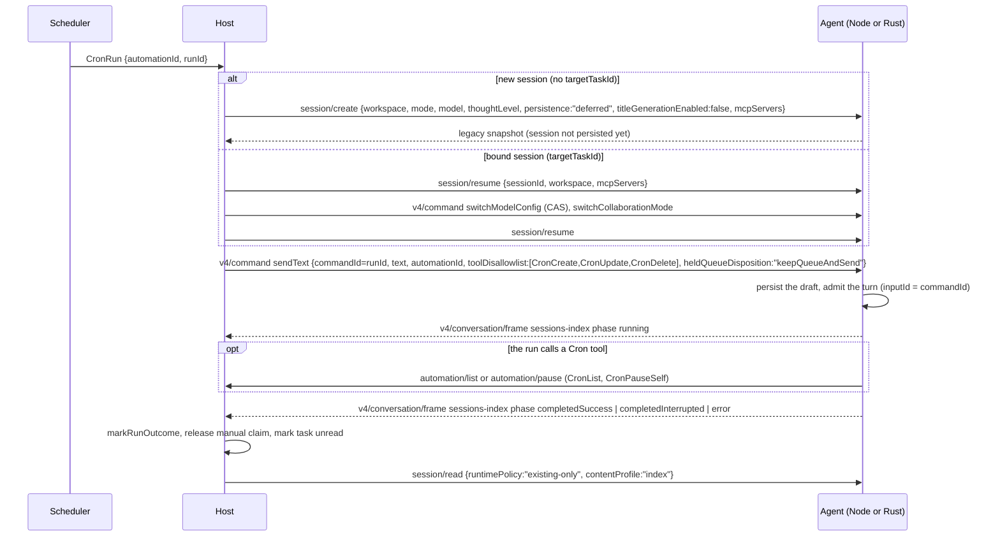

# Automations and off-peak tasks on the Rust agent (fork)

Part of [fork-rust-agent-parity.md](fork-rust-agent-parity.md). The Rust agent (`packages/rust-cli`, `zcode-rs`,
selected with `ZCODE_FORK_AGENT_RUNTIME=rust`) must run desktop scheduled automations and off-peak tasks the way the
Node agent does. The Host, the scheduler and the storage do not change.

## Background: which side owns what

The parity list used to say that `automation/*`, `offPeak/*` and "every legacy `session/*` method they drive" answer
`-32601` on Rust. That is the wrong direction for half of them:

- `automation/create|update|list|delete|pause|checkTaskBinding` and `offPeak/create|list` are **agent→Host** requests.
  The Host serves them (`packages/services/src/zcode-agent/zcodeAgentService.ts` around 3556–3912). The agent only
  sends them, from its Cron and OffPeak tools (Node `bootstrap/src/zcode-protocol/automation-port.ts`,
  `offpeak-port.ts`). The Rust agent never has to answer them.
- The **Host→agent** methods on a run's path are the legacy `session/create` and `session/resume`, plus the v4
  `sendText` fields that mark an automation or off-peak turn.

| Owner                       | Owns                                                                                                                                                                                                                                                                                    |
| --------------------------- | --------------------------------------------------------------------------------------------------------------------------------------------------------------------------------------------------------------------------------------------------------------------------------------- |
| Scheduler process (desktop) | Claiming due rows, the run row (`runId = automationId:scheduledAt`), dispatch requests (`packages/desktop/src/scheduler/index.ts`)                                                                                                                                                      |
| Host                        | Tables `automations`, `automation_runs`, `off_peak_tasks` in `~/.zcode/v2/tasks-index.sqlite` (not the CLI `db.sqlite`); `dispatchCronRun` / `dispatchManualAutomationRun` (`desktop/src/host/index.ts`); run outcome (`cronRunLifecycle.ts`); manual-claim heartbeat; off-peak tickets |
| Agent (Node or Rust)        | The session and its turns; the turn-scoped automation identity and tool limits; the Cron / OffPeak tools, which reach the Host only through the agent→Host requests above                                                                                                               |

The agent never reads or writes the automation tables, so an automation created on one runtime is listed, run,
paused and deleted the same way on the other. Cross-runtime checks are about **sessions**: an automation bound to a
session (`targetTaskId`) resumes that session on whichever runtime is selected.

## Event order

A scheduled or manual run ("Run now" calls the same `dispatchCronRun` without waiting for the clock):



The Host settles a run only on an **observed non-terminal → terminal** phase change in the
`sessions-index/<workspaceKey>` topic (`zcodeTaskIndexSyncer.ts` around 844). A run whose session never shows a
non-terminal phase stays "running" forever. That is the headline acceptance scenario of slice 1.

CronCreate inside an ordinary user turn:

```mermaid
sequenceDiagram
  participant A as Agent tool CronCreate
  participant H as Host
  A->>A: refuse if the turn carries an automation id
  A->>H: automation/checkTaskBinding {targetTaskId: own session, workspace}
  Note over A,H: -32601 only: fall back to automation/list and filter by targetTaskId; any other error fails closed
  A->>H: automation/create {cronExpr, prompt, title, recurring, modelSelection, mode, targetTaskId, ...}
  H-->>A: {automation}
  A->>A: freeze the session title to the automation title
```

## Slices

### Slice 1: run dispatch (Host→agent)

1. **`session/create`** (Node `server-operations.ts` `createSession`). Params validated by the inbound schema
   (`zcodeSessionCreateParamsSchema`, strict). The session is created through the v4 `createSession` path without a
   first input, so it stays a draft until the first accepted input persists it (Node `persistence: "deferred"`);
   `"immediate"`, Node's default when the field is absent, persists it at create. `model` with `thoughtLevel` as its
   reasoning level chooses the selection (`thoughtLevel` without `model` is the level of the default model, the one the
   create picks; a `model` that is not an object is refused), `mode` the permission mode, `incognito` the profile
   (validated like v4). Like Node `resolveSupportedAppThoughtLevel`, a trimmed `thoughtLevel` the target model does
   not offer in the model directory is skipped with a warning (the workspace default may come from a previous model)
   and the model keeps its own level. A model the directory does not list, or an empty directory, offers no level, so
   the level is skipped too (Node lists `[]` for a model its registry does not own, `session-facade.ts`), and so is a
   level whose `model` names no provider and model id (logged).
   `titleGenerationEnabled: false` turns off model-generated titles for the actor's lifetime (Node
   `titleGeneration: {enabled: false}`, kernel `Command::DisableTitleGeneration`); the first input still names the
   session. Any id that already exists (live, stored or soft-deleted) is refused with `-32602 "sessionId already
exists"`; the check runs with the create under the reservation gate (`Existing::Refuse`), so a concurrent create
   of the same id cannot slip between them. The answer is the legacy snapshot of `session/read` (the Host validates it with
   `zcodeSessionStateSnapshotSchema`). Fields the Rust agent cannot honour refuse the request with `-32602`
   `"<field> is not supported by this agent"` instead of being dropped: a non-empty `toolAllowlist` / `toolDenylist`,
   `importedHistory`, `parentSessionId` and `executionWorktree` (none of them is sent on the automation path; the
   message names no unrecognized key, so the Host's compatibility retry does not run without them). `mcpServers`,
   `additionalDirectories`, `offPeakToolEnabled` and `dynamicWorkflow*` are accepted and ignored, as on the v4 path.
2. **`session/resume`** (Node `resumeSession`): opens a stored session (cold) or returns the live one and answers the
   legacy snapshot. `thoughtLevel` is ignored, as in Node (its resume path never reads it; `server-operations.ts`
   reads `thoughtLevel` only in create and `setThoughtLevel`). A non-empty tool list refuses like create. A missing session answers the same error as
   `session/read`.
3. **`session/setMode`, `session/setThoughtLevel`, `session/setModel`**: apply the change through the session actor
   (the same commands as `switchCollaborationMode` / `switchModelConfig`) and answer the legacy snapshot. The Host uses
   them as fallbacks (`setMode` for `auto`, `setThoughtLevel` after a create schema rejection). Divergence:
   `persistAsWorkspaceLastUsed` is ignored (the switch only changes the session); the Host's automation path never
   relies on it, it switches models through v4 `switchModelConfig`. Each call is its own command (a fresh command id:
   the actor dedupes ids for its lifetime), and a refusal without a message names its status and reason code. The v4
   route guard runs first: a session whose prepared worktree is not active refuses like v4 (`v4 command session not
found`) before it is opened. `setThoughtLevel` reads the model from the session (its view), not from the
   projection, which learns of a `setModel` just applied only when its event arrives. A session's model and mode
   switches (these three and v4 `switchModelConfig` / `switchCollaborationMode`) take one switch turn at a time
   (`Live::config_switch`, Node `runSessionModelConfigMutation`): each reads the session's config, decides
   `config.unchanged` and sends its command inside its turn, so concurrent requests apply in arrival order,
   `setThoughtLevel` reads the model once, and neither can revert or mask another switch. A draft's config applied at
   its activation and an `editUserQuery` model switch take the same turn (Node runs `applyRequestedSessionConfig`
   inside the mutation; the edit compares against the session's model, not the projection). Node's lock covers model
   and reasoning only, and its `setMode` is not under it; the Rust mode switch awaits the actor, so it also takes the
   turn, which only orders it and changes no outcome. A `setThoughtLevel` without a `thoughtLevel` is refused as invalid
   params (`thoughtLevel is required`), as in Node; an empty one is the schema's refusal. A failed `"immediate"`
   persistence drops the draft and the runtime and reports the session `unloaded` before answering a generic error
   (the store's text can name the storage path), so a retry with the same id is not refused as existing.
4. **`sendText` turn identity** (Node `prompt-turn.ts`): `automationId` (trimmed, non-empty) and `toolDisallowlist`
   ride on the input's execution and apply to that turn only (a queued input keeps its own). The turn's tool list
   drops every name in the disallowlist, plus CronCreate/CronUpdate/CronDelete when the turn has an automation id.
   CronPauseSelf is offered only on a turn with an automation id and pauses only that id. A turn's automation id is
   never derived from `commandId` or `inputId`. A hidden tool the model calls anyway is refused at the tool pipeline
   (`No such tool available`) before any hook runs; Node only refuses there in the Cron handlers, so the Rust side is
   stricter (fail-closed): without the session's view (its actor stopped) the turn may be an automation run, so the
   gate refuses CronCreate/CronUpdate/CronDelete and CronPauseSelf; the Host's disallowlist cannot be known then.
   The tool listing keeps default limits in that state, so it may still offer CronCreate/CronUpdate/CronDelete that
   the gate then refuses (`No such tool available`): fail-closed, and only once the session's actor or the child's
   agent is gone (the sinks' `view` answers `None` only then).
   The limits travel with their own input end to end: the actor starts the turn with the limits of the input it
   starts (no pending slot), a queued input with limits is never merged into a batch with other inputs, and an input
   with limits is never steered into a running turn (it queues and opens its own turn). An input that named no mode
   or plan (an automation run) records `keepsSessionState`: it leaves the session's mode and plan alone when it
   starts, and the queue projection shows no mode for it. Bash, compaction, cron and goal turns carry no limits.
   Known boundary: subagents take the session's tool config, not the turn's (Node child runtimes read
   `config.toolDisallowlist`). Node registers no Cron tool for a `subagent_child` (`runtime-tools.ts`
   `mainAutomationToolsIncluded`); slice 2 (#449) does the same for desktop subagents and forks (`agents/src/spawn.rs`
   `NodeChild` and `ToolRule::node_child`), so a subagent of a run sees no Cron tool.
   Telemetry (Node `automationAdmission`): the run's `turn.started` fact carries `automationId`, and `taskTrigger`
   (`manual` / `schedule` plus `scheduledAt`) when its `sourceCommandId` is that automation's run id
   (`parseAutomationRunId`). A run gets no renderer send acknowledgement, so the Host seeds the run's `agent_step` /
   `message_completion` from these fields. Owner: sendText remembers the input's automation id with the input
   (`InputMeta`, the projection's per-command record, written only by sendText and the queue's send-now); the
   telemetry observer reads it when that command's `TurnStarted` arrives.
5. **`session/list`** keeps answering an empty list: the Host's directory lookup treats a missing entry as "no parent
   chain" and continues.

### Slice 2: Cron tools under the desktop agent (agent→Host)

Under the desktop agent (`node_desktop`), the Cron tools are Node's five: CronCreate, CronUpdate, CronList, CronDelete,
CronPauseSelf (`core/src/tool/handlers/cron.ts`). Their provider contracts (name, description with the `Usage:` list of
model instructions, input JSON schema) are generated from Node's TypeScript by
`scripts/fork-rust-agent/automation-tools.mts` into `packages/rust-cli/crates/tools/assets/node_automation_tools.json`
(`pnpm rust-agent:automation-tools:update` writes it, `pnpm rust-agent:automation-tools:check` in CI), never copied by
hand. The local file store
(`.zcode/scheduled_tasks.json`, `tools/src/cron_durable.rs`) and the Claude-style Cron tools are **not** assembled for a
desktop session, so a schedule is never fired twice and every schedule shows in the Automations UI. ScheduleWakeup
(`/loop`) is not a Cron tool and is unchanged. The TUI keeps its local cron.

Owners (Node layering):

- **Tools** (`tools/src/automation_tools.rs`, Node `cron.ts` plus the param mapping of `automation-port.ts`): parse and
  check the input (Node's zod refinements, strings trimmed like zod), refuse on a restricted turn, run the bound-session
  check, build each request's params (selection, mode, target, relative delay, interval carrier), and build the output
  `{automation, message}` / `{automations}` / `{deleted, id, message}` / `{paused, id, message}` with Node's texts,
  sent to the model and the UI as compact JSON (the chat card parses the row's `output.text`). The whole call (the
  binding check and the create included) has Node's one 30 s deadline (`Tool execution timed out after 30000ms`).
  Optional fields refuse `null` except where Node's schema allows it (CronCreate `delayMinutes`, CronUpdate
  `maxRuns`).
- **Port** (`kernel-api` `AutomationPort`, implemented by `protocol-zcode/src/automation_port.rs`, Node
  `requestClient`): the transport only. It adds the owner session's `workspace` ref (`Context::workspace_ref`, the
  same construction the account-credential request uses), keeps the Host's JSON-RPC error code, and checks the
  result against the method's reply schema (inbound schema). It fails closed before sending: a method without a reply
  schema, or params that are not an object, answer an `AutomationError` (no code) instead of an unchecked request.
- **Session** (`SessionOps::freeze_title`, Node `setCustomSessionTitle`): after a successful create the tool asks its
  session to take the automation title as a custom title; a subagent's request goes to its owner session.
- **Telemetry** (`protocol-zcode` telemetry observer, Node `cronCreateAutomationId`): a successful CronCreate's
  `tool.lifecycle` completion fact carries the created `automationId`, read from the tool's JSON output
  (`automation.automationId`); a failed call or other output adds nothing.

Rules:

- A turn is _restricted_ when it carries an automation id, or when its disallowlist hides all three mutation tools
  (Node `isAutomationMutationRestrictedTurn`). CronCreate, CronUpdate and CronDelete refuse on it
  (`<Tool> is not allowed while running a scheduled automation.`) before any request. CronPauseSelf refuses without an
  automation id (`CronPauseSelf is only available while running a scheduled automation.`) and pauses only that id.
  Like Node (`assertNotAutomationTurn` before the parse), the refusal comes before the input refinements; the JSON
  schema (CronList and CronPauseSelf take `{}` with no extra key) is checked first on both runtimes.
- A mutation that cannot read the session's view (the actor is gone) cannot tell a restricted turn apart and refuses
  (`Session state is unavailable.`) before any request.
- No subagent child has a Cron tool under the desktop, a fork included (Node registers them for the main session only;
  a fork keeps the main thread's registry otherwise). A child turn carries no automation limits, so this is also what
  keeps an automation run's mutations out of its subagents.
- CronCreate refuses in a session already bound to an automation (`automation/checkTaskBinding`); `-32601` alone falls
  back to `automation/list`; any other failure refuses with the bound-session check error.
- CronCreate sends the session's selection as `modelSelection`, read from the same view as the turn's limits (Node
  reads the runtime selection once), and its base permission mode as `mode` (Node
  `getMode()`: plan is a separate switch, so a task created in plan mode keeps the base mode; Node names, `auto` →
  `build`), `targetTaskId` = the owner session id, `relativeDelayMinutes` / the interval carrier / `maxRuns` and
  `recurring` exactly as `automation-port.ts`. CronUpdate sends `recurring: true, maxRuns: null` with an interval
  carrier.
- Every request carries the owner session's `workspace` ref (`sessionWorkspaceRouting`).
- CronCreate, CronUpdate, CronDelete ask for approval (Node `needsApproval: true`: the generic chain asks unless a
  bypass mode or an allow rule); CronList and CronPauseSelf are allowed.
- Exposure: Node's desktop agent runs with `toolSearchMode: "off"` (the Host default), so its first request carries
  the Cron contracts directly. zcode-rs does not read the Host's tool-search preference yet; an unset
  `ENABLE_TOOL_SEARCH` is therefore off under the app-server (`assemble::limits::tool_search`), which matches Node's
  default request and keeps deferred plugin MCP tools advertised inline like Node's. An explicit `ENABLE_TOOL_SEARCH`
  value still applies. A Host that turns tool search on is a known gap.
- Subagents get no Cron tools under `node_desktop` (Node registers them for the main session only).
- The five Cron names are one list (`tool_names::CRON_TOOLS`), read by the main-session-only rule and by the incognito
  `automationTools` switch, which hides all five.
- Incognito `automationTools: false` removes all five.
- On a restricted turn the turn limits already hide CronCreate/CronUpdate/CronDelete, so the tool pipeline refuses a
  call to them first (`No such tool available`, slice 1); the tools' own refusal is the second line, as in Node.
- No local schedule runs under the desktop Host: the app-server assembles no `.zcode/scheduled_tasks.json` store (a
  job left there would fire beside the Host's automations), and the builtin `/loop` skill, which schedules through
  this process's own cron, is not offered (Node's desktop agent has no `/loop`). ScheduleWakeup stays registered.
  The runtime owns both rules: with `Extensions::automation` set the local cron gets no store whatever `cron_store`
  holds, and `ExtConfig::host_automations` is derived from the port, so no entry point can set one without the other.

Known gaps (no zcode-rs mechanism yet, stated rather than invented): Node's `AutomationCreateLimitError` closes the
turn's tool recovery after a create limit error, while zcode-rs returns it as an ordinary tool error; remote workspaces
are not gated (the Host routes requests by workspace ref); the Host's `toolSearchMode` preference is not read.

### Slice 3: off-peak

Target (unchanged): OffPeakCreate / OffPeakList through `offPeak/create|list`, registered only when the Host enabled
them (`offPeakToolEnabled` on create/resume or `workspace/updateOffPeakToolPolicy`); the `sendText` off-peak fields
(`offPeakTaskId`, `offPeakRunType`, `modelExecution.offPeak`), the `v4/offPeak/lifecycle` notifications matched on
`executionId`, and `v4/conversation/offPeakControl` (`replace_ticket`, `cancel`). Until the dispatch path is honoured,
`workspace/updateOffPeakToolPolicy` answers `enabled: false`, so the Host does not assume the tools exist.

**As built (layer A, branch `feat/rust-offpeak-slice3`).** Layer A is the tool surface, the Host port and the turn
identity. Layer B (the execution runtime) is not built. The policy stays `false` and the app-server does not wire the
port, so no off-peak tool is registered in production.

Why layer B is not in this slice: a Host-dispatched off-peak run needs its model requests to carry the ticket
(`modelExecution.offPeak.ticketId`, `requestAuth`) and to wait for and replace it on the provider's expiry code
(Node `core/src/runtime/off-peak/model-binding.ts`, `lifecycle.ts`). zcode-rs has no per-turn request-auth or
per-turn execution selection path (`platform` `request_auth` is per provider, not per turn). Flipping the policy before
that exists would let the Host create tasks whose runs bill the plan quota, so the flip waits for layer B.

Owners:

| Owner                                                                      | Owns                                                                                                                                   |
| -------------------------------------------------------------------------- | -------------------------------------------------------------------------------------------------------------------------------------- | ---------------------------------------------------- |
| Host                                                                       | `off_peak_tasks`, the `offPeak/create                                                                                                  | list` answers, ticket issue and dispatch, the policy |
| Tools (`tools/src/off_peak_tools.rs`)                                      | Parse, the bound-session check, `offPeak/create` params, output and Node's error texts; the 30 s deadline; refusal on an off-peak turn |
| Port (`kernel-api/src/off_peak.rs`, `protocol-zcode/src/off_peak_port.rs`) | The transport only: the `workspace` ref, the reply check against the inbound schema, the Host's error code                             |
| Turn (`kernel-api/src/turn_limits.rs` via `sendText`)                      | `OffPeakCreate` hidden on the turn whose input carries `offPeakTaskId` (Node `OFF_PEAK_EXECUTION_TOOL_DENYLIST`)                       |
| Inbound schema (`scripts/fork-rust-agent/inbound-schema.mts`)              | Reply shapes of `offPeak/create` (the `ok` union) and `offPeak/list`                                                                   |

Wire:

- `offPeak/create` params: `{workspace, title, prompt, permissionMode?, model?, thoughtLevel?, boundSessionId}`.
  `boundSessionId` is the calling session. The reply is `{ok: true, task}` or
  `{ok: false, failureStage, errorCategory, errorCode}`; a failure keeps its classification (Node
  `createProtocolOffPeakPort`).
- `offPeak/list` params `{workspace}`; reply `{tasks: [...]}`.
- Event order for OffPeakCreate: the turn refusal, then `offPeak/list` (the bound check: a non-terminal task with
  `sessionId` = the calling session refuses; a list error fails closed with Node's text), then `offPeak/create`, then
  the Node error text for each `errorCategory`/`errorCode`. The 30 s deadline covers both requests.

Node divergences kept: the session's `activeOffPeakTaskId` recursion guard is not ported yet (it belongs to layer B's
session record). The turn denylist is the only guard here; the handler also refuses on an off-peak turn. The title is
not frozen (Node `createProtocolOffPeakPort`). OffPeakCreate needs approval; OffPeakList does not.

Not built (layer B): `v4/offPeak/lifecycle` notifications, `v4/conversation/offPeakControl` (answers `-32601` as
before), the ticket authority and model binding, takeover, and the session's off-peak record. The
`offPeakToolEnabled` create and resume flags are accepted and ignored, as before.

### Slice 3 layer B: decision needed before the model binding

Decision (2026-11-17): **option 1, the per-call override**, approved by the user. The model request gains an optional
ticket field, default `None`. `request_auth` takes an early branch when it is set. The wait, `replace_ticket` and retry
state stays in the agent. Ordinary turns are unchanged. The policy flip is the last commit, and only if the whole slice
works.

Status: the decision is recorded. The independent parts (lifecycle, notifications, control, registration) and the
binding are built on `feat/rust-offpeak-slice3-b`. The note below is the original options analysis.

**As built (binding, commit `8217f9f28`).** `kernel-api/src/off_peak_ticket.rs` defines `OffPeakTicketSource`
(`acquire`, `refused_as_expired`, `expired`) and `TicketSource`, carried by `RequestOptions.off_peak_ticket`
(`#[serde(skip)]`, identity equality, so traces and queued inputs never carry it). `EndpointQuery.ticket` is `None`
for every ordinary request. Platform `endpoint()` takes the ticket's credentials before the ordinary source; with no
credentials of its own it falls through to the ordinary source (Node `requestAuth ?? source`) and names the ticket in
`x-off-peak-ticket-id`. The transport's `Connect::fail` renews an attempt refused as expired (Head phase only, before
any output): `expired(ticket_id)`, then re-resolve on the renewed ticket, then resend. The renewal consumes no retry
budget and is reported as a `Retrying` notice with delay 0 at the same attempt number.

Divergences kept: the renewal is a `Retrying` notice (Node emits lifecycle `waiting_ticket` instead); a refusal
after output was delivered is not renewed (Node: `delivered` rethrows); `refused_as_expired` checks the run's
provider and code, so the provider id is matched by the source, not by the transport.

**As built (run, turn hooks, ticket source).** `protocol-zcode/src/off_peak_ticket.rs` (`RunTickets`) is the run's
`OffPeakTicketSource`: `acquire` waits on the run's lifecycle (a `tokio::sync::Notify` woken on every change) until the ticket is
usable, then returns its id and the credentials of its `replace_ticket` (None for the start ticket). `expired` runs
Node `ticketExpired`: a stale ticket retries at once, a current one waits for the renewal; a cancel fails the waiters
with `off_peak_cancelled`. `refused_as_expired` matches the run's provider and its `providerErrorCode` or 3102/3106.

A `sendText` carrying `modelExecution.offPeak` is admitted as a pending run (`admit_off_peak_run`: it needs a model and
an `offPeakTaskId`, else `off_peak_execution_identity_missing`; its execution id is trimmed like the turn's limits, and a
blank id is the same missing identity; a session with an open run refuses it). The run opens when
its turn starts (`turn_started`, Node `prepareOffPeakTurn`), so an input refused after admission, or dropped from the
queue, opens nothing and blocks nothing. An admitted input the kernel refuses (`guard.inputRejected`) or whose draft cannot
be admitted is removed from the pending runs at once (`OffPeakRuns::discard`). A createSession whose `firstInput` carries
`modelExecution.offPeak` is refused before anything is created (`off_peak_first_input_unsupported`), on every create
route. `startNow` carrying `modelExecution.offPeak` is refused too (not ported; refusal rather than a model without a
ticket). A queued off-peak input's edited model is the run's model, and
its edited provider the run's provider (`set_pending_provider`).

Takeover is removed: no Rust caller existed, so the lifecycle has no `user_owned` state and no `UserTakeover` event.

Divergences kept: the run's background tasks and queued notifications are not observed (the work snapshot is empty at
turn end); the run opens at admission, not at turn start; the renewal is a `Retrying` notice (Node emits
`waiting_ticket`).

**Review follow-ups (2026-11-17).** The ticket source registers its wait on the run's `changed` notify before it reads
the state (`enable()`), so a change between the read and the wait is not missed. `ticket_needed` is sent by a task of its
own (`LifecycleSink` over the peer), so dropping the attempt mid-send cannot lose the request; an undelivered notification
(the connection is closed) ends the run, and so its attempts, rather than leave them waiting for an answer nobody can give. An ended run (cancelled or completed) stops its attempts as
`ModelError::Cancelled`, not as an authentication failure; the Node code stays the run's state. `replace_ticket` judges
the run by the runtime's facts (`main_running` is "the run's turn is open"), so a renewal answered after its turn ended
completes the run. A renewal still pending when its turn ends waits for the Host's answer, as Node does (Node's binding
release does not clear a pending renewal). A renewal that names `apiKeyId` or `accountScope` is refused: Node routes a
zhipu account by `apiKeyId` and checks `accountScope`, and neither is implemented in Rust yet. A renewal with neither a key
nor headers installs no credentials, so the ordinary source supplies them. Session delete, tree erase and the deletion execution end the
removed sessions' runs (their final notifications go to the Host) and drop their flags and admitted inputs
(`off_peak_control::forget_sessions`). An admitted input is taken only by its own session's turn,
and admission checks the runs under the same lock. In the transport, a refusal renews only when its attempt named a
non-empty ticket id; renewals per request are capped at 3 (`MAX_TICKET_RENEWALS`), after which the refusal is the
request's error; each renewal logs `model.attempt.failed` with the refused send's ordinal and the renewal count, never the ticket id
(the off-peak ticket header is a secret header); the model-io send ordinal is `attempt + renewals` (each send distinct),
while the `Retrying` notice keeps its attempt number. A queued
off-peak input whose edit leaves the model unset keeps the run's model.

Subagents: a child run inherits its parent run's off-peak execution (`RunInfo.off_peak_execution` recorded from the
request, `LiveAgent.off_peak_execution` set by the Agent tool, `QueryRequest.off_peak_execution` on the child), nested
children included. The port resolves the open run by execution from any session, so a child is sent on the run's ticket;
an ended run gives none.

Selection: an off-peak input's model travels in its turn limits (`TurnLimits.off_peak_selection`) and becomes that turn's
request selection (`main_request`). `submitted_execution` persists no selection for an off-peak input, so the session's
model, and the next ordinary turn's, is the user's own. Test: `an_off_peak_input_does_not_persist_its_model`.

Policy flip (last): `workspace/updateOffPeakToolPolicy` stores the policy and answers `enabled` as stored (Node
`appRuntimePreferences.offPeakToolEnabled`). The off-peak tools follow it for sessions without their own
`offPeakToolEnabled` flag (`OffPeakRuns::tools_enabled`); the port refuses a session whose tools are off.

Registration per session: the off-peak tools are not in the base registry. `OffPeakTools` (a registry layer under the deny
filter, like `LspTools`) adds OffPeakCreate and OffPeakList to a session's snapshot, and resolves them in `find_for`, only
while `OffPeakPort::tools_enabled(session)` is true (the session's own flag, else the workspace policy, as above). Node
injects `offPeakPort` into a session's runtime only then, so the model of a session with the tools off never sees them.
A flip of the policy shows in the next step's snapshot. Lookups without a session (`tools`, `find`) never see the tools.
Test: `off_peak_tools_tests.rs` `the_tools_are_offered_per_session`. Details: `specs/fork-rust-session-context-gaps.md`.

What is blocked: an off-peak run's model requests must carry the ticket (`x-off-peak-ticket-id`, request auth from
`modelExecution.requestAuth`), wait for a ticket when none is held, retry on the ticket-expired code
(`ticket_needed`, then `replace_ticket` resumes the waiting request), and fall back on takeover. Node does this in
`core/src/runtime/off-peak/model-binding.ts` (`OffPeakTicketAuthority.createBinding`, a model wrapper that retries on
`providerErrorCode`) and `lifecycle.ts`.

What exists in zcode-rs: request auth is resolved per provider template in `platform/src/lib.rs` `request_auth`
(`Access::Account` and `Access::ChatGpt` go to the Host's `HeaderSource` with `HeaderRequest { selection, access,
session, rejected_fingerprint }`; everything else uses `credential`). There is no turn-scoped override. The header
source is keyed by session and selection only, so it cannot tell an off-peak attempt from an ordinary one on the same
session. No per-turn model wrapper exists either.

Options:

1. **Per-call override parameter (recommended).** Add `ticket: Option<OffPeakAuthOverride>` to the model request
   (the `request_auth` call site), default `None`. When set, `request_auth` returns the override's headers and key and
   skips the template path. The agent-side authority (wait, replace, retry on the expired code) is a wrapper created
   per off-peak turn, which sets the override on each attempt. Ordinary turns pass `None` and see no change. Cost: a
   new field on the model request type and one early branch in `request_auth`; both are shared-path edits, but each is
   inert for `None`.
2. **Host-resolved ticket.** Extend `HeaderRequest` with a ticket reference and let the Host's header source return
   the ticket headers and wait for a replacement inside `request_auth`. Less agent code, but the wait and the replace
   protocol move into the Host round trip, and the agent's lifecycle state (`ticket_needed`, `replace_ticket`) would
   still need to observe it. Couples the model path to the Host's timing.
3. **Turn-scoped task-local.** Set a task-local override around the turn's model calls and read it in `request_auth`.
   No signature changes, but implicit state crosses the model path, and a subagent or a background task on the same
   task would inherit it. Rejected on that ground.

Recommendation: option 1. It keeps the authority in the agent, as Node does, and changes the shared path only by an
inert optional field. Before coding, confirm: (a) the model request type may gain an optional field, and (b) the
replace/wait state lives in the agent (not the Host).

Independent of this decision, the lifecycle state machine (Node `lifecycle.ts`), the `v4/offPeak/lifecycle`
notifications, `v4/conversation/offPeakControl` (`cancel` and `replace_ticket` route to the matching execution by
`sessionId` and `executionId`), registration (`Extensions.off_peak`, the app-server wiring of `HostOffPeak`,
`offPeakToolEnabled` honoured, incognito and subagent exclusion) could be built first. The policy flip stays last and
waits for the model binding.

## Not ported (stay `-32601`)

- `session/send`: on the automation path it is only the Host's attachment fallback. Node's legacy `session/send`
  lets a local path bypass the attachment ref trust boundary
  ([fork-attachment-ref-trust-boundary.md](fork-attachment-ref-trust-boundary.md)); the Rust agent keeps every input
  on v4 `sendText`, where the boundary holds.
- `session/messages`, `session/events` (app-control, bot topic summaries), `session/stop` (the v4 `stop` command
  covers runs).
- `session/subscribe` + `session/event`: only the best-effort bot delivery of a run result; bots are not ported.

## Acceptance scenarios

Rust tests (protocol-zcode, tools):

1. `session/create` with `persistence:"deferred"` leaves no stored row; the first `sendText` persists it; the
   sessions-index topic shows the session `running` and then `completedSuccess` (and `error` for a failing turn).
2. `session/create` answers the legacy snapshot that validates against `zcodeSessionStateSnapshotSchema` (mode,
   model, thought level as requested); an existing or deleted id is refused.
3. `titleGenerationEnabled:false` produces no title request after the first turn; without it a title request runs.
4. `session/resume` of a stored (cold) session and of a live one answers the snapshot; a missing id is an error.
5. A `sendText` with `automationId` hides CronCreate/CronUpdate/CronDelete and the disallowlisted tools from that turn
   only, offers CronPauseSelf, and the next ordinary turn sees the normal tool list without CronPauseSelf. Its
   `turn.started` fact names the automation and the trigger read from the run id (manual, schedule with
   `scheduledAt`, none for a command that is not the automation's run id); an ordinary turn has none.
6. Desktop session: the tool catalog has Node's five Cron tools and no local cron store; CronCreate sends
   `automation/checkTaskBinding` then `automation/create` with the session's selection, mode, `targetTaskId` and
   workspace; a bound session refuses; a non-`-32601` check failure refuses; `-32601` falls back to `automation/list`;
   success freezes the title and its completed `tool.lifecycle` fact names the created `automationId`. CronPauseSelf sends `automation/pause` with the turn's id.
7. The generated contracts equal Node's (`automation-tools.mts --check`); the CronCreate contract contains the
   `prompt` field description and the model instructions; the Cron tools are not deferred and subagents (forks
   included) do not get them under `node_desktop`; the builtin `/loop` is not offered under the Host's automations.
8. Input checks: each Node refinement of `CronCreateInputSchema` / `CronUpdateInputSchema` refuses its case; a
   restricted turn (automation id, or a disallowlist hiding all three mutation tools) refuses CronCreate/Update/Delete
   before any request; CronPauseSelf without an automation id refuses before any request.

Desktop E2E in the Linux box, on both runtimes (`packages/desktop/test/e2e`):

- `automations/schedule/automations-create-manage`
- `conversation-session/automations/conversation-session-automation-cron-create`, `-cron-relative`,
  `-cron-update`, `-pause-self`, `-run-title-stable`
- slice 3: `conversation-session-offpeak-create`, `-offpeak-create-existing-session`, `-off-peak-invalid-ticket`,
  `automations/off-peak/off-peak-create-manage`

Cross-runtime: an automation created by CronCreate on Node lists and runs ("Run now") on Rust in the same bound
session, and the reverse.
