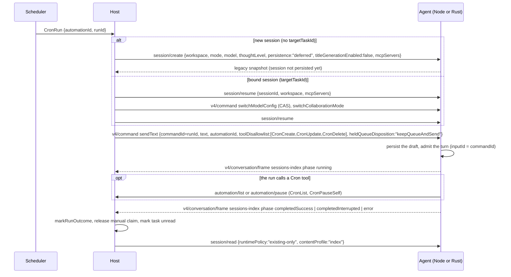

# Automations and off-peak tasks on the Rust agent (fork)

Part of [fork-rust-agent-parity.md](fork-rust-agent-parity.md). The Rust agent (`packages/rust-cli`, `zcode-rs`,
selected with `ZCODE_FORK_AGENT_RUNTIME=rust`) must run desktop scheduled automations and off-peak tasks the way the
Node agent does. The Host, the scheduler and the storage do not change.

## Background: which side owns what

The parity list used to say that `automation/*`, `offPeak/*` and "every legacy `session/*` method they drive" answer
`-32601` on Rust. That is the wrong direction for half of them:

- `automation/create|update|list|delete|pause|checkTaskBinding` and `offPeak/create|list` are **agent→Host** requests.
  The Host serves them (`packages/services/src/zcode-agent/zcodeAgentService.ts` around 3556–3912). The agent only
  sends them, from its Cron and OffPeak tools (Node `bootstrap/src/zcode-protocol/automation-port.ts`,
  `offpeak-port.ts`). The Rust agent never has to answer them.
- The **Host→agent** methods on a run's path are the legacy `session/create` and `session/resume`, plus the v4
  `sendText` fields that mark an automation or off-peak turn.

| Owner                       | Owns                                                                                                                                                                                                                                                                                    |
| --------------------------- | --------------------------------------------------------------------------------------------------------------------------------------------------------------------------------------------------------------------------------------------------------------------------------------- |
| Scheduler process (desktop) | Claiming due rows, the run row (`runId = automationId:scheduledAt`), dispatch requests (`packages/desktop/src/scheduler/index.ts`)                                                                                                                                                      |
| Host                        | Tables `automations`, `automation_runs`, `off_peak_tasks` in `~/.zcode/v2/tasks-index.sqlite` (not the CLI `db.sqlite`); `dispatchCronRun` / `dispatchManualAutomationRun` (`desktop/src/host/index.ts`); run outcome (`cronRunLifecycle.ts`); manual-claim heartbeat; off-peak tickets |
| Agent (Node or Rust)        | The session and its turns; the turn-scoped automation identity and tool limits; the Cron / OffPeak tools, which reach the Host only through the agent→Host requests above                                                                                                               |

The agent never reads or writes the automation tables, so an automation created on one runtime is listed, run,
paused and deleted the same way on the other. Cross-runtime checks are about **sessions**: an automation bound to a
session (`targetTaskId`) resumes that session on whichever runtime is selected.

## Event order

A scheduled or manual run ("Run now" calls the same `dispatchCronRun` without waiting for the clock):



The Host settles a run only on an **observed non-terminal → terminal** phase change in the
`sessions-index/<workspaceKey>` topic (`zcodeTaskIndexSyncer.ts` around 844). A run whose session never shows a
non-terminal phase stays "running" forever. That is the headline acceptance scenario of slice 1.

CronCreate inside an ordinary user turn:

```mermaid
sequenceDiagram
  participant A as Agent tool CronCreate
  participant H as Host
  A->>A: refuse if the turn carries an automation id
  A->>H: automation/checkTaskBinding {targetTaskId: own session, workspace}
  Note over A,H: -32601 only: fall back to automation/list and filter by targetTaskId; any other error fails closed
  A->>H: automation/create {cronExpr, prompt, title, recurring, modelSelection, mode, targetTaskId, ...}
  H-->>A: {automation}
  A->>A: freeze the session title to the automation title
```

## Slices

### Slice 1: run dispatch (Host→agent)

1. **`session/create`** (Node `server-operations.ts` `createSession`). Params validated by the inbound schema
   (`zcodeSessionCreateParamsSchema`, strict). The session is created through the v4 `createSession` path without a
   first input, so it stays a draft until the first accepted input persists it (Node `persistence: "deferred"`);
   `"immediate"`, Node's default when the field is absent, persists it at create. `model` with `thoughtLevel` as its
   reasoning level chooses the selection (`thoughtLevel` without `model` is the level of the default model, the one the
   create picks; a `model` that is not an object is refused), `mode` the permission mode, `incognito` the profile
   (validated like v4).
   `titleGenerationEnabled: false` turns off model-generated titles for the actor's lifetime (Node
   `titleGeneration: {enabled: false}`, kernel `Command::DisableTitleGeneration`); the first input still names the
   session. Any id that already exists (live, stored or soft-deleted) is refused with `-32602 "sessionId already
exists"`; the check runs with the create under the reservation gate (`Existing::Refuse`), so a concurrent create
   of the same id cannot slip between them. The answer is the legacy snapshot of `session/read` (the Host validates it with
   `zcodeSessionStateSnapshotSchema`). Fields the Rust agent cannot honour refuse the request with `-32602`
   `"<field> is not supported by this agent"` instead of being dropped: a non-empty `toolAllowlist` / `toolDenylist`,
   `importedHistory`, `parentSessionId` and `executionWorktree` (none of them is sent on the automation path; the
   message names no unrecognized key, so the Host's compatibility retry does not run without them). `mcpServers`,
   `additionalDirectories`, `offPeakToolEnabled` and `dynamicWorkflow*` are accepted and ignored, as on the v4 path.
2. **`session/resume`** (Node `resumeSession`): opens a stored session (cold) or returns the live one and answers the
   legacy snapshot. `thoughtLevel` is Node's hint for a session without a stored selection; every Rust session has
   one, so it is ignored. A non-empty tool list refuses like create. A missing session answers the same error as
   `session/read`.
3. **`session/setMode`, `session/setThoughtLevel`, `session/setModel`**: apply the change through the session actor
   (the same commands as `switchCollaborationMode` / `switchModelConfig`) and answer the legacy snapshot. The Host uses
   them as fallbacks (`setMode` for `auto`, `setThoughtLevel` after a create schema rejection). Divergence:
   `persistAsWorkspaceLastUsed` is ignored (the switch only changes the session); the Host's automation path never
   relies on it, it switches models through v4 `switchModelConfig`. Each call is its own command (a fresh command id:
   the actor dedupes ids for its lifetime), and a refusal without a message names its status and reason code. The v4
   route guard runs first: a session whose prepared worktree is not active refuses like v4 (`v4 command session not
found`) before it is opened. `setThoughtLevel` reads the model from the session (its view), not from the
   projection, which learns of a `setModel` just applied only when its event arrives. A failed `"immediate"`
   persistence drops the draft and the runtime and reports the session `unloaded` before answering a generic error
   (the store's text can name the storage path), so a retry with the same id is not refused as existing.
4. **`sendText` turn identity** (Node `prompt-turn.ts`): `automationId` (trimmed, non-empty) and `toolDisallowlist`
   ride on the input's execution and apply to that turn only (a queued input keeps its own). The turn's tool list
   drops every name in the disallowlist, plus CronCreate/CronUpdate/CronDelete when the turn has an automation id.
   CronPauseSelf is offered only on a turn with an automation id and pauses only that id. A turn's automation id is
   never derived from `commandId` or `inputId`. A hidden tool the model calls anyway is refused at the tool pipeline
   (`No such tool available`) before any hook runs; Node only refuses there in the Cron handlers, so the Rust side is
   stricter (fail-closed): without the session's view the gate refuses Cron tools that need an automation turn.
   The limits travel with their own input end to end: the actor starts the turn with the limits of the input it
   starts (no pending slot), a queued input with limits is never merged into a batch with other inputs, and an input
   with limits is never steered into a running turn (it queues and opens its own turn). An input that named no mode
   or plan (an automation run) records `keepsSessionState`: it leaves the session's mode and plan alone when it
   starts, and the queue projection shows no mode for it. Bash, compaction, cron and goal turns carry no limits.
   Known boundary: subagents take the session's tool config, not the turn's (Node child runtimes read
   `config.toolDisallowlist`); slice 2 keeps Cron tools main-session only, so until it lands a subagent of a run can
   still see the local Cron tools.
   Telemetry (Node `automationAdmission`): the run's `turn.started` fact carries `automationId`, and `taskTrigger`
   (`manual` / `schedule` plus `scheduledAt`) when its `sourceCommandId` is that automation's run id
   (`parseAutomationRunId`). A run gets no renderer send acknowledgement, so the Host seeds the run's `agent_step` /
   `message_completion` from these fields. Owner: sendText remembers the input's automation id with the input
   (`InputMeta`, the projection's per-command record, written only by sendText and the queue's send-now); the
   telemetry observer reads it when that command's `TurnStarted` arrives.
5. **`session/list`** keeps answering an empty list: the Host's directory lookup treats a missing entry as "no parent
   chain" and continues.

### Slice 2: Cron tools under the desktop agent (agent→Host)

Under the desktop agent (`node_desktop`), the Cron tools are Node's five: CronCreate, CronUpdate, CronList, CronDelete,
CronPauseSelf (`core/src/tool/handlers/cron.ts`). Their provider contracts (name, description with the `Usage:` list of
model instructions, input JSON schema) are generated from Node's TypeScript by
`scripts/fork-rust-agent/automation-tools.mts` into `packages/rust-cli/crates/tools/assets/node_automation_tools.json`
(`pnpm rust-agent:automation-tools:update` writes it, `pnpm rust-agent:automation-tools:check` in CI), never copied by
hand. The local file store
(`.zcode/scheduled_tasks.json`, `tools/src/cron_durable.rs`) and the Claude-style Cron tools are **not** assembled for a
desktop session, so a schedule is never fired twice and every schedule shows in the Automations UI. ScheduleWakeup
(`/loop`) is not a Cron tool and is unchanged. The TUI keeps its local cron.

Owners (Node layering):

- **Tools** (`tools/src/automation_tools.rs`, Node `cron.ts` plus the param mapping of `automation-port.ts`): parse and
  check the input (Node's zod refinements, strings trimmed like zod), refuse on a restricted turn, run the bound-session
  check, build each request's params (selection, mode, target, relative delay, interval carrier), and build the output
  `{automation, message}` / `{automations}` / `{deleted, id, message}` / `{paused, id, message}` with Node's texts,
  sent to the model and the UI as compact JSON (the chat card parses the row's `output.text`). The whole call (the
  binding check and the create included) has Node's one 30 s deadline (`Tool execution timed out after 30000ms`).
  Optional fields refuse `null` except where Node's schema allows it (CronCreate `delayMinutes`, CronUpdate
  `maxRuns`).
- **Port** (`kernel-api` `AutomationPort`, implemented by `protocol-zcode/src/automation_port.rs`, Node
  `requestClient`): the transport only. It adds the owner session's `workspace` ref (`Context::workspace_ref`, the
  same construction the account-credential request uses), keeps the Host's JSON-RPC error code, and checks the
  result against the method's reply schema (inbound schema).
- **Session** (`SessionOps::freeze_title`, Node `setCustomSessionTitle`): after a successful create the tool asks its
  session to take the automation title as a custom title; a subagent's request goes to its owner session.
- **Telemetry** (`protocol-zcode` telemetry observer, Node `cronCreateAutomationId`): a successful CronCreate's
  `tool.lifecycle` completion fact carries the created `automationId`, read from the tool's JSON output
  (`automation.automationId`); a failed call or other output adds nothing.

Rules:

- A turn is _restricted_ when it carries an automation id, or when its disallowlist hides all three mutation tools
  (Node `isAutomationMutationRestrictedTurn`). CronCreate, CronUpdate and CronDelete refuse on it
  (`<Tool> is not allowed while running a scheduled automation.`) before any request. CronPauseSelf refuses without an
  automation id (`CronPauseSelf is only available while running a scheduled automation.`) and pauses only that id.
  Like Node (`assertNotAutomationTurn` before the parse), the refusal comes before the input refinements; the JSON
  schema (CronList and CronPauseSelf take `{}` with no extra key) is checked first on both runtimes.
- A mutation that cannot read the session's view (the actor is gone) cannot tell a restricted turn apart and refuses
  (`Session state is unavailable.`) before any request.
- No subagent child has a Cron tool under the desktop, a fork included (Node registers them for the main session only;
  a fork keeps the main thread's registry otherwise). A child turn carries no automation limits, so this is also what
  keeps an automation run's mutations out of its subagents.
- CronCreate refuses in a session already bound to an automation (`automation/checkTaskBinding`); `-32601` alone falls
  back to `automation/list`; any other failure refuses with the bound-session check error.
- CronCreate sends the session's selection as `modelSelection` and its base permission mode as `mode` (Node
  `getMode()`: plan is a separate switch, so a task created in plan mode keeps the base mode; Node names, `auto` →
  `build`), `targetTaskId` = the owner session id, `relativeDelayMinutes` / the interval carrier / `maxRuns` and
  `recurring` exactly as `automation-port.ts`. CronUpdate sends `recurring: true, maxRuns: null` with an interval
  carrier.
- Every request carries the owner session's `workspace` ref (`sessionWorkspaceRouting`).
- CronCreate, CronUpdate, CronDelete ask for approval (Node `needsApproval: true`: the generic chain asks unless a
  bypass mode or an allow rule); CronList and CronPauseSelf are allowed.
- Exposure: Node's desktop agent runs with `toolSearchMode: "off"` (the Host default), so its first request carries
  the Cron contracts directly. zcode-rs does not read the Host's tool-search preference yet; the desktop Cron tools are
  therefore not deferred, which matches Node's default request. A Host that turns tool search on is a known gap.
- Subagents get no Cron tools under `node_desktop` (Node registers them for the main session only).
- The five Cron names are one list (`tool_names::CRON_TOOLS`), read by the main-session-only rule and by the incognito
  `automationTools` switch, which hides all five.
- Incognito `automationTools: false` removes all five.
- On a restricted turn the turn limits already hide CronCreate/CronUpdate/CronDelete, so the tool pipeline refuses a
  call to them first (`No such tool available`, slice 1); the tools' own refusal is the second line, as in Node.
- No local schedule runs under the desktop Host: the app-server assembles no `.zcode/scheduled_tasks.json` store (a
  job left there would fire beside the Host's automations), and the builtin `/loop` skill, which schedules through
  this process's own cron, is not offered (Node's desktop agent has no `/loop`). ScheduleWakeup stays registered.

Known gaps (no zcode-rs mechanism yet, stated rather than invented): Node's `AutomationCreateLimitError` closes the
turn's tool recovery after a create limit error, while zcode-rs returns it as an ordinary tool error; remote workspaces
are not gated (the Host routes requests by workspace ref); the Host's `toolSearchMode` preference is not read.

### Slice 3: off-peak

OffPeakCreate / OffPeakList through `offPeak/create|list`, registered only when the Host enabled them
(`offPeakToolEnabled` on create/resume or `workspace/updateOffPeakToolPolicy`); the `sendText` off-peak fields
(`offPeakTaskId`, `offPeakRunType`, `modelExecution.offPeak`), the `v4/offPeak/lifecycle` notifications matched on
`executionId`, and `v4/conversation/offPeakControl` (`replace_ticket`, `cancel`). Until slice 3 lands,
`workspace/updateOffPeakToolPolicy` answers `enabled: false`, so the Host does not assume the tools exist.

## Not ported (stay `-32601`)

- `session/send`: on the automation path it is only the Host's attachment fallback. Node's legacy `session/send`
  lets a local path bypass the attachment ref trust boundary
  ([fork-attachment-ref-trust-boundary.md](fork-attachment-ref-trust-boundary.md)); the Rust agent keeps every input
  on v4 `sendText`, where the boundary holds.
- `session/messages`, `session/events` (app-control, bot topic summaries), `session/stop` (the v4 `stop` command
  covers runs).
- `session/subscribe` + `session/event`: only the best-effort bot delivery of a run result; bots are not ported.

## Acceptance scenarios

Rust tests (protocol-zcode, tools):

1. `session/create` with `persistence:"deferred"` leaves no stored row; the first `sendText` persists it; the
   sessions-index topic shows the session `running` and then `completedSuccess` (and `error` for a failing turn).
2. `session/create` answers the legacy snapshot that validates against `zcodeSessionStateSnapshotSchema` (mode,
   model, thought level as requested); an existing or deleted id is refused.
3. `titleGenerationEnabled:false` produces no title request after the first turn; without it a title request runs.
4. `session/resume` of a stored (cold) session and of a live one answers the snapshot; a missing id is an error.
5. A `sendText` with `automationId` hides CronCreate/CronUpdate/CronDelete and the disallowlisted tools from that turn
   only, offers CronPauseSelf, and the next ordinary turn sees the normal tool list without CronPauseSelf. Its
   `turn.started` fact names the automation and the trigger read from the run id (manual, schedule with
   `scheduledAt`, none for a command that is not the automation's run id); an ordinary turn has none.
6. Desktop session: the tool catalog has Node's five Cron tools and no local cron store; CronCreate sends
   `automation/checkTaskBinding` then `automation/create` with the session's selection, mode, `targetTaskId` and
   workspace; a bound session refuses; a non-`-32601` check failure refuses; `-32601` falls back to `automation/list`;
   success freezes the title and its completed `tool.lifecycle` fact names the created `automationId`. CronPauseSelf sends `automation/pause` with the turn's id.
7. The generated contracts equal Node's (`automation-tools.mts --check`); the CronCreate contract contains the
   `prompt` field description and the model instructions; the Cron tools are not deferred and subagents (forks
   included) do not get them under `node_desktop`; the builtin `/loop` is not offered under the Host's automations.
8. Input checks: each Node refinement of `CronCreateInputSchema` / `CronUpdateInputSchema` refuses its case; a
   restricted turn (automation id, or a disallowlist hiding all three mutation tools) refuses CronCreate/Update/Delete
   before any request; CronPauseSelf without an automation id refuses before any request.

Desktop E2E in the Linux box, on both runtimes (`packages/desktop/test/e2e`):

- `automations/schedule/automations-create-manage`
- `conversation-session/automations/conversation-session-automation-cron-create`, `-cron-relative`,
  `-cron-update`, `-pause-self`, `-run-title-stable`
- slice 3: `conversation-session-offpeak-create`, `-offpeak-create-existing-session`, `-off-peak-invalid-ticket`,
  `automations/off-peak/off-peak-create-manage`

Cross-runtime: an automation created by CronCreate on Node lists and runs ("Run now") on Rust in the same bound
session, and the reverse.
