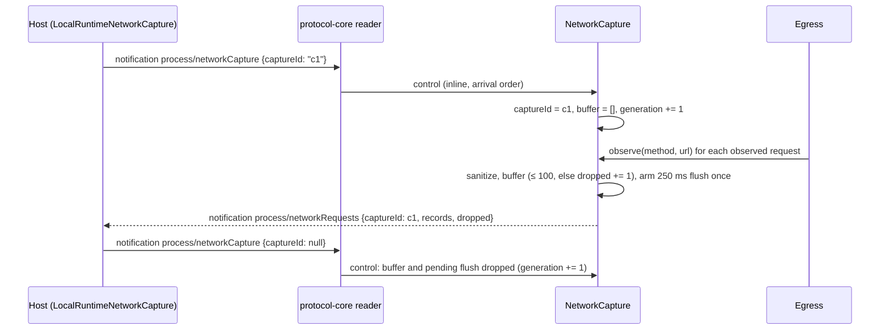

# Network capture in Rust mode (`process/networkCapture`)

Part of `specs/fork-rust-agent-parity.md`. The Resource Manager's Network panel lists the HTTP requests of every
local process while it is open. Node's agent reports its own requests; before this change zcode-rs ignored the
control notification and reported none, so the panel showed no `cli` rows in Rust mode.

## Node behaviour (the reference)

- `process/networkCapture` is a Host → agent **notification** `{captureId: string | null}`
  (`networkCaptureControlSchema`, `packages/shared/src/networkCapture.ts`: 1–100 chars or `null`, strict). It is not a
  request, so no `-32601` was ever answered; the gap was the missing batches.
- The Host (`packages/services/src/zcode-agent/localRuntimeNetworkCapture.ts`) registers every locally spawned agent
  process (the same spawn path for both runtimes, `zcodeAgentProcessManager.ts`), sends the current `captureId` right
  after spawn and on every start/stop, and accepts only batches whose `captureId` matches. It overwrites `pid` and
  `processType` from its own spawn registration.
- The agent (`createNodeNetworkCapture("cli", …)`, `packages/shared/src/node/networkCapture.ts`; wired in
  `bootstrap/src/zcode-protocol/server.ts` and `transport.ts`):
  - handles the control in the reader, outside the command inbox and in arrival order; an invalid control is ignored;
  - with capture off holds no listener, timer or buffer;
  - records each created request: `CONNECT` is skipped, MCP traffic (`withoutNetworkCapture`, `adapters/src/mcp/network.ts`)
    is skipped, a WebSocket upgrade is reported with `ws:`/`wss:`;
  - keeps at most 100 records per batch; each further request only increments `dropped` (counted before the URL is
    checked);
  - the URL goes through `sanitizeNetworkCaptureUrl`: only `http:`, `https:`, `ws:`, `wss:`; credentials and fragment
    removed; every distinct query key kept once with the value `[redacted]` (WHATWG `URLSearchParams.set` then
    form serialization, so `?a=1&a=2&b` becomes `?a=%5Bredacted%5D&b=%5Bredacted%5D`); cut to 2048 characters; an
    unparsable or other-scheme URL is not recorded;
  - flushes 250 ms after the first buffered record as the notification `process/networkRequests`
    `{captureId, records: [{timestamp, processType: "cli", pid, method (≤ 32 chars), url}], dropped}`;
  - a new `captureId` (including `null`) drops the buffer and the pending flush; a disconnect sets it to `null`.

## Owners in Rust

| State                                                 | Owner                                                                                                                                                                          |
| ----------------------------------------------------- | ------------------------------------------------------------------------------------------------------------------------------------------------------------------------------ |
| Current `captureId`, buffer, `dropped`, pending flush | `rust_cli_protocol_zcode::NetworkCapture`, one per app-server process, created before the reader starts                                                                        |
| Which requests are observed                           | `rust_cli_net::Egress` (the single egress of the process) calls its `RequestObserver` for each `send` attempt and each WebSocket upgrade whose `HttpRequest::observed` is true |
| MCP exclusion                                         | the MCP HTTP/SSE transport (`env-local/src/mcp/http.rs`) marks its requests `observed = false`                                                                                 |
| Ordering of control notifications                     | `protocol-core` `serve` offers each notification to `Service::control` in the reader loop before spawning the ordinary notification task                                       |

`net` knows nothing about the protocol: it exposes the `RequestObserver` trait and `Egress::set_observer`. The
app-server passes the capture to the assembly (`Controller::app`), which installs it on the egress as soon as the
egress exists, so requests made while assembling are reported too. It also wraps the deferred service so the control
reaches the capture while the kernel is still being assembled (the Host sends the control right after spawn). The
wrapper owns the capture control. `Deferred` forwards any other control to the installed service without waiting;
before installation it handles none, so the reader passes such a notification on as an ordinary one, which waits for
the service.

Differences kept on purpose:

- A redirect followed inside one `Egress::send` is reported once, with the first URL; undici may report each hop.
- The Monitor tool's WebSocket source is an agent request and is reported (only MCP is excluded, as in Node).
- A batch whose flush already passed its generation check is still written if the Host stops and restarts the same
  `captureId` in that instant; the records are real requests made before the stop.

## Event order

A flush armed under one generation does nothing after the generation changed. When the reader ends the capture is set
to `null`. The flush task is resident: closing the app-server scope drops a pending flush instead of waiting out its
delay (Node unrefs the timer). The URL is sanitized outside the capture's lock.

## Acceptance cases

Unit tests (`protocol-zcode/src/network_capture_tests.rs`, `net` egress tests, `protocol-core` connection tests):

1. With capture off, an observed request records nothing and arms no flush.
2. After `{captureId: "c1"}`, two requests produce one `process/networkRequests` batch 250 ms after the first, with
   both records (`processType: "cli"`, this process's pid, the clock's timestamp) and `dropped: 0`.
3. 105 requests in one window produce 100 records and `dropped: 5`.
4. `CONNECT` and a request with an unsupported scheme or an unparsable URL record nothing (the latter only after the
   100 limit check, like Node).
5. URL sanitization matches Node on: credentials, fragment, duplicate keys, a key without `=`, an empty key, a space
   in a key, a long URL cut to 2048, `ftp:` refused.
6. Changing the `captureId` (to another id or to `null`) before the flush drops the buffered records; no batch is
   sent for the old id.
7. An invalid control (`captureId: ""`, 101 characters, an extra field, a number) is ignored and keeps the current state.
8. `Egress` calls the observer for `send` (with the request's method) and for a WebSocket upgrade (`GET`, the
   `ws:`/`wss:` URL), and not for a request built with `observed = false`; MCP HTTP requests are built that way.
9. `protocol-core` `serve`: a notification the service handles in `control` is not passed to `notification`; two
   control notifications are applied in arrival order; `Deferred` handles none inline.
10. Through `serve` with the capture wrapped around an uninstalled `Deferred`, controls are applied in order before the
    kernel exists.

E2E: `resource-manager/network/resource-manager-network.test.ts` asserts only Main and Renderer rows, so it cannot tell
the runtimes apart; it is run on both runtimes as a regression check of the panel, and the Rust behaviour is covered by
the unit cases above.
