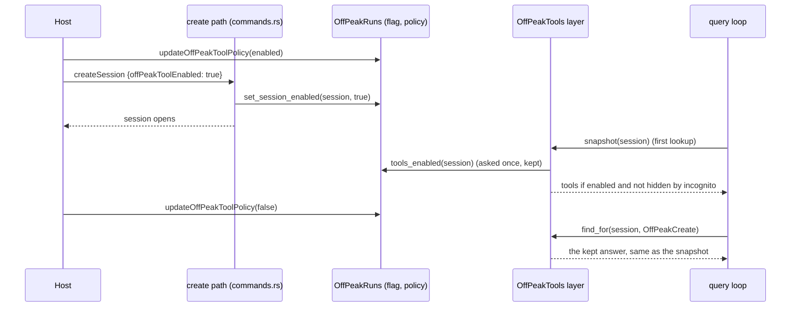

# zcode-rs session and context gaps against Node

Small gaps found while closing the v4 rounds. Each item names the Node source, the Rust owner and the test. Node is the
oracle.

## 1. Legacy Gen UI tail in stored user messages

Node: `normalizeGenUiInput` (`apps/zcode-cli/packages/core/src/agent/message-history.ts`). Old App records spliced the
page state into the body as `\n\n<untrusted_gen_ui_state>\n{JSON}\n</untrusted_gen_ui_state>` at the very end. Node cuts
that tail where it builds rows and queue items, but only when the input's intent has no `genUiContext`, and only when
the JSON is a valid `genUiModelContextSchema` array. A tail that is not valid JSON, or whose entries break the schema,
stays in the text (a user's own example is not deleted). The regex is lazy and anchored at the end:
`/\n\n<untrusted_gen_ui_state>\n([^]*?)\n<\/untrusted_gen_ui_state>\s*$/u`.

Rust owner: `kernel-api/src/gen_ui_context.rs` `strip_legacy_tail` (the leftmost opening whose body fits before the
closing at the end; escaped lone surrogates are accepted as in `JSON.parse`; trailing white space is the JS `\s` set; the schema is the strict `{path, state}` entries, both keys required (zod 4 refuses a missing `state`), at most
100, then the path and size rules of `validate`). `protocol-zcode/src/projection/rows.rs` applies it to the text of a
stored human user message when its intent has no `genUiContext`, so a cold or live row shows the typed text.

Not changed: the model request. Node does not rewrite the stored body for the model either; the text the model read is
whatever was stored.

Tests: `kernel-api/src/gen_ui_context_tests.rs` (valid tail, trailing space, empty array, tail not at the end, broken
JSON, schema failures, two openings, no tail); `projection_tests.rs` `a_user_row_hides_the_legacy_gen_ui_tail`.

## 4. Off-peak tools per session

See `specs/fork-rust-automations.md` ("Registration per session"). The tools are no longer in the base registry; the
`OffPeakTools` layer (`tools/src/off_peak_tools.rs`, built in `runtime/src/assemble.rs` `query_parts`) offers them to a
session when the port enables them for it and its incognito profile keeps the automation tools. The port's answer is
read once per session, on its first lookup, like Node's `offPeakPort` that is fixed when the runtime is created.

Owners and event order:

- The session flag and the workspace policy are owned by `OffPeakRuns` (`off_peak_control.rs`, another track). The
  flag is written by the create path (v4 `createSession` and legacy `session/create` / `session/resume`); the policy
  by `workspace/updateOffPeakToolPolicy`.
- `OffPeakTools` owns the per-session decision. It reads the port once and never writes the flag.
- The incognito profile is read on every lookup (it is fixed for the session too).

Tests: `off_peak_tools_tests.rs` `the_tools_are_offered_per_session` (including a policy flip after the first lookup),
`an_incognito_profile_still_hides_the_tools`; `commands_tests.rs` `a_v4_create_records_the_sessions_off_peak_flag`.

`OffPeakRuns::tools_enabled` follows Node: the port is enabled when the recorded session flag is `true` or the workspace
policy is on, so a recorded `false` never beats a policy that is on. Test: `off_peak_control_tests.rs`
`the_tools_follow_the_session_flag_and_fall_back_to_the_policy`.

Not ported in this round, with the reason:

- 2. The `Execution worktree` system section. The session actor keeps only a boolean (`execution_worktree`). The
     sentence needs the parent workspace, the branch and the missing state at render time, and those are recorded at four
     places (create, prepared activation, cold open, forks and children). It needs a per-session registry like the
     incognito profiles plus a stat of the worktree root. Left for its own change.
- 3. `traceId`, `turnId` and `riskLevel` on tool hook input. Rust has no per-turn trace id on the hook path, and Node's
     `riskLevel` comes from each tool's metadata (PreToolUse) and from the permission decision (PermissionRequest), which
     Rust does not compute. It needs a product decision on the trace id and a table of risk levels.
